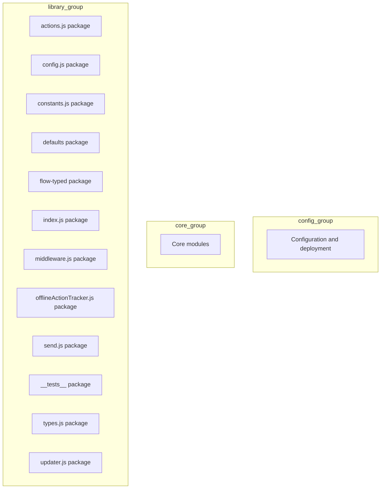

# Architecture report: redux-offline/redux-offline

> Automated static analysis. **Observed** = directly seen in files/imports/AST; **Inferred** = interpretation from that evidence. Repository code was not executed.

## 1. Repository at a glance

| Item | Value |
| --- | --- |
| Repository | redux-offline/redux-offline |
| Description | Build Offline-First Apps for Web and React Native |
| Language | JavaScript |
| Stars | 6130 |
| Licence | MIT |
| Analysed commit / branch | 41c0958bce419028e96cd63095eda5baee5a64b0 / develop |
| Framework(s) | Express, React |
| Files analysed | 94 |
| Components | 14 |

## 2. Architecture in one minute

redux-offline/redux-offline - Build Offline-First Apps for Web and React Native. This repository was analysed statically from 94 file(s) (0 Python). Detected technologies (observed from imports/manifests): Express, React, Redux, Jest. Files are grouped into 14 component(s): actions.js package, Configuration and deployment, config.js package, constants.js package, Core modules, defaults package, flow-typed package, index.js package. Findings below distinguish observed facts from inferred interpretation.

## 3. High-level block diagram

## 4. Main components

### actions.js package (`actions_js`)

- **Kind:** library
- **Status:** Observed
- **Confidence:** 0.85
- **Responsibility:** Groups 1 file(s) under actions.js package (observed from repository paths and static analysis).
- **Paths:** `src/actions.js`
- **Evidence:** [src/actions.js](https://github.com/redux-offline/redux-offline/blob/41c0958bce419028e96cd63095eda5baee5a64b0/src/actions.js)

### Configuration and deployment (`config`)

- **Kind:** config
- **Status:** Observed
- **Confidence:** 0.85
- **Responsibility:** Groups 1 file(s) under configuration and deployment (observed from repository paths and static analysis).
- **Paths:** `package.json`
- **Evidence:** [package.json](https://github.com/redux-offline/redux-offline/blob/41c0958bce419028e96cd63095eda5baee5a64b0/package.json)

### config.js package (`config_js`)

- **Kind:** library
- **Status:** Observed
- **Confidence:** 0.85
- **Responsibility:** Groups 1 file(s) under config.js package (observed from repository paths and static analysis).
- **Paths:** `src/config.js`
- **Evidence:** [src/config.js](https://github.com/redux-offline/redux-offline/blob/41c0958bce419028e96cd63095eda5baee5a64b0/src/config.js)

### constants.js package (`constants_js`)

- **Kind:** library
- **Status:** Observed
- **Confidence:** 0.85
- **Responsibility:** Groups 1 file(s) under constants.js package (observed from repository paths and static analysis).
- **Paths:** `src/constants.js`
- **Evidence:** [src/constants.js](https://github.com/redux-offline/redux-offline/blob/41c0958bce419028e96cd63095eda5baee5a64b0/src/constants.js)

### Core modules (`core`)

- **Kind:** core
- **Status:** Observed
- **Confidence:** 0.85
- **Responsibility:** Groups 1 file(s) under core modules (observed from repository paths and static analysis).
- **Paths:** `typings.d.ts`
- **Evidence:** [typings.d.ts](https://github.com/redux-offline/redux-offline/blob/41c0958bce419028e96cd63095eda5baee5a64b0/typings.d.ts)

### defaults package (`defaults`)

- **Kind:** library
- **Status:** Observed
- **Confidence:** 0.85
- **Responsibility:** Groups 13 file(s) under defaults package (observed from repository paths and static analysis).
- **Paths:** `src/defaults/defaultCommit.js`, `src/defaults/defaultRollback.js`, `src/defaults/detectNetwork.js`, `src/defaults/detectNetwork.native.js`, `src/defaults/discard.js`, `src/defaults/effect.js`, `src/defaults/index.js`, `src/defaults/offlineStateLens.js`, `src/defaults/persist.js`, `src/defaults/persist.native.js`, `src/defaults/persistAutoRehydrate.js`, `src/defaults/queue.js`, `src/defaults/retry.js`
- **Evidence:** [src/defaults/defaultCommit.js](https://github.com/redux-offline/redux-offline/blob/41c0958bce419028e96cd63095eda5baee5a64b0/src/defaults/defaultCommit.js); [src/defaults/defaultRollback.js](https://github.com/redux-offline/redux-offline/blob/41c0958bce419028e96cd63095eda5baee5a64b0/src/defaults/defaultRollback.js); [src/defaults/detectNetwork.js](https://github.com/redux-offline/redux-offline/blob/41c0958bce419028e96cd63095eda5baee5a64b0/src/defaults/detectNetwork.js); [src/defaults/detectNetwork.native.js](https://github.com/redux-offline/redux-offline/blob/41c0958bce419028e96cd63095eda5baee5a64b0/src/defaults/detectNetwork.native.js); [src/defaults/discard.js](https://github.com/redux-offline/redux-offline/blob/41c0958bce419028e96cd63095eda5baee5a64b0/src/defaults/discard.js); [src/defaults/effect.js](https://github.com/redux-offline/redux-offline/blob/41c0958bce419028e96cd63095eda5baee5a64b0/src/defaults/effect.js); [src/defaults/index.js](https://github.com/redux-offline/redux-offline/blob/41c0958bce419028e96cd63095eda5baee5a64b0/src/defaults/index.js); [src/defaults/offlineStateLens.js](https://github.com/redux-offline/redux-offline/blob/41c0958bce419028e96cd63095eda5baee5a64b0/src/defaults/offlineStateLens.js)

### flow-typed package (`flow_typed`)

- **Kind:** library
- **Status:** Observed
- **Confidence:** 0.85
- **Responsibility:** Groups 2 file(s) under flow-typed package (observed from repository paths and static analysis).
- **Paths:** `flow-typed/npm/redux-logger_vx.x.x.js`, `flow-typed/npm/redux_v4.x.x.js`
- **Evidence:** [flow-typed/npm/redux-logger_vx.x.x.js](https://github.com/redux-offline/redux-offline/blob/41c0958bce419028e96cd63095eda5baee5a64b0/flow-typed/npm/redux-logger_vx.x.x.js); [flow-typed/npm/redux_v4.x.x.js](https://github.com/redux-offline/redux-offline/blob/41c0958bce419028e96cd63095eda5baee5a64b0/flow-typed/npm/redux_v4.x.x.js)

### index.js package (`index_js`)

- **Kind:** library
- **Status:** Observed
- **Confidence:** 0.85
- **Responsibility:** Groups 1 file(s) under index.js package (observed from repository paths and static analysis).
- **Paths:** `src/index.js`
- **Evidence:** [src/index.js](https://github.com/redux-offline/redux-offline/blob/41c0958bce419028e96cd63095eda5baee5a64b0/src/index.js)

### middleware.js package (`middleware_js`)

- **Kind:** library
- **Status:** Observed
- **Confidence:** 0.85
- **Responsibility:** Groups 1 file(s) under middleware.js package (observed from repository paths and static analysis).
- **Paths:** `src/middleware.js`
- **Evidence:** [src/middleware.js](https://github.com/redux-offline/redux-offline/blob/41c0958bce419028e96cd63095eda5baee5a64b0/src/middleware.js)

### offlineActionTracker.js package (`offlineactiontracker_js`)

- **Kind:** library
- **Status:** Observed
- **Confidence:** 0.85
- **Responsibility:** Groups 1 file(s) under offlineactiontracker.js package (observed from repository paths and static analysis).
- **Paths:** `src/offlineActionTracker.js`
- **Evidence:** [src/offlineActionTracker.js](https://github.com/redux-offline/redux-offline/blob/41c0958bce419028e96cd63095eda5baee5a64b0/src/offlineActionTracker.js)

### send.js package (`send_js`)

- **Kind:** library
- **Status:** Observed
- **Confidence:** 0.85
- **Responsibility:** Groups 1 file(s) under send.js package (observed from repository paths and static analysis).
- **Paths:** `src/send.js`
- **Evidence:** [src/send.js](https://github.com/redux-offline/redux-offline/blob/41c0958bce419028e96cd63095eda5baee5a64b0/src/send.js)

### __tests__ package (`tests`)

- **Kind:** library
- **Status:** Observed
- **Confidence:** 0.85
- **Responsibility:** Groups 6 file(s) under __tests__ package (observed from repository paths and static analysis).
- **Paths:** `src/__tests__/defaults/discard.js`, `src/__tests__/defaults/effect.js`, `src/__tests__/index.js`, `src/__tests__/middleware.js`, `src/__tests__/offlineActionTracker.js`, `src/__tests__/send.js`
- **Evidence:** [src/__tests__/defaults/discard.js](https://github.com/redux-offline/redux-offline/blob/41c0958bce419028e96cd63095eda5baee5a64b0/src/__tests__/defaults/discard.js); [src/__tests__/defaults/effect.js](https://github.com/redux-offline/redux-offline/blob/41c0958bce419028e96cd63095eda5baee5a64b0/src/__tests__/defaults/effect.js); [src/__tests__/index.js](https://github.com/redux-offline/redux-offline/blob/41c0958bce419028e96cd63095eda5baee5a64b0/src/__tests__/index.js); [src/__tests__/middleware.js](https://github.com/redux-offline/redux-offline/blob/41c0958bce419028e96cd63095eda5baee5a64b0/src/__tests__/middleware.js); [src/__tests__/offlineActionTracker.js](https://github.com/redux-offline/redux-offline/blob/41c0958bce419028e96cd63095eda5baee5a64b0/src/__tests__/offlineActionTracker.js); [src/__tests__/send.js](https://github.com/redux-offline/redux-offline/blob/41c0958bce419028e96cd63095eda5baee5a64b0/src/__tests__/send.js)

### types.js package (`types_js`)

- **Kind:** library
- **Status:** Observed
- **Confidence:** 0.85
- **Responsibility:** Groups 1 file(s) under types.js package (observed from repository paths and static analysis).
- **Paths:** `src/types.js`
- **Evidence:** [src/types.js](https://github.com/redux-offline/redux-offline/blob/41c0958bce419028e96cd63095eda5baee5a64b0/src/types.js)

### updater.js package (`updater_js`)

- **Kind:** library
- **Status:** Observed
- **Confidence:** 0.85
- **Responsibility:** Groups 1 file(s) under updater.js package (observed from repository paths and static analysis).
- **Paths:** `src/updater.js`
- **Evidence:** [src/updater.js](https://github.com/redux-offline/redux-offline/blob/41c0958bce419028e96cd63095eda5baee5a64b0/src/updater.js)

## 5. Execution flow

**Observed** entry point(s):

- [src/defaults/index.js](https://github.com/redux-offline/redux-offline/blob/41c0958bce419028e96cd63095eda5baee5a64b0/src/defaults/index.js)
- [src/index.js](https://github.com/redux-offline/redux-offline/blob/41c0958bce419028e96cd63095eda5baee5a64b0/src/index.js)

Representative flow (derived from observed entry points and the import graph; steps beyond the entry point are **Inferred**):

1. Execution starts at an observed entry point listed above, if present.
2. No internal import relationships between components were observed.

## 6. Project structure

### `(root)`

- `.babelrc` - other (348 bytes)
- `.eslintignore` - other (19 bytes)
- `.eslintrc.js` - source, JavaScript (713 bytes)
- `.flowconfig` - other (174 bytes)
- `.gitignore` - other (699 bytes)
- `.npmignore` - other (74 bytes)
- `.prettierrc` - other (80 bytes)
- `.travis.yml` - ci, YAML (233 bytes)
- `LICENSE` - docs (1072 bytes)
- `README.md` - docs (4885 bytes)
- `package.json` - manifest (2396 bytes)
- `typings.d.ts` - source, TypeScript (4273 bytes)

### `.github`

- `.github/ISSUE_TEMPLATE/redux-offline-core-issues-template.md` - docs (1694 bytes)

### `docs`

- `docs/.gitignore` - docs (233 bytes)
- `docs/README.md` - docs (719 bytes)
- `docs/babel.config.js` - docs (89 bytes)
- `docs/docs/api/_category_.json` - config (48 bytes)
- `docs/docs/api/config.md` - docs (7547 bytes)
- `docs/docs/api/createOffline.md` - docs (785 bytes)
- `docs/docs/api/offline.md` - docs (460 bytes)
- `docs/docs/basics/_category_.json` - config (41 bytes)
- `docs/docs/basics/commit.md` - docs (1375 bytes)
- `docs/docs/basics/getting-started.md` - docs (1443 bytes)
- `docs/docs/basics/read-resilience.md` - docs (838 bytes)
- `docs/docs/basics/rollback.md` - docs (1470 bytes)
- `docs/docs/basics/write-resilience.md` - docs (1509 bytes)
- `docs/docs/introduction.md` - docs (5073 bytes)
- `docs/docs/recepies/_category_.json` - config (42 bytes)
- `docs/docs/recepies/customize-requests.md` - docs (3574 bytes)
- `docs/docs/recepies/empty-outbox.md` - docs (336 bytes)
- `docs/docs/recepies/immutable.md` - docs (559 bytes)
- `docs/docs/recepies/redux-saga.md` - docs (2097 bytes)
- `docs/docs/troubleshooting.md` - docs (2780 bytes)
- `docs/docusaurus.config.js` - docs (1979 bytes)
- `docs/package.json` - manifest (1007 bytes)
- `docs/sidebars.js` - docs (727 bytes)
- `docs/src/components/HomepageFeatures.js` - docs (1494 bytes)
- `docs/src/components/HomepageFeatures.module.css` - docs (138 bytes)
- `docs/src/css/custom.css` - docs (900 bytes)
- `docs/src/pages/index.js` - docs (1948 bytes)
- `docs/src/pages/index.module.css` - docs (1585 bytes)
- `docs/static/.nojekyll` - docs (0 bytes)
- `docs/static/img/easy.svg` - docs (2019 bytes)
- `docs/static/img/focus.svg` - docs (3607 bytes)
- `docs/static/img/logo.svg` - docs (4557 bytes)
- `docs/static/img/redux-offline.svg` - docs (4745 bytes)
- `docs/static/img/redux.svg` - docs (1778 bytes)

### `examples`

- `examples/web/README.md` - docs (432 bytes)
- `examples/web/client/.gitignore` - other (285 bytes)
- `examples/web/client/README.md` - docs (105927 bytes)
- `examples/web/client/package.json` - manifest (785 bytes)
- `examples/web/client/public/index.html` - other (1590 bytes)
- `examples/web/client/public/manifest.json` - config (298 bytes)
- `examples/web/client/src/actions.js` - source, JavaScript (872 bytes)
- `examples/web/client/src/components/App.js` - source, JavaScript (1943 bytes)
- `examples/web/client/src/components/MakeRequests.js` - source, JavaScript (1451 bytes)
- `examples/web/client/src/components/RequestsQueue.js` - source, JavaScript (637 bytes)
- `examples/web/client/src/components/SyncStatus.js` - source, JavaScript (704 bytes)
- `examples/web/client/src/index.css` - other (435 bytes)
- `examples/web/client/src/index.js` - source, JavaScript (265 bytes)
- `examples/web/client/src/registerServiceWorker.js` - source, JavaScript (4022 bytes)
- `examples/web/client/src/store.js` - source, JavaScript (1554 bytes)
- `examples/web/package.json` - manifest (213 bytes)
- `examples/web/server.js` - source, JavaScript (599 bytes)

### `flow-typed`

- `flow-typed/npm/redux-logger_vx.x.x.js` - source, JavaScript (2930 bytes)
- `flow-typed/npm/redux_v4.x.x.js` - source, JavaScript (2580 bytes)

### `src`

- `src/__tests__/defaults/discard.js` - source, JavaScript (671 bytes)
- `src/__tests__/defaults/effect.js` - source, JavaScript (3085 bytes)
- `src/__tests__/index.js` - source, JavaScript (3828 bytes)
- `src/__tests__/middleware.js` - source, JavaScript (5536 bytes)
- `src/__tests__/offlineActionTracker.js` - source, JavaScript (1500 bytes)
- `src/__tests__/send.js` - source, JavaScript (6435 bytes)
- `src/actions.js` - source, JavaScript (656 bytes)
- `src/config.js` - source, JavaScript (208 bytes)
- `src/constants.js` - source, JavaScript (862 bytes)
- `src/defaults/defaultCommit.js` - source, JavaScript (129 bytes)
- `src/defaults/defaultRollback.js` - source, JavaScript (137 bytes)
- `src/defaults/detectNetwork.js` - source, JavaScript (570 bytes)
- `src/defaults/detectNetwork.native.js` - source, JavaScript (4322 bytes)
- `src/defaults/discard.js` - source, JavaScript (436 bytes)
- `src/defaults/effect.js` - source, JavaScript (2274 bytes)
- `src/defaults/index.js` - source, JavaScript (690 bytes)
- `src/defaults/offlineStateLens.js` - source, JavaScript (251 bytes)
- `src/defaults/persist.js` - source, JavaScript (84 bytes)
- `src/defaults/persist.native.js` - source, JavaScript (286 bytes)
- `src/defaults/persistAutoRehydrate.js` - source, JavaScript (87 bytes)
- `src/defaults/queue.js` - source, JavaScript (305 bytes)
- `src/defaults/retry.js` - source, JavaScript (523 bytes)
- `src/index.js` - source, JavaScript (4163 bytes)
- `src/middleware.js` - source, JavaScript (1570 bytes)
- `src/offlineActionTracker.js` - source, JavaScript (791 bytes)
- `src/send.js` - source, JavaScript (2651 bytes)
- `src/types.js` - source, JavaScript (2909 bytes)
- `src/updater.js` - source, JavaScript (3550 bytes)

## 7. Key dependencies and integrations

| Name | Category | Status | Confidence | Evidence |
| --- | --- | --- | --- | --- |
| Express | framework | Observed | 0.85 | [examples/web/package.json:9](https://github.com/redux-offline/redux-offline/blob/41c0958bce419028e96cd63095eda5baee5a64b0/examples/web/package.json#L9) |
| React | framework | Observed | 0.90 | [docs/package.json:19](https://github.com/redux-offline/redux-offline/blob/41c0958bce419028e96cd63095eda5baee5a64b0/docs/package.json#L19); [docs/package.json:25](https://github.com/redux-offline/redux-offline/blob/41c0958bce419028e96cd63095eda5baee5a64b0/docs/package.json#L25); [examples/web/client/package.json:7](https://github.com/redux-offline/redux-offline/blob/41c0958bce419028e96cd63095eda5baee5a64b0/examples/web/client/package.json#L7); [examples/web/client/package.json:8](https://github.com/redux-offline/redux-offline/blob/41c0958bce419028e96cd63095eda5baee5a64b0/examples/web/client/package.json#L8) |
| Redux | library | Observed | 0.90 | [examples/web/client/package.json:6](https://github.com/redux-offline/redux-offline/blob/41c0958bce419028e96cd63095eda5baee5a64b0/examples/web/client/package.json#L6); [package.json:2](https://github.com/redux-offline/redux-offline/blob/41c0958bce419028e96cd63095eda5baee5a64b0/package.json#L2) |
| Jest | tooling | Observed | 0.85 | [package.json:16](https://github.com/redux-offline/redux-offline/blob/41c0958bce419028e96cd63095eda5baee5a64b0/package.json#L16) |

## 8. Data and state

No database, cache, queue, or persistent-state usage was observed in the analysed files. State handling, if any, may be in-memory or in files that were not analysed.

## 9. Configuration and deployment clues

- `.travis.yml` (ci)
- `docs/docs/api/_category_.json` (config)
- `docs/docs/basics/_category_.json` (config)
- `docs/docs/recepies/_category_.json` (config)
- `docs/package.json` (manifest)
- `examples/web/client/package.json` (manifest)
- `examples/web/client/public/manifest.json` (config)
- `examples/web/package.json` (manifest)
- `package.json` (manifest)

## 10. Design observations

- No strong design patterns could be established from the available evidence.

These observations are interpretations (**Inferred**) of the observed structure, not guarantees about runtime design.

## 11. Limitations and unknowns

- Static analysis only: repository code was not executed, installed, or imported at runtime.
- Components and relationships are inferred from file paths, imports, and AST structure; runtime behaviour, dynamic imports, and reflection may not be visible.
- 1 file(s) were skipped during inventory (1 x lockfile excluded).
- No clear application entry point was observed in the analysed files.
- Repository text was treated as untrusted data; no instructions found in repository files were followed, and likely secret values were redacted/excluded.
- JavaScript and TypeScript files were inventoried from paths and package manifests. They were not parsed with a full language AST, and repository code was not executed.
- The GitHub repository was marked archived at selection time.

## 12. Source references

- [docs/package.json:19](https://github.com/redux-offline/redux-offline/blob/41c0958bce419028e96cd63095eda5baee5a64b0/docs/package.json#L19)
- [docs/package.json:25](https://github.com/redux-offline/redux-offline/blob/41c0958bce419028e96cd63095eda5baee5a64b0/docs/package.json#L25)
- [examples/web/client/package.json:6](https://github.com/redux-offline/redux-offline/blob/41c0958bce419028e96cd63095eda5baee5a64b0/examples/web/client/package.json#L6)
- [examples/web/client/package.json:7](https://github.com/redux-offline/redux-offline/blob/41c0958bce419028e96cd63095eda5baee5a64b0/examples/web/client/package.json#L7)
- [examples/web/client/package.json:8](https://github.com/redux-offline/redux-offline/blob/41c0958bce419028e96cd63095eda5baee5a64b0/examples/web/client/package.json#L8)
- [examples/web/package.json:9](https://github.com/redux-offline/redux-offline/blob/41c0958bce419028e96cd63095eda5baee5a64b0/examples/web/package.json#L9)
- [flow-typed/npm/redux-logger_vx.x.x.js](https://github.com/redux-offline/redux-offline/blob/41c0958bce419028e96cd63095eda5baee5a64b0/flow-typed/npm/redux-logger_vx.x.x.js)
- [flow-typed/npm/redux_v4.x.x.js](https://github.com/redux-offline/redux-offline/blob/41c0958bce419028e96cd63095eda5baee5a64b0/flow-typed/npm/redux_v4.x.x.js)
- [package.json](https://github.com/redux-offline/redux-offline/blob/41c0958bce419028e96cd63095eda5baee5a64b0/package.json)
- [package.json:2](https://github.com/redux-offline/redux-offline/blob/41c0958bce419028e96cd63095eda5baee5a64b0/package.json#L2)
- [package.json:16](https://github.com/redux-offline/redux-offline/blob/41c0958bce419028e96cd63095eda5baee5a64b0/package.json#L16)
- [src/__tests__/defaults/discard.js](https://github.com/redux-offline/redux-offline/blob/41c0958bce419028e96cd63095eda5baee5a64b0/src/__tests__/defaults/discard.js)
- [src/__tests__/defaults/effect.js](https://github.com/redux-offline/redux-offline/blob/41c0958bce419028e96cd63095eda5baee5a64b0/src/__tests__/defaults/effect.js)
- [src/__tests__/index.js](https://github.com/redux-offline/redux-offline/blob/41c0958bce419028e96cd63095eda5baee5a64b0/src/__tests__/index.js)
- [src/__tests__/middleware.js](https://github.com/redux-offline/redux-offline/blob/41c0958bce419028e96cd63095eda5baee5a64b0/src/__tests__/middleware.js)
- [src/__tests__/offlineActionTracker.js](https://github.com/redux-offline/redux-offline/blob/41c0958bce419028e96cd63095eda5baee5a64b0/src/__tests__/offlineActionTracker.js)
- [src/__tests__/send.js](https://github.com/redux-offline/redux-offline/blob/41c0958bce419028e96cd63095eda5baee5a64b0/src/__tests__/send.js)
- [src/actions.js](https://github.com/redux-offline/redux-offline/blob/41c0958bce419028e96cd63095eda5baee5a64b0/src/actions.js)
- [src/config.js](https://github.com/redux-offline/redux-offline/blob/41c0958bce419028e96cd63095eda5baee5a64b0/src/config.js)
- [src/constants.js](https://github.com/redux-offline/redux-offline/blob/41c0958bce419028e96cd63095eda5baee5a64b0/src/constants.js)
- [src/defaults/defaultCommit.js](https://github.com/redux-offline/redux-offline/blob/41c0958bce419028e96cd63095eda5baee5a64b0/src/defaults/defaultCommit.js)
- [src/defaults/defaultRollback.js](https://github.com/redux-offline/redux-offline/blob/41c0958bce419028e96cd63095eda5baee5a64b0/src/defaults/defaultRollback.js)
- [src/defaults/detectNetwork.js](https://github.com/redux-offline/redux-offline/blob/41c0958bce419028e96cd63095eda5baee5a64b0/src/defaults/detectNetwork.js)
- [src/defaults/detectNetwork.native.js](https://github.com/redux-offline/redux-offline/blob/41c0958bce419028e96cd63095eda5baee5a64b0/src/defaults/detectNetwork.native.js)
- [src/defaults/discard.js](https://github.com/redux-offline/redux-offline/blob/41c0958bce419028e96cd63095eda5baee5a64b0/src/defaults/discard.js)
- [src/defaults/effect.js](https://github.com/redux-offline/redux-offline/blob/41c0958bce419028e96cd63095eda5baee5a64b0/src/defaults/effect.js)
- [src/defaults/index.js](https://github.com/redux-offline/redux-offline/blob/41c0958bce419028e96cd63095eda5baee5a64b0/src/defaults/index.js)
- [src/defaults/offlineStateLens.js](https://github.com/redux-offline/redux-offline/blob/41c0958bce419028e96cd63095eda5baee5a64b0/src/defaults/offlineStateLens.js)
- [src/index.js](https://github.com/redux-offline/redux-offline/blob/41c0958bce419028e96cd63095eda5baee5a64b0/src/index.js)
- [src/middleware.js](https://github.com/redux-offline/redux-offline/blob/41c0958bce419028e96cd63095eda5baee5a64b0/src/middleware.js)
- [src/offlineActionTracker.js](https://github.com/redux-offline/redux-offline/blob/41c0958bce419028e96cd63095eda5baee5a64b0/src/offlineActionTracker.js)
- [src/send.js](https://github.com/redux-offline/redux-offline/blob/41c0958bce419028e96cd63095eda5baee5a64b0/src/send.js)
- [src/types.js](https://github.com/redux-offline/redux-offline/blob/41c0958bce419028e96cd63095eda5baee5a64b0/src/types.js)
- [src/updater.js](https://github.com/redux-offline/redux-offline/blob/41c0958bce419028e96cd63095eda5baee5a64b0/src/updater.js)
- [typings.d.ts](https://github.com/redux-offline/redux-offline/blob/41c0958bce419028e96cd63095eda5baee5a64b0/typings.d.ts)
