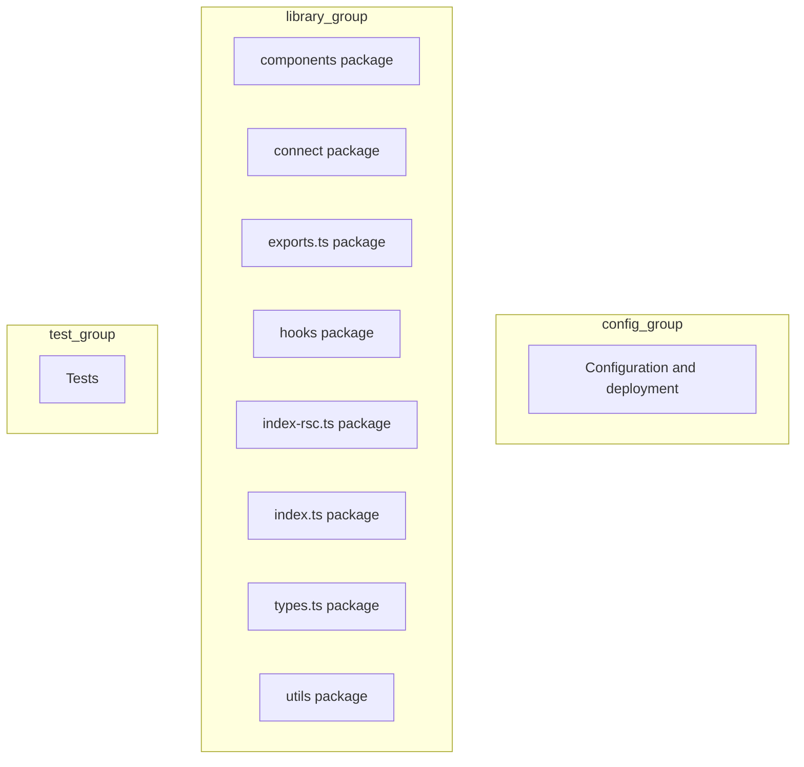

# Architecture report: reduxjs/react-redux

> Automated static analysis. **Observed** = directly seen in files/imports/AST; **Inferred** = interpretation from that evidence. Repository code was not executed.

## 1. Repository at a glance

| Item | Value |
| --- | --- |
| Repository | reduxjs/react-redux |
| Description | Official React bindings for Redux |
| Language | TypeScript |
| Stars | 23423 |
| Licence | MIT |
| Analysed commit / branch | 8e54f5b9dbbdcc972c120ad3ce3c1c57fc2e89fd / master |
| Framework(s) | Next.js, React |
| Files analysed | 113 |
| Components | 10 |

## 2. Architecture in one minute

reduxjs/react-redux - Official React bindings for Redux. This repository was analysed statically from 113 file(s) (0 Python). Detected technologies (observed from imports/manifests): GitHub Actions, Next.js, React, Redux, Redux Toolkit, TypeScript. Files are grouped into 10 component(s): components package, Configuration and deployment, connect package, exports.ts package, hooks package, index-rsc.ts package, index.ts package, Tests. Findings below distinguish observed facts from inferred interpretation.

## 3. High-level block diagram

## 4. Main components

### components package (`components`)

- **Kind:** library
- **Status:** Observed
- **Confidence:** 0.85
- **Responsibility:** Groups 3 file(s) under components package (observed from repository paths and static analysis).
- **Paths:** `src/components/Context.ts`, `src/components/Provider.tsx`, `src/components/connect.tsx`
- **Evidence:** [src/components/Context.ts](https://github.com/reduxjs/react-redux/blob/8e54f5b9dbbdcc972c120ad3ce3c1c57fc2e89fd/src/components/Context.ts); [src/components/Provider.tsx](https://github.com/reduxjs/react-redux/blob/8e54f5b9dbbdcc972c120ad3ce3c1c57fc2e89fd/src/components/Provider.tsx); [src/components/connect.tsx](https://github.com/reduxjs/react-redux/blob/8e54f5b9dbbdcc972c120ad3ce3c1c57fc2e89fd/src/components/connect.tsx)

### Configuration and deployment (`config`)

- **Kind:** config
- **Status:** Observed
- **Confidence:** 0.85
- **Responsibility:** Groups 8 file(s) under configuration and deployment (observed from repository paths and static analysis).
- **Paths:** `codecov.yml`, `netlify.toml`, `package.json`, `pnpm-workspace.yaml`, `tsconfig.base.json`, `tsconfig.build.json`, `tsconfig.json`, `tsconfig.test.json`
- **Evidence:** [codecov.yml](https://github.com/reduxjs/react-redux/blob/8e54f5b9dbbdcc972c120ad3ce3c1c57fc2e89fd/codecov.yml); [netlify.toml](https://github.com/reduxjs/react-redux/blob/8e54f5b9dbbdcc972c120ad3ce3c1c57fc2e89fd/netlify.toml); [package.json](https://github.com/reduxjs/react-redux/blob/8e54f5b9dbbdcc972c120ad3ce3c1c57fc2e89fd/package.json); [pnpm-workspace.yaml](https://github.com/reduxjs/react-redux/blob/8e54f5b9dbbdcc972c120ad3ce3c1c57fc2e89fd/pnpm-workspace.yaml); [tsconfig.base.json](https://github.com/reduxjs/react-redux/blob/8e54f5b9dbbdcc972c120ad3ce3c1c57fc2e89fd/tsconfig.base.json); [tsconfig.build.json](https://github.com/reduxjs/react-redux/blob/8e54f5b9dbbdcc972c120ad3ce3c1c57fc2e89fd/tsconfig.build.json); [tsconfig.json](https://github.com/reduxjs/react-redux/blob/8e54f5b9dbbdcc972c120ad3ce3c1c57fc2e89fd/tsconfig.json); [tsconfig.test.json](https://github.com/reduxjs/react-redux/blob/8e54f5b9dbbdcc972c120ad3ce3c1c57fc2e89fd/tsconfig.test.json)

### connect package (`connect`)

- **Kind:** library
- **Status:** Observed
- **Confidence:** 0.85
- **Responsibility:** Groups 7 file(s) under connect package (observed from repository paths and static analysis).
- **Paths:** `src/connect/invalidArgFactory.ts`, `src/connect/mapDispatchToProps.ts`, `src/connect/mapStateToProps.ts`, `src/connect/mergeProps.ts`, `src/connect/selectorFactory.ts`, `src/connect/verifySubselectors.ts`, `src/connect/wrapMapToProps.ts`
- **Evidence:** [src/connect/invalidArgFactory.ts](https://github.com/reduxjs/react-redux/blob/8e54f5b9dbbdcc972c120ad3ce3c1c57fc2e89fd/src/connect/invalidArgFactory.ts); [src/connect/mapDispatchToProps.ts](https://github.com/reduxjs/react-redux/blob/8e54f5b9dbbdcc972c120ad3ce3c1c57fc2e89fd/src/connect/mapDispatchToProps.ts); [src/connect/mapStateToProps.ts](https://github.com/reduxjs/react-redux/blob/8e54f5b9dbbdcc972c120ad3ce3c1c57fc2e89fd/src/connect/mapStateToProps.ts); [src/connect/mergeProps.ts](https://github.com/reduxjs/react-redux/blob/8e54f5b9dbbdcc972c120ad3ce3c1c57fc2e89fd/src/connect/mergeProps.ts); [src/connect/selectorFactory.ts](https://github.com/reduxjs/react-redux/blob/8e54f5b9dbbdcc972c120ad3ce3c1c57fc2e89fd/src/connect/selectorFactory.ts); [src/connect/verifySubselectors.ts](https://github.com/reduxjs/react-redux/blob/8e54f5b9dbbdcc972c120ad3ce3c1c57fc2e89fd/src/connect/verifySubselectors.ts); [src/connect/wrapMapToProps.ts](https://github.com/reduxjs/react-redux/blob/8e54f5b9dbbdcc972c120ad3ce3c1c57fc2e89fd/src/connect/wrapMapToProps.ts)

### exports.ts package (`exports_ts`)

- **Kind:** library
- **Status:** Observed
- **Confidence:** 0.85
- **Responsibility:** Groups 1 file(s) under exports.ts package (observed from repository paths and static analysis).
- **Paths:** `src/exports.ts`
- **Evidence:** [src/exports.ts](https://github.com/reduxjs/react-redux/blob/8e54f5b9dbbdcc972c120ad3ce3c1c57fc2e89fd/src/exports.ts)

### hooks package (`hooks`)

- **Kind:** library
- **Status:** Observed
- **Confidence:** 0.85
- **Responsibility:** Groups 4 file(s) under hooks package (observed from repository paths and static analysis).
- **Paths:** `src/hooks/useDispatch.ts`, `src/hooks/useReduxContext.ts`, `src/hooks/useSelector.ts`, `src/hooks/useStore.ts`
- **Evidence:** [src/hooks/useDispatch.ts](https://github.com/reduxjs/react-redux/blob/8e54f5b9dbbdcc972c120ad3ce3c1c57fc2e89fd/src/hooks/useDispatch.ts); [src/hooks/useReduxContext.ts](https://github.com/reduxjs/react-redux/blob/8e54f5b9dbbdcc972c120ad3ce3c1c57fc2e89fd/src/hooks/useReduxContext.ts); [src/hooks/useSelector.ts](https://github.com/reduxjs/react-redux/blob/8e54f5b9dbbdcc972c120ad3ce3c1c57fc2e89fd/src/hooks/useSelector.ts); [src/hooks/useStore.ts](https://github.com/reduxjs/react-redux/blob/8e54f5b9dbbdcc972c120ad3ce3c1c57fc2e89fd/src/hooks/useStore.ts)

### index-rsc.ts package (`index_rsc_ts`)

- **Kind:** library
- **Status:** Observed
- **Confidence:** 0.85
- **Responsibility:** Groups 1 file(s) under index-rsc.ts package (observed from repository paths and static analysis).
- **Paths:** `src/index-rsc.ts`
- **Evidence:** [src/index-rsc.ts](https://github.com/reduxjs/react-redux/blob/8e54f5b9dbbdcc972c120ad3ce3c1c57fc2e89fd/src/index-rsc.ts)

### index.ts package (`index_ts`)

- **Kind:** library
- **Status:** Observed
- **Confidence:** 0.85
- **Responsibility:** Groups 1 file(s) under index.ts package (observed from repository paths and static analysis).
- **Paths:** `src/index.ts`
- **Evidence:** [src/index.ts](https://github.com/reduxjs/react-redux/blob/8e54f5b9dbbdcc972c120ad3ce3c1c57fc2e89fd/src/index.ts)

### Tests (`tests`)

- **Kind:** test
- **Status:** Observed
- **Confidence:** 0.85
- **Responsibility:** Groups 24 file(s) under tests (observed from repository paths and static analysis).
- **Paths:** `test/components/Provider-rsc.spec.tsx`, `test/components/Provider.spec.tsx`, `test/components/connect.spec.tsx`, `test/components/hooks.spec.tsx`, `test/connect/wrapMapToProps.spec.ts`, `test/hooks/hooks.withTypes.test.tsx`, `test/hooks/useDispatch.spec.tsx`, `test/hooks/useReduxContext.spec.tsx`, `test/hooks/useSelector.spec.tsx`, `test/integration/dynamic-reducers.spec.tsx`, `test/integration/server-rendering.spec.tsx`, `test/integration/ssr.spec.tsx`, `test/setup.ts`, `test/typetests/connect-mapstate-mapdispatch.test-d.tsx`, `test/typetests/connect-options-and-issues.test-d.tsx`, `test/typetests/connect-union-ordering.test-d.tsx`, `test/typetests/counterApp.ts`, `test/typetests/hooks.test-d.tsx`, `test/typetests/hooks.withTypes.test-d.tsx`, `test/typetests/provider.test-d.tsx`, `test/typetests/react-redux-types.test-d.tsx`, `test/utils/Subscription.spec.ts`, `test/utils/isPlainObject.spec.ts`, `test/utils/shallowEqual.spec.ts`
- **Evidence:** [test/components/Provider-rsc.spec.tsx](https://github.com/reduxjs/react-redux/blob/8e54f5b9dbbdcc972c120ad3ce3c1c57fc2e89fd/test/components/Provider-rsc.spec.tsx); [test/components/Provider.spec.tsx](https://github.com/reduxjs/react-redux/blob/8e54f5b9dbbdcc972c120ad3ce3c1c57fc2e89fd/test/components/Provider.spec.tsx); [test/components/connect.spec.tsx](https://github.com/reduxjs/react-redux/blob/8e54f5b9dbbdcc972c120ad3ce3c1c57fc2e89fd/test/components/connect.spec.tsx); [test/components/hooks.spec.tsx](https://github.com/reduxjs/react-redux/blob/8e54f5b9dbbdcc972c120ad3ce3c1c57fc2e89fd/test/components/hooks.spec.tsx); [test/connect/wrapMapToProps.spec.ts](https://github.com/reduxjs/react-redux/blob/8e54f5b9dbbdcc972c120ad3ce3c1c57fc2e89fd/test/connect/wrapMapToProps.spec.ts); [test/hooks/hooks.withTypes.test.tsx](https://github.com/reduxjs/react-redux/blob/8e54f5b9dbbdcc972c120ad3ce3c1c57fc2e89fd/test/hooks/hooks.withTypes.test.tsx); [test/hooks/useDispatch.spec.tsx](https://github.com/reduxjs/react-redux/blob/8e54f5b9dbbdcc972c120ad3ce3c1c57fc2e89fd/test/hooks/useDispatch.spec.tsx); [test/hooks/useReduxContext.spec.tsx](https://github.com/reduxjs/react-redux/blob/8e54f5b9dbbdcc972c120ad3ce3c1c57fc2e89fd/test/hooks/useReduxContext.spec.tsx)

### types.ts package (`types_ts`)

- **Kind:** library
- **Status:** Observed
- **Confidence:** 0.85
- **Responsibility:** Groups 1 file(s) under types.ts package (observed from repository paths and static analysis).
- **Paths:** `src/types.ts`
- **Evidence:** [src/types.ts](https://github.com/reduxjs/react-redux/blob/8e54f5b9dbbdcc972c120ad3ce3c1c57fc2e89fd/src/types.ts)

### utils package (`utils`)

- **Kind:** library
- **Status:** Observed
- **Confidence:** 0.85
- **Responsibility:** Groups 12 file(s) under utils package (observed from repository paths and static analysis).
- **Paths:** `src/utils/Subscription.ts`, `src/utils/batch.ts`, `src/utils/bindActionCreators.ts`, `src/utils/hoistStatics.ts`, `src/utils/isPlainObject.ts`, `src/utils/react-is.ts`, `src/utils/react.ts`, `src/utils/shallowEqual.ts`, `src/utils/useIsomorphicLayoutEffect.ts`, `src/utils/useSyncExternalStore.ts`, `src/utils/verifyPlainObject.ts`, `src/utils/warning.ts`
- **Evidence:** [src/utils/Subscription.ts](https://github.com/reduxjs/react-redux/blob/8e54f5b9dbbdcc972c120ad3ce3c1c57fc2e89fd/src/utils/Subscription.ts); [src/utils/batch.ts](https://github.com/reduxjs/react-redux/blob/8e54f5b9dbbdcc972c120ad3ce3c1c57fc2e89fd/src/utils/batch.ts); [src/utils/bindActionCreators.ts](https://github.com/reduxjs/react-redux/blob/8e54f5b9dbbdcc972c120ad3ce3c1c57fc2e89fd/src/utils/bindActionCreators.ts); [src/utils/hoistStatics.ts](https://github.com/reduxjs/react-redux/blob/8e54f5b9dbbdcc972c120ad3ce3c1c57fc2e89fd/src/utils/hoistStatics.ts); [src/utils/isPlainObject.ts](https://github.com/reduxjs/react-redux/blob/8e54f5b9dbbdcc972c120ad3ce3c1c57fc2e89fd/src/utils/isPlainObject.ts); [src/utils/react-is.ts](https://github.com/reduxjs/react-redux/blob/8e54f5b9dbbdcc972c120ad3ce3c1c57fc2e89fd/src/utils/react-is.ts); [src/utils/react.ts](https://github.com/reduxjs/react-redux/blob/8e54f5b9dbbdcc972c120ad3ce3c1c57fc2e89fd/src/utils/react.ts); [src/utils/shallowEqual.ts](https://github.com/reduxjs/react-redux/blob/8e54f5b9dbbdcc972c120ad3ce3c1c57fc2e89fd/src/utils/shallowEqual.ts)

## 5. Execution flow

**Observed** entry point(s):

- [src/index.ts](https://github.com/reduxjs/react-redux/blob/8e54f5b9dbbdcc972c120ad3ce3c1c57fc2e89fd/src/index.ts)

Representative flow (derived from observed entry points and the import graph; steps beyond the entry point are **Inferred**):

1. Execution starts at an observed entry point listed above, if present.
2. No internal import relationships between components were observed.

## 6. Project structure

### `(root)`

- `.gitattributes` - other (19 bytes)
- `.gitignore` - other (214 bytes)
- `.oxfmtrc.json` - config (225 bytes)
- `.oxlintrc.json` - config (1237 bytes)
- `.release-it.json` - config (150 bytes)
- `CHANGELOG.md` - docs (107 bytes)
- `CNAME` - other (19 bytes)
- `CODE_OF_CONDUCT.md` - docs (1423 bytes)
- `CONTRIBUTING.md` - docs (2617 bytes)
- `LICENSE.md` - docs (1086 bytes)
- `README.md` - docs (3160 bytes)
- `codecov.yml` - config (98 bytes)
- `netlify.toml` - config (1910 bytes)
- `package.json` - manifest (2796 bytes)
- `pnpm-workspace.yaml` - config (1137 bytes)
- `tsconfig.base.json` - config (799 bytes)
- `tsconfig.build.json` - config (199 bytes)
- `tsconfig.json` - config (343 bytes)
- `tsconfig.test.json` - config (219 bytes)
- `tsdown.config.mts` - other (2913 bytes)
- `vitest.config.mts` - other (551 bytes)

### `.github`

- `.github/FUNDING.yml` - config (41 bytes)
- `.github/ISSUE_TEMPLATE/bug_report.yml` - config (2167 bytes)
- `.github/ISSUE_TEMPLATE/config.yml` - config (267 bytes)
- `.github/ISSUE_TEMPLATE/feature_request.yml` - config (1536 bytes)
- `.github/dependabot.yml` - config (297 bytes)
- `.github/workflows/publish.yml` - ci, YAML (896 bytes)
- `.github/workflows/rebuild-docs-site.yml` - ci, YAML (908 bytes)
- `.github/workflows/release-commit.yml` - ci, YAML (1655 bytes)
- `.github/workflows/size.yaml` - ci, YAML (1743 bytes)
- `.github/workflows/test.yml` - ci, YAML (15141 bytes)

### `.vscode`

- `.vscode/settings.json` - config (56 bytes)

### `docs`

- `docs/README.md` - docs (3147 bytes)
- `docs/api/Provider.md` - docs (4111 bytes)
- `docs/api/batch.md` - docs (1603 bytes)
- `docs/api/connect.md` - docs (22275 bytes)
- `docs/api/hooks.md` - docs (25240 bytes)
- `docs/introduction/getting-started.md` - docs (4451 bytes)
- `docs/introduction/why-use-react-redux.md` - docs (6159 bytes)
- `docs/sidebars.ts` - docs (2026 bytes)
- `docs/tsconfig.json` - config (224 bytes)
- `docs/tutorials/connect.md` - docs (18557 bytes)
- `docs/using-react-redux/accessing-store.md` - docs (6963 bytes)
- `docs/using-react-redux/connect-dispatching-actions-with-mapDispatchToProps.md` - docs (16016 bytes)
- `docs/using-react-redux/connect-extracting-data-with-mapStateToProps.md` - docs (13900 bytes)
- `docs/using-react-redux/usage-with-typescript.md` - docs (5633 bytes)

### `examples`

- `examples/publish-ci/rr-rsc-context/.gitignore` - other (508 bytes)
- `examples/publish-ci/rr-rsc-context/README.md` - docs (1370 bytes)
- `examples/publish-ci/rr-rsc-context/app/globals.css` - other (2206 bytes)
- `examples/publish-ci/rr-rsc-context/app/layout.tsx` - source, TypeScript (435 bytes)
- `examples/publish-ci/rr-rsc-context/app/page.module.css` - other (3912 bytes)
- `examples/publish-ci/rr-rsc-context/app/page.tsx` - source, TypeScript (2848 bytes)
- `examples/publish-ci/rr-rsc-context/next.config.js` - source, JavaScript (92 bytes)
- `examples/publish-ci/rr-rsc-context/package.json` - manifest (450 bytes)
- `examples/publish-ci/rr-rsc-context/pnpm-workspace.yaml` - config (540 bytes)
- `examples/publish-ci/rr-rsc-context/public/next.svg` - other (1375 bytes)
- `examples/publish-ci/rr-rsc-context/public/vercel.svg` - other (629 bytes)
- `examples/publish-ci/rr-rsc-context/tsconfig.json` - config (693 bytes)

### `scripts`

- `scripts/stripSourcemapFileField.mts` - other (1847 bytes)

### `src`

- `src/components/Context.ts` - source, TypeScript (1569 bytes)
- `src/components/Provider.tsx` - source, TypeScript (4157 bytes)
- `src/components/connect.tsx` - source, TypeScript (40335 bytes)
- `src/connect/invalidArgFactory.ts` - source, TypeScript (407 bytes)
- `src/connect/mapDispatchToProps.ts` - source, TypeScript (1064 bytes)
- `src/connect/mapStateToProps.ts` - source, TypeScript (616 bytes)
- `src/connect/mergeProps.ts` - source, TypeScript (2063 bytes)
- `src/connect/selectorFactory.ts` - source, TypeScript (7689 bytes)
- `src/connect/verifySubselectors.ts` - source, TypeScript (777 bytes)
- `src/connect/wrapMapToProps.ts` - source, TypeScript (3945 bytes)
- `src/exports.ts` - source, TypeScript (1489 bytes)
- `src/hooks/useDispatch.ts` - source, TypeScript (3037 bytes)
- `src/hooks/useReduxContext.ts` - source, TypeScript (1440 bytes)
- `src/hooks/useSelector.ts` - source, TypeScript (9753 bytes)
- `src/hooks/useStore.ts` - source, TypeScript (3394 bytes)
- `src/index-rsc.ts` - source, TypeScript (1266 bytes)
- `src/index.ts` - source, TypeScript (26 bytes)
- `src/types.ts` - source, TypeScript (5697 bytes)
- `src/utils/Subscription.ts` - source, TypeScript (4022 bytes)
- `src/utils/batch.ts` - source, TypeScript (145 bytes)
- `src/utils/bindActionCreators.ts` - source, TypeScript (512 bytes)
- `src/utils/hoistStatics.ts` - source, TypeScript (3724 bytes)
- `src/utils/isPlainObject.ts` - source, TypeScript (480 bytes)
- `src/utils/react-is.ts` - source, TypeScript (3638 bytes)
- `src/utils/react.ts` - source, TypeScript (49 bytes)
- `src/utils/shallowEqual.ts` - source, TypeScript (717 bytes)
- `src/utils/useIsomorphicLayoutEffect.ts` - source, TypeScript (1619 bytes)
- `src/utils/useSyncExternalStore.ts` - source, TypeScript (355 bytes)
- `src/utils/verifyPlainObject.ts` - source, TypeScript (341 bytes)
- `src/utils/warning.ts` - source, TypeScript (644 bytes)

### `test`

- `test/components/Provider-rsc.spec.tsx` - test, TypeScript (991 bytes)
- `test/components/Provider.spec.tsx` - test, TypeScript (11116 bytes)
- `test/components/connect.spec.tsx` - test, TypeScript (103850 bytes)
- `test/components/hooks.spec.tsx` - test, TypeScript (3936 bytes)
- `test/connect/wrapMapToProps.spec.ts` - test, TypeScript (1597 bytes)
- `test/hooks/hooks.withTypes.test.tsx` - test, TypeScript (1867 bytes)
- `test/hooks/useDispatch.spec.tsx` - test, TypeScript (2128 bytes)
- `test/hooks/useReduxContext.spec.tsx` - test, TypeScript (1191 bytes)
- `test/hooks/useSelector.spec.tsx` - test, TypeScript (34698 bytes)
- `test/integration/dynamic-reducers.spec.tsx` - test, TypeScript (6823 bytes)
- `test/integration/server-rendering.spec.tsx` - test, TypeScript (6648 bytes)
- `test/integration/ssr.spec.tsx` - test, TypeScript (6917 bytes)
- `test/setup.ts` - test, TypeScript (42 bytes)
- `test/typetests/connect-mapstate-mapdispatch.test-d.tsx` - test, TypeScript (18270 bytes)
- `test/typetests/connect-options-and-issues.test-d.tsx` - test, TypeScript (23778 bytes)
- `test/typetests/connect-union-ordering.test-d.tsx` - test, TypeScript (5650 bytes)
- `test/typetests/counterApp.ts` - test, TypeScript (1233 bytes)
- `test/typetests/hooks.test-d.tsx` - test, TypeScript (6750 bytes)
- `test/typetests/hooks.withTypes.test-d.tsx` - test, TypeScript (1292 bytes)
- `test/typetests/provider.test-d.tsx` - test, TypeScript (526 bytes)
- `test/typetests/react-redux-types.test-d.tsx` - test, TypeScript (11988 bytes)
- `test/utils/Subscription.spec.ts` - test, TypeScript (1513 bytes)
- `test/utils/isPlainObject.spec.ts` - test, TypeScript (725 bytes)
- `test/utils/shallowEqual.spec.ts` - test, TypeScript (2154 bytes)

## 7. Key dependencies and integrations

| Name | Category | Status | Confidence | Evidence |
| --- | --- | --- | --- | --- |
| GitHub Actions | ci | Observed | 0.90 | [.github/workflows/publish.yml](https://github.com/reduxjs/react-redux/blob/8e54f5b9dbbdcc972c120ad3ce3c1c57fc2e89fd/.github/workflows/publish.yml); [.github/workflows/rebuild-docs-site.yml](https://github.com/reduxjs/react-redux/blob/8e54f5b9dbbdcc972c120ad3ce3c1c57fc2e89fd/.github/workflows/rebuild-docs-site.yml); [.github/workflows/release-commit.yml](https://github.com/reduxjs/react-redux/blob/8e54f5b9dbbdcc972c120ad3ce3c1c57fc2e89fd/.github/workflows/release-commit.yml); [.github/workflows/size.yaml](https://github.com/reduxjs/react-redux/blob/8e54f5b9dbbdcc972c120ad3ce3c1c57fc2e89fd/.github/workflows/size.yaml) |
| Next.js | framework | Observed | 0.85 | [examples/publish-ci/rr-rsc-context/package.json:7](https://github.com/reduxjs/react-redux/blob/8e54f5b9dbbdcc972c120ad3ce3c1c57fc2e89fd/examples/publish-ci/rr-rsc-context/package.json#L7) |
| React | framework | Observed | 0.90 | [examples/publish-ci/rr-rsc-context/package.json:13](https://github.com/reduxjs/react-redux/blob/8e54f5b9dbbdcc972c120ad3ce3c1c57fc2e89fd/examples/publish-ci/rr-rsc-context/package.json#L13); [examples/publish-ci/rr-rsc-context/package.json:14](https://github.com/reduxjs/react-redux/blob/8e54f5b9dbbdcc972c120ad3ce3c1c57fc2e89fd/examples/publish-ci/rr-rsc-context/package.json#L14); [package.json:2](https://github.com/reduxjs/react-redux/blob/8e54f5b9dbbdcc972c120ad3ce3c1c57fc2e89fd/package.json#L2); [package.json:77](https://github.com/reduxjs/react-redux/blob/8e54f5b9dbbdcc972c120ad3ce3c1c57fc2e89fd/package.json#L77) |
| Redux | library | Observed | 0.90 | [package.json:2](https://github.com/reduxjs/react-redux/blob/8e54f5b9dbbdcc972c120ad3ce3c1c57fc2e89fd/package.json#L2) |
| Redux Toolkit | library | Observed | 0.85 | [package.json:70](https://github.com/reduxjs/react-redux/blob/8e54f5b9dbbdcc972c120ad3ce3c1c57fc2e89fd/package.json#L70) |
| TypeScript | tooling | Observed | 0.90 | [examples/publish-ci/rr-rsc-context/package.json:19](https://github.com/reduxjs/react-redux/blob/8e54f5b9dbbdcc972c120ad3ce3c1c57fc2e89fd/examples/publish-ci/rr-rsc-context/package.json#L19); [package.json:89](https://github.com/reduxjs/react-redux/blob/8e54f5b9dbbdcc972c120ad3ce3c1c57fc2e89fd/package.json#L89) |
| Vite | tooling | Observed | 0.85 | [package.json:47](https://github.com/reduxjs/react-redux/blob/8e54f5b9dbbdcc972c120ad3ce3c1c57fc2e89fd/package.json#L47) |
| Vitest | tooling | Observed | 0.85 | [package.json:47](https://github.com/reduxjs/react-redux/blob/8e54f5b9dbbdcc972c120ad3ce3c1c57fc2e89fd/package.json#L47) |

## 8. Data and state

No database, cache, queue, or persistent-state usage was observed in the analysed files. State handling, if any, may be in-memory or in files that were not analysed.

## 9. Configuration and deployment clues

- `.github/FUNDING.yml` (config)
- `.github/ISSUE_TEMPLATE/bug_report.yml` (config)
- `.github/ISSUE_TEMPLATE/config.yml` (config)
- `.github/ISSUE_TEMPLATE/feature_request.yml` (config)
- `.github/dependabot.yml` (config)
- `.github/workflows/publish.yml` (ci)
- `.github/workflows/rebuild-docs-site.yml` (ci)
- `.github/workflows/release-commit.yml` (ci)
- `.github/workflows/size.yaml` (ci)
- `.github/workflows/test.yml` (ci)
- `.oxfmtrc.json` (config)
- `.oxlintrc.json` (config)
- `.release-it.json` (config)
- `.vscode/settings.json` (config)
- `codecov.yml` (config)
- `docs/tsconfig.json` (config)
- `examples/publish-ci/rr-rsc-context/package.json` (manifest)
- `examples/publish-ci/rr-rsc-context/pnpm-workspace.yaml` (config)
- `examples/publish-ci/rr-rsc-context/tsconfig.json` (config)
- `netlify.toml` (config)
- `package.json` (manifest)
- `pnpm-workspace.yaml` (config)
- `tsconfig.base.json` (config)
- `tsconfig.build.json` (config)
- `tsconfig.json` (config)
- `tsconfig.test.json` (config)

## 10. Design observations

- Tests are present alongside source code (Observed from test file paths).

These observations are interpretations (**Inferred**) of the observed structure, not guarantees about runtime design.

## 11. Limitations and unknowns

- Static analysis only: repository code was not executed, installed, or imported at runtime.
- Components and relationships are inferred from file paths, imports, and AST structure; runtime behaviour, dynamic imports, and reflection may not be visible.
- 2 file(s) were skipped during inventory (2 x lockfile excluded).
- No clear application entry point was observed in the analysed files.
- Repository text was treated as untrusted data; no instructions found in repository files were followed, and likely secret values were redacted/excluded.
- JavaScript and TypeScript files were inventoried from paths and package manifests. They were not parsed with a full language AST, and repository code was not executed.

## 12. Source references

- [.github/workflows/publish.yml](https://github.com/reduxjs/react-redux/blob/8e54f5b9dbbdcc972c120ad3ce3c1c57fc2e89fd/.github/workflows/publish.yml)
- [.github/workflows/rebuild-docs-site.yml](https://github.com/reduxjs/react-redux/blob/8e54f5b9dbbdcc972c120ad3ce3c1c57fc2e89fd/.github/workflows/rebuild-docs-site.yml)
- [.github/workflows/release-commit.yml](https://github.com/reduxjs/react-redux/blob/8e54f5b9dbbdcc972c120ad3ce3c1c57fc2e89fd/.github/workflows/release-commit.yml)
- [.github/workflows/size.yaml](https://github.com/reduxjs/react-redux/blob/8e54f5b9dbbdcc972c120ad3ce3c1c57fc2e89fd/.github/workflows/size.yaml)
- [.github/workflows/test.yml](https://github.com/reduxjs/react-redux/blob/8e54f5b9dbbdcc972c120ad3ce3c1c57fc2e89fd/.github/workflows/test.yml)
- [codecov.yml](https://github.com/reduxjs/react-redux/blob/8e54f5b9dbbdcc972c120ad3ce3c1c57fc2e89fd/codecov.yml)
- [examples/publish-ci/rr-rsc-context/package.json:7](https://github.com/reduxjs/react-redux/blob/8e54f5b9dbbdcc972c120ad3ce3c1c57fc2e89fd/examples/publish-ci/rr-rsc-context/package.json#L7)
- [examples/publish-ci/rr-rsc-context/package.json:13](https://github.com/reduxjs/react-redux/blob/8e54f5b9dbbdcc972c120ad3ce3c1c57fc2e89fd/examples/publish-ci/rr-rsc-context/package.json#L13)
- [examples/publish-ci/rr-rsc-context/package.json:14](https://github.com/reduxjs/react-redux/blob/8e54f5b9dbbdcc972c120ad3ce3c1c57fc2e89fd/examples/publish-ci/rr-rsc-context/package.json#L14)
- [examples/publish-ci/rr-rsc-context/package.json:19](https://github.com/reduxjs/react-redux/blob/8e54f5b9dbbdcc972c120ad3ce3c1c57fc2e89fd/examples/publish-ci/rr-rsc-context/package.json#L19)
- [netlify.toml](https://github.com/reduxjs/react-redux/blob/8e54f5b9dbbdcc972c120ad3ce3c1c57fc2e89fd/netlify.toml)
- [package.json](https://github.com/reduxjs/react-redux/blob/8e54f5b9dbbdcc972c120ad3ce3c1c57fc2e89fd/package.json)
- [package.json:2](https://github.com/reduxjs/react-redux/blob/8e54f5b9dbbdcc972c120ad3ce3c1c57fc2e89fd/package.json#L2)
- [package.json:47](https://github.com/reduxjs/react-redux/blob/8e54f5b9dbbdcc972c120ad3ce3c1c57fc2e89fd/package.json#L47)
- [package.json:70](https://github.com/reduxjs/react-redux/blob/8e54f5b9dbbdcc972c120ad3ce3c1c57fc2e89fd/package.json#L70)
- [package.json:77](https://github.com/reduxjs/react-redux/blob/8e54f5b9dbbdcc972c120ad3ce3c1c57fc2e89fd/package.json#L77)
- [package.json:89](https://github.com/reduxjs/react-redux/blob/8e54f5b9dbbdcc972c120ad3ce3c1c57fc2e89fd/package.json#L89)
- [pnpm-workspace.yaml](https://github.com/reduxjs/react-redux/blob/8e54f5b9dbbdcc972c120ad3ce3c1c57fc2e89fd/pnpm-workspace.yaml)
- [src/components/Context.ts](https://github.com/reduxjs/react-redux/blob/8e54f5b9dbbdcc972c120ad3ce3c1c57fc2e89fd/src/components/Context.ts)
- [src/components/Provider.tsx](https://github.com/reduxjs/react-redux/blob/8e54f5b9dbbdcc972c120ad3ce3c1c57fc2e89fd/src/components/Provider.tsx)
- [src/components/connect.tsx](https://github.com/reduxjs/react-redux/blob/8e54f5b9dbbdcc972c120ad3ce3c1c57fc2e89fd/src/components/connect.tsx)
- [src/connect/invalidArgFactory.ts](https://github.com/reduxjs/react-redux/blob/8e54f5b9dbbdcc972c120ad3ce3c1c57fc2e89fd/src/connect/invalidArgFactory.ts)
- [src/connect/mapDispatchToProps.ts](https://github.com/reduxjs/react-redux/blob/8e54f5b9dbbdcc972c120ad3ce3c1c57fc2e89fd/src/connect/mapDispatchToProps.ts)
- [src/connect/mapStateToProps.ts](https://github.com/reduxjs/react-redux/blob/8e54f5b9dbbdcc972c120ad3ce3c1c57fc2e89fd/src/connect/mapStateToProps.ts)
- [src/connect/mergeProps.ts](https://github.com/reduxjs/react-redux/blob/8e54f5b9dbbdcc972c120ad3ce3c1c57fc2e89fd/src/connect/mergeProps.ts)
- [src/connect/selectorFactory.ts](https://github.com/reduxjs/react-redux/blob/8e54f5b9dbbdcc972c120ad3ce3c1c57fc2e89fd/src/connect/selectorFactory.ts)
- [src/connect/verifySubselectors.ts](https://github.com/reduxjs/react-redux/blob/8e54f5b9dbbdcc972c120ad3ce3c1c57fc2e89fd/src/connect/verifySubselectors.ts)
- [src/connect/wrapMapToProps.ts](https://github.com/reduxjs/react-redux/blob/8e54f5b9dbbdcc972c120ad3ce3c1c57fc2e89fd/src/connect/wrapMapToProps.ts)
- [src/exports.ts](https://github.com/reduxjs/react-redux/blob/8e54f5b9dbbdcc972c120ad3ce3c1c57fc2e89fd/src/exports.ts)
- [src/hooks/useDispatch.ts](https://github.com/reduxjs/react-redux/blob/8e54f5b9dbbdcc972c120ad3ce3c1c57fc2e89fd/src/hooks/useDispatch.ts)
- [src/hooks/useReduxContext.ts](https://github.com/reduxjs/react-redux/blob/8e54f5b9dbbdcc972c120ad3ce3c1c57fc2e89fd/src/hooks/useReduxContext.ts)
- [src/hooks/useSelector.ts](https://github.com/reduxjs/react-redux/blob/8e54f5b9dbbdcc972c120ad3ce3c1c57fc2e89fd/src/hooks/useSelector.ts)
- [src/hooks/useStore.ts](https://github.com/reduxjs/react-redux/blob/8e54f5b9dbbdcc972c120ad3ce3c1c57fc2e89fd/src/hooks/useStore.ts)
- [src/index-rsc.ts](https://github.com/reduxjs/react-redux/blob/8e54f5b9dbbdcc972c120ad3ce3c1c57fc2e89fd/src/index-rsc.ts)
- [src/index.ts](https://github.com/reduxjs/react-redux/blob/8e54f5b9dbbdcc972c120ad3ce3c1c57fc2e89fd/src/index.ts)
- [src/types.ts](https://github.com/reduxjs/react-redux/blob/8e54f5b9dbbdcc972c120ad3ce3c1c57fc2e89fd/src/types.ts)
- [src/utils/Subscription.ts](https://github.com/reduxjs/react-redux/blob/8e54f5b9dbbdcc972c120ad3ce3c1c57fc2e89fd/src/utils/Subscription.ts)
- [src/utils/batch.ts](https://github.com/reduxjs/react-redux/blob/8e54f5b9dbbdcc972c120ad3ce3c1c57fc2e89fd/src/utils/batch.ts)
- [src/utils/bindActionCreators.ts](https://github.com/reduxjs/react-redux/blob/8e54f5b9dbbdcc972c120ad3ce3c1c57fc2e89fd/src/utils/bindActionCreators.ts)
- [src/utils/hoistStatics.ts](https://github.com/reduxjs/react-redux/blob/8e54f5b9dbbdcc972c120ad3ce3c1c57fc2e89fd/src/utils/hoistStatics.ts)
- [src/utils/isPlainObject.ts](https://github.com/reduxjs/react-redux/blob/8e54f5b9dbbdcc972c120ad3ce3c1c57fc2e89fd/src/utils/isPlainObject.ts)
- [src/utils/react-is.ts](https://github.com/reduxjs/react-redux/blob/8e54f5b9dbbdcc972c120ad3ce3c1c57fc2e89fd/src/utils/react-is.ts)
- [src/utils/react.ts](https://github.com/reduxjs/react-redux/blob/8e54f5b9dbbdcc972c120ad3ce3c1c57fc2e89fd/src/utils/react.ts)
- [src/utils/shallowEqual.ts](https://github.com/reduxjs/react-redux/blob/8e54f5b9dbbdcc972c120ad3ce3c1c57fc2e89fd/src/utils/shallowEqual.ts)
- [test/components/Provider-rsc.spec.tsx](https://github.com/reduxjs/react-redux/blob/8e54f5b9dbbdcc972c120ad3ce3c1c57fc2e89fd/test/components/Provider-rsc.spec.tsx)
- [test/components/Provider.spec.tsx](https://github.com/reduxjs/react-redux/blob/8e54f5b9dbbdcc972c120ad3ce3c1c57fc2e89fd/test/components/Provider.spec.tsx)
- [test/components/connect.spec.tsx](https://github.com/reduxjs/react-redux/blob/8e54f5b9dbbdcc972c120ad3ce3c1c57fc2e89fd/test/components/connect.spec.tsx)
- [test/components/hooks.spec.tsx](https://github.com/reduxjs/react-redux/blob/8e54f5b9dbbdcc972c120ad3ce3c1c57fc2e89fd/test/components/hooks.spec.tsx)
- [test/connect/wrapMapToProps.spec.ts](https://github.com/reduxjs/react-redux/blob/8e54f5b9dbbdcc972c120ad3ce3c1c57fc2e89fd/test/connect/wrapMapToProps.spec.ts)
- [test/hooks/hooks.withTypes.test.tsx](https://github.com/reduxjs/react-redux/blob/8e54f5b9dbbdcc972c120ad3ce3c1c57fc2e89fd/test/hooks/hooks.withTypes.test.tsx)
- [test/hooks/useDispatch.spec.tsx](https://github.com/reduxjs/react-redux/blob/8e54f5b9dbbdcc972c120ad3ce3c1c57fc2e89fd/test/hooks/useDispatch.spec.tsx)
- [test/hooks/useReduxContext.spec.tsx](https://github.com/reduxjs/react-redux/blob/8e54f5b9dbbdcc972c120ad3ce3c1c57fc2e89fd/test/hooks/useReduxContext.spec.tsx)
- [tsconfig.base.json](https://github.com/reduxjs/react-redux/blob/8e54f5b9dbbdcc972c120ad3ce3c1c57fc2e89fd/tsconfig.base.json)
- [tsconfig.build.json](https://github.com/reduxjs/react-redux/blob/8e54f5b9dbbdcc972c120ad3ce3c1c57fc2e89fd/tsconfig.build.json)
- [tsconfig.json](https://github.com/reduxjs/react-redux/blob/8e54f5b9dbbdcc972c120ad3ce3c1c57fc2e89fd/tsconfig.json)
- [tsconfig.test.json](https://github.com/reduxjs/react-redux/blob/8e54f5b9dbbdcc972c120ad3ce3c1c57fc2e89fd/tsconfig.test.json)
