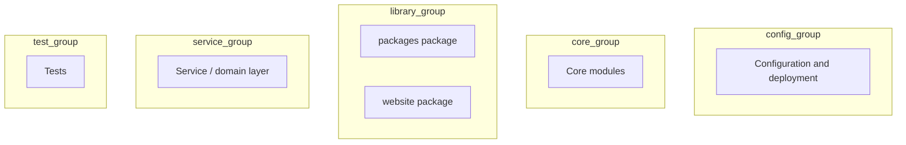

# Architecture report: rematch/rematch

> Automated static analysis. **Observed** = directly seen in files/imports/AST; **Inferred** = interpretation from that evidence. Repository code was not executed.

## 1. Repository at a glance

| Item | Value |
| --- | --- |
| Repository | rematch/rematch |
| Description | The Redux Framework |
| Language | TypeScript |
| Stars | 8390 |
| Licence | MIT |
| Analysed commit / branch | bde199f08c7709e81458394d2bb9374ad95600a2 / main |
| Framework(s) | Next.js, React |
| Files analysed | 274 |
| Components | 6 |

## 2. Architecture in one minute

rematch/rematch - The Redux Framework. This repository was analysed statically from 274 file(s) (0 Python). Detected technologies (observed from imports/manifests): GitHub Actions, Next.js, React, Redux, TypeScript. Files are grouped into 6 component(s): Configuration and deployment, Core modules, packages package, Service / domain layer, Tests, website package. Findings below distinguish observed facts from inferred interpretation.

## 3. High-level block diagram

## 4. Main components

### Configuration and deployment (`config`)

- **Kind:** config
- **Status:** Observed
- **Confidence:** 0.85
- **Responsibility:** Groups 26 file(s) under configuration and deployment (observed from repository paths and static analysis).
- **Paths:** `lerna.json`, `package.json`, `packages/core/package.json`, `packages/core/tsconfig.build.json`, `packages/core/tsconfig.json`, `packages/immer/package.json`, `packages/immer/tsconfig.build.json`, `packages/immer/tsconfig.json`, `packages/loading/package.json`, `packages/loading/tsconfig.build.json`, `packages/loading/tsconfig.json`, `packages/persist/package.json`, `packages/persist/tsconfig.build.json`, `packages/persist/tsconfig.json`, `packages/select/package.json`, `packages/select/tsconfig.build.json`, `packages/select/tsconfig.json`, `packages/typed-state/package.json`, `packages/typed-state/tsconfig.build.json`, `packages/typed-state/tsconfig.json`, `packages/updated/package.json`, `packages/updated/tsconfig.build.json`, `packages/updated/tsconfig.json`, `tsconfig.base.json`, `website/package.json`, `website/tsconfig.json`
- **Evidence:** [lerna.json](https://github.com/rematch/rematch/blob/bde199f08c7709e81458394d2bb9374ad95600a2/lerna.json); [package.json](https://github.com/rematch/rematch/blob/bde199f08c7709e81458394d2bb9374ad95600a2/package.json); [packages/core/package.json](https://github.com/rematch/rematch/blob/bde199f08c7709e81458394d2bb9374ad95600a2/packages/core/package.json); [packages/core/tsconfig.build.json](https://github.com/rematch/rematch/blob/bde199f08c7709e81458394d2bb9374ad95600a2/packages/core/tsconfig.build.json); [packages/core/tsconfig.json](https://github.com/rematch/rematch/blob/bde199f08c7709e81458394d2bb9374ad95600a2/packages/core/tsconfig.json); [packages/immer/package.json](https://github.com/rematch/rematch/blob/bde199f08c7709e81458394d2bb9374ad95600a2/packages/immer/package.json); [packages/immer/tsconfig.build.json](https://github.com/rematch/rematch/blob/bde199f08c7709e81458394d2bb9374ad95600a2/packages/immer/tsconfig.build.json); [packages/immer/tsconfig.json](https://github.com/rematch/rematch/blob/bde199f08c7709e81458394d2bb9374ad95600a2/packages/immer/tsconfig.json)

### Core modules (`core`)

- **Kind:** core
- **Status:** Observed
- **Confidence:** 0.85
- **Responsibility:** Groups 2 file(s) under core modules (observed from repository paths and static analysis).
- **Paths:** `jest.config.js`, `testsetup.js`
- **Evidence:** [jest.config.js](https://github.com/rematch/rematch/blob/bde199f08c7709e81458394d2bb9374ad95600a2/jest.config.js); [testsetup.js](https://github.com/rematch/rematch/blob/bde199f08c7709e81458394d2bb9374ad95600a2/testsetup.js)

### packages package (`packages`)

- **Kind:** library
- **Status:** Observed
- **Confidence:** 0.85
- **Responsibility:** Groups 7 file(s) under packages package (observed from repository paths and static analysis).
- **Paths:** `packages/immer/src/index.ts`, `packages/loading/src/index.ts`, `packages/persist/src/index.ts`, `packages/select/src/index.ts`, `packages/select/src/types.ts`, `packages/typed-state/src/index.ts`, `packages/updated/src/index.ts`
- **Evidence:** [packages/immer/src/index.ts](https://github.com/rematch/rematch/blob/bde199f08c7709e81458394d2bb9374ad95600a2/packages/immer/src/index.ts); [packages/loading/src/index.ts](https://github.com/rematch/rematch/blob/bde199f08c7709e81458394d2bb9374ad95600a2/packages/loading/src/index.ts); [packages/persist/src/index.ts](https://github.com/rematch/rematch/blob/bde199f08c7709e81458394d2bb9374ad95600a2/packages/persist/src/index.ts); [packages/select/src/index.ts](https://github.com/rematch/rematch/blob/bde199f08c7709e81458394d2bb9374ad95600a2/packages/select/src/index.ts); [packages/select/src/types.ts](https://github.com/rematch/rematch/blob/bde199f08c7709e81458394d2bb9374ad95600a2/packages/select/src/types.ts); [packages/typed-state/src/index.ts](https://github.com/rematch/rematch/blob/bde199f08c7709e81458394d2bb9374ad95600a2/packages/typed-state/src/index.ts); [packages/updated/src/index.ts](https://github.com/rematch/rematch/blob/bde199f08c7709e81458394d2bb9374ad95600a2/packages/updated/src/index.ts)

### Service / domain layer (`service_layer`)

- **Kind:** service
- **Status:** Observed
- **Confidence:** 0.85
- **Responsibility:** Groups 9 file(s) under service / domain layer (observed from repository paths and static analysis).
- **Paths:** `packages/core/src/bag.ts`, `packages/core/src/config.ts`, `packages/core/src/dispatcher.ts`, `packages/core/src/index.ts`, `packages/core/src/reduxStore.ts`, `packages/core/src/rematchStore.ts`, `packages/core/src/types.ts`, `packages/core/src/validate.ts`, `packages/core/tsdx.config.js`
- **Evidence:** [packages/core/src/bag.ts](https://github.com/rematch/rematch/blob/bde199f08c7709e81458394d2bb9374ad95600a2/packages/core/src/bag.ts); [packages/core/src/config.ts](https://github.com/rematch/rematch/blob/bde199f08c7709e81458394d2bb9374ad95600a2/packages/core/src/config.ts); [packages/core/src/dispatcher.ts](https://github.com/rematch/rematch/blob/bde199f08c7709e81458394d2bb9374ad95600a2/packages/core/src/dispatcher.ts); [packages/core/src/index.ts](https://github.com/rematch/rematch/blob/bde199f08c7709e81458394d2bb9374ad95600a2/packages/core/src/index.ts); [packages/core/src/reduxStore.ts](https://github.com/rematch/rematch/blob/bde199f08c7709e81458394d2bb9374ad95600a2/packages/core/src/reduxStore.ts); [packages/core/src/rematchStore.ts](https://github.com/rematch/rematch/blob/bde199f08c7709e81458394d2bb9374ad95600a2/packages/core/src/rematchStore.ts); [packages/core/src/types.ts](https://github.com/rematch/rematch/blob/bde199f08c7709e81458394d2bb9374ad95600a2/packages/core/src/types.ts); [packages/core/src/validate.ts](https://github.com/rematch/rematch/blob/bde199f08c7709e81458394d2bb9374ad95600a2/packages/core/src/validate.ts)

### Tests (`tests`)

- **Kind:** test
- **Status:** Observed
- **Confidence:** 0.85
- **Responsibility:** Groups 25 file(s) under tests (observed from repository paths and static analysis).
- **Paths:** `packages/core/test/config.test.ts`, `packages/core/test/createConfig.test.ts`, `packages/core/test/dispatcher.test.ts`, `packages/core/test/effects.test.ts`, `packages/core/test/init.test.ts`, `packages/core/test/listener.test.ts`, `packages/core/test/multiple.test.ts`, `packages/core/test/plugins.test.ts`, `packages/core/test/redux.test.ts`, `packages/core/test/store.test.ts`, `packages/core/test/ts_typings/circular-references.test.ts`, `packages/core/test/ts_typings/dispatcher-typings.test.ts`, `packages/core/test/typescript.test.ts`, `packages/core/test/v1_regressions/circurlarmodels.test.ts`, `packages/core/test/validatePlugins.test.ts`, `packages/immer/test/immer.test.ts`, `packages/loading/test/loading-asBoolean.test.ts`, `packages/loading/test/loading-asFull.test.ts`, `packages/loading/test/loading-asNumber.test.ts`, `packages/loading/test/utils.ts`, `packages/persist/test/localStorage.mock.ts`, `packages/persist/test/persist.test.ts`, `packages/select/test/select.test.ts`, `packages/typed-state/test/typed-state.test.ts`, `packages/updated/test/updated.test.ts`
- **Evidence:** [packages/core/test/config.test.ts](https://github.com/rematch/rematch/blob/bde199f08c7709e81458394d2bb9374ad95600a2/packages/core/test/config.test.ts); [packages/core/test/createConfig.test.ts](https://github.com/rematch/rematch/blob/bde199f08c7709e81458394d2bb9374ad95600a2/packages/core/test/createConfig.test.ts); [packages/core/test/dispatcher.test.ts](https://github.com/rematch/rematch/blob/bde199f08c7709e81458394d2bb9374ad95600a2/packages/core/test/dispatcher.test.ts); [packages/core/test/effects.test.ts](https://github.com/rematch/rematch/blob/bde199f08c7709e81458394d2bb9374ad95600a2/packages/core/test/effects.test.ts); [packages/core/test/init.test.ts](https://github.com/rematch/rematch/blob/bde199f08c7709e81458394d2bb9374ad95600a2/packages/core/test/init.test.ts); [packages/core/test/listener.test.ts](https://github.com/rematch/rematch/blob/bde199f08c7709e81458394d2bb9374ad95600a2/packages/core/test/listener.test.ts); [packages/core/test/multiple.test.ts](https://github.com/rematch/rematch/blob/bde199f08c7709e81458394d2bb9374ad95600a2/packages/core/test/multiple.test.ts); [packages/core/test/plugins.test.ts](https://github.com/rematch/rematch/blob/bde199f08c7709e81458394d2bb9374ad95600a2/packages/core/test/plugins.test.ts)

### website package (`website`)

- **Kind:** library
- **Status:** Observed
- **Confidence:** 0.85
- **Responsibility:** Groups 11 file(s) under website package (observed from repository paths and static analysis).
- **Paths:** `website/babel.config.js`, `website/docusaurus.config.js`, `website/scripts/format.mjs`, `website/sidebars.js`, `website/src/components/MultiLangComponent.tsx`, `website/src/components/useLocalStorage.tsx`, `website/src/components/useWindowSize.tsx`, `website/src/pages/examples.tsx`, `website/src/pages/index.tsx`, `website/src/pages/redux-made-easy-with-rematch-book.tsx`, `website/src/plugins/remark-npm2yarn.js`
- **Evidence:** [website/babel.config.js](https://github.com/rematch/rematch/blob/bde199f08c7709e81458394d2bb9374ad95600a2/website/babel.config.js); [website/docusaurus.config.js](https://github.com/rematch/rematch/blob/bde199f08c7709e81458394d2bb9374ad95600a2/website/docusaurus.config.js); [website/scripts/format.mjs](https://github.com/rematch/rematch/blob/bde199f08c7709e81458394d2bb9374ad95600a2/website/scripts/format.mjs); [website/sidebars.js](https://github.com/rematch/rematch/blob/bde199f08c7709e81458394d2bb9374ad95600a2/website/sidebars.js); [website/src/components/MultiLangComponent.tsx](https://github.com/rematch/rematch/blob/bde199f08c7709e81458394d2bb9374ad95600a2/website/src/components/MultiLangComponent.tsx); [website/src/components/useLocalStorage.tsx](https://github.com/rematch/rematch/blob/bde199f08c7709e81458394d2bb9374ad95600a2/website/src/components/useLocalStorage.tsx); [website/src/components/useWindowSize.tsx](https://github.com/rematch/rematch/blob/bde199f08c7709e81458394d2bb9374ad95600a2/website/src/components/useWindowSize.tsx); [website/src/pages/examples.tsx](https://github.com/rematch/rematch/blob/bde199f08c7709e81458394d2bb9374ad95600a2/website/src/pages/examples.tsx)

## 5. Execution flow

**Observed** entry point(s):

- [packages/core/src/index.ts](https://github.com/rematch/rematch/blob/bde199f08c7709e81458394d2bb9374ad95600a2/packages/core/src/index.ts)
- [packages/immer/src/index.ts](https://github.com/rematch/rematch/blob/bde199f08c7709e81458394d2bb9374ad95600a2/packages/immer/src/index.ts)
- [packages/loading/src/index.ts](https://github.com/rematch/rematch/blob/bde199f08c7709e81458394d2bb9374ad95600a2/packages/loading/src/index.ts)
- [packages/persist/src/index.ts](https://github.com/rematch/rematch/blob/bde199f08c7709e81458394d2bb9374ad95600a2/packages/persist/src/index.ts)
- [packages/select/src/index.ts](https://github.com/rematch/rematch/blob/bde199f08c7709e81458394d2bb9374ad95600a2/packages/select/src/index.ts)
- [packages/typed-state/src/index.ts](https://github.com/rematch/rematch/blob/bde199f08c7709e81458394d2bb9374ad95600a2/packages/typed-state/src/index.ts)
- [packages/updated/src/index.ts](https://github.com/rematch/rematch/blob/bde199f08c7709e81458394d2bb9374ad95600a2/packages/updated/src/index.ts)
- [website/src/pages/index.tsx](https://github.com/rematch/rematch/blob/bde199f08c7709e81458394d2bb9374ad95600a2/website/src/pages/index.tsx)

Representative flow (derived from observed entry points and the import graph; steps beyond the entry point are **Inferred**):

1. Execution starts at an observed entry point listed above, if present.
2. No internal import relationships between components were observed.

## 6. Project structure

### `(root)`

- `.editorconfig` - config (174 bytes)
- `.eslintignore` - other (167 bytes)
- `.eslintrc.js` - source, JavaScript (1391 bytes)
- `.gitignore` - other (310 bytes)
- `.gitpod.yml` - config (223 bytes)
- `.npmignore` - other (144 bytes)
- `.prettierignore` - other (130 bytes)
- `.prettierrc.json` - config (143 bytes)
- `CODE_OF_CONDUCT.md` - docs (3360 bytes)
- `CONTRIBUTING.md` - docs (4903 bytes)
- `LICENSE` - docs (1064 bytes)
- `README.md` - docs (5315 bytes)
- `jest.config.js` - source, JavaScript (62 bytes)
- `lerna.json` - config (663 bytes)
- `package.json` - manifest (4434 bytes)
- `testsetup.js` - source, JavaScript (58 bytes)
- `tsconfig.base.json` - config (417 bytes)

### `.github`

- `.github/FUNDING.yml` - config (642 bytes)
- `.github/ISSUE_TEMPLATE/bug_report.md` - docs (972 bytes)
- `.github/ISSUE_TEMPLATE/documentation.md` - docs (176 bytes)
- `.github/ISSUE_TEMPLATE/feature_request.md` - docs (586 bytes)
- `.github/stale.yml` - config (685 bytes)
- `.github/workflows/ci.yml` - ci, YAML (2955 bytes)
- `.github/workflows/deploy-docs.yml` - ci, YAML (1931 bytes)
- `.github/workflows/lint-pr-title.yml` - ci, YAML (373 bytes)
- `.github/workflows/next-typescript-ci.yml` - ci, YAML (1560 bytes)
- `.github/workflows/test-size.yml` - ci, YAML (275 bytes)

### `.husky`

- `.husky/.gitignore` - other (2 bytes)
- `.husky/commit-msg` - other (68 bytes)
- `.husky/pre-commit` - other (61 bytes)

### `blog`

- `blog/2021-02-01-welcome.md` - docs (4581 bytes)
- `blog/2021-08-30-release-2.1.0.md` - docs (7078 bytes)

### `docs`

- `docs/api-reference/index.md` - docs (3150 bytes)
- `docs/api-reference/models.md` - docs (4016 bytes)
- `docs/api-reference/plugins.md` - docs (3293 bytes)
- `docs/api-reference/redux.md` - docs (2614 bytes)
- `docs/api-reference/store.md` - docs (1946 bytes)
- `docs/installation.md` - docs (7217 bytes)
- `docs/introduction.md` - docs (1824 bytes)
- `docs/migrating/from-redux.md` - docs (1920 bytes)
- `docs/migrating/from-v1-to-v2.md` - docs (757 bytes)
- `docs/plugins/immer.md` - docs (2815 bytes)
- `docs/plugins/index.md` - docs (953 bytes)
- `docs/plugins/loading.md` - docs (7399 bytes)
- `docs/plugins/persist.md` - docs (2426 bytes)
- `docs/plugins/select.md` - docs (8889 bytes)
- `docs/plugins/typed-state.md` - docs (2652 bytes)
- `docs/plugins/updated.md` - docs (3082 bytes)
- `docs/recipes/redux-devtools.md` - docs (3031 bytes)
- `docs/recipes/redux-plugins.md` - docs (2181 bytes)
- `docs/recipes/testing.md` - docs (6320 bytes)
- `docs/typescript.md` - docs (7915 bytes)

### `examples`

- `examples/README.md` - docs (193 bytes)
- `examples/all-plugins-react-ts/.gitignore` - other (310 bytes)
- `examples/all-plugins-react-ts/README.md` - docs (336 bytes)
- `examples/all-plugins-react-ts/package.json` - manifest (1026 bytes)
- `examples/all-plugins-react-ts/public/index.html` - other (363 bytes)
- `examples/all-plugins-react-ts/src/AppWithHooks.tsx` - source, TypeScript (1953 bytes)
- `examples/all-plugins-react-ts/src/AppWithoutHooks.tsx` - source, TypeScript (2518 bytes)
- `examples/all-plugins-react-ts/src/GlobalApp.tsx` - source, TypeScript (720 bytes)
- `examples/all-plugins-react-ts/src/__snapshots__/index.test.tsx.snap` - other (1006 bytes)
- `examples/all-plugins-react-ts/src/index.css` - other (1960 bytes)
- `examples/all-plugins-react-ts/src/index.test.tsx` - source, TypeScript (1182 bytes)
- `examples/all-plugins-react-ts/src/index.tsx` - source, TypeScript (814 bytes)
- `examples/all-plugins-react-ts/src/models/cart.ts` - source, TypeScript (1008 bytes)
- `examples/all-plugins-react-ts/src/models/index.ts` - source, TypeScript (334 bytes)
- `examples/all-plugins-react-ts/src/models/players.ts` - source, TypeScript (1025 bytes)
- `examples/all-plugins-react-ts/src/models/settings.ts` - source, TypeScript (335 bytes)
- `examples/all-plugins-react-ts/src/react-app-env.d.ts` - source, TypeScript (40 bytes)
- `examples/all-plugins-react-ts/src/store.ts` - source, TypeScript (915 bytes)
- `examples/all-plugins-react-ts/src/switch.css` - other (779 bytes)
- `examples/all-plugins-react-ts/tsconfig.json` - config (535 bytes)
- `examples/count-react-ts/.gitignore` - other (310 bytes)
- `examples/count-react-ts/README.md` - docs (324 bytes)
- `examples/count-react-ts/package.json` - manifest (623 bytes)
- `examples/count-react-ts/public/index.html` - other (363 bytes)
- `examples/count-react-ts/src/App.tsx` - source, TypeScript (1508 bytes)
- `examples/count-react-ts/src/index.tsx` - source, TypeScript (301 bytes)
- `examples/count-react-ts/src/models/dolphins.ts` - source, TypeScript (476 bytes)
- `examples/count-react-ts/src/models/index.ts` - source, TypeScript (350 bytes)
- `examples/count-react-ts/src/models/questions.ts` - source, TypeScript (721 bytes)
- `examples/count-react-ts/src/models/sharks.ts` - source, TypeScript (436 bytes)
- `examples/count-react-ts/src/models/utils.ts` - source, TypeScript (103 bytes)
- `examples/count-react-ts/src/react-app-env.d.ts` - source, TypeScript (40 bytes)
- `examples/count-react-ts/src/store.ts` - source, TypeScript (294 bytes)
- `examples/count-react-ts/tsconfig.json` - config (491 bytes)
- `examples/count-react/.gitignore` - other (310 bytes)
- `examples/count-react/README.md` - docs (294 bytes)
- `examples/count-react/package.json` - manifest (405 bytes)
- `examples/count-react/public/index.html` - other (380 bytes)
- `examples/count-react/src/App.js` - source, JavaScript (777 bytes)
- `examples/count-react/src/index.js` - source, JavaScript (375 bytes)
- `examples/count-react/src/models.js` - source, JavaScript (247 bytes)
- `examples/count.js` - source, JavaScript (476 bytes)
- `examples/gatsby-example/.gitignore` - other (974 bytes)
- `examples/gatsby-example/.prettierignore` - other (45 bytes)
- `examples/gatsby-example/.prettierrc` - other (46 bytes)
- `examples/gatsby-example/LICENSE` - docs (675 bytes)
- `examples/gatsby-example/README.md` - docs (5571 bytes)
- `examples/gatsby-example/gatsby-browser.js` - source, JavaScript (224 bytes)
- `examples/gatsby-example/gatsby-config.js` - source, JavaScript (777 bytes)
- `examples/gatsby-example/gatsby-node.js` - source, JavaScript (158 bytes)
- `examples/gatsby-example/gatsby-ssr.js` - source, JavaScript (239 bytes)
- `examples/gatsby-example/package.json` - manifest (1113 bytes)
- `examples/gatsby-example/src/components/header.js` - source, JavaScript (632 bytes)
- `examples/gatsby-example/src/components/image.js` - source, JavaScript (940 bytes)
- `examples/gatsby-example/src/components/layout.css` - other (11282 bytes)
- `examples/gatsby-example/src/components/layout.js` - source, JavaScript (1020 bytes)
- `examples/gatsby-example/src/components/seo.js` - source, JavaScript (1550 bytes)
- `examples/gatsby-example/src/models/index.ts` - source, TypeScript (209 bytes)
- `examples/gatsby-example/src/models/settings.ts` - source, TypeScript (362 bytes)
- `examples/gatsby-example/src/pages/404.tsx` - source, TypeScript (310 bytes)
- `examples/gatsby-example/src/pages/index.tsx` - source, TypeScript (782 bytes)
- `examples/gatsby-example/src/store.ts` - source, TypeScript (294 bytes)
- `examples/gatsby-example/src/wrapper.tsx` - source, TypeScript (185 bytes)
- `examples/gatsby-example/tsconfig.json` - config (491 bytes)
- `examples/hooks-react-ts/README.md` - docs (325 bytes)
- `examples/hooks-react-ts/package.json` - manifest (600 bytes)
- `examples/hooks-react-ts/public/index.html` - other (363 bytes)
- `examples/hooks-react-ts/src/App.tsx` - source, TypeScript (1166 bytes)
- `examples/hooks-react-ts/src/index.tsx` - source, TypeScript (301 bytes)
- `examples/hooks-react-ts/src/models/dolphins.ts` - source, TypeScript (442 bytes)
- `examples/hooks-react-ts/src/models/index.ts` - source, TypeScript (274 bytes)
- `examples/hooks-react-ts/src/models/sharks.ts` - source, TypeScript (387 bytes)
- `examples/hooks-react-ts/src/models/utils.ts` - source, TypeScript (88 bytes)
- `examples/hooks-react-ts/src/react-app-env.d.ts` - source, TypeScript (40 bytes)
- `examples/hooks-react-ts/src/store.ts` - source, TypeScript (294 bytes)
- `examples/hooks-react-ts/tsconfig.json` - config (491 bytes)
- `examples/loading-react/README.md` - docs (320 bytes)
- `examples/loading-react/package.json` - manifest (479 bytes)
- `examples/loading-react/public/index.html` - other (380 bytes)
- `examples/loading-react/src/App.js` - source, JavaScript (1382 bytes)
- `examples/loading-react/src/index.js` - source, JavaScript (516 bytes)
- `examples/loading-react/src/models.js` - source, JavaScript (274 bytes)
- `examples/multi-react/README.md` - docs (294 bytes)
- `examples/multi-react/package.json` - manifest (405 bytes)
- `examples/multi-react/public/index.html` - other (380 bytes)
- `examples/multi-react/src/App.js` - source, JavaScript (545 bytes)
- `examples/multi-react/src/Counter.js` - source, JavaScript (627 bytes)
- `examples/multi-react/src/LeftStore.js` - source, JavaScript (364 bytes)
- `examples/multi-react/src/RightStore.js` - source, JavaScript (366 bytes)
- `examples/multi-react/src/index.js` - source, JavaScript (188 bytes)
- `examples/nextjs-blog/.gitignore` - other (362 bytes)
- `examples/nextjs-blog/README.md` - docs (73 bytes)
- `examples/nextjs-blog/models/index.js` - source, JavaScript (32 bytes)
- `examples/nextjs-blog/models/posts.js` - source, JavaScript (697 bytes)
- `examples/nextjs-blog/package.json` - manifest (370 bytes)
- `examples/nextjs-blog/pages/_app.js` - source, JavaScript (458 bytes)
- `examples/nextjs-blog/pages/index.js` - source, JavaScript (4254 bytes)
- `examples/nextjs-blog/public/vercel.svg` - other (1101 bytes)
- `examples/persist-react/README.md` - docs (320 bytes)
- `examples/persist-react/package.json` - manifest (479 bytes)
- `examples/persist-react/public/index.html` - other (382 bytes)
- `examples/persist-react/src/App.js` - source, JavaScript (938 bytes)
- `examples/persist-react/src/index.js` - source, JavaScript (817 bytes)
- `examples/persist-react/src/models.js` - source, JavaScript (166 bytes)
- `examples/select-react/README.md` - docs (317 bytes)
- `examples/select-react/package.json` - manifest (477 bytes)
- `examples/select-react/public/index.html` - other (381 bytes)
- `examples/select-react/src/App.js` - source, JavaScript (1233 bytes)
- `examples/select-react/src/index.js` - source, JavaScript (297 bytes)
- `examples/select-react/src/models.js` - source, JavaScript (323 bytes)
- `examples/select-react/src/store.js` - source, JavaScript (239 bytes)
- `examples/updated-react/README.md` - docs (320 bytes)
- `examples/updated-react/package.json` - manifest (473 bytes)
- `examples/updated-react/public/index.html` - other (382 bytes)
- `examples/updated-react/src/App.js` - source, JavaScript (736 bytes)
- `examples/updated-react/src/index.js` - source, JavaScript (502 bytes)
- `examples/updated-react/src/models.js` - source, JavaScript (251 bytes)

### `packages`

- `packages/core/CHANGELOG.md` - docs (15115 bytes)
- `packages/core/package.json` - manifest (1314 bytes)
- `packages/core/src/bag.ts` - source, TypeScript (1501 bytes)
- `packages/core/src/config.ts` - source, TypeScript (2423 bytes)
- `packages/core/src/dispatcher.ts` - source, TypeScript (2995 bytes)
- `packages/core/src/index.ts` - source, TypeScript (661 bytes)
- `packages/core/src/reduxStore.ts` - source, TypeScript (5947 bytes)
- `packages/core/src/rematchStore.ts` - source, TypeScript (4502 bytes)
- `packages/core/src/types.ts` - source, TypeScript (25194 bytes)
- `packages/core/src/validate.ts` - source, TypeScript (4055 bytes)
- `packages/core/test/config.test.ts` - test, TypeScript (2210 bytes)
- `packages/core/test/createConfig.test.ts` - test, TypeScript (3806 bytes)
- `packages/core/test/dispatcher.test.ts` - test, TypeScript (8202 bytes)
- `packages/core/test/effects.test.ts` - test, TypeScript (9371 bytes)
- `packages/core/test/init.test.ts` - test, TypeScript (3159 bytes)
- `packages/core/test/listener.test.ts` - test, TypeScript (837 bytes)
- `packages/core/test/multiple.test.ts` - test, TypeScript (3795 bytes)
- `packages/core/test/plugins.test.ts` - test, TypeScript (2304 bytes)
- `packages/core/test/redux.test.ts` - test, TypeScript (2067 bytes)
- `packages/core/test/store.test.ts` - test, TypeScript (3388 bytes)
- `packages/core/test/ts_typings/circular-references.test.ts` - test, TypeScript (1138 bytes)
- `packages/core/test/ts_typings/dispatcher-typings.test.ts` - test, TypeScript (12003 bytes)
- `packages/core/test/typescript.test.ts` - test, TypeScript (621 bytes)
- `packages/core/test/v1_regressions/circurlarmodels.test.ts` - test, TypeScript (1091 bytes)
- `packages/core/test/validatePlugins.test.ts` - test, TypeScript (487 bytes)
- `packages/core/tsconfig.build.json` - config (97 bytes)
- `packages/core/tsconfig.json` - config (115 bytes)
- `packages/core/tsdx.config.js` - source, JavaScript (99 bytes)
- `packages/immer/CHANGELOG.md` - docs (5191 bytes)
- `packages/immer/package.json` - manifest (1319 bytes)
- `packages/immer/src/index.ts` - source, TypeScript (972 bytes)
- `packages/immer/test/immer.test.ts` - test, TypeScript (3223 bytes)
- `packages/immer/tsconfig.build.json` - config (97 bytes)
- `packages/immer/tsconfig.json` - config (113 bytes)
- `packages/loading/CHANGELOG.md` - docs (5363 bytes)
- `packages/loading/package.json` - manifest (1090 bytes)
- `packages/loading/src/index.ts` - source, TypeScript (8516 bytes)
- `packages/loading/test/loading-asBoolean.test.ts` - test, TypeScript (8643 bytes)
- `packages/loading/test/loading-asFull.test.ts` - test, TypeScript (3916 bytes)
- `packages/loading/test/loading-asNumber.test.ts` - test, TypeScript (9358 bytes)
- `packages/loading/test/utils.ts` - test, TypeScript (822 bytes)
- `packages/loading/tsconfig.build.json` - config (97 bytes)
- `packages/loading/tsconfig.json` - config (110 bytes)
- `packages/persist/CHANGELOG.md` - docs (4234 bytes)
- `packages/persist/package.json` - manifest (1240 bytes)
- `packages/persist/src/index.ts` - source, TypeScript (1578 bytes)
- `packages/persist/test/localStorage.mock.ts` - test, TypeScript (865 bytes)
- `packages/persist/test/persist.test.ts` - test, TypeScript (2810 bytes)
- `packages/persist/tsconfig.build.json` - config (97 bytes)
- `packages/persist/tsconfig.json` - config (113 bytes)
- `packages/select/CHANGELOG.md` - docs (4437 bytes)
- `packages/select/package.json` - manifest (1348 bytes)
- `packages/select/src/index.ts` - source, TypeScript (4565 bytes)
- `packages/select/src/types.ts` - source, TypeScript (7062 bytes)
- `packages/select/test/select.test.ts` - test, TypeScript (9209 bytes)
- `packages/select/tsconfig.build.json` - config (97 bytes)
- `packages/select/tsconfig.json` - config (113 bytes)
- `packages/typed-state/CHANGELOG.md` - docs (1314 bytes)
- `packages/typed-state/README.md` - docs (1459 bytes)
- `packages/typed-state/package.json` - manifest (1297 bytes)
- `packages/typed-state/src/index.ts` - source, TypeScript (3049 bytes)
- `packages/typed-state/test/typed-state.test.ts` - test, TypeScript (5750 bytes)
- `packages/typed-state/tsconfig.build.json` - config (97 bytes)
- `packages/typed-state/tsconfig.json` - config (110 bytes)
- `packages/updated/CHANGELOG.md` - docs (4321 bytes)
- `packages/updated/package.json` - manifest (1133 bytes)
- `packages/updated/src/index.ts` - source, TypeScript (2862 bytes)
- `packages/updated/test/updated.test.ts` - test, TypeScript (2898 bytes)
- `packages/updated/tsconfig.build.json` - config (97 bytes)
- `packages/updated/tsconfig.json` - config (110 bytes)

### `website`

- `website/.eslintignore` - other (43 bytes)
- `website/.gitignore` - other (30 bytes)
- `website/README.md` - docs (797 bytes)
- `website/babel.config.js` - source, JavaScript (87 bytes)
- `website/docusaurus.config.js` - source, JavaScript (3508 bytes)
- `website/package.json` - manifest (2127 bytes)
- `website/scripts/format.mjs` - source, JavaScript (690 bytes)
- `website/sidebars.js` - source, JavaScript (643 bytes)
- `website/src/components/MultiLangComponent.tsx` - source, TypeScript (575 bytes)
- `website/src/components/useLocalStorage.tsx` - source, TypeScript (2485 bytes)
- `website/src/components/useWindowSize.tsx` - source, TypeScript (785 bytes)
- `website/src/css/custom.css` - other (3260 bytes)
- `website/src/pages/examples.module.css` - other (198 bytes)
- `website/src/pages/examples.tsx` - source, TypeScript (2411 bytes)
- `website/src/pages/index.tsx` - source, TypeScript (12116 bytes)
- `website/src/pages/redux-made-easy-with-rematch-book.tsx` - source, TypeScript (8103 bytes)
- `website/src/pages/styles.module.css` - other (5934 bytes)
- `website/src/plugins/remark-npm2yarn.js` - source, JavaScript (1576 bytes)
- `website/static/.nojekyll` - other (0 bytes)
- `website/static/CNAME` - other (13 bytes)
- `website/static/icons/cpu.svg` - other (656 bytes)
- `website/static/icons/globe.svg` - other (409 bytes)
- `website/static/icons/radio.svg` - other (378 bytes)
- `website/static/icons/tool.svg` - other (386 bytes)
- `website/static/icons/type.svg` - other (341 bytes)
- `website/static/icons/zap.svg` - other (271 bytes)
- `website/static/img/bg-swoop.svg` - other (322 bytes)
- `website/static/img/logo.svg` - other (2279 bytes)
- `website/static/img/showroom/gatsby.svg` - other (1755 bytes)
- `website/static/img/tech/expo.svg` - other (2065 bytes)
- `website/static/img/tech/immer.svg` - other (3456 bytes)
- `website/static/img/tech/tailwind.svg` - other (3221 bytes)
- `website/static/img/tech/tsdx.svg` - other (2554 bytes)
- `website/static/img/tech/vite.svg` - other (1524 bytes)
- `website/tsconfig.json` - config (77 bytes)

## 7. Key dependencies and integrations

| Name | Category | Status | Confidence | Evidence |
| --- | --- | --- | --- | --- |
| GitHub Actions | ci | Observed | 0.90 | [.github/workflows/ci.yml](https://github.com/rematch/rematch/blob/bde199f08c7709e81458394d2bb9374ad95600a2/.github/workflows/ci.yml); [.github/workflows/deploy-docs.yml](https://github.com/rematch/rematch/blob/bde199f08c7709e81458394d2bb9374ad95600a2/.github/workflows/deploy-docs.yml); [.github/workflows/lint-pr-title.yml](https://github.com/rematch/rematch/blob/bde199f08c7709e81458394d2bb9374ad95600a2/.github/workflows/lint-pr-title.yml); [.github/workflows/next-typescript-ci.yml](https://github.com/rematch/rematch/blob/bde199f08c7709e81458394d2bb9374ad95600a2/.github/workflows/next-typescript-ci.yml) |
| Next.js | framework | Observed | 0.85 | [examples/nextjs-blog/package.json:2](https://github.com/rematch/rematch/blob/bde199f08c7709e81458394d2bb9374ad95600a2/examples/nextjs-blog/package.json#L2) |
| React | framework | Observed | 0.90 | [examples/all-plugins-react-ts/package.json:2](https://github.com/rematch/rematch/blob/bde199f08c7709e81458394d2bb9374ad95600a2/examples/all-plugins-react-ts/package.json#L2); [examples/all-plugins-react-ts/package.json:14](https://github.com/rematch/rematch/blob/bde199f08c7709e81458394d2bb9374ad95600a2/examples/all-plugins-react-ts/package.json#L14); [examples/count-react-ts/package.json:2](https://github.com/rematch/rematch/blob/bde199f08c7709e81458394d2bb9374ad95600a2/examples/count-react-ts/package.json#L2); [examples/count-react-ts/package.json:10](https://github.com/rematch/rematch/blob/bde199f08c7709e81458394d2bb9374ad95600a2/examples/count-react-ts/package.json#L10) |
| Redux | library | Observed | 0.90 | [examples/all-plugins-react-ts/package.json:15](https://github.com/rematch/rematch/blob/bde199f08c7709e81458394d2bb9374ad95600a2/examples/all-plugins-react-ts/package.json#L15); [examples/count-react-ts/package.json:11](https://github.com/rematch/rematch/blob/bde199f08c7709e81458394d2bb9374ad95600a2/examples/count-react-ts/package.json#L11); [examples/gatsby-example/package.json:9](https://github.com/rematch/rematch/blob/bde199f08c7709e81458394d2bb9374ad95600a2/examples/gatsby-example/package.json#L9); [examples/nextjs-blog/package.json:12](https://github.com/rematch/rematch/blob/bde199f08c7709e81458394d2bb9374ad95600a2/examples/nextjs-blog/package.json#L12) |
| TypeScript | tooling | Observed | 0.90 | [examples/all-plugins-react-ts/package.json:19](https://github.com/rematch/rematch/blob/bde199f08c7709e81458394d2bb9374ad95600a2/examples/all-plugins-react-ts/package.json#L19); [examples/count-react-ts/package.json:17](https://github.com/rematch/rematch/blob/bde199f08c7709e81458394d2bb9374ad95600a2/examples/count-react-ts/package.json#L17); [examples/hooks-react-ts/package.json:14](https://github.com/rematch/rematch/blob/bde199f08c7709e81458394d2bb9374ad95600a2/examples/hooks-react-ts/package.json#L14); [package.json:15](https://github.com/rematch/rematch/blob/bde199f08c7709e81458394d2bb9374ad95600a2/package.json#L15) |

## 8. Data and state

No database, cache, queue, or persistent-state usage was observed in the analysed files. State handling, if any, may be in-memory or in files that were not analysed.

## 9. Configuration and deployment clues

- `.editorconfig` (config)
- `.github/FUNDING.yml` (config)
- `.github/stale.yml` (config)
- `.github/workflows/ci.yml` (ci)
- `.github/workflows/deploy-docs.yml` (ci)
- `.github/workflows/lint-pr-title.yml` (ci)
- `.github/workflows/next-typescript-ci.yml` (ci)
- `.github/workflows/test-size.yml` (ci)
- `.gitpod.yml` (config)
- `.prettierrc.json` (config)
- `examples/all-plugins-react-ts/package.json` (manifest)
- `examples/all-plugins-react-ts/tsconfig.json` (config)
- `examples/count-react-ts/package.json` (manifest)
- `examples/count-react-ts/tsconfig.json` (config)
- `examples/count-react/package.json` (manifest)
- `examples/gatsby-example/package.json` (manifest)
- `examples/gatsby-example/tsconfig.json` (config)
- `examples/hooks-react-ts/package.json` (manifest)
- `examples/hooks-react-ts/tsconfig.json` (config)
- `examples/loading-react/package.json` (manifest)
- `examples/multi-react/package.json` (manifest)
- `examples/nextjs-blog/package.json` (manifest)
- `examples/persist-react/package.json` (manifest)
- `examples/select-react/package.json` (manifest)
- `examples/updated-react/package.json` (manifest)
- `lerna.json` (config)
- `package.json` (manifest)
- `packages/core/package.json` (manifest)
- `packages/core/tsconfig.build.json` (config)
- `packages/core/tsconfig.json` (config)
- `packages/immer/package.json` (manifest)
- `packages/immer/tsconfig.build.json` (config)
- `packages/immer/tsconfig.json` (config)
- `packages/loading/package.json` (manifest)
- `packages/loading/tsconfig.build.json` (config)
- `packages/loading/tsconfig.json` (config)
- `packages/persist/package.json` (manifest)
- `packages/persist/tsconfig.build.json` (config)
- `packages/persist/tsconfig.json` (config)
- `packages/select/package.json` (manifest)
- `packages/select/tsconfig.build.json` (config)
- `packages/select/tsconfig.json` (config)
- `packages/typed-state/package.json` (manifest)
- `packages/typed-state/tsconfig.build.json` (config)
- `packages/typed-state/tsconfig.json` (config)
- `packages/updated/package.json` (manifest)
- `packages/updated/tsconfig.build.json` (config)
- `packages/updated/tsconfig.json` (config)
- `tsconfig.base.json` (config)
- `website/package.json` (manifest)
- `website/tsconfig.json` (config)

## 10. Design observations

- Service/domain code is distinct from entry and data code, suggesting layered separation (Inferred).
- Tests are present alongside source code (Observed from test file paths).

These observations are interpretations (**Inferred**) of the observed structure, not guarantees about runtime design.

## 11. Limitations and unknowns

- Static analysis only: repository code was not executed, installed, or imported at runtime.
- Components and relationships are inferred from file paths, imports, and AST structure; runtime behaviour, dynamic imports, and reflection may not be visible.
- 11 file(s) were skipped during inventory (9 x likely secret file excluded; 2 x lockfile excluded).
- No clear application entry point was observed in the analysed files.
- Repository text was treated as untrusted data; no instructions found in repository files were followed, and likely secret values were redacted/excluded.
- JavaScript and TypeScript files were inventoried from paths and package manifests. They were not parsed with a full language AST, and repository code was not executed.
- The GitHub repository was marked archived at selection time.

## 12. Source references

- [.github/workflows/ci.yml](https://github.com/rematch/rematch/blob/bde199f08c7709e81458394d2bb9374ad95600a2/.github/workflows/ci.yml)
- [.github/workflows/deploy-docs.yml](https://github.com/rematch/rematch/blob/bde199f08c7709e81458394d2bb9374ad95600a2/.github/workflows/deploy-docs.yml)
- [.github/workflows/lint-pr-title.yml](https://github.com/rematch/rematch/blob/bde199f08c7709e81458394d2bb9374ad95600a2/.github/workflows/lint-pr-title.yml)
- [.github/workflows/next-typescript-ci.yml](https://github.com/rematch/rematch/blob/bde199f08c7709e81458394d2bb9374ad95600a2/.github/workflows/next-typescript-ci.yml)
- [.github/workflows/test-size.yml](https://github.com/rematch/rematch/blob/bde199f08c7709e81458394d2bb9374ad95600a2/.github/workflows/test-size.yml)
- [examples/all-plugins-react-ts/package.json:2](https://github.com/rematch/rematch/blob/bde199f08c7709e81458394d2bb9374ad95600a2/examples/all-plugins-react-ts/package.json#L2)
- [examples/all-plugins-react-ts/package.json:14](https://github.com/rematch/rematch/blob/bde199f08c7709e81458394d2bb9374ad95600a2/examples/all-plugins-react-ts/package.json#L14)
- [examples/all-plugins-react-ts/package.json:15](https://github.com/rematch/rematch/blob/bde199f08c7709e81458394d2bb9374ad95600a2/examples/all-plugins-react-ts/package.json#L15)
- [examples/all-plugins-react-ts/package.json:19](https://github.com/rematch/rematch/blob/bde199f08c7709e81458394d2bb9374ad95600a2/examples/all-plugins-react-ts/package.json#L19)
- [examples/count-react-ts/package.json:2](https://github.com/rematch/rematch/blob/bde199f08c7709e81458394d2bb9374ad95600a2/examples/count-react-ts/package.json#L2)
- [examples/count-react-ts/package.json:10](https://github.com/rematch/rematch/blob/bde199f08c7709e81458394d2bb9374ad95600a2/examples/count-react-ts/package.json#L10)
- [examples/count-react-ts/package.json:11](https://github.com/rematch/rematch/blob/bde199f08c7709e81458394d2bb9374ad95600a2/examples/count-react-ts/package.json#L11)
- [examples/count-react-ts/package.json:17](https://github.com/rematch/rematch/blob/bde199f08c7709e81458394d2bb9374ad95600a2/examples/count-react-ts/package.json#L17)
- [examples/count-react/package.json:2](https://github.com/rematch/rematch/blob/bde199f08c7709e81458394d2bb9374ad95600a2/examples/count-react/package.json#L2)
- [examples/count-react/package.json:7](https://github.com/rematch/rematch/blob/bde199f08c7709e81458394d2bb9374ad95600a2/examples/count-react/package.json#L7)
- [examples/gatsby-example/package.json:9](https://github.com/rematch/rematch/blob/bde199f08c7709e81458394d2bb9374ad95600a2/examples/gatsby-example/package.json#L9)
- [examples/gatsby-example/package.json:20](https://github.com/rematch/rematch/blob/bde199f08c7709e81458394d2bb9374ad95600a2/examples/gatsby-example/package.json#L20)
- [examples/hooks-react-ts/package.json:14](https://github.com/rematch/rematch/blob/bde199f08c7709e81458394d2bb9374ad95600a2/examples/hooks-react-ts/package.json#L14)
- [examples/nextjs-blog/package.json:2](https://github.com/rematch/rematch/blob/bde199f08c7709e81458394d2bb9374ad95600a2/examples/nextjs-blog/package.json#L2)
- [examples/nextjs-blog/package.json:12](https://github.com/rematch/rematch/blob/bde199f08c7709e81458394d2bb9374ad95600a2/examples/nextjs-blog/package.json#L12)
- [jest.config.js](https://github.com/rematch/rematch/blob/bde199f08c7709e81458394d2bb9374ad95600a2/jest.config.js)
- [lerna.json](https://github.com/rematch/rematch/blob/bde199f08c7709e81458394d2bb9374ad95600a2/lerna.json)
- [package.json](https://github.com/rematch/rematch/blob/bde199f08c7709e81458394d2bb9374ad95600a2/package.json)
- [package.json:15](https://github.com/rematch/rematch/blob/bde199f08c7709e81458394d2bb9374ad95600a2/package.json#L15)
- [packages/core/package.json](https://github.com/rematch/rematch/blob/bde199f08c7709e81458394d2bb9374ad95600a2/packages/core/package.json)
- [packages/core/package.json:4](https://github.com/rematch/rematch/blob/bde199f08c7709e81458394d2bb9374ad95600a2/packages/core/package.json#L4)
- [packages/core/src/bag.ts](https://github.com/rematch/rematch/blob/bde199f08c7709e81458394d2bb9374ad95600a2/packages/core/src/bag.ts)
- [packages/core/src/config.ts](https://github.com/rematch/rematch/blob/bde199f08c7709e81458394d2bb9374ad95600a2/packages/core/src/config.ts)
- [packages/core/src/dispatcher.ts](https://github.com/rematch/rematch/blob/bde199f08c7709e81458394d2bb9374ad95600a2/packages/core/src/dispatcher.ts)
- [packages/core/src/index.ts](https://github.com/rematch/rematch/blob/bde199f08c7709e81458394d2bb9374ad95600a2/packages/core/src/index.ts)
- [packages/core/src/reduxStore.ts](https://github.com/rematch/rematch/blob/bde199f08c7709e81458394d2bb9374ad95600a2/packages/core/src/reduxStore.ts)
- [packages/core/src/rematchStore.ts](https://github.com/rematch/rematch/blob/bde199f08c7709e81458394d2bb9374ad95600a2/packages/core/src/rematchStore.ts)
- [packages/core/src/types.ts](https://github.com/rematch/rematch/blob/bde199f08c7709e81458394d2bb9374ad95600a2/packages/core/src/types.ts)
- [packages/core/src/validate.ts](https://github.com/rematch/rematch/blob/bde199f08c7709e81458394d2bb9374ad95600a2/packages/core/src/validate.ts)
- [packages/core/test/config.test.ts](https://github.com/rematch/rematch/blob/bde199f08c7709e81458394d2bb9374ad95600a2/packages/core/test/config.test.ts)
- [packages/core/test/createConfig.test.ts](https://github.com/rematch/rematch/blob/bde199f08c7709e81458394d2bb9374ad95600a2/packages/core/test/createConfig.test.ts)
- [packages/core/test/dispatcher.test.ts](https://github.com/rematch/rematch/blob/bde199f08c7709e81458394d2bb9374ad95600a2/packages/core/test/dispatcher.test.ts)
- [packages/core/test/effects.test.ts](https://github.com/rematch/rematch/blob/bde199f08c7709e81458394d2bb9374ad95600a2/packages/core/test/effects.test.ts)
- [packages/core/test/init.test.ts](https://github.com/rematch/rematch/blob/bde199f08c7709e81458394d2bb9374ad95600a2/packages/core/test/init.test.ts)
- [packages/core/test/listener.test.ts](https://github.com/rematch/rematch/blob/bde199f08c7709e81458394d2bb9374ad95600a2/packages/core/test/listener.test.ts)
- [packages/core/test/multiple.test.ts](https://github.com/rematch/rematch/blob/bde199f08c7709e81458394d2bb9374ad95600a2/packages/core/test/multiple.test.ts)
- [packages/core/test/plugins.test.ts](https://github.com/rematch/rematch/blob/bde199f08c7709e81458394d2bb9374ad95600a2/packages/core/test/plugins.test.ts)
- [packages/core/tsconfig.build.json](https://github.com/rematch/rematch/blob/bde199f08c7709e81458394d2bb9374ad95600a2/packages/core/tsconfig.build.json)
- [packages/core/tsconfig.json](https://github.com/rematch/rematch/blob/bde199f08c7709e81458394d2bb9374ad95600a2/packages/core/tsconfig.json)
- [packages/immer/package.json](https://github.com/rematch/rematch/blob/bde199f08c7709e81458394d2bb9374ad95600a2/packages/immer/package.json)
- [packages/immer/package.json:5](https://github.com/rematch/rematch/blob/bde199f08c7709e81458394d2bb9374ad95600a2/packages/immer/package.json#L5)
- [packages/immer/src/index.ts](https://github.com/rematch/rematch/blob/bde199f08c7709e81458394d2bb9374ad95600a2/packages/immer/src/index.ts)
- [packages/immer/tsconfig.build.json](https://github.com/rematch/rematch/blob/bde199f08c7709e81458394d2bb9374ad95600a2/packages/immer/tsconfig.build.json)
- [packages/immer/tsconfig.json](https://github.com/rematch/rematch/blob/bde199f08c7709e81458394d2bb9374ad95600a2/packages/immer/tsconfig.json)
- [packages/loading/src/index.ts](https://github.com/rematch/rematch/blob/bde199f08c7709e81458394d2bb9374ad95600a2/packages/loading/src/index.ts)
- [packages/persist/package.json:5](https://github.com/rematch/rematch/blob/bde199f08c7709e81458394d2bb9374ad95600a2/packages/persist/package.json#L5)
- [packages/persist/src/index.ts](https://github.com/rematch/rematch/blob/bde199f08c7709e81458394d2bb9374ad95600a2/packages/persist/src/index.ts)
- [packages/select/package.json:33](https://github.com/rematch/rematch/blob/bde199f08c7709e81458394d2bb9374ad95600a2/packages/select/package.json#L33)
- [packages/select/src/index.ts](https://github.com/rematch/rematch/blob/bde199f08c7709e81458394d2bb9374ad95600a2/packages/select/src/index.ts)
- [packages/select/src/types.ts](https://github.com/rematch/rematch/blob/bde199f08c7709e81458394d2bb9374ad95600a2/packages/select/src/types.ts)
- [packages/typed-state/src/index.ts](https://github.com/rematch/rematch/blob/bde199f08c7709e81458394d2bb9374ad95600a2/packages/typed-state/src/index.ts)
- [packages/updated/src/index.ts](https://github.com/rematch/rematch/blob/bde199f08c7709e81458394d2bb9374ad95600a2/packages/updated/src/index.ts)
- [testsetup.js](https://github.com/rematch/rematch/blob/bde199f08c7709e81458394d2bb9374ad95600a2/testsetup.js)
- [website/babel.config.js](https://github.com/rematch/rematch/blob/bde199f08c7709e81458394d2bb9374ad95600a2/website/babel.config.js)
- [website/docusaurus.config.js](https://github.com/rematch/rematch/blob/bde199f08c7709e81458394d2bb9374ad95600a2/website/docusaurus.config.js)
- [website/package.json:50](https://github.com/rematch/rematch/blob/bde199f08c7709e81458394d2bb9374ad95600a2/website/package.json#L50)
- [website/scripts/format.mjs](https://github.com/rematch/rematch/blob/bde199f08c7709e81458394d2bb9374ad95600a2/website/scripts/format.mjs)
- [website/sidebars.js](https://github.com/rematch/rematch/blob/bde199f08c7709e81458394d2bb9374ad95600a2/website/sidebars.js)
- [website/src/components/MultiLangComponent.tsx](https://github.com/rematch/rematch/blob/bde199f08c7709e81458394d2bb9374ad95600a2/website/src/components/MultiLangComponent.tsx)
- [website/src/components/useLocalStorage.tsx](https://github.com/rematch/rematch/blob/bde199f08c7709e81458394d2bb9374ad95600a2/website/src/components/useLocalStorage.tsx)
- [website/src/components/useWindowSize.tsx](https://github.com/rematch/rematch/blob/bde199f08c7709e81458394d2bb9374ad95600a2/website/src/components/useWindowSize.tsx)
- [website/src/pages/examples.tsx](https://github.com/rematch/rematch/blob/bde199f08c7709e81458394d2bb9374ad95600a2/website/src/pages/examples.tsx)
- [website/src/pages/index.tsx](https://github.com/rematch/rematch/blob/bde199f08c7709e81458394d2bb9374ad95600a2/website/src/pages/index.tsx)
