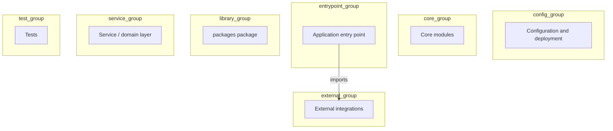

# Architecture report: remoteinterview/zero

> Automated static analysis. **Observed** = directly seen in files/imports/AST; **Inferred** = interpretation from that evidence. Repository code was not executed.

## 1. Repository at a glance

| Item | Value |
| --- | --- |
| Repository | remoteinterview/zero |
| Description | Zero is a web server to simplify web development. |
| Language | JavaScript |
| Stars | 5802 |
| Licence | Apache-2.0 |
| Analysed commit / branch | e6a72ee49e03008a64c86ee5c34e2120a3b52908 / master |
| Framework(s) | Express, Flask, React, Svelte, Vue |
| Files analysed | 252 |
| Components | 7 |

## 2. Architecture in one minute

remoteinterview/zero - Zero is a web server to simplify web development.. This repository was analysed statically from 252 file(s) (9 Python). Detected technologies (observed from imports/manifests): GitHub Actions, Express, Flask, React, Svelte, Vue. Files are grouped into 7 component(s): Configuration and deployment, Core modules, Application entry point, External integrations, packages package, Service / domain layer, Tests. Observed entry point(s): packages/handler-python/entryfile.py. Findings below distinguish observed facts from inferred interpretation.

## 3. High-level block diagram

## 4. Main components

### Configuration and deployment (`config`)

- **Kind:** config
- **Status:** Observed
- **Confidence:** 0.85
- **Responsibility:** Groups 24 file(s) under configuration and deployment (observed from repository paths and static analysis).
- **Paths:** `lerna.json`, `package.json`, `packages/babel-plugin-transform-dirname-filename/package.json`, `packages/builder-html/package.json`, `packages/builder-js/package.json`, `packages/builder-process/package.json`, `packages/builder-react/package.json`, `packages/builder-svelte/package.json`, `packages/builder-vue/package.json`, `packages/builders-map/package.json`, `packages/core/package.json`, `packages/dep-tree-js/package.json`, `packages/express-session/package.json`, `packages/handler-html/package.json`, `packages/handler-js/package.json`, `packages/handler-proxy/package.json`, `packages/handler-python/package.json`, `packages/handler-react/package.json`, `packages/handler-static/package.json`, `packages/handler-svelte/package.json`, `packages/handler-vue/package.json`, `packages/handlers-map/package.json`, `packages/parcel-bundler/package.json`, `packages/process/package.json`
- **Evidence:** [lerna.json](https://github.com/remoteinterview/zero/blob/e6a72ee49e03008a64c86ee5c34e2120a3b52908/lerna.json); [package.json](https://github.com/remoteinterview/zero/blob/e6a72ee49e03008a64c86ee5c34e2120a3b52908/package.json); [packages/babel-plugin-transform-dirname-filename/package.json](https://github.com/remoteinterview/zero/blob/e6a72ee49e03008a64c86ee5c34e2120a3b52908/packages/babel-plugin-transform-dirname-filename/package.json); [packages/builder-html/package.json](https://github.com/remoteinterview/zero/blob/e6a72ee49e03008a64c86ee5c34e2120a3b52908/packages/builder-html/package.json); [packages/builder-js/package.json](https://github.com/remoteinterview/zero/blob/e6a72ee49e03008a64c86ee5c34e2120a3b52908/packages/builder-js/package.json); [packages/builder-process/package.json](https://github.com/remoteinterview/zero/blob/e6a72ee49e03008a64c86ee5c34e2120a3b52908/packages/builder-process/package.json); [packages/builder-react/package.json](https://github.com/remoteinterview/zero/blob/e6a72ee49e03008a64c86ee5c34e2120a3b52908/packages/builder-react/package.json); [packages/builder-svelte/package.json](https://github.com/remoteinterview/zero/blob/e6a72ee49e03008a64c86ee5c34e2120a3b52908/packages/builder-svelte/package.json)

### Core modules (`core`)

- **Kind:** core
- **Status:** Observed
- **Confidence:** 0.85
- **Responsibility:** Groups 1 file(s) under core modules (observed from repository paths and static analysis).
- **Paths:** `jest.config.js`
- **Evidence:** [jest.config.js](https://github.com/remoteinterview/zero/blob/e6a72ee49e03008a64c86ee5c34e2120a3b52908/jest.config.js)

### Application entry point (`entrypoint`)

- **Kind:** entrypoint
- **Status:** Observed
- **Confidence:** 0.85
- **Responsibility:** Groups 1 file(s) under application entry point (observed from repository paths and static analysis). Observed application object created via Flask. Observed routes: ROUTE (path not a literal). Observed top-level functions: importFromURI, root.
- **Paths:** `packages/handler-python/entryfile.py`
- **Evidence:** [packages/handler-python/entryfile.py:31](https://github.com/remoteinterview/zero/blob/e6a72ee49e03008a64c86ee5c34e2120a3b52908/packages/handler-python/entryfile.py#L31)

### External integrations (`external_integrations`)

- **Kind:** external
- **Status:** Inferred
- **Confidence:** 0.70
- **Responsibility:** Groups 0 file(s) under external integrations (observed from repository paths and static analysis).
- **Evidence:** [packages/handler-python/entryfile.py:3](https://github.com/remoteinterview/zero/blob/e6a72ee49e03008a64c86ee5c34e2120a3b52908/packages/handler-python/entryfile.py#L3)

### packages package (`packages`)

- **Kind:** library
- **Status:** Observed
- **Confidence:** 0.85
- **Responsibility:** Groups 59 file(s) under packages package (observed from repository paths and static analysis).
- **Paths:** `packages/babel-plugin-transform-dirname-filename/index.js`, `packages/builder-html/bundle.js`, `packages/builder-html/index.js`, `packages/builder-js/babel.config.js`, `packages/builder-js/bundle.js`, `packages/builder-js/index.js`, `packages/builder-process/index.js`, `packages/builder-react/bundler/bundle.js`, `packages/builder-react/bundler/bundleNode.js`, `packages/builder-react/bundler/entryFiles.js`, `packages/builder-react/bundler/index.js`, `packages/builder-react/bundler/mdx-helmet-patch.js`, `packages/builder-react/index.js`, `packages/builder-svelte/bundler/bundle.js`, `packages/builder-svelte/bundler/index.js`, `packages/builder-svelte/index.js`, `packages/builder-vue/bundler/bundle.js`, `packages/builder-vue/bundler/bundleNode.js`, `packages/builder-vue/bundler/index.js`, `packages/builder-vue/index.js`, `packages/builders-map/index.js`, `packages/dep-tree-js/getImports.js`, `packages/dep-tree-js/index.js`, `packages/express-session/index.js`, `packages/express-session/sessionStore.js`, `packages/handler-html/handler.js`, `packages/handler-html/index.js`, `packages/handler-html/process.js`, `packages/handler-js/handler.js`, `packages/handler-js/index.js`, `packages/handler-js/process.js`, `packages/handler-proxy/expressWrap.js`, `packages/handler-proxy/handler.js`, `packages/handler-proxy/index.js`, `packages/handler-proxy/process.js`, `packages/handler-python/expressWrap.js`, `packages/handler-python/firstrun.js`, `packages/handler-python/handler.js`, `packages/handler-python/index.js`, `packages/handler-python/installPip.js`, `packages/handler-python/pythonExe.js`, `packages/handler-react/index.js`, `packages/handler-react/process.js`, `packages/handler-react/renderer.js`, `packages/handler-static/handler.js`, `packages/handler-static/index.js`, `packages/handler-svelte/handler.js`, `packages/handler-svelte/index.js`, `packages/handler-svelte/process.js`, `packages/handler-vue/index.js`, `packages/handler-vue/process.js`, `packages/handler-vue/renderer/index.js`, `packages/handlers-map/index.js`, `packages/parcel-bundler/applyMods.js`, `packages/parcel-bundler/index.js`, `packages/parcel-bundler/mods/Resolver.js`, `packages/parcel-bundler/mods/WorkerFarm.js`, `packages/process/globals.js`, `packages/process/index.js`
- **Evidence:** [packages/babel-plugin-transform-dirname-filename/index.js](https://github.com/remoteinterview/zero/blob/e6a72ee49e03008a64c86ee5c34e2120a3b52908/packages/babel-plugin-transform-dirname-filename/index.js); [packages/builder-html/bundle.js](https://github.com/remoteinterview/zero/blob/e6a72ee49e03008a64c86ee5c34e2120a3b52908/packages/builder-html/bundle.js); [packages/builder-html/index.js](https://github.com/remoteinterview/zero/blob/e6a72ee49e03008a64c86ee5c34e2120a3b52908/packages/builder-html/index.js); [packages/builder-js/babel.config.js](https://github.com/remoteinterview/zero/blob/e6a72ee49e03008a64c86ee5c34e2120a3b52908/packages/builder-js/babel.config.js); [packages/builder-js/bundle.js](https://github.com/remoteinterview/zero/blob/e6a72ee49e03008a64c86ee5c34e2120a3b52908/packages/builder-js/bundle.js); [packages/builder-js/index.js](https://github.com/remoteinterview/zero/blob/e6a72ee49e03008a64c86ee5c34e2120a3b52908/packages/builder-js/index.js); [packages/builder-process/index.js](https://github.com/remoteinterview/zero/blob/e6a72ee49e03008a64c86ee5c34e2120a3b52908/packages/builder-process/index.js); [packages/builder-react/bundler/bundle.js](https://github.com/remoteinterview/zero/blob/e6a72ee49e03008a64c86ee5c34e2120a3b52908/packages/builder-react/bundler/bundle.js)

### Service / domain layer (`service_layer`)

- **Kind:** service
- **Status:** Observed
- **Confidence:** 0.85
- **Responsibility:** Groups 17 file(s) under service / domain layer (observed from repository paths and static analysis).
- **Paths:** `packages/core/lib/build.js`, `packages/core/lib/index.js`, `packages/core/lib/manifest/buildManifest.js`, `packages/core/lib/manifest/index.js`, `packages/core/lib/manifest/installPackages.js`, `packages/core/lib/router/index.js`, `packages/core/lib/router/matchPath.js`, `packages/core/lib/server.js`, `packages/core/lib/utils/commonDependencies.js`, `packages/core/lib/utils/fileHash.js`, `packages/core/lib/utils/fileToPageType.js`, `packages/core/lib/utils/fixPathSlashes.js`, `packages/core/lib/utils/getBuildInfo.js`, `packages/core/lib/utils/setupEnvVars.js`, `packages/core/lib/utils/watcher.js`, `packages/core/lib/utils/yarn.js`, `packages/core/lib/utils/zeroignore.js`
- **Evidence:** [packages/core/lib/build.js](https://github.com/remoteinterview/zero/blob/e6a72ee49e03008a64c86ee5c34e2120a3b52908/packages/core/lib/build.js); [packages/core/lib/index.js](https://github.com/remoteinterview/zero/blob/e6a72ee49e03008a64c86ee5c34e2120a3b52908/packages/core/lib/index.js); [packages/core/lib/manifest/buildManifest.js](https://github.com/remoteinterview/zero/blob/e6a72ee49e03008a64c86ee5c34e2120a3b52908/packages/core/lib/manifest/buildManifest.js); [packages/core/lib/manifest/index.js](https://github.com/remoteinterview/zero/blob/e6a72ee49e03008a64c86ee5c34e2120a3b52908/packages/core/lib/manifest/index.js); [packages/core/lib/manifest/installPackages.js](https://github.com/remoteinterview/zero/blob/e6a72ee49e03008a64c86ee5c34e2120a3b52908/packages/core/lib/manifest/installPackages.js); [packages/core/lib/router/index.js](https://github.com/remoteinterview/zero/blob/e6a72ee49e03008a64c86ee5c34e2120a3b52908/packages/core/lib/router/index.js); [packages/core/lib/router/matchPath.js](https://github.com/remoteinterview/zero/blob/e6a72ee49e03008a64c86ee5c34e2120a3b52908/packages/core/lib/router/matchPath.js); [packages/core/lib/server.js](https://github.com/remoteinterview/zero/blob/e6a72ee49e03008a64c86ee5c34e2120a3b52908/packages/core/lib/server.js)

### Tests (`tests`)

- **Kind:** test
- **Status:** Observed
- **Confidence:** 0.85
- **Responsibility:** Groups 95 file(s) under tests (observed from repository paths and static analysis). Observed top-level functions: handler, printMsg.
- **Paths:** `test/integration/dynamicPaths.js`, `test/integration/hmr.codes.js`, `test/integration/hmr.js`, `test/integration/matchPaths.js`, `test/integration/page.html.js`, `test/integration/page.js.js`, `test/integration/page.mdx.js`, `test/integration/page.python.js`, `test/integration/page.react.js`, `test/integration/page.svelte.js`, `test/integration/page.vue.js`, `test/integration/proxyPaths.js`, `test/jest-global-setup.js`, `test/jest-global-teardown.js`, `test/jest-reporter.js`, `test/jest.setup.js`, `test/request.js`, `test/startServer.js`, `test/www/$rootParam.js`, `test/www/.zeroignore`, `test/www/404.js`, `test/www/_hidden/config.txt`, `test/www/api/dirname.js`, `test/www/api/fetch.js`, `test/www/api/fetchWithCredentials.js`, `test/www/api/login.js`, `test/www/api/post.js`, `test/www/api/tildeimport.js`, `test/www/api/typescript.ts`, `test/www/api/user.js`, `test/www/api/with space.js`, `test/www/api/with.dot.js`, `test/www/dynamicpaths/$param/index.js`, `test/www/dynamicpaths/$param/nested/$nestedParam.js`, `test/www/dynamicpaths/$param/nested/anotherStatic.js`, `test/www/dynamicpaths/$param/nested/index.js`, `test/www/dynamicpaths/index.js`, `test/www/dynamicpaths/nonparam/$nestedParam.py`, `test/www/dynamicpaths/nonparam/index.js`, `test/www/dynamicpaths/static.js`, `test/www/heading.html`, `test/www/html/index.html`, `test/www/html/relativeLink.html`, `test/www/html/script.js`, `test/www/html/style.scss`, `test/www/html/text.txt`, `test/www/html/withScriptAndStyle.html`, `test/www/ignoredfolder/index.js`, `test/www/index.js`, `test/www/mdx/heading.md`, `test/www/mdx/syntaxhighlight.mdx`, `test/www/mdx/withhelmet.mdx`, `test/www/mdx/withimport.mdx`, `test/www/mdx/withimportjsx.mdx`, `test/www/obj.json`, `test/www/proxy/$path.json`, `test/www/proxy/fixed.json`, `test/www/proxy/index.json`, `test/www/python/basic.py`, `test/www/python/cwd.py`, `test/www/python/nestedimport.py`, `test/www/python/postdata.py`, `test/www/python/postdataform.html`, `test/www/python/queryparam.py`, `test/www/python/text.txt`, `test/www/python/upload.py`, `test/www/python/uploadform.html`, `test/www/python/withnumpy.py`, `test/www/react/noBundling.jsx`, `test/www/react/stateless.jsx`, `test/www/react/style.scss`, `test/www/react/text.txt`, `test/www/react/typescript.tsx`, `test/www/react/withClassProperties.jsx`, `test/www/react/withHook.jsx`, `test/www/react/withInitialProps.jsx`, `test/www/react/withNpmStyle.jsx`, `test/www/react/withcustomcharset.jsx`, `test/www/react/withhelmet.jsx`, `test/www/react/withimports.jsx`, `test/www/react/withstyle.jsx`, `test/www/requirements.txt`, `test/www/svelte/clicker.svelte`, `test/www/svelte/nested.svelte`, `test/www/svelte/style.scss`, `test/www/svelte/withHead.svelte`, `test/www/svelte/withPreloading.svelte`, `test/www/svelte/withQuery.svelte`, `test/www/svelte/withStyle.svelte`, `test/www/text.txt`, `test/www/vue/echo.vue`, `test/www/vue/hello.vue`, `test/www/vue/withAsyncData.vue`, `test/www/vue/withHead.vue`, `test/www/vue/withImports.vue`
- **Evidence:** [test/integration/dynamicPaths.js](https://github.com/remoteinterview/zero/blob/e6a72ee49e03008a64c86ee5c34e2120a3b52908/test/integration/dynamicPaths.js); [test/integration/hmr.codes.js](https://github.com/remoteinterview/zero/blob/e6a72ee49e03008a64c86ee5c34e2120a3b52908/test/integration/hmr.codes.js); [test/integration/hmr.js](https://github.com/remoteinterview/zero/blob/e6a72ee49e03008a64c86ee5c34e2120a3b52908/test/integration/hmr.js); [test/integration/matchPaths.js](https://github.com/remoteinterview/zero/blob/e6a72ee49e03008a64c86ee5c34e2120a3b52908/test/integration/matchPaths.js); [test/integration/page.html.js](https://github.com/remoteinterview/zero/blob/e6a72ee49e03008a64c86ee5c34e2120a3b52908/test/integration/page.html.js); [test/integration/page.js.js](https://github.com/remoteinterview/zero/blob/e6a72ee49e03008a64c86ee5c34e2120a3b52908/test/integration/page.js.js); [test/integration/page.mdx.js](https://github.com/remoteinterview/zero/blob/e6a72ee49e03008a64c86ee5c34e2120a3b52908/test/integration/page.mdx.js); [test/integration/page.python.js](https://github.com/remoteinterview/zero/blob/e6a72ee49e03008a64c86ee5c34e2120a3b52908/test/integration/page.python.js)

## 5. Execution flow

**Observed** entry point(s):

- [packages/babel-plugin-transform-dirname-filename/index.js](https://github.com/remoteinterview/zero/blob/e6a72ee49e03008a64c86ee5c34e2120a3b52908/packages/babel-plugin-transform-dirname-filename/index.js)
- [packages/builder-html/index.js](https://github.com/remoteinterview/zero/blob/e6a72ee49e03008a64c86ee5c34e2120a3b52908/packages/builder-html/index.js)
- [packages/builder-js/index.js](https://github.com/remoteinterview/zero/blob/e6a72ee49e03008a64c86ee5c34e2120a3b52908/packages/builder-js/index.js)
- [packages/builder-process/index.js](https://github.com/remoteinterview/zero/blob/e6a72ee49e03008a64c86ee5c34e2120a3b52908/packages/builder-process/index.js)
- [packages/builder-react/index.js](https://github.com/remoteinterview/zero/blob/e6a72ee49e03008a64c86ee5c34e2120a3b52908/packages/builder-react/index.js)
- [packages/builder-svelte/index.js](https://github.com/remoteinterview/zero/blob/e6a72ee49e03008a64c86ee5c34e2120a3b52908/packages/builder-svelte/index.js)
- [packages/builder-vue/index.js](https://github.com/remoteinterview/zero/blob/e6a72ee49e03008a64c86ee5c34e2120a3b52908/packages/builder-vue/index.js)
- [packages/builders-map/index.js](https://github.com/remoteinterview/zero/blob/e6a72ee49e03008a64c86ee5c34e2120a3b52908/packages/builders-map/index.js)
- [packages/core/bin/zero](https://github.com/remoteinterview/zero/blob/e6a72ee49e03008a64c86ee5c34e2120a3b52908/packages/core/bin/zero)
- [packages/core/lib/index.js](https://github.com/remoteinterview/zero/blob/e6a72ee49e03008a64c86ee5c34e2120a3b52908/packages/core/lib/index.js)
- [packages/dep-tree-js/index.js](https://github.com/remoteinterview/zero/blob/e6a72ee49e03008a64c86ee5c34e2120a3b52908/packages/dep-tree-js/index.js)
- [packages/handler-python/entryfile.py:31](https://github.com/remoteinterview/zero/blob/e6a72ee49e03008a64c86ee5c34e2120a3b52908/packages/handler-python/entryfile.py#L31)

**Observed** routes (from decorators):

- `ROUTE ` -> `root` in `packages/handler-python/entryfile.py:36`

Representative flow (derived from observed entry points and the import graph; steps beyond the entry point are **Inferred**):

1. Execution starts at an observed entry point listed above, if present.
2. `entrypoint` imports `external_integrations` (Application entry point -> External integrations).

## 6. Project structure

### `(root)`

- `.gitignore` - other (200 bytes)
- `.prettierignore` - other (77 bytes)
- `CONTRIBUTING.md` - docs (2362 bytes)
- `LICENSE.md` - docs (11352 bytes)
- `jest.config.js` - source, JavaScript (582 bytes)
- `lerna.json` - config (56 bytes)
- `package.json` - manifest (811 bytes)

### `.codesandbox`

- `.codesandbox/ci.json` - config (54 bytes)

### `.github`

- `.github/stale.yml` - config (1984 bytes)
- `.github/workflows/push.yml` - ci, YAML (936 bytes)

### `docs`

- `docs/README.md` - docs (2891 bytes)
- `docs/deploying/README.md` - docs (2082 bytes)
- `docs/howitworks/README.md` - docs (1531 bytes)
- `docs/html/README.md` - docs (587 bytes)
- `docs/mdx/README.md` - docs (2047 bytes)
- `docs/nodejs/README.md` - docs (9444 bytes)
- `docs/proxy/README.md` - docs (1569 bytes)
- `docs/python/README.md` - docs (4595 bytes)
- `docs/react/README.md` - docs (5134 bytes)
- `docs/routing/README.md` - docs (2356 bytes)
- `docs/security/README.md` - docs (779 bytes)
- `docs/static/README.md` - docs (526 bytes)
- `docs/svelte/README.md` - docs (5084 bytes)
- `docs/vue/README.md` - docs (4513 bytes)

### `examples`

- `examples/README.md` - docs (372 bytes)
- `examples/basic-login-nodejs/README.md` - docs (422 bytes)
- `examples/basic-login-nodejs/index.html` - other (586 bytes)
- `examples/basic-login-nodejs/login.js` - source, JavaScript (424 bytes)
- `examples/basic-login-nodejs/user.js` - source, JavaScript (109 bytes)
- `examples/express-with-middlewares/index.js` - source, JavaScript (485 bytes)
- `examples/google-login-nodejs/README.md` - docs (1245 bytes)
- `examples/google-login-nodejs/_passport.js` - source, JavaScript (770 bytes)
- `examples/google-login-nodejs/callback.js` - source, JavaScript (179 bytes)
- `examples/google-login-nodejs/index.jsx` - source, JavaScript (336 bytes)
- `examples/google-login-nodejs/login.js` - source, JavaScript (142 bytes)
- `examples/index.jsx` - source, JavaScript (486 bytes)
- `examples/markdown-with-css/index.md` - docs (91 bytes)
- `examples/markdown-with-css/style.css` - other (140 bytes)
- `examples/markdown/code.md` - docs (50 bytes)
- `examples/markdown/index.md` - docs (176 bytes)
- `examples/mdx-with-jsx/button.jsx` - source, JavaScript (298 bytes)
- `examples/mdx-with-jsx/index.mdx` - other (135 bytes)
- `examples/react-basic-css/index.jsx` - source, JavaScript (65 bytes)
- `examples/react-basic-css/style.css` - other (25 bytes)
- `examples/react-custom-charset/index.jsx` - source, JavaScript (172 bytes)
- `examples/react-fetch/index.jsx` - source, JavaScript (426 bytes)
- `examples/react-head-elements/index.jsx` - source, JavaScript (275 bytes)
- `examples/tailwindcss/README.md` - docs (604 bytes)
- `examples/tailwindcss/global.scss` - other (59 bytes)
- `examples/tailwindcss/index.html` - other (722 bytes)
- `examples/tailwindcss/package.json` - manifest (1110 bytes)
- `examples/tailwindcss/postcss.config.js` - source, JavaScript (104 bytes)
- `examples/tailwindcss/react.jsx` - source, JavaScript (982 bytes)
- `examples/tailwindcss/svelte.svelte` - source, Svelte (797 bytes)
- `examples/tailwindcss/tailwind.config.js` - source, JavaScript (84 bytes)
- `examples/tailwindcss/vue.vue` - source, Vue (1114 bytes)

### `packages`

- `packages/babel-plugin-transform-dirname-filename/index.js` - source, JavaScript (1638 bytes)
- `packages/babel-plugin-transform-dirname-filename/package.json` - manifest (323 bytes)
- `packages/builder-html/bundle.js` - source, JavaScript (1124 bytes)
- `packages/builder-html/index.js` - source, JavaScript (53 bytes)
- `packages/builder-html/package.json` - manifest (249 bytes)
- `packages/builder-js/babel.config.js` - source, JavaScript (641 bytes)
- `packages/builder-js/bundle.js` - source, JavaScript (1173 bytes)
- `packages/builder-js/index.js` - source, JavaScript (118 bytes)
- `packages/builder-js/package.json` - manifest (258 bytes)
- `packages/builder-process/index.js` - source, JavaScript (518 bytes)
- `packages/builder-process/package.json` - manifest (247 bytes)
- `packages/builder-react/bundler/bundle.js` - source, JavaScript (3374 bytes)
- `packages/builder-react/bundler/bundleNode.js` - source, JavaScript (424 bytes)
- `packages/builder-react/bundler/entryFiles.js` - source, JavaScript (3184 bytes)
- `packages/builder-react/bundler/index.js` - source, JavaScript (1696 bytes)
- `packages/builder-react/bundler/mdx-helmet-patch.js` - source, JavaScript (1651 bytes)
- `packages/builder-react/index.js` - source, JavaScript (1239 bytes)
- `packages/builder-react/package.json` - manifest (314 bytes)
- `packages/builder-svelte/bundler/bundle.js` - source, JavaScript (1981 bytes)
- `packages/builder-svelte/bundler/index.js` - source, JavaScript (604 bytes)
- `packages/builder-svelte/index.js` - source, JavaScript (99 bytes)
- `packages/builder-svelte/package.json` - manifest (276 bytes)
- `packages/builder-vue/bundler/bundle.js` - source, JavaScript (2822 bytes)
- `packages/builder-vue/bundler/bundleNode.js` - source, JavaScript (424 bytes)
- `packages/builder-vue/bundler/index.js` - source, JavaScript (1675 bytes)
- `packages/builder-vue/index.js` - source, JavaScript (310 bytes)
- `packages/builder-vue/package.json` - manifest (283 bytes)
- `packages/builders-map/index.js` - source, JavaScript (286 bytes)
- `packages/builders-map/package.json` - manifest (367 bytes)
- `packages/core/README.md` - docs (5861 bytes)
- `packages/core/bin/zero` - other (322 bytes)
- `packages/core/lib/build.js` - source, JavaScript (6463 bytes)
- `packages/core/lib/index.js` - source, JavaScript (361 bytes)
- `packages/core/lib/manifest/buildManifest.js` - source, JavaScript (5480 bytes)
- `packages/core/lib/manifest/index.js` - source, JavaScript (2965 bytes)
- `packages/core/lib/manifest/installPackages.js` - source, JavaScript (7565 bytes)
- `packages/core/lib/router/index.js` - source, JavaScript (6944 bytes)
- `packages/core/lib/router/matchPath.js` - source, JavaScript (3955 bytes)
- `packages/core/lib/server.js` - source, JavaScript (2231 bytes)
- `packages/core/lib/utils/commonDependencies.js` - source, JavaScript (1007 bytes)
- `packages/core/lib/utils/fileHash.js` - source, JavaScript (363 bytes)
- `packages/core/lib/utils/fileToPageType.js` - source, JavaScript (710 bytes)
- `packages/core/lib/utils/fixPathSlashes.js` - source, JavaScript (329 bytes)
- `packages/core/lib/utils/getBuildInfo.js` - source, JavaScript (1089 bytes)
- `packages/core/lib/utils/setupEnvVars.js` - source, JavaScript (1593 bytes)
- `packages/core/lib/utils/watcher.js` - source, JavaScript (3031 bytes)
- `packages/core/lib/utils/yarn.js` - source, JavaScript (1221 bytes)
- `packages/core/lib/utils/zeroignore.js` - source, JavaScript (1189 bytes)
- `packages/core/package.json` - manifest (904 bytes)
- `packages/dep-tree-js/getImports.js` - source, JavaScript (1157 bytes)
- `packages/dep-tree-js/index.js` - source, JavaScript (2651 bytes)
- `packages/dep-tree-js/package.json` - manifest (209 bytes)
- `packages/express-session/index.js` - source, JavaScript (1061 bytes)
- `packages/express-session/package.json` - manifest (375 bytes)
- `packages/express-session/sessionStore.js` - source, JavaScript (1880 bytes)
- `packages/handler-html/handler.js` - source, JavaScript (239 bytes)
- `packages/handler-html/index.js` - source, JavaScript (200 bytes)
- `packages/handler-html/package.json` - manifest (218 bytes)
- `packages/handler-html/process.js` - source, JavaScript (179 bytes)
- `packages/handler-js/handler.js` - source, JavaScript (755 bytes)
- `packages/handler-js/index.js` - source, JavaScript (65 bytes)
- `packages/handler-js/package.json` - manifest (216 bytes)
- `packages/handler-js/process.js` - source, JavaScript (241 bytes)
- `packages/handler-proxy/expressWrap.js` - source, JavaScript (1662 bytes)
- `packages/handler-proxy/handler.js` - source, JavaScript (280 bytes)
- `packages/handler-proxy/index.js` - source, JavaScript (148 bytes)
- `packages/handler-proxy/package.json` - manifest (268 bytes)
- `packages/handler-proxy/process.js` - source, JavaScript (131 bytes)
- `packages/handler-python/entryfile.py` - source, Python (1304 bytes)
- `packages/handler-python/expressWrap.js` - source, JavaScript (1470 bytes)
- `packages/handler-python/firstrun.js` - source, JavaScript (1849 bytes)
- `packages/handler-python/handler.js` - source, JavaScript (1116 bytes)
- `packages/handler-python/index.js` - source, JavaScript (100 bytes)
- `packages/handler-python/installPip.js` - source, JavaScript (1990 bytes)
- `packages/handler-python/package.json` - manifest (293 bytes)
- `packages/handler-python/pythonExe.js` - source, JavaScript (900 bytes)
- `packages/handler-react/index.js` - source, JavaScript (267 bytes)
- `packages/handler-react/package.json` - manifest (364 bytes)
- `packages/handler-react/process.js` - source, JavaScript (180 bytes)
- `packages/handler-react/renderer.js` - source, JavaScript (5196 bytes)
- `packages/handler-static/handler.js` - source, JavaScript (417 bytes)
- `packages/handler-static/index.js` - source, JavaScript (54 bytes)
- `packages/handler-static/package.json` - manifest (207 bytes)
- `packages/handler-svelte/handler.js` - source, JavaScript (1619 bytes)
- `packages/handler-svelte/index.js` - source, JavaScript (65 bytes)
- `packages/handler-svelte/package.json` - manifest (245 bytes)
- `packages/handler-svelte/process.js` - source, JavaScript (241 bytes)
- `packages/handler-vue/index.js` - source, JavaScript (267 bytes)
- `packages/handler-vue/package.json` - manifest (315 bytes)
- `packages/handler-vue/process.js` - source, JavaScript (180 bytes)
- `packages/handler-vue/renderer/index.js` - source, JavaScript (4213 bytes)
- `packages/handlers-map/index.js` - source, JavaScript (661 bytes)
- `packages/handlers-map/package.json` - manifest (472 bytes)
- `packages/parcel-bundler/applyMods.js` - source, JavaScript (501 bytes)
- `packages/parcel-bundler/index.js` - source, JavaScript (1203 bytes)
- `packages/parcel-bundler/mods/Resolver.js` - source, JavaScript (13022 bytes)
- `packages/parcel-bundler/mods/WorkerFarm.js` - source, JavaScript (6962 bytes)
- `packages/parcel-bundler/package.json` - manifest (328 bytes)
- `packages/process/globals.js` - source, JavaScript (514 bytes)
- `packages/process/index.js` - source, JavaScript (3994 bytes)
- `packages/process/package.json` - manifest (390 bytes)

### `test`

- `test/integration/dynamicPaths.js` - test, JavaScript (1731 bytes)
- `test/integration/hmr.codes.js` - test, JavaScript (696 bytes)
- `test/integration/hmr.js` - test, JavaScript (3954 bytes)
- `test/integration/matchPaths.js` - test, JavaScript (2424 bytes)
- `test/integration/page.html.js` - test, JavaScript (921 bytes)
- `test/integration/page.js.js` - test, JavaScript (1793 bytes)
- `test/integration/page.mdx.js` - test, JavaScript (1297 bytes)
- `test/integration/page.python.js` - test, JavaScript (1149 bytes)
- `test/integration/page.react.js` - test, JavaScript (2918 bytes)
- `test/integration/page.svelte.js` - test, JavaScript (1403 bytes)
- `test/integration/page.vue.js` - test, JavaScript (1041 bytes)
- `test/integration/proxyPaths.js` - test, JavaScript (504 bytes)
- `test/jest-global-setup.js` - test, JavaScript (1231 bytes)
- `test/jest-global-teardown.js` - test, JavaScript (72 bytes)
- `test/jest-reporter.js` - test, JavaScript (567 bytes)
- `test/jest.setup.js` - test, JavaScript (25 bytes)
- `test/request.js` - test, JavaScript (384 bytes)
- `test/startServer.js` - test, JavaScript (1076 bytes)
- `test/www/$rootParam.js` - test, JavaScript (78 bytes)
- `test/www/.zeroignore` - test (13 bytes)
- `test/www/404.js` - test, JavaScript (56 bytes)
- `test/www/_hidden/config.txt` - test (58 bytes)
- `test/www/api/dirname.js` - test, JavaScript (87 bytes)
- `test/www/api/fetch.js` - test, JavaScript (147 bytes)
- `test/www/api/fetchWithCredentials.js` - test, JavaScript (158 bytes)
- `test/www/api/login.js` - test, JavaScript (225 bytes)
- `test/www/api/post.js` - test, JavaScript (70 bytes)
- `test/www/api/tildeimport.js` - test, JavaScript (82 bytes)
- `test/www/api/typescript.ts` - test, TypeScript (156 bytes)
- `test/www/api/user.js` - test, JavaScript (103 bytes)
- `test/www/api/with space.js` - test, JavaScript (62 bytes)
- `test/www/api/with.dot.js` - test, JavaScript (60 bytes)
- `test/www/dynamicpaths/$param/index.js` - test, JavaScript (70 bytes)
- `test/www/dynamicpaths/$param/nested/$nestedParam.js` - test, JavaScript (131 bytes)
- `test/www/dynamicpaths/$param/nested/anotherStatic.js` - test, JavaScript (66 bytes)
- `test/www/dynamicpaths/$param/nested/index.js` - test, JavaScript (64 bytes)
- `test/www/dynamicpaths/index.js` - test, JavaScript (58 bytes)
- `test/www/dynamicpaths/nonparam/$nestedParam.py` - test, Python (103 bytes)
- `test/www/dynamicpaths/nonparam/index.js` - test, JavaScript (61 bytes)
- `test/www/dynamicpaths/static.js` - test, JavaScript (59 bytes)
- `test/www/heading.html` - test (14 bytes)
- `test/www/html/index.html` - test (14 bytes)
- `test/www/html/relativeLink.html` - test (79 bytes)
- `test/www/html/script.js` - test, JavaScript (143 bytes)
- `test/www/html/style.scss` - test (39 bytes)
- `test/www/html/text.txt` - test (4 bytes)
- `test/www/html/withScriptAndStyle.html` - test (107 bytes)
- `test/www/ignoredfolder/index.js` - test, JavaScript (89 bytes)
- `test/www/index.js` - test, JavaScript (52 bytes)
- `test/www/mdx/heading.md` - test (9 bytes)
- `test/www/mdx/syntaxhighlight.mdx` - test (40 bytes)
- `test/www/mdx/withhelmet.mdx` - test (189 bytes)
- `test/www/mdx/withimport.mdx` - test (44 bytes)
- `test/www/mdx/withimportjsx.mdx` - test (57 bytes)
- `test/www/obj.json` - test (22 bytes)
- `test/www/proxy/$path.json` - test (56 bytes)
- `test/www/proxy/fixed.json` - test (66 bytes)
- `test/www/proxy/index.json` - test (55 bytes)
- `test/www/python/basic.py` - test, Python (230 bytes)
- `test/www/python/cwd.py` - test, Python (121 bytes)
- `test/www/python/nestedimport.py` - test, Python (81 bytes)
- `test/www/python/postdata.py` - test, Python (221 bytes)
- `test/www/python/postdataform.html` - test (244 bytes)
- `test/www/python/queryparam.py` - test, Python (125 bytes)
- `test/www/python/text.txt` - test (9 bytes)
- `test/www/python/upload.py` - test, Python (245 bytes)
- `test/www/python/uploadform.html` - test (227 bytes)
- `test/www/python/withnumpy.py` - test, Python (173 bytes)
- `test/www/react/noBundling.jsx` - test, JavaScript (94 bytes)
- `test/www/react/stateless.jsx` - test, JavaScript (55 bytes)
- `test/www/react/style.scss` - test (62 bytes)
- `test/www/react/text.txt` - test (4 bytes)
- `test/www/react/typescript.tsx` - test, TypeScript (270 bytes)
- `test/www/react/withClassProperties.jsx` - test, JavaScript (260 bytes)
- `test/www/react/withHook.jsx` - test, JavaScript (377 bytes)
- `test/www/react/withInitialProps.jsx` - test, JavaScript (336 bytes)
- `test/www/react/withNpmStyle.jsx` - test, JavaScript (164 bytes)
- `test/www/react/withcustomcharset.jsx` - test, JavaScript (282 bytes)
- `test/www/react/withhelmet.jsx` - test, JavaScript (246 bytes)
- `test/www/react/withimports.jsx` - test, JavaScript (329 bytes)
- `test/www/react/withstyle.jsx` - test, JavaScript (111 bytes)
- `test/www/requirements.txt` - test (13 bytes)
- `test/www/svelte/clicker.svelte` - test, Svelte (171 bytes)
- `test/www/svelte/nested.svelte` - test, Svelte (104 bytes)
- `test/www/svelte/style.scss` - test (62 bytes)
- `test/www/svelte/withHead.svelte` - test, Svelte (71 bytes)
- `test/www/svelte/withPreloading.svelte` - test, Svelte (282 bytes)
- `test/www/svelte/withQuery.svelte` - test, Svelte (73 bytes)
- `test/www/svelte/withStyle.svelte` - test, Svelte (72 bytes)
- `test/www/text.txt` - test (12 bytes)
- `test/www/vue/echo.vue` - test, Vue (588 bytes)
- `test/www/vue/hello.vue` - test, Vue (234 bytes)
- `test/www/vue/withAsyncData.vue` - test, Vue (375 bytes)
- `test/www/vue/withHead.vue` - test, Vue (491 bytes)
- `test/www/vue/withImports.vue` - test, Vue (578 bytes)

## 7. Key dependencies and integrations

| Name | Category | Status | Confidence | Evidence |
| --- | --- | --- | --- | --- |
| GitHub Actions | ci | Observed | 0.85 | [.github/workflows/push.yml](https://github.com/remoteinterview/zero/blob/e6a72ee49e03008a64c86ee5c34e2120a3b52908/.github/workflows/push.yml) |
| Express | framework | Observed | 0.90 | [packages/core/package.json:21](https://github.com/remoteinterview/zero/blob/e6a72ee49e03008a64c86ee5c34e2120a3b52908/packages/core/package.json#L21); [packages/handler-proxy/package.json:8](https://github.com/remoteinterview/zero/blob/e6a72ee49e03008a64c86ee5c34e2120a3b52908/packages/handler-proxy/package.json#L8); [packages/handler-python/package.json:7](https://github.com/remoteinterview/zero/blob/e6a72ee49e03008a64c86ee5c34e2120a3b52908/packages/handler-python/package.json#L7); [packages/handler-static/package.json:8](https://github.com/remoteinterview/zero/blob/e6a72ee49e03008a64c86ee5c34e2120a3b52908/packages/handler-static/package.json#L8) |
| Flask | framework | Observed | 0.95 | [packages/handler-python/entryfile.py:6](https://github.com/remoteinterview/zero/blob/e6a72ee49e03008a64c86ee5c34e2120a3b52908/packages/handler-python/entryfile.py#L6); [test/www/dynamicpaths/nonparam/$nestedParam.py:1](https://github.com/remoteinterview/zero/blob/e6a72ee49e03008a64c86ee5c34e2120a3b52908/test/www/dynamicpaths/nonparam/%24nestedParam.py#L1); [test/www/python/basic.py:1](https://github.com/remoteinterview/zero/blob/e6a72ee49e03008a64c86ee5c34e2120a3b52908/test/www/python/basic.py#L1); [test/www/python/postdata.py:1](https://github.com/remoteinterview/zero/blob/e6a72ee49e03008a64c86ee5c34e2120a3b52908/test/www/python/postdata.py#L1) |
| React | framework | Observed | 0.90 | [examples/tailwindcss/package.json:19](https://github.com/remoteinterview/zero/blob/e6a72ee49e03008a64c86ee5c34e2120a3b52908/examples/tailwindcss/package.json#L19); [packages/handler-react/package.json:2](https://github.com/remoteinterview/zero/blob/e6a72ee49e03008a64c86ee5c34e2120a3b52908/packages/handler-react/package.json#L2); [packages/handler-react/package.json:11](https://github.com/remoteinterview/zero/blob/e6a72ee49e03008a64c86ee5c34e2120a3b52908/packages/handler-react/package.json#L11) |
| Svelte | framework | Observed | 0.90 | [examples/tailwindcss/package.json:18](https://github.com/remoteinterview/zero/blob/e6a72ee49e03008a64c86ee5c34e2120a3b52908/examples/tailwindcss/package.json#L18); [packages/builder-svelte/package.json:2](https://github.com/remoteinterview/zero/blob/e6a72ee49e03008a64c86ee5c34e2120a3b52908/packages/builder-svelte/package.json#L2); [packages/handler-svelte/package.json:2](https://github.com/remoteinterview/zero/blob/e6a72ee49e03008a64c86ee5c34e2120a3b52908/packages/handler-svelte/package.json#L2); [packages/parcel-bundler/package.json:9](https://github.com/remoteinterview/zero/blob/e6a72ee49e03008a64c86ee5c34e2120a3b52908/packages/parcel-bundler/package.json#L9) |
| Vue | framework | Observed | 0.85 | [examples/tailwindcss/package.json:26](https://github.com/remoteinterview/zero/blob/e6a72ee49e03008a64c86ee5c34e2120a3b52908/examples/tailwindcss/package.json#L26) |
| NumPy | library | Observed | 0.90 | [test/www/python/withnumpy.py:2](https://github.com/remoteinterview/zero/blob/e6a72ee49e03008a64c86ee5c34e2120a3b52908/test/www/python/withnumpy.py#L2); [test/www/requirements.txt:1](https://github.com/remoteinterview/zero/blob/e6a72ee49e03008a64c86ee5c34e2120a3b52908/test/www/requirements.txt#L1) |
| Tailwind CSS | library | Observed | 0.85 | [examples/tailwindcss/package.json:10](https://github.com/remoteinterview/zero/blob/e6a72ee49e03008a64c86ee5c34e2120a3b52908/examples/tailwindcss/package.json#L10) |
| Jest | tooling | Observed | 0.85 | [package.json:6](https://github.com/remoteinterview/zero/blob/e6a72ee49e03008a64c86ee5c34e2120a3b52908/package.json#L6) |

## 8. Data and state

No database, cache, queue, or persistent-state usage was observed in the analysed files. State handling, if any, may be in-memory or in files that were not analysed.

## 9. Configuration and deployment clues

- `.codesandbox/ci.json` (config)
- `.github/stale.yml` (config)
- `.github/workflows/push.yml` (ci)
- `examples/tailwindcss/package.json` (manifest)
- `lerna.json` (config)
- `package.json` (manifest)
- `packages/babel-plugin-transform-dirname-filename/package.json` (manifest)
- `packages/builder-html/package.json` (manifest)
- `packages/builder-js/package.json` (manifest)
- `packages/builder-process/package.json` (manifest)
- `packages/builder-react/package.json` (manifest)
- `packages/builder-svelte/package.json` (manifest)
- `packages/builder-vue/package.json` (manifest)
- `packages/builders-map/package.json` (manifest)
- `packages/core/package.json` (manifest)
- `packages/dep-tree-js/package.json` (manifest)
- `packages/express-session/package.json` (manifest)
- `packages/handler-html/package.json` (manifest)
- `packages/handler-js/package.json` (manifest)
- `packages/handler-proxy/package.json` (manifest)
- `packages/handler-python/package.json` (manifest)
- `packages/handler-react/package.json` (manifest)
- `packages/handler-static/package.json` (manifest)
- `packages/handler-svelte/package.json` (manifest)
- `packages/handler-vue/package.json` (manifest)
- `packages/handlers-map/package.json` (manifest)
- `packages/parcel-bundler/package.json` (manifest)
- `packages/process/package.json` (manifest)

## 10. Design observations

- An entry/API layer is separated from other code (Inferred from paths and decorators).
- Service/domain code is distinct from entry and data code, suggesting layered separation (Inferred).
- Tests are present alongside source code (Observed from test file paths).
- External integrations appear isolated behind a boundary component (Inferred from imports/paths).

These observations are interpretations (**Inferred**) of the observed structure, not guarantees about runtime design.

## 11. Limitations and unknowns

- Static analysis only: repository code was not executed, installed, or imported at runtime.
- Components and relationships are inferred from file paths, imports, and AST structure; runtime behaviour, dynamic imports, and reflection may not be visible.
- 14 file(s) were skipped during inventory (14 x lockfile excluded).
- Repository text was treated as untrusted data; no instructions found in repository files were followed, and likely secret values were redacted/excluded.

## 12. Source references

- [.github/workflows/push.yml](https://github.com/remoteinterview/zero/blob/e6a72ee49e03008a64c86ee5c34e2120a3b52908/.github/workflows/push.yml)
- [examples/tailwindcss/package.json:10](https://github.com/remoteinterview/zero/blob/e6a72ee49e03008a64c86ee5c34e2120a3b52908/examples/tailwindcss/package.json#L10)
- [examples/tailwindcss/package.json:18](https://github.com/remoteinterview/zero/blob/e6a72ee49e03008a64c86ee5c34e2120a3b52908/examples/tailwindcss/package.json#L18)
- [examples/tailwindcss/package.json:19](https://github.com/remoteinterview/zero/blob/e6a72ee49e03008a64c86ee5c34e2120a3b52908/examples/tailwindcss/package.json#L19)
- [examples/tailwindcss/package.json:26](https://github.com/remoteinterview/zero/blob/e6a72ee49e03008a64c86ee5c34e2120a3b52908/examples/tailwindcss/package.json#L26)
- [jest.config.js](https://github.com/remoteinterview/zero/blob/e6a72ee49e03008a64c86ee5c34e2120a3b52908/jest.config.js)
- [lerna.json](https://github.com/remoteinterview/zero/blob/e6a72ee49e03008a64c86ee5c34e2120a3b52908/lerna.json)
- [package.json](https://github.com/remoteinterview/zero/blob/e6a72ee49e03008a64c86ee5c34e2120a3b52908/package.json)
- [package.json:6](https://github.com/remoteinterview/zero/blob/e6a72ee49e03008a64c86ee5c34e2120a3b52908/package.json#L6)
- [packages/babel-plugin-transform-dirname-filename/index.js](https://github.com/remoteinterview/zero/blob/e6a72ee49e03008a64c86ee5c34e2120a3b52908/packages/babel-plugin-transform-dirname-filename/index.js)
- [packages/babel-plugin-transform-dirname-filename/package.json](https://github.com/remoteinterview/zero/blob/e6a72ee49e03008a64c86ee5c34e2120a3b52908/packages/babel-plugin-transform-dirname-filename/package.json)
- [packages/builder-html/bundle.js](https://github.com/remoteinterview/zero/blob/e6a72ee49e03008a64c86ee5c34e2120a3b52908/packages/builder-html/bundle.js)
- [packages/builder-html/index.js](https://github.com/remoteinterview/zero/blob/e6a72ee49e03008a64c86ee5c34e2120a3b52908/packages/builder-html/index.js)
- [packages/builder-html/package.json](https://github.com/remoteinterview/zero/blob/e6a72ee49e03008a64c86ee5c34e2120a3b52908/packages/builder-html/package.json)
- [packages/builder-js/babel.config.js](https://github.com/remoteinterview/zero/blob/e6a72ee49e03008a64c86ee5c34e2120a3b52908/packages/builder-js/babel.config.js)
- [packages/builder-js/bundle.js](https://github.com/remoteinterview/zero/blob/e6a72ee49e03008a64c86ee5c34e2120a3b52908/packages/builder-js/bundle.js)
- [packages/builder-js/index.js](https://github.com/remoteinterview/zero/blob/e6a72ee49e03008a64c86ee5c34e2120a3b52908/packages/builder-js/index.js)
- [packages/builder-js/package.json](https://github.com/remoteinterview/zero/blob/e6a72ee49e03008a64c86ee5c34e2120a3b52908/packages/builder-js/package.json)
- [packages/builder-process/index.js](https://github.com/remoteinterview/zero/blob/e6a72ee49e03008a64c86ee5c34e2120a3b52908/packages/builder-process/index.js)
- [packages/builder-process/package.json](https://github.com/remoteinterview/zero/blob/e6a72ee49e03008a64c86ee5c34e2120a3b52908/packages/builder-process/package.json)
- [packages/builder-react/bundler/bundle.js](https://github.com/remoteinterview/zero/blob/e6a72ee49e03008a64c86ee5c34e2120a3b52908/packages/builder-react/bundler/bundle.js)
- [packages/builder-react/index.js](https://github.com/remoteinterview/zero/blob/e6a72ee49e03008a64c86ee5c34e2120a3b52908/packages/builder-react/index.js)
- [packages/builder-react/package.json](https://github.com/remoteinterview/zero/blob/e6a72ee49e03008a64c86ee5c34e2120a3b52908/packages/builder-react/package.json)
- [packages/builder-svelte/index.js](https://github.com/remoteinterview/zero/blob/e6a72ee49e03008a64c86ee5c34e2120a3b52908/packages/builder-svelte/index.js)
- [packages/builder-svelte/package.json](https://github.com/remoteinterview/zero/blob/e6a72ee49e03008a64c86ee5c34e2120a3b52908/packages/builder-svelte/package.json)
- [packages/builder-svelte/package.json:2](https://github.com/remoteinterview/zero/blob/e6a72ee49e03008a64c86ee5c34e2120a3b52908/packages/builder-svelte/package.json#L2)
- [packages/builder-vue/index.js](https://github.com/remoteinterview/zero/blob/e6a72ee49e03008a64c86ee5c34e2120a3b52908/packages/builder-vue/index.js)
- [packages/builders-map/index.js](https://github.com/remoteinterview/zero/blob/e6a72ee49e03008a64c86ee5c34e2120a3b52908/packages/builders-map/index.js)
- [packages/core/bin/zero](https://github.com/remoteinterview/zero/blob/e6a72ee49e03008a64c86ee5c34e2120a3b52908/packages/core/bin/zero)
- [packages/core/lib/build.js](https://github.com/remoteinterview/zero/blob/e6a72ee49e03008a64c86ee5c34e2120a3b52908/packages/core/lib/build.js)
- [packages/core/lib/index.js](https://github.com/remoteinterview/zero/blob/e6a72ee49e03008a64c86ee5c34e2120a3b52908/packages/core/lib/index.js)
- [packages/core/lib/manifest/buildManifest.js](https://github.com/remoteinterview/zero/blob/e6a72ee49e03008a64c86ee5c34e2120a3b52908/packages/core/lib/manifest/buildManifest.js)
- [packages/core/lib/manifest/index.js](https://github.com/remoteinterview/zero/blob/e6a72ee49e03008a64c86ee5c34e2120a3b52908/packages/core/lib/manifest/index.js)
- [packages/core/lib/manifest/installPackages.js](https://github.com/remoteinterview/zero/blob/e6a72ee49e03008a64c86ee5c34e2120a3b52908/packages/core/lib/manifest/installPackages.js)
- [packages/core/lib/router/index.js](https://github.com/remoteinterview/zero/blob/e6a72ee49e03008a64c86ee5c34e2120a3b52908/packages/core/lib/router/index.js)
- [packages/core/lib/router/matchPath.js](https://github.com/remoteinterview/zero/blob/e6a72ee49e03008a64c86ee5c34e2120a3b52908/packages/core/lib/router/matchPath.js)
- [packages/core/lib/server.js](https://github.com/remoteinterview/zero/blob/e6a72ee49e03008a64c86ee5c34e2120a3b52908/packages/core/lib/server.js)
- [packages/core/package.json:21](https://github.com/remoteinterview/zero/blob/e6a72ee49e03008a64c86ee5c34e2120a3b52908/packages/core/package.json#L21)
- [packages/dep-tree-js/index.js](https://github.com/remoteinterview/zero/blob/e6a72ee49e03008a64c86ee5c34e2120a3b52908/packages/dep-tree-js/index.js)
- [packages/handler-proxy/package.json:8](https://github.com/remoteinterview/zero/blob/e6a72ee49e03008a64c86ee5c34e2120a3b52908/packages/handler-proxy/package.json#L8)
- [packages/handler-python/entryfile.py:3](https://github.com/remoteinterview/zero/blob/e6a72ee49e03008a64c86ee5c34e2120a3b52908/packages/handler-python/entryfile.py#L3)
- [packages/handler-python/entryfile.py:6](https://github.com/remoteinterview/zero/blob/e6a72ee49e03008a64c86ee5c34e2120a3b52908/packages/handler-python/entryfile.py#L6)
- [packages/handler-python/entryfile.py:31](https://github.com/remoteinterview/zero/blob/e6a72ee49e03008a64c86ee5c34e2120a3b52908/packages/handler-python/entryfile.py#L31)
- [packages/handler-python/package.json:7](https://github.com/remoteinterview/zero/blob/e6a72ee49e03008a64c86ee5c34e2120a3b52908/packages/handler-python/package.json#L7)
- [packages/handler-react/package.json:2](https://github.com/remoteinterview/zero/blob/e6a72ee49e03008a64c86ee5c34e2120a3b52908/packages/handler-react/package.json#L2)
- [packages/handler-react/package.json:11](https://github.com/remoteinterview/zero/blob/e6a72ee49e03008a64c86ee5c34e2120a3b52908/packages/handler-react/package.json#L11)
- [packages/handler-static/package.json:8](https://github.com/remoteinterview/zero/blob/e6a72ee49e03008a64c86ee5c34e2120a3b52908/packages/handler-static/package.json#L8)
- [packages/handler-svelte/package.json:2](https://github.com/remoteinterview/zero/blob/e6a72ee49e03008a64c86ee5c34e2120a3b52908/packages/handler-svelte/package.json#L2)
- [packages/parcel-bundler/package.json:9](https://github.com/remoteinterview/zero/blob/e6a72ee49e03008a64c86ee5c34e2120a3b52908/packages/parcel-bundler/package.json#L9)
- [packages/process/package.json:9](https://github.com/remoteinterview/zero/blob/e6a72ee49e03008a64c86ee5c34e2120a3b52908/packages/process/package.json#L9)
- [test/integration/dynamicPaths.js](https://github.com/remoteinterview/zero/blob/e6a72ee49e03008a64c86ee5c34e2120a3b52908/test/integration/dynamicPaths.js)
- [test/integration/hmr.codes.js](https://github.com/remoteinterview/zero/blob/e6a72ee49e03008a64c86ee5c34e2120a3b52908/test/integration/hmr.codes.js)
- [test/integration/hmr.js](https://github.com/remoteinterview/zero/blob/e6a72ee49e03008a64c86ee5c34e2120a3b52908/test/integration/hmr.js)
- [test/integration/matchPaths.js](https://github.com/remoteinterview/zero/blob/e6a72ee49e03008a64c86ee5c34e2120a3b52908/test/integration/matchPaths.js)
- [test/integration/page.html.js](https://github.com/remoteinterview/zero/blob/e6a72ee49e03008a64c86ee5c34e2120a3b52908/test/integration/page.html.js)
- [test/integration/page.js.js](https://github.com/remoteinterview/zero/blob/e6a72ee49e03008a64c86ee5c34e2120a3b52908/test/integration/page.js.js)
- [test/integration/page.mdx.js](https://github.com/remoteinterview/zero/blob/e6a72ee49e03008a64c86ee5c34e2120a3b52908/test/integration/page.mdx.js)
- [test/integration/page.python.js](https://github.com/remoteinterview/zero/blob/e6a72ee49e03008a64c86ee5c34e2120a3b52908/test/integration/page.python.js)
- [test/www/dynamicpaths/nonparam/$nestedParam.py:1](https://github.com/remoteinterview/zero/blob/e6a72ee49e03008a64c86ee5c34e2120a3b52908/test/www/dynamicpaths/nonparam/%24nestedParam.py#L1)
- [test/www/python/basic.py:1](https://github.com/remoteinterview/zero/blob/e6a72ee49e03008a64c86ee5c34e2120a3b52908/test/www/python/basic.py#L1)
- [test/www/python/postdata.py:1](https://github.com/remoteinterview/zero/blob/e6a72ee49e03008a64c86ee5c34e2120a3b52908/test/www/python/postdata.py#L1)
- [test/www/python/queryparam.py:1](https://github.com/remoteinterview/zero/blob/e6a72ee49e03008a64c86ee5c34e2120a3b52908/test/www/python/queryparam.py#L1)
- [test/www/python/upload.py:1](https://github.com/remoteinterview/zero/blob/e6a72ee49e03008a64c86ee5c34e2120a3b52908/test/www/python/upload.py#L1)
- [test/www/python/withnumpy.py:1](https://github.com/remoteinterview/zero/blob/e6a72ee49e03008a64c86ee5c34e2120a3b52908/test/www/python/withnumpy.py#L1)
- [test/www/python/withnumpy.py:2](https://github.com/remoteinterview/zero/blob/e6a72ee49e03008a64c86ee5c34e2120a3b52908/test/www/python/withnumpy.py#L2)
- [test/www/requirements.txt:1](https://github.com/remoteinterview/zero/blob/e6a72ee49e03008a64c86ee5c34e2120a3b52908/test/www/requirements.txt#L1)
