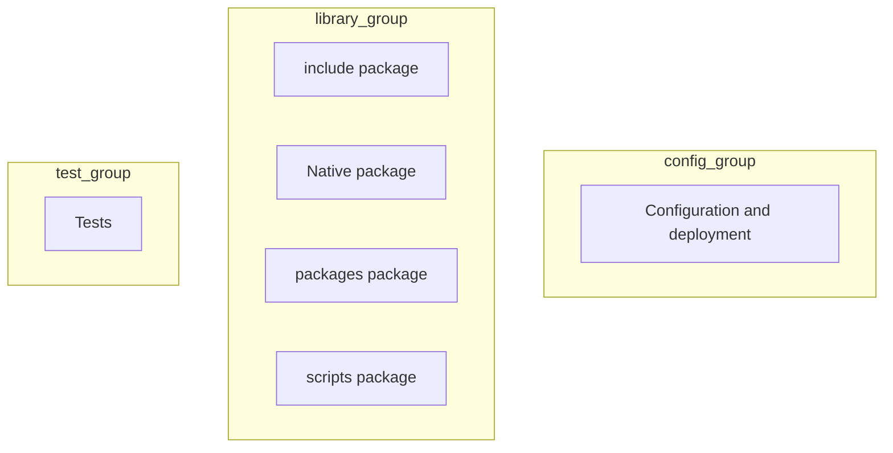

# Architecture report: revery-ui/revery

> Automated static analysis. **Observed** = directly seen in files/imports/AST; **Inferred** = interpretation from that evidence. Repository code was not executed.

## 1. Repository at a glance

| Item | Value |
| --- | --- |
| Repository | revery-ui/revery |
| Description | :zap: Native, high-performance, cross-platform desktop apps - built with Reason! |
| Language | Reason |
| Stars | 8030 |
| Licence | MIT |
| Analysed commit / branch | 141f70f69d6abd69674b46d805a783411b38cd79 / master |
| Framework(s) | None detected |
| Files analysed | 800 |
| Components | 6 |

## 2. Architecture in one minute

revery-ui/revery - :zap: Native, high-performance, cross-platform desktop apps - built with Reason!. This repository was analysed statically from 800 file(s) (0 Python). Detected technologies (observed from imports/manifests): Docker. Files are grouped into 6 component(s): Configuration and deployment, include package, Native package, packages package, scripts package, Tests. Findings below distinguish observed facts from inferred interpretation.

## 3. High-level block diagram

## 4. Main components

### Configuration and deployment (`config`)

- **Kind:** config
- **Status:** Observed
- **Confidence:** 0.85
- **Responsibility:** Groups 33 file(s) under configuration and deployment (observed from repository paths and static analysis).
- **Paths:** `azure-pipelines.yml`, `bench.esy.lock/index.json`, `bench.esy.lock/overrides/opam__s__conf_pkg_config_opam__c__2_opam_override/package.json`, `bench.esy.lock/overrides/opam__s__ctypes_opam__c__0.15.1_opam_override/package.json`, `bench.esy.lock/overrides/opam__s__ocamlbuild_opam__c__0.14.0_opam_override/package.json`, `bench.esy.lock/overrides/opam__s__ocamlfind_opam__c__1.9.1_opam_override/package.json`, `bench.json`, `doc.esy.lock/index.json`, `doc.esy.lock/overrides/opam__s__conf_pkg_config_opam__c__2_opam_override/package.json`, `doc.esy.lock/overrides/opam__s__ctypes_opam__c__0.15.1_opam_override/package.json`, `doc.esy.lock/overrides/opam__s__ocamlbuild_opam__c__0.14.0_opam_override/package.json`, `doc.esy.lock/overrides/opam__s__ocamlfind_opam__c__1.9.1_opam_override/package.json`, `doc.json`, `esy.lock/index.json`, `esy.lock/overrides/opam__s__conf_pkg_config_opam__c__2_opam_override/package.json`, `esy.lock/overrides/opam__s__ctypes_opam__c__0.15.1_opam_override/package.json`, `esy.lock/overrides/opam__s__ocamlbuild_opam__c__0.14.0_opam_override/package.json`, `esy.lock/overrides/opam__s__ocamlfind_opam__c__1.9.1_opam_override/package.json`, `examples.esy.lock/index.json`, `examples.esy.lock/overrides/opam__s__conf_pkg_config_opam__c__2_opam_override/package.json`, `examples.esy.lock/overrides/opam__s__ctypes_opam__c__0.15.1_opam_override/package.json`, `examples.esy.lock/overrides/opam__s__ocamlbuild_opam__c__0.14.0_opam_override/package.json`, `examples.esy.lock/overrides/opam__s__ocamlfind_opam__c__1.9.1_opam_override/package.json`, `examples.json`, `js.esy.lock/index.json`, `js.esy.lock/overrides/opam__s__conf_pkg_config_opam__c__2_opam_override/package.json`, `js.esy.lock/overrides/opam__s__ctypes_opam__c__0.15.1_opam_override/package.json`, `js.esy.lock/overrides/opam__s__ocamlbuild_opam__c__0.14.0_opam_override/package.json`, `js.esy.lock/overrides/opam__s__ocamlfind_opam__c__1.9.1_opam_override/package.json`, `js.json`, `package.json`, `scripts/docker/archlinux/Dockerfile`, `scripts/docker/centos/Dockerfile`
- **Evidence:** [azure-pipelines.yml](https://github.com/revery-ui/revery/blob/141f70f69d6abd69674b46d805a783411b38cd79/azure-pipelines.yml); [bench.esy.lock/index.json](https://github.com/revery-ui/revery/blob/141f70f69d6abd69674b46d805a783411b38cd79/bench.esy.lock/index.json); [bench.esy.lock/overrides/opam__s__conf_pkg_config_opam__c__2_opam_override/package.json](https://github.com/revery-ui/revery/blob/141f70f69d6abd69674b46d805a783411b38cd79/bench.esy.lock/overrides/opam__s__conf_pkg_config_opam__c__2_opam_override/package.json); [bench.esy.lock/overrides/opam__s__ctypes_opam__c__0.15.1_opam_override/package.json](https://github.com/revery-ui/revery/blob/141f70f69d6abd69674b46d805a783411b38cd79/bench.esy.lock/overrides/opam__s__ctypes_opam__c__0.15.1_opam_override/package.json); [bench.esy.lock/overrides/opam__s__ocamlbuild_opam__c__0.14.0_opam_override/package.json](https://github.com/revery-ui/revery/blob/141f70f69d6abd69674b46d805a783411b38cd79/bench.esy.lock/overrides/opam__s__ocamlbuild_opam__c__0.14.0_opam_override/package.json); [bench.esy.lock/overrides/opam__s__ocamlfind_opam__c__1.9.1_opam_override/package.json](https://github.com/revery-ui/revery/blob/141f70f69d6abd69674b46d805a783411b38cd79/bench.esy.lock/overrides/opam__s__ocamlfind_opam__c__1.9.1_opam_override/package.json); [bench.json](https://github.com/revery-ui/revery/blob/141f70f69d6abd69674b46d805a783411b38cd79/bench.json); [doc.esy.lock/index.json](https://github.com/revery-ui/revery/blob/141f70f69d6abd69674b46d805a783411b38cd79/doc.esy.lock/index.json)

### include package (`include`)

- **Kind:** library
- **Status:** Observed
- **Confidence:** 0.85
- **Responsibility:** Groups 2 file(s) under include package (observed from repository paths and static analysis).
- **Paths:** `include/KHR/khrplatform.h`, `include/glad/glad.h`
- **Evidence:** [include/KHR/khrplatform.h](https://github.com/revery-ui/revery/blob/141f70f69d6abd69674b46d805a783411b38cd79/include/KHR/khrplatform.h); [include/glad/glad.h](https://github.com/revery-ui/revery/blob/141f70f69d6abd69674b46d805a783411b38cd79/include/glad/glad.h)

### Native package (`native`)

- **Kind:** library
- **Status:** Observed
- **Confidence:** 0.85
- **Responsibility:** Groups 56 file(s) under native package (observed from repository paths and static analysis).
- **Paths:** `src/Native/ReveryCocoa.h`, `src/Native/ReveryGtk.h`, `src/Native/ReveryLinux.h`, `src/Native/ReveryMac.h`, `src/Native/ReveryNSObject.c`, `src/Native/ReveryWin32.h`, `src/Native/ReveryWindows.h`, `src/Native/Revery_Native.c`, `src/Native/caml_values.h`, `src/Native/cocoa/ReveryAppDelegate.c`, `src/Native/cocoa/ReveryAppDelegate.h`, `src/Native/cocoa/ReveryAppDelegate_func.c`, `src/Native/cocoa/ReveryAppDelegate_func.h`, `src/Native/cocoa/ReveryButtonTarget.c`, `src/Native/cocoa/ReveryButtonTarget.h`, `src/Native/cocoa/ReveryMenuItemTarget.c`, `src/Native/cocoa/ReveryMenuItemTarget.h`, `src/Native/cocoa/ReveryNSView.c`, `src/Native/cocoa/ReveryNSViewCoords.c`, `src/Native/cocoa/ReveryNSViewCoords.h`, `src/Native/cocoa/ReveryProgressBar.c`, `src/Native/cocoa/ReveryProgressBar.h`, `src/Native/cocoa/SDLAppDelegate.h`, `src/Native/dialog.c`, `src/Native/dialog.js`, `src/Native/dialog_cocoa.c`, `src/Native/dialog_gtk.c`, `src/Native/dialog_win32.c`, `src/Native/environment.c`, `src/Native/environment_linux.c`, `src/Native/environment_mac.c`, `src/Native/environment_windows.c`, `src/Native/gtk/ReveryGtk.c`, `src/Native/gtk/ReveryGtk_Widget.c`, `src/Native/icon.c`, `src/Native/icon_cocoa.c`, `src/Native/icon_win32.c`, `src/Native/input.c`, `src/Native/input_cocoa.c`, `src/Native/locale.c`, `src/Native/locale_cocoa.c`, `src/Native/locale_win32.c`, `src/Native/menu.c`, `src/Native/menu.h`, `src/Native/menu_cocoa.c`, `src/Native/notification.c`, `src/Native/notification_cocoa.c`, `src/Native/shell.c`, `src/Native/shell_cocoa.c`, `src/Native/shell_gtk.c`, `src/Native/shell_win32.c`, `src/Native/utilities.c`, `src/Native/utilities.h`, `src/Native/win32_target.h`, `src/Native/window.c`, `src/Native/window_cocoa.c`
- **Evidence:** [src/Native/ReveryCocoa.h](https://github.com/revery-ui/revery/blob/141f70f69d6abd69674b46d805a783411b38cd79/src/Native/ReveryCocoa.h); [src/Native/ReveryGtk.h](https://github.com/revery-ui/revery/blob/141f70f69d6abd69674b46d805a783411b38cd79/src/Native/ReveryGtk.h); [src/Native/ReveryLinux.h](https://github.com/revery-ui/revery/blob/141f70f69d6abd69674b46d805a783411b38cd79/src/Native/ReveryLinux.h); [src/Native/ReveryMac.h](https://github.com/revery-ui/revery/blob/141f70f69d6abd69674b46d805a783411b38cd79/src/Native/ReveryMac.h); [src/Native/ReveryNSObject.c](https://github.com/revery-ui/revery/blob/141f70f69d6abd69674b46d805a783411b38cd79/src/Native/ReveryNSObject.c); [src/Native/ReveryWin32.h](https://github.com/revery-ui/revery/blob/141f70f69d6abd69674b46d805a783411b38cd79/src/Native/ReveryWin32.h); [src/Native/ReveryWindows.h](https://github.com/revery-ui/revery/blob/141f70f69d6abd69674b46d805a783411b38cd79/src/Native/ReveryWindows.h); [src/Native/Revery_Native.c](https://github.com/revery-ui/revery/blob/141f70f69d6abd69674b46d805a783411b38cd79/src/Native/Revery_Native.c)

### packages package (`packages`)

- **Kind:** library
- **Status:** Observed
- **Confidence:** 0.85
- **Responsibility:** Groups 9 file(s) under packages package (observed from repository paths and static analysis).
- **Paths:** `packages/reason-harfbuzz/examples/harfbuzz-cli/run-harfbuzz.sh`, `packages/reason-harfbuzz/src/harfbuzz.cpp`, `packages/reason-sdl2/src/sdl2_stubs.js`, `packages/reason-sdl2/src/sdl2_wrapper.cpp`, `packages/reason-sdl2/src/stb_image.cpp`, `packages/reason-skia/examples/skia-font-manager-cli/run-skia-fontmanager.sh`, `packages/reason-skia/src/wrapped/c/c_stubs.c`, `packages/reason-skia/src/wrapped/c/c_stubs.h`, `packages/reason-skia/src/wrapped/lib/raw_bindings.c`
- **Evidence:** [packages/reason-harfbuzz/examples/harfbuzz-cli/run-harfbuzz.sh](https://github.com/revery-ui/revery/blob/141f70f69d6abd69674b46d805a783411b38cd79/packages/reason-harfbuzz/examples/harfbuzz-cli/run-harfbuzz.sh); [packages/reason-harfbuzz/src/harfbuzz.cpp](https://github.com/revery-ui/revery/blob/141f70f69d6abd69674b46d805a783411b38cd79/packages/reason-harfbuzz/src/harfbuzz.cpp); [packages/reason-sdl2/src/sdl2_stubs.js](https://github.com/revery-ui/revery/blob/141f70f69d6abd69674b46d805a783411b38cd79/packages/reason-sdl2/src/sdl2_stubs.js); [packages/reason-sdl2/src/sdl2_wrapper.cpp](https://github.com/revery-ui/revery/blob/141f70f69d6abd69674b46d805a783411b38cd79/packages/reason-sdl2/src/sdl2_wrapper.cpp); [packages/reason-sdl2/src/stb_image.cpp](https://github.com/revery-ui/revery/blob/141f70f69d6abd69674b46d805a783411b38cd79/packages/reason-sdl2/src/stb_image.cpp); [packages/reason-skia/examples/skia-font-manager-cli/run-skia-fontmanager.sh](https://github.com/revery-ui/revery/blob/141f70f69d6abd69674b46d805a783411b38cd79/packages/reason-skia/examples/skia-font-manager-cli/run-skia-fontmanager.sh); [packages/reason-skia/src/wrapped/c/c_stubs.c](https://github.com/revery-ui/revery/blob/141f70f69d6abd69674b46d805a783411b38cd79/packages/reason-skia/src/wrapped/c/c_stubs.c); [packages/reason-skia/src/wrapped/c/c_stubs.h](https://github.com/revery-ui/revery/blob/141f70f69d6abd69674b46d805a783411b38cd79/packages/reason-skia/src/wrapped/c/c_stubs.h)

### scripts package (`scripts`)

- **Kind:** library
- **Status:** Observed
- **Confidence:** 0.85
- **Responsibility:** Groups 3 file(s) under scripts package (observed from repository paths and static analysis).
- **Paths:** `scripts/docker-build.sh`, `scripts/make-binary-file.js`, `scripts/release.sh`
- **Evidence:** [scripts/docker-build.sh](https://github.com/revery-ui/revery/blob/141f70f69d6abd69674b46d805a783411b38cd79/scripts/docker-build.sh); [scripts/make-binary-file.js](https://github.com/revery-ui/revery/blob/141f70f69d6abd69674b46d805a783411b38cd79/scripts/make-binary-file.js); [scripts/release.sh](https://github.com/revery-ui/revery/blob/141f70f69d6abd69674b46d805a783411b38cd79/scripts/release.sh)

### Tests (`tests`)

- **Kind:** test
- **Status:** Observed
- **Confidence:** 0.85
- **Responsibility:** Groups 10 file(s) under tests (observed from repository paths and static analysis).
- **Paths:** `packages/reason-harfbuzz/test/FeaturesTest.re`, `packages/reason-harfbuzz/test/ShapingTest.re`, `packages/reason-harfbuzz/test/TestFramework.re`, `packages/reason-harfbuzz/test/dune`, `packages/reason-skia/test/ColorTest.re`, `packages/reason-skia/test/MatrixTest.re`, `packages/reason-skia/test/PaintTest.re`, `packages/reason-skia/test/RectTest.re`, `packages/reason-skia/test/TestFramework.re`, `packages/reason-skia/test/dune`
- **Evidence:** [packages/reason-harfbuzz/test/FeaturesTest.re](https://github.com/revery-ui/revery/blob/141f70f69d6abd69674b46d805a783411b38cd79/packages/reason-harfbuzz/test/FeaturesTest.re); [packages/reason-harfbuzz/test/ShapingTest.re](https://github.com/revery-ui/revery/blob/141f70f69d6abd69674b46d805a783411b38cd79/packages/reason-harfbuzz/test/ShapingTest.re); [packages/reason-harfbuzz/test/TestFramework.re](https://github.com/revery-ui/revery/blob/141f70f69d6abd69674b46d805a783411b38cd79/packages/reason-harfbuzz/test/TestFramework.re); [packages/reason-harfbuzz/test/dune](https://github.com/revery-ui/revery/blob/141f70f69d6abd69674b46d805a783411b38cd79/packages/reason-harfbuzz/test/dune); [packages/reason-skia/test/ColorTest.re](https://github.com/revery-ui/revery/blob/141f70f69d6abd69674b46d805a783411b38cd79/packages/reason-skia/test/ColorTest.re); [packages/reason-skia/test/MatrixTest.re](https://github.com/revery-ui/revery/blob/141f70f69d6abd69674b46d805a783411b38cd79/packages/reason-skia/test/MatrixTest.re); [packages/reason-skia/test/PaintTest.re](https://github.com/revery-ui/revery/blob/141f70f69d6abd69674b46d805a783411b38cd79/packages/reason-skia/test/PaintTest.re); [packages/reason-skia/test/RectTest.re](https://github.com/revery-ui/revery/blob/141f70f69d6abd69674b46d805a783411b38cd79/packages/reason-skia/test/RectTest.re)

## 5. Execution flow

No entry point was observed; the startup flow below is therefore limited.

Representative flow (derived from observed entry points and the import graph; steps beyond the entry point are **Inferred**):

1. Execution starts at an observed entry point listed above, if present.
2. No internal import relationships between components were observed.

## 6. Project structure

### `(root)`

- `.gitattributes` - other (417 bytes)
- `.gitignore` - other (1141 bytes)
- `CODE_OF_CONDUCT.md` - docs (3350 bytes)
- `LICENSE` - docs (1069 bytes)
- `README.md` - docs (8078 bytes)
- `Revery.opam` - other (105 bytes)
- `ReveryBench.opam` - other (105 bytes)
- `ReveryExampleJs.opam` - other (105 bytes)
- `ReveryExamples.opam` - other (105 bytes)
- `ReveryTest.opam` - other (105 bytes)
- `ThirdPartyLicenses.txt` - docs (18177 bytes)
- `azure-pipelines.yml` - ci, YAML (3926 bytes)
- `bench.json` - config (286 bytes)
- `doc.json` - config (381 bytes)
- `dune` - other (40 bytes)
- `dune-project` - other (51 bytes)
- `dune-workspace` - other (88 bytes)
- `examples.json` - config (588 bytes)
- `js.json` - config (445 bytes)
- `lsan.supp` - other (80 bytes)
- `package.json` - manifest (2648 bytes)
- `reason-harfbuzz.opam` - other (108 bytes)
- `reason-sdl2.opam` - other (105 bytes)
- `reason-skia.opam` - other (105 bytes)

### `.ci`

- `.ci/.gitattributes` - other (295 bytes)
- `.ci/create-docs.yml` - config (765 bytes)
- `.ci/esy-bench.yml` - config (240 bytes)
- `.ci/esy-build-steps.yml` - config (1014 bytes)
- `.ci/esy-check-hygiene.yml` - config (1563 bytes)
- `.ci/format.sh` - source, Shell (821 bytes)
- `.ci/publish-build-cache.yml` - config (1259 bytes)
- `.ci/publish-release.yml` - config (246 bytes)
- `.ci/restore-build-cache.yml` - config (1797 bytes)
- `.ci/use-node.yml` - config (97 bytes)

### `.github`

- `.github/FUNDING.yml` - config (71 bytes)
- `.github/ISSUE_TEMPLATE/bug_report.md` - docs (790 bytes)
- `.github/ISSUE_TEMPLATE/feature_request.md` - docs (183 bytes)

### `assets`

- `assets/revery.svg` - other (3229 bytes)

### `bench`

- `bench/exe/Bench.re` - other (67 bytes)
- `bench/exe/dune` - other (188 bytes)
- `bench/lib/BenchFramework.re` - other (103 bytes)
- `bench/lib/DrawBench.re` - other (2891 bytes)
- `bench/lib/LayoutBench.re` - other (1051 bytes)
- `bench/lib/NodeUtility.re` - other (486 bytes)
- `bench/lib/PaintBench.re` - other (404 bytes)
- `bench/lib/RecalculateBench.re` - other (502 bytes)
- `bench/lib/SurfaceUtility.re` - other (174 bytes)
- `bench/lib/ViewNodeBench.re` - other (711 bytes)
- `bench/lib/dune` - other (119 bytes)

### `bench.esy.lock`

- `bench.esy.lock/.gitattributes` - other (100 bytes)
- `bench.esy.lock/.gitignore` - other (76 bytes)
- `bench.esy.lock/index.json` - config (87364 bytes)
- `bench.esy.lock/opam/astring.0.8.5/opam` - other (1382 bytes)
- `bench.esy.lock/opam/base-bigarray.base/opam` - other (157 bytes)
- `bench.esy.lock/opam/base-bytes.base/opam` - other (189 bytes)
- `bench.esy.lock/opam/base-threads.base/opam` - other (156 bytes)
- `bench.esy.lock/opam/base-unix.base/opam` - other (153 bytes)
- `bench.esy.lock/opam/base.v0.14.1/opam` - other (1230 bytes)
- `bench.esy.lock/opam/biniou.1.2.1/opam` - other (1764 bytes)
- `bench.esy.lock/opam/bos.0.2.0/opam` - other (1624 bytes)
- `bench.esy.lock/opam/camomile.1.0.2/opam` - other (1277 bytes)
- `bench.esy.lock/opam/charInfo_width.1.1.0/opam` - other (835 bytes)
- `bench.esy.lock/opam/conf-pkg-config.2/opam` - other (1804 bytes)
- `bench.esy.lock/opam/cppo.1.6.7/opam` - other (1256 bytes)
- `bench.esy.lock/opam/csexp.1.5.1/opam` - other (1945 bytes)
- `bench.esy.lock/opam/ctypes.0.15.1/opam` - other (2090 bytes)
- `bench.esy.lock/opam/dot-merlin-reader.4.1/opam` - other (1012 bytes)
- `bench.esy.lock/opam/dune-build-info.2.8.5/opam` - other (1298 bytes)
- `bench.esy.lock/opam/dune-configurator.2.8.5/opam` - other (1339 bytes)
- `bench.esy.lock/opam/dune.2.8.5/opam` - other (2233 bytes)
- `bench.esy.lock/opam/easy-format.1.3.2/opam` - other (1705 bytes)
- `bench.esy.lock/opam/fix.20201120/opam` - other (730 bytes)
- `bench.esy.lock/opam/fmt.0.8.9/opam` - other (1459 bytes)
- `bench.esy.lock/opam/fpath.0.7.3/opam` - other (1102 bytes)
- `bench.esy.lock/opam/integers.0.4.0/opam` - other (794 bytes)
- `bench.esy.lock/opam/junit.2.0.2/opam` - other (1114 bytes)
- `bench.esy.lock/opam/logs.0.7.0/opam` - other (2123 bytes)
- `bench.esy.lock/opam/lwt.5.4.1/opam` - other (1902 bytes)
- `bench.esy.lock/opam/lwt_ppx.2.0.1/opam` - other (743 bytes)
- `bench.esy.lock/opam/markup.0.8.2/opam` - other (1875 bytes)
- `bench.esy.lock/opam/menhir.20210419/opam` - other (909 bytes)
- `bench.esy.lock/opam/menhirLib.20210419/opam` - other (937 bytes)
- `bench.esy.lock/opam/menhirSdk.20210419/opam` - other (940 bytes)
- `bench.esy.lock/opam/merlin-extend.0.6/opam` - other (1149 bytes)
- `bench.esy.lock/opam/mmap.1.1.0/opam` - other (738 bytes)
- `bench.esy.lock/opam/ocaml-compiler-libs.v0.12.3/opam` - other (1056 bytes)
- `bench.esy.lock/opam/ocaml-lsp-server.1.6.1/opam` - other (1387 bytes)
- `bench.esy.lock/opam/ocaml-migrate-parsetree.1.8.0/opam` - other (1415 bytes)
- `bench.esy.lock/opam/ocamlbuild.0.14.0/opam` - other (1106 bytes)
- `bench.esy.lock/opam/ocamlfind.1.9.1/opam` - other (1410 bytes)
- `bench.esy.lock/opam/ocplib-endian.1.1/opam` - other (1612 bytes)
- `bench.esy.lock/opam/pp.1.1.2/opam` - other (1850 bytes)
- `bench.esy.lock/opam/ppx_derivers.1.2.1/opam` - other (747 bytes)
- `bench.esy.lock/opam/ppx_deriving.4.5/opam` - other (1260 bytes)
- `bench.esy.lock/opam/ppx_optcomp.v0.14.0/opam` - other (850 bytes)
- `bench.esy.lock/opam/ppx_tools.6.3/opam` - other (920 bytes)
- `bench.esy.lock/opam/ppx_tools_versioned.5.4.0/opam` - other (837 bytes)
- `bench.esy.lock/opam/ppx_yojson_conv_lib.v0.14.0/opam` - other (805 bytes)
- `bench.esy.lock/opam/ppxfind.1.4/opam` - other (1188 bytes)
- `bench.esy.lock/opam/ppxlib.0.15.0/opam` - other (1996 bytes)
- `bench.esy.lock/opam/printbox.0.5/opam` - other (1052 bytes)
- `bench.esy.lock/opam/psq.0.2.0/opam` - other (1008 bytes)
- `bench.esy.lock/opam/ptime.0.8.5/opam` - other (1668 bytes)
- `bench.esy.lock/opam/re.1.9.0/opam` - other (1124 bytes)
- `bench.esy.lock/opam/reason.3.7.0/opam` - other (975 bytes)
- `bench.esy.lock/opam/result.1.5/opam` - other (755 bytes)
- `bench.esy.lock/opam/rresult.0.6.0/opam` - other (1158 bytes)
- `bench.esy.lock/opam/seq.base/files/META.seq` - other (137 bytes)
- `bench.esy.lock/opam/seq.base/files/seq.install` - other (30 bytes)
- `bench.esy.lock/opam/seq.base/opam` - other (428 bytes)
- `bench.esy.lock/opam/sexplib0.v0.14.0/opam` - other (918 bytes)
- `bench.esy.lock/opam/stdio.v0.14.0/opam` - other (857 bytes)
- `bench.esy.lock/opam/stdlib-shims.0.3.0/opam` - other (1177 bytes)
- `bench.esy.lock/opam/topkg.1.0.3/opam` - other (1834 bytes)
- `bench.esy.lock/opam/tyxml.4.5.0/opam` - other (1561 bytes)
- `bench.esy.lock/opam/uchar.0.0.2/opam` - other (1133 bytes)
- `bench.esy.lock/opam/uucp.13.0.0/opam` - other (1405 bytes)
- `bench.esy.lock/opam/uutf.1.0.2/opam` - other (1421 bytes)
- `bench.esy.lock/opam/yojson.1.7.0/opam` - other (1234 bytes)
- `bench.esy.lock/overrides/opam__s__conf_pkg_config_opam__c__2_opam_override/package.json` - manifest (185 bytes)
- `bench.esy.lock/overrides/opam__s__ctypes_opam__c__0.15.1_opam_override/package.json` - manifest (150 bytes)
- `bench.esy.lock/overrides/opam__s__ocamlbuild_opam__c__0.14.0_opam_override/files/ocamlbuild-0.14.0.patch` - other (15935 bytes)
- `bench.esy.lock/overrides/opam__s__ocamlbuild_opam__c__0.14.0_opam_override/package.json` - manifest (567 bytes)
- `bench.esy.lock/overrides/opam__s__ocamlfind_opam__c__1.9.1_opam_override/files/findlib-1.9.1.patch` - other (14822 bytes)
- `bench.esy.lock/overrides/opam__s__ocamlfind_opam__c__1.9.1_opam_override/package.json` - manifest (912 bytes)

### `doc.esy.lock`

- `doc.esy.lock/.gitattributes` - other (100 bytes)
- `doc.esy.lock/.gitignore` - other (76 bytes)
- `doc.esy.lock/index.json` - config (103404 bytes)
- `doc.esy.lock/opam/astring.0.8.5/opam` - other (1382 bytes)
- `doc.esy.lock/opam/base-bigarray.base/opam` - other (157 bytes)
- `doc.esy.lock/opam/base-bytes.base/opam` - other (189 bytes)
- `doc.esy.lock/opam/base-threads.base/opam` - other (156 bytes)
- `doc.esy.lock/opam/base-unix.base/opam` - other (153 bytes)
- `doc.esy.lock/opam/base.v0.14.1/opam` - other (1230 bytes)
- `doc.esy.lock/opam/biniou.1.2.1/opam` - other (1764 bytes)
- `doc.esy.lock/opam/bos.0.2.0/opam` - other (1624 bytes)
- `doc.esy.lock/opam/camomile.1.0.2/opam` - other (1277 bytes)
- `doc.esy.lock/opam/charInfo_width.1.1.0/opam` - other (835 bytes)
- `doc.esy.lock/opam/cmdliner.1.0.4/opam` - other (1516 bytes)
- `doc.esy.lock/opam/conf-pkg-config.2/opam` - other (1804 bytes)
- `doc.esy.lock/opam/cppo.1.6.7/opam` - other (1256 bytes)
- `doc.esy.lock/opam/csexp.1.5.1/opam` - other (1945 bytes)
- `doc.esy.lock/opam/ctypes.0.15.1/opam` - other (2090 bytes)
- `doc.esy.lock/opam/dot-merlin-reader.4.1/opam` - other (1012 bytes)
- `doc.esy.lock/opam/dune-build-info.2.8.5/opam` - other (1298 bytes)
- `doc.esy.lock/opam/dune-configurator.2.8.5/opam` - other (1339 bytes)
- `doc.esy.lock/opam/dune.2.8.5/opam` - other (2233 bytes)
- `doc.esy.lock/opam/easy-format.1.3.2/opam` - other (1705 bytes)
- `doc.esy.lock/opam/fix.20201120/opam` - other (730 bytes)
- `doc.esy.lock/opam/fmt.0.8.9/opam` - other (1459 bytes)
- `doc.esy.lock/opam/fpath.0.7.3/opam` - other (1102 bytes)
- `doc.esy.lock/opam/integers.0.4.0/opam` - other (794 bytes)
- `doc.esy.lock/opam/junit.2.0.2/opam` - other (1114 bytes)
- `doc.esy.lock/opam/logs.0.7.0/opam` - other (2123 bytes)
- `doc.esy.lock/opam/lwt.5.4.1/opam` - other (1902 bytes)
- `doc.esy.lock/opam/lwt_ppx.2.0.1/opam` - other (743 bytes)
- `doc.esy.lock/opam/markup.0.8.2/opam` - other (1875 bytes)
- `doc.esy.lock/opam/menhir.20210419/opam` - other (909 bytes)
- `doc.esy.lock/opam/menhirLib.20210419/opam` - other (937 bytes)
- `doc.esy.lock/opam/menhirSdk.20210419/opam` - other (940 bytes)
- `doc.esy.lock/opam/merlin-extend.0.6/opam` - other (1149 bytes)
- `doc.esy.lock/opam/mmap.1.1.0/opam` - other (738 bytes)
- `doc.esy.lock/opam/ocaml-compiler-libs.v0.12.3/opam` - other (1056 bytes)
- `doc.esy.lock/opam/ocaml-lsp-server.1.6.1/opam` - other (1387 bytes)
- `doc.esy.lock/opam/ocaml-migrate-parsetree.1.8.0/opam` - other (1415 bytes)
- `doc.esy.lock/opam/ocamlbuild.0.14.0/opam` - other (1106 bytes)
- `doc.esy.lock/opam/ocamlfind.1.9.1/opam` - other (1410 bytes)
- `doc.esy.lock/opam/ocplib-endian.1.1/opam` - other (1612 bytes)
- `doc.esy.lock/opam/odoc.1.5.2/opam` - other (1425 bytes)
- `doc.esy.lock/opam/pp.1.1.2/opam` - other (1850 bytes)
- `doc.esy.lock/opam/ppx_derivers.1.2.1/opam` - other (747 bytes)
- `doc.esy.lock/opam/ppx_deriving.4.5/opam` - other (1260 bytes)
- `doc.esy.lock/opam/ppx_optcomp.v0.14.0/opam` - other (850 bytes)
- `doc.esy.lock/opam/ppx_tools.6.3/opam` - other (920 bytes)
- `doc.esy.lock/opam/ppx_tools_versioned.5.4.0/opam` - other (837 bytes)
- `doc.esy.lock/opam/ppx_yojson_conv_lib.v0.14.0/opam` - other (805 bytes)
- `doc.esy.lock/opam/ppxfind.1.4/opam` - other (1188 bytes)
- `doc.esy.lock/opam/ppxlib.0.15.0/opam` - other (1996 bytes)
- `doc.esy.lock/opam/printbox.0.5/opam` - other (1052 bytes)
- `doc.esy.lock/opam/psq.0.2.0/opam` - other (1008 bytes)
- `doc.esy.lock/opam/ptime.0.8.5/opam` - other (1668 bytes)
- `doc.esy.lock/opam/re.1.9.0/opam` - other (1124 bytes)
- `doc.esy.lock/opam/reason.3.7.0/opam` - other (975 bytes)
- `doc.esy.lock/opam/result.1.5/opam` - other (755 bytes)
- `doc.esy.lock/opam/rresult.0.6.0/opam` - other (1158 bytes)
- `doc.esy.lock/opam/seq.base/files/META.seq` - other (137 bytes)
- `doc.esy.lock/opam/seq.base/files/seq.install` - other (30 bytes)
- `doc.esy.lock/opam/seq.base/opam` - other (428 bytes)
- `doc.esy.lock/opam/sexplib0.v0.14.0/opam` - other (918 bytes)
- `doc.esy.lock/opam/stdio.v0.14.0/opam` - other (857 bytes)
- `doc.esy.lock/opam/stdlib-shims.0.3.0/opam` - other (1177 bytes)
- `doc.esy.lock/opam/topkg.1.0.3/opam` - other (1834 bytes)
- `doc.esy.lock/opam/tyxml.4.5.0/opam` - other (1561 bytes)
- `doc.esy.lock/opam/uchar.0.0.2/opam` - other (1133 bytes)
- `doc.esy.lock/opam/uucp.13.0.0/opam` - other (1405 bytes)
- `doc.esy.lock/opam/uutf.1.0.2/opam` - other (1421 bytes)
- `doc.esy.lock/opam/yojson.1.7.0/opam` - other (1234 bytes)
- `doc.esy.lock/overrides/opam__s__conf_pkg_config_opam__c__2_opam_override/package.json` - manifest (185 bytes)
- `doc.esy.lock/overrides/opam__s__ctypes_opam__c__0.15.1_opam_override/package.json` - manifest (150 bytes)
- `doc.esy.lock/overrides/opam__s__ocamlbuild_opam__c__0.14.0_opam_override/files/ocamlbuild-0.14.0.patch` - other (15935 bytes)
- `doc.esy.lock/overrides/opam__s__ocamlbuild_opam__c__0.14.0_opam_override/package.json` - manifest (567 bytes)
- `doc.esy.lock/overrides/opam__s__ocamlfind_opam__c__1.9.1_opam_override/files/findlib-1.9.1.patch` - other (14822 bytes)
- `doc.esy.lock/overrides/opam__s__ocamlfind_opam__c__1.9.1_opam_override/package.json` - manifest (912 bytes)

### `esy.lock`

- `esy.lock/.gitattributes` - other (100 bytes)
- `esy.lock/.gitignore` - other (76 bytes)
- `esy.lock/index.json` - config (86936 bytes)
- `esy.lock/opam/astring.0.8.5/opam` - other (1382 bytes)
- `esy.lock/opam/base-bigarray.base/opam` - other (157 bytes)
- `esy.lock/opam/base-bytes.base/opam` - other (189 bytes)
- `esy.lock/opam/base-threads.base/opam` - other (156 bytes)
- `esy.lock/opam/base-unix.base/opam` - other (153 bytes)
- `esy.lock/opam/base.v0.14.1/opam` - other (1230 bytes)
- `esy.lock/opam/biniou.1.2.1/opam` - other (1764 bytes)
- `esy.lock/opam/bos.0.2.0/opam` - other (1624 bytes)
- `esy.lock/opam/camomile.1.0.2/opam` - other (1277 bytes)
- `esy.lock/opam/charInfo_width.1.1.0/opam` - other (835 bytes)
- `esy.lock/opam/conf-pkg-config.2/opam` - other (1804 bytes)
- `esy.lock/opam/cppo.1.6.7/opam` - other (1256 bytes)
- `esy.lock/opam/csexp.1.5.1/opam` - other (1945 bytes)
- `esy.lock/opam/ctypes.0.15.1/opam` - other (2090 bytes)
- `esy.lock/opam/dot-merlin-reader.4.1/opam` - other (1012 bytes)
- `esy.lock/opam/dune-build-info.2.8.5/opam` - other (1298 bytes)
- `esy.lock/opam/dune-configurator.2.8.5/opam` - other (1339 bytes)
- `esy.lock/opam/dune.2.8.5/opam` - other (2233 bytes)
- `esy.lock/opam/easy-format.1.3.2/opam` - other (1705 bytes)
- `esy.lock/opam/fix.20201120/opam` - other (730 bytes)
- `esy.lock/opam/fmt.0.8.9/opam` - other (1459 bytes)
- `esy.lock/opam/fpath.0.7.3/opam` - other (1102 bytes)
- `esy.lock/opam/integers.0.4.0/opam` - other (794 bytes)
- `esy.lock/opam/junit.2.0.2/opam` - other (1114 bytes)
- `esy.lock/opam/logs.0.7.0/opam` - other (2123 bytes)
- `esy.lock/opam/lwt.5.4.1/opam` - other (1902 bytes)
- `esy.lock/opam/lwt_ppx.2.0.1/opam` - other (743 bytes)
- `esy.lock/opam/markup.0.8.2/opam` - other (1875 bytes)
- `esy.lock/opam/menhir.20210419/opam` - other (909 bytes)
- `esy.lock/opam/menhirLib.20210419/opam` - other (937 bytes)
- `esy.lock/opam/menhirSdk.20210419/opam` - other (940 bytes)
- `esy.lock/opam/merlin-extend.0.6/opam` - other (1149 bytes)
- `esy.lock/opam/mmap.1.1.0/opam` - other (738 bytes)
- `esy.lock/opam/ocaml-compiler-libs.v0.12.3/opam` - other (1056 bytes)
- `esy.lock/opam/ocaml-lsp-server.1.6.1/opam` - other (1387 bytes)
- `esy.lock/opam/ocaml-migrate-parsetree.1.8.0/opam` - other (1415 bytes)
- `esy.lock/opam/ocamlbuild.0.14.0/opam` - other (1106 bytes)
- `esy.lock/opam/ocamlfind.1.9.1/opam` - other (1410 bytes)
- `esy.lock/opam/ocplib-endian.1.1/opam` - other (1612 bytes)
- `esy.lock/opam/pp.1.1.2/opam` - other (1850 bytes)
- `esy.lock/opam/ppx_derivers.1.2.1/opam` - other (747 bytes)
- `esy.lock/opam/ppx_deriving.4.5/opam` - other (1260 bytes)
- `esy.lock/opam/ppx_optcomp.v0.14.0/opam` - other (850 bytes)
- `esy.lock/opam/ppx_tools.6.3/opam` - other (920 bytes)
- `esy.lock/opam/ppx_tools_versioned.5.4.0/opam` - other (837 bytes)
- `esy.lock/opam/ppx_yojson_conv_lib.v0.14.0/opam` - other (805 bytes)
- `esy.lock/opam/ppxfind.1.4/opam` - other (1188 bytes)
- `esy.lock/opam/ppxlib.0.15.0/opam` - other (1996 bytes)
- `esy.lock/opam/printbox.0.5/opam` - other (1052 bytes)
- `esy.lock/opam/psq.0.2.0/opam` - other (1008 bytes)
- `esy.lock/opam/ptime.0.8.5/opam` - other (1668 bytes)
- `esy.lock/opam/re.1.9.0/opam` - other (1124 bytes)
- `esy.lock/opam/reason.3.7.0/opam` - other (975 bytes)
- `esy.lock/opam/result.1.5/opam` - other (755 bytes)
- `esy.lock/opam/rresult.0.6.0/opam` - other (1158 bytes)
- `esy.lock/opam/seq.base/files/META.seq` - other (137 bytes)
- `esy.lock/opam/seq.base/files/seq.install` - other (30 bytes)
- `esy.lock/opam/seq.base/opam` - other (428 bytes)
- `esy.lock/opam/sexplib0.v0.14.0/opam` - other (918 bytes)
- `esy.lock/opam/stdio.v0.14.0/opam` - other (857 bytes)
- `esy.lock/opam/stdlib-shims.0.3.0/opam` - other (1177 bytes)
- `esy.lock/opam/topkg.1.0.3/opam` - other (1834 bytes)
- `esy.lock/opam/tyxml.4.5.0/opam` - other (1561 bytes)
- `esy.lock/opam/uchar.0.0.2/opam` - other (1133 bytes)
- `esy.lock/opam/uucp.13.0.0/opam` - other (1405 bytes)
- `esy.lock/opam/uutf.1.0.2/opam` - other (1421 bytes)
- `esy.lock/opam/yojson.1.7.0/opam` - other (1234 bytes)
- `esy.lock/overrides/opam__s__conf_pkg_config_opam__c__2_opam_override/package.json` - manifest (185 bytes)
- `esy.lock/overrides/opam__s__ctypes_opam__c__0.15.1_opam_override/package.json` - manifest (150 bytes)
- `esy.lock/overrides/opam__s__ocamlbuild_opam__c__0.14.0_opam_override/files/ocamlbuild-0.14.0.patch` - other (15935 bytes)
- `esy.lock/overrides/opam__s__ocamlbuild_opam__c__0.14.0_opam_override/package.json` - manifest (567 bytes)
- `esy.lock/overrides/opam__s__ocamlfind_opam__c__1.9.1_opam_override/files/findlib-1.9.1.patch` - other (14822 bytes)
- `esy.lock/overrides/opam__s__ocamlfind_opam__c__1.9.1_opam_override/package.json` - manifest (912 bytes)

### `examples`

- `examples/AnalogClock.re` - other (3556 bytes)
- `examples/Border.re` - other (821 bytes)
- `examples/Boxshadow.re` - other (1223 bytes)
- `examples/Calculator.re` - other (10677 bytes)
- `examples/CanQuitExample.re` - other (1036 bytes)
- `examples/CanvasExample.re` - other (5167 bytes)
- `examples/CheckboxExample.re` - other (1272 bytes)
- `examples/DefaultButton.re` - other (917 bytes)
- `examples/DropdownExample.re` - other (958 bytes)
- `examples/Examples.re` - other (10213 bytes)
- `examples/FileDragAndDrop.re` - other (1152 bytes)
- `examples/Flexbox.re` - other (2592 bytes)
- `examples/FocusExample.re` - other (1097 bytes)
- `examples/FontsExample.re` - other (2204 bytes)
- `examples/GameOfLife.re` - other (10715 bytes)
- `examples/Hello.re` - other (3474 bytes)
- `examples/HitTests.re` - other (926 bytes)
- `examples/HoverExample.re` - other (3603 bytes)
- `examples/ImageQualityExample.re` - other (596 bytes)
- `examples/Info.plist` - other (258 bytes)
- `examples/InputExample.re` - other (3565 bytes)
- `examples/LayerExample.re` - other (466 bytes)
- `examples/MarkdownExample.re` - other (1632 bytes)
- `examples/NativeFileExample.re` - other (2324 bytes)
- `examples/NativeIconExample.re` - other (1883 bytes)
- `examples/NativeInputExample.re` - other (1090 bytes)
- `examples/NativeMenuExample.re` - other (4744 bytes)
- `examples/NativeNotificationExample.re` - other (675 bytes)
- `examples/NestedClickable.re` - other (590 bytes)
- `examples/RadioButtonExample.re` - other (994 bytes)
- `examples/RichTextExample.re` - other (935 bytes)
- `examples/SVGExample.re` - other (16634 bytes)
- `examples/ScreenCapture.re` - other (1610 bytes)
- `examples/ScrollView.re` - other (1481 bytes)
- `examples/Slider.re` - other (3194 bytes)
- `examples/SpringExample.re` - other (3232 bytes)
- `examples/Stopwatch.re` - other (2919 bytes)
- `examples/TextExample.re` - other (3746 bytes)
- `examples/TodoExample.re` - other (12703 bytes)
- `examples/TreeView.re` - other (5692 bytes)
- `examples/URLFileOpen.re` - other (709 bytes)
- `examples/WavFilePlaybackExample.re` - other (6364 bytes)
- `examples/WindowControl.re` - other (640 bytes)
- `examples/ZoomExample.re` - other (1354 bytes)
- `examples/dune` - other (430 bytes)
- `examples/gl-matrix-min.js` - source, JavaScript (55991 bytes)
- `examples/index.html` - other (938 bytes)
- `examples/stubs/ExampleStubs.re` - other (137 bytes)
- `examples/stubs/dune` - other (182 bytes)
- `examples/stubs/example_stubs.c` - source, C (356 bytes)
- `examples/stubs/example_stubs.js` - source, JavaScript (331 bytes)

### `examples.esy.lock`

- `examples.esy.lock/.gitattributes` - other (100 bytes)
- `examples.esy.lock/.gitignore` - other (76 bytes)
- `examples.esy.lock/index.json` - config (87574 bytes)
- `examples.esy.lock/opam/astring.0.8.5/opam` - other (1382 bytes)
- `examples.esy.lock/opam/base-bigarray.base/opam` - other (157 bytes)
- `examples.esy.lock/opam/base-bytes.base/opam` - other (189 bytes)
- `examples.esy.lock/opam/base-threads.base/opam` - other (156 bytes)
- `examples.esy.lock/opam/base-unix.base/opam` - other (153 bytes)
- `examples.esy.lock/opam/base.v0.14.1/opam` - other (1230 bytes)
- `examples.esy.lock/opam/biniou.1.2.1/opam` - other (1764 bytes)
- `examples.esy.lock/opam/bos.0.2.0/opam` - other (1624 bytes)
- `examples.esy.lock/opam/camomile.1.0.2/opam` - other (1277 bytes)
- `examples.esy.lock/opam/charInfo_width.1.1.0/opam` - other (835 bytes)
- `examples.esy.lock/opam/conf-pkg-config.2/opam` - other (1804 bytes)
- `examples.esy.lock/opam/cppo.1.6.7/opam` - other (1256 bytes)
- `examples.esy.lock/opam/csexp.1.5.1/opam` - other (1945 bytes)
- `examples.esy.lock/opam/ctypes.0.15.1/opam` - other (2090 bytes)
- `examples.esy.lock/opam/dot-merlin-reader.4.1/opam` - other (1012 bytes)
- `examples.esy.lock/opam/dune-build-info.2.8.5/opam` - other (1298 bytes)
- `examples.esy.lock/opam/dune-configurator.2.8.5/opam` - other (1339 bytes)
- `examples.esy.lock/opam/dune.2.8.5/opam` - other (2233 bytes)
- `examples.esy.lock/opam/easy-format.1.3.2/opam` - other (1705 bytes)
- `examples.esy.lock/opam/fix.20201120/opam` - other (730 bytes)
- `examples.esy.lock/opam/fmt.0.8.9/opam` - other (1459 bytes)
- `examples.esy.lock/opam/fpath.0.7.3/opam` - other (1102 bytes)
- `examples.esy.lock/opam/integers.0.4.0/opam` - other (794 bytes)
- `examples.esy.lock/opam/junit.2.0.2/opam` - other (1114 bytes)
- `examples.esy.lock/opam/logs.0.7.0/opam` - other (2123 bytes)
- `examples.esy.lock/opam/lwt.5.4.1/opam` - other (1902 bytes)
- `examples.esy.lock/opam/lwt_ppx.2.0.1/opam` - other (743 bytes)
- `examples.esy.lock/opam/markup.0.8.2/opam` - other (1875 bytes)
- `examples.esy.lock/opam/menhir.20210419/opam` - other (909 bytes)
- `examples.esy.lock/opam/menhirLib.20210419/opam` - other (937 bytes)
- `examples.esy.lock/opam/menhirSdk.20210419/opam` - other (940 bytes)
- `examples.esy.lock/opam/merlin-extend.0.6/opam` - other (1149 bytes)
- `examples.esy.lock/opam/mmap.1.1.0/opam` - other (738 bytes)
- `examples.esy.lock/opam/ocaml-compiler-libs.v0.12.3/opam` - other (1056 bytes)
- `examples.esy.lock/opam/ocaml-lsp-server.1.6.1/opam` - other (1387 bytes)
- `examples.esy.lock/opam/ocaml-migrate-parsetree.1.8.0/opam` - other (1415 bytes)
- `examples.esy.lock/opam/ocamlbuild.0.14.0/opam` - other (1106 bytes)
- `examples.esy.lock/opam/ocamlfind.1.9.1/opam` - other (1410 bytes)
- `examples.esy.lock/opam/ocplib-endian.1.1/opam` - other (1612 bytes)
- `examples.esy.lock/opam/pp.1.1.2/opam` - other (1850 bytes)
- `examples.esy.lock/opam/ppx_derivers.1.2.1/opam` - other (747 bytes)
- `examples.esy.lock/opam/ppx_deriving.4.5/opam` - other (1260 bytes)
- `examples.esy.lock/opam/ppx_optcomp.v0.14.0/opam` - other (850 bytes)
- `examples.esy.lock/opam/ppx_tools.6.3/opam` - other (920 bytes)
- `examples.esy.lock/opam/ppx_tools_versioned.5.4.0/opam` - other (837 bytes)
- `examples.esy.lock/opam/ppx_yojson_conv_lib.v0.14.0/opam` - other (805 bytes)
- `examples.esy.lock/opam/ppxfind.1.4/opam` - other (1188 bytes)
- `examples.esy.lock/opam/ppxlib.0.15.0/opam` - other (1996 bytes)
- `examples.esy.lock/opam/printbox.0.5/opam` - other (1052 bytes)
- `examples.esy.lock/opam/psq.0.2.0/opam` - other (1008 bytes)
- `examples.esy.lock/opam/ptime.0.8.5/opam` - other (1668 bytes)
- `examples.esy.lock/opam/re.1.9.0/opam` - other (1124 bytes)
- `examples.esy.lock/opam/reason.3.7.0/opam` - other (975 bytes)
- `examples.esy.lock/opam/result.1.5/opam` - other (755 bytes)
- `examples.esy.lock/opam/rresult.0.6.0/opam` - other (1158 bytes)
- `examples.esy.lock/opam/seq.base/files/META.seq` - other (137 bytes)
- `examples.esy.lock/opam/seq.base/files/seq.install` - other (30 bytes)
- `examples.esy.lock/opam/seq.base/opam` - other (428 bytes)
- `examples.esy.lock/opam/sexplib0.v0.14.0/opam` - other (918 bytes)
- `examples.esy.lock/opam/stdio.v0.14.0/opam` - other (857 bytes)
- `examples.esy.lock/opam/stdlib-shims.0.3.0/opam` - other (1177 bytes)
- `examples.esy.lock/opam/topkg.1.0.3/opam` - other (1834 bytes)
- `examples.esy.lock/opam/tyxml.4.5.0/opam` - other (1561 bytes)
- `examples.esy.lock/opam/uchar.0.0.2/opam` - other (1133 bytes)
- `examples.esy.lock/opam/uucp.13.0.0/opam` - other (1405 bytes)
- `examples.esy.lock/opam/uutf.1.0.2/opam` - other (1421 bytes)
- `examples.esy.lock/opam/yojson.1.7.0/opam` - other (1234 bytes)
- `examples.esy.lock/overrides/opam__s__conf_pkg_config_opam__c__2_opam_override/package.json` - manifest (185 bytes)
- `examples.esy.lock/overrides/opam__s__ctypes_opam__c__0.15.1_opam_override/package.json` - manifest (150 bytes)
- `examples.esy.lock/overrides/opam__s__ocamlbuild_opam__c__0.14.0_opam_override/files/ocamlbuild-0.14.0.patch` - other (15935 bytes)
- `examples.esy.lock/overrides/opam__s__ocamlbuild_opam__c__0.14.0_opam_override/package.json` - manifest (567 bytes)
- `examples.esy.lock/overrides/opam__s__ocamlfind_opam__c__1.9.1_opam_override/files/findlib-1.9.1.patch` - other (14822 bytes)
- `examples.esy.lock/overrides/opam__s__ocamlfind_opam__c__1.9.1_opam_override/package.json` - manifest (912 bytes)

### `include`

- `include/COPYING.txt` - docs (928 bytes)
- `include/KHR/khrplatform.h` - source, C/C++ (10033 bytes)
- `include/glad/glad.h` - source, C/C++ (42534 bytes)

### `js.esy.lock`

- `js.esy.lock/.gitattributes` - other (100 bytes)
- `js.esy.lock/.gitignore` - other (76 bytes)
- `js.esy.lock/index.json` - config (107532 bytes)
- `js.esy.lock/opam/astring.0.8.5/opam` - other (1382 bytes)
- `js.esy.lock/opam/base-bigarray.base/opam` - other (157 bytes)
- `js.esy.lock/opam/base-bytes.base/opam` - other (189 bytes)
- `js.esy.lock/opam/base-threads.base/opam` - other (156 bytes)
- `js.esy.lock/opam/base-unix.base/opam` - other (153 bytes)
- `js.esy.lock/opam/base.v0.14.1/opam` - other (1230 bytes)
- `js.esy.lock/opam/biniou.1.2.1/opam` - other (1764 bytes)
- `js.esy.lock/opam/bos.0.2.0/opam` - other (1624 bytes)
- `js.esy.lock/opam/camomile.1.0.2/opam` - other (1277 bytes)
- `js.esy.lock/opam/charInfo_width.1.1.0/opam` - other (835 bytes)
- `js.esy.lock/opam/cmdliner.1.0.4/opam` - other (1516 bytes)
- `js.esy.lock/opam/conf-pkg-config.2/opam` - other (1804 bytes)
- `js.esy.lock/opam/cppo.1.6.7/opam` - other (1256 bytes)
- `js.esy.lock/opam/csexp.1.5.1/opam` - other (1945 bytes)
- `js.esy.lock/opam/ctypes.0.15.1/opam` - other (2090 bytes)
- `js.esy.lock/opam/dot-merlin-reader.4.1/opam` - other (1012 bytes)
- `js.esy.lock/opam/dune-build-info.2.8.5/opam` - other (1298 bytes)
- `js.esy.lock/opam/dune-configurator.2.8.5/opam` - other (1339 bytes)
- `js.esy.lock/opam/dune.2.8.5/opam` - other (2233 bytes)
- `js.esy.lock/opam/easy-format.1.3.2/opam` - other (1705 bytes)
- `js.esy.lock/opam/fix.20201120/opam` - other (730 bytes)
- `js.esy.lock/opam/fmt.0.8.9/opam` - other (1459 bytes)
- `js.esy.lock/opam/fpath.0.7.3/opam` - other (1102 bytes)
- `js.esy.lock/opam/integers.0.4.0/opam` - other (794 bytes)
- `js.esy.lock/opam/js_of_ocaml-compiler.3.9.1/opam` - other (1283 bytes)
- `js.esy.lock/opam/js_of_ocaml-lwt.3.9.0/opam` - other (1122 bytes)
- `js.esy.lock/opam/js_of_ocaml-ppx.3.9.0/opam` - other (1060 bytes)
- `js.esy.lock/opam/js_of_ocaml.3.9.0/opam` - other (1094 bytes)
- `js.esy.lock/opam/junit.2.0.2/opam` - other (1114 bytes)
- `js.esy.lock/opam/logs.0.7.0/opam` - other (2123 bytes)
- `js.esy.lock/opam/lwt.5.4.1/opam` - other (1902 bytes)
- `js.esy.lock/opam/lwt_ppx.2.0.1/opam` - other (743 bytes)
- `js.esy.lock/opam/markup.0.8.2/opam` - other (1875 bytes)
- `js.esy.lock/opam/menhir.20210419/opam` - other (909 bytes)
- `js.esy.lock/opam/menhirLib.20210419/opam` - other (937 bytes)
- `js.esy.lock/opam/menhirSdk.20210419/opam` - other (940 bytes)
- `js.esy.lock/opam/merlin-extend.0.6/opam` - other (1149 bytes)
- `js.esy.lock/opam/mmap.1.1.0/opam` - other (738 bytes)
- `js.esy.lock/opam/ocaml-compiler-libs.v0.12.3/opam` - other (1056 bytes)
- `js.esy.lock/opam/ocaml-lsp-server.1.6.1/opam` - other (1387 bytes)
- `js.esy.lock/opam/ocaml-migrate-parsetree.1.8.0/opam` - other (1415 bytes)
- `js.esy.lock/opam/ocamlbuild.0.14.0/opam` - other (1106 bytes)
- `js.esy.lock/opam/ocamlfind.1.9.1/opam` - other (1410 bytes)
- `js.esy.lock/opam/ocplib-endian.1.1/opam` - other (1612 bytes)
- `js.esy.lock/opam/pp.1.1.2/opam` - other (1850 bytes)
- `js.esy.lock/opam/ppx_derivers.1.2.1/opam` - other (747 bytes)
- `js.esy.lock/opam/ppx_deriving.4.5/opam` - other (1260 bytes)
- `js.esy.lock/opam/ppx_optcomp.v0.14.0/opam` - other (850 bytes)
- `js.esy.lock/opam/ppx_tools.6.3/opam` - other (920 bytes)
- `js.esy.lock/opam/ppx_tools_versioned.5.4.0/opam` - other (837 bytes)
- `js.esy.lock/opam/ppx_yojson_conv_lib.v0.14.0/opam` - other (805 bytes)
- `js.esy.lock/opam/ppxfind.1.4/opam` - other (1188 bytes)
- `js.esy.lock/opam/ppxlib.0.15.0/opam` - other (1996 bytes)
- `js.esy.lock/opam/printbox.0.5/opam` - other (1052 bytes)
- `js.esy.lock/opam/psq.0.2.0/opam` - other (1008 bytes)
- `js.esy.lock/opam/ptime.0.8.5/opam` - other (1668 bytes)
- `js.esy.lock/opam/re.1.9.0/opam` - other (1124 bytes)
- `js.esy.lock/opam/reason.3.7.0/opam` - other (975 bytes)
- `js.esy.lock/opam/result.1.5/opam` - other (755 bytes)
- `js.esy.lock/opam/rresult.0.6.0/opam` - other (1158 bytes)
- `js.esy.lock/opam/seq.base/files/META.seq` - other (137 bytes)
- `js.esy.lock/opam/seq.base/files/seq.install` - other (30 bytes)
- `js.esy.lock/opam/seq.base/opam` - other (428 bytes)
- `js.esy.lock/opam/sexplib0.v0.14.0/opam` - other (918 bytes)
- `js.esy.lock/opam/stdio.v0.14.0/opam` - other (857 bytes)
- `js.esy.lock/opam/stdlib-shims.0.3.0/opam` - other (1177 bytes)
- `js.esy.lock/opam/topkg.1.0.3/opam` - other (1834 bytes)
- `js.esy.lock/opam/tyxml.4.5.0/opam` - other (1561 bytes)
- `js.esy.lock/opam/uchar.0.0.2/opam` - other (1133 bytes)
- `js.esy.lock/opam/uucp.13.0.0/opam` - other (1405 bytes)
- `js.esy.lock/opam/uutf.1.0.2/opam` - other (1421 bytes)
- `js.esy.lock/opam/yojson.1.7.0/opam` - other (1234 bytes)
- `js.esy.lock/overrides/opam__s__conf_pkg_config_opam__c__2_opam_override/package.json` - manifest (185 bytes)
- `js.esy.lock/overrides/opam__s__ctypes_opam__c__0.15.1_opam_override/package.json` - manifest (150 bytes)
- `js.esy.lock/overrides/opam__s__ocamlbuild_opam__c__0.14.0_opam_override/files/ocamlbuild-0.14.0.patch` - other (15935 bytes)
- `js.esy.lock/overrides/opam__s__ocamlbuild_opam__c__0.14.0_opam_override/package.json` - manifest (567 bytes)
- `js.esy.lock/overrides/opam__s__ocamlfind_opam__c__1.9.1_opam_override/files/findlib-1.9.1.patch` - other (14822 bytes)
- `js.esy.lock/overrides/opam__s__ocamlfind_opam__c__1.9.1_opam_override/package.json` - manifest (912 bytes)

### `packages`

- `packages/reason-harfbuzz/examples/harfbuzz-cli/HarfbuzzCli.re` - other (1413 bytes)
- `packages/reason-harfbuzz/examples/harfbuzz-cli/dune` - other (225 bytes)
- `packages/reason-harfbuzz/examples/harfbuzz-cli/run-harfbuzz.sh` - source, Shell (175 bytes)
- `packages/reason-harfbuzz/src/Harfbuzz.re` - other (2356 bytes)
- `packages/reason-harfbuzz/src/Harfbuzz.rei` - other (685 bytes)
- `packages/reason-harfbuzz/src/config/discover.re` - other (1887 bytes)
- `packages/reason-harfbuzz/src/config/dune` - other (61 bytes)
- `packages/reason-harfbuzz/src/dune` - other (390 bytes)
- `packages/reason-harfbuzz/src/harfbuzz.cpp` - source, C++ (5269 bytes)
- `packages/reason-harfbuzz/test/FeaturesTest.re` - test (1131 bytes)
- `packages/reason-harfbuzz/test/ShapingTest.re` - test (817 bytes)
- `packages/reason-harfbuzz/test/TestFramework.re` - test (241 bytes)
- `packages/reason-harfbuzz/test/dune` - test (114 bytes)
- `packages/reason-sdl2/src/Float32Array.re` - other (173 bytes)
- `packages/reason-sdl2/src/Uint16Array.re` - other (187 bytes)
- `packages/reason-sdl2/src/config/discover.re` - other (4366 bytes)
- `packages/reason-sdl2/src/config/dune` - other (61 bytes)
- `packages/reason-sdl2/src/dune` - other (470 bytes)
- `packages/reason-sdl2/src/sdl2.re` - other (24558 bytes)
- `packages/reason-sdl2/src/sdl2_stubs.js` - source, JavaScript (16576 bytes)
- `packages/reason-sdl2/src/sdl2_wrapper.cpp` - source, C++ (64454 bytes)
- `packages/reason-sdl2/src/stb_image.cpp` - source, C++ (56 bytes)
- `packages/reason-skia/bench/BenchFramework.re` - other (103 bytes)
- `packages/reason-skia/bench/CanvasBench.re` - other (612 bytes)
- `packages/reason-skia/bench/ColorBench.re` - other (908 bytes)
- `packages/reason-skia/bench/MatrixBench.re` - other (1612 bytes)
- `packages/reason-skia/bench/RectBench.re` - other (682 bytes)
- `packages/reason-skia/bench/SkiaPaintBench.re` - other (521 bytes)
- `packages/reason-skia/bench/dune` - other (144 bytes)
- `packages/reason-skia/examples/skia-cli/LICENSE_FiraCode.txt` - docs (4389 bytes)
- `packages/reason-skia/examples/skia-cli/LICENSE_ORBITRON.md` - docs (4435 bytes)
- `packages/reason-skia/examples/skia-cli/SkiaCli.re` - other (10678 bytes)
- `packages/reason-skia/examples/skia-cli/dune` - other (282 bytes)
- `packages/reason-skia/examples/skia-font-manager-cli/SkiaFontManagerCli.re` - other (4488 bytes)
- `packages/reason-skia/examples/skia-font-manager-cli/dune` - other (350 bytes)
- `packages/reason-skia/examples/skia-font-manager-cli/run-skia-fontmanager.sh` - source, Shell (189 bytes)
- `packages/reason-skia/examples/skia-sdl2/SkiaSdl.re` - other (3934 bytes)
- `packages/reason-skia/examples/skia-sdl2/dune` - other (269 bytes)
- `packages/reason-skia/src/Skia.re` - other (27687 bytes)
- `packages/reason-skia/src/Skia.rei` - other (13233 bytes)
- `packages/reason-skia/src/config/discover.re` - other (6967 bytes)
- `packages/reason-skia/src/config/dune` - other (61 bytes)
- `packages/reason-skia/src/dune` - other (305 bytes)
- `packages/reason-skia/src/wrapped/bindings/SkiaWrappedBindings.re` - other (33322 bytes)
- `packages/reason-skia/src/wrapped/bindings/dune` - other (338 bytes)
- `packages/reason-skia/src/wrapped/c/c_stubs.c` - source, C (2087 bytes)
- `packages/reason-skia/src/wrapped/c/c_stubs.h` - source, C/C++ (839 bytes)
- `packages/reason-skia/src/wrapped/c/dune` - other (837 bytes)
- `packages/reason-skia/src/wrapped/lib/SkiaWrapped.re` - other (53 bytes)
- `packages/reason-skia/src/wrapped/lib/dune` - other (669 bytes)
- `packages/reason-skia/src/wrapped/lib/raw_bindings.c` - source, C (7737 bytes)
- `packages/reason-skia/src/wrapped/stubgen/dune` - other (828 bytes)
- `packages/reason-skia/src/wrapped/stubgen/stubgen.ml` - other (1085 bytes)
- `packages/reason-skia/src/wrapped/stubgen/types_stubgen.ml` - other (185 bytes)
- `packages/reason-skia/src/wrapped/types/SkiaWrappedTypes.re` - other (13500 bytes)
- `packages/reason-skia/src/wrapped/types/dune` - other (96 bytes)
- `packages/reason-skia/test/ColorTest.re` - test (1426 bytes)
- `packages/reason-skia/test/MatrixTest.re` - test (726 bytes)
- `packages/reason-skia/test/PaintTest.re` - test (745 bytes)
- `packages/reason-skia/test/RectTest.re` - test (924 bytes)
- `packages/reason-skia/test/TestFramework.re` - test (149 bytes)
- `packages/reason-skia/test/dune` - test (193 bytes)
- `packages/revery-text-wrap/examples/text-wrap-cli/ReveryTextWrapCli.re` - other (1594 bytes)
- `packages/revery-text-wrap/examples/text-wrap-cli/dune` - other (245 bytes)
- `packages/revery-text-wrap/src/Revery_TextWrap.re` - other (8609 bytes)
- `packages/revery-text-wrap/src/Revery_TextWrap.rei` - other (175 bytes)
- `packages/revery-text-wrap/src/Tokenize.re` - other (2152 bytes)
- `packages/revery-text-wrap/src/dune` - other (97 bytes)
- `packages/zed/src/dune` - other (159 bytes)
- `packages/zed/src/zed_utf8.ml` - other (30908 bytes)
- `packages/zed/src/zed_utf8.mli` - other (11273 bytes)

### `scripts`

- `scripts/docker-build.sh` - source, Shell (263 bytes)
- `scripts/docker/archlinux/Dockerfile` - container (686 bytes)
- `scripts/docker/centos/Dockerfile` - container (1237 bytes)
- `scripts/make-binary-file.js` - source, JavaScript (207 bytes)
- `scripts/release.sh` - source, Shell (95 bytes)

### `src`

- `src/Core/App.re` - other (9840 bytes)
- `src/Core/App.rei` - other (3201 bytes)
- `src/Core/Color.re` - other (4128 bytes)
- `src/Core/Color.rei` - other (509 bytes)
- `src/Core/Colors.re` - other (12608 bytes)
- `src/Core/Environment.re` - other (3374 bytes)
- `src/Core/Environment.rei` - other (1720 bytes)
- `src/Core/Event.re` - other (876 bytes)
- `src/Core/Events.re` - other (1174 bytes)
- `src/Core/GarbageCollector.re` - other (336 bytes)
- `src/Core/Key.re` - other (368 bytes)
- `src/Core/Key.rei` - other (2262 bytes)
- `src/Core/Log.re` - other (57 bytes)
- `src/Core/Log.rei` - other (495 bytes)
- `src/Core/MouseButton.re` - other (336 bytes)
- `src/Core/MouseButton.rei` - other (136 bytes)
- `src/Core/MouseCursors.re` - other (1501 bytes)
- `src/Core/MouseCursors.rei` - other (173 bytes)
- `src/Core/Performance.re` - other (1819 bytes)
- `src/Core/Revery_Core.re` - other (702 bytes)
- `src/Core/TextOverflow.re` - other (511 bytes)
- `src/Core/TextWrapping.re` - other (530 bytes)
- `src/Core/Tick.re` - other (3780 bytes)
- `src/Core/Time.re` - other (437 bytes)
- `src/Core/Time.rei` - other (683 bytes)
- `src/Core/UniqueId.re` - other (137 bytes)
- `src/Core/Vsync.re` - other (459 bytes)
- `src/Core/Window.re` - other (26640 bytes)
- `src/Core/Window.rei` - other (3893 bytes)
- `src/Core/WindowCreateOptions.re` - other (4032 bytes)
- `src/Core/WindowStyles.re` - other (96 bytes)
- `src/Core/dune` - other (253 bytes)
- `src/Draw/CanvasContext.re` - other (8554 bytes)
- `src/Draw/DebugDraw.re` - other (980 bytes)
- `src/Draw/ImageResizeMode.re` - other (33 bytes)
- `src/Draw/Revery_Draw.re` - other (151 bytes)
- `src/Draw/Text.re` - other (2134 bytes)
- `src/Draw/Text.rei` - other (711 bytes)
- `src/Draw/dune` - other (205 bytes)
- `src/Font/Discovery.re` - other (397 bytes)
- `src/Font/Feature.re` - other (264 bytes)
- `src/Font/Feature.rei` - other (193 bytes)
- `src/Font/Features.re` - other (11215 bytes)
- `src/Font/Features.rei` - other (6436 bytes)
- `src/Font/FontCache.re` - other (13202 bytes)
- `src/Font/FontCache.rei` - other (854 bytes)
- `src/Font/FontFamily.re` - other (2816 bytes)
- `src/Font/FontFamily.rei` - other (350 bytes)
- `src/Font/FontManager.re` - other (185 bytes)
- `src/Font/FontMetrics.re` - other (1010 bytes)
- `src/Font/FontRenderer.re` - other (775 bytes)
- `src/Font/FontWeight.re` - other (881 bytes)
- `src/Font/FontWidth.re` - other (1070 bytes)
- `src/Font/Revery_Font.re` - other (770 bytes)
- `src/Font/ShapeResult.re` - other (1769 bytes)
- `src/Font/Smoothing.re` - other (714 bytes)
- `src/Font/dune` - other (275 bytes)
- `src/IO/File.re` - other (899 bytes)
- `src/IO/File.rei` - other (458 bytes)
- `src/IO/Image.re` - other (3434 bytes)
- `src/IO/Image.rei` - other (523 bytes)
- `src/IO/LwtLetOperators.re` - other (397 bytes)
- `src/IO/Revery_IO.re` - other (84 bytes)
- `src/IO/dune` - other (125 bytes)
- `src/Lwt/Revery_Lwt.re` - other (995 bytes)
- `src/Lwt/dune` - other (75 bytes)
- `src/Math/Angle.re` - other (137 bytes)
- `src/Math/BoundingBox2d.re` - other (2757 bytes)
- `src/Math/BoundingBox2d.rei` - other (498 bytes)
- `src/Math/Revery_Math.re` - other (299 bytes)
- `src/Math/dune` - other (75 bytes)
- `src/Native/Dialog.re` - other (875 bytes)
- `src/Native/Environment.re` - other (496 bytes)
- `src/Native/Gtk.re` - other (2284 bytes)
- `src/Native/Icon.re` - other (533 bytes)
- `src/Native/Initialization.re` - other (293 bytes)
- `src/Native/Input.re` - other (1926 bytes)
- `src/Native/Input.rei` - other (513 bytes)
- `src/Native/Locale.re` - other (59 bytes)
- `src/Native/Menu.re` - other (4206 bytes)
- `src/Native/Menu.rei` - other (1103 bytes)
- `src/Native/NSObject.re` - other (675 bytes)
- `src/Native/NSView.re` - other (713 bytes)
- `src/Native/Notification.re` - other (364 bytes)
- `src/Native/ReveryCocoa.h` - source, C/C++ (2453 bytes)
- `src/Native/ReveryGtk.h` - source, C/C++ (492 bytes)
- `src/Native/ReveryLinux.h` - source, C/C++ (129 bytes)
- `src/Native/ReveryMac.h` - source, C/C++ (115 bytes)
- `src/Native/ReveryNSObject.c` - source, C (1611 bytes)
- `src/Native/ReveryWin32.h` - source, C/C++ (530 bytes)
- `src/Native/ReveryWindows.h` - source, C/C++ (118 bytes)
- `src/Native/Revery_Native.c` - source, C (1599 bytes)
- `src/Native/Revery_Native.re` - other (269 bytes)
- `src/Native/Shell.re` - other (108 bytes)
- `src/Native/Window.re` - other (259 bytes)
- `src/Native/caml_values.h` - source, C/C++ (294 bytes)
- `src/Native/cocoa/ReveryAppDelegate.c` - source, C (2295 bytes)
- `src/Native/cocoa/ReveryAppDelegate.h` - source, C/C++ (771 bytes)
- `src/Native/cocoa/ReveryAppDelegate_func.c` - source, C (852 bytes)
- `src/Native/cocoa/ReveryAppDelegate_func.h` - source, C/C++ (171 bytes)
- `src/Native/cocoa/ReveryButtonTarget.c` - source, C (878 bytes)
- `src/Native/cocoa/ReveryButtonTarget.h` - source, C/C++ (158 bytes)
- `src/Native/cocoa/ReveryMenuItemTarget.c` - source, C (1225 bytes)
- `src/Native/cocoa/ReveryMenuItemTarget.h` - source, C/C++ (164 bytes)
- `src/Native/cocoa/ReveryNSView.c` - source, C (2083 bytes)
- `src/Native/cocoa/ReveryNSViewCoords.c` - source, C (637 bytes)
- `src/Native/cocoa/ReveryNSViewCoords.h` - source, C/C++ (522 bytes)
- `src/Native/cocoa/ReveryProgressBar.c` - source, C (1202 bytes)
- `src/Native/cocoa/ReveryProgressBar.h` - source, C/C++ (55 bytes)
- `src/Native/cocoa/SDLAppDelegate.h` - source, C/C++ (139 bytes)
- `src/Native/config/discover.re` - other (3381 bytes)
- `src/Native/config/dune` - other (61 bytes)
- `src/Native/dialog.c` - source, C (4446 bytes)
- `src/Native/dialog.js` - source, JavaScript (186 bytes)
- `src/Native/dialog_cocoa.c` - source, C (4076 bytes)
- `src/Native/dialog_gtk.c` - source, C (4744 bytes)
- `src/Native/dialog_win32.c` - source, C (2346 bytes)
- `src/Native/dune` - other (1126 bytes)
- `src/Native/environment.c` - source, C (1447 bytes)
- `src/Native/environment_linux.c` - source, C (625 bytes)
- `src/Native/environment_mac.c` - source, C (370 bytes)
- `src/Native/environment_windows.c` - source, C (924 bytes)
- `src/Native/gtk/ReveryGtk.c` - source, C (485 bytes)
- `src/Native/gtk/ReveryGtk_Widget.c` - source, C (2699 bytes)
- `src/Native/icon.c` - source, C (2544 bytes)
- `src/Native/icon_cocoa.c` - source, C (2389 bytes)
- `src/Native/icon_win32.c` - source, C (1120 bytes)
- `src/Native/input.c` - source, C (1474 bytes)
- `src/Native/input_cocoa.c` - source, C (1264 bytes)
- `src/Native/locale.c` - source, C (872 bytes)
- `src/Native/locale_cocoa.c` - source, C (240 bytes)
- `src/Native/locale_win32.c` - source, C (380 bytes)
- `src/Native/menu.c` - source, C (6964 bytes)
- `src/Native/menu.h` - source, C/C++ (103 bytes)
- `src/Native/menu_cocoa.c` - source, C (3938 bytes)
- `src/Native/notification.c` - source, C (1748 bytes)
- `src/Native/notification_cocoa.c` - source, C (2607 bytes)
- `src/Native/shell.c` - source, C (1409 bytes)
- `src/Native/shell_cocoa.c` - source, C (933 bytes)
- `src/Native/shell_gtk.c` - source, C (768 bytes)
- `src/Native/shell_win32.c` - source, C (577 bytes)
- `src/Native/utilities.c` - source, C (1457 bytes)
- `src/Native/utilities.h` - source, C/C++ (2323 bytes)
- `src/Native/win32_target.h` - source, C/C++ (50 bytes)
- `src/Native/window.c` - source, C (689 bytes)
- `src/Native/window_cocoa.c` - source, C (181 bytes)
- `src/Platform.re` - other (267 bytes)
- `src/Revery.re` - other (767 bytes)
- `src/UI/Animation.re` - other (2448 bytes)
- `src/UI/Animation.rei` - other (7718 bytes)
- `src/UI/CanvasNode.re` - other (1044 bytes)
- `src/UI/Container.re` - other (1411 bytes)
- `src/UI/Dimensions.re` - other (159 bytes)
- `src/UI/Easing.re` - other (478 bytes)
- `src/UI/FileDrop.re` - other (1238 bytes)
- `src/UI/Focus.re` - other (1047 bytes)
- `src/UI/Focus.rei` - other (143 bytes)
- `src/UI/HitTest.re` - other (772 bytes)
- `src/UI/ImageNode.re` - other (2525 bytes)
- `src/UI/ImageResizeMode.re` - other (33 bytes)
- `src/UI/Keyboard.re` - other (1142 bytes)
- `src/UI/LayerNode.re` - other (6774 bytes)
- `src/UI/Layout.re` - other (1264 bytes)
- `src/UI/Mouse.re` - other (13167 bytes)
- `src/UI/Mouse.rei` - other (601 bytes)
- `src/UI/NativeButtonNode.re` - other (1717 bytes)
- `src/UI/Node.re` - other (13777 bytes)
- `src/UI/NodeDrawContext.re` - other (694 bytes)
- `src/UI/NodeEvents.re` - other (4767 bytes)
- `src/UI/Offset.re` - other (39 bytes)
- `src/UI/Overflow.re` - other (830 bytes)
- `src/UI/React.re` - other (70 bytes)
- `src/UI/Reconciler.re` - other (769 bytes)
- `src/UI/Render.re` - other (3389 bytes)
- `src/UI/RenderCondition.re` - other (1267 bytes)
- `src/UI/RenderContainer.re` - other (834 bytes)
- `src/UI/Revery_UI.re` - other (1502 bytes)
- `src/UI/RichText.re` - other (3404 bytes)
- `src/UI/RichText.rei` - other (1467 bytes)
- `src/UI/Selector.re` - other (5623 bytes)
- `src/UI/Spring.re` - other (1933 bytes)
- `src/UI/Spring.rei` - other (977 bytes)
- `src/UI/Style.re` - other (20526 bytes)
- `src/UI/TextNode.re` - other (8450 bytes)
- `src/UI/Transform.re` - other (2513 bytes)
- `src/UI/Transform.rei` - other (264 bytes)
- `src/UI/Ui.re` - other (5410 bytes)
- `src/UI/Ui.rei` - other (1325 bytes)
- `src/UI/UiEvents.re` - other (2781 bytes)
- `src/UI/ViewNode.re` - other (11937 bytes)
- `src/UI/dune` - other (208 bytes)
- `src/UI_Components/Button.re` - other (882 bytes)
- `src/UI_Components/Button.rei` - other (558 bytes)
- `src/UI_Components/Center.re` - other (210 bytes)
- `src/UI_Components/Checkbox.re` - other (1105 bytes)
- `src/UI_Components/Checkbox.rei` - other (391 bytes)
- `src/UI_Components/Clickable.re` - other (2968 bytes)
- `src/UI_Components/Clickable.rei` - other (1291 bytes)
- `src/UI_Components/ClickableText.re` - other (885 bytes)
- `src/UI_Components/ClipContainer.re` - other (300 bytes)
- `src/UI_Components/ClipContainer.rei` - other (570 bytes)
- `src/UI_Components/Column.re` - other (238 bytes)
- `src/UI_Components/Container.re` - other (323 bytes)
- `src/UI_Components/Container.rei` - other (497 bytes)
- `src/UI_Components/Dropdown.re` - other (3439 bytes)
- `src/UI_Components/ExpandContainer.re` - other (238 bytes)
- `src/UI_Components/Input.re` - other (11380 bytes)
- `src/UI_Components/Link.re` - other (480 bytes)
- `src/UI_Components/Markdown.re` - other (14011 bytes)
- `src/UI_Components/Markdown.rei` - other (1266 bytes)
- `src/UI_Components/Positioned.re` - other (577 bytes)
- `src/UI_Components/Positioned.rei` - other (186 bytes)
- `src/UI_Components/RadioButtons.re` - other (1625 bytes)
- `src/UI_Components/Revery_UI_Components.re` - other (1006 bytes)
- `src/UI_Components/RichTextView.re` - other (814 bytes)
- `src/UI_Components/Row.re` - other (244 bytes)
- `src/UI_Components/SVG.re` - other (2507 bytes)
- `src/UI_Components/ScrollView.re` - other (9264 bytes)
- `src/UI_Components/Slider.re` - other (4954 bytes)
- `src/UI_Components/Stack.re` - other (224 bytes)
- `src/UI_Components/Ticker.re` - other (600 bytes)
- `src/UI_Components/Ticker.rei` - other (691 bytes)
- `src/UI_Components/Tree.re` - other (3119 bytes)
- `src/UI_Components/dune` - other (240 bytes)
- `src/UI_Hooks/Effect.re` - other (50 bytes)
- `src/UI_Hooks/Effect.rei` - other (379 bytes)
- `src/UI_Hooks/Reducer.re` - other (52 bytes)
- `src/UI_Hooks/Reducer.rei` - other (416 bytes)
- `src/UI_Hooks/Ref.re` - other (44 bytes)
- `src/UI_Hooks/Ref.rei` - other (90 bytes)
- `src/UI_Hooks/Revery_UI_Hooks.re` - other (4751 bytes)
- `src/UI_Hooks/Spring.re` - other (989 bytes)
- `src/UI_Hooks/State.re` - other (48 bytes)
- `src/UI_Hooks/State.rei` - other (209 bytes)

## 7. Key dependencies and integrations

| Name | Category | Status | Confidence | Evidence |
| --- | --- | --- | --- | --- |
| Docker | tooling | Observed | 0.90 | [scripts/docker/archlinux/Dockerfile](https://github.com/revery-ui/revery/blob/141f70f69d6abd69674b46d805a783411b38cd79/scripts/docker/archlinux/Dockerfile); [scripts/docker/centos/Dockerfile](https://github.com/revery-ui/revery/blob/141f70f69d6abd69674b46d805a783411b38cd79/scripts/docker/centos/Dockerfile) |

## 8. Data and state

No database, cache, queue, or persistent-state usage was observed in the analysed files. State handling, if any, may be in-memory or in files that were not analysed.

## 9. Configuration and deployment clues

- `.ci/create-docs.yml` (config)
- `.ci/esy-bench.yml` (config)
- `.ci/esy-build-steps.yml` (config)
- `.ci/esy-check-hygiene.yml` (config)
- `.ci/publish-build-cache.yml` (config)
- `.ci/publish-release.yml` (config)
- `.ci/restore-build-cache.yml` (config)
- `.ci/use-node.yml` (config)
- `.github/FUNDING.yml` (config)
- `azure-pipelines.yml` (ci)
- `bench.esy.lock/index.json` (config)
- `bench.esy.lock/overrides/opam__s__conf_pkg_config_opam__c__2_opam_override/package.json` (manifest)
- `bench.esy.lock/overrides/opam__s__ctypes_opam__c__0.15.1_opam_override/package.json` (manifest)
- `bench.esy.lock/overrides/opam__s__ocamlbuild_opam__c__0.14.0_opam_override/package.json` (manifest)
- `bench.esy.lock/overrides/opam__s__ocamlfind_opam__c__1.9.1_opam_override/package.json` (manifest)
- `bench.json` (config)
- `doc.esy.lock/index.json` (config)
- `doc.esy.lock/overrides/opam__s__conf_pkg_config_opam__c__2_opam_override/package.json` (manifest)
- `doc.esy.lock/overrides/opam__s__ctypes_opam__c__0.15.1_opam_override/package.json` (manifest)
- `doc.esy.lock/overrides/opam__s__ocamlbuild_opam__c__0.14.0_opam_override/package.json` (manifest)
- `doc.esy.lock/overrides/opam__s__ocamlfind_opam__c__1.9.1_opam_override/package.json` (manifest)
- `doc.json` (config)
- `esy.lock/index.json` (config)
- `esy.lock/overrides/opam__s__conf_pkg_config_opam__c__2_opam_override/package.json` (manifest)
- `esy.lock/overrides/opam__s__ctypes_opam__c__0.15.1_opam_override/package.json` (manifest)
- `esy.lock/overrides/opam__s__ocamlbuild_opam__c__0.14.0_opam_override/package.json` (manifest)
- `esy.lock/overrides/opam__s__ocamlfind_opam__c__1.9.1_opam_override/package.json` (manifest)
- `examples.esy.lock/index.json` (config)
- `examples.esy.lock/overrides/opam__s__conf_pkg_config_opam__c__2_opam_override/package.json` (manifest)
- `examples.esy.lock/overrides/opam__s__ctypes_opam__c__0.15.1_opam_override/package.json` (manifest)
- `examples.esy.lock/overrides/opam__s__ocamlbuild_opam__c__0.14.0_opam_override/package.json` (manifest)
- `examples.esy.lock/overrides/opam__s__ocamlfind_opam__c__1.9.1_opam_override/package.json` (manifest)
- `examples.json` (config)
- `js.esy.lock/index.json` (config)
- `js.esy.lock/overrides/opam__s__conf_pkg_config_opam__c__2_opam_override/package.json` (manifest)
- `js.esy.lock/overrides/opam__s__ctypes_opam__c__0.15.1_opam_override/package.json` (manifest)
- `js.esy.lock/overrides/opam__s__ocamlbuild_opam__c__0.14.0_opam_override/package.json` (manifest)
- `js.esy.lock/overrides/opam__s__ocamlfind_opam__c__1.9.1_opam_override/package.json` (manifest)
- `js.json` (config)
- `package.json` (manifest)
- `scripts/docker/archlinux/Dockerfile` (container)
- `scripts/docker/centos/Dockerfile` (container)

## 10. Design observations

- Tests are present alongside source code (Observed from test file paths).

These observations are interpretations (**Inferred**) of the observed structure, not guarantees about runtime design.

## 11. Limitations and unknowns

- Static analysis only: repository code was not executed, installed, or imported at runtime.
- Components and relationships are inferred from file paths, imports, and AST structure; runtime behaviour, dynamic imports, and reflection may not be visible.
- No clear application entry point was observed in the analysed files.
- Repository text was treated as untrusted data; no instructions found in repository files were followed, and likely secret values were redacted/excluded.
- JavaScript and TypeScript files were inventoried from paths and package manifests. They were not parsed with a full language AST, and repository code was not executed.

## 12. Source references

- [azure-pipelines.yml](https://github.com/revery-ui/revery/blob/141f70f69d6abd69674b46d805a783411b38cd79/azure-pipelines.yml)
- [bench.esy.lock/index.json](https://github.com/revery-ui/revery/blob/141f70f69d6abd69674b46d805a783411b38cd79/bench.esy.lock/index.json)
- [bench.esy.lock/overrides/opam__s__conf_pkg_config_opam__c__2_opam_override/package.json](https://github.com/revery-ui/revery/blob/141f70f69d6abd69674b46d805a783411b38cd79/bench.esy.lock/overrides/opam__s__conf_pkg_config_opam__c__2_opam_override/package.json)
- [bench.esy.lock/overrides/opam__s__ctypes_opam__c__0.15.1_opam_override/package.json](https://github.com/revery-ui/revery/blob/141f70f69d6abd69674b46d805a783411b38cd79/bench.esy.lock/overrides/opam__s__ctypes_opam__c__0.15.1_opam_override/package.json)
- [bench.esy.lock/overrides/opam__s__ocamlbuild_opam__c__0.14.0_opam_override/package.json](https://github.com/revery-ui/revery/blob/141f70f69d6abd69674b46d805a783411b38cd79/bench.esy.lock/overrides/opam__s__ocamlbuild_opam__c__0.14.0_opam_override/package.json)
- [bench.esy.lock/overrides/opam__s__ocamlfind_opam__c__1.9.1_opam_override/package.json](https://github.com/revery-ui/revery/blob/141f70f69d6abd69674b46d805a783411b38cd79/bench.esy.lock/overrides/opam__s__ocamlfind_opam__c__1.9.1_opam_override/package.json)
- [bench.json](https://github.com/revery-ui/revery/blob/141f70f69d6abd69674b46d805a783411b38cd79/bench.json)
- [doc.esy.lock/index.json](https://github.com/revery-ui/revery/blob/141f70f69d6abd69674b46d805a783411b38cd79/doc.esy.lock/index.json)
- [include/KHR/khrplatform.h](https://github.com/revery-ui/revery/blob/141f70f69d6abd69674b46d805a783411b38cd79/include/KHR/khrplatform.h)
- [include/glad/glad.h](https://github.com/revery-ui/revery/blob/141f70f69d6abd69674b46d805a783411b38cd79/include/glad/glad.h)
- [packages/reason-harfbuzz/examples/harfbuzz-cli/run-harfbuzz.sh](https://github.com/revery-ui/revery/blob/141f70f69d6abd69674b46d805a783411b38cd79/packages/reason-harfbuzz/examples/harfbuzz-cli/run-harfbuzz.sh)
- [packages/reason-harfbuzz/src/harfbuzz.cpp](https://github.com/revery-ui/revery/blob/141f70f69d6abd69674b46d805a783411b38cd79/packages/reason-harfbuzz/src/harfbuzz.cpp)
- [packages/reason-harfbuzz/test/FeaturesTest.re](https://github.com/revery-ui/revery/blob/141f70f69d6abd69674b46d805a783411b38cd79/packages/reason-harfbuzz/test/FeaturesTest.re)
- [packages/reason-harfbuzz/test/ShapingTest.re](https://github.com/revery-ui/revery/blob/141f70f69d6abd69674b46d805a783411b38cd79/packages/reason-harfbuzz/test/ShapingTest.re)
- [packages/reason-harfbuzz/test/TestFramework.re](https://github.com/revery-ui/revery/blob/141f70f69d6abd69674b46d805a783411b38cd79/packages/reason-harfbuzz/test/TestFramework.re)
- [packages/reason-harfbuzz/test/dune](https://github.com/revery-ui/revery/blob/141f70f69d6abd69674b46d805a783411b38cd79/packages/reason-harfbuzz/test/dune)
- [packages/reason-sdl2/src/sdl2_stubs.js](https://github.com/revery-ui/revery/blob/141f70f69d6abd69674b46d805a783411b38cd79/packages/reason-sdl2/src/sdl2_stubs.js)
- [packages/reason-sdl2/src/sdl2_wrapper.cpp](https://github.com/revery-ui/revery/blob/141f70f69d6abd69674b46d805a783411b38cd79/packages/reason-sdl2/src/sdl2_wrapper.cpp)
- [packages/reason-sdl2/src/stb_image.cpp](https://github.com/revery-ui/revery/blob/141f70f69d6abd69674b46d805a783411b38cd79/packages/reason-sdl2/src/stb_image.cpp)
- [packages/reason-skia/examples/skia-font-manager-cli/run-skia-fontmanager.sh](https://github.com/revery-ui/revery/blob/141f70f69d6abd69674b46d805a783411b38cd79/packages/reason-skia/examples/skia-font-manager-cli/run-skia-fontmanager.sh)
- [packages/reason-skia/src/wrapped/c/c_stubs.c](https://github.com/revery-ui/revery/blob/141f70f69d6abd69674b46d805a783411b38cd79/packages/reason-skia/src/wrapped/c/c_stubs.c)
- [packages/reason-skia/src/wrapped/c/c_stubs.h](https://github.com/revery-ui/revery/blob/141f70f69d6abd69674b46d805a783411b38cd79/packages/reason-skia/src/wrapped/c/c_stubs.h)
- [packages/reason-skia/test/ColorTest.re](https://github.com/revery-ui/revery/blob/141f70f69d6abd69674b46d805a783411b38cd79/packages/reason-skia/test/ColorTest.re)
- [packages/reason-skia/test/MatrixTest.re](https://github.com/revery-ui/revery/blob/141f70f69d6abd69674b46d805a783411b38cd79/packages/reason-skia/test/MatrixTest.re)
- [packages/reason-skia/test/PaintTest.re](https://github.com/revery-ui/revery/blob/141f70f69d6abd69674b46d805a783411b38cd79/packages/reason-skia/test/PaintTest.re)
- [packages/reason-skia/test/RectTest.re](https://github.com/revery-ui/revery/blob/141f70f69d6abd69674b46d805a783411b38cd79/packages/reason-skia/test/RectTest.re)
- [scripts/docker-build.sh](https://github.com/revery-ui/revery/blob/141f70f69d6abd69674b46d805a783411b38cd79/scripts/docker-build.sh)
- [scripts/docker/archlinux/Dockerfile](https://github.com/revery-ui/revery/blob/141f70f69d6abd69674b46d805a783411b38cd79/scripts/docker/archlinux/Dockerfile)
- [scripts/docker/centos/Dockerfile](https://github.com/revery-ui/revery/blob/141f70f69d6abd69674b46d805a783411b38cd79/scripts/docker/centos/Dockerfile)
- [scripts/make-binary-file.js](https://github.com/revery-ui/revery/blob/141f70f69d6abd69674b46d805a783411b38cd79/scripts/make-binary-file.js)
- [scripts/release.sh](https://github.com/revery-ui/revery/blob/141f70f69d6abd69674b46d805a783411b38cd79/scripts/release.sh)
- [src/Native/ReveryCocoa.h](https://github.com/revery-ui/revery/blob/141f70f69d6abd69674b46d805a783411b38cd79/src/Native/ReveryCocoa.h)
- [src/Native/ReveryGtk.h](https://github.com/revery-ui/revery/blob/141f70f69d6abd69674b46d805a783411b38cd79/src/Native/ReveryGtk.h)
- [src/Native/ReveryLinux.h](https://github.com/revery-ui/revery/blob/141f70f69d6abd69674b46d805a783411b38cd79/src/Native/ReveryLinux.h)
- [src/Native/ReveryMac.h](https://github.com/revery-ui/revery/blob/141f70f69d6abd69674b46d805a783411b38cd79/src/Native/ReveryMac.h)
- [src/Native/ReveryNSObject.c](https://github.com/revery-ui/revery/blob/141f70f69d6abd69674b46d805a783411b38cd79/src/Native/ReveryNSObject.c)
- [src/Native/ReveryWin32.h](https://github.com/revery-ui/revery/blob/141f70f69d6abd69674b46d805a783411b38cd79/src/Native/ReveryWin32.h)
- [src/Native/ReveryWindows.h](https://github.com/revery-ui/revery/blob/141f70f69d6abd69674b46d805a783411b38cd79/src/Native/ReveryWindows.h)
- [src/Native/Revery_Native.c](https://github.com/revery-ui/revery/blob/141f70f69d6abd69674b46d805a783411b38cd79/src/Native/Revery_Native.c)
