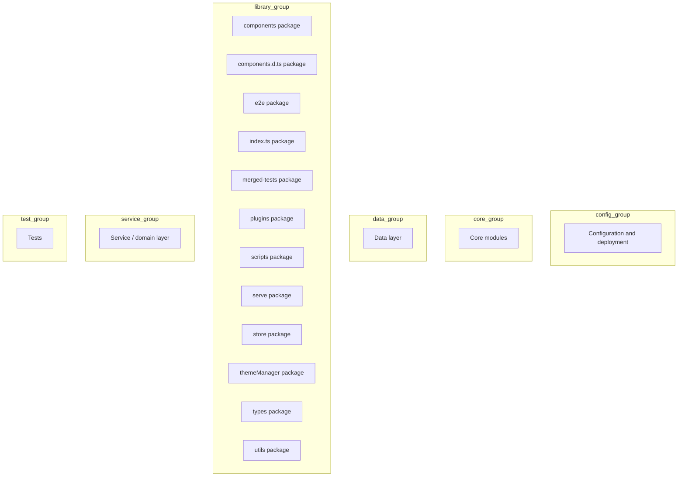

# Architecture report: revolist/revogrid

> Automated static analysis. **Observed** = directly seen in files/imports/AST; **Inferred** = interpretation from that evidence. Repository code was not executed.

## 1. Repository at a glance

| Item | Value |
| --- | --- |
| Repository | revolist/revogrid |
| Description | Powerful virtual data table smartsheet with advanced customization. Best features from excel plus incredible  performance 🔋 |
| Language | TypeScript |
| Stars | 3467 |
| Licence | MIT |
| Analysed commit / branch | 07e7c11f14e82d2d89418dac95d4b60e516d20ba / main |
| Framework(s) | React, Svelte, Vue |
| Files analysed | 307 |
| Components | 17 |

## 2. Architecture in one minute

revolist/revogrid - Powerful virtual data table smartsheet with advanced customization. Best features from excel plus incredible  performance 🔋. This repository was analysed statically from 307 file(s) (0 Python). Detected technologies (observed from imports/manifests): GitHub Actions, React, Svelte, Vue, Jest, TypeScript. Files are grouped into 17 component(s): components package, components.d.ts package, Configuration and deployment, Core modules, Data layer, e2e package, index.ts package, merged-tests package. Findings below distinguish observed facts from inferred interpretation.

## 3. High-level block diagram

## 4. Main components

### components package (`components`)

- **Kind:** library
- **Status:** Observed
- **Confidence:** 0.85
- **Responsibility:** Groups 36 file(s) under components package (observed from repository paths and static analysis).
- **Paths:** `src/components/attribution/revogr-attribution.tsx`, `src/components/clipboard/revogr-clipboard.tsx`, `src/components/editors/edit.utils.ts`, `src/components/editors/revogr-edit.tsx`, `src/components/editors/text-editor.ts`, `src/components/extra/revogr-extra.tsx`, `src/components/header/header-cell-renderer.tsx`, `src/components/header/header-group-renderer.tsx`, `src/components/header/header-renderer.tsx`, `src/components/header/resizable.directive.tsx`, `src/components/header/resizable.element.tsx`, `src/components/header/revogr-header.tsx`, `src/components/order/order-renderer.tsx`, `src/components/order/order-row.service.ts`, `src/components/order/revogr-order-editor.tsx`, `src/components/overlay/autofill.service.tsx`, `src/components/overlay/clipboard.utils.ts`, `src/components/overlay/keyboard.service.ts`, `src/components/overlay/revogr-overlay-selection.tsx`, `src/components/overlay/selection.utils.ts`, `src/components/revoGrid/grid.helpers.ts`, `src/components/revoGrid/plugin.service.ts`, `src/components/revoGrid/revo-grid.tsx`, `src/components/revoGrid/viewport.helpers.ts`, `src/components/revoGrid/viewport.resize.service.ts`, `src/components/revoGrid/viewport.scrolling.service.ts`, `src/components/revoGrid/viewport.service.ts`, `src/components/rowHeaders/revogr-row-headers.tsx`, `src/components/rowHeaders/row-header-render.tsx`, `src/components/scroll/revogr-viewport-scroll.tsx`, `src/components/scrollable/autohide-scroll.plugin.ts`, `src/components/scrollable/revogr-scroll-virtual.tsx`, `src/components/selectionFocus/revogr-focus.tsx`, `src/components/selectionTempRange/revogr-temp-range.tsx`, `src/components/vnode/vnode-converter.tsx`, `src/components/vnode/vnode.utils.ts`
- **Evidence:** [src/components/attribution/revogr-attribution.tsx](https://github.com/revolist/revogrid/blob/07e7c11f14e82d2d89418dac95d4b60e516d20ba/src/components/attribution/revogr-attribution.tsx); [src/components/clipboard/revogr-clipboard.tsx](https://github.com/revolist/revogrid/blob/07e7c11f14e82d2d89418dac95d4b60e516d20ba/src/components/clipboard/revogr-clipboard.tsx); [src/components/editors/edit.utils.ts](https://github.com/revolist/revogrid/blob/07e7c11f14e82d2d89418dac95d4b60e516d20ba/src/components/editors/edit.utils.ts); [src/components/editors/revogr-edit.tsx](https://github.com/revolist/revogrid/blob/07e7c11f14e82d2d89418dac95d4b60e516d20ba/src/components/editors/revogr-edit.tsx); [src/components/editors/text-editor.ts](https://github.com/revolist/revogrid/blob/07e7c11f14e82d2d89418dac95d4b60e516d20ba/src/components/editors/text-editor.ts); [src/components/extra/revogr-extra.tsx](https://github.com/revolist/revogrid/blob/07e7c11f14e82d2d89418dac95d4b60e516d20ba/src/components/extra/revogr-extra.tsx); [src/components/header/header-cell-renderer.tsx](https://github.com/revolist/revogrid/blob/07e7c11f14e82d2d89418dac95d4b60e516d20ba/src/components/header/header-cell-renderer.tsx); [src/components/header/header-group-renderer.tsx](https://github.com/revolist/revogrid/blob/07e7c11f14e82d2d89418dac95d4b60e516d20ba/src/components/header/header-group-renderer.tsx)

### components.d.ts package (`components_d_ts`)

- **Kind:** library
- **Status:** Observed
- **Confidence:** 0.85
- **Responsibility:** Groups 1 file(s) under components.d.ts package (observed from repository paths and static analysis).
- **Paths:** `src/components.d.ts`
- **Evidence:** [src/components.d.ts](https://github.com/revolist/revogrid/blob/07e7c11f14e82d2d89418dac95d4b60e516d20ba/src/components.d.ts)

### Configuration and deployment (`config`)

- **Kind:** config
- **Status:** Observed
- **Confidence:** 0.85
- **Responsibility:** Groups 4 file(s) under configuration and deployment (observed from repository paths and static analysis).
- **Paths:** `package.json`, `tsconfig.fw.json`, `tsconfig.json`, `typedoc.json`
- **Evidence:** [package.json](https://github.com/revolist/revogrid/blob/07e7c11f14e82d2d89418dac95d4b60e516d20ba/package.json); [tsconfig.fw.json](https://github.com/revolist/revogrid/blob/07e7c11f14e82d2d89418dac95d4b60e516d20ba/tsconfig.fw.json); [tsconfig.json](https://github.com/revolist/revogrid/blob/07e7c11f14e82d2d89418dac95d4b60e516d20ba/tsconfig.json); [typedoc.json](https://github.com/revolist/revogrid/blob/07e7c11f14e82d2d89418dac95d4b60e516d20ba/typedoc.json)

### Core modules (`core`)

- **Kind:** core
- **Status:** Observed
- **Confidence:** 0.85
- **Responsibility:** Groups 2 file(s) under core modules (observed from repository paths and static analysis).
- **Paths:** `playwright.config.ts`, `stencil.config.ts`
- **Evidence:** [playwright.config.ts](https://github.com/revolist/revogrid/blob/07e7c11f14e82d2d89418dac95d4b60e516d20ba/playwright.config.ts); [stencil.config.ts](https://github.com/revolist/revogrid/blob/07e7c11f14e82d2d89418dac95d4b60e516d20ba/stencil.config.ts)

### Data layer (`data_layer`)

- **Kind:** data
- **Status:** Observed
- **Confidence:** 0.85
- **Responsibility:** Groups 5 file(s) under data layer (observed from repository paths and static analysis).
- **Paths:** `src/components/data/cell-renderer.tsx`, `src/components/data/column.service.ts`, `src/components/data/revogr-data.tsx`, `src/components/data/row-highlight.plugin.ts`, `src/components/data/row-renderer.tsx`
- **Evidence:** [src/components/data/cell-renderer.tsx](https://github.com/revolist/revogrid/blob/07e7c11f14e82d2d89418dac95d4b60e516d20ba/src/components/data/cell-renderer.tsx); [src/components/data/column.service.ts](https://github.com/revolist/revogrid/blob/07e7c11f14e82d2d89418dac95d4b60e516d20ba/src/components/data/column.service.ts); [src/components/data/revogr-data.tsx](https://github.com/revolist/revogrid/blob/07e7c11f14e82d2d89418dac95d4b60e516d20ba/src/components/data/revogr-data.tsx); [src/components/data/row-highlight.plugin.ts](https://github.com/revolist/revogrid/blob/07e7c11f14e82d2d89418dac95d4b60e516d20ba/src/components/data/row-highlight.plugin.ts); [src/components/data/row-renderer.tsx](https://github.com/revolist/revogrid/blob/07e7c11f14e82d2d89418dac95d4b60e516d20ba/src/components/data/row-renderer.tsx)

### e2e package (`e2e`)

- **Kind:** library
- **Status:** Observed
- **Confidence:** 0.85
- **Responsibility:** Groups 38 file(s) under e2e package (observed from repository paths and static analysis).
- **Paths:** `e2e/accessibility.spec.ts`, `e2e/auto-size.spec.ts`, `e2e/clipboard.spec.ts`, `e2e/column-groups.spec.ts`, `e2e/defaults.spec.ts`, `e2e/editing.spec.ts`, `e2e/export.spec.ts`, `e2e/filtering.spec.ts`, `e2e/helpers.ts`, `e2e/helpers/assertions.ts`, `e2e/helpers/clipboard.ts`, `e2e/helpers/export.ts`, `e2e/helpers/fixtures.ts`, `e2e/helpers/grid.ts`, `e2e/helpers/interactions.ts`, `e2e/helpers/locators.ts`, `e2e/helpers/selectors.ts`, `e2e/helpers/types.ts`, `e2e/layout.spec.ts`, `e2e/lifecycle.spec.ts`, `e2e/navigation.spec.ts`, `e2e/october-wcag-trim.spec.ts`, `e2e/overlay-scrollbar.spec.ts`, `e2e/pinning.spec.ts`, `e2e/range.spec.ts`, `e2e/rendering.spec.ts`, `e2e/reordering.spec.ts`, `e2e/resize-trim-regressions.spec.ts`, `e2e/row-grouping.spec.ts`, `e2e/row-headers.spec.ts`, `e2e/row-resize.spec.ts`, `e2e/scroll-resize.spec.ts`, `e2e/set-data-at.spec.ts`, `e2e/sorting-filtering.spec.ts`, `e2e/sorting.spec.ts`, `e2e/theme.spec.ts`, `e2e/trimming.spec.ts`, `e2e/virtualization.spec.ts`
- **Evidence:** [e2e/accessibility.spec.ts](https://github.com/revolist/revogrid/blob/07e7c11f14e82d2d89418dac95d4b60e516d20ba/e2e/accessibility.spec.ts); [e2e/auto-size.spec.ts](https://github.com/revolist/revogrid/blob/07e7c11f14e82d2d89418dac95d4b60e516d20ba/e2e/auto-size.spec.ts); [e2e/clipboard.spec.ts](https://github.com/revolist/revogrid/blob/07e7c11f14e82d2d89418dac95d4b60e516d20ba/e2e/clipboard.spec.ts); [e2e/column-groups.spec.ts](https://github.com/revolist/revogrid/blob/07e7c11f14e82d2d89418dac95d4b60e516d20ba/e2e/column-groups.spec.ts); [e2e/defaults.spec.ts](https://github.com/revolist/revogrid/blob/07e7c11f14e82d2d89418dac95d4b60e516d20ba/e2e/defaults.spec.ts); [e2e/editing.spec.ts](https://github.com/revolist/revogrid/blob/07e7c11f14e82d2d89418dac95d4b60e516d20ba/e2e/editing.spec.ts); [e2e/export.spec.ts](https://github.com/revolist/revogrid/blob/07e7c11f14e82d2d89418dac95d4b60e516d20ba/e2e/export.spec.ts); [e2e/filtering.spec.ts](https://github.com/revolist/revogrid/blob/07e7c11f14e82d2d89418dac95d4b60e516d20ba/e2e/filtering.spec.ts)

### index.ts package (`index_ts`)

- **Kind:** library
- **Status:** Observed
- **Confidence:** 0.85
- **Responsibility:** Groups 1 file(s) under index.ts package (observed from repository paths and static analysis).
- **Paths:** `src/index.ts`
- **Evidence:** [src/index.ts](https://github.com/revolist/revogrid/blob/07e7c11f14e82d2d89418dac95d4b60e516d20ba/src/index.ts)

### merged-tests package (`merged_tests`)

- **Kind:** library
- **Status:** Observed
- **Confidence:** 0.85
- **Responsibility:** Groups 2 file(s) under merged-tests package (observed from repository paths and static analysis).
- **Paths:** `merged-tests/e2e-auto-size.spec.ts`, `merged-tests/test-auto-size.spec.ts`
- **Evidence:** [merged-tests/e2e-auto-size.spec.ts](https://github.com/revolist/revogrid/blob/07e7c11f14e82d2d89418dac95d4b60e516d20ba/merged-tests/e2e-auto-size.spec.ts); [merged-tests/test-auto-size.spec.ts](https://github.com/revolist/revogrid/blob/07e7c11f14e82d2d89418dac95d4b60e516d20ba/merged-tests/test-auto-size.spec.ts)

### plugins package (`plugins`)

- **Kind:** library
- **Status:** Observed
- **Confidence:** 0.85
- **Responsibility:** Groups 46 file(s) under plugins package (observed from repository paths and static analysis).
- **Paths:** `src/plugins/add-rows-on-paste.plugin.ts`, `src/plugins/base.plugin.ts`, `src/plugins/column.auto-size.plugin.ts`, `src/plugins/column.stretch.plugin.ts`, `src/plugins/dispatcher.ts`, `src/plugins/export/csv.ts`, `src/plugins/export/export.plugin.ts`, `src/plugins/export/types.ts`, `src/plugins/filter/conditions/equal.ts`, `src/plugins/filter/conditions/number/greaterThan.ts`, `src/plugins/filter/conditions/number/greaterThanOrEqual.ts`, `src/plugins/filter/conditions/number/lessThan.ts`, `src/plugins/filter/conditions/number/lessThanOrEqual.ts`, `src/plugins/filter/conditions/set.ts`, `src/plugins/filter/conditions/string/beginswith.ts`, `src/plugins/filter/conditions/string/contains.ts`, `src/plugins/filter/conditions/value.ts`, `src/plugins/filter/filter.blank.ts`, `src/plugins/filter/filter.button.tsx`, `src/plugins/filter/filter.constants.ts`, `src/plugins/filter/filter.indexed.ts`, `src/plugins/filter/filter.panel.tsx`, `src/plugins/filter/filter.plugin.tsx`, `src/plugins/filter/filter.reorder.ts`, `src/plugins/filter/filter.types.ts`, `src/plugins/groupingRow/grouping.const.ts`, `src/plugins/groupingRow/grouping.row.expand.service.ts`, `src/plugins/groupingRow/grouping.row.plugin.ts`, `src/plugins/groupingRow/grouping.row.renderer.tsx`, `src/plugins/groupingRow/grouping.row.types.ts`, `src/plugins/groupingRow/grouping.service.ts`, `src/plugins/groupingRow/grouping.sorting.service.ts`, `src/plugins/groupingRow/grouping.trimmed.service.ts`, `src/plugins/index.ts`, `src/plugins/moveColumn/column.drag.plugin.ts`, `src/plugins/moveColumn/order-column.handler.tsx`, `src/plugins/row-resize/index.ts`, `src/plugins/row-resize/row-resize.plugin.tsx`, `src/plugins/row-resize/row-resize.types.ts`, `src/plugins/row-resize/row-resize.utils.ts`, `src/plugins/rtl/rtl.plugin.ts`, `src/plugins/sorting/sorting.func.ts`, `src/plugins/sorting/sorting.plugin.ts`, `src/plugins/sorting/sorting.sign.tsx`, `src/plugins/sorting/sorting.types.ts`, `src/plugins/wcag/index.ts`
- **Evidence:** [src/plugins/add-rows-on-paste.plugin.ts](https://github.com/revolist/revogrid/blob/07e7c11f14e82d2d89418dac95d4b60e516d20ba/src/plugins/add-rows-on-paste.plugin.ts); [src/plugins/base.plugin.ts](https://github.com/revolist/revogrid/blob/07e7c11f14e82d2d89418dac95d4b60e516d20ba/src/plugins/base.plugin.ts); [src/plugins/column.auto-size.plugin.ts](https://github.com/revolist/revogrid/blob/07e7c11f14e82d2d89418dac95d4b60e516d20ba/src/plugins/column.auto-size.plugin.ts); [src/plugins/column.stretch.plugin.ts](https://github.com/revolist/revogrid/blob/07e7c11f14e82d2d89418dac95d4b60e516d20ba/src/plugins/column.stretch.plugin.ts); [src/plugins/dispatcher.ts](https://github.com/revolist/revogrid/blob/07e7c11f14e82d2d89418dac95d4b60e516d20ba/src/plugins/dispatcher.ts); [src/plugins/export/csv.ts](https://github.com/revolist/revogrid/blob/07e7c11f14e82d2d89418dac95d4b60e516d20ba/src/plugins/export/csv.ts); [src/plugins/export/export.plugin.ts](https://github.com/revolist/revogrid/blob/07e7c11f14e82d2d89418dac95d4b60e516d20ba/src/plugins/export/export.plugin.ts); [src/plugins/export/types.ts](https://github.com/revolist/revogrid/blob/07e7c11f14e82d2d89418dac95d4b60e516d20ba/src/plugins/export/types.ts)

### scripts package (`scripts`)

- **Kind:** library
- **Status:** Observed
- **Confidence:** 0.85
- **Responsibility:** Groups 9 file(s) under scripts package (observed from repository paths and static analysis).
- **Paths:** `scripts/event-list.plugin.ts`, `scripts/finalize-package.mjs`, `scripts/generate_api.sh`, `scripts/generate_readme.mjs`, `scripts/hydrate-types.plugin.ts`, `scripts/package-commit.mjs`, `scripts/package-dirs.mjs`, `scripts/package-formats.test.mjs`, `scripts/package-version.mjs`
- **Evidence:** [scripts/event-list.plugin.ts](https://github.com/revolist/revogrid/blob/07e7c11f14e82d2d89418dac95d4b60e516d20ba/scripts/event-list.plugin.ts); [scripts/finalize-package.mjs](https://github.com/revolist/revogrid/blob/07e7c11f14e82d2d89418dac95d4b60e516d20ba/scripts/finalize-package.mjs); [scripts/generate_api.sh](https://github.com/revolist/revogrid/blob/07e7c11f14e82d2d89418dac95d4b60e516d20ba/scripts/generate_api.sh); [scripts/generate_readme.mjs](https://github.com/revolist/revogrid/blob/07e7c11f14e82d2d89418dac95d4b60e516d20ba/scripts/generate_readme.mjs); [scripts/hydrate-types.plugin.ts](https://github.com/revolist/revogrid/blob/07e7c11f14e82d2d89418dac95d4b60e516d20ba/scripts/hydrate-types.plugin.ts); [scripts/package-commit.mjs](https://github.com/revolist/revogrid/blob/07e7c11f14e82d2d89418dac95d4b60e516d20ba/scripts/package-commit.mjs); [scripts/package-dirs.mjs](https://github.com/revolist/revogrid/blob/07e7c11f14e82d2d89418dac95d4b60e516d20ba/scripts/package-dirs.mjs); [scripts/package-formats.test.mjs](https://github.com/revolist/revogrid/blob/07e7c11f14e82d2d89418dac95d4b60e516d20ba/scripts/package-formats.test.mjs)

### serve package (`serve`)

- **Kind:** library
- **Status:** Observed
- **Confidence:** 0.85
- **Responsibility:** Groups 2 file(s) under serve package (observed from repository paths and static analysis).
- **Paths:** `src/serve/controller.js`, `src/serve/data.js`
- **Evidence:** [src/serve/controller.js](https://github.com/revolist/revogrid/blob/07e7c11f14e82d2d89418dac95d4b60e516d20ba/src/serve/controller.js); [src/serve/data.js](https://github.com/revolist/revogrid/blob/07e7c11f14e82d2d89418dac95d4b60e516d20ba/src/serve/data.js)

### Service / domain layer (`service_layer`)

- **Kind:** service
- **Status:** Observed
- **Confidence:** 0.85
- **Responsibility:** Groups 9 file(s) under service / domain layer (observed from repository paths and static analysis).
- **Paths:** `src/services/cell.helpers.ts`, `src/services/column.data.provider.ts`, `src/services/data.provider.ts`, `src/services/dimension.provider.ts`, `src/services/local.scroll.service.ts`, `src/services/local.scroll.timer.ts`, `src/services/scroll.dimension.helpers.ts`, `src/services/selection.store.connector.ts`, `src/services/viewport.provider.ts`
- **Evidence:** [src/services/cell.helpers.ts](https://github.com/revolist/revogrid/blob/07e7c11f14e82d2d89418dac95d4b60e516d20ba/src/services/cell.helpers.ts); [src/services/column.data.provider.ts](https://github.com/revolist/revogrid/blob/07e7c11f14e82d2d89418dac95d4b60e516d20ba/src/services/column.data.provider.ts); [src/services/data.provider.ts](https://github.com/revolist/revogrid/blob/07e7c11f14e82d2d89418dac95d4b60e516d20ba/src/services/data.provider.ts); [src/services/dimension.provider.ts](https://github.com/revolist/revogrid/blob/07e7c11f14e82d2d89418dac95d4b60e516d20ba/src/services/dimension.provider.ts); [src/services/local.scroll.service.ts](https://github.com/revolist/revogrid/blob/07e7c11f14e82d2d89418dac95d4b60e516d20ba/src/services/local.scroll.service.ts); [src/services/local.scroll.timer.ts](https://github.com/revolist/revogrid/blob/07e7c11f14e82d2d89418dac95d4b60e516d20ba/src/services/local.scroll.timer.ts); [src/services/scroll.dimension.helpers.ts](https://github.com/revolist/revogrid/blob/07e7c11f14e82d2d89418dac95d4b60e516d20ba/src/services/scroll.dimension.helpers.ts); [src/services/selection.store.connector.ts](https://github.com/revolist/revogrid/blob/07e7c11f14e82d2d89418dac95d4b60e516d20ba/src/services/selection.store.connector.ts)

### store package (`store`)

- **Kind:** library
- **Status:** Observed
- **Confidence:** 0.85
- **Responsibility:** Groups 17 file(s) under store package (observed from repository paths and static analysis).
- **Paths:** `src/store/dataSource/data.pending.plugin.ts`, `src/store/dataSource/data.proxy.ts`, `src/store/dataSource/data.store.ts`, `src/store/dataSource/index.ts`, `src/store/dataSource/trimmed.plugin.ts`, `src/store/dimension/dimension.helpers.ts`, `src/store/dimension/dimension.recalculate.plugin.ts`, `src/store/dimension/dimension.store.ts`, `src/store/dimension/dimension.trim.plugin.ts`, `src/store/dimension/index.ts`, `src/store/index.ts`, `src/store/selection/index.ts`, `src/store/selection/selection.helpers.ts`, `src/store/selection/selection.store.ts`, `src/store/vp/index.ts`, `src/store/vp/viewport.helpers.ts`, `src/store/vp/viewport.store.ts`
- **Evidence:** [src/store/dataSource/data.pending.plugin.ts](https://github.com/revolist/revogrid/blob/07e7c11f14e82d2d89418dac95d4b60e516d20ba/src/store/dataSource/data.pending.plugin.ts); [src/store/dataSource/data.proxy.ts](https://github.com/revolist/revogrid/blob/07e7c11f14e82d2d89418dac95d4b60e516d20ba/src/store/dataSource/data.proxy.ts); [src/store/dataSource/data.store.ts](https://github.com/revolist/revogrid/blob/07e7c11f14e82d2d89418dac95d4b60e516d20ba/src/store/dataSource/data.store.ts); [src/store/dataSource/index.ts](https://github.com/revolist/revogrid/blob/07e7c11f14e82d2d89418dac95d4b60e516d20ba/src/store/dataSource/index.ts); [src/store/dataSource/trimmed.plugin.ts](https://github.com/revolist/revogrid/blob/07e7c11f14e82d2d89418dac95d4b60e516d20ba/src/store/dataSource/trimmed.plugin.ts); [src/store/dimension/dimension.helpers.ts](https://github.com/revolist/revogrid/blob/07e7c11f14e82d2d89418dac95d4b60e516d20ba/src/store/dimension/dimension.helpers.ts); [src/store/dimension/dimension.recalculate.plugin.ts](https://github.com/revolist/revogrid/blob/07e7c11f14e82d2d89418dac95d4b60e516d20ba/src/store/dimension/dimension.recalculate.plugin.ts); [src/store/dimension/dimension.store.ts](https://github.com/revolist/revogrid/blob/07e7c11f14e82d2d89418dac95d4b60e516d20ba/src/store/dimension/dimension.store.ts)

### Tests (`tests`)

- **Kind:** test
- **Status:** Observed
- **Confidence:** 0.85
- **Responsibility:** Groups 29 file(s) under tests (observed from repository paths and static analysis).
- **Paths:** `test/auto-size.spec.ts`, `test/autohide-scroll.spec.ts`, `test/base-plugin.spec.ts`, `test/clipboard.spec.ts`, `test/column-grouping.spec.ts`, `test/column-service.spec.ts`, `test/csv.spec.ts`, `test/data.provider.spec.ts`, `test/data.store.spec.ts`, `test/dimension.spec.ts`, `test/filter.spec.ts`, `test/grouping.spec.ts`, `test/hydrate-package-types.ts`, `test/hydrate-types.ts`, `test/keyboard.service.spec.ts`, `test/october-wcag-items.spec.ts`, `test/overlay-selection.spec.ts`, `test/revogr-edit.spec.ts`, `test/row-resize.spec.ts`, `test/scroll.dimension.spec.ts`, `test/serve.data.spec.ts`, `test/sorting.spec.ts`, `test/theme.spec.ts`, `test/utils.spec.ts`, `test/viewport-lifecycle.spec.ts`, `test/viewport.resize.spec.ts`, `test/viewport.scrolling.spec.ts`, `test/viewport.spec.ts`, `test/wcag.spec.ts`
- **Evidence:** [test/auto-size.spec.ts](https://github.com/revolist/revogrid/blob/07e7c11f14e82d2d89418dac95d4b60e516d20ba/test/auto-size.spec.ts); [test/autohide-scroll.spec.ts](https://github.com/revolist/revogrid/blob/07e7c11f14e82d2d89418dac95d4b60e516d20ba/test/autohide-scroll.spec.ts); [test/base-plugin.spec.ts](https://github.com/revolist/revogrid/blob/07e7c11f14e82d2d89418dac95d4b60e516d20ba/test/base-plugin.spec.ts); [test/clipboard.spec.ts](https://github.com/revolist/revogrid/blob/07e7c11f14e82d2d89418dac95d4b60e516d20ba/test/clipboard.spec.ts); [test/column-grouping.spec.ts](https://github.com/revolist/revogrid/blob/07e7c11f14e82d2d89418dac95d4b60e516d20ba/test/column-grouping.spec.ts); [test/column-service.spec.ts](https://github.com/revolist/revogrid/blob/07e7c11f14e82d2d89418dac95d4b60e516d20ba/test/column-service.spec.ts); [test/csv.spec.ts](https://github.com/revolist/revogrid/blob/07e7c11f14e82d2d89418dac95d4b60e516d20ba/test/csv.spec.ts); [test/data.provider.spec.ts](https://github.com/revolist/revogrid/blob/07e7c11f14e82d2d89418dac95d4b60e516d20ba/test/data.provider.spec.ts)

### themeManager package (`thememanager`)

- **Kind:** library
- **Status:** Observed
- **Confidence:** 0.85
- **Responsibility:** Groups 8 file(s) under thememanager package (observed from repository paths and static analysis).
- **Paths:** `src/themeManager/presets/aurora.ts`, `src/themeManager/presets/high-contrast-dark.ts`, `src/themeManager/presets/high-contrast.ts`, `src/themeManager/presets/index.ts`, `src/themeManager/presets/midnight.ts`, `src/themeManager/presets/ocean.ts`, `src/themeManager/presets/shared.ts`, `src/themeManager/theme.service.ts`
- **Evidence:** [src/themeManager/presets/aurora.ts](https://github.com/revolist/revogrid/blob/07e7c11f14e82d2d89418dac95d4b60e516d20ba/src/themeManager/presets/aurora.ts); [src/themeManager/presets/high-contrast-dark.ts](https://github.com/revolist/revogrid/blob/07e7c11f14e82d2d89418dac95d4b60e516d20ba/src/themeManager/presets/high-contrast-dark.ts); [src/themeManager/presets/high-contrast.ts](https://github.com/revolist/revogrid/blob/07e7c11f14e82d2d89418dac95d4b60e516d20ba/src/themeManager/presets/high-contrast.ts); [src/themeManager/presets/index.ts](https://github.com/revolist/revogrid/blob/07e7c11f14e82d2d89418dac95d4b60e516d20ba/src/themeManager/presets/index.ts); [src/themeManager/presets/midnight.ts](https://github.com/revolist/revogrid/blob/07e7c11f14e82d2d89418dac95d4b60e516d20ba/src/themeManager/presets/midnight.ts); [src/themeManager/presets/ocean.ts](https://github.com/revolist/revogrid/blob/07e7c11f14e82d2d89418dac95d4b60e516d20ba/src/themeManager/presets/ocean.ts); [src/themeManager/presets/shared.ts](https://github.com/revolist/revogrid/blob/07e7c11f14e82d2d89418dac95d4b60e516d20ba/src/themeManager/presets/shared.ts); [src/themeManager/theme.service.ts](https://github.com/revolist/revogrid/blob/07e7c11f14e82d2d89418dac95d4b60e516d20ba/src/themeManager/theme.service.ts)

### types package (`types`)

- **Kind:** library
- **Status:** Observed
- **Confidence:** 0.85
- **Responsibility:** Groups 9 file(s) under types package (observed from repository paths and static analysis).
- **Paths:** `src/types/dimension.ts`, `src/types/events.ts`, `src/types/index.ts`, `src/types/interfaces.ts`, `src/types/plugin.ts`, `src/types/plugin.types.ts`, `src/types/selection.ts`, `src/types/theme.ts`, `src/types/viewport.interfaces.ts`
- **Evidence:** [src/types/dimension.ts](https://github.com/revolist/revogrid/blob/07e7c11f14e82d2d89418dac95d4b60e516d20ba/src/types/dimension.ts); [src/types/events.ts](https://github.com/revolist/revogrid/blob/07e7c11f14e82d2d89418dac95d4b60e516d20ba/src/types/events.ts); [src/types/index.ts](https://github.com/revolist/revogrid/blob/07e7c11f14e82d2d89418dac95d4b60e516d20ba/src/types/index.ts); [src/types/interfaces.ts](https://github.com/revolist/revogrid/blob/07e7c11f14e82d2d89418dac95d4b60e516d20ba/src/types/interfaces.ts); [src/types/plugin.ts](https://github.com/revolist/revogrid/blob/07e7c11f14e82d2d89418dac95d4b60e516d20ba/src/types/plugin.ts); [src/types/plugin.types.ts](https://github.com/revolist/revogrid/blob/07e7c11f14e82d2d89418dac95d4b60e516d20ba/src/types/plugin.types.ts); [src/types/selection.ts](https://github.com/revolist/revogrid/blob/07e7c11f14e82d2d89418dac95d4b60e516d20ba/src/types/selection.ts); [src/types/theme.ts](https://github.com/revolist/revogrid/blob/07e7c11f14e82d2d89418dac95d4b60e516d20ba/src/types/theme.ts)

### utils package (`utils`)

- **Kind:** library
- **Status:** Observed
- **Confidence:** 0.85
- **Responsibility:** Groups 15 file(s) under utils package (observed from repository paths and static analysis).
- **Paths:** `src/utils/browser.ts`, `src/utils/closest.polifill.ts`, `src/utils/column.utils.ts`, `src/utils/consts.ts`, `src/utils/events.ts`, `src/utils/header.utils.ts`, `src/utils/index.ts`, `src/utils/key.codes.ts`, `src/utils/key.utils.ts`, `src/utils/mobile.ts`, `src/utils/platform.ts`, `src/utils/row-header-utils.ts`, `src/utils/serialization.ts`, `src/utils/store.types.ts`, `src/utils/store.utils.ts`
- **Evidence:** [src/utils/browser.ts](https://github.com/revolist/revogrid/blob/07e7c11f14e82d2d89418dac95d4b60e516d20ba/src/utils/browser.ts); [src/utils/closest.polifill.ts](https://github.com/revolist/revogrid/blob/07e7c11f14e82d2d89418dac95d4b60e516d20ba/src/utils/closest.polifill.ts); [src/utils/column.utils.ts](https://github.com/revolist/revogrid/blob/07e7c11f14e82d2d89418dac95d4b60e516d20ba/src/utils/column.utils.ts); [src/utils/consts.ts](https://github.com/revolist/revogrid/blob/07e7c11f14e82d2d89418dac95d4b60e516d20ba/src/utils/consts.ts); [src/utils/events.ts](https://github.com/revolist/revogrid/blob/07e7c11f14e82d2d89418dac95d4b60e516d20ba/src/utils/events.ts); [src/utils/header.utils.ts](https://github.com/revolist/revogrid/blob/07e7c11f14e82d2d89418dac95d4b60e516d20ba/src/utils/header.utils.ts); [src/utils/index.ts](https://github.com/revolist/revogrid/blob/07e7c11f14e82d2d89418dac95d4b60e516d20ba/src/utils/index.ts); [src/utils/key.codes.ts](https://github.com/revolist/revogrid/blob/07e7c11f14e82d2d89418dac95d4b60e516d20ba/src/utils/key.codes.ts)

## 5. Execution flow

**Observed** entry point(s):

- [src/index.ts](https://github.com/revolist/revogrid/blob/07e7c11f14e82d2d89418dac95d4b60e516d20ba/src/index.ts)
- [src/plugins/index.ts](https://github.com/revolist/revogrid/blob/07e7c11f14e82d2d89418dac95d4b60e516d20ba/src/plugins/index.ts)
- [src/plugins/row-resize/index.ts](https://github.com/revolist/revogrid/blob/07e7c11f14e82d2d89418dac95d4b60e516d20ba/src/plugins/row-resize/index.ts)
- [src/plugins/wcag/index.ts](https://github.com/revolist/revogrid/blob/07e7c11f14e82d2d89418dac95d4b60e516d20ba/src/plugins/wcag/index.ts)
- [src/store/dataSource/index.ts](https://github.com/revolist/revogrid/blob/07e7c11f14e82d2d89418dac95d4b60e516d20ba/src/store/dataSource/index.ts)
- [src/store/dimension/index.ts](https://github.com/revolist/revogrid/blob/07e7c11f14e82d2d89418dac95d4b60e516d20ba/src/store/dimension/index.ts)
- [src/store/index.ts](https://github.com/revolist/revogrid/blob/07e7c11f14e82d2d89418dac95d4b60e516d20ba/src/store/index.ts)
- [src/store/selection/index.ts](https://github.com/revolist/revogrid/blob/07e7c11f14e82d2d89418dac95d4b60e516d20ba/src/store/selection/index.ts)
- [src/store/vp/index.ts](https://github.com/revolist/revogrid/blob/07e7c11f14e82d2d89418dac95d4b60e516d20ba/src/store/vp/index.ts)
- [src/themeManager/presets/index.ts](https://github.com/revolist/revogrid/blob/07e7c11f14e82d2d89418dac95d4b60e516d20ba/src/themeManager/presets/index.ts)
- [src/types/index.ts](https://github.com/revolist/revogrid/blob/07e7c11f14e82d2d89418dac95d4b60e516d20ba/src/types/index.ts)
- [src/utils/index.ts](https://github.com/revolist/revogrid/blob/07e7c11f14e82d2d89418dac95d4b60e516d20ba/src/utils/index.ts)

Representative flow (derived from observed entry points and the import graph; steps beyond the entry point are **Inferred**):

1. Execution starts at an observed entry point listed above, if present.
2. No internal import relationships between components were observed.

## 6. Project structure

### `(root)`

- `.editorconfig` - config (57 bytes)
- `.gitignore` - other (334 bytes)
- `.gitmodules` - other (1146 bytes)
- `.prettierrc.js` - source, JavaScript (82 bytes)
- `.prettierrc.json` - config (245 bytes)
- `.sonarcloud.properties` - other (928 bytes)
- `ACCESSIBILITY.md` - docs (10074 bytes)
- `AGENTS.md` - docs (3454 bytes)
- `CODE_OF_CONDUCT.md` - docs (5230 bytes)
- `CONTRIBUTING.md` - docs (6329 bytes)
- `LICENSE` - docs (1068 bytes)
- `SECURITY.md` - docs (2865 bytes)
- `package.json` - manifest (4644 bytes)
- `playwright.config.ts` - source, TypeScript (1178 bytes)
- `readme.md` - docs (30573 bytes)
- `stencil.config.ts` - source, TypeScript (5889 bytes)
- `tsconfig.fw.json` - config (485 bytes)
- `tsconfig.json` - config (806 bytes)
- `typedoc.json` - config (820 bytes)

### `.github`

- `.github/FUNDING.yml` - config (763 bytes)
- `.github/ISSUE_TEMPLATE/new-issue.md` - docs (610 bytes)
- `.github/PULL_REQUEST_TEMPLATE.md` - docs (1158 bytes)
- `.github/codex/prompts/release-notes.md` - docs (2261 bytes)
- `.github/dependabot.yml` - config (522 bytes)
- `.github/workflows/e2e.yml` - ci, YAML (1906 bytes)
- `.github/workflows/publish.yml` - ci, YAML (8062 bytes)
- `.github/workflows/unit.yml` - ci, YAML (2405 bytes)

### `assets`

- `assets/angular.svg` - other (416 bytes)
- `assets/js.svg` - other (1217 bytes)
- `assets/logo.svg` - other (10291 bytes)
- `assets/python.svg` - other (9597 bytes)
- `assets/react.svg` - other (3092 bytes)
- `assets/svelte.svg` - other (3388 bytes)
- `assets/vuejs.svg` - other (378 bytes)

### `e2e`

- `e2e/accessibility.spec.ts` - source, TypeScript (2282 bytes)
- `e2e/auto-size.spec.ts` - source, TypeScript (2073 bytes)
- `e2e/clipboard.spec.ts` - source, TypeScript (8161 bytes)
- `e2e/column-groups.spec.ts` - source, TypeScript (17876 bytes)
- `e2e/defaults.spec.ts` - source, TypeScript (2505 bytes)
- `e2e/editing.spec.ts` - source, TypeScript (11122 bytes)
- `e2e/export.spec.ts` - source, TypeScript (2070 bytes)
- `e2e/filtering.spec.ts` - source, TypeScript (39099 bytes)
- `e2e/helpers.ts` - source, TypeScript (1062 bytes)
- `e2e/helpers/assertions.ts` - source, TypeScript (1539 bytes)
- `e2e/helpers/clipboard.ts` - source, TypeScript (3574 bytes)
- `e2e/helpers/export.ts` - source, TypeScript (627 bytes)
- `e2e/helpers/fixtures.ts` - source, TypeScript (2107 bytes)
- `e2e/helpers/grid.ts` - source, TypeScript (5878 bytes)
- `e2e/helpers/interactions.ts` - source, TypeScript (1920 bytes)
- `e2e/helpers/locators.ts` - source, TypeScript (2639 bytes)
- `e2e/helpers/selectors.ts` - source, TypeScript (982 bytes)
- `e2e/helpers/types.ts` - source, TypeScript (1027 bytes)
- `e2e/layout.spec.ts` - source, TypeScript (10962 bytes)
- `e2e/lifecycle.spec.ts` - source, TypeScript (6100 bytes)
- `e2e/navigation.spec.ts` - source, TypeScript (7053 bytes)
- `e2e/october-wcag-trim.spec.ts` - source, TypeScript (1599 bytes)
- `e2e/overlay-scrollbar.spec.ts` - source, TypeScript (4408 bytes)
- `e2e/pinning.spec.ts` - source, TypeScript (18791 bytes)
- `e2e/range.spec.ts` - source, TypeScript (7097 bytes)
- `e2e/rendering.spec.ts` - source, TypeScript (6121 bytes)
- `e2e/reordering.spec.ts` - source, TypeScript (11671 bytes)
- `e2e/resize-trim-regressions.spec.ts` - source, TypeScript (9923 bytes)
- `e2e/row-grouping.spec.ts` - source, TypeScript (47893 bytes)
- `e2e/row-headers.spec.ts` - source, TypeScript (4612 bytes)
- `e2e/row-resize.spec.ts` - source, TypeScript (58832 bytes)
- `e2e/scroll-resize.spec.ts` - source, TypeScript (17981 bytes)
- `e2e/set-data-at.spec.ts` - source, TypeScript (4205 bytes)
- `e2e/sorting-filtering.spec.ts` - source, TypeScript (1813 bytes)
- `e2e/sorting.spec.ts` - source, TypeScript (1962 bytes)
- `e2e/theme.spec.ts` - source, TypeScript (23146 bytes)
- `e2e/trimming.spec.ts` - source, TypeScript (1079 bytes)
- `e2e/virtualization.spec.ts` - source, TypeScript (30100 bytes)

### `merged-tests`

- `merged-tests/e2e-auto-size.spec.ts` - source, TypeScript (2074 bytes)
- `merged-tests/test-auto-size.spec.ts` - source, TypeScript (5089 bytes)

### `readme`

- `readme/angular.usage.md` - docs (2705 bytes)
- `readme/banner.md` - docs (1931 bytes)
- `readme/contribute.md` - docs (470 bytes)
- `readme/e2e.md` - docs (1671 bytes)
- `readme/features.md` - docs (6682 bytes)
- `readme/framework.md` - docs (399 bytes)
- `readme/install.framework.md` - docs (504 bytes)
- `readme/install.md` - docs (1893 bytes)
- `readme/js.usage.md` - docs (1101 bytes)
- `readme/license.md` - docs (20 bytes)
- `readme/pro.features.md` - docs (11271 bytes)
- `readme/react.cell.md` - docs (359 bytes)
- `readme/react.install.md` - docs (354 bytes)
- `readme/react.title.md` - docs (17 bytes)
- `readme/react.usage.md` - docs (2056 bytes)
- `readme/sponsors.md` - docs (794 bytes)
- `readme/svelte-5.usage.md` - docs (382 bytes)
- `readme/svelte.usage.md` - docs (1870 bytes)
- `readme/usage.basic.md` - docs (311 bytes)
- `readme/usage.deprecated.md` - docs (142 bytes)
- `readme/version.md` - docs (2761 bytes)
- `readme/vue2.title.md` - docs (17 bytes)
- `readme/vue2.usage.md` - docs (1649 bytes)
- `readme/vue3.usage.md` - docs (3238 bytes)

### `scripts`

- `scripts/event-list.plugin.ts` - source, TypeScript (4318 bytes)
- `scripts/finalize-package.mjs` - source, JavaScript (771 bytes)
- `scripts/generate_api.sh` - source, Shell (1095 bytes)
- `scripts/generate_readme.mjs` - source, JavaScript (4087 bytes)
- `scripts/hydrate-types.plugin.ts` - source, TypeScript (2138 bytes)
- `scripts/package-commit.mjs` - source, JavaScript (966 bytes)
- `scripts/package-dirs.mjs` - source, JavaScript (162 bytes)
- `scripts/package-formats.test.mjs` - source, JavaScript (4086 bytes)
- `scripts/package-version.mjs` - source, JavaScript (1295 bytes)

### `src`

- `src/components.d.ts` - source, TypeScript (128769 bytes)
- `src/components/attribution/revogr-attribution.tsx` - source, TypeScript (977 bytes)
- `src/components/clipboard/revogr-clipboard.tsx` - source, TypeScript (7657 bytes)
- `src/components/data/cell-renderer.tsx` - source, TypeScript (1740 bytes)
- `src/components/data/column.service.ts` - source, TypeScript (12713 bytes)
- `src/components/data/revogr-data-style.scss` - other (1870 bytes)
- `src/components/data/revogr-data.tsx` - source, TypeScript (10940 bytes)
- `src/components/data/row-highlight.plugin.ts` - source, TypeScript (1656 bytes)
- `src/components/data/row-renderer.tsx` - source, TypeScript (950 bytes)
- `src/components/editors/edit.utils.ts` - source, TypeScript (434 bytes)
- `src/components/editors/revogr-edit-style.scss` - other (400 bytes)
- `src/components/editors/revogr-edit.tsx` - source, TypeScript (5361 bytes)
- `src/components/editors/text-editor.ts` - source, TypeScript (2822 bytes)
- `src/components/extra/revogr-extra.tsx` - source, TypeScript (1838 bytes)
- `src/components/header/header-cell-renderer.tsx` - source, TypeScript (1223 bytes)
- `src/components/header/header-group-renderer.tsx` - source, TypeScript (1477 bytes)
- `src/components/header/header-renderer.tsx` - source, TypeScript (3120 bytes)
- `src/components/header/resizable.directive.tsx` - source, TypeScript (9492 bytes)
- `src/components/header/resizable.element.tsx` - source, TypeScript (1249 bytes)
- `src/components/header/revogr-header-style.scss` - other (3401 bytes)
- `src/components/header/revogr-header.tsx` - source, TypeScript (10877 bytes)
- `src/components/order/order-renderer.tsx` - source, TypeScript (1600 bytes)
- `src/components/order/order-row.service.ts` - source, TypeScript (2612 bytes)
- `src/components/order/revogr-order-editor.tsx` - source, TypeScript (4853 bytes)
- `src/components/overlay/autofill.service.tsx` - source, TypeScript (8660 bytes)
- `src/components/overlay/clipboard.utils.ts` - source, TypeScript (925 bytes)
- `src/components/overlay/keyboard.service.ts` - source, TypeScript (8810 bytes)
- `src/components/overlay/revogr-overlay-selection.tsx` - source, TypeScript (28125 bytes)
- `src/components/overlay/revogr-overlay-style.scss` - other (2103 bytes)
- `src/components/overlay/selection.utils.ts` - source, TypeScript (5372 bytes)
- `src/components/revoGrid/grid.helpers.ts` - source, TypeScript (943 bytes)
- `src/components/revoGrid/plugin.service.ts` - source, TypeScript (2360 bytes)
- `src/components/revoGrid/revo-grid-style.scss` - other (12593 bytes)
- `src/components/revoGrid/revo-grid.tsx` - source, TypeScript (61535 bytes)
- `src/components/revoGrid/styles/revo-grid.common-material.scss` - other (1311 bytes)
- `src/components/revoGrid/styles/revo-grid.common.scss` - other (1403 bytes)
- `src/components/revoGrid/styles/revo-grid.compact.scss` - other (1159 bytes)
- `src/components/revoGrid/styles/revo-grid.default.scss` - other (4394 bytes)
- `src/components/revoGrid/styles/revo-grid.material.scss` - other (1374 bytes)
- `src/components/revoGrid/styles/revo-grid.mixin.scss` - other (409 bytes)
- `src/components/revoGrid/styles/revo-grid.rtl.scss` - other (3343 bytes)
- `src/components/revoGrid/viewport.helpers.ts` - source, TypeScript (2864 bytes)
- `src/components/revoGrid/viewport.resize.service.ts` - source, TypeScript (1479 bytes)
- `src/components/revoGrid/viewport.scrolling.service.ts` - source, TypeScript (3321 bytes)
- `src/components/revoGrid/viewport.service.ts` - source, TypeScript (12078 bytes)
- `src/components/rowHeaders/revogr-row-headers.tsx` - source, TypeScript (4420 bytes)
- `src/components/rowHeaders/row-header-render.tsx` - source, TypeScript (269 bytes)
- `src/components/scroll/revogr-viewport-scroll-style.scss` - other (1408 bytes)
- `src/components/scroll/revogr-viewport-scroll.tsx` - source, TypeScript (15749 bytes)
- `src/components/scrollable/autohide-scroll.plugin.ts` - source, TypeScript (1604 bytes)
- `src/components/scrollable/revogr-scroll-style.scss` - other (851 bytes)
- `src/components/scrollable/revogr-scroll-virtual.tsx` - source, TypeScript (11033 bytes)
- `src/components/selectionFocus/revogr-focus-style.scss` - other (187 bytes)
- `src/components/selectionFocus/revogr-focus.tsx` - source, TypeScript (4211 bytes)
- `src/components/selectionTempRange/revogr-temp-range-style.scss` - other (510 bytes)
- `src/components/selectionTempRange/revogr-temp-range.tsx` - source, TypeScript (2445 bytes)
- `src/components/vnode/vnode-converter.tsx` - source, TypeScript (822 bytes)
- `src/components/vnode/vnode.utils.ts` - source, TypeScript (642 bytes)
- `src/global/_buttons.scss` - other (754 bytes)
- `src/global/_icons.scss` - other (3099 bytes)
- `src/global/_mixins.scss` - other (172 bytes)
- `src/index.ts` - source, TypeScript (394 bytes)
- `src/plugins/add-rows-on-paste.plugin.ts` - source, TypeScript (1588 bytes)
- `src/plugins/base.plugin.ts` - source, TypeScript (3683 bytes)
- `src/plugins/column.auto-size.plugin.ts` - source, TypeScript (9305 bytes)
- `src/plugins/column.stretch.plugin.ts` - source, TypeScript (3955 bytes)
- `src/plugins/dispatcher.ts` - source, TypeScript (1829 bytes)
- `src/plugins/export/csv.ts` - source, TypeScript (2616 bytes)
- `src/plugins/export/export.plugin.ts` - source, TypeScript (5186 bytes)
- `src/plugins/export/types.ts` - source, TypeScript (506 bytes)
- `src/plugins/filter/conditions/equal.ts` - source, TypeScript (769 bytes)
- `src/plugins/filter/conditions/number/greaterThan.ts` - source, TypeScript (474 bytes)
- `src/plugins/filter/conditions/number/greaterThanOrEqual.ts` - source, TypeScript (363 bytes)
- `src/plugins/filter/conditions/number/lessThan.ts` - source, TypeScript (473 bytes)
- `src/plugins/filter/conditions/number/lessThanOrEqual.ts` - source, TypeScript (348 bytes)
- `src/plugins/filter/conditions/set.ts` - source, TypeScript (736 bytes)
- `src/plugins/filter/conditions/string/beginswith.ts` - source, TypeScript (592 bytes)
- `src/plugins/filter/conditions/string/contains.ts` - source, TypeScript (721 bytes)
- `src/plugins/filter/conditions/value.ts` - source, TypeScript (311 bytes)
- `src/plugins/filter/filter.blank.ts` - source, TypeScript (2074 bytes)
- `src/plugins/filter/filter.button.tsx` - source, TypeScript (3044 bytes)
- `src/plugins/filter/filter.constants.ts` - source, TypeScript (323 bytes)
- `src/plugins/filter/filter.indexed.ts` - source, TypeScript (1471 bytes)
- `src/plugins/filter/filter.panel.tsx` - source, TypeScript (22535 bytes)
- `src/plugins/filter/filter.plugin.tsx` - source, TypeScript (20639 bytes)
- `src/plugins/filter/filter.reorder.ts` - source, TypeScript (1497 bytes)
- `src/plugins/filter/filter.style.scss` - other (8128 bytes)
- `src/plugins/filter/filter.types.ts` - source, TypeScript (7633 bytes)
- `src/plugins/groupingRow/grouping.const.ts` - source, TypeScript (811 bytes)
- `src/plugins/groupingRow/grouping.row.expand.service.ts` - source, TypeScript (2471 bytes)
- `src/plugins/groupingRow/grouping.row.plugin.ts` - source, TypeScript (15983 bytes)
- `src/plugins/groupingRow/grouping.row.renderer.tsx` - source, TypeScript (4945 bytes)
- `src/plugins/groupingRow/grouping.row.types.ts` - source, TypeScript (4197 bytes)
- `src/plugins/groupingRow/grouping.service.ts` - source, TypeScript (6428 bytes)
- `src/plugins/groupingRow/grouping.sorting.service.ts` - source, TypeScript (1960 bytes)
- `src/plugins/groupingRow/grouping.trimmed.service.ts` - source, TypeScript (4815 bytes)
- `src/plugins/index.ts` - source, TypeScript (481 bytes)
- `src/plugins/moveColumn/column.drag.plugin.ts` - source, TypeScript (10405 bytes)
- `src/plugins/moveColumn/order-column.handler.tsx` - source, TypeScript (2222 bytes)
- `src/plugins/row-resize/index.ts` - source, TypeScript (109 bytes)
- `src/plugins/row-resize/row-resize.plugin.tsx` - source, TypeScript (17736 bytes)
- `src/plugins/row-resize/row-resize.types.ts` - source, TypeScript (1507 bytes)
- `src/plugins/row-resize/row-resize.utils.ts` - source, TypeScript (2799 bytes)
- `src/plugins/rtl/rtl.plugin.ts` - source, TypeScript (3949 bytes)
- `src/plugins/sorting/sorting.func.ts` - source, TypeScript (9540 bytes)
- `src/plugins/sorting/sorting.plugin.ts` - source, TypeScript (18162 bytes)
- `src/plugins/sorting/sorting.sign.tsx` - source, TypeScript (691 bytes)
- `src/plugins/sorting/sorting.types.ts` - source, TypeScript (2235 bytes)
- `src/plugins/wcag/index.ts` - source, TypeScript (5728 bytes)
- `src/serve/controller.js` - source, JavaScript (12280 bytes)
- `src/serve/data.js` - source, JavaScript (6758 bytes)
- `src/serve/index.html` - other (8679 bytes)
- `src/serve/style.css` - other (1006 bytes)
- `src/services/cell.helpers.ts` - source, TypeScript (273 bytes)
- `src/services/column.data.provider.ts` - source, TypeScript (4424 bytes)
- `src/services/data.provider.ts` - source, TypeScript (5891 bytes)
- `src/services/dimension.provider.ts` - source, TypeScript (9107 bytes)
- `src/services/local.scroll.service.ts` - source, TypeScript (6906 bytes)
- `src/services/local.scroll.timer.ts` - source, TypeScript (3036 bytes)
- `src/services/scroll.dimension.helpers.ts` - source, TypeScript (4372 bytes)
- `src/services/selection.store.connector.ts` - source, TypeScript (9854 bytes)
- `src/services/viewport.provider.ts` - source, TypeScript (682 bytes)
- `src/store/dataSource/data.pending.plugin.ts` - source, TypeScript (893 bytes)
- `src/store/dataSource/data.proxy.ts` - source, TypeScript (1542 bytes)
- `src/store/dataSource/data.store.ts` - source, TypeScript (8308 bytes)
- `src/store/dataSource/index.ts` - source, TypeScript (94 bytes)
- `src/store/dataSource/trimmed.plugin.ts` - source, TypeScript (1308 bytes)
- `src/store/dimension/dimension.helpers.ts` - source, TypeScript (4050 bytes)
- `src/store/dimension/dimension.recalculate.plugin.ts` - source, TypeScript (1586 bytes)
- `src/store/dimension/dimension.store.ts` - source, TypeScript (4498 bytes)
- `src/store/dimension/dimension.trim.plugin.ts` - source, TypeScript (2197 bytes)
- `src/store/dimension/index.ts` - source, TypeScript (72 bytes)
- `src/store/index.ts` - source, TypeScript (462 bytes)
- `src/store/selection/index.ts` - source, TypeScript (73 bytes)
- `src/store/selection/selection.helpers.ts` - source, TypeScript (1325 bytes)
- `src/store/selection/selection.store.ts` - source, TypeScript (2390 bytes)
- `src/store/vp/index.ts` - source, TypeScript (255 bytes)
- `src/store/vp/viewport.helpers.ts` - source, TypeScript (11043 bytes)
- `src/store/vp/viewport.store.ts` - source, TypeScript (5424 bytes)
- `src/themeManager/presets/aurora.ts` - source, TypeScript (1713 bytes)
- `src/themeManager/presets/high-contrast-dark.ts` - source, TypeScript (1833 bytes)
- `src/themeManager/presets/high-contrast.ts` - source, TypeScript (1774 bytes)
- `src/themeManager/presets/index.ts` - source, TypeScript (829 bytes)
- `src/themeManager/presets/midnight.ts` - source, TypeScript (1731 bytes)
- `src/themeManager/presets/ocean.ts` - source, TypeScript (1675 bytes)
- `src/themeManager/presets/shared.ts` - source, TypeScript (4924 bytes)
- `src/themeManager/theme.service.ts` - source, TypeScript (5837 bytes)
- `src/types/dimension.ts` - source, TypeScript (455 bytes)
- `src/types/events.ts` - source, TypeScript (7309 bytes)
- `src/types/index.ts` - source, TypeScript (237 bytes)
- `src/types/interfaces.ts` - source, TypeScript (24733 bytes)
- `src/types/plugin.ts` - source, TypeScript (158 bytes)
- `src/types/plugin.types.ts` - source, TypeScript (2223 bytes)
- `src/types/selection.ts` - source, TypeScript (5574 bytes)
- `src/types/theme.ts` - source, TypeScript (4212 bytes)
- `src/types/viewport.interfaces.ts` - source, TypeScript (2183 bytes)
- `src/utils/browser.ts` - source, TypeScript (179 bytes)
- `src/utils/closest.polifill.ts` - source, TypeScript (647 bytes)
- `src/utils/column.utils.ts` - source, TypeScript (6354 bytes)
- `src/utils/consts.ts` - source, TypeScript (1013 bytes)
- `src/utils/events.ts` - source, TypeScript (1383 bytes)
- `src/utils/header.utils.ts` - source, TypeScript (584 bytes)
- `src/utils/index.ts` - source, TypeScript (3900 bytes)
- `src/utils/key.codes.ts` - source, TypeScript (1166 bytes)
- `src/utils/key.utils.ts` - source, TypeScript (3252 bytes)
- `src/utils/mobile.ts` - source, TypeScript (155 bytes)
- `src/utils/platform.ts` - source, TypeScript (62 bytes)
- `src/utils/row-header-utils.ts` - source, TypeScript (311 bytes)
- `src/utils/serialization.ts` - source, TypeScript (1274 bytes)
- `src/utils/store.types.ts` - source, TypeScript (3626 bytes)
- `src/utils/store.utils.ts` - source, TypeScript (529 bytes)

### `test`

- `test/auto-size.spec.ts` - test, TypeScript (5089 bytes)
- `test/autohide-scroll.spec.ts` - test, TypeScript (2135 bytes)
- `test/base-plugin.spec.ts` - test, TypeScript (2983 bytes)
- `test/clipboard.spec.ts` - test, TypeScript (1663 bytes)
- `test/column-grouping.spec.ts` - test, TypeScript (1362 bytes)
- `test/column-service.spec.ts` - test, TypeScript (2838 bytes)
- `test/csv.spec.ts` - test, TypeScript (6297 bytes)
- `test/data.provider.spec.ts` - test, TypeScript (1094 bytes)
- `test/data.store.spec.ts` - test, TypeScript (1005 bytes)
- `test/dimension.spec.ts` - test, TypeScript (10547 bytes)
- `test/filter.spec.ts` - test, TypeScript (35234 bytes)
- `test/grouping.spec.ts` - test, TypeScript (32492 bytes)
- `test/hydrate-package-types.ts` - test, TypeScript (354 bytes)
- `test/hydrate-types.ts` - test, TypeScript (1185 bytes)
- `test/keyboard.service.spec.ts` - test, TypeScript (5752 bytes)
- `test/october-wcag-items.spec.ts` - test, TypeScript (1469 bytes)
- `test/overlay-selection.spec.ts` - test, TypeScript (2412 bytes)
- `test/revogr-edit.spec.ts` - test, TypeScript (3175 bytes)
- `test/row-resize.spec.ts` - test, TypeScript (7019 bytes)
- `test/scroll.dimension.spec.ts` - test, TypeScript (19393 bytes)
- `test/serve.data.spec.ts` - test, TypeScript (3163 bytes)
- `test/sorting.spec.ts` - test, TypeScript (26573 bytes)
- `test/theme.spec.ts` - test, TypeScript (11683 bytes)
- `test/utils.spec.ts` - test, TypeScript (6412 bytes)
- `test/viewport-lifecycle.spec.ts` - test, TypeScript (1786 bytes)
- `test/viewport.resize.spec.ts` - test, TypeScript (6984 bytes)
- `test/viewport.scrolling.spec.ts` - test, TypeScript (2696 bytes)
- `test/viewport.spec.ts` - test, TypeScript (3054 bytes)
- `test/wcag.spec.ts` - test, TypeScript (3832 bytes)

## 7. Key dependencies and integrations

| Name | Category | Status | Confidence | Evidence |
| --- | --- | --- | --- | --- |
| GitHub Actions | ci | Observed | 0.90 | [.github/workflows/e2e.yml](https://github.com/revolist/revogrid/blob/07e7c11f14e82d2d89418dac95d4b60e516d20ba/.github/workflows/e2e.yml); [.github/workflows/publish.yml](https://github.com/revolist/revogrid/blob/07e7c11f14e82d2d89418dac95d4b60e516d20ba/.github/workflows/publish.yml); [.github/workflows/unit.yml](https://github.com/revolist/revogrid/blob/07e7c11f14e82d2d89418dac95d4b60e516d20ba/.github/workflows/unit.yml) |
| React | framework | Observed | 0.90 | [package.json:5](https://github.com/revolist/revogrid/blob/07e7c11f14e82d2d89418dac95d4b60e516d20ba/package.json#L5); [package.json:134](https://github.com/revolist/revogrid/blob/07e7c11f14e82d2d89418dac95d4b60e516d20ba/package.json#L134) |
| Svelte | framework | Observed | 0.85 | [package.json:50](https://github.com/revolist/revogrid/blob/07e7c11f14e82d2d89418dac95d4b60e516d20ba/package.json#L50) |
| Vue | framework | Observed | 0.85 | [package.json:42](https://github.com/revolist/revogrid/blob/07e7c11f14e82d2d89418dac95d4b60e516d20ba/package.json#L42) |
| Jest | tooling | Observed | 0.85 | [package.json:130](https://github.com/revolist/revogrid/blob/07e7c11f14e82d2d89418dac95d4b60e516d20ba/package.json#L130) |
| TypeScript | tooling | Observed | 0.85 | [package.json:152](https://github.com/revolist/revogrid/blob/07e7c11f14e82d2d89418dac95d4b60e516d20ba/package.json#L152) |

## 8. Data and state

- Data component `data_layer` (Observed): Groups 5 file(s) under data layer (observed from repository paths and static analysis).

## 9. Configuration and deployment clues

- `.editorconfig` (config)
- `.github/FUNDING.yml` (config)
- `.github/dependabot.yml` (config)
- `.github/workflows/e2e.yml` (ci)
- `.github/workflows/publish.yml` (ci)
- `.github/workflows/unit.yml` (ci)
- `.prettierrc.json` (config)
- `package.json` (manifest)
- `tsconfig.fw.json` (config)
- `tsconfig.json` (config)
- `typedoc.json` (config)

## 10. Design observations

- Data-related code is grouped separately, suggesting a data-layer boundary (Inferred).
- Service/domain code is distinct from entry and data code, suggesting layered separation (Inferred).
- Tests are present alongside source code (Observed from test file paths).

These observations are interpretations (**Inferred**) of the observed structure, not guarantees about runtime design.

## 11. Limitations and unknowns

- Static analysis only: repository code was not executed, installed, or imported at runtime.
- Components and relationships are inferred from file paths, imports, and AST structure; runtime behaviour, dynamic imports, and reflection may not be visible.
- No clear application entry point was observed in the analysed files.
- Repository text was treated as untrusted data; no instructions found in repository files were followed, and likely secret values were redacted/excluded.
- JavaScript and TypeScript files were inventoried from paths and package manifests. They were not parsed with a full language AST, and repository code was not executed.

## 12. Source references

- [.github/workflows/e2e.yml](https://github.com/revolist/revogrid/blob/07e7c11f14e82d2d89418dac95d4b60e516d20ba/.github/workflows/e2e.yml)
- [.github/workflows/publish.yml](https://github.com/revolist/revogrid/blob/07e7c11f14e82d2d89418dac95d4b60e516d20ba/.github/workflows/publish.yml)
- [.github/workflows/unit.yml](https://github.com/revolist/revogrid/blob/07e7c11f14e82d2d89418dac95d4b60e516d20ba/.github/workflows/unit.yml)
- [e2e/accessibility.spec.ts](https://github.com/revolist/revogrid/blob/07e7c11f14e82d2d89418dac95d4b60e516d20ba/e2e/accessibility.spec.ts)
- [e2e/auto-size.spec.ts](https://github.com/revolist/revogrid/blob/07e7c11f14e82d2d89418dac95d4b60e516d20ba/e2e/auto-size.spec.ts)
- [e2e/clipboard.spec.ts](https://github.com/revolist/revogrid/blob/07e7c11f14e82d2d89418dac95d4b60e516d20ba/e2e/clipboard.spec.ts)
- [e2e/column-groups.spec.ts](https://github.com/revolist/revogrid/blob/07e7c11f14e82d2d89418dac95d4b60e516d20ba/e2e/column-groups.spec.ts)
- [e2e/defaults.spec.ts](https://github.com/revolist/revogrid/blob/07e7c11f14e82d2d89418dac95d4b60e516d20ba/e2e/defaults.spec.ts)
- [e2e/editing.spec.ts](https://github.com/revolist/revogrid/blob/07e7c11f14e82d2d89418dac95d4b60e516d20ba/e2e/editing.spec.ts)
- [e2e/export.spec.ts](https://github.com/revolist/revogrid/blob/07e7c11f14e82d2d89418dac95d4b60e516d20ba/e2e/export.spec.ts)
- [e2e/filtering.spec.ts](https://github.com/revolist/revogrid/blob/07e7c11f14e82d2d89418dac95d4b60e516d20ba/e2e/filtering.spec.ts)
- [merged-tests/e2e-auto-size.spec.ts](https://github.com/revolist/revogrid/blob/07e7c11f14e82d2d89418dac95d4b60e516d20ba/merged-tests/e2e-auto-size.spec.ts)
- [merged-tests/test-auto-size.spec.ts](https://github.com/revolist/revogrid/blob/07e7c11f14e82d2d89418dac95d4b60e516d20ba/merged-tests/test-auto-size.spec.ts)
- [package.json](https://github.com/revolist/revogrid/blob/07e7c11f14e82d2d89418dac95d4b60e516d20ba/package.json)
- [package.json:5](https://github.com/revolist/revogrid/blob/07e7c11f14e82d2d89418dac95d4b60e516d20ba/package.json#L5)
- [package.json:42](https://github.com/revolist/revogrid/blob/07e7c11f14e82d2d89418dac95d4b60e516d20ba/package.json#L42)
- [package.json:50](https://github.com/revolist/revogrid/blob/07e7c11f14e82d2d89418dac95d4b60e516d20ba/package.json#L50)
- [package.json:130](https://github.com/revolist/revogrid/blob/07e7c11f14e82d2d89418dac95d4b60e516d20ba/package.json#L130)
- [package.json:134](https://github.com/revolist/revogrid/blob/07e7c11f14e82d2d89418dac95d4b60e516d20ba/package.json#L134)
- [package.json:152](https://github.com/revolist/revogrid/blob/07e7c11f14e82d2d89418dac95d4b60e516d20ba/package.json#L152)
- [playwright.config.ts](https://github.com/revolist/revogrid/blob/07e7c11f14e82d2d89418dac95d4b60e516d20ba/playwright.config.ts)
- [scripts/event-list.plugin.ts](https://github.com/revolist/revogrid/blob/07e7c11f14e82d2d89418dac95d4b60e516d20ba/scripts/event-list.plugin.ts)
- [scripts/finalize-package.mjs](https://github.com/revolist/revogrid/blob/07e7c11f14e82d2d89418dac95d4b60e516d20ba/scripts/finalize-package.mjs)
- [scripts/generate_api.sh](https://github.com/revolist/revogrid/blob/07e7c11f14e82d2d89418dac95d4b60e516d20ba/scripts/generate_api.sh)
- [scripts/generate_readme.mjs](https://github.com/revolist/revogrid/blob/07e7c11f14e82d2d89418dac95d4b60e516d20ba/scripts/generate_readme.mjs)
- [scripts/hydrate-types.plugin.ts](https://github.com/revolist/revogrid/blob/07e7c11f14e82d2d89418dac95d4b60e516d20ba/scripts/hydrate-types.plugin.ts)
- [scripts/package-commit.mjs](https://github.com/revolist/revogrid/blob/07e7c11f14e82d2d89418dac95d4b60e516d20ba/scripts/package-commit.mjs)
- [scripts/package-dirs.mjs](https://github.com/revolist/revogrid/blob/07e7c11f14e82d2d89418dac95d4b60e516d20ba/scripts/package-dirs.mjs)
- [scripts/package-formats.test.mjs](https://github.com/revolist/revogrid/blob/07e7c11f14e82d2d89418dac95d4b60e516d20ba/scripts/package-formats.test.mjs)
- [src/components.d.ts](https://github.com/revolist/revogrid/blob/07e7c11f14e82d2d89418dac95d4b60e516d20ba/src/components.d.ts)
- [src/components/attribution/revogr-attribution.tsx](https://github.com/revolist/revogrid/blob/07e7c11f14e82d2d89418dac95d4b60e516d20ba/src/components/attribution/revogr-attribution.tsx)
- [src/components/clipboard/revogr-clipboard.tsx](https://github.com/revolist/revogrid/blob/07e7c11f14e82d2d89418dac95d4b60e516d20ba/src/components/clipboard/revogr-clipboard.tsx)
- [src/components/data/cell-renderer.tsx](https://github.com/revolist/revogrid/blob/07e7c11f14e82d2d89418dac95d4b60e516d20ba/src/components/data/cell-renderer.tsx)
- [src/components/data/column.service.ts](https://github.com/revolist/revogrid/blob/07e7c11f14e82d2d89418dac95d4b60e516d20ba/src/components/data/column.service.ts)
- [src/components/data/revogr-data.tsx](https://github.com/revolist/revogrid/blob/07e7c11f14e82d2d89418dac95d4b60e516d20ba/src/components/data/revogr-data.tsx)
- [src/components/data/row-highlight.plugin.ts](https://github.com/revolist/revogrid/blob/07e7c11f14e82d2d89418dac95d4b60e516d20ba/src/components/data/row-highlight.plugin.ts)
- [src/components/data/row-renderer.tsx](https://github.com/revolist/revogrid/blob/07e7c11f14e82d2d89418dac95d4b60e516d20ba/src/components/data/row-renderer.tsx)
- [src/components/editors/edit.utils.ts](https://github.com/revolist/revogrid/blob/07e7c11f14e82d2d89418dac95d4b60e516d20ba/src/components/editors/edit.utils.ts)
- [src/components/editors/revogr-edit.tsx](https://github.com/revolist/revogrid/blob/07e7c11f14e82d2d89418dac95d4b60e516d20ba/src/components/editors/revogr-edit.tsx)
- [src/components/editors/text-editor.ts](https://github.com/revolist/revogrid/blob/07e7c11f14e82d2d89418dac95d4b60e516d20ba/src/components/editors/text-editor.ts)
- [src/components/extra/revogr-extra.tsx](https://github.com/revolist/revogrid/blob/07e7c11f14e82d2d89418dac95d4b60e516d20ba/src/components/extra/revogr-extra.tsx)
- [src/components/header/header-cell-renderer.tsx](https://github.com/revolist/revogrid/blob/07e7c11f14e82d2d89418dac95d4b60e516d20ba/src/components/header/header-cell-renderer.tsx)
- [src/components/header/header-group-renderer.tsx](https://github.com/revolist/revogrid/blob/07e7c11f14e82d2d89418dac95d4b60e516d20ba/src/components/header/header-group-renderer.tsx)
- [src/index.ts](https://github.com/revolist/revogrid/blob/07e7c11f14e82d2d89418dac95d4b60e516d20ba/src/index.ts)
- [src/plugins/add-rows-on-paste.plugin.ts](https://github.com/revolist/revogrid/blob/07e7c11f14e82d2d89418dac95d4b60e516d20ba/src/plugins/add-rows-on-paste.plugin.ts)
- [src/plugins/base.plugin.ts](https://github.com/revolist/revogrid/blob/07e7c11f14e82d2d89418dac95d4b60e516d20ba/src/plugins/base.plugin.ts)
- [src/plugins/column.auto-size.plugin.ts](https://github.com/revolist/revogrid/blob/07e7c11f14e82d2d89418dac95d4b60e516d20ba/src/plugins/column.auto-size.plugin.ts)
- [src/plugins/column.stretch.plugin.ts](https://github.com/revolist/revogrid/blob/07e7c11f14e82d2d89418dac95d4b60e516d20ba/src/plugins/column.stretch.plugin.ts)
- [src/plugins/dispatcher.ts](https://github.com/revolist/revogrid/blob/07e7c11f14e82d2d89418dac95d4b60e516d20ba/src/plugins/dispatcher.ts)
- [src/plugins/export/csv.ts](https://github.com/revolist/revogrid/blob/07e7c11f14e82d2d89418dac95d4b60e516d20ba/src/plugins/export/csv.ts)
- [src/plugins/export/export.plugin.ts](https://github.com/revolist/revogrid/blob/07e7c11f14e82d2d89418dac95d4b60e516d20ba/src/plugins/export/export.plugin.ts)
- [src/plugins/export/types.ts](https://github.com/revolist/revogrid/blob/07e7c11f14e82d2d89418dac95d4b60e516d20ba/src/plugins/export/types.ts)
- [src/plugins/index.ts](https://github.com/revolist/revogrid/blob/07e7c11f14e82d2d89418dac95d4b60e516d20ba/src/plugins/index.ts)
- [src/plugins/row-resize/index.ts](https://github.com/revolist/revogrid/blob/07e7c11f14e82d2d89418dac95d4b60e516d20ba/src/plugins/row-resize/index.ts)
- [src/plugins/wcag/index.ts](https://github.com/revolist/revogrid/blob/07e7c11f14e82d2d89418dac95d4b60e516d20ba/src/plugins/wcag/index.ts)
- [src/serve/controller.js](https://github.com/revolist/revogrid/blob/07e7c11f14e82d2d89418dac95d4b60e516d20ba/src/serve/controller.js)
- [src/serve/data.js](https://github.com/revolist/revogrid/blob/07e7c11f14e82d2d89418dac95d4b60e516d20ba/src/serve/data.js)
- [src/services/cell.helpers.ts](https://github.com/revolist/revogrid/blob/07e7c11f14e82d2d89418dac95d4b60e516d20ba/src/services/cell.helpers.ts)
- [src/services/column.data.provider.ts](https://github.com/revolist/revogrid/blob/07e7c11f14e82d2d89418dac95d4b60e516d20ba/src/services/column.data.provider.ts)
- [src/services/data.provider.ts](https://github.com/revolist/revogrid/blob/07e7c11f14e82d2d89418dac95d4b60e516d20ba/src/services/data.provider.ts)
- [src/services/dimension.provider.ts](https://github.com/revolist/revogrid/blob/07e7c11f14e82d2d89418dac95d4b60e516d20ba/src/services/dimension.provider.ts)
- [src/services/local.scroll.service.ts](https://github.com/revolist/revogrid/blob/07e7c11f14e82d2d89418dac95d4b60e516d20ba/src/services/local.scroll.service.ts)
- [src/services/local.scroll.timer.ts](https://github.com/revolist/revogrid/blob/07e7c11f14e82d2d89418dac95d4b60e516d20ba/src/services/local.scroll.timer.ts)
- [src/services/scroll.dimension.helpers.ts](https://github.com/revolist/revogrid/blob/07e7c11f14e82d2d89418dac95d4b60e516d20ba/src/services/scroll.dimension.helpers.ts)
- [src/services/selection.store.connector.ts](https://github.com/revolist/revogrid/blob/07e7c11f14e82d2d89418dac95d4b60e516d20ba/src/services/selection.store.connector.ts)
- [src/store/dataSource/data.pending.plugin.ts](https://github.com/revolist/revogrid/blob/07e7c11f14e82d2d89418dac95d4b60e516d20ba/src/store/dataSource/data.pending.plugin.ts)
- [src/store/dataSource/data.proxy.ts](https://github.com/revolist/revogrid/blob/07e7c11f14e82d2d89418dac95d4b60e516d20ba/src/store/dataSource/data.proxy.ts)
- [src/store/dataSource/data.store.ts](https://github.com/revolist/revogrid/blob/07e7c11f14e82d2d89418dac95d4b60e516d20ba/src/store/dataSource/data.store.ts)
- [src/store/dataSource/index.ts](https://github.com/revolist/revogrid/blob/07e7c11f14e82d2d89418dac95d4b60e516d20ba/src/store/dataSource/index.ts)
- [src/store/dataSource/trimmed.plugin.ts](https://github.com/revolist/revogrid/blob/07e7c11f14e82d2d89418dac95d4b60e516d20ba/src/store/dataSource/trimmed.plugin.ts)
- [src/store/dimension/dimension.helpers.ts](https://github.com/revolist/revogrid/blob/07e7c11f14e82d2d89418dac95d4b60e516d20ba/src/store/dimension/dimension.helpers.ts)
- [src/store/dimension/dimension.recalculate.plugin.ts](https://github.com/revolist/revogrid/blob/07e7c11f14e82d2d89418dac95d4b60e516d20ba/src/store/dimension/dimension.recalculate.plugin.ts)
- [src/store/dimension/dimension.store.ts](https://github.com/revolist/revogrid/blob/07e7c11f14e82d2d89418dac95d4b60e516d20ba/src/store/dimension/dimension.store.ts)
- [src/store/dimension/index.ts](https://github.com/revolist/revogrid/blob/07e7c11f14e82d2d89418dac95d4b60e516d20ba/src/store/dimension/index.ts)
- [src/store/index.ts](https://github.com/revolist/revogrid/blob/07e7c11f14e82d2d89418dac95d4b60e516d20ba/src/store/index.ts)
- [src/store/selection/index.ts](https://github.com/revolist/revogrid/blob/07e7c11f14e82d2d89418dac95d4b60e516d20ba/src/store/selection/index.ts)
- [src/store/vp/index.ts](https://github.com/revolist/revogrid/blob/07e7c11f14e82d2d89418dac95d4b60e516d20ba/src/store/vp/index.ts)
- [src/themeManager/presets/aurora.ts](https://github.com/revolist/revogrid/blob/07e7c11f14e82d2d89418dac95d4b60e516d20ba/src/themeManager/presets/aurora.ts)
- [src/themeManager/presets/high-contrast-dark.ts](https://github.com/revolist/revogrid/blob/07e7c11f14e82d2d89418dac95d4b60e516d20ba/src/themeManager/presets/high-contrast-dark.ts)
- [src/themeManager/presets/high-contrast.ts](https://github.com/revolist/revogrid/blob/07e7c11f14e82d2d89418dac95d4b60e516d20ba/src/themeManager/presets/high-contrast.ts)
- [src/themeManager/presets/index.ts](https://github.com/revolist/revogrid/blob/07e7c11f14e82d2d89418dac95d4b60e516d20ba/src/themeManager/presets/index.ts)
- [src/themeManager/presets/midnight.ts](https://github.com/revolist/revogrid/blob/07e7c11f14e82d2d89418dac95d4b60e516d20ba/src/themeManager/presets/midnight.ts)
- [src/themeManager/presets/ocean.ts](https://github.com/revolist/revogrid/blob/07e7c11f14e82d2d89418dac95d4b60e516d20ba/src/themeManager/presets/ocean.ts)
- [src/themeManager/presets/shared.ts](https://github.com/revolist/revogrid/blob/07e7c11f14e82d2d89418dac95d4b60e516d20ba/src/themeManager/presets/shared.ts)
- [src/themeManager/theme.service.ts](https://github.com/revolist/revogrid/blob/07e7c11f14e82d2d89418dac95d4b60e516d20ba/src/themeManager/theme.service.ts)
- [src/types/dimension.ts](https://github.com/revolist/revogrid/blob/07e7c11f14e82d2d89418dac95d4b60e516d20ba/src/types/dimension.ts)
- [src/types/events.ts](https://github.com/revolist/revogrid/blob/07e7c11f14e82d2d89418dac95d4b60e516d20ba/src/types/events.ts)
- [src/types/index.ts](https://github.com/revolist/revogrid/blob/07e7c11f14e82d2d89418dac95d4b60e516d20ba/src/types/index.ts)
- [src/types/interfaces.ts](https://github.com/revolist/revogrid/blob/07e7c11f14e82d2d89418dac95d4b60e516d20ba/src/types/interfaces.ts)
- [src/types/plugin.ts](https://github.com/revolist/revogrid/blob/07e7c11f14e82d2d89418dac95d4b60e516d20ba/src/types/plugin.ts)
- [src/types/plugin.types.ts](https://github.com/revolist/revogrid/blob/07e7c11f14e82d2d89418dac95d4b60e516d20ba/src/types/plugin.types.ts)
- [src/types/selection.ts](https://github.com/revolist/revogrid/blob/07e7c11f14e82d2d89418dac95d4b60e516d20ba/src/types/selection.ts)
- [src/types/theme.ts](https://github.com/revolist/revogrid/blob/07e7c11f14e82d2d89418dac95d4b60e516d20ba/src/types/theme.ts)
- [src/utils/browser.ts](https://github.com/revolist/revogrid/blob/07e7c11f14e82d2d89418dac95d4b60e516d20ba/src/utils/browser.ts)
- [src/utils/closest.polifill.ts](https://github.com/revolist/revogrid/blob/07e7c11f14e82d2d89418dac95d4b60e516d20ba/src/utils/closest.polifill.ts)
- [src/utils/column.utils.ts](https://github.com/revolist/revogrid/blob/07e7c11f14e82d2d89418dac95d4b60e516d20ba/src/utils/column.utils.ts)
- [src/utils/consts.ts](https://github.com/revolist/revogrid/blob/07e7c11f14e82d2d89418dac95d4b60e516d20ba/src/utils/consts.ts)
- [src/utils/events.ts](https://github.com/revolist/revogrid/blob/07e7c11f14e82d2d89418dac95d4b60e516d20ba/src/utils/events.ts)
- [src/utils/header.utils.ts](https://github.com/revolist/revogrid/blob/07e7c11f14e82d2d89418dac95d4b60e516d20ba/src/utils/header.utils.ts)
- [src/utils/index.ts](https://github.com/revolist/revogrid/blob/07e7c11f14e82d2d89418dac95d4b60e516d20ba/src/utils/index.ts)
- [src/utils/key.codes.ts](https://github.com/revolist/revogrid/blob/07e7c11f14e82d2d89418dac95d4b60e516d20ba/src/utils/key.codes.ts)
- [stencil.config.ts](https://github.com/revolist/revogrid/blob/07e7c11f14e82d2d89418dac95d4b60e516d20ba/stencil.config.ts)
- [test/auto-size.spec.ts](https://github.com/revolist/revogrid/blob/07e7c11f14e82d2d89418dac95d4b60e516d20ba/test/auto-size.spec.ts)
- [test/autohide-scroll.spec.ts](https://github.com/revolist/revogrid/blob/07e7c11f14e82d2d89418dac95d4b60e516d20ba/test/autohide-scroll.spec.ts)
- [test/base-plugin.spec.ts](https://github.com/revolist/revogrid/blob/07e7c11f14e82d2d89418dac95d4b60e516d20ba/test/base-plugin.spec.ts)
- [test/clipboard.spec.ts](https://github.com/revolist/revogrid/blob/07e7c11f14e82d2d89418dac95d4b60e516d20ba/test/clipboard.spec.ts)
- [test/column-grouping.spec.ts](https://github.com/revolist/revogrid/blob/07e7c11f14e82d2d89418dac95d4b60e516d20ba/test/column-grouping.spec.ts)
- [test/column-service.spec.ts](https://github.com/revolist/revogrid/blob/07e7c11f14e82d2d89418dac95d4b60e516d20ba/test/column-service.spec.ts)
- [test/csv.spec.ts](https://github.com/revolist/revogrid/blob/07e7c11f14e82d2d89418dac95d4b60e516d20ba/test/csv.spec.ts)
- [test/data.provider.spec.ts](https://github.com/revolist/revogrid/blob/07e7c11f14e82d2d89418dac95d4b60e516d20ba/test/data.provider.spec.ts)
- [tsconfig.fw.json](https://github.com/revolist/revogrid/blob/07e7c11f14e82d2d89418dac95d4b60e516d20ba/tsconfig.fw.json)
- [tsconfig.json](https://github.com/revolist/revogrid/blob/07e7c11f14e82d2d89418dac95d4b60e516d20ba/tsconfig.json)
- [typedoc.json](https://github.com/revolist/revogrid/blob/07e7c11f14e82d2d89418dac95d4b60e516d20ba/typedoc.json)
