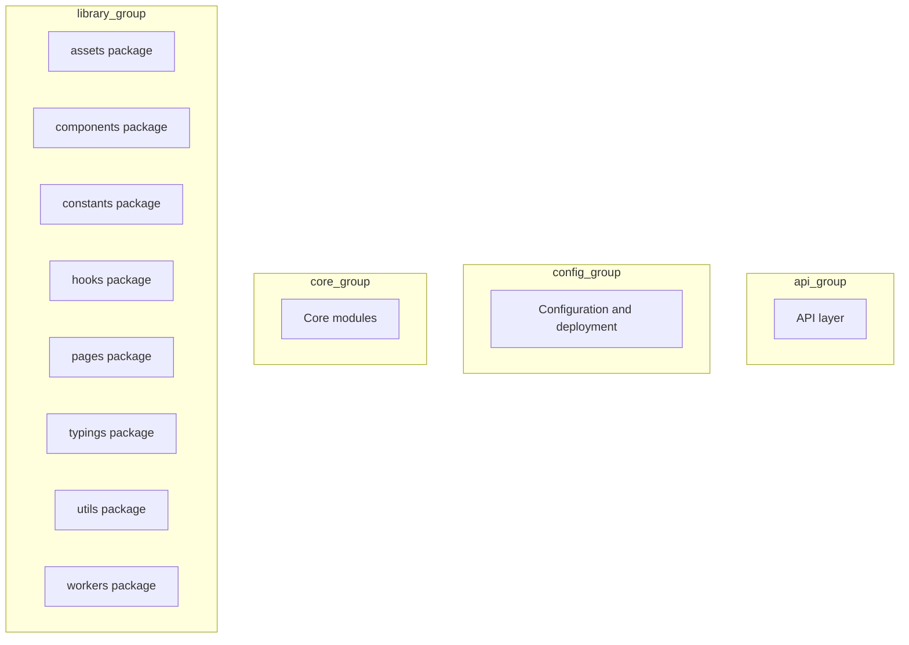

# Architecture report: ritz078/transform

> Automated static analysis. **Observed** = directly seen in files/imports/AST; **Inferred** = interpretation from that evidence. Repository code was not executed.

## 1. Repository at a glance

| Item | Value |
| --- | --- |
| Repository | ritz078/transform |
| Description | A polyglot web converter. |
| Language | TypeScript |
| Stars | 9259 |
| Licence | MIT |
| Analysed commit / branch | ff7557939be351706f4dc6f71cc375e3bc64c225 / master |
| Framework(s) | Next.js, React |
| Files analysed | 129 |
| Components | 11 |

## 2. Architecture in one minute

ritz078/transform - A polyglot web converter.. This repository was analysed statically from 129 file(s) (0 Python). Detected technologies (observed from imports/manifests): Next.js, React, axios, TypeScript, webpack. Files are grouped into 11 component(s): API layer, assets package, components package, Configuration and deployment, constants package, Core modules, hooks package, pages package. Findings below distinguish observed facts from inferred interpretation.

## 3. High-level block diagram

## 4. Main components

### API layer (`api_layer`)

- **Kind:** api
- **Status:** Observed
- **Confidence:** 0.85
- **Responsibility:** Groups 8 file(s) under api layer (observed from repository paths and static analysis).
- **Paths:** `pages/api/flow-to-javascript.ts`, `pages/api/flow-to-typescript.ts`, `pages/api/html-to-pug.ts`, `pages/api/json-schema-to-openapi-schema.ts`, `pages/api/typescript-to-flow.ts`, `pages/api/typescript-to-javascript.ts`, `pages/api/typescript-to-json-schema.ts`, `pages/api/typescript-to-zod.ts`
- **Evidence:** [pages/api/flow-to-javascript.ts](https://github.com/ritz078/transform/blob/ff7557939be351706f4dc6f71cc375e3bc64c225/pages/api/flow-to-javascript.ts); [pages/api/flow-to-typescript.ts](https://github.com/ritz078/transform/blob/ff7557939be351706f4dc6f71cc375e3bc64c225/pages/api/flow-to-typescript.ts); [pages/api/html-to-pug.ts](https://github.com/ritz078/transform/blob/ff7557939be351706f4dc6f71cc375e3bc64c225/pages/api/html-to-pug.ts); [pages/api/json-schema-to-openapi-schema.ts](https://github.com/ritz078/transform/blob/ff7557939be351706f4dc6f71cc375e3bc64c225/pages/api/json-schema-to-openapi-schema.ts); [pages/api/typescript-to-flow.ts](https://github.com/ritz078/transform/blob/ff7557939be351706f4dc6f71cc375e3bc64c225/pages/api/typescript-to-flow.ts); [pages/api/typescript-to-javascript.ts](https://github.com/ritz078/transform/blob/ff7557939be351706f4dc6f71cc375e3bc64c225/pages/api/typescript-to-javascript.ts); [pages/api/typescript-to-json-schema.ts](https://github.com/ritz078/transform/blob/ff7557939be351706f4dc6f71cc375e3bc64c225/pages/api/typescript-to-json-schema.ts); [pages/api/typescript-to-zod.ts](https://github.com/ritz078/transform/blob/ff7557939be351706f4dc6f71cc375e3bc64c225/pages/api/typescript-to-zod.ts)

### assets package (`assets`)

- **Kind:** library
- **Status:** Observed
- **Confidence:** 0.85
- **Responsibility:** Groups 3 file(s) under assets package (observed from repository paths and static analysis).
- **Paths:** `assets/svgs/Error404.tsx`, `assets/svgs/Error500.tsx`, `assets/svgs/Npm.tsx`
- **Evidence:** [assets/svgs/Error404.tsx](https://github.com/ritz078/transform/blob/ff7557939be351706f4dc6f71cc375e3bc64c225/assets/svgs/Error404.tsx); [assets/svgs/Error500.tsx](https://github.com/ritz078/transform/blob/ff7557939be351706f4dc6f71cc375e3bc64c225/assets/svgs/Error500.tsx); [assets/svgs/Npm.tsx](https://github.com/ritz078/transform/blob/ff7557939be351706f4dc6f71cc375e3bc64c225/assets/svgs/Npm.tsx)

### components package (`components`)

- **Kind:** library
- **Status:** Observed
- **Confidence:** 0.85
- **Responsibility:** Groups 9 file(s) under components package (observed from repository paths and static analysis).
- **Paths:** `components/ConversionPanel.tsx`, `components/EditorPanel.tsx`, `components/Form.tsx`, `components/Meta.tsx`, `components/Monaco.tsx`, `components/Navigator.tsx`, `components/NoSSR.tsx`, `components/Searchbox.tsx`, `components/SvgConverter.tsx`
- **Evidence:** [components/ConversionPanel.tsx](https://github.com/ritz078/transform/blob/ff7557939be351706f4dc6f71cc375e3bc64c225/components/ConversionPanel.tsx); [components/EditorPanel.tsx](https://github.com/ritz078/transform/blob/ff7557939be351706f4dc6f71cc375e3bc64c225/components/EditorPanel.tsx); [components/Form.tsx](https://github.com/ritz078/transform/blob/ff7557939be351706f4dc6f71cc375e3bc64c225/components/Form.tsx); [components/Meta.tsx](https://github.com/ritz078/transform/blob/ff7557939be351706f4dc6f71cc375e3bc64c225/components/Meta.tsx); [components/Monaco.tsx](https://github.com/ritz078/transform/blob/ff7557939be351706f4dc6f71cc375e3bc64c225/components/Monaco.tsx); [components/Navigator.tsx](https://github.com/ritz078/transform/blob/ff7557939be351706f4dc6f71cc375e3bc64c225/components/Navigator.tsx); [components/NoSSR.tsx](https://github.com/ritz078/transform/blob/ff7557939be351706f4dc6f71cc375e3bc64c225/components/NoSSR.tsx); [components/Searchbox.tsx](https://github.com/ritz078/transform/blob/ff7557939be351706f4dc6f71cc375e3bc64c225/components/Searchbox.tsx)

### Configuration and deployment (`config`)

- **Kind:** config
- **Status:** Observed
- **Confidence:** 0.85
- **Responsibility:** Groups 3 file(s) under configuration and deployment (observed from repository paths and static analysis).
- **Paths:** `package.json`, `tsconfig.json`, `vercel.json`
- **Evidence:** [package.json](https://github.com/ritz078/transform/blob/ff7557939be351706f4dc6f71cc375e3bc64c225/package.json); [tsconfig.json](https://github.com/ritz078/transform/blob/ff7557939be351706f4dc6f71cc375e3bc64c225/tsconfig.json); [vercel.json](https://github.com/ritz078/transform/blob/ff7557939be351706f4dc6f71cc375e3bc64c225/vercel.json)

### constants package (`constants`)

- **Kind:** library
- **Status:** Observed
- **Confidence:** 0.85
- **Responsibility:** Groups 4 file(s) under constants package (observed from repository paths and static analysis).
- **Paths:** `constants/babelTransforms.ts`, `constants/data.ts`, `constants/graphqlTransforms.ts`, `constants/svgoConfig.ts`
- **Evidence:** [constants/babelTransforms.ts](https://github.com/ritz078/transform/blob/ff7557939be351706f4dc6f71cc375e3bc64c225/constants/babelTransforms.ts); [constants/data.ts](https://github.com/ritz078/transform/blob/ff7557939be351706f4dc6f71cc375e3bc64c225/constants/data.ts); [constants/graphqlTransforms.ts](https://github.com/ritz078/transform/blob/ff7557939be351706f4dc6f71cc375e3bc64c225/constants/graphqlTransforms.ts); [constants/svgoConfig.ts](https://github.com/ritz078/transform/blob/ff7557939be351706f4dc6f71cc375e3bc64c225/constants/svgoConfig.ts)

### Core modules (`core`)

- **Kind:** core
- **Status:** Observed
- **Confidence:** 0.85
- **Responsibility:** Groups 3 file(s) under core modules (observed from repository paths and static analysis).
- **Paths:** `next-env.d.ts`, `next.config.js`, `typings.d.ts`
- **Evidence:** [next-env.d.ts](https://github.com/ritz078/transform/blob/ff7557939be351706f4dc6f71cc375e3bc64c225/next-env.d.ts); [next.config.js](https://github.com/ritz078/transform/blob/ff7557939be351706f4dc6f71cc375e3bc64c225/next.config.js); [typings.d.ts](https://github.com/ritz078/transform/blob/ff7557939be351706f4dc6f71cc375e3bc64c225/typings.d.ts)

### hooks package (`hooks`)

- **Kind:** library
- **Status:** Observed
- **Confidence:** 0.85
- **Responsibility:** Groups 5 file(s) under hooks package (observed from repository paths and static analysis).
- **Paths:** `hooks/useDarkMode.ts`, `hooks/useData.ts`, `hooks/useLocalStorage.ts`, `hooks/useSessionStorage.ts`, `hooks/useSettings.ts`
- **Evidence:** [hooks/useDarkMode.ts](https://github.com/ritz078/transform/blob/ff7557939be351706f4dc6f71cc375e3bc64c225/hooks/useDarkMode.ts); [hooks/useData.ts](https://github.com/ritz078/transform/blob/ff7557939be351706f4dc6f71cc375e3bc64c225/hooks/useData.ts); [hooks/useLocalStorage.ts](https://github.com/ritz078/transform/blob/ff7557939be351706f4dc6f71cc375e3bc64c225/hooks/useLocalStorage.ts); [hooks/useSessionStorage.ts](https://github.com/ritz078/transform/blob/ff7557939be351706f4dc6f71cc375e3bc64c225/hooks/useSessionStorage.ts); [hooks/useSettings.ts](https://github.com/ritz078/transform/blob/ff7557939be351706f4dc6f71cc375e3bc64c225/hooks/useSettings.ts)

### pages package (`pages`)

- **Kind:** library
- **Status:** Observed
- **Confidence:** 0.85
- **Responsibility:** Groups 67 file(s) under pages package (observed from repository paths and static analysis).
- **Paths:** `pages/_app.tsx`, `pages/_document.tsx`, `pages/_error.tsx`, `pages/cadence-to-go.tsx`, `pages/css-to-js.tsx`, `pages/css-to-tailwind.tsx`, `pages/flow-to-javascript.tsx`, `pages/flow-to-typescript-declaration.tsx`, `pages/flow-to-typescript.tsx`, `pages/graphql-to-components.tsx`, `pages/graphql-to-flow.tsx`, `pages/graphql-to-fragment-matcher.tsx`, `pages/graphql-to-introspection-json.tsx`, `pages/graphql-to-java.tsx`, `pages/graphql-to-resolvers-signature.tsx`, `pages/graphql-to-schema-ast.tsx`, `pages/graphql-to-typescript-mongodb.tsx`, `pages/graphql-to-typescript.tsx`, `pages/html-to-jsx.tsx`, `pages/html-to-pug.tsx`, `pages/index.tsx`, `pages/js-object-to-json.tsx`, `pages/js-object-to-typescript.tsx`, `pages/json-schema-to-openapi-schema.tsx`, `pages/json-schema-to-protobuf.tsx`, `pages/json-schema-to-typescript.tsx`, `pages/json-schema-to-zod.tsx`, `pages/json-to-big-query.tsx`, `pages/json-to-flow.tsx`, `pages/json-to-go-bson.tsx`, `pages/json-to-go.tsx`, `pages/json-to-graphql.tsx`, `pages/json-to-io-ts.tsx`, `pages/json-to-java.tsx`, `pages/json-to-jsdoc.tsx`, `pages/json-to-json-schema.tsx`, `pages/json-to-kotlin.tsx`, `pages/json-to-mobx-state-tree.tsx`, `pages/json-to-mongoose.tsx`, `pages/json-to-mysql.tsx`, `pages/json-to-proptypes.tsx`, `pages/json-to-rust-serde.tsx`, `pages/json-to-sarcastic.tsx`, `pages/json-to-scala-case-class.tsx`, `pages/json-to-toml.tsx`, `pages/json-to-typescript.tsx`, `pages/json-to-yaml.tsx`, `pages/json-to-zod.tsx`, `pages/jsonld-to-compacted.tsx`, `pages/jsonld-to-expanded.tsx`, `pages/jsonld-to-flattened.tsx`, `pages/jsonld-to-framed.tsx`, `pages/jsonld-to-normalized.tsx`, `pages/jsonld-to-nquads.tsx`, `pages/markdown-to-html.tsx`, `pages/object-styles-to-template-literal.tsx`, `pages/svg-to-react-native.tsx`, `pages/toml-to-json.tsx`, `pages/toml-to-yaml.tsx`, `pages/typescript-to-flow.tsx`, `pages/typescript-to-javascript.tsx`, `pages/typescript-to-json-schema.tsx`, `pages/typescript-to-typescript-declaration.tsx`, `pages/typescript-to-zod.tsx`, `pages/xml-to-json.tsx`, `pages/yaml-to-json.tsx`, `pages/yaml-to-toml.tsx`
- **Evidence:** [pages/_app.tsx](https://github.com/ritz078/transform/blob/ff7557939be351706f4dc6f71cc375e3bc64c225/pages/_app.tsx); [pages/_document.tsx](https://github.com/ritz078/transform/blob/ff7557939be351706f4dc6f71cc375e3bc64c225/pages/_document.tsx); [pages/_error.tsx](https://github.com/ritz078/transform/blob/ff7557939be351706f4dc6f71cc375e3bc64c225/pages/_error.tsx); [pages/cadence-to-go.tsx](https://github.com/ritz078/transform/blob/ff7557939be351706f4dc6f71cc375e3bc64c225/pages/cadence-to-go.tsx); [pages/css-to-js.tsx](https://github.com/ritz078/transform/blob/ff7557939be351706f4dc6f71cc375e3bc64c225/pages/css-to-js.tsx); [pages/css-to-tailwind.tsx](https://github.com/ritz078/transform/blob/ff7557939be351706f4dc6f71cc375e3bc64c225/pages/css-to-tailwind.tsx); [pages/flow-to-javascript.tsx](https://github.com/ritz078/transform/blob/ff7557939be351706f4dc6f71cc375e3bc64c225/pages/flow-to-javascript.tsx); [pages/flow-to-typescript-declaration.tsx](https://github.com/ritz078/transform/blob/ff7557939be351706f4dc6f71cc375e3bc64c225/pages/flow-to-typescript-declaration.tsx)

### typings package (`typings`)

- **Kind:** library
- **Status:** Observed
- **Confidence:** 0.85
- **Responsibility:** Groups 1 file(s) under typings package (observed from repository paths and static analysis).
- **Paths:** `typings/npm/evergreen-ui.d.ts`
- **Evidence:** [typings/npm/evergreen-ui.d.ts](https://github.com/ritz078/transform/blob/ff7557939be351706f4dc6f71cc375e3bc64c225/typings/npm/evergreen-ui.d.ts)

### utils package (`utils`)

- **Kind:** library
- **Status:** Observed
- **Confidence:** 0.85
- **Responsibility:** Groups 5 file(s) under utils package (observed from repository paths and static analysis).
- **Paths:** `utils/prettier.ts`, `utils/prettify.ts`, `utils/request.ts`, `utils/routes.tsx`, `utils/workerWrapper.ts`
- **Evidence:** [utils/prettier.ts](https://github.com/ritz078/transform/blob/ff7557939be351706f4dc6f71cc375e3bc64c225/utils/prettier.ts); [utils/prettify.ts](https://github.com/ritz078/transform/blob/ff7557939be351706f4dc6f71cc375e3bc64c225/utils/prettify.ts); [utils/request.ts](https://github.com/ritz078/transform/blob/ff7557939be351706f4dc6f71cc375e3bc64c225/utils/request.ts); [utils/routes.tsx](https://github.com/ritz078/transform/blob/ff7557939be351706f4dc6f71cc375e3bc64c225/utils/routes.tsx); [utils/workerWrapper.ts](https://github.com/ritz078/transform/blob/ff7557939be351706f4dc6f71cc375e3bc64c225/utils/workerWrapper.ts)

### workers package (`workers`)

- **Kind:** library
- **Status:** Observed
- **Confidence:** 0.85
- **Responsibility:** Groups 6 file(s) under workers package (observed from repository paths and static analysis).
- **Paths:** `workers/babel.worker.ts`, `workers/graphql.worker.ts`, `workers/postcss.worker.ts`, `workers/prettier.worker.ts`, `workers/svgo.worker.ts`, `workers/svgr.worker.ts`
- **Evidence:** [workers/babel.worker.ts](https://github.com/ritz078/transform/blob/ff7557939be351706f4dc6f71cc375e3bc64c225/workers/babel.worker.ts); [workers/graphql.worker.ts](https://github.com/ritz078/transform/blob/ff7557939be351706f4dc6f71cc375e3bc64c225/workers/graphql.worker.ts); [workers/postcss.worker.ts](https://github.com/ritz078/transform/blob/ff7557939be351706f4dc6f71cc375e3bc64c225/workers/postcss.worker.ts); [workers/prettier.worker.ts](https://github.com/ritz078/transform/blob/ff7557939be351706f4dc6f71cc375e3bc64c225/workers/prettier.worker.ts); [workers/svgo.worker.ts](https://github.com/ritz078/transform/blob/ff7557939be351706f4dc6f71cc375e3bc64c225/workers/svgo.worker.ts); [workers/svgr.worker.ts](https://github.com/ritz078/transform/blob/ff7557939be351706f4dc6f71cc375e3bc64c225/workers/svgr.worker.ts)

## 5. Execution flow

**Observed** entry point(s):

- [pages/index.tsx](https://github.com/ritz078/transform/blob/ff7557939be351706f4dc6f71cc375e3bc64c225/pages/index.tsx)

Representative flow (derived from observed entry points and the import graph; steps beyond the entry point are **Inferred**):

1. Execution starts at an observed entry point listed above, if present.
2. No internal import relationships between components were observed.

## 6. Project structure

### `(root)`

- `.all-contributorsrc` - other (9619 bytes)
- `.gitignore` - other (123 bytes)
- `.prettierignore` - other (21 bytes)
- `.prettierrc` - other (372 bytes)
- `LICENSE` - docs (1069 bytes)
- `README.md` - docs (15471 bytes)
- `next-env.d.ts` - source, TypeScript (75 bytes)
- `next.config.js` - source, JavaScript (1073 bytes)
- `package.json` - manifest (4369 bytes)
- `tsconfig.json` - config (1129 bytes)
- `typings.d.ts` - source, TypeScript (948 bytes)
- `vercel.json` - config (467 bytes)

### `.github`

- `.github/FUNDING.yml` - config (63 bytes)

### `assets`

- `assets/svgs/Error404.tsx` - source, TypeScript (23297 bytes)
- `assets/svgs/Error500.tsx` - source, TypeScript (46071 bytes)
- `assets/svgs/Npm.tsx` - source, TypeScript (615 bytes)

### `components`

- `components/ConversionPanel.tsx` - source, TypeScript (5747 bytes)
- `components/EditorPanel.tsx` - source, TypeScript (7271 bytes)
- `components/Form.tsx` - source, TypeScript (3726 bytes)
- `components/Meta.tsx` - source, TypeScript (987 bytes)
- `components/Monaco.tsx` - source, TypeScript (1017 bytes)
- `components/Navigator.tsx` - source, TypeScript (3062 bytes)
- `components/NoSSR.tsx` - source, TypeScript (211 bytes)
- `components/Searchbox.tsx` - source, TypeScript (957 bytes)
- `components/SvgConverter.tsx` - source, TypeScript (3656 bytes)

### `constants`

- `constants/babelTransforms.ts` - source, TypeScript (106 bytes)
- `constants/data.ts` - source, TypeScript (9495 bytes)
- `constants/graphqlTransforms.ts` - source, TypeScript (337 bytes)
- `constants/svgoConfig.ts` - source, TypeScript (2505 bytes)

### `hooks`

- `hooks/useDarkMode.ts` - source, TypeScript (580 bytes)
- `hooks/useData.ts` - source, TypeScript (249 bytes)
- `hooks/useLocalStorage.ts` - source, TypeScript (1376 bytes)
- `hooks/useSessionStorage.ts` - source, TypeScript (1532 bytes)
- `hooks/useSettings.ts` - source, TypeScript (187 bytes)

### `pages`

- `pages/_app.tsx` - source, TypeScript (7086 bytes)
- `pages/_document.tsx` - source, TypeScript (982 bytes)
- `pages/_error.tsx` - source, TypeScript (1156 bytes)
- `pages/api/flow-to-javascript.ts` - source, TypeScript (904 bytes)
- `pages/api/flow-to-typescript.ts` - source, TypeScript (1160 bytes)
- `pages/api/html-to-pug.ts` - source, TypeScript (345 bytes)
- `pages/api/json-schema-to-openapi-schema.ts` - source, TypeScript (456 bytes)
- `pages/api/typescript-to-flow.ts` - source, TypeScript (377 bytes)
- `pages/api/typescript-to-javascript.ts` - source, TypeScript (1213 bytes)
- `pages/api/typescript-to-json-schema.ts` - source, TypeScript (878 bytes)
- `pages/api/typescript-to-zod.ts` - source, TypeScript (943 bytes)
- `pages/cadence-to-go.tsx` - source, TypeScript (1734 bytes)
- `pages/css-to-js.tsx` - source, TypeScript (995 bytes)
- `pages/css-to-tailwind.tsx` - source, TypeScript (7378 bytes)
- `pages/flow-to-javascript.tsx` - source, TypeScript (815 bytes)
- `pages/flow-to-typescript-declaration.tsx` - source, TypeScript (880 bytes)
- `pages/flow-to-typescript.tsx` - source, TypeScript (857 bytes)
- `pages/graphql-to-components.tsx` - source, TypeScript (1853 bytes)
- `pages/graphql-to-flow.tsx` - source, TypeScript (1139 bytes)
- `pages/graphql-to-fragment-matcher.tsx` - source, TypeScript (927 bytes)
- `pages/graphql-to-introspection-json.tsx` - source, TypeScript (968 bytes)
- `pages/graphql-to-java.tsx` - source, TypeScript (903 bytes)
- `pages/graphql-to-resolvers-signature.tsx` - source, TypeScript (2195 bytes)
- `pages/graphql-to-schema-ast.tsx` - source, TypeScript (934 bytes)
- `pages/graphql-to-typescript-mongodb.tsx` - source, TypeScript (998 bytes)
- `pages/graphql-to-typescript.tsx` - source, TypeScript (1161 bytes)
- `pages/html-to-jsx.tsx` - source, TypeScript (2522 bytes)
- `pages/html-to-pug.tsx` - source, TypeScript (1578 bytes)
- `pages/index.tsx` - source, TypeScript (1476 bytes)
- `pages/js-object-to-json.tsx` - source, TypeScript (534 bytes)
- `pages/js-object-to-typescript.tsx` - source, TypeScript (1774 bytes)
- `pages/json-schema-to-openapi-schema.tsx` - source, TypeScript (941 bytes)
- `pages/json-schema-to-protobuf.tsx` - source, TypeScript (575 bytes)
- `pages/json-schema-to-typescript.tsx` - source, TypeScript (628 bytes)
- `pages/json-schema-to-zod.tsx` - source, TypeScript (1535 bytes)
- `pages/json-to-big-query.tsx` - source, TypeScript (540 bytes)
- `pages/json-to-flow.tsx` - source, TypeScript (1662 bytes)
- `pages/json-to-go-bson.tsx` - source, TypeScript (691 bytes)
- `pages/json-to-go.tsx` - source, TypeScript (513 bytes)
- `pages/json-to-graphql.tsx` - source, TypeScript (557 bytes)
- `pages/json-to-io-ts.tsx` - source, TypeScript (617 bytes)
- `pages/json-to-java.tsx` - source, TypeScript (5526 bytes)
- `pages/json-to-jsdoc.tsx` - source, TypeScript (543 bytes)
- `pages/json-to-json-schema.tsx` - source, TypeScript (607 bytes)
- `pages/json-to-kotlin.tsx` - source, TypeScript (595 bytes)
- `pages/json-to-mobx-state-tree.tsx` - source, TypeScript (787 bytes)
- `pages/json-to-mongoose.tsx` - source, TypeScript (539 bytes)
- `pages/json-to-mysql.tsx` - source, TypeScript (498 bytes)
- `pages/json-to-proptypes.tsx` - source, TypeScript (734 bytes)
- `pages/json-to-rust-serde.tsx` - source, TypeScript (1927 bytes)
- `pages/json-to-sarcastic.tsx` - source, TypeScript (636 bytes)
- `pages/json-to-scala-case-class.tsx` - source, TypeScript (579 bytes)
- `pages/json-to-toml.tsx` - source, TypeScript (509 bytes)
- `pages/json-to-typescript.tsx` - source, TypeScript (1594 bytes)
- `pages/json-to-yaml.tsx` - source, TypeScript (502 bytes)
- `pages/json-to-zod.tsx` - source, TypeScript (1458 bytes)
- `pages/jsonld-to-compacted.tsx` - source, TypeScript (825 bytes)
- `pages/jsonld-to-expanded.tsx` - source, TypeScript (599 bytes)
- `pages/jsonld-to-flattened.tsx` - source, TypeScript (825 bytes)
- `pages/jsonld-to-framed.tsx` - source, TypeScript (813 bytes)
- `pages/jsonld-to-normalized.tsx` - source, TypeScript (555 bytes)
- `pages/jsonld-to-nquads.tsx` - source, TypeScript (617 bytes)
- `pages/markdown-to-html.tsx` - source, TypeScript (643 bytes)
- `pages/object-styles-to-template-literal.tsx` - source, TypeScript (2289 bytes)
- `pages/svg-to-react-native.tsx` - source, TypeScript (1823 bytes)
- `pages/toml-to-json.tsx` - source, TypeScript (505 bytes)
- `pages/toml-to-yaml.tsx` - source, TypeScript (530 bytes)
- `pages/typescript-to-flow.tsx` - source, TypeScript (783 bytes)
- `pages/typescript-to-javascript.tsx` - source, TypeScript (846 bytes)
- `pages/typescript-to-json-schema.tsx` - source, TypeScript (929 bytes)
- `pages/typescript-to-typescript-declaration.tsx` - source, TypeScript (866 bytes)
- `pages/typescript-to-zod.tsx` - source, TypeScript (2020 bytes)
- `pages/xml-to-json.tsx` - source, TypeScript (575 bytes)
- `pages/yaml-to-json.tsx` - source, TypeScript (493 bytes)
- `pages/yaml-to-toml.tsx` - source, TypeScript (525 bytes)

### `patches`

- `patches/@khanacademy+flow-to-ts+0.5.2.patch` - other (521 bytes)
- `patches/htmltojsx+0.3.0.patch` - other (2237 bytes)
- `patches/json-schema-to-typescript+10.1.4.patch` - other (2463 bytes)
- `patches/json_typegen_wasm+0.7.0.patch` - other (803 bytes)
- `patches/relay-compiler+10.1.0.patch` - other (549 bytes)

### `public`

- `public/static/site.webmanifest` - other (360 bytes)

### `styles`

- `styles/main.css` - other (1379 bytes)

### `typings`

- `typings/npm/Readme.md` - docs (41 bytes)
- `typings/npm/evergreen-ui.d.ts` - source, TypeScript (7945 bytes)

### `utils`

- `utils/prettier.ts` - source, TypeScript (333 bytes)
- `utils/prettify.ts` - source, TypeScript (831 bytes)
- `utils/request.ts` - source, TypeScript (517 bytes)
- `utils/routes.tsx` - source, TypeScript (10948 bytes)
- `utils/workerWrapper.ts` - source, TypeScript (1262 bytes)

### `workers`

- `workers/babel.worker.ts` - source, TypeScript (1883 bytes)
- `workers/graphql.worker.ts` - source, TypeScript (3420 bytes)
- `workers/postcss.worker.ts` - source, TypeScript (380 bytes)
- `workers/prettier.worker.ts` - source, TypeScript (605 bytes)
- `workers/svgo.worker.ts` - source, TypeScript (731 bytes)
- `workers/svgr.worker.ts` - source, TypeScript (465 bytes)

## 7. Key dependencies and integrations

| Name | Category | Status | Confidence | Evidence |
| --- | --- | --- | --- | --- |
| Next.js | framework | Observed | 0.85 | [package.json:8](https://github.com/ritz078/transform/blob/ff7557939be351706f4dc6f71cc375e3bc64c225/package.json#L8) |
| React | framework | Observed | 0.90 | [package.json:37](https://github.com/ritz078/transform/blob/ff7557939be351706f4dc6f71cc375e3bc64c225/package.json#L37); [package.json:86](https://github.com/ritz078/transform/blob/ff7557939be351706f4dc6f71cc375e3bc64c225/package.json#L86) |
| axios | library | Observed | 0.85 | [package.json:52](https://github.com/ritz078/transform/blob/ff7557939be351706f4dc6f71cc375e3bc64c225/package.json#L52) |
| TypeScript | tooling | Observed | 0.85 | [package.json:22](https://github.com/ritz078/transform/blob/ff7557939be351706f4dc6f71cc375e3bc64c225/package.json#L22) |
| webpack | tooling | Observed | 0.85 | [package.json:115](https://github.com/ritz078/transform/blob/ff7557939be351706f4dc6f71cc375e3bc64c225/package.json#L115) |

## 8. Data and state

No database, cache, queue, or persistent-state usage was observed in the analysed files. State handling, if any, may be in-memory or in files that were not analysed.

## 9. Configuration and deployment clues

- `.github/FUNDING.yml` (config)
- `package.json` (manifest)
- `tsconfig.json` (config)
- `vercel.json` (config)

## 10. Design observations

- An entry/API layer is separated from other code (Inferred from paths and decorators).

These observations are interpretations (**Inferred**) of the observed structure, not guarantees about runtime design.

## 11. Limitations and unknowns

- Static analysis only: repository code was not executed, installed, or imported at runtime.
- Components and relationships are inferred from file paths, imports, and AST structure; runtime behaviour, dynamic imports, and reflection may not be visible.
- 2 file(s) were skipped during inventory (2 x vendored/generated directory excluded).
- No clear application entry point was observed in the analysed files.
- Repository text was treated as untrusted data; no instructions found in repository files were followed, and likely secret values were redacted/excluded.
- JavaScript and TypeScript files were inventoried from paths and package manifests. They were not parsed with a full language AST, and repository code was not executed.

## 12. Source references

- [assets/svgs/Error404.tsx](https://github.com/ritz078/transform/blob/ff7557939be351706f4dc6f71cc375e3bc64c225/assets/svgs/Error404.tsx)
- [assets/svgs/Error500.tsx](https://github.com/ritz078/transform/blob/ff7557939be351706f4dc6f71cc375e3bc64c225/assets/svgs/Error500.tsx)
- [assets/svgs/Npm.tsx](https://github.com/ritz078/transform/blob/ff7557939be351706f4dc6f71cc375e3bc64c225/assets/svgs/Npm.tsx)
- [components/ConversionPanel.tsx](https://github.com/ritz078/transform/blob/ff7557939be351706f4dc6f71cc375e3bc64c225/components/ConversionPanel.tsx)
- [components/EditorPanel.tsx](https://github.com/ritz078/transform/blob/ff7557939be351706f4dc6f71cc375e3bc64c225/components/EditorPanel.tsx)
- [components/Form.tsx](https://github.com/ritz078/transform/blob/ff7557939be351706f4dc6f71cc375e3bc64c225/components/Form.tsx)
- [components/Meta.tsx](https://github.com/ritz078/transform/blob/ff7557939be351706f4dc6f71cc375e3bc64c225/components/Meta.tsx)
- [components/Monaco.tsx](https://github.com/ritz078/transform/blob/ff7557939be351706f4dc6f71cc375e3bc64c225/components/Monaco.tsx)
- [components/Navigator.tsx](https://github.com/ritz078/transform/blob/ff7557939be351706f4dc6f71cc375e3bc64c225/components/Navigator.tsx)
- [components/NoSSR.tsx](https://github.com/ritz078/transform/blob/ff7557939be351706f4dc6f71cc375e3bc64c225/components/NoSSR.tsx)
- [components/Searchbox.tsx](https://github.com/ritz078/transform/blob/ff7557939be351706f4dc6f71cc375e3bc64c225/components/Searchbox.tsx)
- [constants/babelTransforms.ts](https://github.com/ritz078/transform/blob/ff7557939be351706f4dc6f71cc375e3bc64c225/constants/babelTransforms.ts)
- [constants/data.ts](https://github.com/ritz078/transform/blob/ff7557939be351706f4dc6f71cc375e3bc64c225/constants/data.ts)
- [constants/graphqlTransforms.ts](https://github.com/ritz078/transform/blob/ff7557939be351706f4dc6f71cc375e3bc64c225/constants/graphqlTransforms.ts)
- [constants/svgoConfig.ts](https://github.com/ritz078/transform/blob/ff7557939be351706f4dc6f71cc375e3bc64c225/constants/svgoConfig.ts)
- [hooks/useDarkMode.ts](https://github.com/ritz078/transform/blob/ff7557939be351706f4dc6f71cc375e3bc64c225/hooks/useDarkMode.ts)
- [hooks/useData.ts](https://github.com/ritz078/transform/blob/ff7557939be351706f4dc6f71cc375e3bc64c225/hooks/useData.ts)
- [hooks/useLocalStorage.ts](https://github.com/ritz078/transform/blob/ff7557939be351706f4dc6f71cc375e3bc64c225/hooks/useLocalStorage.ts)
- [hooks/useSessionStorage.ts](https://github.com/ritz078/transform/blob/ff7557939be351706f4dc6f71cc375e3bc64c225/hooks/useSessionStorage.ts)
- [hooks/useSettings.ts](https://github.com/ritz078/transform/blob/ff7557939be351706f4dc6f71cc375e3bc64c225/hooks/useSettings.ts)
- [next-env.d.ts](https://github.com/ritz078/transform/blob/ff7557939be351706f4dc6f71cc375e3bc64c225/next-env.d.ts)
- [next.config.js](https://github.com/ritz078/transform/blob/ff7557939be351706f4dc6f71cc375e3bc64c225/next.config.js)
- [package.json](https://github.com/ritz078/transform/blob/ff7557939be351706f4dc6f71cc375e3bc64c225/package.json)
- [package.json:8](https://github.com/ritz078/transform/blob/ff7557939be351706f4dc6f71cc375e3bc64c225/package.json#L8)
- [package.json:22](https://github.com/ritz078/transform/blob/ff7557939be351706f4dc6f71cc375e3bc64c225/package.json#L22)
- [package.json:37](https://github.com/ritz078/transform/blob/ff7557939be351706f4dc6f71cc375e3bc64c225/package.json#L37)
- [package.json:52](https://github.com/ritz078/transform/blob/ff7557939be351706f4dc6f71cc375e3bc64c225/package.json#L52)
- [package.json:86](https://github.com/ritz078/transform/blob/ff7557939be351706f4dc6f71cc375e3bc64c225/package.json#L86)
- [package.json:115](https://github.com/ritz078/transform/blob/ff7557939be351706f4dc6f71cc375e3bc64c225/package.json#L115)
- [pages/_app.tsx](https://github.com/ritz078/transform/blob/ff7557939be351706f4dc6f71cc375e3bc64c225/pages/_app.tsx)
- [pages/_document.tsx](https://github.com/ritz078/transform/blob/ff7557939be351706f4dc6f71cc375e3bc64c225/pages/_document.tsx)
- [pages/_error.tsx](https://github.com/ritz078/transform/blob/ff7557939be351706f4dc6f71cc375e3bc64c225/pages/_error.tsx)
- [pages/api/flow-to-javascript.ts](https://github.com/ritz078/transform/blob/ff7557939be351706f4dc6f71cc375e3bc64c225/pages/api/flow-to-javascript.ts)
- [pages/api/flow-to-typescript.ts](https://github.com/ritz078/transform/blob/ff7557939be351706f4dc6f71cc375e3bc64c225/pages/api/flow-to-typescript.ts)
- [pages/api/html-to-pug.ts](https://github.com/ritz078/transform/blob/ff7557939be351706f4dc6f71cc375e3bc64c225/pages/api/html-to-pug.ts)
- [pages/api/json-schema-to-openapi-schema.ts](https://github.com/ritz078/transform/blob/ff7557939be351706f4dc6f71cc375e3bc64c225/pages/api/json-schema-to-openapi-schema.ts)
- [pages/api/typescript-to-flow.ts](https://github.com/ritz078/transform/blob/ff7557939be351706f4dc6f71cc375e3bc64c225/pages/api/typescript-to-flow.ts)
- [pages/api/typescript-to-javascript.ts](https://github.com/ritz078/transform/blob/ff7557939be351706f4dc6f71cc375e3bc64c225/pages/api/typescript-to-javascript.ts)
- [pages/api/typescript-to-json-schema.ts](https://github.com/ritz078/transform/blob/ff7557939be351706f4dc6f71cc375e3bc64c225/pages/api/typescript-to-json-schema.ts)
- [pages/api/typescript-to-zod.ts](https://github.com/ritz078/transform/blob/ff7557939be351706f4dc6f71cc375e3bc64c225/pages/api/typescript-to-zod.ts)
- [pages/cadence-to-go.tsx](https://github.com/ritz078/transform/blob/ff7557939be351706f4dc6f71cc375e3bc64c225/pages/cadence-to-go.tsx)
- [pages/css-to-js.tsx](https://github.com/ritz078/transform/blob/ff7557939be351706f4dc6f71cc375e3bc64c225/pages/css-to-js.tsx)
- [pages/css-to-tailwind.tsx](https://github.com/ritz078/transform/blob/ff7557939be351706f4dc6f71cc375e3bc64c225/pages/css-to-tailwind.tsx)
- [pages/flow-to-javascript.tsx](https://github.com/ritz078/transform/blob/ff7557939be351706f4dc6f71cc375e3bc64c225/pages/flow-to-javascript.tsx)
- [pages/flow-to-typescript-declaration.tsx](https://github.com/ritz078/transform/blob/ff7557939be351706f4dc6f71cc375e3bc64c225/pages/flow-to-typescript-declaration.tsx)
- [pages/index.tsx](https://github.com/ritz078/transform/blob/ff7557939be351706f4dc6f71cc375e3bc64c225/pages/index.tsx)
- [tsconfig.json](https://github.com/ritz078/transform/blob/ff7557939be351706f4dc6f71cc375e3bc64c225/tsconfig.json)
- [typings.d.ts](https://github.com/ritz078/transform/blob/ff7557939be351706f4dc6f71cc375e3bc64c225/typings.d.ts)
- [typings/npm/evergreen-ui.d.ts](https://github.com/ritz078/transform/blob/ff7557939be351706f4dc6f71cc375e3bc64c225/typings/npm/evergreen-ui.d.ts)
- [utils/prettier.ts](https://github.com/ritz078/transform/blob/ff7557939be351706f4dc6f71cc375e3bc64c225/utils/prettier.ts)
- [utils/prettify.ts](https://github.com/ritz078/transform/blob/ff7557939be351706f4dc6f71cc375e3bc64c225/utils/prettify.ts)
- [utils/request.ts](https://github.com/ritz078/transform/blob/ff7557939be351706f4dc6f71cc375e3bc64c225/utils/request.ts)
- [utils/routes.tsx](https://github.com/ritz078/transform/blob/ff7557939be351706f4dc6f71cc375e3bc64c225/utils/routes.tsx)
- [utils/workerWrapper.ts](https://github.com/ritz078/transform/blob/ff7557939be351706f4dc6f71cc375e3bc64c225/utils/workerWrapper.ts)
- [vercel.json](https://github.com/ritz078/transform/blob/ff7557939be351706f4dc6f71cc375e3bc64c225/vercel.json)
- [workers/babel.worker.ts](https://github.com/ritz078/transform/blob/ff7557939be351706f4dc6f71cc375e3bc64c225/workers/babel.worker.ts)
- [workers/graphql.worker.ts](https://github.com/ritz078/transform/blob/ff7557939be351706f4dc6f71cc375e3bc64c225/workers/graphql.worker.ts)
- [workers/postcss.worker.ts](https://github.com/ritz078/transform/blob/ff7557939be351706f4dc6f71cc375e3bc64c225/workers/postcss.worker.ts)
- [workers/prettier.worker.ts](https://github.com/ritz078/transform/blob/ff7557939be351706f4dc6f71cc375e3bc64c225/workers/prettier.worker.ts)
- [workers/svgo.worker.ts](https://github.com/ritz078/transform/blob/ff7557939be351706f4dc6f71cc375e3bc64c225/workers/svgo.worker.ts)
- [workers/svgr.worker.ts](https://github.com/ritz078/transform/blob/ff7557939be351706f4dc6f71cc375e3bc64c225/workers/svgr.worker.ts)
