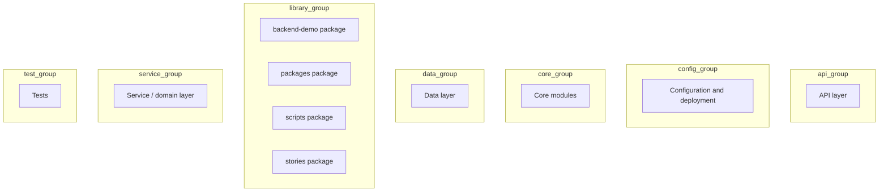

# Architecture report: ruilisi/fortune-sheet

> Automated static analysis. **Observed** = directly seen in files/imports/AST; **Inferred** = interpretation from that evidence. Repository code was not executed.

## 1. Repository at a glance

| Item | Value |
| --- | --- |
| Repository | ruilisi/fortune-sheet |
| Description | A drop-in javascript spreadsheet library that provides rich features like Excel and Google Sheets |
| Language | TypeScript |
| Stars | 3751 |
| Licence | MIT |
| Analysed commit / branch | 94346608877db4747406707a177c4b8f3bacdbf9 / master |
| Framework(s) | Express, React |
| Files analysed | 325 |
| Components | 10 |

## 2. Architecture in one minute

ruilisi/fortune-sheet - A drop-in javascript spreadsheet library that provides rich features like Excel and Google Sheets. This repository was analysed statically from 325 file(s) (0 Python). Detected technologies (observed from imports/manifests): GitHub Actions, Express, React, Jest, TypeScript, webpack. Files are grouped into 10 component(s): API layer, backend-demo package, Configuration and deployment, Core modules, Data layer, packages package, scripts package, Service / domain layer. Findings below distinguish observed facts from inferred interpretation.

## 3. High-level block diagram

## 4. Main components

### API layer (`api_layer`)

- **Kind:** api
- **Status:** Observed
- **Confidence:** 0.85
- **Responsibility:** Groups 9 file(s) under api layer (observed from repository paths and static analysis).
- **Paths:** `packages/core/src/api/cell.ts`, `packages/core/src/api/common.ts`, `packages/core/src/api/errors.ts`, `packages/core/src/api/index.ts`, `packages/core/src/api/merge.ts`, `packages/core/src/api/range.ts`, `packages/core/src/api/rowcol.ts`, `packages/core/src/api/sheet.ts`, `packages/core/src/api/workbook.ts`
- **Evidence:** [packages/core/src/api/cell.ts](https://github.com/ruilisi/fortune-sheet/blob/94346608877db4747406707a177c4b8f3bacdbf9/packages/core/src/api/cell.ts); [packages/core/src/api/common.ts](https://github.com/ruilisi/fortune-sheet/blob/94346608877db4747406707a177c4b8f3bacdbf9/packages/core/src/api/common.ts); [packages/core/src/api/errors.ts](https://github.com/ruilisi/fortune-sheet/blob/94346608877db4747406707a177c4b8f3bacdbf9/packages/core/src/api/errors.ts); [packages/core/src/api/index.ts](https://github.com/ruilisi/fortune-sheet/blob/94346608877db4747406707a177c4b8f3bacdbf9/packages/core/src/api/index.ts); [packages/core/src/api/merge.ts](https://github.com/ruilisi/fortune-sheet/blob/94346608877db4747406707a177c4b8f3bacdbf9/packages/core/src/api/merge.ts); [packages/core/src/api/range.ts](https://github.com/ruilisi/fortune-sheet/blob/94346608877db4747406707a177c4b8f3bacdbf9/packages/core/src/api/range.ts); [packages/core/src/api/rowcol.ts](https://github.com/ruilisi/fortune-sheet/blob/94346608877db4747406707a177c4b8f3bacdbf9/packages/core/src/api/rowcol.ts); [packages/core/src/api/sheet.ts](https://github.com/ruilisi/fortune-sheet/blob/94346608877db4747406707a177c4b8f3bacdbf9/packages/core/src/api/sheet.ts)

### backend-demo package (`backend_demo`)

- **Kind:** library
- **Status:** Observed
- **Confidence:** 0.85
- **Responsibility:** Groups 2 file(s) under backend-demo package (observed from repository paths and static analysis).
- **Paths:** `backend-demo/index.js`, `backend-demo/op.js`
- **Evidence:** [backend-demo/index.js](https://github.com/ruilisi/fortune-sheet/blob/94346608877db4747406707a177c4b8f3bacdbf9/backend-demo/index.js); [backend-demo/op.js](https://github.com/ruilisi/fortune-sheet/blob/94346608877db4747406707a177c4b8f3bacdbf9/backend-demo/op.js)

### Configuration and deployment (`config`)

- **Kind:** config
- **Status:** Observed
- **Confidence:** 0.85
- **Responsibility:** Groups 12 file(s) under configuration and deployment (observed from repository paths and static analysis).
- **Paths:** `babel.config.json`, `lerna.json`, `package.json`, `packages/core/package.json`, `packages/formula-parser/.codeclimate.yml`, `packages/formula-parser/.editorconfig`, `packages/formula-parser/.release.json`, `packages/formula-parser/.travis.yml`, `packages/formula-parser/bower.json`, `packages/formula-parser/package.json`, `packages/react/package.json`, `tsconfig.json`
- **Evidence:** [babel.config.json](https://github.com/ruilisi/fortune-sheet/blob/94346608877db4747406707a177c4b8f3bacdbf9/babel.config.json); [lerna.json](https://github.com/ruilisi/fortune-sheet/blob/94346608877db4747406707a177c4b8f3bacdbf9/lerna.json); [package.json](https://github.com/ruilisi/fortune-sheet/blob/94346608877db4747406707a177c4b8f3bacdbf9/package.json); [packages/core/package.json](https://github.com/ruilisi/fortune-sheet/blob/94346608877db4747406707a177c4b8f3bacdbf9/packages/core/package.json); [packages/formula-parser/.codeclimate.yml](https://github.com/ruilisi/fortune-sheet/blob/94346608877db4747406707a177c4b8f3bacdbf9/packages/formula-parser/.codeclimate.yml); [packages/formula-parser/.editorconfig](https://github.com/ruilisi/fortune-sheet/blob/94346608877db4747406707a177c4b8f3bacdbf9/packages/formula-parser/.editorconfig); [packages/formula-parser/.release.json](https://github.com/ruilisi/fortune-sheet/blob/94346608877db4747406707a177c4b8f3bacdbf9/packages/formula-parser/.release.json); [packages/formula-parser/.travis.yml](https://github.com/ruilisi/fortune-sheet/blob/94346608877db4747406707a177c4b8f3bacdbf9/packages/formula-parser/.travis.yml)

### Core modules (`core`)

- **Kind:** core
- **Status:** Observed
- **Confidence:** 0.85
- **Responsibility:** Groups 2 file(s) under core modules (observed from repository paths and static analysis).
- **Paths:** `jest.config.js`, `lint-staged.config.js`
- **Evidence:** [jest.config.js](https://github.com/ruilisi/fortune-sheet/blob/94346608877db4747406707a177c4b8f3bacdbf9/jest.config.js); [lint-staged.config.js](https://github.com/ruilisi/fortune-sheet/blob/94346608877db4747406707a177c4b8f3bacdbf9/lint-staged.config.js)

### Data layer (`data_layer`)

- **Kind:** data
- **Status:** Observed
- **Confidence:** 0.85
- **Responsibility:** Groups 6 file(s) under data layer (observed from repository paths and static analysis).
- **Paths:** `stories/data/cell.ts`, `stories/data/dataVerification.ts`, `stories/data/empty.ts`, `stories/data/formula.ts`, `stories/data/freeze.ts`, `stories/data/protected.ts`
- **Evidence:** [stories/data/cell.ts](https://github.com/ruilisi/fortune-sheet/blob/94346608877db4747406707a177c4b8f3bacdbf9/stories/data/cell.ts); [stories/data/dataVerification.ts](https://github.com/ruilisi/fortune-sheet/blob/94346608877db4747406707a177c4b8f3bacdbf9/stories/data/dataVerification.ts); [stories/data/empty.ts](https://github.com/ruilisi/fortune-sheet/blob/94346608877db4747406707a177c4b8f3bacdbf9/stories/data/empty.ts); [stories/data/formula.ts](https://github.com/ruilisi/fortune-sheet/blob/94346608877db4747406707a177c4b8f3bacdbf9/stories/data/formula.ts); [stories/data/freeze.ts](https://github.com/ruilisi/fortune-sheet/blob/94346608877db4747406707a177c4b8f3bacdbf9/stories/data/freeze.ts); [stories/data/protected.ts](https://github.com/ruilisi/fortune-sheet/blob/94346608877db4747406707a177c4b8f3bacdbf9/stories/data/protected.ts)

### packages package (`packages`)

- **Kind:** library
- **Status:** Observed
- **Confidence:** 0.85
- **Responsibility:** Groups 90 file(s) under packages package (observed from repository paths and static analysis).
- **Paths:** `packages/formula-parser/.config/plugin/babel/add-import-extension.js`, `packages/formula-parser/.fatherrc.js`, `packages/formula-parser/scripts/prepare-package.js`, `packages/formula-parser/src/error.js`, `packages/formula-parser/src/evaluate-by-operator/evaluate-by-operator.js`, `packages/formula-parser/src/evaluate-by-operator/operator/add.js`, `packages/formula-parser/src/evaluate-by-operator/operator/ampersand.js`, `packages/formula-parser/src/evaluate-by-operator/operator/divide.js`, `packages/formula-parser/src/evaluate-by-operator/operator/equal.js`, `packages/formula-parser/src/evaluate-by-operator/operator/formula-function.js`, `packages/formula-parser/src/evaluate-by-operator/operator/greater-than-or-equal.js`, `packages/formula-parser/src/evaluate-by-operator/operator/greater-than.js`, `packages/formula-parser/src/evaluate-by-operator/operator/less-than-or-equal.js`, `packages/formula-parser/src/evaluate-by-operator/operator/less-than.js`, `packages/formula-parser/src/evaluate-by-operator/operator/minus.js`, `packages/formula-parser/src/evaluate-by-operator/operator/multiply.js`, `packages/formula-parser/src/evaluate-by-operator/operator/not-equal.js`, `packages/formula-parser/src/evaluate-by-operator/operator/power.js`, `packages/formula-parser/src/grammar-parser/grammar-parser.js`, `packages/formula-parser/src/helper/cell.js`, `packages/formula-parser/src/helper/number.js`, `packages/formula-parser/src/helper/string.js`, `packages/formula-parser/src/index.js`, `packages/formula-parser/src/parser.js`, `packages/formula-parser/src/supported-formulas.js`, `packages/formula-parser/webpack.config.js`, `packages/react/.fatherrc.js`, `packages/react/src/components/ChangeColor/index.tsx`, `packages/react/src/components/ConditionFormat/ConditionRules.tsx`, `packages/react/src/components/ConditionFormat/index.tsx`, `packages/react/src/components/ContextMenu/Divider.tsx`, `packages/react/src/components/ContextMenu/FilterMenu.tsx`, `packages/react/src/components/ContextMenu/Menu.tsx`, `packages/react/src/components/ContextMenu/SheetTab.tsx`, `packages/react/src/components/ContextMenu/index.tsx`, `packages/react/src/components/CustomSort/index.tsx`, `packages/react/src/components/DataVerification/DropdownList.tsx`, `packages/react/src/components/DataVerification/RangeDialog.tsx`, `packages/react/src/components/DataVerification/index.tsx`, `packages/react/src/components/Dialog/index.tsx`, `packages/react/src/components/FilterOption/index.tsx`, `packages/react/src/components/FormatSearch/index.tsx`, `packages/react/src/components/FormulaSearch/index.tsx`, `packages/react/src/components/FxEditor/NameBox.tsx`, `packages/react/src/components/FxEditor/index.tsx`, `packages/react/src/components/ImgBoxs/index.tsx`, `packages/react/src/components/LinkEidtCard/index.tsx`, `packages/react/src/components/LocationCondition/index.tsx`, `packages/react/src/components/MessageBox/index.tsx`, `packages/react/src/components/NotationBoxes/index.tsx`, `packages/react/src/components/SVGDefines.tsx`, `packages/react/src/components/SVGIcon.tsx`, `packages/react/src/components/SearchReplace/index.tsx`, `packages/react/src/components/Sheet/index.tsx`, `packages/react/src/components/SheetList/SheetHiddenButton.tsx`, `packages/react/src/components/SheetList/SheetListItem.tsx`, `packages/react/src/components/SheetList/index.tsx`, `packages/react/src/components/SheetOverlay/ColumnHeader.tsx`, `packages/react/src/components/SheetOverlay/ContentEditable.tsx`, `packages/react/src/components/SheetOverlay/FormulaHint/index.tsx`, `packages/react/src/components/SheetOverlay/FormulaSearch/index.tsx`, `packages/react/src/components/SheetOverlay/InputBox.tsx`, `packages/react/src/components/SheetOverlay/RowHeader.tsx`, `packages/react/src/components/SheetOverlay/ScrollBar/index.tsx`, `packages/react/src/components/SheetOverlay/index.tsx`, `packages/react/src/components/SheetTab/SheetItem.tsx`, `packages/react/src/components/SheetTab/index.tsx`, `packages/react/src/components/SplitColumn/index.tsx`, `packages/react/src/components/Toolbar/Button.tsx`, `packages/react/src/components/Toolbar/ColorPicker.tsx`, `packages/react/src/components/Toolbar/Combo.tsx`, `packages/react/src/components/Toolbar/CustomBorder.tsx`, `packages/react/src/components/Toolbar/CustomButton.tsx`, `packages/react/src/components/Toolbar/CustomColor.tsx`, `packages/react/src/components/Toolbar/CustomIcon.tsx`, `packages/react/src/components/Toolbar/Divider.tsx`, `packages/react/src/components/Toolbar/MoreItemsContainer.tsx`, `packages/react/src/components/Toolbar/Select.tsx`, `packages/react/src/components/Toolbar/index.tsx`, `packages/react/src/components/Workbook/api.ts`, `packages/react/src/components/Workbook/index.tsx`, `packages/react/src/components/ZoomControl/index.tsx`, `packages/react/src/components/index.ts`, `packages/react/src/context/index.ts`, `packages/react/src/context/modal.tsx`, `packages/react/src/hooks/useAlert.tsx`, `packages/react/src/hooks/useDialog.tsx`, `packages/react/src/hooks/useOutsideClick.ts`, `packages/react/src/hooks/usePrevious.tsx`, `packages/react/src/index.ts`
- **Evidence:** [packages/formula-parser/.config/plugin/babel/add-import-extension.js](https://github.com/ruilisi/fortune-sheet/blob/94346608877db4747406707a177c4b8f3bacdbf9/packages/formula-parser/.config/plugin/babel/add-import-extension.js); [packages/formula-parser/.fatherrc.js](https://github.com/ruilisi/fortune-sheet/blob/94346608877db4747406707a177c4b8f3bacdbf9/packages/formula-parser/.fatherrc.js); [packages/formula-parser/scripts/prepare-package.js](https://github.com/ruilisi/fortune-sheet/blob/94346608877db4747406707a177c4b8f3bacdbf9/packages/formula-parser/scripts/prepare-package.js); [packages/formula-parser/src/error.js](https://github.com/ruilisi/fortune-sheet/blob/94346608877db4747406707a177c4b8f3bacdbf9/packages/formula-parser/src/error.js); [packages/formula-parser/src/evaluate-by-operator/evaluate-by-operator.js](https://github.com/ruilisi/fortune-sheet/blob/94346608877db4747406707a177c4b8f3bacdbf9/packages/formula-parser/src/evaluate-by-operator/evaluate-by-operator.js); [packages/formula-parser/src/evaluate-by-operator/operator/add.js](https://github.com/ruilisi/fortune-sheet/blob/94346608877db4747406707a177c4b8f3bacdbf9/packages/formula-parser/src/evaluate-by-operator/operator/add.js); [packages/formula-parser/src/evaluate-by-operator/operator/ampersand.js](https://github.com/ruilisi/fortune-sheet/blob/94346608877db4747406707a177c4b8f3bacdbf9/packages/formula-parser/src/evaluate-by-operator/operator/ampersand.js); [packages/formula-parser/src/evaluate-by-operator/operator/divide.js](https://github.com/ruilisi/fortune-sheet/blob/94346608877db4747406707a177c4b8f3bacdbf9/packages/formula-parser/src/evaluate-by-operator/operator/divide.js)

### scripts package (`scripts`)

- **Kind:** library
- **Status:** Observed
- **Confidence:** 0.85
- **Responsibility:** Groups 1 file(s) under scripts package (observed from repository paths and static analysis).
- **Paths:** `scripts/build.js`
- **Evidence:** [scripts/build.js](https://github.com/ruilisi/fortune-sheet/blob/94346608877db4747406707a177c4b8f3bacdbf9/scripts/build.js)

### Service / domain layer (`service_layer`)

- **Kind:** service
- **Status:** Observed
- **Confidence:** 0.85
- **Responsibility:** Groups 51 file(s) under service / domain layer (observed from repository paths and static analysis).
- **Paths:** `packages/core/src/canvas.ts`, `packages/core/src/context.ts`, `packages/core/src/events/copy.ts`, `packages/core/src/events/index.ts`, `packages/core/src/events/keyboard.ts`, `packages/core/src/events/mouse.ts`, `packages/core/src/events/paste.ts`, `packages/core/src/index.ts`, `packages/core/src/locale/index.ts`, `packages/core/src/modules/ConditionFormat.ts`, `packages/core/src/modules/border.ts`, `packages/core/src/modules/cell.ts`, `packages/core/src/modules/clipboard.ts`, `packages/core/src/modules/color.ts`, `packages/core/src/modules/comment.ts`, `packages/core/src/modules/conditionalFormat.ts`, `packages/core/src/modules/cursor.ts`, `packages/core/src/modules/dataVerification.ts`, `packages/core/src/modules/dropCell.ts`, `packages/core/src/modules/filter.ts`, `packages/core/src/modules/format.ts`, `packages/core/src/modules/formula.ts`, `packages/core/src/modules/formulaHelper.ts`, `packages/core/src/modules/freeze.ts`, `packages/core/src/modules/hyperlink.ts`, `packages/core/src/modules/image.ts`, `packages/core/src/modules/index.ts`, `packages/core/src/modules/inline-string.ts`, `packages/core/src/modules/location.ts`, `packages/core/src/modules/locationCondition.ts`, `packages/core/src/modules/merge.ts`, `packages/core/src/modules/mobile.ts`, `packages/core/src/modules/moveCells.ts`, `packages/core/src/modules/protection.ts`, `packages/core/src/modules/refresh.ts`, `packages/core/src/modules/rowcol.ts`, `packages/core/src/modules/screenshot.ts`, `packages/core/src/modules/searchReplace.ts`, `packages/core/src/modules/selection.ts`, `packages/core/src/modules/sheet.ts`, `packages/core/src/modules/sort.ts`, `packages/core/src/modules/splitColumn.ts`, `packages/core/src/modules/ssf.js`, `packages/core/src/modules/text.ts`, `packages/core/src/modules/toolbar.ts`, `packages/core/src/modules/validation.ts`, `packages/core/src/modules/zoom.ts`, `packages/core/src/settings.ts`, `packages/core/src/types.ts`, `packages/core/src/utils/index.ts`, `packages/core/src/utils/patch.ts`
- **Evidence:** [packages/core/src/canvas.ts](https://github.com/ruilisi/fortune-sheet/blob/94346608877db4747406707a177c4b8f3bacdbf9/packages/core/src/canvas.ts); [packages/core/src/context.ts](https://github.com/ruilisi/fortune-sheet/blob/94346608877db4747406707a177c4b8f3bacdbf9/packages/core/src/context.ts); [packages/core/src/events/copy.ts](https://github.com/ruilisi/fortune-sheet/blob/94346608877db4747406707a177c4b8f3bacdbf9/packages/core/src/events/copy.ts); [packages/core/src/events/index.ts](https://github.com/ruilisi/fortune-sheet/blob/94346608877db4747406707a177c4b8f3bacdbf9/packages/core/src/events/index.ts); [packages/core/src/events/keyboard.ts](https://github.com/ruilisi/fortune-sheet/blob/94346608877db4747406707a177c4b8f3bacdbf9/packages/core/src/events/keyboard.ts); [packages/core/src/events/mouse.ts](https://github.com/ruilisi/fortune-sheet/blob/94346608877db4747406707a177c4b8f3bacdbf9/packages/core/src/events/mouse.ts); [packages/core/src/events/paste.ts](https://github.com/ruilisi/fortune-sheet/blob/94346608877db4747406707a177c4b8f3bacdbf9/packages/core/src/events/paste.ts); [packages/core/src/index.ts](https://github.com/ruilisi/fortune-sheet/blob/94346608877db4747406707a177c4b8f3bacdbf9/packages/core/src/index.ts)

### stories package (`stories`)

- **Kind:** library
- **Status:** Observed
- **Confidence:** 0.85
- **Responsibility:** Groups 4 file(s) under stories package (observed from repository paths and static analysis).
- **Paths:** `stories/API.stories.tsx`, `stories/Collabration.stories.tsx`, `stories/Features.stories.tsx`, `stories/utils.ts`
- **Evidence:** [stories/API.stories.tsx](https://github.com/ruilisi/fortune-sheet/blob/94346608877db4747406707a177c4b8f3bacdbf9/stories/API.stories.tsx); [stories/Collabration.stories.tsx](https://github.com/ruilisi/fortune-sheet/blob/94346608877db4747406707a177c4b8f3bacdbf9/stories/Collabration.stories.tsx); [stories/Features.stories.tsx](https://github.com/ruilisi/fortune-sheet/blob/94346608877db4747406707a177c4b8f3bacdbf9/stories/Features.stories.tsx); [stories/utils.ts](https://github.com/ruilisi/fortune-sheet/blob/94346608877db4747406707a177c4b8f3bacdbf9/stories/utils.ts)

### Tests (`tests`)

- **Kind:** test
- **Status:** Observed
- **Confidence:** 0.85
- **Responsibility:** Groups 70 file(s) under tests (observed from repository paths and static analysis).
- **Paths:** `packages/core/test/api/cell.test.js`, `packages/core/test/api/common.test.js`, `packages/core/test/api/merge.test.js`, `packages/core/test/api/range.test.js`, `packages/core/test/api/rowcol.test.js`, `packages/core/test/api/sheet.test.js`, `packages/core/test/api/workbook.test.js`, `packages/core/test/comment/comment.test.js`, `packages/core/test/events/copy.test.js`, `packages/core/test/events/keyboard.test.js`, `packages/core/test/events/mouse.test.js`, `packages/core/test/events/paste.test.js`, `packages/core/test/factories/cell.ts`, `packages/core/test/factories/context.ts`, `packages/core/test/factories/pasted-html.ts`, `packages/core/test/hooks/cell.test.js`, `packages/core/test/hooks/comment.test.js`, `packages/core/test/hooks/sheet.test.js`, `packages/core/test/toolbar/auto-formula.test.js`, `packages/core/test/toolbar/border-style.test.js`, `packages/core/test/toolbar/clear-format.test.js`, `packages/core/test/toolbar/font-format.test.js`, `packages/core/test/toolbar/format-painter.test.js`, `packages/core/test/toolbar/freeze.test.js`, `packages/core/test/toolbar/merge-cell.test.js`, `packages/core/test/toolbar/numer-format.test.js`, `packages/core/test/utils/patch.test.js`, `packages/formula-parser/test/index.js`, `packages/formula-parser/test/integration/parsing/coordinates.js`, `packages/formula-parser/test/integration/parsing/error.js`, `packages/formula-parser/test/integration/parsing/formula.js`, `packages/formula-parser/test/integration/parsing/formula/date-time.js`, `packages/formula-parser/test/integration/parsing/formula/engineering.js`, `packages/formula-parser/test/integration/parsing/formula/financial.js`, `packages/formula-parser/test/integration/parsing/formula/information.js`, `packages/formula-parser/test/integration/parsing/formula/logical.js`, `packages/formula-parser/test/integration/parsing/formula/lookup-reference.js`, `packages/formula-parser/test/integration/parsing/formula/math-trig.js`, `packages/formula-parser/test/integration/parsing/formula/miscellaneous.js`, `packages/formula-parser/test/integration/parsing/formula/statistical.js`, `packages/formula-parser/test/integration/parsing/formula/text.js`, `packages/formula-parser/test/integration/parsing/function.js`, `packages/formula-parser/test/integration/parsing/general.js`, `packages/formula-parser/test/integration/parsing/logical.js`, `packages/formula-parser/test/integration/parsing/math.js`, `packages/formula-parser/test/integration/parsing/variable.js`, `packages/formula-parser/test/unit/error.js`, `packages/formula-parser/test/unit/evaluate-by-operator/evaluate-by-operator.js`, `packages/formula-parser/test/unit/evaluate-by-operator/operator/add.js`, `packages/formula-parser/test/unit/evaluate-by-operator/operator/ampersand.js`, `packages/formula-parser/test/unit/evaluate-by-operator/operator/divide.js`, `packages/formula-parser/test/unit/evaluate-by-operator/operator/equal.js`, `packages/formula-parser/test/unit/evaluate-by-operator/operator/formula-function.js`, `packages/formula-parser/test/unit/evaluate-by-operator/operator/greater-than-or-equal.js`, `packages/formula-parser/test/unit/evaluate-by-operator/operator/greater-than.js`, `packages/formula-parser/test/unit/evaluate-by-operator/operator/less-than-or-equal.js`, `packages/formula-parser/test/unit/evaluate-by-operator/operator/less-than.js`, `packages/formula-parser/test/unit/evaluate-by-operator/operator/minus.js`, `packages/formula-parser/test/unit/evaluate-by-operator/operator/multiply.js`, `packages/formula-parser/test/unit/evaluate-by-operator/operator/non-equal.js`, `packages/formula-parser/test/unit/evaluate-by-operator/operator/power.js`, `packages/formula-parser/test/unit/helper/cell.js`, `packages/formula-parser/test/unit/helper/number.js`, `packages/formula-parser/test/unit/helper/string.js`, `packages/formula-parser/test/unit/index.js`, `packages/formula-parser/test/unit/parser.js`, `packages/formula-parser/test/unit/supported-formulas.js`, `packages/react/test/index.test.tsx`, `tests/setup.js`, `tests/transformer.js`
- **Evidence:** [packages/core/test/api/cell.test.js](https://github.com/ruilisi/fortune-sheet/blob/94346608877db4747406707a177c4b8f3bacdbf9/packages/core/test/api/cell.test.js); [packages/core/test/api/common.test.js](https://github.com/ruilisi/fortune-sheet/blob/94346608877db4747406707a177c4b8f3bacdbf9/packages/core/test/api/common.test.js); [packages/core/test/api/merge.test.js](https://github.com/ruilisi/fortune-sheet/blob/94346608877db4747406707a177c4b8f3bacdbf9/packages/core/test/api/merge.test.js); [packages/core/test/api/range.test.js](https://github.com/ruilisi/fortune-sheet/blob/94346608877db4747406707a177c4b8f3bacdbf9/packages/core/test/api/range.test.js); [packages/core/test/api/rowcol.test.js](https://github.com/ruilisi/fortune-sheet/blob/94346608877db4747406707a177c4b8f3bacdbf9/packages/core/test/api/rowcol.test.js); [packages/core/test/api/sheet.test.js](https://github.com/ruilisi/fortune-sheet/blob/94346608877db4747406707a177c4b8f3bacdbf9/packages/core/test/api/sheet.test.js); [packages/core/test/api/workbook.test.js](https://github.com/ruilisi/fortune-sheet/blob/94346608877db4747406707a177c4b8f3bacdbf9/packages/core/test/api/workbook.test.js); [packages/core/test/comment/comment.test.js](https://github.com/ruilisi/fortune-sheet/blob/94346608877db4747406707a177c4b8f3bacdbf9/packages/core/test/comment/comment.test.js)

## 5. Execution flow

**Observed** entry point(s):

- [.storybook/main.js](https://github.com/ruilisi/fortune-sheet/blob/94346608877db4747406707a177c4b8f3bacdbf9/.storybook/main.js)
- [backend-demo/index.js](https://github.com/ruilisi/fortune-sheet/blob/94346608877db4747406707a177c4b8f3bacdbf9/backend-demo/index.js)
- [packages/core/src/index.ts](https://github.com/ruilisi/fortune-sheet/blob/94346608877db4747406707a177c4b8f3bacdbf9/packages/core/src/index.ts)
- [packages/formula-parser/src/index.js](https://github.com/ruilisi/fortune-sheet/blob/94346608877db4747406707a177c4b8f3bacdbf9/packages/formula-parser/src/index.js)
- [packages/react/src/index.ts](https://github.com/ruilisi/fortune-sheet/blob/94346608877db4747406707a177c4b8f3bacdbf9/packages/react/src/index.ts)

Representative flow (derived from observed entry points and the import graph; steps beyond the entry point are **Inferred**):

1. Execution starts at an observed entry point listed above, if present.
2. No internal import relationships between components were observed.

## 6. Project structure

### `(root)`

- `.drone.yml` - config (1493 bytes)
- `.eslintignore` - other (109 bytes)
- `.eslintrc.js` - source, JavaScript (1934 bytes)
- `.fatherrc.js` - source, JavaScript (162 bytes)
- `.gitignore` - other (2141 bytes)
- `.prettierignore` - other (24 bytes)
- `CHANGELOG.md` - docs (1748 bytes)
- `LICENSE` - docs (1091 bytes)
- `README-zh.md` - docs (5844 bytes)
- `README.md` - docs (6754 bytes)
- `babel.config.json` - config (267 bytes)
- `jest.config.js` - source, JavaScript (966 bytes)
- `lerna.json` - config (73 bytes)
- `lint-staged.config.js` - source, JavaScript (142 bytes)
- `package.json` - manifest (2812 bytes)
- `tsconfig.json` - config (695 bytes)

### `.github`

- `.github/FUNDING.yml` - config (794 bytes)
- `.github/ISSUE_TEMPLATE/bug_report.md` - docs (535 bytes)
- `.github/ISSUE_TEMPLATE/feature_request.md` - docs (595 bytes)
- `.github/dependabot.yml` - config (690 bytes)
- `.github/workflows/ci.yml` - ci, YAML (361 bytes)
- `.github/workflows/deprecate.yml` - ci, YAML (522 bytes)
- `.github/workflows/release.yml` - ci, YAML (1196 bytes)

### `.storybook`

- `.storybook/main.js` - source, JavaScript (355 bytes)
- `.storybook/preview-head.html` - other (135 bytes)
- `.storybook/preview.js` - source, JavaScript (282 bytes)
- `.storybook/webpack.config.js` - source, JavaScript (348 bytes)

### `backend-demo`

- `backend-demo/index.js` - source, JavaScript (2994 bytes)
- `backend-demo/op.js` - source, JavaScript (4640 bytes)

### `docs`

- `docs/.vuepress/config.js` - docs (3507 bytes)
- `docs/README.md` - docs (460 bytes)
- `docs/guide/FAQ.md` - docs (19 bytes)
- `docs/guide/README.md` - docs (6323 bytes)
- `docs/guide/api.md` - docs (17750 bytes)
- `docs/guide/cell.md` - docs (24209 bytes)
- `docs/guide/config.md` - docs (28996 bytes)
- `docs/guide/contribute.md` - docs (5579 bytes)
- `docs/guide/op.md` - docs (3075 bytes)
- `docs/guide/sheet.md` - docs (54193 bytes)
- `docs/package.json` - manifest (315 bytes)
- `docs/zh/README.md` - docs (398 bytes)
- `docs/zh/guide/FAQ.md` - docs (29 bytes)
- `docs/zh/guide/README.md` - docs (7017 bytes)
- `docs/zh/guide/api.md` - docs (16772 bytes)
- `docs/zh/guide/cell.md` - docs (27225 bytes)
- `docs/zh/guide/config.md` - docs (35190 bytes)
- `docs/zh/guide/contribute.md` - docs (4776 bytes)
- `docs/zh/guide/op.md` - docs (2882 bytes)
- `docs/zh/guide/sheet.md` - docs (52938 bytes)

### `packages`

- `packages/core/README.md` - docs (370 bytes)
- `packages/core/package.json` - manifest (827 bytes)
- `packages/core/src/api/cell.ts` - source, TypeScript (7143 bytes)
- `packages/core/src/api/common.ts` - source, TypeScript (1933 bytes)
- `packages/core/src/api/errors.ts` - source, TypeScript (120 bytes)
- `packages/core/src/api/index.ts` - source, TypeScript (367 bytes)
- `packages/core/src/api/merge.ts` - source, TypeScript (536 bytes)
- `packages/core/src/api/range.ts` - source, TypeScript (3822 bytes)
- `packages/core/src/api/rowcol.ts` - source, TypeScript (7711 bytes)
- `packages/core/src/api/sheet.ts` - source, TypeScript (5578 bytes)
- `packages/core/src/api/workbook.ts` - source, TypeScript (2794 bytes)
- `packages/core/src/canvas.ts` - source, TypeScript (116229 bytes)
- `packages/core/src/context.ts` - source, TypeScript (18838 bytes)
- `packages/core/src/events/copy.ts` - source, TypeScript (3370 bytes)
- `packages/core/src/events/index.ts` - source, TypeScript (102 bytes)
- `packages/core/src/events/keyboard.ts` - source, TypeScript (27341 bytes)
- `packages/core/src/events/mouse.ts` - source, TypeScript (167523 bytes)
- `packages/core/src/events/paste.ts` - source, TypeScript (64419 bytes)
- `packages/core/src/index.ts` - source, TypeScript (258 bytes)
- `packages/core/src/locale/index.ts` - source, TypeScript (639 bytes)
- `packages/core/src/modules/ConditionFormat.ts` - source, TypeScript (56031 bytes)
- `packages/core/src/modules/border.ts` - source, TypeScript (53772 bytes)
- `packages/core/src/modules/cell.ts` - source, TypeScript (43004 bytes)
- `packages/core/src/modules/clipboard.ts` - source, TypeScript (1220 bytes)
- `packages/core/src/modules/color.ts` - source, TypeScript (404 bytes)
- `packages/core/src/modules/comment.ts` - source, TypeScript (25701 bytes)
- `packages/core/src/modules/conditionalFormat.ts` - source, TypeScript (16991 bytes)
- `packages/core/src/modules/cursor.ts` - source, TypeScript (2272 bytes)
- `packages/core/src/modules/dataVerification.ts` - source, TypeScript (33452 bytes)
- `packages/core/src/modules/dropCell.ts` - source, TypeScript (85235 bytes)
- `packages/core/src/modules/filter.ts` - source, TypeScript (15891 bytes)
- `packages/core/src/modules/format.ts` - source, TypeScript (10179 bytes)
- `packages/core/src/modules/formula.ts` - source, TypeScript (93621 bytes)
- `packages/core/src/modules/formulaHelper.ts` - source, TypeScript (9418 bytes)
- `packages/core/src/modules/freeze.ts` - source, TypeScript (5831 bytes)
- `packages/core/src/modules/hyperlink.ts` - source, TypeScript (7256 bytes)
- `packages/core/src/modules/image.ts` - source, TypeScript (7922 bytes)
- `packages/core/src/modules/index.ts` - source, TypeScript (990 bytes)
- `packages/core/src/modules/inline-string.ts` - source, TypeScript (14849 bytes)
- `packages/core/src/modules/location.ts` - source, TypeScript (1535 bytes)
- `packages/core/src/modules/locationCondition.ts` - source, TypeScript (9871 bytes)
- `packages/core/src/modules/merge.ts` - source, TypeScript (6723 bytes)
- `packages/core/src/modules/mobile.ts` - source, TypeScript (1628 bytes)
- `packages/core/src/modules/moveCells.ts` - source, TypeScript (16602 bytes)
- `packages/core/src/modules/protection.ts` - source, TypeScript (3355 bytes)
- `packages/core/src/modules/refresh.ts` - source, TypeScript (1968 bytes)
- `packages/core/src/modules/rowcol.ts` - source, TypeScript (64942 bytes)
- `packages/core/src/modules/screenshot.ts` - source, TypeScript (4060 bytes)
- `packages/core/src/modules/searchReplace.ts` - source, TypeScript (15643 bytes)
- `packages/core/src/modules/selection.ts` - source, TypeScript (66299 bytes)
- `packages/core/src/modules/sheet.ts` - source, TypeScript (9786 bytes)
- `packages/core/src/modules/sort.ts` - source, TypeScript (5070 bytes)
- `packages/core/src/modules/splitColumn.ts` - source, TypeScript (3706 bytes)
- `packages/core/src/modules/ssf.js` - source, JavaScript (57242 bytes)
- `packages/core/src/modules/text.ts` - source, TypeScript (56556 bytes)
- `packages/core/src/modules/toolbar.ts` - source, TypeScript (41203 bytes)
- `packages/core/src/modules/validation.ts` - source, TypeScript (5600 bytes)
- `packages/core/src/modules/zoom.ts` - source, TypeScript (895 bytes)
- `packages/core/src/settings.ts` - source, TypeScript (7508 bytes)
- `packages/core/src/types.ts` - source, TypeScript (7640 bytes)
- `packages/core/src/utils/index.ts` - source, TypeScript (7130 bytes)
- `packages/core/src/utils/patch.ts` - source, TypeScript (11715 bytes)
- `packages/core/test/api/cell.test.js` - test, JavaScript (2179 bytes)
- `packages/core/test/api/common.test.js` - test, JavaScript (637 bytes)
- `packages/core/test/api/merge.test.js` - test, JavaScript (2378 bytes)
- `packages/core/test/api/range.test.js` - test, JavaScript (3602 bytes)
- `packages/core/test/api/rowcol.test.js` - test, JavaScript (5668 bytes)
- `packages/core/test/api/sheet.test.js` - test, JavaScript (474 bytes)
- `packages/core/test/api/workbook.test.js` - test, JavaScript (2372 bytes)
- `packages/core/test/comment/comment.test.js` - test, JavaScript (1700 bytes)
- `packages/core/test/events/copy.test.js` - test, JavaScript (1749 bytes)
- `packages/core/test/events/keyboard.test.js` - test, JavaScript (7187 bytes)
- `packages/core/test/events/mouse.test.js` - test, JavaScript (2354 bytes)
- `packages/core/test/events/paste.test.js` - test, JavaScript (2158 bytes)
- `packages/core/test/factories/cell.ts` - test, TypeScript (526 bytes)
- `packages/core/test/factories/context.ts` - test, TypeScript (1450 bytes)
- `packages/core/test/factories/pasted-html.ts` - test, TypeScript (7398 bytes)
- `packages/core/test/hooks/cell.test.js` - test, JavaScript (11615 bytes)
- `packages/core/test/hooks/comment.test.js` - test, JavaScript (5694 bytes)
- `packages/core/test/hooks/sheet.test.js` - test, JavaScript (7168 bytes)
- `packages/core/test/toolbar/auto-formula.test.js` - test, JavaScript (2592 bytes)
- `packages/core/test/toolbar/border-style.test.js` - test, JavaScript (2292 bytes)
- `packages/core/test/toolbar/clear-format.test.js` - test, JavaScript (3317 bytes)
- `packages/core/test/toolbar/font-format.test.js` - test, JavaScript (2196 bytes)
- `packages/core/test/toolbar/format-painter.test.js` - test, JavaScript (3810 bytes)
- `packages/core/test/toolbar/freeze.test.js` - test, JavaScript (2183 bytes)
- `packages/core/test/toolbar/merge-cell.test.js` - test, JavaScript (1405 bytes)
- `packages/core/test/toolbar/numer-format.test.js` - test, JavaScript (1367 bytes)
- `packages/core/test/utils/patch.test.js` - test, JavaScript (10004 bytes)
- `packages/formula-parser/.babelrc` - other (401 bytes)
- `packages/formula-parser/.codeclimate.yml` - config (379 bytes)
- `packages/formula-parser/.config/plugin/babel/add-import-extension.js` - source, JavaScript (3448 bytes)
- `packages/formula-parser/.editorconfig` - config (415 bytes)
- `packages/formula-parser/.eslintignore` - other (53 bytes)
- `packages/formula-parser/.eslintrc` - other (2964 bytes)
- `packages/formula-parser/.fatherrc.js` - source, JavaScript (132 bytes)
- `packages/formula-parser/.gitattributes` - other (136 bytes)
- `packages/formula-parser/.gitignore` - other (71 bytes)
- `packages/formula-parser/.npmignore` - other (310 bytes)
- `packages/formula-parser/.nvmrc` - other (4 bytes)
- `packages/formula-parser/.release.json` - config (389 bytes)
- `packages/formula-parser/.travis.yml` - ci, YAML (985 bytes)
- `packages/formula-parser/CHANGELOG.md` - docs (86 bytes)
- `packages/formula-parser/CONTRIBUTING.md` - docs (1244 bytes)
- `packages/formula-parser/LICENSE` - docs (1104 bytes)
- `packages/formula-parser/README.md` - docs (7016 bytes)
- `packages/formula-parser/bower.json` - config (530 bytes)
- `packages/formula-parser/package.json` - manifest (1774 bytes)
- `packages/formula-parser/scripts/prepare-package.js` - source, JavaScript (370 bytes)
- `packages/formula-parser/src/error.js` - source, JavaScript (1196 bytes)
- `packages/formula-parser/src/evaluate-by-operator/evaluate-by-operator.js` - source, JavaScript (2189 bytes)
- `packages/formula-parser/src/evaluate-by-operator/operator/add.js` - source, JavaScript (380 bytes)
- `packages/formula-parser/src/evaluate-by-operator/operator/ampersand.js` - source, JavaScript (163 bytes)
- `packages/formula-parser/src/evaluate-by-operator/operator/divide.js` - source, JavaScript (509 bytes)
- `packages/formula-parser/src/evaluate-by-operator/operator/equal.js` - source, JavaScript (120 bytes)
- `packages/formula-parser/src/evaluate-by-operator/operator/formula-function.js` - source, JavaScript (1148 bytes)
- `packages/formula-parser/src/evaluate-by-operator/operator/greater-than-or-equal.js` - source, JavaScript (120 bytes)
- `packages/formula-parser/src/evaluate-by-operator/operator/greater-than.js` - source, JavaScript (118 bytes)
- `packages/formula-parser/src/evaluate-by-operator/operator/less-than-or-equal.js` - source, JavaScript (120 bytes)
- `packages/formula-parser/src/evaluate-by-operator/operator/less-than.js` - source, JavaScript (118 bytes)
- `packages/formula-parser/src/evaluate-by-operator/operator/minus.js` - source, JavaScript (370 bytes)
- `packages/formula-parser/src/evaluate-by-operator/operator/multiply.js` - source, JavaScript (370 bytes)
- `packages/formula-parser/src/evaluate-by-operator/operator/not-equal.js` - source, JavaScript (121 bytes)
- `packages/formula-parser/src/evaluate-by-operator/operator/power.js` - source, JavaScript (327 bytes)
- `packages/formula-parser/src/grammar-parser/grammar-parser.jison` - other (7859 bytes)
- `packages/formula-parser/src/grammar-parser/grammar-parser.js` - source, JavaScript (40235 bytes)
- `packages/formula-parser/src/helper/cell.js` - source, JavaScript (3384 bytes)
- `packages/formula-parser/src/helper/number.js` - source, JavaScript (537 bytes)
- `packages/formula-parser/src/helper/string.js` - source, JavaScript (407 bytes)
- `packages/formula-parser/src/index.js` - source, JavaScript (663 bytes)
- `packages/formula-parser/src/parser.js` - source, JavaScript (6321 bytes)
- `packages/formula-parser/src/supported-formulas.js` - source, JavaScript (139 bytes)
- `packages/formula-parser/test/index.js` - test, JavaScript (905 bytes)
- `packages/formula-parser/test/integration/parsing/coordinates.js` - test, JavaScript (11910 bytes)
- `packages/formula-parser/test/integration/parsing/error.js` - test, JavaScript (3276 bytes)
- `packages/formula-parser/test/integration/parsing/formula.js` - test, JavaScript (970 bytes)
- `packages/formula-parser/test/integration/parsing/formula/date-time.js` - test, JavaScript (9082 bytes)
- `packages/formula-parser/test/integration/parsing/formula/engineering.js` - test, JavaScript (20416 bytes)
- `packages/formula-parser/test/integration/parsing/formula/financial.js` - test, JavaScript (17554 bytes)
- `packages/formula-parser/test/integration/parsing/formula/information.js` - test, JavaScript (3929 bytes)
- `packages/formula-parser/test/integration/parsing/formula/logical.js` - test, JavaScript (3571 bytes)
- `packages/formula-parser/test/integration/parsing/formula/lookup-reference.js` - test, JavaScript (1116 bytes)
- `packages/formula-parser/test/integration/parsing/formula/math-trig.js` - test, JavaScript (41587 bytes)
- `packages/formula-parser/test/integration/parsing/formula/miscellaneous.js` - test, JavaScript (2243 bytes)
- `packages/formula-parser/test/integration/parsing/formula/statistical.js` - test, JavaScript (50616 bytes)
- `packages/formula-parser/test/integration/parsing/formula/text.js` - test, JavaScript (12034 bytes)
- `packages/formula-parser/test/integration/parsing/function.js` - test, JavaScript (1166 bytes)
- `packages/formula-parser/test/integration/parsing/general.js` - test, JavaScript (1523 bytes)
- `packages/formula-parser/test/integration/parsing/logical.js` - test, JavaScript (3776 bytes)
- `packages/formula-parser/test/integration/parsing/math.js` - test, JavaScript (3359 bytes)
- `packages/formula-parser/test/integration/parsing/variable.js` - test, JavaScript (931 bytes)
- `packages/formula-parser/test/unit/error.js` - test, JavaScript (5360 bytes)
- `packages/formula-parser/test/unit/evaluate-by-operator/evaluate-by-operator.js` - test, JavaScript (2775 bytes)
- `packages/formula-parser/test/unit/evaluate-by-operator/operator/add.js` - test, JavaScript (600 bytes)
- `packages/formula-parser/test/unit/evaluate-by-operator/operator/ampersand.js` - test, JavaScript (513 bytes)
- `packages/formula-parser/test/unit/evaluate-by-operator/operator/divide.js` - test, JavaScript (623 bytes)
- `packages/formula-parser/test/unit/evaluate-by-operator/operator/equal.js` - test, JavaScript (665 bytes)
- `packages/formula-parser/test/unit/evaluate-by-operator/operator/formula-function.js` - test, JavaScript (1128 bytes)
- `packages/formula-parser/test/unit/evaluate-by-operator/operator/greater-than-or-equal.js` - test, JavaScript (699 bytes)
- `packages/formula-parser/test/unit/evaluate-by-operator/operator/greater-than.js` - test, JavaScript (668 bytes)
- `packages/formula-parser/test/unit/evaluate-by-operator/operator/less-than-or-equal.js` - test, JavaScript (693 bytes)
- `packages/formula-parser/test/unit/evaluate-by-operator/operator/less-than.js` - test, JavaScript (662 bytes)
- `packages/formula-parser/test/unit/evaluate-by-operator/operator/minus.js` - test, JavaScript (630 bytes)
- `packages/formula-parser/test/unit/evaluate-by-operator/operator/multiply.js` - test, JavaScript (609 bytes)
- `packages/formula-parser/test/unit/evaluate-by-operator/operator/non-equal.js` - test, JavaScript (671 bytes)
- `packages/formula-parser/test/unit/evaluate-by-operator/operator/power.js` - test, JavaScript (640 bytes)
- `packages/formula-parser/test/unit/helper/cell.js` - test, JavaScript (4756 bytes)
- `packages/formula-parser/test/unit/helper/number.js` - test, JavaScript (1085 bytes)
- `packages/formula-parser/test/unit/helper/string.js` - test, JavaScript (280 bytes)
- `packages/formula-parser/test/unit/index.js` - test, JavaScript (1754 bytes)
- `packages/formula-parser/test/unit/parser.js` - test, JavaScript (12171 bytes)
- `packages/formula-parser/test/unit/supported-formulas.js` - test, JavaScript (197 bytes)
- `packages/formula-parser/webpack.config.js` - source, JavaScript (935 bytes)
- `packages/react/.fatherrc.js` - source, JavaScript (216 bytes)
- `packages/react/README.md` - docs (373 bytes)
- `packages/react/package.json` - manifest (822 bytes)
- `packages/react/src/components/ChangeColor/index.css` - other (1297 bytes)
- `packages/react/src/components/ChangeColor/index.tsx` - source, TypeScript (2154 bytes)
- `packages/react/src/components/ConditionFormat/ConditionRules.tsx` - source, TypeScript (10879 bytes)
- `packages/react/src/components/ConditionFormat/index.css` - other (2938 bytes)
- `packages/react/src/components/ConditionFormat/index.tsx` - source, TypeScript (8837 bytes)
- `packages/react/src/components/ContextMenu/Divider.tsx` - source, TypeScript (149 bytes)
- `packages/react/src/components/ContextMenu/FilterMenu.tsx` - source, TypeScript (25144 bytes)
- `packages/react/src/components/ContextMenu/Menu.tsx` - source, TypeScript (1291 bytes)
- `packages/react/src/components/ContextMenu/SheetTab.tsx` - source, TypeScript (7282 bytes)
- `packages/react/src/components/ContextMenu/index.css` - other (5599 bytes)
- `packages/react/src/components/ContextMenu/index.tsx` - source, TypeScript (23962 bytes)
- `packages/react/src/components/CustomSort/index.css` - other (355 bytes)
- `packages/react/src/components/CustomSort/index.tsx` - source, TypeScript (5090 bytes)
- `packages/react/src/components/DataVerification/DropdownList.tsx` - source, TypeScript (4343 bytes)
- `packages/react/src/components/DataVerification/RangeDialog.tsx` - source, TypeScript (3194 bytes)
- `packages/react/src/components/DataVerification/index.css` - other (3828 bytes)
- `packages/react/src/components/DataVerification/index.tsx` - source, TypeScript (24227 bytes)
- `packages/react/src/components/Dialog/index.css` - other (1164 bytes)
- `packages/react/src/components/Dialog/index.tsx` - source, TypeScript (1945 bytes)
- `packages/react/src/components/FilterOption/index.tsx` - source, TypeScript (5759 bytes)
- `packages/react/src/components/FormatSearch/index.css` - other (244 bytes)
- `packages/react/src/components/FormatSearch/index.tsx` - source, TypeScript (5130 bytes)
- `packages/react/src/components/FormulaSearch/index.css` - other (1072 bytes)
- `packages/react/src/components/FormulaSearch/index.tsx` - source, TypeScript (5909 bytes)
- `packages/react/src/components/FxEditor/NameBox.tsx` - source, TypeScript (1216 bytes)
- `packages/react/src/components/FxEditor/index.css` - other (1435 bytes)
- `packages/react/src/components/FxEditor/index.tsx` - source, TypeScript (10654 bytes)
- `packages/react/src/components/ImgBoxs/index.tsx` - source, TypeScript (7336 bytes)
- `packages/react/src/components/LinkEidtCard/index.css` - other (3612 bytes)
- `packages/react/src/components/LinkEidtCard/index.tsx` - source, TypeScript (11114 bytes)
- `packages/react/src/components/LocationCondition/index.css` - other (1596 bytes)
- `packages/react/src/components/LocationCondition/index.tsx` - source, TypeScript (8748 bytes)
- `packages/react/src/components/MessageBox/index.tsx` - source, TypeScript (625 bytes)
- `packages/react/src/components/NotationBoxes/index.tsx` - source, TypeScript (6038 bytes)
- `packages/react/src/components/SVGDefines.tsx` - source, TypeScript (66243 bytes)
- `packages/react/src/components/SVGIcon.tsx` - source, TypeScript (368 bytes)
- `packages/react/src/components/SearchReplace/index.css` - other (3132 bytes)
- `packages/react/src/components/SearchReplace/index.tsx` - source, TypeScript (9733 bytes)
- `packages/react/src/components/Sheet/index.css` - other (375 bytes)
- `packages/react/src/components/Sheet/index.tsx` - source, TypeScript (9264 bytes)
- `packages/react/src/components/SheetList/SheetHiddenButton.tsx` - source, TypeScript (1094 bytes)
- `packages/react/src/components/SheetList/SheetListItem.tsx` - source, TypeScript (2870 bytes)
- `packages/react/src/components/SheetList/index.css` - other (908 bytes)
- `packages/react/src/components/SheetList/index.tsx` - source, TypeScript (958 bytes)
- `packages/react/src/components/SheetOverlay/ColumnHeader.tsx` - source, TypeScript (9297 bytes)
- `packages/react/src/components/SheetOverlay/ContentEditable.tsx` - source, TypeScript (1963 bytes)
- `packages/react/src/components/SheetOverlay/FormulaHint/index.css` - other (1505 bytes)
- `packages/react/src/components/SheetOverlay/FormulaHint/index.tsx` - source, TypeScript (4445 bytes)
- `packages/react/src/components/SheetOverlay/FormulaSearch/index.css` - other (939 bytes)
- `packages/react/src/components/SheetOverlay/FormulaSearch/index.tsx` - source, TypeScript (944 bytes)
- `packages/react/src/components/SheetOverlay/InputBox.tsx` - source, TypeScript (15284 bytes)
- `packages/react/src/components/SheetOverlay/RowHeader.tsx` - source, TypeScript (8263 bytes)
- `packages/react/src/components/SheetOverlay/ScrollBar/index.css` - other (679 bytes)
- `packages/react/src/components/SheetOverlay/ScrollBar/index.tsx` - source, TypeScript (1545 bytes)
- `packages/react/src/components/SheetOverlay/index.css` - other (17093 bytes)
- `packages/react/src/components/SheetOverlay/index.tsx` - source, TypeScript (30480 bytes)
- `packages/react/src/components/SheetTab/SheetItem.tsx` - source, TypeScript (8214 bytes)
- `packages/react/src/components/SheetTab/index.css` - other (5937 bytes)
- `packages/react/src/components/SheetTab/index.tsx` - source, TypeScript (5397 bytes)
- `packages/react/src/components/SplitColumn/index.css` - other (1718 bytes)
- `packages/react/src/components/SplitColumn/index.tsx` - source, TypeScript (5167 bytes)
- `packages/react/src/components/Toolbar/Button.tsx` - source, TypeScript (898 bytes)
- `packages/react/src/components/Toolbar/ColorPicker.tsx` - source, TypeScript (1696 bytes)
- `packages/react/src/components/Toolbar/Combo.tsx` - source, TypeScript (2921 bytes)
- `packages/react/src/components/Toolbar/CustomBorder.tsx` - source, TypeScript (6740 bytes)
- `packages/react/src/components/Toolbar/CustomButton.tsx` - source, TypeScript (877 bytes)
- `packages/react/src/components/Toolbar/CustomColor.tsx` - source, TypeScript (1375 bytes)
- `packages/react/src/components/Toolbar/CustomIcon.tsx` - source, TypeScript (876 bytes)
- `packages/react/src/components/Toolbar/Divider.tsx` - source, TypeScript (273 bytes)
- `packages/react/src/components/Toolbar/MoreItemsContainer.tsx` - source, TypeScript (543 bytes)
- `packages/react/src/components/Toolbar/Select.tsx` - source, TypeScript (1083 bytes)
- `packages/react/src/components/Toolbar/index.css` - other (5666 bytes)
- `packages/react/src/components/Toolbar/index.tsx` - source, TypeScript (47870 bytes)
- `packages/react/src/components/Workbook/api.ts` - source, TypeScript (10700 bytes)
- `packages/react/src/components/Workbook/index.css` - other (996 bytes)
- `packages/react/src/components/Workbook/index.tsx` - source, TypeScript (28186 bytes)
- `packages/react/src/components/ZoomControl/index.css` - other (897 bytes)
- `packages/react/src/components/ZoomControl/index.tsx` - source, TypeScript (3182 bytes)
- `packages/react/src/components/index.ts` - source, TypeScript (109 bytes)
- `packages/react/src/context/index.ts` - source, TypeScript (2043 bytes)
- `packages/react/src/context/modal.tsx` - source, TypeScript (1268 bytes)
- `packages/react/src/hooks/useAlert.tsx` - source, TypeScript (661 bytes)
- `packages/react/src/hooks/useDialog.tsx` - source, TypeScript (661 bytes)
- `packages/react/src/hooks/useOutsideClick.ts` - source, TypeScript (638 bytes)
- `packages/react/src/hooks/usePrevious.tsx` - source, TypeScript (223 bytes)
- `packages/react/src/index.ts` - source, TypeScript (30 bytes)
- `packages/react/test/index.test.tsx` - test, TypeScript (431 bytes)

### `scripts`

- `scripts/build.js` - source, JavaScript (896 bytes)

### `stories`

- `stories/API.stories.tsx` - source, TypeScript (22778 bytes)
- `stories/Collabration.stories.tsx` - source, TypeScript (3560 bytes)
- `stories/Features.stories.tsx` - source, TypeScript (2249 bytes)
- `stories/data/cell.ts` - source, TypeScript (96438 bytes)
- `stories/data/dataVerification.ts` - source, TypeScript (3691 bytes)
- `stories/data/empty.ts` - source, TypeScript (109 bytes)
- `stories/data/formula.ts` - source, TypeScript (102726 bytes)
- `stories/data/freeze.ts` - source, TypeScript (9368 bytes)
- `stories/data/protected.ts` - source, TypeScript (908 bytes)
- `stories/utils.ts` - source, TypeScript (283 bytes)

### `tests`

- `tests/setup.js` - test, JavaScript (1160 bytes)
- `tests/transformer.js` - test, JavaScript (248 bytes)

## 7. Key dependencies and integrations

| Name | Category | Status | Confidence | Evidence |
| --- | --- | --- | --- | --- |
| GitHub Actions | ci | Observed | 0.90 | [.github/workflows/ci.yml](https://github.com/ruilisi/fortune-sheet/blob/94346608877db4747406707a177c4b8f3bacdbf9/.github/workflows/ci.yml); [.github/workflows/deprecate.yml](https://github.com/ruilisi/fortune-sheet/blob/94346608877db4747406707a177c4b8f3bacdbf9/.github/workflows/deprecate.yml); [.github/workflows/release.yml](https://github.com/ruilisi/fortune-sheet/blob/94346608877db4747406707a177c4b8f3bacdbf9/.github/workflows/release.yml) |
| Express | framework | Observed | 0.85 | [package.json:52](https://github.com/ruilisi/fortune-sheet/blob/94346608877db4747406707a177c4b8f3bacdbf9/package.json#L52) |
| React | framework | Observed | 0.90 | [package.json:18](https://github.com/ruilisi/fortune-sheet/blob/94346608877db4747406707a177c4b8f3bacdbf9/package.json#L18); [package.json:70](https://github.com/ruilisi/fortune-sheet/blob/94346608877db4747406707a177c4b8f3bacdbf9/package.json#L70); [packages/react/package.json:2](https://github.com/ruilisi/fortune-sheet/blob/94346608877db4747406707a177c4b8f3bacdbf9/packages/react/package.json#L2); [packages/react/package.json:24](https://github.com/ruilisi/fortune-sheet/blob/94346608877db4747406707a177c4b8f3bacdbf9/packages/react/package.json#L24) |
| Jest | tooling | Observed | 0.90 | [package.json:19](https://github.com/ruilisi/fortune-sheet/blob/94346608877db4747406707a177c4b8f3bacdbf9/package.json#L19); [packages/formula-parser/package.json:15](https://github.com/ruilisi/fortune-sheet/blob/94346608877db4747406707a177c4b8f3bacdbf9/packages/formula-parser/package.json#L15) |
| TypeScript | tooling | Observed | 0.85 | [package.json:26](https://github.com/ruilisi/fortune-sheet/blob/94346608877db4747406707a177c4b8f3bacdbf9/package.json#L26) |
| webpack | tooling | Observed | 0.85 | [packages/formula-parser/package.json:47](https://github.com/ruilisi/fortune-sheet/blob/94346608877db4747406707a177c4b8f3bacdbf9/packages/formula-parser/package.json#L47) |

## 8. Data and state

- Data component `data_layer` (Observed): Groups 6 file(s) under data layer (observed from repository paths and static analysis).

## 9. Configuration and deployment clues

- `.drone.yml` (config)
- `.github/FUNDING.yml` (config)
- `.github/dependabot.yml` (config)
- `.github/workflows/ci.yml` (ci)
- `.github/workflows/deprecate.yml` (ci)
- `.github/workflows/release.yml` (ci)
- `babel.config.json` (config)
- `docs/package.json` (manifest)
- `lerna.json` (config)
- `package.json` (manifest)
- `packages/core/package.json` (manifest)
- `packages/formula-parser/.codeclimate.yml` (config)
- `packages/formula-parser/.editorconfig` (config)
- `packages/formula-parser/.release.json` (config)
- `packages/formula-parser/.travis.yml` (ci)
- `packages/formula-parser/bower.json` (config)
- `packages/formula-parser/package.json` (manifest)
- `packages/react/package.json` (manifest)
- `tsconfig.json` (config)

## 10. Design observations

- An entry/API layer is separated from other code (Inferred from paths and decorators).
- Data-related code is grouped separately, suggesting a data-layer boundary (Inferred).
- Service/domain code is distinct from entry and data code, suggesting layered separation (Inferred).
- Tests are present alongside source code (Observed from test file paths).

These observations are interpretations (**Inferred**) of the observed structure, not guarantees about runtime design.

## 11. Limitations and unknowns

- Static analysis only: repository code was not executed, installed, or imported at runtime.
- Components and relationships are inferred from file paths, imports, and AST structure; runtime behaviour, dynamic imports, and reflection may not be visible.
- 1 file(s) were skipped during inventory (1 x likely secret file excluded).
- No clear application entry point was observed in the analysed files.
- Repository text was treated as untrusted data; no instructions found in repository files were followed, and likely secret values were redacted/excluded.
- JavaScript and TypeScript files were inventoried from paths and package manifests. They were not parsed with a full language AST, and repository code was not executed.

## 12. Source references

- [.github/workflows/ci.yml](https://github.com/ruilisi/fortune-sheet/blob/94346608877db4747406707a177c4b8f3bacdbf9/.github/workflows/ci.yml)
- [.github/workflows/deprecate.yml](https://github.com/ruilisi/fortune-sheet/blob/94346608877db4747406707a177c4b8f3bacdbf9/.github/workflows/deprecate.yml)
- [.github/workflows/release.yml](https://github.com/ruilisi/fortune-sheet/blob/94346608877db4747406707a177c4b8f3bacdbf9/.github/workflows/release.yml)
- [.storybook/main.js](https://github.com/ruilisi/fortune-sheet/blob/94346608877db4747406707a177c4b8f3bacdbf9/.storybook/main.js)
- [babel.config.json](https://github.com/ruilisi/fortune-sheet/blob/94346608877db4747406707a177c4b8f3bacdbf9/babel.config.json)
- [backend-demo/index.js](https://github.com/ruilisi/fortune-sheet/blob/94346608877db4747406707a177c4b8f3bacdbf9/backend-demo/index.js)
- [backend-demo/op.js](https://github.com/ruilisi/fortune-sheet/blob/94346608877db4747406707a177c4b8f3bacdbf9/backend-demo/op.js)
- [jest.config.js](https://github.com/ruilisi/fortune-sheet/blob/94346608877db4747406707a177c4b8f3bacdbf9/jest.config.js)
- [lerna.json](https://github.com/ruilisi/fortune-sheet/blob/94346608877db4747406707a177c4b8f3bacdbf9/lerna.json)
- [lint-staged.config.js](https://github.com/ruilisi/fortune-sheet/blob/94346608877db4747406707a177c4b8f3bacdbf9/lint-staged.config.js)
- [package.json](https://github.com/ruilisi/fortune-sheet/blob/94346608877db4747406707a177c4b8f3bacdbf9/package.json)
- [package.json:18](https://github.com/ruilisi/fortune-sheet/blob/94346608877db4747406707a177c4b8f3bacdbf9/package.json#L18)
- [package.json:19](https://github.com/ruilisi/fortune-sheet/blob/94346608877db4747406707a177c4b8f3bacdbf9/package.json#L19)
- [package.json:26](https://github.com/ruilisi/fortune-sheet/blob/94346608877db4747406707a177c4b8f3bacdbf9/package.json#L26)
- [package.json:52](https://github.com/ruilisi/fortune-sheet/blob/94346608877db4747406707a177c4b8f3bacdbf9/package.json#L52)
- [package.json:70](https://github.com/ruilisi/fortune-sheet/blob/94346608877db4747406707a177c4b8f3bacdbf9/package.json#L70)
- [packages/core/package.json](https://github.com/ruilisi/fortune-sheet/blob/94346608877db4747406707a177c4b8f3bacdbf9/packages/core/package.json)
- [packages/core/src/api/cell.ts](https://github.com/ruilisi/fortune-sheet/blob/94346608877db4747406707a177c4b8f3bacdbf9/packages/core/src/api/cell.ts)
- [packages/core/src/api/common.ts](https://github.com/ruilisi/fortune-sheet/blob/94346608877db4747406707a177c4b8f3bacdbf9/packages/core/src/api/common.ts)
- [packages/core/src/api/errors.ts](https://github.com/ruilisi/fortune-sheet/blob/94346608877db4747406707a177c4b8f3bacdbf9/packages/core/src/api/errors.ts)
- [packages/core/src/api/index.ts](https://github.com/ruilisi/fortune-sheet/blob/94346608877db4747406707a177c4b8f3bacdbf9/packages/core/src/api/index.ts)
- [packages/core/src/api/merge.ts](https://github.com/ruilisi/fortune-sheet/blob/94346608877db4747406707a177c4b8f3bacdbf9/packages/core/src/api/merge.ts)
- [packages/core/src/api/range.ts](https://github.com/ruilisi/fortune-sheet/blob/94346608877db4747406707a177c4b8f3bacdbf9/packages/core/src/api/range.ts)
- [packages/core/src/api/rowcol.ts](https://github.com/ruilisi/fortune-sheet/blob/94346608877db4747406707a177c4b8f3bacdbf9/packages/core/src/api/rowcol.ts)
- [packages/core/src/api/sheet.ts](https://github.com/ruilisi/fortune-sheet/blob/94346608877db4747406707a177c4b8f3bacdbf9/packages/core/src/api/sheet.ts)
- [packages/core/src/canvas.ts](https://github.com/ruilisi/fortune-sheet/blob/94346608877db4747406707a177c4b8f3bacdbf9/packages/core/src/canvas.ts)
- [packages/core/src/context.ts](https://github.com/ruilisi/fortune-sheet/blob/94346608877db4747406707a177c4b8f3bacdbf9/packages/core/src/context.ts)
- [packages/core/src/events/copy.ts](https://github.com/ruilisi/fortune-sheet/blob/94346608877db4747406707a177c4b8f3bacdbf9/packages/core/src/events/copy.ts)
- [packages/core/src/events/index.ts](https://github.com/ruilisi/fortune-sheet/blob/94346608877db4747406707a177c4b8f3bacdbf9/packages/core/src/events/index.ts)
- [packages/core/src/events/keyboard.ts](https://github.com/ruilisi/fortune-sheet/blob/94346608877db4747406707a177c4b8f3bacdbf9/packages/core/src/events/keyboard.ts)
- [packages/core/src/events/mouse.ts](https://github.com/ruilisi/fortune-sheet/blob/94346608877db4747406707a177c4b8f3bacdbf9/packages/core/src/events/mouse.ts)
- [packages/core/src/events/paste.ts](https://github.com/ruilisi/fortune-sheet/blob/94346608877db4747406707a177c4b8f3bacdbf9/packages/core/src/events/paste.ts)
- [packages/core/src/index.ts](https://github.com/ruilisi/fortune-sheet/blob/94346608877db4747406707a177c4b8f3bacdbf9/packages/core/src/index.ts)
- [packages/core/test/api/cell.test.js](https://github.com/ruilisi/fortune-sheet/blob/94346608877db4747406707a177c4b8f3bacdbf9/packages/core/test/api/cell.test.js)
- [packages/core/test/api/common.test.js](https://github.com/ruilisi/fortune-sheet/blob/94346608877db4747406707a177c4b8f3bacdbf9/packages/core/test/api/common.test.js)
- [packages/core/test/api/merge.test.js](https://github.com/ruilisi/fortune-sheet/blob/94346608877db4747406707a177c4b8f3bacdbf9/packages/core/test/api/merge.test.js)
- [packages/core/test/api/range.test.js](https://github.com/ruilisi/fortune-sheet/blob/94346608877db4747406707a177c4b8f3bacdbf9/packages/core/test/api/range.test.js)
- [packages/core/test/api/rowcol.test.js](https://github.com/ruilisi/fortune-sheet/blob/94346608877db4747406707a177c4b8f3bacdbf9/packages/core/test/api/rowcol.test.js)
- [packages/core/test/api/sheet.test.js](https://github.com/ruilisi/fortune-sheet/blob/94346608877db4747406707a177c4b8f3bacdbf9/packages/core/test/api/sheet.test.js)
- [packages/core/test/api/workbook.test.js](https://github.com/ruilisi/fortune-sheet/blob/94346608877db4747406707a177c4b8f3bacdbf9/packages/core/test/api/workbook.test.js)
- [packages/core/test/comment/comment.test.js](https://github.com/ruilisi/fortune-sheet/blob/94346608877db4747406707a177c4b8f3bacdbf9/packages/core/test/comment/comment.test.js)
- [packages/formula-parser/.codeclimate.yml](https://github.com/ruilisi/fortune-sheet/blob/94346608877db4747406707a177c4b8f3bacdbf9/packages/formula-parser/.codeclimate.yml)
- [packages/formula-parser/.config/plugin/babel/add-import-extension.js](https://github.com/ruilisi/fortune-sheet/blob/94346608877db4747406707a177c4b8f3bacdbf9/packages/formula-parser/.config/plugin/babel/add-import-extension.js)
- [packages/formula-parser/.editorconfig](https://github.com/ruilisi/fortune-sheet/blob/94346608877db4747406707a177c4b8f3bacdbf9/packages/formula-parser/.editorconfig)
- [packages/formula-parser/.fatherrc.js](https://github.com/ruilisi/fortune-sheet/blob/94346608877db4747406707a177c4b8f3bacdbf9/packages/formula-parser/.fatherrc.js)
- [packages/formula-parser/.release.json](https://github.com/ruilisi/fortune-sheet/blob/94346608877db4747406707a177c4b8f3bacdbf9/packages/formula-parser/.release.json)
- [packages/formula-parser/.travis.yml](https://github.com/ruilisi/fortune-sheet/blob/94346608877db4747406707a177c4b8f3bacdbf9/packages/formula-parser/.travis.yml)
- [packages/formula-parser/package.json:15](https://github.com/ruilisi/fortune-sheet/blob/94346608877db4747406707a177c4b8f3bacdbf9/packages/formula-parser/package.json#L15)
- [packages/formula-parser/package.json:47](https://github.com/ruilisi/fortune-sheet/blob/94346608877db4747406707a177c4b8f3bacdbf9/packages/formula-parser/package.json#L47)
- [packages/formula-parser/scripts/prepare-package.js](https://github.com/ruilisi/fortune-sheet/blob/94346608877db4747406707a177c4b8f3bacdbf9/packages/formula-parser/scripts/prepare-package.js)
- [packages/formula-parser/src/error.js](https://github.com/ruilisi/fortune-sheet/blob/94346608877db4747406707a177c4b8f3bacdbf9/packages/formula-parser/src/error.js)
- [packages/formula-parser/src/evaluate-by-operator/evaluate-by-operator.js](https://github.com/ruilisi/fortune-sheet/blob/94346608877db4747406707a177c4b8f3bacdbf9/packages/formula-parser/src/evaluate-by-operator/evaluate-by-operator.js)
- [packages/formula-parser/src/evaluate-by-operator/operator/add.js](https://github.com/ruilisi/fortune-sheet/blob/94346608877db4747406707a177c4b8f3bacdbf9/packages/formula-parser/src/evaluate-by-operator/operator/add.js)
- [packages/formula-parser/src/evaluate-by-operator/operator/ampersand.js](https://github.com/ruilisi/fortune-sheet/blob/94346608877db4747406707a177c4b8f3bacdbf9/packages/formula-parser/src/evaluate-by-operator/operator/ampersand.js)
- [packages/formula-parser/src/evaluate-by-operator/operator/divide.js](https://github.com/ruilisi/fortune-sheet/blob/94346608877db4747406707a177c4b8f3bacdbf9/packages/formula-parser/src/evaluate-by-operator/operator/divide.js)
- [packages/formula-parser/src/index.js](https://github.com/ruilisi/fortune-sheet/blob/94346608877db4747406707a177c4b8f3bacdbf9/packages/formula-parser/src/index.js)
- [packages/react/package.json:2](https://github.com/ruilisi/fortune-sheet/blob/94346608877db4747406707a177c4b8f3bacdbf9/packages/react/package.json#L2)
- [packages/react/package.json:24](https://github.com/ruilisi/fortune-sheet/blob/94346608877db4747406707a177c4b8f3bacdbf9/packages/react/package.json#L24)
- [packages/react/src/index.ts](https://github.com/ruilisi/fortune-sheet/blob/94346608877db4747406707a177c4b8f3bacdbf9/packages/react/src/index.ts)
- [scripts/build.js](https://github.com/ruilisi/fortune-sheet/blob/94346608877db4747406707a177c4b8f3bacdbf9/scripts/build.js)
- [stories/API.stories.tsx](https://github.com/ruilisi/fortune-sheet/blob/94346608877db4747406707a177c4b8f3bacdbf9/stories/API.stories.tsx)
- [stories/Collabration.stories.tsx](https://github.com/ruilisi/fortune-sheet/blob/94346608877db4747406707a177c4b8f3bacdbf9/stories/Collabration.stories.tsx)
- [stories/Features.stories.tsx](https://github.com/ruilisi/fortune-sheet/blob/94346608877db4747406707a177c4b8f3bacdbf9/stories/Features.stories.tsx)
- [stories/data/cell.ts](https://github.com/ruilisi/fortune-sheet/blob/94346608877db4747406707a177c4b8f3bacdbf9/stories/data/cell.ts)
- [stories/data/dataVerification.ts](https://github.com/ruilisi/fortune-sheet/blob/94346608877db4747406707a177c4b8f3bacdbf9/stories/data/dataVerification.ts)
- [stories/data/empty.ts](https://github.com/ruilisi/fortune-sheet/blob/94346608877db4747406707a177c4b8f3bacdbf9/stories/data/empty.ts)
- [stories/data/formula.ts](https://github.com/ruilisi/fortune-sheet/blob/94346608877db4747406707a177c4b8f3bacdbf9/stories/data/formula.ts)
- [stories/data/freeze.ts](https://github.com/ruilisi/fortune-sheet/blob/94346608877db4747406707a177c4b8f3bacdbf9/stories/data/freeze.ts)
- [stories/data/protected.ts](https://github.com/ruilisi/fortune-sheet/blob/94346608877db4747406707a177c4b8f3bacdbf9/stories/data/protected.ts)
- [stories/utils.ts](https://github.com/ruilisi/fortune-sheet/blob/94346608877db4747406707a177c4b8f3bacdbf9/stories/utils.ts)
