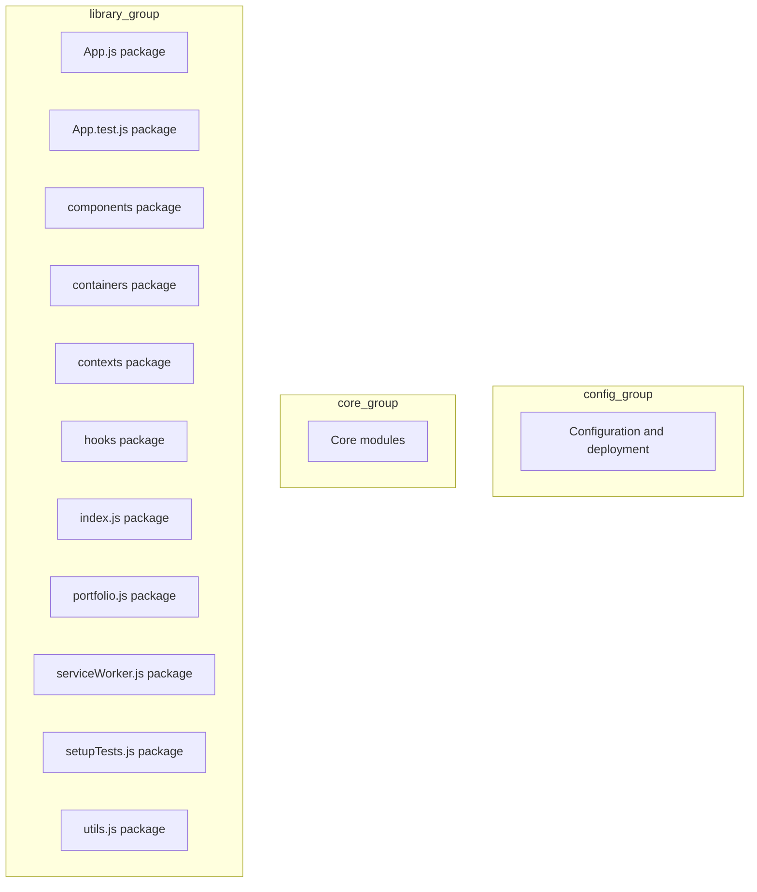

# Architecture report: saadpasta/developerFolio

> Automated static analysis. **Observed** = directly seen in files/imports/AST; **Inferred** = interpretation from that evidence. Repository code was not executed.

## 1. Repository at a glance

| Item | Value |
| --- | --- |
| Repository | saadpasta/developerFolio |
| Description | 🚀 Software Developer Portfolio Template that helps you showcase your work and skills as a software developer. (This is currently not being actively maintained) |
| Language | JavaScript |
| Stars | 6648 |
| Licence | GPL-3.0 |
| Analysed commit / branch | fc693405936fae6f5e5a4ba4c1da11513732f748 / master |
| Framework(s) | React |
| Files analysed | 111 |
| Components | 13 |

## 2. Architecture in one minute

saadpasta/developerFolio - 🚀 Software Developer Portfolio Template that helps you showcase your work and skills as a software developer. (This is currently not being actively maintained). This repository was analysed statically from 111 file(s) (0 Python). Detected technologies (observed from imports/manifests): GitHub Actions, React, Docker. Files are grouped into 13 component(s): App.js package, App.test.js package, components package, Configuration and deployment, containers package, contexts package, Core modules, hooks package. Findings below distinguish observed facts from inferred interpretation.

## 3. High-level block diagram

## 4. Main components

### App.js package (`app_js`)

- **Kind:** library
- **Status:** Observed
- **Confidence:** 0.85
- **Responsibility:** Groups 1 file(s) under app.js package (observed from repository paths and static analysis).
- **Paths:** `src/App.js`
- **Evidence:** [src/App.js](https://github.com/saadpasta/developerFolio/blob/fc693405936fae6f5e5a4ba4c1da11513732f748/src/App.js)

### App.test.js package (`app_test_js`)

- **Kind:** library
- **Status:** Observed
- **Confidence:** 0.85
- **Responsibility:** Groups 1 file(s) under app.test.js package (observed from repository paths and static analysis).
- **Paths:** `src/App.test.js`
- **Evidence:** [src/App.test.js](https://github.com/saadpasta/developerFolio/blob/fc693405936fae6f5e5a4ba4c1da11513732f748/src/App.test.js)

### components package (`components`)

- **Kind:** library
- **Status:** Observed
- **Confidence:** 0.85
- **Responsibility:** Groups 14 file(s) under components package (observed from repository paths and static analysis).
- **Paths:** `src/components/ToggleSwitch/ToggleSwitch.js`, `src/components/achievementCard/AchievementCard.js`, `src/components/blogCard/BlogCard.js`, `src/components/button/Button.js`, `src/components/displayLottie/DisplayLottie.js`, `src/components/educationCard/EducationCard.js`, `src/components/experienceCard/ExperienceCard.js`, `src/components/footer/Footer.js`, `src/components/githubProfileCard/GithubProfileCard.js`, `src/components/githubRepoCard/GithubRepoCard.js`, `src/components/header/Header.js`, `src/components/socialMedia/SocialMedia.js`, `src/components/softwareSkills/SoftwareSkill.js`, `src/components/talkCard/TalkCard.js`
- **Evidence:** [src/components/ToggleSwitch/ToggleSwitch.js](https://github.com/saadpasta/developerFolio/blob/fc693405936fae6f5e5a4ba4c1da11513732f748/src/components/ToggleSwitch/ToggleSwitch.js); [src/components/achievementCard/AchievementCard.js](https://github.com/saadpasta/developerFolio/blob/fc693405936fae6f5e5a4ba4c1da11513732f748/src/components/achievementCard/AchievementCard.js); [src/components/blogCard/BlogCard.js](https://github.com/saadpasta/developerFolio/blob/fc693405936fae6f5e5a4ba4c1da11513732f748/src/components/blogCard/BlogCard.js); [src/components/button/Button.js](https://github.com/saadpasta/developerFolio/blob/fc693405936fae6f5e5a4ba4c1da11513732f748/src/components/button/Button.js); [src/components/displayLottie/DisplayLottie.js](https://github.com/saadpasta/developerFolio/blob/fc693405936fae6f5e5a4ba4c1da11513732f748/src/components/displayLottie/DisplayLottie.js); [src/components/educationCard/EducationCard.js](https://github.com/saadpasta/developerFolio/blob/fc693405936fae6f5e5a4ba4c1da11513732f748/src/components/educationCard/EducationCard.js); [src/components/experienceCard/ExperienceCard.js](https://github.com/saadpasta/developerFolio/blob/fc693405936fae6f5e5a4ba4c1da11513732f748/src/components/experienceCard/ExperienceCard.js); [src/components/footer/Footer.js](https://github.com/saadpasta/developerFolio/blob/fc693405936fae6f5e5a4ba4c1da11513732f748/src/components/footer/Footer.js)

### Configuration and deployment (`config`)

- **Kind:** config
- **Status:** Observed
- **Confidence:** 0.85
- **Responsibility:** Groups 8 file(s) under configuration and deployment (observed from repository paths and static analysis).
- **Paths:** `Dockerfile`, `package.json`, `public/manifest.json`, `src/assets/lottie/build.json`, `src/assets/lottie/codingPerson.json`, `src/assets/lottie/email.json`, `src/assets/lottie/landingPerson.json`, `src/assets/lottie/splashAnimation.json`
- **Evidence:** [Dockerfile](https://github.com/saadpasta/developerFolio/blob/fc693405936fae6f5e5a4ba4c1da11513732f748/Dockerfile); [package.json](https://github.com/saadpasta/developerFolio/blob/fc693405936fae6f5e5a4ba4c1da11513732f748/package.json); [public/manifest.json](https://github.com/saadpasta/developerFolio/blob/fc693405936fae6f5e5a4ba4c1da11513732f748/public/manifest.json); [src/assets/lottie/build.json](https://github.com/saadpasta/developerFolio/blob/fc693405936fae6f5e5a4ba4c1da11513732f748/src/assets/lottie/build.json); [src/assets/lottie/codingPerson.json](https://github.com/saadpasta/developerFolio/blob/fc693405936fae6f5e5a4ba4c1da11513732f748/src/assets/lottie/codingPerson.json); [src/assets/lottie/email.json](https://github.com/saadpasta/developerFolio/blob/fc693405936fae6f5e5a4ba4c1da11513732f748/src/assets/lottie/email.json); [src/assets/lottie/landingPerson.json](https://github.com/saadpasta/developerFolio/blob/fc693405936fae6f5e5a4ba4c1da11513732f748/src/assets/lottie/landingPerson.json); [src/assets/lottie/splashAnimation.json](https://github.com/saadpasta/developerFolio/blob/fc693405936fae6f5e5a4ba4c1da11513732f748/src/assets/lottie/splashAnimation.json)

### containers package (`containers`)

- **Kind:** library
- **Status:** Observed
- **Confidence:** 0.85
- **Responsibility:** Groups 18 file(s) under containers package (observed from repository paths and static analysis).
- **Paths:** `src/containers/Main.js`, `src/containers/StartupProjects/StartupProject.js`, `src/containers/achievement/Achievement.js`, `src/containers/blogs/Blogs.js`, `src/containers/contact/Contact.js`, `src/containers/education/Education.js`, `src/containers/greeting/Greeting.js`, `src/containers/loading/Loading.js`, `src/containers/podcast/Podcast.js`, `src/containers/profile/Profile.js`, `src/containers/projects/Projects.js`, `src/containers/skillProgress/skillProgress.js`, `src/containers/skills/Skills.js`, `src/containers/splashScreen/SplashScreen.js`, `src/containers/talks/Talks.js`, `src/containers/topbutton/Top.js`, `src/containers/twitter-embed/twitter.js`, `src/containers/workExperience/WorkExperience.js`
- **Evidence:** [src/containers/Main.js](https://github.com/saadpasta/developerFolio/blob/fc693405936fae6f5e5a4ba4c1da11513732f748/src/containers/Main.js); [src/containers/StartupProjects/StartupProject.js](https://github.com/saadpasta/developerFolio/blob/fc693405936fae6f5e5a4ba4c1da11513732f748/src/containers/StartupProjects/StartupProject.js); [src/containers/achievement/Achievement.js](https://github.com/saadpasta/developerFolio/blob/fc693405936fae6f5e5a4ba4c1da11513732f748/src/containers/achievement/Achievement.js); [src/containers/blogs/Blogs.js](https://github.com/saadpasta/developerFolio/blob/fc693405936fae6f5e5a4ba4c1da11513732f748/src/containers/blogs/Blogs.js); [src/containers/contact/Contact.js](https://github.com/saadpasta/developerFolio/blob/fc693405936fae6f5e5a4ba4c1da11513732f748/src/containers/contact/Contact.js); [src/containers/education/Education.js](https://github.com/saadpasta/developerFolio/blob/fc693405936fae6f5e5a4ba4c1da11513732f748/src/containers/education/Education.js); [src/containers/greeting/Greeting.js](https://github.com/saadpasta/developerFolio/blob/fc693405936fae6f5e5a4ba4c1da11513732f748/src/containers/greeting/Greeting.js); [src/containers/loading/Loading.js](https://github.com/saadpasta/developerFolio/blob/fc693405936fae6f5e5a4ba4c1da11513732f748/src/containers/loading/Loading.js)

### contexts package (`contexts`)

- **Kind:** library
- **Status:** Observed
- **Confidence:** 0.85
- **Responsibility:** Groups 1 file(s) under contexts package (observed from repository paths and static analysis).
- **Paths:** `src/contexts/StyleContext.js`
- **Evidence:** [src/contexts/StyleContext.js](https://github.com/saadpasta/developerFolio/blob/fc693405936fae6f5e5a4ba4c1da11513732f748/src/contexts/StyleContext.js)

### Core modules (`core`)

- **Kind:** core
- **Status:** Observed
- **Confidence:** 0.85
- **Responsibility:** Groups 1 file(s) under core modules (observed from repository paths and static analysis).
- **Paths:** `fetch.js`
- **Evidence:** [fetch.js](https://github.com/saadpasta/developerFolio/blob/fc693405936fae6f5e5a4ba4c1da11513732f748/fetch.js)

### hooks package (`hooks`)

- **Kind:** library
- **Status:** Observed
- **Confidence:** 0.85
- **Responsibility:** Groups 1 file(s) under hooks package (observed from repository paths and static analysis).
- **Paths:** `src/hooks/useLocalStorage.js`
- **Evidence:** [src/hooks/useLocalStorage.js](https://github.com/saadpasta/developerFolio/blob/fc693405936fae6f5e5a4ba4c1da11513732f748/src/hooks/useLocalStorage.js)

### index.js package (`index_js`)

- **Kind:** library
- **Status:** Observed
- **Confidence:** 0.85
- **Responsibility:** Groups 1 file(s) under index.js package (observed from repository paths and static analysis).
- **Paths:** `src/index.js`
- **Evidence:** [src/index.js](https://github.com/saadpasta/developerFolio/blob/fc693405936fae6f5e5a4ba4c1da11513732f748/src/index.js)

### portfolio.js package (`portfolio_js`)

- **Kind:** library
- **Status:** Observed
- **Confidence:** 0.85
- **Responsibility:** Groups 1 file(s) under portfolio.js package (observed from repository paths and static analysis).
- **Paths:** `src/portfolio.js`
- **Evidence:** [src/portfolio.js](https://github.com/saadpasta/developerFolio/blob/fc693405936fae6f5e5a4ba4c1da11513732f748/src/portfolio.js)

### serviceWorker.js package (`serviceworker_js`)

- **Kind:** library
- **Status:** Observed
- **Confidence:** 0.85
- **Responsibility:** Groups 1 file(s) under serviceworker.js package (observed from repository paths and static analysis).
- **Paths:** `src/serviceWorker.js`
- **Evidence:** [src/serviceWorker.js](https://github.com/saadpasta/developerFolio/blob/fc693405936fae6f5e5a4ba4c1da11513732f748/src/serviceWorker.js)

### setupTests.js package (`setuptests_js`)

- **Kind:** library
- **Status:** Observed
- **Confidence:** 0.85
- **Responsibility:** Groups 1 file(s) under setuptests.js package (observed from repository paths and static analysis).
- **Paths:** `src/setupTests.js`
- **Evidence:** [src/setupTests.js](https://github.com/saadpasta/developerFolio/blob/fc693405936fae6f5e5a4ba4c1da11513732f748/src/setupTests.js)

### utils.js package (`utils_js`)

- **Kind:** library
- **Status:** Observed
- **Confidence:** 0.85
- **Responsibility:** Groups 1 file(s) under utils.js package (observed from repository paths and static analysis).
- **Paths:** `src/utils.js`
- **Evidence:** [src/utils.js](https://github.com/saadpasta/developerFolio/blob/fc693405936fae6f5e5a4ba4c1da11513732f748/src/utils.js)

## 5. Execution flow

**Observed** entry point(s):

- [src/App.js](https://github.com/saadpasta/developerFolio/blob/fc693405936fae6f5e5a4ba4c1da11513732f748/src/App.js)
- [src/containers/Main.js](https://github.com/saadpasta/developerFolio/blob/fc693405936fae6f5e5a4ba4c1da11513732f748/src/containers/Main.js)
- [src/index.js](https://github.com/saadpasta/developerFolio/blob/fc693405936fae6f5e5a4ba4c1da11513732f748/src/index.js)

Representative flow (derived from observed entry points and the import graph; steps beyond the entry point are **Inferred**):

1. Execution starts at an observed entry point listed above, if present.
2. No internal import relationships between components were observed.

## 6. Project structure

### `(root)`

- `.all-contributorsrc` - other (16308 bytes)
- `.gitattributes` - other (138 bytes)
- `.gitignore` - other (365 bytes)
- `.pre-commit-config.yaml` - config (190 bytes)
- `.prettierignore` - other (58 bytes)
- `.prettierrc` - other (173 bytes)
- `Dockerfile` - container (619 bytes)
- `LICENSE` - docs (35149 bytes)
- `README.md` - docs (36154 bytes)
- `env.example` - other (702 bytes)
- `fetch.js` - source, JavaScript (3089 bytes)
- `package.json` - manifest (1534 bytes)

### `.github`

- `.github/ISSUE_TEMPLATE/bug.yml` - config (2201 bytes)
- `.github/ISSUE_TEMPLATE/config.yml` - config (26 bytes)
- `.github/ISSUE_TEMPLATE/feature_request.yml` - config (927 bytes)
- `.github/pull_request_template.md` - docs (557 bytes)
- `.github/workflows/deploy.yml` - ci, YAML (1409 bytes)
- `.github/workflows/prettier.yml` - ci, YAML (515 bytes)

### `public`

- `public/browserconfig.xml` - other (260 bytes)
- `public/index.html` - other (4064 bytes)
- `public/manifest.json` - config (549 bytes)
- `public/robots.txt` - docs (57 bytes)
- `public/safari-pinned-tab.svg` - other (5022 bytes)

### `src`

- `src/App.js` - source, JavaScript (179 bytes)
- `src/App.scss` - other (423 bytes)
- `src/App.test.js` - source, JavaScript (616 bytes)
- `src/_globalColor.scss` - other (2203 bytes)
- `src/assets/images/contactMailDark.svg` - other (29119 bytes)
- `src/assets/images/developerActivity.svg` - other (27643 bytes)
- `src/assets/images/googleAssistant.svg` - other (856 bytes)
- `src/assets/images/jsFramework.svg` - other (20757 bytes)
- `src/assets/images/manOnTable.svg` - other (45927 bytes)
- `src/assets/images/programmer.svg` - other (20904 bytes)
- `src/assets/images/skill.svg` - other (8317 bytes)
- `src/assets/images/talksCardBack.svg` - other (542 bytes)
- `src/assets/lottie/build.json` - config (98820 bytes)
- `src/assets/lottie/codingPerson.json` - config (158924 bytes)
- `src/assets/lottie/email.json` - config (11967 bytes)
- `src/assets/lottie/landingPerson.json` - config (195885 bytes)
- `src/assets/lottie/splashAnimation.json` - config (29950 bytes)
- `src/components/ToggleSwitch/ToggleSwitch.js` - source, JavaScript (761 bytes)
- `src/components/ToggleSwitch/ToggleSwitch.scss` - other (1787 bytes)
- `src/components/achievementCard/AchievementCard.js` - source, JavaScript (1342 bytes)
- `src/components/achievementCard/AchievementCard.scss` - other (1702 bytes)
- `src/components/blogCard/BlogCard.js` - source, JavaScript (972 bytes)
- `src/components/blogCard/BlogCard.scss` - other (2912 bytes)
- `src/components/button/Button.js` - source, JavaScript (279 bytes)
- `src/components/button/Button.scss` - other (951 bytes)
- `src/components/displayLottie/DisplayLottie.js` - source, JavaScript (577 bytes)
- `src/components/educationCard/EducationCard.js` - source, JavaScript (2154 bytes)
- `src/components/educationCard/EducationCard.scss` - other (2419 bytes)
- `src/components/experienceCard/ExperienceCard.js` - source, JavaScript (2263 bytes)
- `src/components/experienceCard/ExperienceCard.scss` - other (2936 bytes)
- `src/components/footer/Footer.js` - source, JavaScript (846 bytes)
- `src/components/footer/Footer.scss` - other (214 bytes)
- `src/components/githubProfileCard/GithubProfileCard.js` - source, JavaScript (2236 bytes)
- `src/components/githubProfileCard/GithubProfileCard.scss` - other (1491 bytes)
- `src/components/githubRepoCard/GithubRepoCard.js` - source, JavaScript (3637 bytes)
- `src/components/githubRepoCard/GithubRepoCard.scss` - other (1731 bytes)
- `src/components/header/Header.js` - source, JavaScript (2611 bytes)
- `src/components/header/Header.scss` - other (3081 bytes)
- `src/components/socialMedia/SocialMedia.js` - source, JavaScript (3329 bytes)
- `src/components/socialMedia/SocialMedia.scss` - other (1333 bytes)
- `src/components/softwareSkills/SoftwareSkill.js` - source, JavaScript (683 bytes)
- `src/components/softwareSkills/SoftwareSkill.scss` - other (512 bytes)
- `src/components/talkCard/TalkCard.js` - source, JavaScript (829 bytes)
- `src/components/talkCard/TalkCard.scss` - other (2385 bytes)
- `src/containers/Main.js` - source, JavaScript (2372 bytes)
- `src/containers/Main.scss` - other (118 bytes)
- `src/containers/StartupProjects/StartupProject.js` - source, JavaScript (2998 bytes)
- `src/containers/StartupProjects/StartupProjects.scss` - other (1832 bytes)
- `src/containers/achievement/Achievement.js` - source, JavaScript (1805 bytes)
- `src/containers/achievement/Achievement.scss` - other (564 bytes)
- `src/containers/blogs/Blog.scss` - other (1231 bytes)
- `src/containers/blogs/Blogs.js` - source, JavaScript (3261 bytes)
- `src/containers/contact/Contact.js` - source, JavaScript (2213 bytes)
- `src/containers/contact/Contact.scss` - other (1279 bytes)
- `src/containers/education/Education.js` - source, JavaScript (609 bytes)
- `src/containers/education/Education.scss` - other (788 bytes)
- `src/containers/greeting/Greeting.js` - source, JavaScript (2369 bytes)
- `src/containers/greeting/Greeting.scss` - other (1783 bytes)
- `src/containers/loading/Loading.js` - source, JavaScript (828 bytes)
- `src/containers/loading/loading.scss` - other (3335 bytes)
- `src/containers/podcast/Podcast.js` - source, JavaScript (1541 bytes)
- `src/containers/podcast/Podcast.scss` - other (596 bytes)
- `src/containers/profile/Profile.js` - source, JavaScript (1526 bytes)
- `src/containers/projects/Project.scss` - other (557 bytes)
- `src/containers/projects/Projects.js` - source, JavaScript (2292 bytes)
- `src/containers/skillProgress/Progress.scss` - other (1154 bytes)
- `src/containers/skillProgress/skillProgress.js` - source, JavaScript (1376 bytes)
- `src/containers/skills/Skills.js` - source, JavaScript (2155 bytes)
- `src/containers/skills/Skills.scss` - other (930 bytes)
- `src/containers/splashScreen/SplashScreen.css` - other (464 bytes)
- `src/containers/splashScreen/SplashScreen.js` - source, JavaScript (808 bytes)
- `src/containers/talks/Talks.js` - source, JavaScript (1327 bytes)
- `src/containers/talks/Talks.scss` - other (470 bytes)
- `src/containers/topbutton/Top.js` - source, JavaScript (1037 bytes)
- `src/containers/topbutton/Top.scss` - other (389 bytes)
- `src/containers/twitter-embed/twitter.js` - source, JavaScript (1671 bytes)
- `src/containers/twitter-embed/twitter.scss` - other (364 bytes)
- `src/containers/workExperience/WorkExperience.js` - source, JavaScript (1423 bytes)
- `src/containers/workExperience/WorkExperience.scss` - other (554 bytes)
- `src/contexts/StyleContext.js` - source, JavaScript (207 bytes)
- `src/hooks/useLocalStorage.js` - source, JavaScript (1237 bytes)
- `src/index.css` - other (776 bytes)
- `src/index.js` - source, JavaScript (452 bytes)
- `src/logo.svg` - other (8205 bytes)
- `src/portfolio.js` - source, JavaScript (12878 bytes)
- `src/serviceWorker.js` - source, JavaScript (4951 bytes)
- `src/setupTests.js` - source, JavaScript (146 bytes)
- `src/utils.js` - source, JavaScript (159 bytes)

## 7. Key dependencies and integrations

| Name | Category | Status | Confidence | Evidence |
| --- | --- | --- | --- | --- |
| GitHub Actions | ci | Observed | 0.90 | [.github/workflows/deploy.yml](https://github.com/saadpasta/developerFolio/blob/fc693405936fae6f5e5a4ba4c1da11513732f748/.github/workflows/deploy.yml); [.github/workflows/prettier.yml](https://github.com/saadpasta/developerFolio/blob/fc693405936fae6f5e5a4ba4c1da11513732f748/.github/workflows/prettier.yml) |
| React | framework | Observed | 0.90 | [package.json:9](https://github.com/saadpasta/developerFolio/blob/fc693405936fae6f5e5a4ba4c1da11513732f748/package.json#L9); [package.json:14](https://github.com/saadpasta/developerFolio/blob/fc693405936fae6f5e5a4ba4c1da11513732f748/package.json#L14) |
| Docker | tooling | Observed | 0.85 | [Dockerfile](https://github.com/saadpasta/developerFolio/blob/fc693405936fae6f5e5a4ba4c1da11513732f748/Dockerfile) |

## 8. Data and state

No database, cache, queue, or persistent-state usage was observed in the analysed files. State handling, if any, may be in-memory or in files that were not analysed.

## 9. Configuration and deployment clues

- `.github/ISSUE_TEMPLATE/bug.yml` (config)
- `.github/ISSUE_TEMPLATE/config.yml` (config)
- `.github/ISSUE_TEMPLATE/feature_request.yml` (config)
- `.github/workflows/deploy.yml` (ci)
- `.github/workflows/prettier.yml` (ci)
- `.pre-commit-config.yaml` (config)
- `Dockerfile` (container)
- `package.json` (manifest)
- `public/manifest.json` (config)
- `src/assets/lottie/build.json` (config)
- `src/assets/lottie/codingPerson.json` (config)
- `src/assets/lottie/email.json` (config)
- `src/assets/lottie/landingPerson.json` (config)
- `src/assets/lottie/splashAnimation.json` (config)

## 10. Design observations

- No strong design patterns could be established from the available evidence.

These observations are interpretations (**Inferred**) of the observed structure, not guarantees about runtime design.

## 11. Limitations and unknowns

- Static analysis only: repository code was not executed, installed, or imported at runtime.
- Components and relationships are inferred from file paths, imports, and AST structure; runtime behaviour, dynamic imports, and reflection may not be visible.
- No clear application entry point was observed in the analysed files.
- Repository text was treated as untrusted data; no instructions found in repository files were followed, and likely secret values were redacted/excluded.
- JavaScript and TypeScript files were inventoried from paths and package manifests. They were not parsed with a full language AST, and repository code was not executed.

## 12. Source references

- [.github/workflows/deploy.yml](https://github.com/saadpasta/developerFolio/blob/fc693405936fae6f5e5a4ba4c1da11513732f748/.github/workflows/deploy.yml)
- [.github/workflows/prettier.yml](https://github.com/saadpasta/developerFolio/blob/fc693405936fae6f5e5a4ba4c1da11513732f748/.github/workflows/prettier.yml)
- [Dockerfile](https://github.com/saadpasta/developerFolio/blob/fc693405936fae6f5e5a4ba4c1da11513732f748/Dockerfile)
- [fetch.js](https://github.com/saadpasta/developerFolio/blob/fc693405936fae6f5e5a4ba4c1da11513732f748/fetch.js)
- [package.json](https://github.com/saadpasta/developerFolio/blob/fc693405936fae6f5e5a4ba4c1da11513732f748/package.json)
- [package.json:9](https://github.com/saadpasta/developerFolio/blob/fc693405936fae6f5e5a4ba4c1da11513732f748/package.json#L9)
- [package.json:14](https://github.com/saadpasta/developerFolio/blob/fc693405936fae6f5e5a4ba4c1da11513732f748/package.json#L14)
- [public/manifest.json](https://github.com/saadpasta/developerFolio/blob/fc693405936fae6f5e5a4ba4c1da11513732f748/public/manifest.json)
- [src/App.js](https://github.com/saadpasta/developerFolio/blob/fc693405936fae6f5e5a4ba4c1da11513732f748/src/App.js)
- [src/App.test.js](https://github.com/saadpasta/developerFolio/blob/fc693405936fae6f5e5a4ba4c1da11513732f748/src/App.test.js)
- [src/assets/lottie/build.json](https://github.com/saadpasta/developerFolio/blob/fc693405936fae6f5e5a4ba4c1da11513732f748/src/assets/lottie/build.json)
- [src/assets/lottie/codingPerson.json](https://github.com/saadpasta/developerFolio/blob/fc693405936fae6f5e5a4ba4c1da11513732f748/src/assets/lottie/codingPerson.json)
- [src/assets/lottie/email.json](https://github.com/saadpasta/developerFolio/blob/fc693405936fae6f5e5a4ba4c1da11513732f748/src/assets/lottie/email.json)
- [src/assets/lottie/landingPerson.json](https://github.com/saadpasta/developerFolio/blob/fc693405936fae6f5e5a4ba4c1da11513732f748/src/assets/lottie/landingPerson.json)
- [src/assets/lottie/splashAnimation.json](https://github.com/saadpasta/developerFolio/blob/fc693405936fae6f5e5a4ba4c1da11513732f748/src/assets/lottie/splashAnimation.json)
- [src/components/ToggleSwitch/ToggleSwitch.js](https://github.com/saadpasta/developerFolio/blob/fc693405936fae6f5e5a4ba4c1da11513732f748/src/components/ToggleSwitch/ToggleSwitch.js)
- [src/components/achievementCard/AchievementCard.js](https://github.com/saadpasta/developerFolio/blob/fc693405936fae6f5e5a4ba4c1da11513732f748/src/components/achievementCard/AchievementCard.js)
- [src/components/blogCard/BlogCard.js](https://github.com/saadpasta/developerFolio/blob/fc693405936fae6f5e5a4ba4c1da11513732f748/src/components/blogCard/BlogCard.js)
- [src/components/button/Button.js](https://github.com/saadpasta/developerFolio/blob/fc693405936fae6f5e5a4ba4c1da11513732f748/src/components/button/Button.js)
- [src/components/displayLottie/DisplayLottie.js](https://github.com/saadpasta/developerFolio/blob/fc693405936fae6f5e5a4ba4c1da11513732f748/src/components/displayLottie/DisplayLottie.js)
- [src/components/educationCard/EducationCard.js](https://github.com/saadpasta/developerFolio/blob/fc693405936fae6f5e5a4ba4c1da11513732f748/src/components/educationCard/EducationCard.js)
- [src/components/experienceCard/ExperienceCard.js](https://github.com/saadpasta/developerFolio/blob/fc693405936fae6f5e5a4ba4c1da11513732f748/src/components/experienceCard/ExperienceCard.js)
- [src/components/footer/Footer.js](https://github.com/saadpasta/developerFolio/blob/fc693405936fae6f5e5a4ba4c1da11513732f748/src/components/footer/Footer.js)
- [src/containers/Main.js](https://github.com/saadpasta/developerFolio/blob/fc693405936fae6f5e5a4ba4c1da11513732f748/src/containers/Main.js)
- [src/containers/StartupProjects/StartupProject.js](https://github.com/saadpasta/developerFolio/blob/fc693405936fae6f5e5a4ba4c1da11513732f748/src/containers/StartupProjects/StartupProject.js)
- [src/containers/achievement/Achievement.js](https://github.com/saadpasta/developerFolio/blob/fc693405936fae6f5e5a4ba4c1da11513732f748/src/containers/achievement/Achievement.js)
- [src/containers/blogs/Blogs.js](https://github.com/saadpasta/developerFolio/blob/fc693405936fae6f5e5a4ba4c1da11513732f748/src/containers/blogs/Blogs.js)
- [src/containers/contact/Contact.js](https://github.com/saadpasta/developerFolio/blob/fc693405936fae6f5e5a4ba4c1da11513732f748/src/containers/contact/Contact.js)
- [src/containers/education/Education.js](https://github.com/saadpasta/developerFolio/blob/fc693405936fae6f5e5a4ba4c1da11513732f748/src/containers/education/Education.js)
- [src/containers/greeting/Greeting.js](https://github.com/saadpasta/developerFolio/blob/fc693405936fae6f5e5a4ba4c1da11513732f748/src/containers/greeting/Greeting.js)
- [src/containers/loading/Loading.js](https://github.com/saadpasta/developerFolio/blob/fc693405936fae6f5e5a4ba4c1da11513732f748/src/containers/loading/Loading.js)
- [src/contexts/StyleContext.js](https://github.com/saadpasta/developerFolio/blob/fc693405936fae6f5e5a4ba4c1da11513732f748/src/contexts/StyleContext.js)
- [src/hooks/useLocalStorage.js](https://github.com/saadpasta/developerFolio/blob/fc693405936fae6f5e5a4ba4c1da11513732f748/src/hooks/useLocalStorage.js)
- [src/index.js](https://github.com/saadpasta/developerFolio/blob/fc693405936fae6f5e5a4ba4c1da11513732f748/src/index.js)
- [src/portfolio.js](https://github.com/saadpasta/developerFolio/blob/fc693405936fae6f5e5a4ba4c1da11513732f748/src/portfolio.js)
- [src/serviceWorker.js](https://github.com/saadpasta/developerFolio/blob/fc693405936fae6f5e5a4ba4c1da11513732f748/src/serviceWorker.js)
- [src/setupTests.js](https://github.com/saadpasta/developerFolio/blob/fc693405936fae6f5e5a4ba4c1da11513732f748/src/setupTests.js)
- [src/utils.js](https://github.com/saadpasta/developerFolio/blob/fc693405936fae6f5e5a4ba4c1da11513732f748/src/utils.js)
