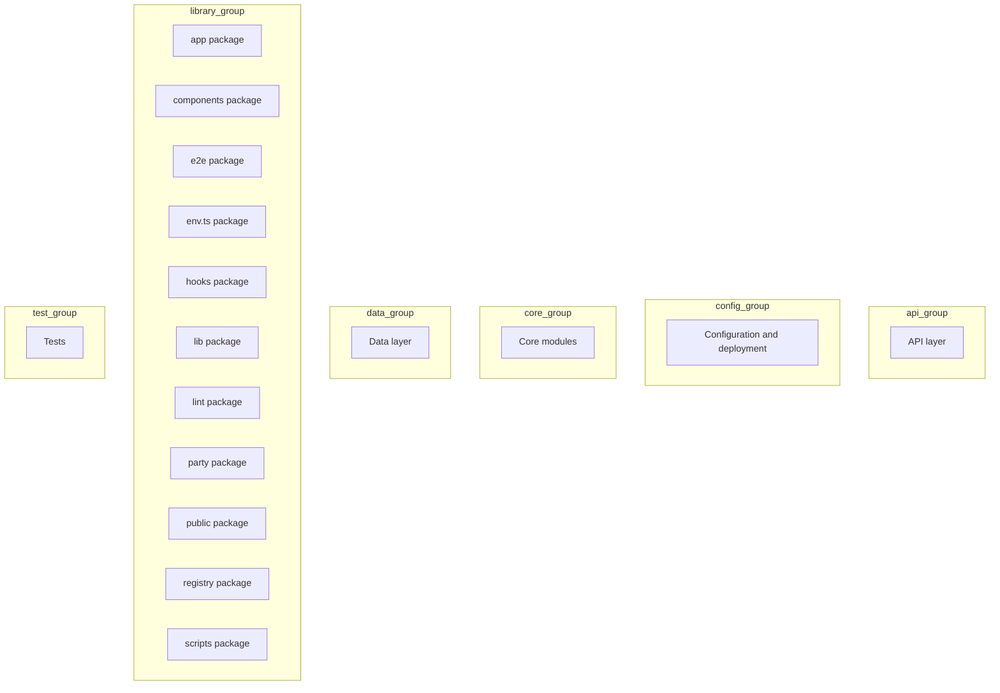

# Architecture report: sadmann7/tablecn

> Automated static analysis. **Observed** = directly seen in files/imports/AST; **Inferred** = interpretation from that evidence. Repository code was not executed.

## 1. Repository at a glance

| Item | Value |
| --- | --- |
| Repository | sadmann7/tablecn |
| Description | Data table and data grid components built with shadcn/ui, featuring sorting, filtering, pagination, infinite scrolling, and real-time collaboration. |
| Language | TypeScript |
| Stars | 6384 |
| Licence | MIT |
| Analysed commit / branch | 44ac3879d0db81e92c011971cb43261fbbdc059a / main |
| Framework(s) | Next.js, React |
| Files analysed | 414 |
| Components | 16 |

## 2. Architecture in one minute

sadmann7/tablecn - Data table and data grid components built with shadcn/ui, featuring sorting, filtering, pagination, infinite scrolling, and real-time collaboration.. This repository was analysed statically from 414 file(s) (0 Python). Detected technologies (observed from imports/manifests): GitHub Actions, Database (unspecified), PostgreSQL, Redis, Next.js, React. Files are grouped into 16 component(s): API layer, app package, components package, Configuration and deployment, Core modules, Data layer, e2e package, env.ts package. Findings below distinguish observed facts from inferred interpretation.

## 3. High-level block diagram

## 4. Main components

### API layer (`api_layer`)

- **Kind:** api
- **Status:** Observed
- **Confidence:** 0.85
- **Responsibility:** Groups 3 file(s) under api layer (observed from repository paths and static analysis).
- **Paths:** `src/app/api/uploadthing/core.ts`, `src/app/api/uploadthing/delete/route.ts`, `src/app/api/uploadthing/route.ts`
- **Evidence:** [src/app/api/uploadthing/core.ts](https://github.com/sadmann7/tablecn/blob/44ac3879d0db81e92c011971cb43261fbbdc059a/src/app/api/uploadthing/core.ts); [src/app/api/uploadthing/delete/route.ts](https://github.com/sadmann7/tablecn/blob/44ac3879d0db81e92c011971cb43261fbbdc059a/src/app/api/uploadthing/delete/route.ts); [src/app/api/uploadthing/route.ts](https://github.com/sadmann7/tablecn/blob/44ac3879d0db81e92c011971cb43261fbbdc059a/src/app/api/uploadthing/route.ts)

### app package (`app`)

- **Kind:** library
- **Status:** Observed
- **Confidence:** 0.85
- **Responsibility:** Groups 77 file(s) under app package (observed from repository paths and static analysis).
- **Paths:** `src/app/bases/[base]/page.tsx`, `src/app/bases/components/aria-data-table-demo.tsx`, `src/app/bases/components/base-data-grid-demo.tsx`, `src/app/bases/components/base-data-table-demo.tsx`, `src/app/bases/components/bases-controls.tsx`, `src/app/bases/components/bases-view.tsx`, `src/app/bases/components/radix-data-grid-demo.tsx`, `src/app/bases/components/radix-data-table-demo.tsx`, `src/app/bases/hooks/use-bases-data-grid.ts`, `src/app/bases/hooks/use-bases-data-table.ts`, `src/app/bases/lib/data-grid-columns.ts`, `src/app/bases/lib/data-grid-fixtures.ts`, `src/app/bases/lib/data-table-columns.tsx`, `src/app/bases/lib/data.ts`, `src/app/bases/lib/fixtures.ts`, `src/app/bases/lib/search-params.ts`, `src/app/bases/lib/table.ts`, `src/app/bases/page.tsx`, `src/app/components/delete-tasks-dialog.tsx`, `src/app/components/tasks-table-action-bar.tsx`, `src/app/components/tasks-table-control-menu.tsx`, `src/app/components/tasks-table.tsx`, `src/app/components/update-task-sheet.tsx`, `src/app/data-grid-doom/components/data-grid-doom-demo.tsx`, `src/app/data-grid-doom/components/data-grid-doom-player.tsx`, `src/app/data-grid-doom/components/data-grid-doom-skeleton.tsx`, `src/app/data-grid-doom/lib/doom.ts`, `src/app/data-grid-doom/lib/doom.worker.ts`, `src/app/data-grid-doom/lib/params.ts`, `src/app/data-grid-doom/page.tsx`, `src/app/data-grid-multiplayer/components/data-grid-multiplayer-demo.tsx`, `src/app/data-grid-multiplayer/components/data-grid-multiplayer-room.tsx`, `src/app/data-grid-multiplayer/components/data-grid-multiplayer-skeleton.tsx`, `src/app/data-grid-multiplayer/components/data-grid-presence-avatars.tsx`, `src/app/data-grid-multiplayer/components/data-grid-share-menu.tsx`, `src/app/data-grid-multiplayer/components/skaters-data-grid-action-bar.tsx`, `src/app/data-grid-multiplayer/lib/multiplayer-collection.ts`, `src/app/data-grid-multiplayer/lib/order.ts`, `src/app/data-grid-multiplayer/lib/rooms.ts`, `src/app/data-grid-multiplayer/lib/validation.ts`, `src/app/data-grid-multiplayer/page.tsx`, `src/app/data-grid-rapid/components/data-grid-rapid-demo.tsx`, `src/app/data-grid-rapid/lib/rapid.ts`, `src/app/data-grid-rapid/page.tsx`, `src/app/data-grid/components/data-grid-benchmark.tsx`, `src/app/data-grid/components/data-grid-demo-skeleton.tsx`, `src/app/data-grid/components/data-grid-demo.tsx`, `src/app/data-grid/components/people-data-grid-action-bar.tsx`, `src/app/data-grid/lib/duplicate-rows.ts`, `src/app/data-grid/lib/seeds.ts`, `src/app/data-grid/lib/worst-case.ts`, `src/app/data-grid/page.tsx`, `src/app/data-table-launch/components/data-table-launch-columns.tsx`, `src/app/data-table-launch/components/data-table-launch-controls.tsx`, `src/app/data-table-launch/components/data-table-launch-demo.tsx`, `src/app/data-table-launch/components/data-table-launch-director.tsx`, `src/app/data-table-launch/components/data-table-launch-scenes.tsx`, `src/app/data-table-launch/components/data-table-launch-window.tsx`, `src/app/data-table-launch/hooks/use-data-table-launch-server.ts`, `src/app/data-table-launch/hooks/use-data-table-launch-timeline.ts`, `src/app/data-table-launch/hooks/use-stage-scale.ts`, `src/app/data-table-launch/lib/data.ts`, `src/app/data-table-launch/lib/dom.ts`, `src/app/data-table-launch/lib/script.ts`, `src/app/data-table-launch/lib/state.ts`, `src/app/data-table-launch/page.tsx`, `src/app/layout.tsx`, `src/app/lib/actions.ts`, `src/app/lib/filter-columns.ts`, `src/app/lib/queries.ts`, `src/app/lib/seeds.ts`, `src/app/lib/utils.ts`, `src/app/lib/validations.ts`, `src/app/manifest.ts`, `src/app/page.tsx`, `src/app/robots.ts`, `src/app/sitemap.ts`
- **Evidence:** [src/app/bases/[base]/page.tsx](https://github.com/sadmann7/tablecn/blob/44ac3879d0db81e92c011971cb43261fbbdc059a/src/app/bases/%5Bbase%5D/page.tsx); [src/app/bases/components/aria-data-table-demo.tsx](https://github.com/sadmann7/tablecn/blob/44ac3879d0db81e92c011971cb43261fbbdc059a/src/app/bases/components/aria-data-table-demo.tsx); [src/app/bases/components/base-data-grid-demo.tsx](https://github.com/sadmann7/tablecn/blob/44ac3879d0db81e92c011971cb43261fbbdc059a/src/app/bases/components/base-data-grid-demo.tsx); [src/app/bases/components/base-data-table-demo.tsx](https://github.com/sadmann7/tablecn/blob/44ac3879d0db81e92c011971cb43261fbbdc059a/src/app/bases/components/base-data-table-demo.tsx); [src/app/bases/components/bases-controls.tsx](https://github.com/sadmann7/tablecn/blob/44ac3879d0db81e92c011971cb43261fbbdc059a/src/app/bases/components/bases-controls.tsx); [src/app/bases/components/bases-view.tsx](https://github.com/sadmann7/tablecn/blob/44ac3879d0db81e92c011971cb43261fbbdc059a/src/app/bases/components/bases-view.tsx); [src/app/bases/components/radix-data-grid-demo.tsx](https://github.com/sadmann7/tablecn/blob/44ac3879d0db81e92c011971cb43261fbbdc059a/src/app/bases/components/radix-data-grid-demo.tsx); [src/app/bases/components/radix-data-table-demo.tsx](https://github.com/sadmann7/tablecn/blob/44ac3879d0db81e92c011971cb43261fbbdc059a/src/app/bases/components/radix-data-table-demo.tsx)

### components package (`components`)

- **Kind:** library
- **Status:** Observed
- **Confidence:** 0.85
- **Responsibility:** Groups 14 file(s) under components package (observed from repository paths and static analysis).
- **Paths:** `src/components/action-bar-tooltip-item.tsx`, `src/components/active-link.tsx`, `src/components/data-mode-toggle.tsx`, `src/components/icons.tsx`, `src/components/layouts/docs-link.tsx`, `src/components/layouts/mobile-nav.tsx`, `src/components/layouts/mode-toggle.tsx`, `src/components/layouts/site-header.tsx`, `src/components/providers.tsx`, `src/components/skip-nav.tsx`, `src/components/tailwind-indicator.tsx`, `src/components/theme-color.tsx`, `src/components/theme-shortcut.tsx`, `src/components/uploadthing-ssr.tsx`
- **Evidence:** [src/components/action-bar-tooltip-item.tsx](https://github.com/sadmann7/tablecn/blob/44ac3879d0db81e92c011971cb43261fbbdc059a/src/components/action-bar-tooltip-item.tsx); [src/components/active-link.tsx](https://github.com/sadmann7/tablecn/blob/44ac3879d0db81e92c011971cb43261fbbdc059a/src/components/active-link.tsx); [src/components/data-mode-toggle.tsx](https://github.com/sadmann7/tablecn/blob/44ac3879d0db81e92c011971cb43261fbbdc059a/src/components/data-mode-toggle.tsx); [src/components/icons.tsx](https://github.com/sadmann7/tablecn/blob/44ac3879d0db81e92c011971cb43261fbbdc059a/src/components/icons.tsx); [src/components/layouts/docs-link.tsx](https://github.com/sadmann7/tablecn/blob/44ac3879d0db81e92c011971cb43261fbbdc059a/src/components/layouts/docs-link.tsx); [src/components/layouts/mobile-nav.tsx](https://github.com/sadmann7/tablecn/blob/44ac3879d0db81e92c011971cb43261fbbdc059a/src/components/layouts/mobile-nav.tsx); [src/components/layouts/mode-toggle.tsx](https://github.com/sadmann7/tablecn/blob/44ac3879d0db81e92c011971cb43261fbbdc059a/src/components/layouts/mode-toggle.tsx); [src/components/layouts/site-header.tsx](https://github.com/sadmann7/tablecn/blob/44ac3879d0db81e92c011971cb43261fbbdc059a/src/components/layouts/site-header.tsx)

### Configuration and deployment (`config`)

- **Kind:** config
- **Status:** Observed
- **Confidence:** 0.85
- **Responsibility:** Groups 14 file(s) under configuration and deployment (observed from repository paths and static analysis).
- **Paths:** `components.json`, `docker-compose.yml`, `drizzle/meta/_journal.json`, `package.json`, `party/tsconfig.json`, `pnpm-workspace.yaml`, `public/doom/default.cfg`, `public/doom/extra.cfg`, `public/r/styles/index.json`, `registry.json`, `registry/base-differences.json`, `renovate.json`, `tsconfig.json`, `tsconfig.scripts.json`
- **Evidence:** [components.json](https://github.com/sadmann7/tablecn/blob/44ac3879d0db81e92c011971cb43261fbbdc059a/components.json); [docker-compose.yml](https://github.com/sadmann7/tablecn/blob/44ac3879d0db81e92c011971cb43261fbbdc059a/docker-compose.yml); [drizzle/meta/_journal.json](https://github.com/sadmann7/tablecn/blob/44ac3879d0db81e92c011971cb43261fbbdc059a/drizzle/meta/_journal.json); [package.json](https://github.com/sadmann7/tablecn/blob/44ac3879d0db81e92c011971cb43261fbbdc059a/package.json); [party/tsconfig.json](https://github.com/sadmann7/tablecn/blob/44ac3879d0db81e92c011971cb43261fbbdc059a/party/tsconfig.json); [pnpm-workspace.yaml](https://github.com/sadmann7/tablecn/blob/44ac3879d0db81e92c011971cb43261fbbdc059a/pnpm-workspace.yaml); [public/doom/default.cfg](https://github.com/sadmann7/tablecn/blob/44ac3879d0db81e92c011971cb43261fbbdc059a/public/doom/default.cfg); [public/doom/extra.cfg](https://github.com/sadmann7/tablecn/blob/44ac3879d0db81e92c011971cb43261fbbdc059a/public/doom/extra.cfg)

### Core modules (`core`)

- **Kind:** core
- **Status:** Observed
- **Confidence:** 0.85
- **Responsibility:** Groups 7 file(s) under core modules (observed from repository paths and static analysis).
- **Paths:** `drizzle.config.ts`, `next.config.ts`, `playwright.config.ts`, `playwright.record.config.ts`, `postcss.config.cjs`, `vitest.config.ts`, `vitest.setup.ts`
- **Evidence:** [drizzle.config.ts](https://github.com/sadmann7/tablecn/blob/44ac3879d0db81e92c011971cb43261fbbdc059a/drizzle.config.ts); [next.config.ts](https://github.com/sadmann7/tablecn/blob/44ac3879d0db81e92c011971cb43261fbbdc059a/next.config.ts); [playwright.config.ts](https://github.com/sadmann7/tablecn/blob/44ac3879d0db81e92c011971cb43261fbbdc059a/playwright.config.ts); [playwright.record.config.ts](https://github.com/sadmann7/tablecn/blob/44ac3879d0db81e92c011971cb43261fbbdc059a/playwright.record.config.ts); [postcss.config.cjs](https://github.com/sadmann7/tablecn/blob/44ac3879d0db81e92c011971cb43261fbbdc059a/postcss.config.cjs); [vitest.config.ts](https://github.com/sadmann7/tablecn/blob/44ac3879d0db81e92c011971cb43261fbbdc059a/vitest.config.ts); [vitest.setup.ts](https://github.com/sadmann7/tablecn/blob/44ac3879d0db81e92c011971cb43261fbbdc059a/vitest.setup.ts)

### Data layer (`data_layer`)

- **Kind:** data
- **Status:** Observed
- **Confidence:** 0.85
- **Responsibility:** Groups 6 file(s) under data layer (observed from repository paths and static analysis).
- **Paths:** `src/db/extensions.ts`, `src/db/index.ts`, `src/db/migrate.ts`, `src/db/schema.ts`, `src/db/seed.ts`, `src/db/utils.ts`
- **Evidence:** [src/db/extensions.ts](https://github.com/sadmann7/tablecn/blob/44ac3879d0db81e92c011971cb43261fbbdc059a/src/db/extensions.ts); [src/db/index.ts](https://github.com/sadmann7/tablecn/blob/44ac3879d0db81e92c011971cb43261fbbdc059a/src/db/index.ts); [src/db/migrate.ts](https://github.com/sadmann7/tablecn/blob/44ac3879d0db81e92c011971cb43261fbbdc059a/src/db/migrate.ts); [src/db/schema.ts](https://github.com/sadmann7/tablecn/blob/44ac3879d0db81e92c011971cb43261fbbdc059a/src/db/schema.ts); [src/db/seed.ts](https://github.com/sadmann7/tablecn/blob/44ac3879d0db81e92c011971cb43261fbbdc059a/src/db/seed.ts); [src/db/utils.ts](https://github.com/sadmann7/tablecn/blob/44ac3879d0db81e92c011971cb43261fbbdc059a/src/db/utils.ts)

### e2e package (`e2e`)

- **Kind:** library
- **Status:** Observed
- **Confidence:** 0.85
- **Responsibility:** Groups 2 file(s) under e2e package (observed from repository paths and static analysis).
- **Paths:** `e2e/data-table.spec.ts`, `e2e/record-data-table-launch.spec.ts`
- **Evidence:** [e2e/data-table.spec.ts](https://github.com/sadmann7/tablecn/blob/44ac3879d0db81e92c011971cb43261fbbdc059a/e2e/data-table.spec.ts); [e2e/record-data-table-launch.spec.ts](https://github.com/sadmann7/tablecn/blob/44ac3879d0db81e92c011971cb43261fbbdc059a/e2e/record-data-table-launch.spec.ts)

### env.ts package (`env_ts`)

- **Kind:** library
- **Status:** Observed
- **Confidence:** 0.85
- **Responsibility:** Groups 1 file(s) under env.ts package (observed from repository paths and static analysis).
- **Paths:** `src/env.ts`
- **Evidence:** [src/env.ts](https://github.com/sadmann7/tablecn/blob/44ac3879d0db81e92c011971cb43261fbbdc059a/src/env.ts)

### hooks package (`hooks`)

- **Kind:** library
- **Status:** Observed
- **Confidence:** 0.85
- **Responsibility:** Groups 9 file(s) under hooks package (observed from repository paths and static analysis).
- **Paths:** `src/hooks/use-badge-overflow.ts`, `src/hooks/use-debounced-callback.ts`, `src/hooks/use-isomorphic-layout-effect.ts`, `src/hooks/use-media-query.ts`, `src/hooks/use-mounted.ts`, `src/hooks/use-multiplayer-room.ts`, `src/hooks/use-ref-with-init.ts`, `src/hooks/use-value-as-ref.ts`, `src/hooks/use-window-size.ts`
- **Evidence:** [src/hooks/use-badge-overflow.ts](https://github.com/sadmann7/tablecn/blob/44ac3879d0db81e92c011971cb43261fbbdc059a/src/hooks/use-badge-overflow.ts); [src/hooks/use-debounced-callback.ts](https://github.com/sadmann7/tablecn/blob/44ac3879d0db81e92c011971cb43261fbbdc059a/src/hooks/use-debounced-callback.ts); [src/hooks/use-isomorphic-layout-effect.ts](https://github.com/sadmann7/tablecn/blob/44ac3879d0db81e92c011971cb43261fbbdc059a/src/hooks/use-isomorphic-layout-effect.ts); [src/hooks/use-media-query.ts](https://github.com/sadmann7/tablecn/blob/44ac3879d0db81e92c011971cb43261fbbdc059a/src/hooks/use-media-query.ts); [src/hooks/use-mounted.ts](https://github.com/sadmann7/tablecn/blob/44ac3879d0db81e92c011971cb43261fbbdc059a/src/hooks/use-mounted.ts); [src/hooks/use-multiplayer-room.ts](https://github.com/sadmann7/tablecn/blob/44ac3879d0db81e92c011971cb43261fbbdc059a/src/hooks/use-multiplayer-room.ts); [src/hooks/use-ref-with-init.ts](https://github.com/sadmann7/tablecn/blob/44ac3879d0db81e92c011971cb43261fbbdc059a/src/hooks/use-ref-with-init.ts); [src/hooks/use-value-as-ref.ts](https://github.com/sadmann7/tablecn/blob/44ac3879d0db81e92c011971cb43261fbbdc059a/src/hooks/use-value-as-ref.ts)

### lib package (`lib`)

- **Kind:** library
- **Status:** Observed
- **Confidence:** 0.85
- **Responsibility:** Groups 22 file(s) under lib package (observed from repository paths and static analysis).
- **Paths:** `src/lib/constants.ts`, `src/lib/data-grid-features.ts`, `src/lib/data-grid-filters.ts`, `src/lib/data-grid-row-models.ts`, `src/lib/data-grid-types.ts`, `src/lib/data-grid-utils.ts`, `src/lib/data-table-config.ts`, `src/lib/data-table-features.ts`, `src/lib/data-table-filters.ts`, `src/lib/data-table-parsers.ts`, `src/lib/data-table-types.ts`, `src/lib/data-table-utils.ts`, `src/lib/error.ts`, `src/lib/export.ts`, `src/lib/flag.ts`, `src/lib/fonts.ts`, `src/lib/format.ts`, `src/lib/id.ts`, `src/lib/rate-limit.ts`, `src/lib/site.ts`, `src/lib/uploadthing.ts`, `src/lib/utils.ts`
- **Evidence:** [src/lib/constants.ts](https://github.com/sadmann7/tablecn/blob/44ac3879d0db81e92c011971cb43261fbbdc059a/src/lib/constants.ts); [src/lib/data-grid-features.ts](https://github.com/sadmann7/tablecn/blob/44ac3879d0db81e92c011971cb43261fbbdc059a/src/lib/data-grid-features.ts); [src/lib/data-grid-filters.ts](https://github.com/sadmann7/tablecn/blob/44ac3879d0db81e92c011971cb43261fbbdc059a/src/lib/data-grid-filters.ts); [src/lib/data-grid-row-models.ts](https://github.com/sadmann7/tablecn/blob/44ac3879d0db81e92c011971cb43261fbbdc059a/src/lib/data-grid-row-models.ts); [src/lib/data-grid-types.ts](https://github.com/sadmann7/tablecn/blob/44ac3879d0db81e92c011971cb43261fbbdc059a/src/lib/data-grid-types.ts); [src/lib/data-grid-utils.ts](https://github.com/sadmann7/tablecn/blob/44ac3879d0db81e92c011971cb43261fbbdc059a/src/lib/data-grid-utils.ts); [src/lib/data-table-config.ts](https://github.com/sadmann7/tablecn/blob/44ac3879d0db81e92c011971cb43261fbbdc059a/src/lib/data-table-config.ts); [src/lib/data-table-features.ts](https://github.com/sadmann7/tablecn/blob/44ac3879d0db81e92c011971cb43261fbbdc059a/src/lib/data-table-features.ts)

### lint package (`lint`)

- **Kind:** library
- **Status:** Observed
- **Confidence:** 0.85
- **Responsibility:** Groups 4 file(s) under lint package (observed from repository paths and static analysis).
- **Paths:** `lint/comment-style.test.ts`, `lint/comment-style.ts`, `lint/plugin.ts`, `lint/top-down-order.ts`
- **Evidence:** [lint/comment-style.test.ts](https://github.com/sadmann7/tablecn/blob/44ac3879d0db81e92c011971cb43261fbbdc059a/lint/comment-style.test.ts); [lint/comment-style.ts](https://github.com/sadmann7/tablecn/blob/44ac3879d0db81e92c011971cb43261fbbdc059a/lint/comment-style.ts); [lint/plugin.ts](https://github.com/sadmann7/tablecn/blob/44ac3879d0db81e92c011971cb43261fbbdc059a/lint/plugin.ts); [lint/top-down-order.ts](https://github.com/sadmann7/tablecn/blob/44ac3879d0db81e92c011971cb43261fbbdc059a/lint/top-down-order.ts)

### party package (`party`)

- **Kind:** library
- **Status:** Observed
- **Confidence:** 0.85
- **Responsibility:** Groups 4 file(s) under party package (observed from repository paths and static analysis).
- **Paths:** `party/constants.ts`, `party/index.ts`, `party/seeds.ts`, `party/types.ts`
- **Evidence:** [party/constants.ts](https://github.com/sadmann7/tablecn/blob/44ac3879d0db81e92c011971cb43261fbbdc059a/party/constants.ts); [party/index.ts](https://github.com/sadmann7/tablecn/blob/44ac3879d0db81e92c011971cb43261fbbdc059a/party/index.ts); [party/seeds.ts](https://github.com/sadmann7/tablecn/blob/44ac3879d0db81e92c011971cb43261fbbdc059a/party/seeds.ts); [party/types.ts](https://github.com/sadmann7/tablecn/blob/44ac3879d0db81e92c011971cb43261fbbdc059a/party/types.ts)

### public package (`public`)

- **Kind:** library
- **Status:** Observed
- **Confidence:** 0.85
- **Responsibility:** Groups 1 file(s) under public package (observed from repository paths and static analysis).
- **Paths:** `public/doom/websockets-doom.js`
- **Evidence:** [public/doom/websockets-doom.js](https://github.com/sadmann7/tablecn/blob/44ac3879d0db81e92c011971cb43261fbbdc059a/public/doom/websockets-doom.js)

### registry package (`registry`)

- **Kind:** library
- **Status:** Observed
- **Confidence:** 0.85
- **Responsibility:** Groups 183 file(s) under registry package (observed from repository paths and static analysis).
- **Paths:** `registry/bases.ts`, `registry/styles.tsx`, `src/registry/bases/aria/components/data-table/data-table-actions-column.tsx`, `src/registry/bases/aria/components/data-table/data-table-advanced-toolbar.tsx`, `src/registry/bases/aria/components/data-table/data-table-column-header.tsx`, `src/registry/bases/aria/components/data-table/data-table-command-filter-menu.tsx`, `src/registry/bases/aria/components/data-table/data-table-date-filter.tsx`, `src/registry/bases/aria/components/data-table/data-table-faceted-filter.tsx`, `src/registry/bases/aria/components/data-table/data-table-filter-menu.tsx`, `src/registry/bases/aria/components/data-table/data-table-pagination.tsx`, `src/registry/bases/aria/components/data-table/data-table-range-filter.tsx`, `src/registry/bases/aria/components/data-table/data-table-select-column.tsx`, `src/registry/bases/aria/components/data-table/data-table-skeleton.tsx`, `src/registry/bases/aria/components/data-table/data-table-slider-filter.tsx`, `src/registry/bases/aria/components/data-table/data-table-sort-menu.tsx`, `src/registry/bases/aria/components/data-table/data-table-toolbar.tsx`, `src/registry/bases/aria/components/data-table/data-table-view-options.tsx`, `src/registry/bases/aria/components/data-table/data-table.tsx`, `src/registry/bases/aria/hooks/use-data-table.ts`, `src/registry/bases/aria/ui/avatar.tsx`, `src/registry/bases/aria/ui/badge.tsx`, `src/registry/bases/aria/ui/button-group.tsx`, `src/registry/bases/aria/ui/button.tsx`, `src/registry/bases/aria/ui/calendar.tsx`, `src/registry/bases/aria/ui/card.tsx`, `src/registry/bases/aria/ui/checkbox.tsx`, `src/registry/bases/aria/ui/command.tsx`, `src/registry/bases/aria/ui/dialog.tsx`, `src/registry/bases/aria/ui/direction.tsx`, `src/registry/bases/aria/ui/drawer.tsx`, `src/registry/bases/aria/ui/dropdown-menu.tsx`, `src/registry/bases/aria/ui/faceted.tsx`, `src/registry/bases/aria/ui/hover-card.tsx`, `src/registry/bases/aria/ui/input-group.tsx`, `src/registry/bases/aria/ui/input.tsx`, `src/registry/bases/aria/ui/label.tsx`, `src/registry/bases/aria/ui/popover.tsx`, `src/registry/bases/aria/ui/scroll-area.tsx`, `src/registry/bases/aria/ui/select.tsx`, `src/registry/bases/aria/ui/separator.tsx`, `src/registry/bases/aria/ui/skeleton.tsx`, `src/registry/bases/aria/ui/slider.tsx`, `src/registry/bases/aria/ui/sortable.tsx`, `src/registry/bases/aria/ui/switch.tsx`, `src/registry/bases/aria/ui/table.tsx`, `src/registry/bases/aria/ui/textarea.tsx`, `src/registry/bases/aria/ui/tooltip.tsx`, `src/registry/bases/base/components/data-grid/data-grid-actions-column.tsx`, `src/registry/bases/base/components/data-grid/data-grid-cell-preview.tsx`, `src/registry/bases/base/components/data-grid/data-grid-cell-variants.tsx`, `src/registry/bases/base/components/data-grid/data-grid-cell.tsx`, `src/registry/bases/base/components/data-grid/data-grid-column-header.tsx`, `src/registry/bases/base/components/data-grid/data-grid-context-menu.tsx`, `src/registry/bases/base/components/data-grid/data-grid-data-cell.tsx`, `src/registry/bases/base/components/data-grid/data-grid-filter-menu.tsx`, `src/registry/bases/base/components/data-grid/data-grid-keyboard-shortcuts.tsx`, `src/registry/bases/base/components/data-grid/data-grid-paste-dialog.tsx`, `src/registry/bases/base/components/data-grid/data-grid-row-height-menu.tsx`, `src/registry/bases/base/components/data-grid/data-grid-row.tsx`, `src/registry/bases/base/components/data-grid/data-grid-search.tsx`, `src/registry/bases/base/components/data-grid/data-grid-select-column.tsx`, `src/registry/bases/base/components/data-grid/data-grid-skeleton.tsx`, `src/registry/bases/base/components/data-grid/data-grid-sort-menu.tsx`, `src/registry/bases/base/components/data-grid/data-grid-view-menu.tsx`, `src/registry/bases/base/components/data-grid/data-grid.tsx`, `src/registry/bases/base/components/data-table/data-table-actions-column.tsx`, `src/registry/bases/base/components/data-table/data-table-advanced-toolbar.tsx`, `src/registry/bases/base/components/data-table/data-table-column-header.tsx`, `src/registry/bases/base/components/data-table/data-table-command-filter-menu.tsx`, `src/registry/bases/base/components/data-table/data-table-date-filter.tsx`, `src/registry/bases/base/components/data-table/data-table-faceted-filter.tsx`, `src/registry/bases/base/components/data-table/data-table-filter-menu.tsx`, `src/registry/bases/base/components/data-table/data-table-pagination.tsx`, `src/registry/bases/base/components/data-table/data-table-range-filter.tsx`, `src/registry/bases/base/components/data-table/data-table-select-column.tsx`, `src/registry/bases/base/components/data-table/data-table-skeleton.tsx`, `src/registry/bases/base/components/data-table/data-table-slider-filter.tsx`, `src/registry/bases/base/components/data-table/data-table-sort-menu.tsx`, `src/registry/bases/base/components/data-table/data-table-toolbar.tsx`, `src/registry/bases/base/components/data-table/data-table-view-options.tsx`, `src/registry/bases/base/components/data-table/data-table.tsx`, `src/registry/bases/base/hooks/use-data-grid.ts`, `src/registry/bases/base/hooks/use-data-table.ts`, `src/registry/bases/base/ui/alert.tsx`, `src/registry/bases/base/ui/avatar.tsx`, `src/registry/bases/base/ui/badge.tsx`, `src/registry/bases/base/ui/button-group.tsx`, `src/registry/bases/base/ui/button.tsx`, `src/registry/bases/base/ui/calendar.tsx`, `src/registry/bases/base/ui/card.tsx`, `src/registry/bases/base/ui/checkbox.tsx`, `src/registry/bases/base/ui/command.tsx`, `src/registry/bases/base/ui/dialog.tsx`, `src/registry/bases/base/ui/direction.tsx`, `src/registry/bases/base/ui/drawer.tsx`, `src/registry/bases/base/ui/dropdown-menu.tsx`, `src/registry/bases/base/ui/faceted.tsx`, `src/registry/bases/base/ui/hover-card.tsx`, `src/registry/bases/base/ui/input-group.tsx`, `src/registry/bases/base/ui/input.tsx`, `src/registry/bases/base/ui/kbd.tsx`, `src/registry/bases/base/ui/label.tsx`, `src/registry/bases/base/ui/popover.tsx`, `src/registry/bases/base/ui/scroll-area.tsx`, `src/registry/bases/base/ui/select.tsx`, `src/registry/bases/base/ui/separator.tsx`, `src/registry/bases/base/ui/skeleton.tsx`, `src/registry/bases/base/ui/slider.tsx`, `src/registry/bases/base/ui/sortable.tsx`, `src/registry/bases/base/ui/switch.tsx`, `src/registry/bases/base/ui/table.tsx`, `src/registry/bases/base/ui/textarea.tsx`, `src/registry/bases/base/ui/tooltip.tsx`, `src/registry/bases/radix/components/data-grid/data-grid-actions-column.tsx`, `src/registry/bases/radix/components/data-grid/data-grid-cell-preview.tsx`, `src/registry/bases/radix/components/data-grid/data-grid-cell-variants.tsx`, `src/registry/bases/radix/components/data-grid/data-grid-cell.tsx`, `src/registry/bases/radix/components/data-grid/data-grid-column-header.tsx`, `src/registry/bases/radix/components/data-grid/data-grid-context-menu.tsx`, `src/registry/bases/radix/components/data-grid/data-grid-data-cell.tsx`, `src/registry/bases/radix/components/data-grid/data-grid-filter-menu.tsx`, `src/registry/bases/radix/components/data-grid/data-grid-keyboard-shortcuts.tsx`, `src/registry/bases/radix/components/data-grid/data-grid-paste-dialog.tsx`, `src/registry/bases/radix/components/data-grid/data-grid-row-height-menu.tsx`, `src/registry/bases/radix/components/data-grid/data-grid-row.tsx`, `src/registry/bases/radix/components/data-grid/data-grid-search.tsx`, `src/registry/bases/radix/components/data-grid/data-grid-select-column.tsx`, `src/registry/bases/radix/components/data-grid/data-grid-skeleton.tsx`, `src/registry/bases/radix/components/data-grid/data-grid-sort-menu.tsx`, `src/registry/bases/radix/components/data-grid/data-grid-view-menu.tsx`, `src/registry/bases/radix/components/data-grid/data-grid.tsx`, `src/registry/bases/radix/components/data-table/data-table-actions-column.tsx`, `src/registry/bases/radix/components/data-table/data-table-advanced-toolbar.tsx`, `src/registry/bases/radix/components/data-table/data-table-column-header.tsx`, `src/registry/bases/radix/components/data-table/data-table-command-filter-menu.tsx`, `src/registry/bases/radix/components/data-table/data-table-date-filter.tsx`, `src/registry/bases/radix/components/data-table/data-table-faceted-filter.tsx`, `src/registry/bases/radix/components/data-table/data-table-filter-menu.tsx`, `src/registry/bases/radix/components/data-table/data-table-pagination.tsx`, `src/registry/bases/radix/components/data-table/data-table-range-filter.tsx`, `src/registry/bases/radix/components/data-table/data-table-select-column.tsx`, `src/registry/bases/radix/components/data-table/data-table-skeleton.tsx`, `src/registry/bases/radix/components/data-table/data-table-slider-filter.tsx`, `src/registry/bases/radix/components/data-table/data-table-sort-menu.tsx`, `src/registry/bases/radix/components/data-table/data-table-toolbar.tsx`, `src/registry/bases/radix/components/data-table/data-table-view-options.tsx`, `src/registry/bases/radix/components/data-table/data-table.tsx`, `src/registry/bases/radix/hooks/use-data-grid.ts`, `src/registry/bases/radix/hooks/use-data-table.ts`, `src/registry/bases/radix/ui/action-bar.tsx`, `src/registry/bases/radix/ui/alert.tsx`, `src/registry/bases/radix/ui/badge.tsx`, `src/registry/bases/radix/ui/button.tsx`, `src/registry/bases/radix/ui/calendar.tsx`, `src/registry/bases/radix/ui/checkbox.tsx`, `src/registry/bases/radix/ui/command.tsx`, `src/registry/bases/radix/ui/dialog.tsx`, `src/registry/bases/radix/ui/direction.tsx`, `src/registry/bases/radix/ui/drawer.tsx`, `src/registry/bases/radix/ui/dropdown-menu.tsx`, `src/registry/bases/radix/ui/faceted.tsx`, `src/registry/bases/radix/ui/form.tsx`, `src/registry/bases/radix/ui/fps.tsx`, `src/registry/bases/radix/ui/input-group.tsx`, `src/registry/bases/radix/ui/input.tsx`, `src/registry/bases/radix/ui/kbd.tsx`, `src/registry/bases/radix/ui/label.tsx`, `src/registry/bases/radix/ui/popover.tsx`, `src/registry/bases/radix/ui/scroll-area.tsx`, `src/registry/bases/radix/ui/select.tsx`, `src/registry/bases/radix/ui/separator.tsx`, `src/registry/bases/radix/ui/sheet.tsx`, `src/registry/bases/radix/ui/skeleton.tsx`, `src/registry/bases/radix/ui/slider.tsx`, `src/registry/bases/radix/ui/sonner.tsx`, `src/registry/bases/radix/ui/sortable.tsx`, `src/registry/bases/radix/ui/switch.tsx`, `src/registry/bases/radix/ui/table.tsx`, `src/registry/bases/radix/ui/textarea.tsx`, `src/registry/bases/radix/ui/toggle-group.tsx`, `src/registry/bases/radix/ui/toggle.tsx`, `src/registry/bases/radix/ui/tooltip.tsx`, `src/registry/icons/icon-placeholder.tsx`
- **Evidence:** [registry/bases.ts](https://github.com/sadmann7/tablecn/blob/44ac3879d0db81e92c011971cb43261fbbdc059a/registry/bases.ts); [registry/styles.tsx](https://github.com/sadmann7/tablecn/blob/44ac3879d0db81e92c011971cb43261fbbdc059a/registry/styles.tsx); [src/registry/bases/aria/components/data-table/data-table-actions-column.tsx](https://github.com/sadmann7/tablecn/blob/44ac3879d0db81e92c011971cb43261fbbdc059a/src/registry/bases/aria/components/data-table/data-table-actions-column.tsx); [src/registry/bases/aria/components/data-table/data-table-advanced-toolbar.tsx](https://github.com/sadmann7/tablecn/blob/44ac3879d0db81e92c011971cb43261fbbdc059a/src/registry/bases/aria/components/data-table/data-table-advanced-toolbar.tsx); [src/registry/bases/aria/components/data-table/data-table-column-header.tsx](https://github.com/sadmann7/tablecn/blob/44ac3879d0db81e92c011971cb43261fbbdc059a/src/registry/bases/aria/components/data-table/data-table-column-header.tsx); [src/registry/bases/aria/components/data-table/data-table-command-filter-menu.tsx](https://github.com/sadmann7/tablecn/blob/44ac3879d0db81e92c011971cb43261fbbdc059a/src/registry/bases/aria/components/data-table/data-table-command-filter-menu.tsx); [src/registry/bases/aria/components/data-table/data-table-date-filter.tsx](https://github.com/sadmann7/tablecn/blob/44ac3879d0db81e92c011971cb43261fbbdc059a/src/registry/bases/aria/components/data-table/data-table-date-filter.tsx); [src/registry/bases/aria/components/data-table/data-table-faceted-filter.tsx](https://github.com/sadmann7/tablecn/blob/44ac3879d0db81e92c011971cb43261fbbdc059a/src/registry/bases/aria/components/data-table/data-table-faceted-filter.tsx)

### scripts package (`scripts`)

- **Kind:** library
- **Status:** Observed
- **Confidence:** 0.85
- **Responsibility:** Groups 4 file(s) under scripts package (observed from repository paths and static analysis).
- **Paths:** `scripts/build-registry.ts`, `scripts/check-bases.ts`, `scripts/clean-registry.ts`, `scripts/profile-data-grid-scroll.ts`
- **Evidence:** [scripts/build-registry.ts](https://github.com/sadmann7/tablecn/blob/44ac3879d0db81e92c011971cb43261fbbdc059a/scripts/build-registry.ts); [scripts/check-bases.ts](https://github.com/sadmann7/tablecn/blob/44ac3879d0db81e92c011971cb43261fbbdc059a/scripts/check-bases.ts); [scripts/clean-registry.ts](https://github.com/sadmann7/tablecn/blob/44ac3879d0db81e92c011971cb43261fbbdc059a/scripts/clean-registry.ts); [scripts/profile-data-grid-scroll.ts](https://github.com/sadmann7/tablecn/blob/44ac3879d0db81e92c011971cb43261fbbdc059a/scripts/profile-data-grid-scroll.ts)

### Tests (`tests`)

- **Kind:** test
- **Status:** Observed
- **Confidence:** 0.85
- **Responsibility:** Groups 33 file(s) under tests (observed from repository paths and static analysis).
- **Paths:** `src/app/data-grid-multiplayer/lib/test/multiplayer-collection.test.ts`, `src/app/lib/test/filter-columns.test.ts`, `src/app/lib/test/utils.test.ts`, `src/hooks/test/data-grid-cells.test.tsx`, `src/hooks/test/data-grid-menus.test.tsx`, `src/hooks/test/data-grid-render.test.tsx`, `src/hooks/test/data-grid-renders.test.tsx`, `src/hooks/test/data-table-a11y.test.tsx`, `src/hooks/test/data-table-actions-column.test.tsx`, `src/hooks/test/data-table-column-header.test.tsx`, `src/hooks/test/data-table-command-filter-menu.test.tsx`, `src/hooks/test/data-table-escape.test.tsx`, `src/hooks/test/data-table-filter-menu.test.tsx`, `src/hooks/test/data-table-global-filter.test.tsx`, `src/hooks/test/data-table-pagination.test.tsx`, `src/hooks/test/data-table-range-filters.test.tsx`, `src/hooks/test/data-table-render.test.tsx`, `src/hooks/test/data-table-select-column.test.tsx`, `src/hooks/test/data-table-shortcuts.test.tsx`, `src/hooks/test/data-table-sort-menu.test.tsx`, `src/hooks/test/data-table-sticky-header.test.tsx`, `src/hooks/test/data-table-toolbar-filters.test.tsx`, `src/hooks/test/faceted.test.tsx`, `src/hooks/test/use-data-grid.test.tsx`, `src/hooks/test/use-data-table.test.tsx`, `src/lib/test/data-grid-filters.test.ts`, `src/lib/test/data-grid-row-models.test.ts`, `src/lib/test/data-grid-utils.test.ts`, `src/lib/test/data-table-config.test.ts`, `src/lib/test/data-table-filters.test.ts`, `src/lib/test/data-table-parsers.test.ts`, `src/lib/test/data-table-table.test.tsx`, `src/lib/test/data-table-utils.test.ts`
- **Evidence:** [src/app/data-grid-multiplayer/lib/test/multiplayer-collection.test.ts](https://github.com/sadmann7/tablecn/blob/44ac3879d0db81e92c011971cb43261fbbdc059a/src/app/data-grid-multiplayer/lib/test/multiplayer-collection.test.ts); [src/app/lib/test/filter-columns.test.ts](https://github.com/sadmann7/tablecn/blob/44ac3879d0db81e92c011971cb43261fbbdc059a/src/app/lib/test/filter-columns.test.ts); [src/app/lib/test/utils.test.ts](https://github.com/sadmann7/tablecn/blob/44ac3879d0db81e92c011971cb43261fbbdc059a/src/app/lib/test/utils.test.ts); [src/hooks/test/data-grid-cells.test.tsx](https://github.com/sadmann7/tablecn/blob/44ac3879d0db81e92c011971cb43261fbbdc059a/src/hooks/test/data-grid-cells.test.tsx); [src/hooks/test/data-grid-menus.test.tsx](https://github.com/sadmann7/tablecn/blob/44ac3879d0db81e92c011971cb43261fbbdc059a/src/hooks/test/data-grid-menus.test.tsx); [src/hooks/test/data-grid-render.test.tsx](https://github.com/sadmann7/tablecn/blob/44ac3879d0db81e92c011971cb43261fbbdc059a/src/hooks/test/data-grid-render.test.tsx); [src/hooks/test/data-grid-renders.test.tsx](https://github.com/sadmann7/tablecn/blob/44ac3879d0db81e92c011971cb43261fbbdc059a/src/hooks/test/data-grid-renders.test.tsx); [src/hooks/test/data-table-a11y.test.tsx](https://github.com/sadmann7/tablecn/blob/44ac3879d0db81e92c011971cb43261fbbdc059a/src/hooks/test/data-table-a11y.test.tsx)

## 5. Execution flow

**Observed** entry point(s):

- [party/index.ts](https://github.com/sadmann7/tablecn/blob/44ac3879d0db81e92c011971cb43261fbbdc059a/party/index.ts)
- [src/app/bases/page.tsx](https://github.com/sadmann7/tablecn/blob/44ac3879d0db81e92c011971cb43261fbbdc059a/src/app/bases/page.tsx)
- [src/app/data-grid-doom/page.tsx](https://github.com/sadmann7/tablecn/blob/44ac3879d0db81e92c011971cb43261fbbdc059a/src/app/data-grid-doom/page.tsx)
- [src/app/data-grid-multiplayer/page.tsx](https://github.com/sadmann7/tablecn/blob/44ac3879d0db81e92c011971cb43261fbbdc059a/src/app/data-grid-multiplayer/page.tsx)
- [src/app/data-grid-rapid/page.tsx](https://github.com/sadmann7/tablecn/blob/44ac3879d0db81e92c011971cb43261fbbdc059a/src/app/data-grid-rapid/page.tsx)
- [src/app/data-grid/page.tsx](https://github.com/sadmann7/tablecn/blob/44ac3879d0db81e92c011971cb43261fbbdc059a/src/app/data-grid/page.tsx)
- [src/app/data-table-launch/page.tsx](https://github.com/sadmann7/tablecn/blob/44ac3879d0db81e92c011971cb43261fbbdc059a/src/app/data-table-launch/page.tsx)
- [src/app/page.tsx](https://github.com/sadmann7/tablecn/blob/44ac3879d0db81e92c011971cb43261fbbdc059a/src/app/page.tsx)
- [src/db/index.ts](https://github.com/sadmann7/tablecn/blob/44ac3879d0db81e92c011971cb43261fbbdc059a/src/db/index.ts)

Representative flow (derived from observed entry points and the import graph; steps beyond the entry point are **Inferred**):

1. Execution starts at an observed entry point listed above, if present.
2. No internal import relationships between components were observed.

## 6. Project structure

### `(root)`

- `.env.example` - config (755 bytes)
- `.gitignore` - other (1045 bytes)
- `.markdownlint-cli2.yaml` - config (55 bytes)
- `.oxfmtrc.json` - config (914 bytes)
- `.oxlintrc.json` - config (3826 bytes)
- `AGENTS.md` - docs (2258 bytes)
- `CONTRIBUTING.md` - docs (4739 bytes)
- `LICENSE.md` - docs (1071 bytes)
- `README.md` - docs (3588 bytes)
- `REVIEW.md` - docs (2528 bytes)
- `components.json` - config (592 bytes)
- `docker-compose.yml` - container (463 bytes)
- `drizzle.config.ts` - source, TypeScript (332 bytes)
- `next.config.ts` - source, TypeScript (1091 bytes)
- `package.json` - manifest (4524 bytes)
- `playwright.config.ts` - source, TypeScript (809 bytes)
- `playwright.record.config.ts` - source, TypeScript (823 bytes)
- `pnpm-workspace.yaml` - config (457 bytes)
- `postcss.config.cjs` - source, JavaScript (96 bytes)
- `registry.json` - config (26080 bytes)
- `renovate.json` - config (140 bytes)
- `tsconfig.json` - config (1075 bytes)
- `tsconfig.scripts.json` - config (615 bytes)
- `vitest.config.ts` - source, TypeScript (549 bytes)
- `vitest.setup.ts` - source, TypeScript (31 bytes)
- `wrangler.jsonc` - other (315 bytes)

### `.claude`

- `.claude/launch.json` - config (325 bytes)

### `.cursor`

- `.cursor/rules/react-patterns.mdc` - other (14747 bytes)

### `.github`

- `.github/ISSUE_TEMPLATE/bug_report.yml` - config (1490 bytes)
- `.github/ISSUE_TEMPLATE/config.yml` - config (350 bytes)
- `.github/ISSUE_TEMPLATE/feature_request.yml` - config (1661 bytes)
- `.github/setup/action.yml` - config (266 bytes)
- `.github/workflows/code-check.yml` - ci, YAML (2159 bytes)

### `.vscode`

- `.vscode/settings.json` - config (1810 bytes)

### `drizzle`

- `drizzle/meta/_journal.json` - config (60 bytes)

### `e2e`

- `e2e/data-table.spec.ts` - source, TypeScript (5451 bytes)
- `e2e/record-data-table-launch.spec.ts` - source, TypeScript (5702 bytes)

### `lint`

- `lint/comment-style.test.ts` - source, TypeScript (5589 bytes)
- `lint/comment-style.ts` - source, TypeScript (9590 bytes)
- `lint/plugin.ts` - source, TypeScript (309 bytes)
- `lint/top-down-order.ts` - source, TypeScript (26228 bytes)

### `party`

- `party/constants.ts` - source, TypeScript (1327 bytes)
- `party/index.ts` - source, TypeScript (9153 bytes)
- `party/seeds.ts` - source, TypeScript (2196 bytes)
- `party/tsconfig.json` - config (389 bytes)
- `party/types.ts` - source, TypeScript (1346 bytes)

### `public`

- `public/doom/COPYING.md` - docs (17895 bytes)
- `public/doom/README.md` - docs (3161 bytes)
- `public/doom/default.cfg` - config (785 bytes)
- `public/doom/doom-wasm.patch` - other (13289 bytes)
- `public/doom/extra.cfg` - config (283 bytes)
- `public/doom/websockets-doom.js` - source, JavaScript (158206 bytes)
- `public/r/styles/index.json` - config (803 bytes)

### `registry`

- `registry/base-differences.json` - config (7685 bytes)
- `registry/bases.ts` - source, TypeScript (2515 bytes)
- `registry/styles.tsx` - source, TypeScript (5975 bytes)

### `scripts`

- `scripts/build-registry.ts` - source, TypeScript (5883 bytes)
- `scripts/check-bases.ts` - source, TypeScript (7029 bytes)
- `scripts/clean-registry.ts` - source, TypeScript (5387 bytes)
- `scripts/profile-data-grid-scroll.ts` - source, TypeScript (11929 bytes)

### `src`

- `src/app/api/uploadthing/core.ts` - source, TypeScript (996 bytes)
- `src/app/api/uploadthing/delete/route.ts` - source, TypeScript (892 bytes)
- `src/app/api/uploadthing/route.ts` - source, TypeScript (176 bytes)
- `src/app/bases/[base]/page.tsx` - source, TypeScript (2317 bytes)
- `src/app/bases/components/aria-data-table-demo.tsx` - source, TypeScript (3947 bytes)
- `src/app/bases/components/base-data-grid-demo.tsx` - source, TypeScript (3240 bytes)
- `src/app/bases/components/base-data-table-demo.tsx` - source, TypeScript (3855 bytes)
- `src/app/bases/components/bases-controls.tsx` - source, TypeScript (4959 bytes)
- `src/app/bases/components/bases-view.tsx` - source, TypeScript (768 bytes)
- `src/app/bases/components/radix-data-grid-demo.tsx` - source, TypeScript (3247 bytes)
- `src/app/bases/components/radix-data-table-demo.tsx` - source, TypeScript (3865 bytes)
- `src/app/bases/hooks/use-bases-data-grid.ts` - source, TypeScript (504 bytes)
- `src/app/bases/hooks/use-bases-data-table.ts` - source, TypeScript (919 bytes)
- `src/app/bases/lib/data-grid-columns.ts` - source, TypeScript (3751 bytes)
- `src/app/bases/lib/data-grid-fixtures.ts` - source, TypeScript (2042 bytes)
- `src/app/bases/lib/data-table-columns.tsx` - source, TypeScript (3887 bytes)
- `src/app/bases/lib/data.ts` - source, TypeScript (1307 bytes)
- `src/app/bases/lib/fixtures.ts` - source, TypeScript (3092 bytes)
- `src/app/bases/lib/search-params.ts` - source, TypeScript (655 bytes)
- `src/app/bases/lib/table.ts` - source, TypeScript (278 bytes)
- `src/app/bases/page.tsx` - source, TypeScript (245 bytes)
- `src/app/components/delete-tasks-dialog.tsx` - source, TypeScript (4048 bytes)
- `src/app/components/tasks-table-action-bar.tsx` - source, TypeScript (4786 bytes)
- `src/app/components/tasks-table-control-menu.tsx` - source, TypeScript (4258 bytes)
- `src/app/components/tasks-table.tsx` - source, TypeScript (11045 bytes)
- `src/app/components/update-task-sheet.tsx` - source, TypeScript (7403 bytes)
- `src/app/data-grid-doom/components/data-grid-doom-demo.tsx` - source, TypeScript (37228 bytes)
- `src/app/data-grid-doom/components/data-grid-doom-player.tsx` - source, TypeScript (550 bytes)
- `src/app/data-grid-doom/components/data-grid-doom-skeleton.tsx` - source, TypeScript (543 bytes)
- `src/app/data-grid-doom/lib/doom.ts` - source, TypeScript (10132 bytes)
- `src/app/data-grid-doom/lib/doom.worker.ts` - source, TypeScript (7688 bytes)
- `src/app/data-grid-doom/lib/params.ts` - source, TypeScript (1647 bytes)
- `src/app/data-grid-doom/opengraph-image.alt.txt` - docs (59 bytes)
- `src/app/data-grid-doom/page.tsx` - source, TypeScript (416 bytes)
- `src/app/data-grid-multiplayer/components/data-grid-multiplayer-demo.tsx` - source, TypeScript (18589 bytes)
- `src/app/data-grid-multiplayer/components/data-grid-multiplayer-room.tsx` - source, TypeScript (884 bytes)
- `src/app/data-grid-multiplayer/components/data-grid-multiplayer-skeleton.tsx` - source, TypeScript (395 bytes)
- `src/app/data-grid-multiplayer/components/data-grid-presence-avatars.tsx` - source, TypeScript (5913 bytes)
- `src/app/data-grid-multiplayer/components/data-grid-share-menu.tsx` - source, TypeScript (2038 bytes)
- `src/app/data-grid-multiplayer/components/skaters-data-grid-action-bar.tsx` - source, TypeScript (5361 bytes)
- `src/app/data-grid-multiplayer/lib/multiplayer-collection.ts` - source, TypeScript (7055 bytes)
- `src/app/data-grid-multiplayer/lib/order.ts` - source, TypeScript (738 bytes)
- `src/app/data-grid-multiplayer/lib/rooms.ts` - source, TypeScript (738 bytes)
- `src/app/data-grid-multiplayer/lib/test/multiplayer-collection.test.ts` - test, TypeScript (2334 bytes)
- `src/app/data-grid-multiplayer/lib/validation.ts` - source, TypeScript (1031 bytes)
- `src/app/data-grid-multiplayer/opengraph-image.alt.txt` - docs (100 bytes)
- `src/app/data-grid-multiplayer/page.tsx` - source, TypeScript (541 bytes)
- `src/app/data-grid-rapid/components/data-grid-rapid-demo.tsx` - source, TypeScript (20890 bytes)
- `src/app/data-grid-rapid/lib/rapid.ts` - source, TypeScript (9232 bytes)
- `src/app/data-grid-rapid/opengraph-image.alt.txt` - docs (82 bytes)
- `src/app/data-grid-rapid/page.tsx` - source, TypeScript (230 bytes)
- `src/app/data-grid/components/data-grid-benchmark.tsx` - source, TypeScript (23626 bytes)
- `src/app/data-grid/components/data-grid-demo-skeleton.tsx` - source, TypeScript (1427 bytes)
- `src/app/data-grid/components/data-grid-demo.tsx` - source, TypeScript (12914 bytes)
- `src/app/data-grid/components/people-data-grid-action-bar.tsx` - source, TypeScript (5008 bytes)
- `src/app/data-grid/lib/duplicate-rows.ts` - source, TypeScript (452 bytes)
- `src/app/data-grid/lib/seeds.ts` - source, TypeScript (8275 bytes)
- `src/app/data-grid/lib/worst-case.ts` - source, TypeScript (6639 bytes)
- `src/app/data-grid/opengraph-image.alt.txt` - docs (91 bytes)
- `src/app/data-grid/page.tsx` - source, TypeScript (394 bytes)
- `src/app/data-table-launch/components/data-table-launch-columns.tsx` - source, TypeScript (3461 bytes)
- `src/app/data-table-launch/components/data-table-launch-controls.tsx` - source, TypeScript (2949 bytes)
- `src/app/data-table-launch/components/data-table-launch-demo.tsx` - source, TypeScript (9864 bytes)
- `src/app/data-table-launch/components/data-table-launch-director.tsx` - source, TypeScript (8282 bytes)
- `src/app/data-table-launch/components/data-table-launch-scenes.tsx` - source, TypeScript (8308 bytes)
- `src/app/data-table-launch/components/data-table-launch-window.tsx` - source, TypeScript (5808 bytes)
- `src/app/data-table-launch/data-table-launch.css` - other (7536 bytes)
- `src/app/data-table-launch/hooks/use-data-table-launch-server.ts` - source, TypeScript (1412 bytes)
- `src/app/data-table-launch/hooks/use-data-table-launch-timeline.ts` - source, TypeScript (5770 bytes)
- `src/app/data-table-launch/hooks/use-stage-scale.ts` - source, TypeScript (1077 bytes)
- `src/app/data-table-launch/lib/data.ts` - source, TypeScript (6053 bytes)
- `src/app/data-table-launch/lib/dom.ts` - source, TypeScript (4132 bytes)
- `src/app/data-table-launch/lib/script.ts` - source, TypeScript (11784 bytes)
- `src/app/data-table-launch/lib/state.ts` - source, TypeScript (3049 bytes)
- `src/app/data-table-launch/page.tsx` - source, TypeScript (512 bytes)
- `src/app/icon.svg` - other (616 bytes)
- `src/app/layout.tsx` - source, TypeScript (2679 bytes)
- `src/app/lib/actions.ts` - source, TypeScript (4928 bytes)
- `src/app/lib/filter-columns.ts` - source, TypeScript (5109 bytes)
- `src/app/lib/queries.ts` - source, TypeScript (3703 bytes)
- `src/app/lib/seeds.ts` - source, TypeScript (450 bytes)
- `src/app/lib/test/filter-columns.test.ts` - test, TypeScript (10757 bytes)
- `src/app/lib/test/utils.test.ts` - test, TypeScript (771 bytes)
- `src/app/lib/utils.ts` - source, TypeScript (4222 bytes)
- `src/app/lib/validations.ts` - source, TypeScript (1767 bytes)
- `src/app/manifest.ts` - source, TypeScript (689 bytes)
- `src/app/opengraph-image.alt.txt` - docs (119 bytes)
- `src/app/page.tsx` - source, TypeScript (1970 bytes)
- `src/app/robots.ts` - source, TypeScript (259 bytes)
- `src/app/sitemap.ts` - source, TypeScript (340 bytes)
- `src/components/action-bar-tooltip-item.tsx` - source, TypeScript (1253 bytes)
- `src/components/active-link.tsx` - source, TypeScript (839 bytes)
- `src/components/data-mode-toggle.tsx` - source, TypeScript (1331 bytes)
- `src/components/icons.tsx` - source, TypeScript (2925 bytes)
- `src/components/layouts/docs-link.tsx` - source, TypeScript (729 bytes)
- `src/components/layouts/mobile-nav.tsx` - source, TypeScript (892 bytes)
- `src/components/layouts/mode-toggle.tsx` - source, TypeScript (1359 bytes)
- `src/components/layouts/site-header.tsx` - source, TypeScript (2615 bytes)
- `src/components/providers.tsx` - source, TypeScript (1121 bytes)
- `src/components/skip-nav.tsx` - source, TypeScript (2015 bytes)
- `src/components/tailwind-indicator.tsx` - source, TypeScript (741 bytes)
- `src/components/theme-color.tsx` - source, TypeScript (534 bytes)
- `src/components/theme-shortcut.tsx` - source, TypeScript (941 bytes)
- `src/components/uploadthing-ssr.tsx` - source, TypeScript (374 bytes)
- `src/db/extensions.ts` - source, TypeScript (486 bytes)
- `src/db/index.ts` - source, TypeScript (242 bytes)
- `src/db/migrate.ts` - source, TypeScript (485 bytes)
- `src/db/schema.ts` - source, TypeScript (1538 bytes)
- `src/db/seed.ts` - source, TypeScript (1175 bytes)
- `src/db/utils.ts` - source, TypeScript (1183 bytes)
- `src/env.ts` - source, TypeScript (1193 bytes)
- `src/hooks/test/data-grid-cells.test.tsx` - test, TypeScript (35987 bytes)
- `src/hooks/test/data-grid-menus.test.tsx` - test, TypeScript (4884 bytes)
- `src/hooks/test/data-grid-render.test.tsx` - test, TypeScript (29993 bytes)
- `src/hooks/test/data-grid-renders.test.tsx` - test, TypeScript (3643 bytes)
- `src/hooks/test/data-table-a11y.test.tsx` - test, TypeScript (7785 bytes)
- `src/hooks/test/data-table-actions-column.test.tsx` - test, TypeScript (5481 bytes)
- `src/hooks/test/data-table-column-header.test.tsx` - test, TypeScript (3283 bytes)
- `src/hooks/test/data-table-command-filter-menu.test.tsx` - test, TypeScript (8690 bytes)
- `src/hooks/test/data-table-escape.test.tsx` - test, TypeScript (4386 bytes)
- `src/hooks/test/data-table-filter-menu.test.tsx` - test, TypeScript (9412 bytes)
- `src/hooks/test/data-table-global-filter.test.tsx` - test, TypeScript (6833 bytes)
- `src/hooks/test/data-table-pagination.test.tsx` - test, TypeScript (3662 bytes)
- `src/hooks/test/data-table-range-filters.test.tsx` - test, TypeScript (15223 bytes)
- `src/hooks/test/data-table-render.test.tsx` - test, TypeScript (5641 bytes)
- `src/hooks/test/data-table-select-column.test.tsx` - test, TypeScript (4705 bytes)
- `src/hooks/test/data-table-shortcuts.test.tsx` - test, TypeScript (4498 bytes)
- `src/hooks/test/data-table-sort-menu.test.tsx` - test, TypeScript (3256 bytes)
- `src/hooks/test/data-table-sticky-header.test.tsx` - test, TypeScript (3495 bytes)
- `src/hooks/test/data-table-toolbar-filters.test.tsx` - test, TypeScript (7475 bytes)
- `src/hooks/test/faceted.test.tsx` - test, TypeScript (2742 bytes)
- `src/hooks/test/use-data-grid.test.tsx` - test, TypeScript (168108 bytes)
- `src/hooks/test/use-data-table.test.tsx` - test, TypeScript (33393 bytes)
- `src/hooks/use-badge-overflow.ts` - source, TypeScript (5461 bytes)
- `src/hooks/use-debounced-callback.ts` - source, TypeScript (787 bytes)
- `src/hooks/use-isomorphic-layout-effect.ts` - source, TypeScript (181 bytes)
- `src/hooks/use-media-query.ts` - source, TypeScript (463 bytes)
- `src/hooks/use-mounted.ts` - source, TypeScript (301 bytes)
- `src/hooks/use-multiplayer-room.ts` - source, TypeScript (6155 bytes)
- `src/hooks/use-ref-with-init.ts` - source, TypeScript (202 bytes)
- `src/hooks/use-value-as-ref.ts` - source, TypeScript (304 bytes)
- `src/hooks/use-window-size.ts` - source, TypeScript (970 bytes)
- `src/lib/constants.ts` - source, TypeScript (184 bytes)
- `src/lib/data-grid-features.ts` - source, TypeScript (83108 bytes)
- `src/lib/data-grid-filters.ts` - source, TypeScript (9104 bytes)
- `src/lib/data-grid-row-models.ts` - source, TypeScript (22743 bytes)
- `src/lib/data-grid-types.ts` - source, TypeScript (5451 bytes)
- `src/lib/data-grid-utils.ts` - source, TypeScript (33055 bytes)
- `src/lib/data-table-config.ts` - source, TypeScript (10197 bytes)
- `src/lib/data-table-features.ts` - source, TypeScript (8236 bytes)
- `src/lib/data-table-filters.ts` - source, TypeScript (16352 bytes)
- `src/lib/data-table-parsers.ts` - source, TypeScript (8091 bytes)
- `src/lib/data-table-types.ts` - source, TypeScript (3037 bytes)
- `src/lib/data-table-utils.ts` - source, TypeScript (17473 bytes)
- `src/lib/error.ts` - source, TypeScript (419 bytes)
- `src/lib/export.ts` - source, TypeScript (1714 bytes)
- `src/lib/flag.ts` - source, TypeScript (1429 bytes)
- `src/lib/fonts.ts` - source, TypeScript (231 bytes)
- `src/lib/format.ts` - source, TypeScript (380 bytes)
- `src/lib/id.ts` - source, TypeScript (565 bytes)
- `src/lib/rate-limit.ts` - source, TypeScript (1472 bytes)
- `src/lib/site.ts` - source, TypeScript (727 bytes)
- `src/lib/test/data-grid-filters.test.ts` - test, TypeScript (5110 bytes)
- `src/lib/test/data-grid-row-models.test.ts` - test, TypeScript (10425 bytes)
- `src/lib/test/data-grid-utils.test.ts` - test, TypeScript (19933 bytes)
- `src/lib/test/data-table-config.test.ts` - test, TypeScript (10589 bytes)
- `src/lib/test/data-table-filters.test.ts` - test, TypeScript (5111 bytes)
- `src/lib/test/data-table-parsers.test.ts` - test, TypeScript (10410 bytes)
- `src/lib/test/data-table-table.test.tsx` - test, TypeScript (15468 bytes)
- `src/lib/test/data-table-utils.test.ts` - test, TypeScript (13190 bytes)
- `src/lib/uploadthing.ts` - source, TypeScript (199 bytes)
- `src/lib/utils.ts` - source, TypeScript (691 bytes)
- `src/registry/bases/aria/components/data-table/data-table-actions-column.tsx` - source, TypeScript (1818 bytes)
- `src/registry/bases/aria/components/data-table/data-table-advanced-toolbar.tsx` - source, TypeScript (2058 bytes)
- `src/registry/bases/aria/components/data-table/data-table-column-header.tsx` - source, TypeScript (6222 bytes)
- `src/registry/bases/aria/components/data-table/data-table-command-filter-menu.tsx` - source, TypeScript (28485 bytes)
- `src/registry/bases/aria/components/data-table/data-table-date-filter.tsx` - source, TypeScript (7038 bytes)
- `src/registry/bases/aria/components/data-table/data-table-faceted-filter.tsx` - source, TypeScript (5592 bytes)
- `src/registry/bases/aria/components/data-table/data-table-filter-menu.tsx` - source, TypeScript (23808 bytes)
- `src/registry/bases/aria/components/data-table/data-table-pagination.tsx` - source, TypeScript (6849 bytes)
- `src/registry/bases/aria/components/data-table/data-table-range-filter.tsx` - source, TypeScript (4794 bytes)
- `src/registry/bases/aria/components/data-table/data-table-select-column.tsx` - source, TypeScript (1611 bytes)
- `src/registry/bases/aria/components/data-table/data-table-skeleton.tsx` - source, TypeScript (3898 bytes)
- `src/registry/bases/aria/components/data-table/data-table-slider-filter.tsx` - source, TypeScript (11137 bytes)
- `src/registry/bases/aria/components/data-table/data-table-sort-menu.tsx` - source, TypeScript (12598 bytes)
- `src/registry/bases/aria/components/data-table/data-table-toolbar.tsx` - source, TypeScript (6801 bytes)
- `src/registry/bases/aria/components/data-table/data-table-view-options.tsx` - source, TypeScript (3015 bytes)
- `src/registry/bases/aria/components/data-table/data-table.tsx` - source, TypeScript (11258 bytes)
- `src/registry/bases/aria/hooks/use-data-table.ts` - source, TypeScript (10328 bytes)
- `src/registry/bases/aria/ui/avatar.tsx` - source, TypeScript (3275 bytes)
- `src/registry/bases/aria/ui/badge.tsx` - source, TypeScript (2026 bytes)
- `src/registry/bases/aria/ui/button-group.tsx` - source, TypeScript (2697 bytes)
- `src/registry/bases/aria/ui/button.tsx` - source, TypeScript (3972 bytes)
- `src/registry/bases/aria/ui/calendar.tsx` - source, TypeScript (9820 bytes)
- `src/registry/bases/aria/ui/card.tsx` - source, TypeScript (2635 bytes)
- `src/registry/bases/aria/ui/checkbox.tsx` - source, TypeScript (2415 bytes)
- `src/registry/bases/aria/ui/command.tsx` - source, TypeScript (6167 bytes)
- `src/registry/bases/aria/ui/dialog.tsx` - source, TypeScript (4599 bytes)
- `src/registry/bases/aria/ui/direction.tsx` - source, TypeScript (886 bytes)
- `src/registry/bases/aria/ui/drawer.tsx` - source, TypeScript (11383 bytes)
- `src/registry/bases/aria/ui/dropdown-menu.tsx` - source, TypeScript (7892 bytes)
- `src/registry/bases/aria/ui/faceted.tsx` - source, TypeScript (16712 bytes)
- `src/registry/bases/aria/ui/hover-card.tsx` - source, TypeScript (1395 bytes)
- `src/registry/bases/aria/ui/input-group.tsx` - source, TypeScript (5337 bytes)
- `src/registry/bases/aria/ui/input.tsx` - source, TypeScript (1165 bytes)
- `src/registry/bases/aria/ui/label.tsx` - source, TypeScript (842 bytes)
- `src/registry/bases/aria/ui/popover.tsx` - source, TypeScript (2146 bytes)
- `src/registry/bases/aria/ui/scroll-area.tsx` - source, TypeScript (622 bytes)
- `src/registry/bases/aria/ui/select.tsx` - source, TypeScript (8061 bytes)
- `src/registry/bases/aria/ui/separator.tsx` - source, TypeScript (664 bytes)
- `src/registry/bases/aria/ui/skeleton.tsx` - source, TypeScript (269 bytes)
- `src/registry/bases/aria/ui/slider.tsx` - source, TypeScript (1970 bytes)
- `src/registry/bases/aria/ui/sortable.tsx` - source, TypeScript (5516 bytes)
- `src/registry/bases/aria/ui/switch.tsx` - source, TypeScript (2914 bytes)
- `src/registry/bases/aria/ui/table.tsx` - source, TypeScript (3013 bytes)
- `src/registry/bases/aria/ui/textarea.tsx` - source, TypeScript (1043 bytes)
- `src/registry/bases/aria/ui/tooltip.tsx` - source, TypeScript (2559 bytes)
- `src/registry/bases/base/components/data-grid/data-grid-actions-column.tsx` - source, TypeScript (2834 bytes)
- `src/registry/bases/base/components/data-grid/data-grid-cell-preview.tsx` - source, TypeScript (9924 bytes)
- `src/registry/bases/base/components/data-grid/data-grid-cell-variants.tsx` - source, TypeScript (53392 bytes)
- `src/registry/bases/base/components/data-grid/data-grid-cell.tsx` - source, TypeScript (7089 bytes)
- `src/registry/bases/base/components/data-grid/data-grid-column-header.tsx` - source, TypeScript (15859 bytes)
- `src/registry/bases/base/components/data-grid/data-grid-context-menu.tsx` - source, TypeScript (5131 bytes)
- `src/registry/bases/base/components/data-grid/data-grid-data-cell.tsx` - source, TypeScript (7002 bytes)
- `src/registry/bases/base/components/data-grid/data-grid-filter-menu.tsx` - source, TypeScript (29896 bytes)
- `src/registry/bases/base/components/data-grid/data-grid-keyboard-shortcuts.tsx` - source, TypeScript (14651 bytes)
- `src/registry/bases/base/components/data-grid/data-grid-paste-dialog.tsx` - source, TypeScript (4732 bytes)
- `src/registry/bases/base/components/data-grid/data-grid-row-height-menu.tsx` - source, TypeScript (3434 bytes)
- `src/registry/bases/base/components/data-grid/data-grid-row.tsx` - source, TypeScript (11396 bytes)
- `src/registry/bases/base/components/data-grid/data-grid-search.tsx` - source, TypeScript (7019 bytes)
- `src/registry/bases/base/components/data-grid/data-grid-select-column.tsx` - source, TypeScript (7287 bytes)
- `src/registry/bases/base/components/data-grid/data-grid-skeleton.tsx` - source, TypeScript (1567 bytes)
- `src/registry/bases/base/components/data-grid/data-grid-sort-menu.tsx` - source, TypeScript (13240 bytes)
- `src/registry/bases/base/components/data-grid/data-grid-view-menu.tsx` - source, TypeScript (3149 bytes)
- `src/registry/bases/base/components/data-grid/data-grid.tsx` - source, TypeScript (23247 bytes)
- `src/registry/bases/base/components/data-table/data-table-actions-column.tsx` - source, TypeScript (1960 bytes)
- `src/registry/bases/base/components/data-table/data-table-advanced-toolbar.tsx` - source, TypeScript (2047 bytes)
- `src/registry/bases/base/components/data-table/data-table-column-header.tsx` - source, TypeScript (6015 bytes)
- `src/registry/bases/base/components/data-table/data-table-command-filter-menu.tsx` - source, TypeScript (27805 bytes)
- `src/registry/bases/base/components/data-table/data-table-date-filter.tsx` - source, TypeScript (6594 bytes)
- `src/registry/bases/base/components/data-table/data-table-faceted-filter.tsx` - source, TypeScript (5589 bytes)
- `src/registry/bases/base/components/data-table/data-table-filter-menu.tsx` - source, TypeScript (25085 bytes)
- `src/registry/bases/base/components/data-table/data-table-pagination.tsx` - source, TypeScript (6793 bytes)
- `src/registry/bases/base/components/data-table/data-table-range-filter.tsx` - source, TypeScript (4794 bytes)
- `src/registry/bases/base/components/data-table/data-table-select-column.tsx` - source, TypeScript (3181 bytes)
- `src/registry/bases/base/components/data-table/data-table-skeleton.tsx` - source, TypeScript (3935 bytes)
- `src/registry/bases/base/components/data-table/data-table-slider-filter.tsx` - source, TypeScript (10996 bytes)
- `src/registry/bases/base/components/data-table/data-table-sort-menu.tsx` - source, TypeScript (13474 bytes)
- `src/registry/bases/base/components/data-table/data-table-toolbar.tsx` - source, TypeScript (6790 bytes)
- `src/registry/bases/base/components/data-table/data-table-view-options.tsx` - source, TypeScript (3044 bytes)
- `src/registry/bases/base/components/data-table/data-table.tsx` - source, TypeScript (9055 bytes)
- `src/registry/bases/base/hooks/use-data-grid.ts` - source, TypeScript (57825 bytes)
- `src/registry/bases/base/hooks/use-data-table.ts` - source, TypeScript (10328 bytes)
- `src/registry/bases/base/ui/alert.tsx` - source, TypeScript (2049 bytes)
- `src/registry/bases/base/ui/avatar.tsx` - source, TypeScript (3044 bytes)
- `src/registry/bases/base/ui/badge.tsx` - source, TypeScript (1924 bytes)
- `src/registry/bases/base/ui/button-group.tsx` - source, TypeScript (2494 bytes)
- `src/registry/bases/base/ui/button.tsx` - source, TypeScript (3237 bytes)
- `src/registry/bases/base/ui/calendar.tsx` - source, TypeScript (8452 bytes)
- `src/registry/bases/base/ui/card.tsx` - source, TypeScript (2635 bytes)
- `src/registry/bases/base/ui/checkbox.tsx` - source, TypeScript (1528 bytes)
- `src/registry/bases/base/ui/command.tsx` - source, TypeScript (5043 bytes)
- `src/registry/bases/base/ui/dialog.tsx` - source, TypeScript (4106 bytes)
- `src/registry/bases/base/ui/direction.tsx` - source, TypeScript (105 bytes)
- `src/registry/bases/base/ui/drawer.tsx` - source, TypeScript (11381 bytes)
- `src/registry/bases/base/ui/dropdown-menu.tsx` - source, TypeScript (8814 bytes)
- `src/registry/bases/base/ui/faceted.tsx` - source, TypeScript (17860 bytes)
- `src/registry/bases/base/ui/hover-card.tsx` - source, TypeScript (1852 bytes)
- `src/registry/bases/base/ui/input-group.tsx` - source, TypeScript (5307 bytes)
- `src/registry/bases/base/ui/input.tsx` - source, TypeScript (1036 bytes)
- `src/registry/bases/base/ui/kbd.tsx` - source, TypeScript (833 bytes)
- `src/registry/bases/base/ui/label.tsx` - source, TypeScript (514 bytes)
- `src/registry/bases/base/ui/popover.tsx` - source, TypeScript (2575 bytes)
- `src/registry/bases/base/ui/scroll-area.tsx` - source, TypeScript (1622 bytes)
- `src/registry/bases/base/ui/select.tsx` - source, TypeScript (6688 bytes)
- `src/registry/bases/base/ui/separator.tsx` - source, TypeScript (541 bytes)
- `src/registry/bases/base/ui/skeleton.tsx` - source, TypeScript (269 bytes)
- `src/registry/bases/base/ui/slider.tsx` - source, TypeScript (1869 bytes)
- `src/registry/bases/base/ui/sortable.tsx` - source, TypeScript (17008 bytes)
- `src/registry/bases/base/ui/switch.tsx` - source, TypeScript (2092 bytes)
- `src/registry/bases/base/ui/table.tsx` - source, TypeScript (2409 bytes)
- `src/registry/bases/base/ui/textarea.tsx` - source, TypeScript (837 bytes)
- `src/registry/bases/base/ui/tooltip.tsx` - source, TypeScript (2843 bytes)
- `src/registry/bases/radix/components/data-grid/data-grid-actions-column.tsx` - source, TypeScript (2825 bytes)
- `src/registry/bases/radix/components/data-grid/data-grid-cell-preview.tsx` - source, TypeScript (9926 bytes)
- `src/registry/bases/radix/components/data-grid/data-grid-cell-variants.tsx` - source, TypeScript (53489 bytes)
- `src/registry/bases/radix/components/data-grid/data-grid-cell.tsx` - source, TypeScript (7082 bytes)
- `src/registry/bases/radix/components/data-grid/data-grid-column-header.tsx` - source, TypeScript (15381 bytes)
- `src/registry/bases/radix/components/data-grid/data-grid-context-menu.tsx` - source, TypeScript (5201 bytes)
- `src/registry/bases/radix/components/data-grid/data-grid-data-cell.tsx` - source, TypeScript (7005 bytes)
- `src/registry/bases/radix/components/data-grid/data-grid-filter-menu.tsx` - source, TypeScript (30190 bytes)
- `src/registry/bases/radix/components/data-grid/data-grid-keyboard-shortcuts.tsx` - source, TypeScript (14696 bytes)
- `src/registry/bases/radix/components/data-grid/data-grid-paste-dialog.tsx` - source, TypeScript (4734 bytes)
- `src/registry/bases/radix/components/data-grid/data-grid-row-height-menu.tsx` - source, TypeScript (3468 bytes)
- `src/registry/bases/radix/components/data-grid/data-grid-row.tsx` - source, TypeScript (11390 bytes)
- `src/registry/bases/radix/components/data-grid/data-grid-search.tsx` - source, TypeScript (7021 bytes)
- `src/registry/bases/radix/components/data-grid/data-grid-select-column.tsx` - source, TypeScript (7239 bytes)
- `src/registry/bases/radix/components/data-grid/data-grid-skeleton.tsx` - source, TypeScript (1568 bytes)
- `src/registry/bases/radix/components/data-grid/data-grid-sort-menu.tsx` - source, TypeScript (13403 bytes)
- `src/registry/bases/radix/components/data-grid/data-grid-view-menu.tsx` - source, TypeScript (3137 bytes)
- `src/registry/bases/radix/components/data-grid/data-grid.tsx` - source, TypeScript (23215 bytes)
- `src/registry/bases/radix/components/data-table/data-table-actions-column.tsx` - source, TypeScript (1953 bytes)
- `src/registry/bases/radix/components/data-table/data-table-advanced-toolbar.tsx` - source, TypeScript (2049 bytes)
- `src/registry/bases/radix/components/data-table/data-table-column-header.tsx` - source, TypeScript (5900 bytes)
- `src/registry/bases/radix/components/data-table/data-table-command-filter-menu.tsx` - source, TypeScript (27560 bytes)
- `src/registry/bases/radix/components/data-table/data-table-date-filter.tsx` - source, TypeScript (6655 bytes)
- `src/registry/bases/radix/components/data-table/data-table-faceted-filter.tsx` - source, TypeScript (5707 bytes)
- `src/registry/bases/radix/components/data-table/data-table-filter-menu.tsx` - source, TypeScript (24801 bytes)
- `src/registry/bases/radix/components/data-table/data-table-pagination.tsx` - source, TypeScript (6647 bytes)
- `src/registry/bases/radix/components/data-table/data-table-range-filter.tsx` - source, TypeScript (4795 bytes)
- `src/registry/bases/radix/components/data-table/data-table-select-column.tsx` - source, TypeScript (3108 bytes)
- `src/registry/bases/radix/components/data-table/data-table-skeleton.tsx` - source, TypeScript (3937 bytes)
- `src/registry/bases/radix/components/data-table/data-table-slider-filter.tsx` - source, TypeScript (11100 bytes)
- `src/registry/bases/radix/components/data-table/data-table-sort-menu.tsx` - source, TypeScript (13652 bytes)
- `src/registry/bases/radix/components/data-table/data-table-toolbar.tsx` - source, TypeScript (6797 bytes)
- `src/registry/bases/radix/components/data-table/data-table-view-options.tsx` - source, TypeScript (3036 bytes)
- `src/registry/bases/radix/components/data-table/data-table.tsx` - source, TypeScript (9058 bytes)
- `src/registry/bases/radix/hooks/use-data-grid.ts` - source, TypeScript (57822 bytes)
- `src/registry/bases/radix/hooks/use-data-table.ts` - source, TypeScript (10328 bytes)
- `src/registry/bases/radix/ui/action-bar.tsx` - source, TypeScript (18313 bytes)
- `src/registry/bases/radix/ui/alert.tsx` - source, TypeScript (2049 bytes)
- `src/registry/bases/radix/ui/badge.tsx` - source, TypeScript (1864 bytes)
- `src/registry/bases/radix/ui/button.tsx` - source, TypeScript (3385 bytes)
- `src/registry/bases/radix/ui/calendar.tsx` - source, TypeScript (8453 bytes)
- `src/registry/bases/radix/ui/checkbox.tsx` - source, TypeScript (1572 bytes)
- `src/registry/bases/radix/ui/command.tsx` - source, TypeScript (4998 bytes)
- `src/registry/bases/radix/ui/dialog.tsx` - source, TypeScript (4264 bytes)
- `src/registry/bases/radix/ui/direction.tsx` - source, TypeScript (513 bytes)
- `src/registry/bases/radix/ui/drawer.tsx` - source, TypeScript (4391 bytes)
- `src/registry/bases/radix/ui/dropdown-menu.tsx` - source, TypeScript (8899 bytes)
- `src/registry/bases/radix/ui/faceted.tsx` - source, TypeScript (17655 bytes)
- `src/registry/bases/radix/ui/form.tsx` - source, TypeScript (3780 bytes)
- `src/registry/bases/radix/ui/fps.tsx` - source, TypeScript (3015 bytes)
- `src/registry/bases/radix/ui/input-group.tsx` - source, TypeScript (5251 bytes)
- `src/registry/bases/radix/ui/input.tsx` - source, TypeScript (963 bytes)
- `src/registry/bases/radix/ui/kbd.tsx` - source, TypeScript (833 bytes)
- `src/registry/bases/radix/ui/label.tsx` - source, TypeScript (603 bytes)
- `src/registry/bases/radix/ui/popover.tsx` - source, TypeScript (2378 bytes)
- `src/registry/bases/radix/ui/scroll-area.tsx` - source, TypeScript (1637 bytes)
- `src/registry/bases/radix/ui/select.tsx` - source, TypeScript (6804 bytes)
- `src/registry/bases/radix/ui/separator.tsx` - source, TypeScript (641 bytes)
- `src/registry/bases/radix/ui/sheet.tsx` - source, TypeScript (4577 bytes)
- `src/registry/bases/radix/ui/skeleton.tsx` - source, TypeScript (269 bytes)
- `src/registry/bases/radix/ui/slider.tsx` - source, TypeScript (1852 bytes)
- `src/registry/bases/radix/ui/sonner.tsx` - source, TypeScript (1135 bytes)
- `src/registry/bases/radix/ui/sortable.tsx` - source, TypeScript (16762 bytes)
- `src/registry/bases/radix/ui/switch.tsx` - source, TypeScript (2228 bytes)
- `src/registry/bases/radix/ui/table.tsx` - source, TypeScript (2409 bytes)
- `src/registry/bases/radix/ui/textarea.tsx` - source, TypeScript (837 bytes)
- `src/registry/bases/radix/ui/toggle-group.tsx` - source, TypeScript (3693 bytes)
- `src/registry/bases/radix/ui/toggle.tsx` - source, TypeScript (1814 bytes)
- `src/registry/bases/radix/ui/tooltip.tsx` - source, TypeScript (2111 bytes)
- `src/registry/icons/icon-placeholder.tsx` - source, TypeScript (665 bytes)
- `src/styles/globals.css` - other (6191 bytes)

## 7. Key dependencies and integrations

| Name | Category | Status | Confidence | Evidence |
| --- | --- | --- | --- | --- |
| GitHub Actions | ci | Observed | 0.85 | [.github/workflows/code-check.yml](https://github.com/sadmann7/tablecn/blob/44ac3879d0db81e92c011971cb43261fbbdc059a/.github/workflows/code-check.yml) |
| Database (unspecified) | database | Inferred | 0.45 | [.env.example:2](https://github.com/sadmann7/tablecn/blob/44ac3879d0db81e92c011971cb43261fbbdc059a/.env.example#L2) |
| PostgreSQL | database | Observed | 0.80 | [docker-compose.yml:2](https://github.com/sadmann7/tablecn/blob/44ac3879d0db81e92c011971cb43261fbbdc059a/docker-compose.yml#L2) |
| Redis | database | Observed | 0.60 | [.env.example:15](https://github.com/sadmann7/tablecn/blob/44ac3879d0db81e92c011971cb43261fbbdc059a/.env.example#L15); [.env.example:16](https://github.com/sadmann7/tablecn/blob/44ac3879d0db81e92c011971cb43261fbbdc059a/.env.example#L16) |
| Next.js | framework | Observed | 0.85 | [package.json:7](https://github.com/sadmann7/tablecn/blob/44ac3879d0db81e92c011971cb43261fbbdc059a/package.json#L7) |
| React | framework | Observed | 0.90 | [package.json:44](https://github.com/sadmann7/tablecn/blob/44ac3879d0db81e92c011971cb43261fbbdc059a/package.json#L44); [package.json:78](https://github.com/sadmann7/tablecn/blob/44ac3879d0db81e92c011971cb43261fbbdc059a/package.json#L78) |
| Tailwind CSS | library | Observed | 0.85 | [package.json:93](https://github.com/sadmann7/tablecn/blob/44ac3879d0db81e92c011971cb43261fbbdc059a/package.json#L93) |
| Docker Compose | tooling | Observed | 0.85 | [docker-compose.yml](https://github.com/sadmann7/tablecn/blob/44ac3879d0db81e92c011971cb43261fbbdc059a/docker-compose.yml) |
| TypeScript | tooling | Observed | 0.85 | [package.json:113](https://github.com/sadmann7/tablecn/blob/44ac3879d0db81e92c011971cb43261fbbdc059a/package.json#L113) |
| Vite | tooling | Observed | 0.85 | [package.json:12](https://github.com/sadmann7/tablecn/blob/44ac3879d0db81e92c011971cb43261fbbdc059a/package.json#L12) |
| Vitest | tooling | Observed | 0.85 | [package.json:12](https://github.com/sadmann7/tablecn/blob/44ac3879d0db81e92c011971cb43261fbbdc059a/package.json#L12) |

## 8. Data and state

- **Database (unspecified)** (Inferred, confidence 0.45) - evidence: [.env.example:2](https://github.com/sadmann7/tablecn/blob/44ac3879d0db81e92c011971cb43261fbbdc059a/.env.example#L2)
- **PostgreSQL** (Observed, confidence 0.80) - evidence: [docker-compose.yml:2](https://github.com/sadmann7/tablecn/blob/44ac3879d0db81e92c011971cb43261fbbdc059a/docker-compose.yml#L2)
- **Redis** (Observed, confidence 0.60) - evidence: [.env.example:15](https://github.com/sadmann7/tablecn/blob/44ac3879d0db81e92c011971cb43261fbbdc059a/.env.example#L15); [.env.example:16](https://github.com/sadmann7/tablecn/blob/44ac3879d0db81e92c011971cb43261fbbdc059a/.env.example#L16)
- Data component `data_layer` (Observed): Groups 6 file(s) under data layer (observed from repository paths and static analysis).

## 9. Configuration and deployment clues

- `.claude/launch.json` (config)
- `.env.example` (config)
- `.github/ISSUE_TEMPLATE/bug_report.yml` (config)
- `.github/ISSUE_TEMPLATE/config.yml` (config)
- `.github/ISSUE_TEMPLATE/feature_request.yml` (config)
- `.github/setup/action.yml` (config)
- `.github/workflows/code-check.yml` (ci)
- `.markdownlint-cli2.yaml` (config)
- `.oxfmtrc.json` (config)
- `.oxlintrc.json` (config)
- `.vscode/settings.json` (config)
- `components.json` (config)
- `docker-compose.yml` (container)
- `drizzle/meta/_journal.json` (config)
- `package.json` (manifest)
- `party/tsconfig.json` (config)
- `pnpm-workspace.yaml` (config)
- `public/doom/default.cfg` (config)
- `public/doom/extra.cfg` (config)
- `public/r/styles/index.json` (config)
- `registry.json` (config)
- `registry/base-differences.json` (config)
- `renovate.json` (config)
- `tsconfig.json` (config)
- `tsconfig.scripts.json` (config)

Environment variable *names* seen in example env files (values never recorded):

- `.env.example`: `DATABASE_HOST`, `DATABASE_NAME`, `DATABASE_PASSWORD`, `DATABASE_PORT`, `DATABASE_URL`, `DATABASE_USER`, `NEXT_PUBLIC_PARTYKIT_HOST`, `UPLOADTHING_TOKEN`, `UPSTASH_REDIS_REST_TOKEN`, `UPSTASH_REDIS_REST_URL`

## 10. Design observations

- An entry/API layer is separated from other code (Inferred from paths and decorators).
- Data-related code is grouped separately, suggesting a data-layer boundary (Inferred).
- Tests are present alongside source code (Observed from test file paths).

These observations are interpretations (**Inferred**) of the observed structure, not guarantees about runtime design.

## 11. Limitations and unknowns

- Static analysis only: repository code was not executed, installed, or imported at runtime.
- Components and relationships are inferred from file paths, imports, and AST structure; runtime behaviour, dynamic imports, and reflection may not be visible.
- No clear application entry point was observed in the analysed files.
- Repository text was treated as untrusted data; no instructions found in repository files were followed, and likely secret values were redacted/excluded.
- JavaScript and TypeScript files were inventoried from paths and package manifests. They were not parsed with a full language AST, and repository code was not executed.

## 12. Source references

- [.env.example:2](https://github.com/sadmann7/tablecn/blob/44ac3879d0db81e92c011971cb43261fbbdc059a/.env.example#L2)
- [.env.example:15](https://github.com/sadmann7/tablecn/blob/44ac3879d0db81e92c011971cb43261fbbdc059a/.env.example#L15)
- [.env.example:16](https://github.com/sadmann7/tablecn/blob/44ac3879d0db81e92c011971cb43261fbbdc059a/.env.example#L16)
- [.github/workflows/code-check.yml](https://github.com/sadmann7/tablecn/blob/44ac3879d0db81e92c011971cb43261fbbdc059a/.github/workflows/code-check.yml)
- [components.json](https://github.com/sadmann7/tablecn/blob/44ac3879d0db81e92c011971cb43261fbbdc059a/components.json)
- [docker-compose.yml](https://github.com/sadmann7/tablecn/blob/44ac3879d0db81e92c011971cb43261fbbdc059a/docker-compose.yml)
- [docker-compose.yml:2](https://github.com/sadmann7/tablecn/blob/44ac3879d0db81e92c011971cb43261fbbdc059a/docker-compose.yml#L2)
- [drizzle.config.ts](https://github.com/sadmann7/tablecn/blob/44ac3879d0db81e92c011971cb43261fbbdc059a/drizzle.config.ts)
- [drizzle/meta/_journal.json](https://github.com/sadmann7/tablecn/blob/44ac3879d0db81e92c011971cb43261fbbdc059a/drizzle/meta/_journal.json)
- [e2e/data-table.spec.ts](https://github.com/sadmann7/tablecn/blob/44ac3879d0db81e92c011971cb43261fbbdc059a/e2e/data-table.spec.ts)
- [e2e/record-data-table-launch.spec.ts](https://github.com/sadmann7/tablecn/blob/44ac3879d0db81e92c011971cb43261fbbdc059a/e2e/record-data-table-launch.spec.ts)
- [lint/comment-style.test.ts](https://github.com/sadmann7/tablecn/blob/44ac3879d0db81e92c011971cb43261fbbdc059a/lint/comment-style.test.ts)
- [lint/comment-style.ts](https://github.com/sadmann7/tablecn/blob/44ac3879d0db81e92c011971cb43261fbbdc059a/lint/comment-style.ts)
- [lint/plugin.ts](https://github.com/sadmann7/tablecn/blob/44ac3879d0db81e92c011971cb43261fbbdc059a/lint/plugin.ts)
- [lint/top-down-order.ts](https://github.com/sadmann7/tablecn/blob/44ac3879d0db81e92c011971cb43261fbbdc059a/lint/top-down-order.ts)
- [next.config.ts](https://github.com/sadmann7/tablecn/blob/44ac3879d0db81e92c011971cb43261fbbdc059a/next.config.ts)
- [package.json](https://github.com/sadmann7/tablecn/blob/44ac3879d0db81e92c011971cb43261fbbdc059a/package.json)
- [package.json:7](https://github.com/sadmann7/tablecn/blob/44ac3879d0db81e92c011971cb43261fbbdc059a/package.json#L7)
- [package.json:12](https://github.com/sadmann7/tablecn/blob/44ac3879d0db81e92c011971cb43261fbbdc059a/package.json#L12)
- [package.json:44](https://github.com/sadmann7/tablecn/blob/44ac3879d0db81e92c011971cb43261fbbdc059a/package.json#L44)
- [package.json:78](https://github.com/sadmann7/tablecn/blob/44ac3879d0db81e92c011971cb43261fbbdc059a/package.json#L78)
- [package.json:93](https://github.com/sadmann7/tablecn/blob/44ac3879d0db81e92c011971cb43261fbbdc059a/package.json#L93)
- [package.json:113](https://github.com/sadmann7/tablecn/blob/44ac3879d0db81e92c011971cb43261fbbdc059a/package.json#L113)
- [party/constants.ts](https://github.com/sadmann7/tablecn/blob/44ac3879d0db81e92c011971cb43261fbbdc059a/party/constants.ts)
- [party/index.ts](https://github.com/sadmann7/tablecn/blob/44ac3879d0db81e92c011971cb43261fbbdc059a/party/index.ts)
- [party/seeds.ts](https://github.com/sadmann7/tablecn/blob/44ac3879d0db81e92c011971cb43261fbbdc059a/party/seeds.ts)
- [party/tsconfig.json](https://github.com/sadmann7/tablecn/blob/44ac3879d0db81e92c011971cb43261fbbdc059a/party/tsconfig.json)
- [party/types.ts](https://github.com/sadmann7/tablecn/blob/44ac3879d0db81e92c011971cb43261fbbdc059a/party/types.ts)
- [playwright.config.ts](https://github.com/sadmann7/tablecn/blob/44ac3879d0db81e92c011971cb43261fbbdc059a/playwright.config.ts)
- [playwright.record.config.ts](https://github.com/sadmann7/tablecn/blob/44ac3879d0db81e92c011971cb43261fbbdc059a/playwright.record.config.ts)
- [pnpm-workspace.yaml](https://github.com/sadmann7/tablecn/blob/44ac3879d0db81e92c011971cb43261fbbdc059a/pnpm-workspace.yaml)
- [postcss.config.cjs](https://github.com/sadmann7/tablecn/blob/44ac3879d0db81e92c011971cb43261fbbdc059a/postcss.config.cjs)
- [public/doom/default.cfg](https://github.com/sadmann7/tablecn/blob/44ac3879d0db81e92c011971cb43261fbbdc059a/public/doom/default.cfg)
- [public/doom/extra.cfg](https://github.com/sadmann7/tablecn/blob/44ac3879d0db81e92c011971cb43261fbbdc059a/public/doom/extra.cfg)
- [public/doom/websockets-doom.js](https://github.com/sadmann7/tablecn/blob/44ac3879d0db81e92c011971cb43261fbbdc059a/public/doom/websockets-doom.js)
- [registry/bases.ts](https://github.com/sadmann7/tablecn/blob/44ac3879d0db81e92c011971cb43261fbbdc059a/registry/bases.ts)
- [registry/styles.tsx](https://github.com/sadmann7/tablecn/blob/44ac3879d0db81e92c011971cb43261fbbdc059a/registry/styles.tsx)
- [scripts/build-registry.ts](https://github.com/sadmann7/tablecn/blob/44ac3879d0db81e92c011971cb43261fbbdc059a/scripts/build-registry.ts)
- [scripts/check-bases.ts](https://github.com/sadmann7/tablecn/blob/44ac3879d0db81e92c011971cb43261fbbdc059a/scripts/check-bases.ts)
- [scripts/clean-registry.ts](https://github.com/sadmann7/tablecn/blob/44ac3879d0db81e92c011971cb43261fbbdc059a/scripts/clean-registry.ts)
- [scripts/profile-data-grid-scroll.ts](https://github.com/sadmann7/tablecn/blob/44ac3879d0db81e92c011971cb43261fbbdc059a/scripts/profile-data-grid-scroll.ts)
- [src/app/api/uploadthing/core.ts](https://github.com/sadmann7/tablecn/blob/44ac3879d0db81e92c011971cb43261fbbdc059a/src/app/api/uploadthing/core.ts)
- [src/app/api/uploadthing/delete/route.ts](https://github.com/sadmann7/tablecn/blob/44ac3879d0db81e92c011971cb43261fbbdc059a/src/app/api/uploadthing/delete/route.ts)
- [src/app/api/uploadthing/route.ts](https://github.com/sadmann7/tablecn/blob/44ac3879d0db81e92c011971cb43261fbbdc059a/src/app/api/uploadthing/route.ts)
- [src/app/bases/[base]/page.tsx](https://github.com/sadmann7/tablecn/blob/44ac3879d0db81e92c011971cb43261fbbdc059a/src/app/bases/%5Bbase%5D/page.tsx)
- [src/app/bases/components/aria-data-table-demo.tsx](https://github.com/sadmann7/tablecn/blob/44ac3879d0db81e92c011971cb43261fbbdc059a/src/app/bases/components/aria-data-table-demo.tsx)
- [src/app/bases/components/base-data-grid-demo.tsx](https://github.com/sadmann7/tablecn/blob/44ac3879d0db81e92c011971cb43261fbbdc059a/src/app/bases/components/base-data-grid-demo.tsx)
- [src/app/bases/components/base-data-table-demo.tsx](https://github.com/sadmann7/tablecn/blob/44ac3879d0db81e92c011971cb43261fbbdc059a/src/app/bases/components/base-data-table-demo.tsx)
- [src/app/bases/components/bases-controls.tsx](https://github.com/sadmann7/tablecn/blob/44ac3879d0db81e92c011971cb43261fbbdc059a/src/app/bases/components/bases-controls.tsx)
- [src/app/bases/components/bases-view.tsx](https://github.com/sadmann7/tablecn/blob/44ac3879d0db81e92c011971cb43261fbbdc059a/src/app/bases/components/bases-view.tsx)
- [src/app/bases/components/radix-data-grid-demo.tsx](https://github.com/sadmann7/tablecn/blob/44ac3879d0db81e92c011971cb43261fbbdc059a/src/app/bases/components/radix-data-grid-demo.tsx)
- [src/app/bases/components/radix-data-table-demo.tsx](https://github.com/sadmann7/tablecn/blob/44ac3879d0db81e92c011971cb43261fbbdc059a/src/app/bases/components/radix-data-table-demo.tsx)
- [src/app/bases/page.tsx](https://github.com/sadmann7/tablecn/blob/44ac3879d0db81e92c011971cb43261fbbdc059a/src/app/bases/page.tsx)
- [src/app/data-grid-doom/page.tsx](https://github.com/sadmann7/tablecn/blob/44ac3879d0db81e92c011971cb43261fbbdc059a/src/app/data-grid-doom/page.tsx)
- [src/app/data-grid-multiplayer/lib/test/multiplayer-collection.test.ts](https://github.com/sadmann7/tablecn/blob/44ac3879d0db81e92c011971cb43261fbbdc059a/src/app/data-grid-multiplayer/lib/test/multiplayer-collection.test.ts)
- [src/app/data-grid-multiplayer/page.tsx](https://github.com/sadmann7/tablecn/blob/44ac3879d0db81e92c011971cb43261fbbdc059a/src/app/data-grid-multiplayer/page.tsx)
- [src/app/data-grid-rapid/page.tsx](https://github.com/sadmann7/tablecn/blob/44ac3879d0db81e92c011971cb43261fbbdc059a/src/app/data-grid-rapid/page.tsx)
- [src/app/data-grid/page.tsx](https://github.com/sadmann7/tablecn/blob/44ac3879d0db81e92c011971cb43261fbbdc059a/src/app/data-grid/page.tsx)
- [src/app/data-table-launch/page.tsx](https://github.com/sadmann7/tablecn/blob/44ac3879d0db81e92c011971cb43261fbbdc059a/src/app/data-table-launch/page.tsx)
- [src/app/lib/test/filter-columns.test.ts](https://github.com/sadmann7/tablecn/blob/44ac3879d0db81e92c011971cb43261fbbdc059a/src/app/lib/test/filter-columns.test.ts)
- [src/app/lib/test/utils.test.ts](https://github.com/sadmann7/tablecn/blob/44ac3879d0db81e92c011971cb43261fbbdc059a/src/app/lib/test/utils.test.ts)
- [src/app/page.tsx](https://github.com/sadmann7/tablecn/blob/44ac3879d0db81e92c011971cb43261fbbdc059a/src/app/page.tsx)
- [src/components/action-bar-tooltip-item.tsx](https://github.com/sadmann7/tablecn/blob/44ac3879d0db81e92c011971cb43261fbbdc059a/src/components/action-bar-tooltip-item.tsx)
- [src/components/active-link.tsx](https://github.com/sadmann7/tablecn/blob/44ac3879d0db81e92c011971cb43261fbbdc059a/src/components/active-link.tsx)
- [src/components/data-mode-toggle.tsx](https://github.com/sadmann7/tablecn/blob/44ac3879d0db81e92c011971cb43261fbbdc059a/src/components/data-mode-toggle.tsx)
- [src/components/icons.tsx](https://github.com/sadmann7/tablecn/blob/44ac3879d0db81e92c011971cb43261fbbdc059a/src/components/icons.tsx)
- [src/components/layouts/docs-link.tsx](https://github.com/sadmann7/tablecn/blob/44ac3879d0db81e92c011971cb43261fbbdc059a/src/components/layouts/docs-link.tsx)
- [src/components/layouts/mobile-nav.tsx](https://github.com/sadmann7/tablecn/blob/44ac3879d0db81e92c011971cb43261fbbdc059a/src/components/layouts/mobile-nav.tsx)
- [src/components/layouts/mode-toggle.tsx](https://github.com/sadmann7/tablecn/blob/44ac3879d0db81e92c011971cb43261fbbdc059a/src/components/layouts/mode-toggle.tsx)
- [src/components/layouts/site-header.tsx](https://github.com/sadmann7/tablecn/blob/44ac3879d0db81e92c011971cb43261fbbdc059a/src/components/layouts/site-header.tsx)
- [src/db/extensions.ts](https://github.com/sadmann7/tablecn/blob/44ac3879d0db81e92c011971cb43261fbbdc059a/src/db/extensions.ts)
- [src/db/index.ts](https://github.com/sadmann7/tablecn/blob/44ac3879d0db81e92c011971cb43261fbbdc059a/src/db/index.ts)
- [src/db/migrate.ts](https://github.com/sadmann7/tablecn/blob/44ac3879d0db81e92c011971cb43261fbbdc059a/src/db/migrate.ts)
- [src/db/schema.ts](https://github.com/sadmann7/tablecn/blob/44ac3879d0db81e92c011971cb43261fbbdc059a/src/db/schema.ts)
- [src/db/seed.ts](https://github.com/sadmann7/tablecn/blob/44ac3879d0db81e92c011971cb43261fbbdc059a/src/db/seed.ts)
- [src/db/utils.ts](https://github.com/sadmann7/tablecn/blob/44ac3879d0db81e92c011971cb43261fbbdc059a/src/db/utils.ts)
- [src/env.ts](https://github.com/sadmann7/tablecn/blob/44ac3879d0db81e92c011971cb43261fbbdc059a/src/env.ts)
- [src/hooks/test/data-grid-cells.test.tsx](https://github.com/sadmann7/tablecn/blob/44ac3879d0db81e92c011971cb43261fbbdc059a/src/hooks/test/data-grid-cells.test.tsx)
- [src/hooks/test/data-grid-menus.test.tsx](https://github.com/sadmann7/tablecn/blob/44ac3879d0db81e92c011971cb43261fbbdc059a/src/hooks/test/data-grid-menus.test.tsx)
- [src/hooks/test/data-grid-render.test.tsx](https://github.com/sadmann7/tablecn/blob/44ac3879d0db81e92c011971cb43261fbbdc059a/src/hooks/test/data-grid-render.test.tsx)
- [src/hooks/test/data-grid-renders.test.tsx](https://github.com/sadmann7/tablecn/blob/44ac3879d0db81e92c011971cb43261fbbdc059a/src/hooks/test/data-grid-renders.test.tsx)
- [src/hooks/test/data-table-a11y.test.tsx](https://github.com/sadmann7/tablecn/blob/44ac3879d0db81e92c011971cb43261fbbdc059a/src/hooks/test/data-table-a11y.test.tsx)
- [src/hooks/use-badge-overflow.ts](https://github.com/sadmann7/tablecn/blob/44ac3879d0db81e92c011971cb43261fbbdc059a/src/hooks/use-badge-overflow.ts)
- [src/hooks/use-debounced-callback.ts](https://github.com/sadmann7/tablecn/blob/44ac3879d0db81e92c011971cb43261fbbdc059a/src/hooks/use-debounced-callback.ts)
- [src/hooks/use-isomorphic-layout-effect.ts](https://github.com/sadmann7/tablecn/blob/44ac3879d0db81e92c011971cb43261fbbdc059a/src/hooks/use-isomorphic-layout-effect.ts)
- [src/hooks/use-media-query.ts](https://github.com/sadmann7/tablecn/blob/44ac3879d0db81e92c011971cb43261fbbdc059a/src/hooks/use-media-query.ts)
- [src/hooks/use-mounted.ts](https://github.com/sadmann7/tablecn/blob/44ac3879d0db81e92c011971cb43261fbbdc059a/src/hooks/use-mounted.ts)
- [src/hooks/use-multiplayer-room.ts](https://github.com/sadmann7/tablecn/blob/44ac3879d0db81e92c011971cb43261fbbdc059a/src/hooks/use-multiplayer-room.ts)
- [src/hooks/use-ref-with-init.ts](https://github.com/sadmann7/tablecn/blob/44ac3879d0db81e92c011971cb43261fbbdc059a/src/hooks/use-ref-with-init.ts)
- [src/hooks/use-value-as-ref.ts](https://github.com/sadmann7/tablecn/blob/44ac3879d0db81e92c011971cb43261fbbdc059a/src/hooks/use-value-as-ref.ts)
- [src/lib/constants.ts](https://github.com/sadmann7/tablecn/blob/44ac3879d0db81e92c011971cb43261fbbdc059a/src/lib/constants.ts)
- [src/lib/data-grid-features.ts](https://github.com/sadmann7/tablecn/blob/44ac3879d0db81e92c011971cb43261fbbdc059a/src/lib/data-grid-features.ts)
- [src/lib/data-grid-filters.ts](https://github.com/sadmann7/tablecn/blob/44ac3879d0db81e92c011971cb43261fbbdc059a/src/lib/data-grid-filters.ts)
- [src/lib/data-grid-row-models.ts](https://github.com/sadmann7/tablecn/blob/44ac3879d0db81e92c011971cb43261fbbdc059a/src/lib/data-grid-row-models.ts)
- [src/lib/data-grid-types.ts](https://github.com/sadmann7/tablecn/blob/44ac3879d0db81e92c011971cb43261fbbdc059a/src/lib/data-grid-types.ts)
- [src/lib/data-grid-utils.ts](https://github.com/sadmann7/tablecn/blob/44ac3879d0db81e92c011971cb43261fbbdc059a/src/lib/data-grid-utils.ts)
- [src/lib/data-table-config.ts](https://github.com/sadmann7/tablecn/blob/44ac3879d0db81e92c011971cb43261fbbdc059a/src/lib/data-table-config.ts)
- [src/lib/data-table-features.ts](https://github.com/sadmann7/tablecn/blob/44ac3879d0db81e92c011971cb43261fbbdc059a/src/lib/data-table-features.ts)
- [src/registry/bases/aria/components/data-table/data-table-actions-column.tsx](https://github.com/sadmann7/tablecn/blob/44ac3879d0db81e92c011971cb43261fbbdc059a/src/registry/bases/aria/components/data-table/data-table-actions-column.tsx)
- [src/registry/bases/aria/components/data-table/data-table-advanced-toolbar.tsx](https://github.com/sadmann7/tablecn/blob/44ac3879d0db81e92c011971cb43261fbbdc059a/src/registry/bases/aria/components/data-table/data-table-advanced-toolbar.tsx)
- [src/registry/bases/aria/components/data-table/data-table-column-header.tsx](https://github.com/sadmann7/tablecn/blob/44ac3879d0db81e92c011971cb43261fbbdc059a/src/registry/bases/aria/components/data-table/data-table-column-header.tsx)
- [src/registry/bases/aria/components/data-table/data-table-command-filter-menu.tsx](https://github.com/sadmann7/tablecn/blob/44ac3879d0db81e92c011971cb43261fbbdc059a/src/registry/bases/aria/components/data-table/data-table-command-filter-menu.tsx)
- [src/registry/bases/aria/components/data-table/data-table-date-filter.tsx](https://github.com/sadmann7/tablecn/blob/44ac3879d0db81e92c011971cb43261fbbdc059a/src/registry/bases/aria/components/data-table/data-table-date-filter.tsx)
- [src/registry/bases/aria/components/data-table/data-table-faceted-filter.tsx](https://github.com/sadmann7/tablecn/blob/44ac3879d0db81e92c011971cb43261fbbdc059a/src/registry/bases/aria/components/data-table/data-table-faceted-filter.tsx)
- [vitest.config.ts](https://github.com/sadmann7/tablecn/blob/44ac3879d0db81e92c011971cb43261fbbdc059a/vitest.config.ts)
- [vitest.setup.ts](https://github.com/sadmann7/tablecn/blob/44ac3879d0db81e92c011971cb43261fbbdc059a/vitest.setup.ts)
