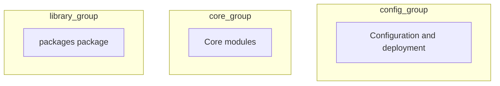

# Architecture report: salesforce/akita

> Automated static analysis. **Observed** = directly seen in files/imports/AST; **Inferred** = interpretation from that evidence. Repository code was not executed.

## 1. Repository at a glance

| Item | Value |
| --- | --- |
| Repository | salesforce/akita |
| Description | 🚀 State Management Tailored-Made for JS Applications |
| Language | TypeScript |
| Stars | 3661 |
| Licence | Apache-2.0 |
| Analysed commit / branch | 9997049301febe22b4e9cdd2a3637bada2356aaf / master |
| Framework(s) | React |
| Files analysed | 378 |
| Components | 3 |

## 2. Architecture in one minute

salesforce/akita - 🚀 State Management Tailored-Made for JS Applications. This repository was analysed statically from 378 file(s) (0 Python). Detected technologies (observed from imports/manifests): GitHub Actions, React, Jest, TypeScript. Files are grouped into 3 component(s): Configuration and deployment, Core modules, packages package. Findings below distinguish observed facts from inferred interpretation.

## 3. High-level block diagram

## 4. Main components

### Configuration and deployment (`config`)

- **Kind:** config
- **Status:** Observed
- **Confidence:** 0.85
- **Responsibility:** Groups 34 file(s) under configuration and deployment (observed from repository paths and static analysis).
- **Paths:** `migrations.json`, `nx.json`, `package.json`, `packages/akita/.eslintrc.json`, `packages/akita/package.json`, `packages/akita/project.json`, `packages/akita/tsconfig.json`, `packages/akita/tsconfig.lib.json`, `packages/akita/tsconfig.spec.json`, `packages/ng-entity-service/.eslintrc.json`, `packages/ng-entity-service/ng-package.json`, `packages/ng-entity-service/package.json`, `packages/ng-entity-service/project.json`, `packages/ng-entity-service/tsconfig.json`, `packages/ng-entity-service/tsconfig.lib.json`, `packages/ng-entity-service/tsconfig.lib.prod.json`, `packages/ng-entity-service/tsconfig.spec.json`, `packages/ng-playground/.eslintrc.json`, `packages/ng-playground/project.json`, `packages/ng-playground/tsconfig.app.json`, `packages/ng-playground/tsconfig.editor.json`, `packages/ng-playground/tsconfig.json`, `packages/ng-playground/tsconfig.spec.json`, `packages/ng-router-store/.eslintrc.json`, `packages/ng-router-store/ng-package.json`, `packages/ng-router-store/package.json`, `packages/ng-router-store/project.json`, `packages/ng-router-store/tsconfig.json`, `packages/ng-router-store/tsconfig.lib.json`, `packages/ng-router-store/tsconfig.lib.prod.json`, `packages/ng-router-store/tsconfig.spec.json`, `tools/tsconfig.tools.json`, `tsconfig.base.json`, `workspace.json`
- **Evidence:** [migrations.json](https://github.com/salesforce/akita/blob/9997049301febe22b4e9cdd2a3637bada2356aaf/migrations.json); [nx.json](https://github.com/salesforce/akita/blob/9997049301febe22b4e9cdd2a3637bada2356aaf/nx.json); [package.json](https://github.com/salesforce/akita/blob/9997049301febe22b4e9cdd2a3637bada2356aaf/package.json); [packages/akita/.eslintrc.json](https://github.com/salesforce/akita/blob/9997049301febe22b4e9cdd2a3637bada2356aaf/packages/akita/.eslintrc.json); [packages/akita/package.json](https://github.com/salesforce/akita/blob/9997049301febe22b4e9cdd2a3637bada2356aaf/packages/akita/package.json); [packages/akita/project.json](https://github.com/salesforce/akita/blob/9997049301febe22b4e9cdd2a3637bada2356aaf/packages/akita/project.json); [packages/akita/tsconfig.json](https://github.com/salesforce/akita/blob/9997049301febe22b4e9cdd2a3637bada2356aaf/packages/akita/tsconfig.json); [packages/akita/tsconfig.lib.json](https://github.com/salesforce/akita/blob/9997049301febe22b4e9cdd2a3637bada2356aaf/packages/akita/tsconfig.lib.json)

### Core modules (`core`)

- **Kind:** core
- **Status:** Observed
- **Confidence:** 0.85
- **Responsibility:** Groups 3 file(s) under core modules (observed from repository paths and static analysis).
- **Paths:** `changelog.config.js`, `jest.config.ts`, `jest.preset.js`
- **Evidence:** [changelog.config.js](https://github.com/salesforce/akita/blob/9997049301febe22b4e9cdd2a3637bada2356aaf/changelog.config.js); [jest.config.ts](https://github.com/salesforce/akita/blob/9997049301febe22b4e9cdd2a3637bada2356aaf/jest.config.ts); [jest.preset.js](https://github.com/salesforce/akita/blob/9997049301febe22b4e9cdd2a3637bada2356aaf/jest.preset.js)

### packages package (`packages`)

- **Kind:** library
- **Status:** Observed
- **Confidence:** 0.85
- **Responsibility:** Groups 236 file(s) under packages package (observed from repository paths and static analysis).
- **Paths:** `packages/akita/jest.config.ts`, `packages/akita/src/__tests__/addEntities.spec.ts`, `packages/akita/src/__tests__/akitaConfig.spec.ts`, `packages/akita/src/__tests__/arrayAdd.spec.ts`, `packages/akita/src/__tests__/arrayFind.spec.ts`, `packages/akita/src/__tests__/arrayRemove.spec.ts`, `packages/akita/src/__tests__/arrayToggle.spec.ts`, `packages/akita/src/__tests__/arrayUpdate.spec.ts`, `packages/akita/src/__tests__/arrayUpsert.spec.ts`, `packages/akita/src/__tests__/booksStore.ts`, `packages/akita/src/__tests__/classBased.spec.ts`, `packages/akita/src/__tests__/customId.spec.ts`, `packages/akita/src/__tests__/deepFreeze.spec.ts`, `packages/akita/src/__tests__/devtools.spec.ts`, `packages/akita/src/__tests__/dirtyCheck.spec.ts`, `packages/akita/src/__tests__/entityActions.spec.ts`, `packages/akita/src/__tests__/entityCollectionPlugin.spec.ts`, `packages/akita/src/__tests__/entityStore.spec.ts`, `packages/akita/src/__tests__/entityUIStore.spec.ts`, `packages/akita/src/__tests__/env.spec.ts`, `packages/akita/src/__tests__/mocks.ts`, `packages/akita/src/__tests__/moveEntity.spec.ts`, `packages/akita/src/__tests__/multiActive.spec.ts`, `packages/akita/src/__tests__/multiProps.spec.ts`, `packages/akita/src/__tests__/pagination.spec.ts`, `packages/akita/src/__tests__/persistState.spec.ts`, `packages/akita/src/__tests__/persistStateAsync.spec.ts`, `packages/akita/src/__tests__/persistStateInclude.spec.ts`, `packages/akita/src/__tests__/persistStateKey.spec.ts`, `packages/akita/src/__tests__/persistStateSelect.spec.ts`, `packages/akita/src/__tests__/persistStateStore.spec.ts`, `packages/akita/src/__tests__/query.spec.ts`, `packages/akita/src/__tests__/queryEntity.spec.ts`, `packages/akita/src/__tests__/queryLastFirst.spec.ts`, `packages/akita/src/__tests__/removeEntities.spec.ts`, `packages/akita/src/__tests__/resetStore.spec.ts`, `packages/akita/src/__tests__/resetStores.spec.ts`, `packages/akita/src/__tests__/runStoreAction.spec.ts`, `packages/akita/src/__tests__/selectMany.spec.ts`, `packages/akita/src/__tests__/setActiveEntities.spec.ts`, `packages/akita/src/__tests__/setEntities.spec.ts`, `packages/akita/src/__tests__/setLoading.spec.ts`, `packages/akita/src/__tests__/setup.ts`, `packages/akita/src/__tests__/snapshotManager.spec.ts`, `packages/akita/src/__tests__/stateHistory.spec.ts`, `packages/akita/src/__tests__/store.spec.ts`, `packages/akita/src/__tests__/storeMiddleware.spec.ts`, `packages/akita/src/__tests__/transaction.spec.ts`, `packages/akita/src/__tests__/update.spec.ts`, `packages/akita/src/__tests__/updateEntities.spec.ts`, `packages/akita/src/__tests__/upsert.spec.ts`, `packages/akita/src/__tests__/utils.spec.ts`, `packages/akita/src/index.ts`, `packages/akita/src/lib/actions.ts`, `packages/akita/src/lib/activeState.ts`, `packages/akita/src/lib/addEntities.ts`, `packages/akita/src/lib/arrayAdd.ts`, `packages/akita/src/lib/arrayFind.ts`, `packages/akita/src/lib/arrayRemove.ts`, `packages/akita/src/lib/arrayToggle.ts`, `packages/akita/src/lib/arrayUpdate.ts`, `packages/akita/src/lib/arrayUpsert.ts`, `packages/akita/src/lib/cacheable.ts`, `packages/akita/src/lib/capitalize.ts`, `packages/akita/src/lib/coerceArray.ts`, `packages/akita/src/lib/combineQueries.ts`, `packages/akita/src/lib/compareKeys.ts`, `packages/akita/src/lib/config.ts`, `packages/akita/src/lib/deepFreeze.ts`, `packages/akita/src/lib/defaultIDKey.ts`, `packages/akita/src/lib/devtools.ts`, `packages/akita/src/lib/dispatchers.ts`, `packages/akita/src/lib/entitiesToArray.ts`, `packages/akita/src/lib/entitiesToMap.ts`, `packages/akita/src/lib/entityActions.ts`, `packages/akita/src/lib/entityService.ts`, `packages/akita/src/lib/entityStore.ts`, `packages/akita/src/lib/env.ts`, `packages/akita/src/lib/errors.ts`, `packages/akita/src/lib/filterNil.ts`, `packages/akita/src/lib/fp.ts`, `packages/akita/src/lib/getActiveEntities.ts`, `packages/akita/src/lib/getEntity.ts`, `packages/akita/src/lib/getInitialEntitiesState.ts`, `packages/akita/src/lib/getValueByString.ts`, `packages/akita/src/lib/guid.ts`, `packages/akita/src/lib/hasEntity.ts`, `packages/akita/src/lib/index.ts`, `packages/akita/src/lib/isArray.ts`, `packages/akita/src/lib/isDefined.ts`, `packages/akita/src/lib/isEmpty.ts`, `packages/akita/src/lib/isFunction.ts`, `packages/akita/src/lib/isNil.ts`, `packages/akita/src/lib/isNumber.ts`, `packages/akita/src/lib/isObject.ts`, `packages/akita/src/lib/isPlainObject.ts`, `packages/akita/src/lib/isString.ts`, `packages/akita/src/lib/isUndefined.ts`, `packages/akita/src/lib/mapSkipUndefined.ts`, `packages/akita/src/lib/not.ts`, `packages/akita/src/lib/persistState.ts`, `packages/akita/src/lib/plugins/dirtyCheck/dirtyCheckPlugin.ts`, `packages/akita/src/lib/plugins/dirtyCheck/entityDirtyCheckPlugin.ts`, `packages/akita/src/lib/plugins/entityCollectionPlugin.ts`, `packages/akita/src/lib/plugins/paginator/paginatorPlugin.ts`, `packages/akita/src/lib/plugins/persistForm/persistNgFormPlugin.ts`, `packages/akita/src/lib/plugins/plugin.ts`, `packages/akita/src/lib/plugins/stateHistory/entityStateHistoryPlugin.ts`, `packages/akita/src/lib/plugins/stateHistory/stateHistoryPlugin.ts`, `packages/akita/src/lib/query.ts`, `packages/akita/src/lib/queryConfig.ts`, `packages/akita/src/lib/queryEntity.ts`, `packages/akita/src/lib/removeEntities.ts`, `packages/akita/src/lib/resetStores.ts`, `packages/akita/src/lib/root.ts`, `packages/akita/src/lib/runStoreAction.ts`, `packages/akita/src/lib/selectAllOverloads.ts`, `packages/akita/src/lib/setEntities.ts`, `packages/akita/src/lib/setLoading.ts`, `packages/akita/src/lib/setLoadingAndError.ts`, `packages/akita/src/lib/setValueByString.ts`, `packages/akita/src/lib/snapshotManager.ts`, `packages/akita/src/lib/sort.ts`, `packages/akita/src/lib/sortByOptions.ts`, `packages/akita/src/lib/store.ts`, `packages/akita/src/lib/storeConfig.ts`, `packages/akita/src/lib/stores.ts`, `packages/akita/src/lib/toBoolean.ts`, `packages/akita/src/lib/toEntitiesIds.ts`, `packages/akita/src/lib/toEntitiesObject.ts`, `packages/akita/src/lib/trackIdChanges.ts`, `packages/akita/src/lib/transaction.ts`, `packages/akita/src/lib/types.ts`, `packages/akita/src/lib/updateEntities.ts`, `packages/ng-entity-service/jest.config.js`, `packages/ng-entity-service/src/index.ts`, `packages/ng-entity-service/src/lib/action-factory.ts`, `packages/ng-entity-service/src/lib/helpers.ts`, `packages/ng-entity-service/src/lib/ng-entity-service-notifier.ts`, `packages/ng-entity-service/src/lib/ng-entity-service.config.ts`, `packages/ng-entity-service/src/lib/ng-entity-service.loader.ts`, `packages/ng-entity-service/src/lib/ng-entity-service.spec.ts`, `packages/ng-entity-service/src/lib/ng-entity.service.ts`, `packages/ng-entity-service/src/lib/setup.ts`, `packages/ng-entity-service/src/lib/types.ts`, `packages/ng-entity-service/src/test-setup.ts`, `packages/ng-playground/jest.config.ts`, `packages/ng-playground/src/app/app-routing.module.ts`, `packages/ng-playground/src/app/app.component.ts`, `packages/ng-playground/src/app/app.module.ts`, `packages/ng-playground/src/app/auth/auth.guard.ts`, `packages/ng-playground/src/app/auth/auth.module.ts`, `packages/ng-playground/src/app/auth/login/login.component.ts`, `packages/ng-playground/src/app/auth/login/login.module.ts`, `packages/ng-playground/src/app/auth/state/auth.query.ts`, `packages/ng-playground/src/app/auth/state/auth.service.ts`, `packages/ng-playground/src/app/auth/state/auth.store.ts`, `packages/ng-playground/src/app/cart/cart.component.ts`, `packages/ng-playground/src/app/cart/cart.module.ts`, `packages/ng-playground/src/app/cart/state/cart.model.ts`, `packages/ng-playground/src/app/cart/state/cart.query.ts`, `packages/ng-playground/src/app/cart/state/cart.service.ts`, `packages/ng-playground/src/app/cart/state/cart.store.ts`, `packages/ng-playground/src/app/contacts/contacts-page/contacts-page.component.ts`, `packages/ng-playground/src/app/contacts/contacts.data.ts`, `packages/ng-playground/src/app/contacts/contacts.module.ts`, `packages/ng-playground/src/app/contacts/state/contact.model.ts`, `packages/ng-playground/src/app/contacts/state/contacts.pagination.ts`, `packages/ng-playground/src/app/contacts/state/contacts.query.ts`, `packages/ng-playground/src/app/contacts/state/contacts.service.ts`, `packages/ng-playground/src/app/contacts/state/contacts.store.ts`, `packages/ng-playground/src/app/movies/actors/state/actor.model.ts`, `packages/ng-playground/src/app/movies/actors/state/actors.query.ts`, `packages/ng-playground/src/app/movies/actors/state/actors.store.ts`, `packages/ng-playground/src/app/movies/genres/state/genre.model.ts`, `packages/ng-playground/src/app/movies/genres/state/genres.query.ts`, `packages/ng-playground/src/app/movies/genres/state/genres.store.ts`, `packages/ng-playground/src/app/movies/movies.module.ts`, `packages/ng-playground/src/app/movies/movies/movies.component.ts`, `packages/ng-playground/src/app/movies/normalized.ts`, `packages/ng-playground/src/app/movies/state/movie.model.ts`, `packages/ng-playground/src/app/movies/state/movies.query.ts`, `packages/ng-playground/src/app/movies/state/movies.service.ts`, `packages/ng-playground/src/app/movies/state/movies.store.ts`, `packages/ng-playground/src/app/nav/nav.component.ts`, `packages/ng-playground/src/app/posts/posts.component.ts`, `packages/ng-playground/src/app/posts/posts.module.ts`, `packages/ng-playground/src/app/posts/state/index.ts`, `packages/ng-playground/src/app/posts/state/post.model.ts`, `packages/ng-playground/src/app/posts/state/posts.query.ts`, `packages/ng-playground/src/app/posts/state/posts.service.ts`, `packages/ng-playground/src/app/posts/state/posts.store.ts`, `packages/ng-playground/src/app/product-page/product-page.component.ts`, `packages/ng-playground/src/app/products/product/product.component.ts`, `packages/ng-playground/src/app/products/products.component.ts`, `packages/ng-playground/src/app/products/products.mocks.ts`, `packages/ng-playground/src/app/products/products.module.ts`, `packages/ng-playground/src/app/products/state/products.model.ts`, `packages/ng-playground/src/app/products/state/products.query.ts`, `packages/ng-playground/src/app/products/state/products.service.ts`, `packages/ng-playground/src/app/products/state/products.store.ts`, `packages/ng-playground/src/app/stories/state/stories.query.ts`, `packages/ng-playground/src/app/stories/state/stories.service.ts`, `packages/ng-playground/src/app/stories/state/stories.store.ts`, `packages/ng-playground/src/app/stories/state/story.model.ts`, `packages/ng-playground/src/app/stories/stories.module.ts`, `packages/ng-playground/src/app/stories/stories/stories.component.ts`, `packages/ng-playground/src/app/todos-app/filter/filter.model.ts`, `packages/ng-playground/src/app/todos-app/filter/todos-filters.component.ts`, `packages/ng-playground/src/app/todos-app/state/todo.model.ts`, `packages/ng-playground/src/app/todos-app/state/todos.query.ts`, `packages/ng-playground/src/app/todos-app/state/todos.service.ts`, `packages/ng-playground/src/app/todos-app/state/todos.store.ts`, `packages/ng-playground/src/app/todos-app/todo/todo.component.ts`, `packages/ng-playground/src/app/todos-app/todos-page/todos-page.component.ts`, `packages/ng-playground/src/app/todos-app/todos.module.ts`, `packages/ng-playground/src/app/todos-app/todos/todos.component.ts`, `packages/ng-playground/src/app/widgets/state/widget.model.ts`, `packages/ng-playground/src/app/widgets/state/widgets.query.ts`, `packages/ng-playground/src/app/widgets/state/widgets.service.ts`, `packages/ng-playground/src/app/widgets/state/widgets.store.ts`, `packages/ng-playground/src/app/widgets/widgets.component.ts`, `packages/ng-playground/src/app/widgets/widgets.module.ts`, `packages/ng-playground/src/environments/environment.prod.ts`, `packages/ng-playground/src/environments/environment.ts`, `packages/ng-playground/src/main.ts`, `packages/ng-playground/src/polyfills.ts`, `packages/ng-playground/src/test-setup.ts`, `packages/ng-router-store/jest.config.ts`, `packages/ng-router-store/src/index.ts`, `packages/ng-router-store/src/lib/router.module.ts`, `packages/ng-router-store/src/lib/router.query.ts`, `packages/ng-router-store/src/lib/router.service.ts`, `packages/ng-router-store/src/lib/router.spec.ts`, `packages/ng-router-store/src/lib/router.store.ts`, `packages/ng-router-store/src/test-setup.ts`
- **Evidence:** [packages/akita/jest.config.ts](https://github.com/salesforce/akita/blob/9997049301febe22b4e9cdd2a3637bada2356aaf/packages/akita/jest.config.ts); [packages/akita/src/__tests__/addEntities.spec.ts](https://github.com/salesforce/akita/blob/9997049301febe22b4e9cdd2a3637bada2356aaf/packages/akita/src/__tests__/addEntities.spec.ts); [packages/akita/src/__tests__/akitaConfig.spec.ts](https://github.com/salesforce/akita/blob/9997049301febe22b4e9cdd2a3637bada2356aaf/packages/akita/src/__tests__/akitaConfig.spec.ts); [packages/akita/src/__tests__/arrayAdd.spec.ts](https://github.com/salesforce/akita/blob/9997049301febe22b4e9cdd2a3637bada2356aaf/packages/akita/src/__tests__/arrayAdd.spec.ts); [packages/akita/src/__tests__/arrayFind.spec.ts](https://github.com/salesforce/akita/blob/9997049301febe22b4e9cdd2a3637bada2356aaf/packages/akita/src/__tests__/arrayFind.spec.ts); [packages/akita/src/__tests__/arrayRemove.spec.ts](https://github.com/salesforce/akita/blob/9997049301febe22b4e9cdd2a3637bada2356aaf/packages/akita/src/__tests__/arrayRemove.spec.ts); [packages/akita/src/__tests__/arrayToggle.spec.ts](https://github.com/salesforce/akita/blob/9997049301febe22b4e9cdd2a3637bada2356aaf/packages/akita/src/__tests__/arrayToggle.spec.ts); [packages/akita/src/__tests__/arrayUpdate.spec.ts](https://github.com/salesforce/akita/blob/9997049301febe22b4e9cdd2a3637bada2356aaf/packages/akita/src/__tests__/arrayUpdate.spec.ts)

## 5. Execution flow

**Observed** entry point(s):

- [packages/akita/src/index.ts](https://github.com/salesforce/akita/blob/9997049301febe22b4e9cdd2a3637bada2356aaf/packages/akita/src/index.ts)
- [packages/ng-entity-service/src/index.ts](https://github.com/salesforce/akita/blob/9997049301febe22b4e9cdd2a3637bada2356aaf/packages/ng-entity-service/src/index.ts)
- [packages/ng-playground/src/main.ts](https://github.com/salesforce/akita/blob/9997049301febe22b4e9cdd2a3637bada2356aaf/packages/ng-playground/src/main.ts)
- [packages/ng-router-store/src/index.ts](https://github.com/salesforce/akita/blob/9997049301febe22b4e9cdd2a3637bada2356aaf/packages/ng-router-store/src/index.ts)

Representative flow (derived from observed entry points and the import graph; steps beyond the entry point are **Inferred**):

1. Execution starts at an observed entry point listed above, if present.
2. No internal import relationships between components were observed.

## 6. Project structure

### `(root)`

- `.commitlintrc.json` - config (63 bytes)
- `.editorconfig` - config (245 bytes)
- `.eslintrc.json` - config (753 bytes)
- `.gitattributes` - other (254 bytes)
- `.gitignore` - other (554 bytes)
- `.prettierignore` - other (90 bytes)
- `.prettierrc` - other (47 bytes)
- `BREAKING_CHANGES.md` - docs (6789 bytes)
- `CODEOWNERS` - other (140 bytes)
- `CODE_OF_CONDUCT.md` - docs (3218 bytes)
- `CONTRIBUTING-ARCHIVED.md` - docs (131 bytes)
- `CONTRIBUTING.md` - docs (3152 bytes)
- `LICENSE` - docs (11342 bytes)
- `README.md` - docs (2482 bytes)
- `SECURITY.md` - docs (401 bytes)
- `changelog.config.js` - source, JavaScript (1568 bytes)
- `jest.config.ts` - source, TypeScript (103 bytes)
- `jest.preset.js` - source, JavaScript (90 bytes)
- `migrations.json` - config (5098 bytes)
- `nx.json` - config (1016 bytes)
- `package.json` - manifest (2630 bytes)
- `tsconfig.base.json` - config (824 bytes)
- `workspace.json` - config (223 bytes)

### `.github`

- `.github/ISSUE_TEMPLATE/1-bug-report.yaml` - config (1049 bytes)
- `.github/ISSUE_TEMPLATE/2-feature-request.yaml` - config (663 bytes)
- `.github/ISSUE_TEMPLATE/3-support-request.md` - docs (298 bytes)
- `.github/PULL_REQUEST_TEMPLATE.md` - docs (1111 bytes)
- `.github/workflows/ci.yml` - ci, YAML (849 bytes)
- `.github/workflows/deploy-sample-app.yml` - ci, YAML (610 bytes)
- `.github/workflows/docs.yml` - ci, YAML (1161 bytes)

### `.husky`

- `.husky/.gitignore` - other (2 bytes)
- `.husky/commit-msg` - other (80 bytes)

### `.vscode`

- `.vscode/extensions.json` - config (78 bytes)
- `.vscode/settings.json` - config (275 bytes)

### `docs`

- `docs/.gitignore` - docs (233 bytes)
- `docs/README.md` - docs (721 bytes)
- `docs/docs/additional/array.mdx` - docs (4082 bytes)
- `docs/docs/additional/cache.mdx` - docs (2283 bytes)
- `docs/docs/additional/class.mdx` - docs (1595 bytes)
- `docs/docs/additional/events.mdx` - docs (1933 bytes)
- `docs/docs/additional/js.mdx` - docs (959 bytes)
- `docs/docs/additional/middleware.mdx` - docs (2069 bytes)
- `docs/docs/additional/notifications.mdx` - docs (2324 bytes)
- `docs/docs/additional/operators.mdx` - docs (663 bytes)
- `docs/docs/additional/optimstic-updates.mdx` - docs (1403 bytes)
- `docs/docs/additional/reset.mdx` - docs (926 bytes)
- `docs/docs/angular/architecture.mdx` - docs (10434 bytes)
- `docs/docs/angular/effects.mdx` - docs (3359 bytes)
- `docs/docs/angular/entity-service.mdx` - docs (7286 bytes)
- `docs/docs/angular/hmr.mdx` - docs (234 bytes)
- `docs/docs/angular/local-state.mdx` - docs (3225 bytes)
- `docs/docs/angular/router.mdx` - docs (5836 bytes)
- `docs/docs/angular/tests.mdx` - docs (5848 bytes)
- `docs/docs/best-practices.mdx` - docs (3259 bytes)
- `docs/docs/config.mdx` - docs (1799 bytes)
- `docs/docs/enhancers/cli.mdx` - docs (1024 bytes)
- `docs/docs/enhancers/devtools.mdx` - docs (2122 bytes)
- `docs/docs/enhancers/persist-state.mdx` - docs (6915 bytes)
- `docs/docs/enhancers/snapshot.mdx` - docs (1642 bytes)
- `docs/docs/entities/active.mdx` - docs (3393 bytes)
- `docs/docs/entities/entity-store.mdx` - docs (6347 bytes)
- `docs/docs/entities/query-entity.mdx` - docs (3988 bytes)
- `docs/docs/entities/sorting.mdx` - docs (1366 bytes)
- `docs/docs/immer.mdx` - docs (1556 bytes)
- `docs/docs/installation.mdx` - docs (216 bytes)
- `docs/docs/plugins/dirty-check.mdx` - docs (5438 bytes)
- `docs/docs/plugins/pagination.mdx` - docs (8451 bytes)
- `docs/docs/plugins/state-history.mdx` - docs (4455 bytes)
- `docs/docs/query.mdx` - docs (2570 bytes)
- `docs/docs/store.mdx` - docs (2552 bytes)
- `docs/docs/transactions.mdx` - docs (4158 bytes)
- `docs/docs/ui.mdx` - docs (3961 bytes)
- `docs/docusaurus.config.js` - docs (3056 bytes)
- `docs/package.json` - manifest (765 bytes)
- `docs/sidebars.js` - docs (3009 bytes)
- `docs/src/components/architecture-svg.js` - docs (93860 bytes)
- `docs/src/components/highlight.js` - docs (308 bytes)
- `docs/src/css/custom.css` - docs (25761 bytes)
- `docs/src/pages/index.js` - docs (2750 bytes)
- `docs/src/pages/sample-app.js` - docs (833 bytes)
- `docs/src/pages/styles.module.css` - docs (718 bytes)
- `docs/static/.nojekyll` - docs (0 bytes)
- `docs/static/img/akita.svg` - docs (9923 bytes)

### `packages`

- `packages/.gitkeep` - other (0 bytes)
- `packages/akita/.babelrc` - other (67 bytes)
- `packages/akita/.eslintrc.json` - config (306 bytes)
- `packages/akita/CHANGELOG.md` - docs (1329 bytes)
- `packages/akita/README.md` - docs (2423 bytes)
- `packages/akita/jest.config.ts` - source, TypeScript (391 bytes)
- `packages/akita/package.json` - manifest (733 bytes)
- `packages/akita/project.json` - config (928 bytes)
- `packages/akita/src/__tests__/addEntities.spec.ts` - source, TypeScript (2195 bytes)
- `packages/akita/src/__tests__/akitaConfig.spec.ts` - source, TypeScript (1385 bytes)
- `packages/akita/src/__tests__/arrayAdd.spec.ts` - source, TypeScript (2536 bytes)
- `packages/akita/src/__tests__/arrayFind.spec.ts` - source, TypeScript (8784 bytes)
- `packages/akita/src/__tests__/arrayRemove.spec.ts` - source, TypeScript (4426 bytes)
- `packages/akita/src/__tests__/arrayToggle.spec.ts` - source, TypeScript (1591 bytes)
- `packages/akita/src/__tests__/arrayUpdate.spec.ts` - source, TypeScript (3775 bytes)
- `packages/akita/src/__tests__/arrayUpsert.spec.ts` - source, TypeScript (2121 bytes)
- `packages/akita/src/__tests__/booksStore.ts` - source, TypeScript (421 bytes)
- `packages/akita/src/__tests__/classBased.spec.ts` - source, TypeScript (1227 bytes)
- `packages/akita/src/__tests__/customId.spec.ts` - source, TypeScript (960 bytes)
- `packages/akita/src/__tests__/deepFreeze.spec.ts` - source, TypeScript (2375 bytes)
- `packages/akita/src/__tests__/devtools.spec.ts` - source, TypeScript (6810 bytes)
- `packages/akita/src/__tests__/dirtyCheck.spec.ts` - source, TypeScript (23028 bytes)
- `packages/akita/src/__tests__/entityActions.spec.ts` - source, TypeScript (2735 bytes)
- `packages/akita/src/__tests__/entityCollectionPlugin.spec.ts` - source, TypeScript (5622 bytes)
- `packages/akita/src/__tests__/entityStore.spec.ts` - source, TypeScript (17487 bytes)
- `packages/akita/src/__tests__/entityUIStore.spec.ts` - source, TypeScript (4094 bytes)
- `packages/akita/src/__tests__/env.spec.ts` - source, TypeScript (740 bytes)
- `packages/akita/src/__tests__/mocks.ts` - source, TypeScript (437 bytes)
- `packages/akita/src/__tests__/moveEntity.spec.ts` - source, TypeScript (1049 bytes)
- `packages/akita/src/__tests__/multiActive.spec.ts` - source, TypeScript (4515 bytes)
- `packages/akita/src/__tests__/multiProps.spec.ts` - source, TypeScript (1897 bytes)
- `packages/akita/src/__tests__/pagination.spec.ts` - source, TypeScript (12246 bytes)
- `packages/akita/src/__tests__/persistState.spec.ts` - source, TypeScript (4468 bytes)
- `packages/akita/src/__tests__/persistStateAsync.spec.ts` - source, TypeScript (1465 bytes)
- `packages/akita/src/__tests__/persistStateInclude.spec.ts` - source, TypeScript (1720 bytes)
- `packages/akita/src/__tests__/persistStateKey.spec.ts` - source, TypeScript (2418 bytes)
- `packages/akita/src/__tests__/persistStateSelect.spec.ts` - source, TypeScript (1849 bytes)
- `packages/akita/src/__tests__/persistStateStore.spec.ts` - source, TypeScript (1033 bytes)
- `packages/akita/src/__tests__/query.spec.ts` - source, TypeScript (1350 bytes)
- `packages/akita/src/__tests__/queryEntity.spec.ts` - source, TypeScript (33968 bytes)
- `packages/akita/src/__tests__/queryLastFirst.spec.ts` - source, TypeScript (3797 bytes)
- `packages/akita/src/__tests__/removeEntities.spec.ts` - source, TypeScript (2635 bytes)
- `packages/akita/src/__tests__/resetStore.spec.ts` - source, TypeScript (1455 bytes)
- `packages/akita/src/__tests__/resetStores.spec.ts` - source, TypeScript (2614 bytes)
- `packages/akita/src/__tests__/runStoreAction.spec.ts` - source, TypeScript (7177 bytes)
- `packages/akita/src/__tests__/selectMany.spec.ts` - source, TypeScript (916 bytes)
- `packages/akita/src/__tests__/setActiveEntities.spec.ts` - source, TypeScript (4400 bytes)
- `packages/akita/src/__tests__/setEntities.spec.ts` - source, TypeScript (3302 bytes)
- `packages/akita/src/__tests__/setLoading.spec.ts` - source, TypeScript (1214 bytes)
- `packages/akita/src/__tests__/setup.ts` - source, TypeScript (2119 bytes)
- `packages/akita/src/__tests__/snapshotManager.spec.ts` - source, TypeScript (2122 bytes)
- `packages/akita/src/__tests__/stateHistory.spec.ts` - source, TypeScript (15602 bytes)
- `packages/akita/src/__tests__/store.spec.ts` - source, TypeScript (4123 bytes)
- `packages/akita/src/__tests__/storeMiddleware.spec.ts` - source, TypeScript (2654 bytes)
- `packages/akita/src/__tests__/transaction.spec.ts` - source, TypeScript (2079 bytes)
- `packages/akita/src/__tests__/update.spec.ts` - source, TypeScript (4737 bytes)
- `packages/akita/src/__tests__/updateEntities.spec.ts` - source, TypeScript (3930 bytes)
- `packages/akita/src/__tests__/upsert.spec.ts` - source, TypeScript (4886 bytes)
- `packages/akita/src/__tests__/utils.spec.ts` - source, TypeScript (446 bytes)
- `packages/akita/src/index.ts` - source, TypeScript (29 bytes)
- `packages/akita/src/lib/actions.ts` - source, TypeScript (1229 bytes)
- `packages/akita/src/lib/activeState.ts` - source, TypeScript (1079 bytes)
- `packages/akita/src/lib/addEntities.ts` - source, TypeScript (1284 bytes)
- `packages/akita/src/lib/arrayAdd.ts` - source, TypeScript (580 bytes)
- `packages/akita/src/lib/arrayFind.ts` - source, TypeScript (3129 bytes)
- `packages/akita/src/lib/arrayRemove.ts` - source, TypeScript (908 bytes)
- `packages/akita/src/lib/arrayToggle.ts` - source, TypeScript (1038 bytes)
- `packages/akita/src/lib/arrayUpdate.ts` - source, TypeScript (1113 bytes)
- `packages/akita/src/lib/arrayUpsert.ts` - source, TypeScript (798 bytes)
- `packages/akita/src/lib/cacheable.ts` - source, TypeScript (715 bytes)
- `packages/akita/src/lib/capitalize.ts` - source, TypeScript (125 bytes)
- `packages/akita/src/lib/coerceArray.ts` - source, TypeScript (193 bytes)
- `packages/akita/src/lib/combineQueries.ts` - source, TypeScript (400 bytes)
- `packages/akita/src/lib/compareKeys.ts` - source, TypeScript (445 bytes)
- `packages/akita/src/lib/config.ts` - source, TypeScript (507 bytes)
- `packages/akita/src/lib/deepFreeze.ts` - source, TypeScript (555 bytes)
- `packages/akita/src/lib/defaultIDKey.ts` - source, TypeScript (36 bytes)
- `packages/akita/src/lib/devtools.ts` - source, TypeScript (4642 bytes)
- `packages/akita/src/lib/dispatchers.ts` - source, TypeScript (688 bytes)
- `packages/akita/src/lib/entitiesToArray.ts` - source, TypeScript (999 bytes)
- `packages/akita/src/lib/entitiesToMap.ts` - source, TypeScript (1179 bytes)
- `packages/akita/src/lib/entityActions.ts` - source, TypeScript (185 bytes)
- `packages/akita/src/lib/entityService.ts` - source, TypeScript (486 bytes)
- `packages/akita/src/lib/entityStore.ts` - source, TypeScript (19610 bytes)
- `packages/akita/src/lib/env.ts` - source, TypeScript (284 bytes)
- `packages/akita/src/lib/errors.ts` - source, TypeScript (289 bytes)
- `packages/akita/src/lib/filterNil.ts` - source, TypeScript (637 bytes)
- `packages/akita/src/lib/fp.ts` - source, TypeScript (918 bytes)
- `packages/akita/src/lib/getActiveEntities.ts` - source, TypeScript (1308 bytes)
- `packages/akita/src/lib/getEntity.ts` - source, TypeScript (731 bytes)
- `packages/akita/src/lib/getInitialEntitiesState.ts` - source, TypeScript (190 bytes)
- `packages/akita/src/lib/getValueByString.ts` - source, TypeScript (394 bytes)
- `packages/akita/src/lib/guid.ts` - source, TypeScript (224 bytes)
- `packages/akita/src/lib/hasEntity.ts` - source, TypeScript (162 bytes)
- `packages/akita/src/lib/index.ts` - source, TypeScript (4840 bytes)
- `packages/akita/src/lib/isArray.ts` - source, TypeScript (101 bytes)
- `packages/akita/src/lib/isDefined.ts` - source, TypeScript (118 bytes)
- `packages/akita/src/lib/isEmpty.ts` - source, TypeScript (161 bytes)
- `packages/akita/src/lib/isFunction.ts` - source, TypeScript (113 bytes)
- `packages/akita/src/lib/isNil.ts` - source, TypeScript (82 bytes)
- `packages/akita/src/lib/isNumber.ts` - source, TypeScript (173 bytes)
- `packages/akita/src/lib/isObject.ts` - source, TypeScript (151 bytes)
- `packages/akita/src/lib/isPlainObject.ts` - source, TypeScript (162 bytes)
- `packages/akita/src/lib/isString.ts` - source, TypeScript (107 bytes)
- `packages/akita/src/lib/isUndefined.ts` - source, TypeScript (107 bytes)
- `packages/akita/src/lib/mapSkipUndefined.ts` - source, TypeScript (314 bytes)
- `packages/akita/src/lib/not.ts` - source, TypeScript (124 bytes)
- `packages/akita/src/lib/persistState.ts` - source, TypeScript (8333 bytes)
- `packages/akita/src/lib/plugins/dirtyCheck/dirtyCheckPlugin.ts` - source, TypeScript (5249 bytes)
- `packages/akita/src/lib/plugins/dirtyCheck/entityDirtyCheckPlugin.ts` - source, TypeScript (3660 bytes)
- `packages/akita/src/lib/plugins/entityCollectionPlugin.ts` - source, TypeScript (5498 bytes)
- `packages/akita/src/lib/plugins/paginator/paginatorPlugin.ts` - source, TypeScript (8055 bytes)
- `packages/akita/src/lib/plugins/persistForm/persistNgFormPlugin.ts` - source, TypeScript (4829 bytes)
- `packages/akita/src/lib/plugins/plugin.ts` - source, TypeScript (3314 bytes)
- `packages/akita/src/lib/plugins/stateHistory/entityStateHistoryPlugin.ts` - source, TypeScript (2173 bytes)
- `packages/akita/src/lib/plugins/stateHistory/stateHistoryPlugin.ts` - source, TypeScript (6713 bytes)
- `packages/akita/src/lib/query.ts` - source, TypeScript (3339 bytes)
- `packages/akita/src/lib/queryConfig.ts` - source, TypeScript (640 bytes)
- `packages/akita/src/lib/queryEntity.ts` - source, TypeScript (12501 bytes)
- `packages/akita/src/lib/removeEntities.ts` - source, TypeScript (1089 bytes)
- `packages/akita/src/lib/resetStores.ts` - source, TypeScript (779 bytes)
- `packages/akita/src/lib/root.ts` - source, TypeScript (497 bytes)
- `packages/akita/src/lib/runStoreAction.ts` - source, TypeScript (9288 bytes)
- `packages/akita/src/lib/selectAllOverloads.ts` - source, TypeScript (783 bytes)
- `packages/akita/src/lib/setEntities.ts` - source, TypeScript (1844 bytes)
- `packages/akita/src/lib/setLoading.ts` - source, TypeScript (371 bytes)
- `packages/akita/src/lib/setLoadingAndError.ts` - source, TypeScript (575 bytes)
- `packages/akita/src/lib/setValueByString.ts` - source, TypeScript (733 bytes)
- `packages/akita/src/lib/snapshotManager.ts` - source, TypeScript (1887 bytes)
- `packages/akita/src/lib/sort.ts` - source, TypeScript (592 bytes)
- `packages/akita/src/lib/sortByOptions.ts` - source, TypeScript (207 bytes)
- `packages/akita/src/lib/store.ts` - source, TypeScript (8201 bytes)
- `packages/akita/src/lib/storeConfig.ts` - source, TypeScript (848 bytes)
- `packages/akita/src/lib/stores.ts` - source, TypeScript (369 bytes)
- `packages/akita/src/lib/toBoolean.ts` - source, TypeScript (114 bytes)
- `packages/akita/src/lib/toEntitiesIds.ts` - source, TypeScript (239 bytes)
- `packages/akita/src/lib/toEntitiesObject.ts` - source, TypeScript (441 bytes)
- `packages/akita/src/lib/trackIdChanges.ts` - source, TypeScript (2299 bytes)
- `packages/akita/src/lib/transaction.ts` - source, TypeScript (2940 bytes)
- `packages/akita/src/lib/types.ts` - source, TypeScript (2461 bytes)
- `packages/akita/src/lib/updateEntities.ts` - source, TypeScript (2794 bytes)
- `packages/akita/tsconfig.json` - config (309 bytes)
- `packages/akita/tsconfig.lib.json` - config (240 bytes)
- `packages/akita/tsconfig.spec.json` - config (245 bytes)
- `packages/ng-entity-service/.eslintrc.json` - config (801 bytes)
- `packages/ng-entity-service/CHANGELOG.md` - docs (528 bytes)
- `packages/ng-entity-service/README.md` - docs (158 bytes)
- `packages/ng-entity-service/jest.config.js` - source, JavaScript (694 bytes)
- `packages/ng-entity-service/ng-package.json` - config (171 bytes)
- `packages/ng-entity-service/package.json` - manifest (639 bytes)
- `packages/ng-entity-service/project.json` - config (1236 bytes)
- `packages/ng-entity-service/src/index.ts` - source, TypeScript (285 bytes)
- `packages/ng-entity-service/src/lib/action-factory.ts` - source, TypeScript (743 bytes)
- `packages/ng-entity-service/src/lib/helpers.ts` - source, TypeScript (152 bytes)
- `packages/ng-entity-service/src/lib/ng-entity-service-notifier.ts` - source, TypeScript (1030 bytes)
- `packages/ng-entity-service/src/lib/ng-entity-service.config.ts` - source, TypeScript (1524 bytes)
- `packages/ng-entity-service/src/lib/ng-entity-service.loader.ts` - source, TypeScript (1756 bytes)
- `packages/ng-entity-service/src/lib/ng-entity-service.spec.ts` - source, TypeScript (60199 bytes)
- `packages/ng-entity-service/src/lib/ng-entity.service.ts` - source, TypeScript (10470 bytes)
- `packages/ng-entity-service/src/lib/setup.ts` - source, TypeScript (1902 bytes)
- `packages/ng-entity-service/src/lib/types.ts` - source, TypeScript (1519 bytes)
- `packages/ng-entity-service/src/test-setup.ts` - source, TypeScript (41 bytes)
- `packages/ng-entity-service/tsconfig.json` - config (505 bytes)
- `packages/ng-entity-service/tsconfig.lib.json` - config (289 bytes)
- `packages/ng-entity-service/tsconfig.lib.prod.json` - config (163 bytes)
- `packages/ng-entity-service/tsconfig.spec.json` - config (249 bytes)
- `packages/ng-playground/.eslintrc.json` - config (801 bytes)
- `packages/ng-playground/jest.config.ts` - source, TypeScript (688 bytes)
- `packages/ng-playground/project.json` - config (2735 bytes)
- `packages/ng-playground/src/app/app-routing.module.ts` - source, TypeScript (1645 bytes)
- `packages/ng-playground/src/app/app.component.html` - other (339 bytes)
- `packages/ng-playground/src/app/app.component.ts` - source, TypeScript (293 bytes)
- `packages/ng-playground/src/app/app.module.ts` - source, TypeScript (2005 bytes)
- `packages/ng-playground/src/app/auth/auth.guard.ts` - source, TypeScript (954 bytes)
- `packages/ng-playground/src/app/auth/auth.module.ts` - source, TypeScript (164 bytes)
- `packages/ng-playground/src/app/auth/login/login.component.html` - other (812 bytes)
- `packages/ng-playground/src/app/auth/login/login.component.ts` - source, TypeScript (736 bytes)
- `packages/ng-playground/src/app/auth/login/login.module.ts` - source, TypeScript (321 bytes)
- `packages/ng-playground/src/app/auth/state/auth.query.ts` - source, TypeScript (345 bytes)
- `packages/ng-playground/src/app/auth/state/auth.service.ts` - source, TypeScript (655 bytes)
- `packages/ng-playground/src/app/auth/state/auth.store.ts` - source, TypeScript (533 bytes)
- `packages/ng-playground/src/app/cart/cart.component.html` - other (998 bytes)
- `packages/ng-playground/src/app/cart/cart.component.ts` - source, TypeScript (854 bytes)
- `packages/ng-playground/src/app/cart/cart.module.ts` - source, TypeScript (298 bytes)
- `packages/ng-playground/src/app/cart/state/cart.model.ts` - source, TypeScript (293 bytes)
- `packages/ng-playground/src/app/cart/state/cart.query.ts` - source, TypeScript (995 bytes)
- `packages/ng-playground/src/app/cart/state/cart.service.ts` - source, TypeScript (1073 bytes)
- `packages/ng-playground/src/app/cart/state/cart.store.ts` - source, TypeScript (703 bytes)
- `packages/ng-playground/src/app/contacts/contacts-page/contacts-page.component.css` - other (24 bytes)
- `packages/ng-playground/src/app/contacts/contacts-page/contacts-page.component.html` - other (2455 bytes)
- `packages/ng-playground/src/app/contacts/contacts-page/contacts-page.component.ts` - source, TypeScript (2715 bytes)
- `packages/ng-playground/src/app/contacts/contacts.data.ts` - source, TypeScript (980 bytes)
- `packages/ng-playground/src/app/contacts/contacts.module.ts` - source, TypeScript (552 bytes)
- `packages/ng-playground/src/app/contacts/state/contact.model.ts` - source, TypeScript (79 bytes)
- `packages/ng-playground/src/app/contacts/state/contacts.pagination.ts` - source, TypeScript (417 bytes)
- `packages/ng-playground/src/app/contacts/state/contacts.query.ts` - source, TypeScript (327 bytes)
- `packages/ng-playground/src/app/contacts/state/contacts.service.ts` - source, TypeScript (391 bytes)
- `packages/ng-playground/src/app/contacts/state/contacts.store.ts` - source, TypeScript (395 bytes)
- `packages/ng-playground/src/app/movies/actors/state/actor.model.ts` - source, TypeScript (90 bytes)
- `packages/ng-playground/src/app/movies/actors/state/actors.query.ts` - source, TypeScript (317 bytes)
- `packages/ng-playground/src/app/movies/actors/state/actors.store.ts` - source, TypeScript (383 bytes)
- `packages/ng-playground/src/app/movies/genres/state/genre.model.ts` - source, TypeScript (90 bytes)
- `packages/ng-playground/src/app/movies/genres/state/genres.query.ts` - source, TypeScript (317 bytes)
- `packages/ng-playground/src/app/movies/genres/state/genres.store.ts` - source, TypeScript (383 bytes)
- `packages/ng-playground/src/app/movies/movies.module.ts` - source, TypeScript (430 bytes)
- `packages/ng-playground/src/app/movies/movies/movies.component.css` - other (48 bytes)
- `packages/ng-playground/src/app/movies/movies/movies.component.html` - other (1282 bytes)
- `packages/ng-playground/src/app/movies/movies/movies.component.ts` - source, TypeScript (1697 bytes)
- `packages/ng-playground/src/app/movies/normalized.ts` - source, TypeScript (1383 bytes)
- `packages/ng-playground/src/app/movies/state/movie.model.ts` - source, TypeScript (326 bytes)
- `packages/ng-playground/src/app/movies/state/movies.query.ts` - source, TypeScript (1113 bytes)
- `packages/ng-playground/src/app/movies/state/movies.service.ts` - source, TypeScript (1468 bytes)
- `packages/ng-playground/src/app/movies/state/movies.store.ts` - source, TypeScript (623 bytes)
- `packages/ng-playground/src/app/nav/nav.component.ts` - source, TypeScript (1655 bytes)
- `packages/ng-playground/src/app/posts/posts.component.html` - other (1432 bytes)
- `packages/ng-playground/src/app/posts/posts.component.ts` - source, TypeScript (1658 bytes)
- `packages/ng-playground/src/app/posts/posts.css` - other (0 bytes)
- `packages/ng-playground/src/app/posts/posts.module.ts` - source, TypeScript (418 bytes)
- `packages/ng-playground/src/app/posts/state/index.ts` - source, TypeScript (125 bytes)
- `packages/ng-playground/src/app/posts/state/post.model.ts` - source, TypeScript (73 bytes)
- `packages/ng-playground/src/app/posts/state/posts.query.ts` - source, TypeScript (313 bytes)
- `packages/ng-playground/src/app/posts/state/posts.service.ts` - source, TypeScript (339 bytes)
- `packages/ng-playground/src/app/posts/state/posts.store.ts` - source, TypeScript (387 bytes)
- `packages/ng-playground/src/app/product-page/product-page.component.ts` - source, TypeScript (1218 bytes)
- `packages/ng-playground/src/app/products/product/product.component.html` - other (749 bytes)
- `packages/ng-playground/src/app/products/product/product.component.ts` - source, TypeScript (447 bytes)
- `packages/ng-playground/src/app/products/products.component.html` - other (1110 bytes)
- `packages/ng-playground/src/app/products/products.component.ts` - source, TypeScript (1356 bytes)
- `packages/ng-playground/src/app/products/products.mocks.ts` - source, TypeScript (608 bytes)
- `packages/ng-playground/src/app/products/products.module.ts` - source, TypeScript (535 bytes)
- `packages/ng-playground/src/app/products/state/products.model.ts` - source, TypeScript (133 bytes)
- `packages/ng-playground/src/app/products/state/products.query.ts` - source, TypeScript (596 bytes)
- `packages/ng-playground/src/app/products/state/products.service.ts` - source, TypeScript (784 bytes)
- `packages/ng-playground/src/app/products/state/products.store.ts` - source, TypeScript (448 bytes)
- `packages/ng-playground/src/app/stories/state/stories.query.ts` - source, TypeScript (325 bytes)
- `packages/ng-playground/src/app/stories/state/stories.service.ts` - source, TypeScript (510 bytes)
- `packages/ng-playground/src/app/stories/state/stories.store.ts` - source, TypeScript (727 bytes)
- `packages/ng-playground/src/app/stories/state/story.model.ts` - source, TypeScript (224 bytes)
- `packages/ng-playground/src/app/stories/stories.module.ts` - source, TypeScript (507 bytes)
- `packages/ng-playground/src/app/stories/stories/stories.component.css` - other (0 bytes)
- `packages/ng-playground/src/app/stories/stories/stories.component.html` - other (2600 bytes)
- `packages/ng-playground/src/app/stories/stories/stories.component.ts` - source, TypeScript (2351 bytes)
- `packages/ng-playground/src/app/todos-app/filter/filter.model.ts` - source, TypeScript (436 bytes)
- `packages/ng-playground/src/app/todos-app/filter/todos-filters.component.ts` - source, TypeScript (1260 bytes)
- `packages/ng-playground/src/app/todos-app/state/todo.model.ts` - source, TypeScript (244 bytes)
- `packages/ng-playground/src/app/todos-app/state/todos.query.ts` - source, TypeScript (1079 bytes)
- `packages/ng-playground/src/app/todos-app/state/todos.service.ts` - source, TypeScript (972 bytes)
- `packages/ng-playground/src/app/todos-app/state/todos.store.ts` - source, TypeScript (563 bytes)
- `packages/ng-playground/src/app/todos-app/todo/todo.component.html` - other (347 bytes)
- `packages/ng-playground/src/app/todos-app/todo/todo.component.ts` - source, TypeScript (951 bytes)
- `packages/ng-playground/src/app/todos-app/todos-page/todos-page.component.css` - other (0 bytes)
- `packages/ng-playground/src/app/todos-app/todos-page/todos-page.component.html` - other (2306 bytes)
- `packages/ng-playground/src/app/todos-app/todos-page/todos-page.component.ts` - source, TypeScript (2297 bytes)
- `packages/ng-playground/src/app/todos-app/todos.module.ts` - source, TypeScript (810 bytes)
- `packages/ng-playground/src/app/todos-app/todos/todos.component.ts` - source, TypeScript (772 bytes)
- `packages/ng-playground/src/app/widgets/state/widget.model.ts` - source, TypeScript (273 bytes)
- `packages/ng-playground/src/app/widgets/state/widgets.query.ts` - source, TypeScript (323 bytes)
- `packages/ng-playground/src/app/widgets/state/widgets.service.ts` - source, TypeScript (943 bytes)
- `packages/ng-playground/src/app/widgets/state/widgets.store.ts` - source, TypeScript (514 bytes)
- `packages/ng-playground/src/app/widgets/widgets.component.html` - other (2808 bytes)
- `packages/ng-playground/src/app/widgets/widgets.component.ts` - source, TypeScript (2014 bytes)
- `packages/ng-playground/src/app/widgets/widgets.module.ts` - source, TypeScript (424 bytes)
- `packages/ng-playground/src/assets/.gitkeep` - other (0 bytes)
- `packages/ng-playground/src/assets/akita.svg` - other (9923 bytes)
- `packages/ng-playground/src/environments/environment.prod.ts` - source, TypeScript (52 bytes)
- `packages/ng-playground/src/environments/environment.ts` - source, TypeScript (659 bytes)
- `packages/ng-playground/src/index.html` - other (653 bytes)
- `packages/ng-playground/src/main.ts` - source, TypeScript (377 bytes)
- `packages/ng-playground/src/polyfills.ts` - source, TypeScript (2336 bytes)
- `packages/ng-playground/src/styles.scss` - other (1110 bytes)
- `packages/ng-playground/src/test-setup.ts` - source, TypeScript (41 bytes)
- `packages/ng-playground/tsconfig.app.json` - config (322 bytes)
- `packages/ng-playground/tsconfig.editor.json` - config (119 bytes)
- `packages/ng-playground/tsconfig.json` - config (249 bytes)
- `packages/ng-playground/tsconfig.spec.json` - config (267 bytes)
- `packages/ng-router-store/.eslintrc.json` - config (801 bytes)
- `packages/ng-router-store/CHANGELOG.md` - docs (524 bytes)
- `packages/ng-router-store/README.md` - docs (154 bytes)
- `packages/ng-router-store/jest.config.ts` - source, TypeScript (692 bytes)
- `packages/ng-router-store/ng-package.json` - config (169 bytes)
- `packages/ng-router-store/package.json` - manifest (745 bytes)
- `packages/ng-router-store/project.json` - config (1199 bytes)
- `packages/ng-router-store/src/index.ts` - source, TypeScript (147 bytes)
- `packages/ng-router-store/src/lib/router.module.ts` - source, TypeScript (236 bytes)
- `packages/ng-router-store/src/lib/router.query.ts` - source, TypeScript (3971 bytes)
- `packages/ng-router-store/src/lib/router.service.ts` - source, TypeScript (3357 bytes)
- `packages/ng-router-store/src/lib/router.spec.ts` - source, TypeScript (5398 bytes)
- `packages/ng-router-store/src/lib/router.store.ts` - source, TypeScript (730 bytes)
- `packages/ng-router-store/src/test-setup.ts` - source, TypeScript (41 bytes)
- `packages/ng-router-store/tsconfig.json` - config (530 bytes)
- `packages/ng-router-store/tsconfig.lib.json` - config (369 bytes)
- `packages/ng-router-store/tsconfig.lib.prod.json` - config (258 bytes)
- `packages/ng-router-store/tsconfig.spec.json` - config (370 bytes)

### `tools`

- `tools/generators/.gitkeep` - other (0 bytes)
- `tools/tsconfig.tools.json` - config (251 bytes)

## 7. Key dependencies and integrations

| Name | Category | Status | Confidence | Evidence |
| --- | --- | --- | --- | --- |
| GitHub Actions | ci | Observed | 0.90 | [.github/workflows/ci.yml](https://github.com/salesforce/akita/blob/9997049301febe22b4e9cdd2a3637bada2356aaf/.github/workflows/ci.yml); [.github/workflows/deploy-sample-app.yml](https://github.com/salesforce/akita/blob/9997049301febe22b4e9cdd2a3637bada2356aaf/.github/workflows/deploy-sample-app.yml); [.github/workflows/docs.yml](https://github.com/salesforce/akita/blob/9997049301febe22b4e9cdd2a3637bada2356aaf/.github/workflows/docs.yml) |
| React | framework | Observed | 0.90 | [docs/package.json:17](https://github.com/salesforce/akita/blob/9997049301febe22b4e9cdd2a3637bada2356aaf/docs/package.json#L17); [docs/package.json:18](https://github.com/salesforce/akita/blob/9997049301febe22b4e9cdd2a3637bada2356aaf/docs/package.json#L18) |
| Jest | tooling | Observed | 0.85 | [package.json:52](https://github.com/salesforce/akita/blob/9997049301febe22b4e9cdd2a3637bada2356aaf/package.json#L52) |
| TypeScript | tooling | Observed | 0.85 | [package.json:57](https://github.com/salesforce/akita/blob/9997049301febe22b4e9cdd2a3637bada2356aaf/package.json#L57) |

## 8. Data and state

No database, cache, queue, or persistent-state usage was observed in the analysed files. State handling, if any, may be in-memory or in files that were not analysed.

## 9. Configuration and deployment clues

- `.commitlintrc.json` (config)
- `.editorconfig` (config)
- `.eslintrc.json` (config)
- `.github/ISSUE_TEMPLATE/1-bug-report.yaml` (config)
- `.github/ISSUE_TEMPLATE/2-feature-request.yaml` (config)
- `.github/workflows/ci.yml` (ci)
- `.github/workflows/deploy-sample-app.yml` (ci)
- `.github/workflows/docs.yml` (ci)
- `.vscode/extensions.json` (config)
- `.vscode/settings.json` (config)
- `docs/package.json` (manifest)
- `migrations.json` (config)
- `nx.json` (config)
- `package.json` (manifest)
- `packages/akita/.eslintrc.json` (config)
- `packages/akita/package.json` (manifest)
- `packages/akita/project.json` (config)
- `packages/akita/tsconfig.json` (config)
- `packages/akita/tsconfig.lib.json` (config)
- `packages/akita/tsconfig.spec.json` (config)
- `packages/ng-entity-service/.eslintrc.json` (config)
- `packages/ng-entity-service/ng-package.json` (config)
- `packages/ng-entity-service/package.json` (manifest)
- `packages/ng-entity-service/project.json` (config)
- `packages/ng-entity-service/tsconfig.json` (config)
- `packages/ng-entity-service/tsconfig.lib.json` (config)
- `packages/ng-entity-service/tsconfig.lib.prod.json` (config)
- `packages/ng-entity-service/tsconfig.spec.json` (config)
- `packages/ng-playground/.eslintrc.json` (config)
- `packages/ng-playground/project.json` (config)
- `packages/ng-playground/tsconfig.app.json` (config)
- `packages/ng-playground/tsconfig.editor.json` (config)
- `packages/ng-playground/tsconfig.json` (config)
- `packages/ng-playground/tsconfig.spec.json` (config)
- `packages/ng-router-store/.eslintrc.json` (config)
- `packages/ng-router-store/ng-package.json` (config)
- `packages/ng-router-store/package.json` (manifest)
- `packages/ng-router-store/project.json` (config)
- `packages/ng-router-store/tsconfig.json` (config)
- `packages/ng-router-store/tsconfig.lib.json` (config)
- `packages/ng-router-store/tsconfig.lib.prod.json` (config)
- `packages/ng-router-store/tsconfig.spec.json` (config)
- `tools/tsconfig.tools.json` (config)
- `tsconfig.base.json` (config)
- `workspace.json` (config)

## 10. Design observations

- No strong design patterns could be established from the available evidence.

These observations are interpretations (**Inferred**) of the observed structure, not guarantees about runtime design.

## 11. Limitations and unknowns

- Static analysis only: repository code was not executed, installed, or imported at runtime.
- Components and relationships are inferred from file paths, imports, and AST structure; runtime behaviour, dynamic imports, and reflection may not be visible.
- 1 file(s) were skipped during inventory (1 x likely secret file excluded).
- No clear application entry point was observed in the analysed files.
- Repository text was treated as untrusted data; no instructions found in repository files were followed, and likely secret values were redacted/excluded.
- JavaScript and TypeScript files were inventoried from paths and package manifests. They were not parsed with a full language AST, and repository code was not executed.
- The GitHub repository was marked archived at selection time.

## 12. Source references

- [.github/workflows/ci.yml](https://github.com/salesforce/akita/blob/9997049301febe22b4e9cdd2a3637bada2356aaf/.github/workflows/ci.yml)
- [.github/workflows/deploy-sample-app.yml](https://github.com/salesforce/akita/blob/9997049301febe22b4e9cdd2a3637bada2356aaf/.github/workflows/deploy-sample-app.yml)
- [.github/workflows/docs.yml](https://github.com/salesforce/akita/blob/9997049301febe22b4e9cdd2a3637bada2356aaf/.github/workflows/docs.yml)
- [changelog.config.js](https://github.com/salesforce/akita/blob/9997049301febe22b4e9cdd2a3637bada2356aaf/changelog.config.js)
- [docs/package.json:17](https://github.com/salesforce/akita/blob/9997049301febe22b4e9cdd2a3637bada2356aaf/docs/package.json#L17)
- [docs/package.json:18](https://github.com/salesforce/akita/blob/9997049301febe22b4e9cdd2a3637bada2356aaf/docs/package.json#L18)
- [jest.config.ts](https://github.com/salesforce/akita/blob/9997049301febe22b4e9cdd2a3637bada2356aaf/jest.config.ts)
- [jest.preset.js](https://github.com/salesforce/akita/blob/9997049301febe22b4e9cdd2a3637bada2356aaf/jest.preset.js)
- [migrations.json](https://github.com/salesforce/akita/blob/9997049301febe22b4e9cdd2a3637bada2356aaf/migrations.json)
- [nx.json](https://github.com/salesforce/akita/blob/9997049301febe22b4e9cdd2a3637bada2356aaf/nx.json)
- [package.json](https://github.com/salesforce/akita/blob/9997049301febe22b4e9cdd2a3637bada2356aaf/package.json)
- [package.json:52](https://github.com/salesforce/akita/blob/9997049301febe22b4e9cdd2a3637bada2356aaf/package.json#L52)
- [package.json:57](https://github.com/salesforce/akita/blob/9997049301febe22b4e9cdd2a3637bada2356aaf/package.json#L57)
- [packages/akita/.eslintrc.json](https://github.com/salesforce/akita/blob/9997049301febe22b4e9cdd2a3637bada2356aaf/packages/akita/.eslintrc.json)
- [packages/akita/jest.config.ts](https://github.com/salesforce/akita/blob/9997049301febe22b4e9cdd2a3637bada2356aaf/packages/akita/jest.config.ts)
- [packages/akita/package.json](https://github.com/salesforce/akita/blob/9997049301febe22b4e9cdd2a3637bada2356aaf/packages/akita/package.json)
- [packages/akita/project.json](https://github.com/salesforce/akita/blob/9997049301febe22b4e9cdd2a3637bada2356aaf/packages/akita/project.json)
- [packages/akita/src/__tests__/addEntities.spec.ts](https://github.com/salesforce/akita/blob/9997049301febe22b4e9cdd2a3637bada2356aaf/packages/akita/src/__tests__/addEntities.spec.ts)
- [packages/akita/src/__tests__/akitaConfig.spec.ts](https://github.com/salesforce/akita/blob/9997049301febe22b4e9cdd2a3637bada2356aaf/packages/akita/src/__tests__/akitaConfig.spec.ts)
- [packages/akita/src/__tests__/arrayAdd.spec.ts](https://github.com/salesforce/akita/blob/9997049301febe22b4e9cdd2a3637bada2356aaf/packages/akita/src/__tests__/arrayAdd.spec.ts)
- [packages/akita/src/__tests__/arrayFind.spec.ts](https://github.com/salesforce/akita/blob/9997049301febe22b4e9cdd2a3637bada2356aaf/packages/akita/src/__tests__/arrayFind.spec.ts)
- [packages/akita/src/__tests__/arrayRemove.spec.ts](https://github.com/salesforce/akita/blob/9997049301febe22b4e9cdd2a3637bada2356aaf/packages/akita/src/__tests__/arrayRemove.spec.ts)
- [packages/akita/src/__tests__/arrayToggle.spec.ts](https://github.com/salesforce/akita/blob/9997049301febe22b4e9cdd2a3637bada2356aaf/packages/akita/src/__tests__/arrayToggle.spec.ts)
- [packages/akita/src/__tests__/arrayUpdate.spec.ts](https://github.com/salesforce/akita/blob/9997049301febe22b4e9cdd2a3637bada2356aaf/packages/akita/src/__tests__/arrayUpdate.spec.ts)
- [packages/akita/src/index.ts](https://github.com/salesforce/akita/blob/9997049301febe22b4e9cdd2a3637bada2356aaf/packages/akita/src/index.ts)
- [packages/akita/tsconfig.json](https://github.com/salesforce/akita/blob/9997049301febe22b4e9cdd2a3637bada2356aaf/packages/akita/tsconfig.json)
- [packages/akita/tsconfig.lib.json](https://github.com/salesforce/akita/blob/9997049301febe22b4e9cdd2a3637bada2356aaf/packages/akita/tsconfig.lib.json)
- [packages/ng-entity-service/src/index.ts](https://github.com/salesforce/akita/blob/9997049301febe22b4e9cdd2a3637bada2356aaf/packages/ng-entity-service/src/index.ts)
- [packages/ng-playground/src/main.ts](https://github.com/salesforce/akita/blob/9997049301febe22b4e9cdd2a3637bada2356aaf/packages/ng-playground/src/main.ts)
- [packages/ng-router-store/src/index.ts](https://github.com/salesforce/akita/blob/9997049301febe22b4e9cdd2a3637bada2356aaf/packages/ng-router-store/src/index.ts)
