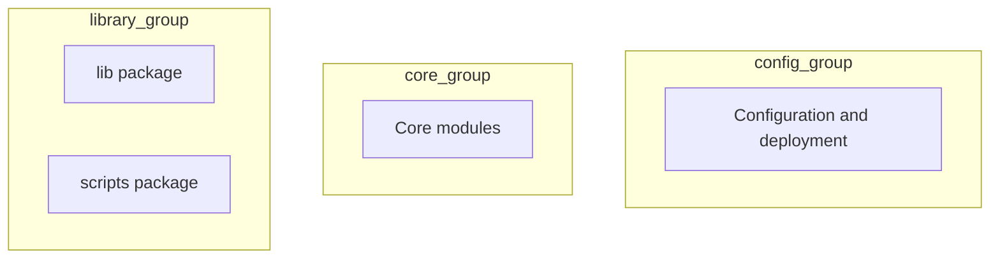

# Architecture report: saltyshiomix/nextron

> Automated static analysis. **Observed** = directly seen in files/imports/AST; **Inferred** = interpretation from that evidence. Repository code was not executed.

## 1. Repository at a glance

| Item | Value |
| --- | --- |
| Repository | saltyshiomix/nextron |
| Description | ⚡ Next.js + Electron ⚡ |
| Language | TypeScript |
| Stars | 4439 |
| Licence | MIT |
| Analysed commit / branch | d128307b62cca08c3711a1556e0a0f564c5eb766 / main |
| Framework(s) | Electron, Next.js, React |
| Files analysed | 188 |
| Components | 4 |

## 2. Architecture in one minute

saltyshiomix/nextron - ⚡ Next.js + Electron ⚡. This repository was analysed statically from 188 file(s) (0 Python). Detected technologies (observed from imports/manifests): Electron, Next.js, React, Tailwind CSS, TypeScript, webpack. Files are grouped into 4 component(s): Configuration and deployment, Core modules, lib package, scripts package. Findings below distinguish observed facts from inferred interpretation.

## 3. High-level block diagram

## 4. Main components

### Configuration and deployment (`config`)

- **Kind:** config
- **Status:** Observed
- **Confidence:** 0.85
- **Responsibility:** Groups 9 file(s) under configuration and deployment (observed from repository paths and static analysis).
- **Paths:** `lefthook.yaml`, `lerna.json`, `package.json`, `pnpm-workspace.yaml`, `scripts/package.json`, `scripts/tsconfig.json`, `tsconfig.base.json`, `tsconfig.json`, `tsconfig.nextron.json`
- **Evidence:** [lefthook.yaml](https://github.com/saltyshiomix/nextron/blob/d128307b62cca08c3711a1556e0a0f564c5eb766/lefthook.yaml); [lerna.json](https://github.com/saltyshiomix/nextron/blob/d128307b62cca08c3711a1556e0a0f564c5eb766/lerna.json); [package.json](https://github.com/saltyshiomix/nextron/blob/d128307b62cca08c3711a1556e0a0f564c5eb766/package.json); [pnpm-workspace.yaml](https://github.com/saltyshiomix/nextron/blob/d128307b62cca08c3711a1556e0a0f564c5eb766/pnpm-workspace.yaml); [scripts/package.json](https://github.com/saltyshiomix/nextron/blob/d128307b62cca08c3711a1556e0a0f564c5eb766/scripts/package.json); [scripts/tsconfig.json](https://github.com/saltyshiomix/nextron/blob/d128307b62cca08c3711a1556e0a0f564c5eb766/scripts/tsconfig.json); [tsconfig.base.json](https://github.com/saltyshiomix/nextron/blob/d128307b62cca08c3711a1556e0a0f564c5eb766/tsconfig.base.json); [tsconfig.json](https://github.com/saltyshiomix/nextron/blob/d128307b62cca08c3711a1556e0a0f564c5eb766/tsconfig.json)

### Core modules (`core`)

- **Kind:** core
- **Status:** Observed
- **Confidence:** 0.85
- **Responsibility:** Groups 2 file(s) under core modules (observed from repository paths and static analysis).
- **Paths:** `eslint.config.ts`, `types.d.ts`
- **Evidence:** [eslint.config.ts](https://github.com/saltyshiomix/nextron/blob/d128307b62cca08c3711a1556e0a0f564c5eb766/eslint.config.ts); [types.d.ts](https://github.com/saltyshiomix/nextron/blob/d128307b62cca08c3711a1556e0a0f564c5eb766/types.d.ts)

### lib package (`lib`)

- **Kind:** library
- **Status:** Observed
- **Confidence:** 0.85
- **Responsibility:** Groups 14 file(s) under lib package (observed from repository paths and static analysis).
- **Paths:** `lib/helpers/check-next-config.ts`, `lib/helpers/get-next-config.ts`, `lib/helpers/get-nextron-config.ts`, `lib/helpers/get-project-settings.ts`, `lib/helpers/load-script.ts`, `lib/logger.ts`, `lib/nextron-build.ts`, `lib/nextron-dev.ts`, `lib/nextron.ts`, `lib/webpack/development/get-main-config.ts`, `lib/webpack/development/get-preload-config.ts`, `lib/webpack/get-base-config-main.ts`, `lib/webpack/get-base-config-preload.ts`, `lib/webpack/production/webpack.config.ts`
- **Evidence:** [lib/helpers/check-next-config.ts](https://github.com/saltyshiomix/nextron/blob/d128307b62cca08c3711a1556e0a0f564c5eb766/lib/helpers/check-next-config.ts); [lib/helpers/get-next-config.ts](https://github.com/saltyshiomix/nextron/blob/d128307b62cca08c3711a1556e0a0f564c5eb766/lib/helpers/get-next-config.ts); [lib/helpers/get-nextron-config.ts](https://github.com/saltyshiomix/nextron/blob/d128307b62cca08c3711a1556e0a0f564c5eb766/lib/helpers/get-nextron-config.ts); [lib/helpers/get-project-settings.ts](https://github.com/saltyshiomix/nextron/blob/d128307b62cca08c3711a1556e0a0f564c5eb766/lib/helpers/get-project-settings.ts); [lib/helpers/load-script.ts](https://github.com/saltyshiomix/nextron/blob/d128307b62cca08c3711a1556e0a0f564c5eb766/lib/helpers/load-script.ts); [lib/logger.ts](https://github.com/saltyshiomix/nextron/blob/d128307b62cca08c3711a1556e0a0f564c5eb766/lib/logger.ts); [lib/nextron-build.ts](https://github.com/saltyshiomix/nextron/blob/d128307b62cca08c3711a1556e0a0f564c5eb766/lib/nextron-build.ts); [lib/nextron-dev.ts](https://github.com/saltyshiomix/nextron/blob/d128307b62cca08c3711a1556e0a0f564c5eb766/lib/nextron-dev.ts)

### scripts package (`scripts`)

- **Kind:** library
- **Status:** Observed
- **Confidence:** 0.85
- **Responsibility:** Groups 2 file(s) under scripts package (observed from repository paths and static analysis).
- **Paths:** `scripts/detect-package-manager.ts`, `scripts/dev.ts`
- **Evidence:** [scripts/detect-package-manager.ts](https://github.com/saltyshiomix/nextron/blob/d128307b62cca08c3711a1556e0a0f564c5eb766/scripts/detect-package-manager.ts); [scripts/dev.ts](https://github.com/saltyshiomix/nextron/blob/d128307b62cca08c3711a1556e0a0f564c5eb766/scripts/dev.ts)

## 5. Execution flow

No entry point was observed; the startup flow below is therefore limited.

Representative flow (derived from observed entry points and the import graph; steps beyond the entry point are **Inferred**):

1. Execution starts at an observed entry point listed above, if present.
2. No internal import relationships between components were observed.

## 6. Project structure

### `(root)`

- `.gitignore` - other (207 bytes)
- `.node-version` - other (8 bytes)
- `.prettierignore` - other (54 bytes)
- `.prettierrc.json` - config (106 bytes)
- `CHANGELOG.md` - docs (1351 bytes)
- `LICENSE` - docs (1073 bytes)
- `README.md` - docs (13567 bytes)
- `eslint.config.ts` - source, TypeScript (456 bytes)
- `lefthook.yaml` - config (252 bytes)
- `lerna.json` - config (110 bytes)
- `package.json` - manifest (1923 bytes)
- `pnpm-workspace.yaml` - config (170 bytes)
- `tsconfig.base.json` - config (282 bytes)
- `tsconfig.json` - config (178 bytes)
- `tsconfig.nextron.json` - config (364 bytes)
- `tsdown.config.mts` - other (452 bytes)
- `types.d.ts` - source, TypeScript (1029 bytes)

### `.github`

- `.github/FUNDING.yml` - config (23 bytes)

### `.vscode`

- `.vscode/settings.json` - config (253 bytes)

### `examples`

- `examples/_template/gitignore.txt` - docs (79 bytes)
- `examples/_template/js/.vscode/launch.json` - config (816 bytes)
- `examples/_template/js/.vscode/tasks.json` - config (393 bytes)
- `examples/_template/js/main/helpers/create-window.js` - source, JavaScript (1970 bytes)
- `examples/_template/js/main/main.js` - source, JavaScript (916 bytes)
- `examples/_template/js/main/preload.js` - source, JavaScript (410 bytes)
- `examples/_template/ts/.vscode/launch.json` - config (816 bytes)
- `examples/_template/ts/.vscode/tasks.json` - config (393 bytes)
- `examples/_template/ts/main/helpers/create-window.ts` - source, TypeScript (2144 bytes)
- `examples/_template/ts/main/main.ts` - source, TypeScript (913 bytes)
- `examples/_template/ts/main/preload.ts` - source, TypeScript (548 bytes)
- `examples/basic-lang-javascript/README.md` - docs (630 bytes)
- `examples/basic-lang-javascript/electron-builder.yml` - config (235 bytes)
- `examples/basic-lang-javascript/package.json` - manifest (632 bytes)
- `examples/basic-lang-javascript/renderer/next.config.js` - source, JavaScript (214 bytes)
- `examples/basic-lang-javascript/renderer/pages/home.jsx` - source, JavaScript (946 bytes)
- `examples/basic-lang-javascript/renderer/pages/next.jsx` - source, JavaScript (402 bytes)
- `examples/basic-lang-typescript/README.md` - docs (630 bytes)
- `examples/basic-lang-typescript/electron-builder.yml` - config (235 bytes)
- `examples/basic-lang-typescript/package.json` - manifest (723 bytes)
- `examples/basic-lang-typescript/renderer/next.config.ts` - source, TypeScript (243 bytes)
- `examples/basic-lang-typescript/renderer/pages/home.tsx` - source, TypeScript (961 bytes)
- `examples/basic-lang-typescript/renderer/pages/next.tsx` - source, TypeScript (401 bytes)
- `examples/basic-lang-typescript/renderer/preload.d.ts` - source, TypeScript (110 bytes)
- `examples/basic-lang-typescript/renderer/tsconfig.json` - config (455 bytes)
- `examples/basic-lang-typescript/tsconfig.json` - config (364 bytes)
- `examples/basic-launch-app-from-url/README.md` - docs (1290 bytes)
- `examples/basic-launch-app-from-url/electron-builder.yml` - config (303 bytes)
- `examples/basic-launch-app-from-url/main/main.ts` - source, TypeScript (2629 bytes)
- `examples/basic-launch-app-from-url/main/preload.ts` - source, TypeScript (413 bytes)
- `examples/basic-launch-app-from-url/package.json` - manifest (723 bytes)
- `examples/basic-launch-app-from-url/renderer/next.config.ts` - source, TypeScript (243 bytes)
- `examples/basic-launch-app-from-url/renderer/pages/home.tsx` - source, TypeScript (853 bytes)
- `examples/basic-launch-app-from-url/renderer/pages/next.tsx` - source, TypeScript (406 bytes)
- `examples/basic-launch-app-from-url/renderer/preload.d.ts` - source, TypeScript (110 bytes)
- `examples/basic-launch-app-from-url/renderer/tsconfig.json` - config (455 bytes)
- `examples/basic-launch-app-from-url/tsconfig.json` - config (364 bytes)
- `examples/basic-store-data/README.md` - docs (615 bytes)
- `examples/basic-store-data/electron-builder.yml` - config (235 bytes)
- `examples/basic-store-data/main/main.ts` - source, TypeScript (1207 bytes)
- `examples/basic-store-data/package.json` - manifest (723 bytes)
- `examples/basic-store-data/renderer/next.config.ts` - source, TypeScript (243 bytes)
- `examples/basic-store-data/renderer/pages/home.tsx` - source, TypeScript (1413 bytes)
- `examples/basic-store-data/renderer/pages/next.tsx` - source, TypeScript (397 bytes)
- `examples/basic-store-data/renderer/preload.d.ts` - source, TypeScript (110 bytes)
- `examples/basic-store-data/renderer/tsconfig.json` - config (455 bytes)
- `examples/basic-store-data/tsconfig.json` - config (364 bytes)
- `examples/custom-build-options/README.md` - docs (627 bytes)
- `examples/custom-build-options/electron-builder.prod.yml` - config (290 bytes)
- `examples/custom-build-options/electron-builder.yml` - config (235 bytes)
- `examples/custom-build-options/package.json` - manifest (992 bytes)
- `examples/custom-build-options/renderer/next.config.ts` - source, TypeScript (243 bytes)
- `examples/custom-build-options/renderer/pages/home.tsx` - source, TypeScript (953 bytes)
- `examples/custom-build-options/renderer/pages/next.tsx` - source, TypeScript (401 bytes)
- `examples/custom-build-options/renderer/preload.d.ts` - source, TypeScript (110 bytes)
- `examples/custom-build-options/renderer/tsconfig.json` - config (455 bytes)
- `examples/custom-build-options/tsconfig.json` - config (364 bytes)
- `examples/custom-renderer-port/README.md` - docs (627 bytes)
- `examples/custom-renderer-port/electron-builder.yml` - config (235 bytes)
- `examples/custom-renderer-port/package.json` - manifest (744 bytes)
- `examples/custom-renderer-port/renderer/next.config.ts` - source, TypeScript (243 bytes)
- `examples/custom-renderer-port/renderer/pages/home.tsx` - source, TypeScript (953 bytes)
- `examples/custom-renderer-port/renderer/pages/next.tsx` - source, TypeScript (401 bytes)
- `examples/custom-renderer-port/renderer/preload.d.ts` - source, TypeScript (110 bytes)
- `examples/custom-renderer-port/renderer/tsconfig.json` - config (455 bytes)
- `examples/custom-renderer-port/tsconfig.json` - config (364 bytes)
- `examples/with-ant-design/README.md` - docs (648 bytes)
- `examples/with-ant-design/electron-builder.yml` - config (235 bytes)
- `examples/with-ant-design/package.json` - manifest (780 bytes)
- `examples/with-ant-design/renderer/next.config.ts` - source, TypeScript (243 bytes)
- `examples/with-ant-design/renderer/pages/_app.tsx` - source, TypeScript (403 bytes)
- `examples/with-ant-design/renderer/pages/home.tsx` - source, TypeScript (2509 bytes)
- `examples/with-ant-design/renderer/pages/next.tsx` - source, TypeScript (558 bytes)
- `examples/with-ant-design/renderer/preload.d.ts` - source, TypeScript (110 bytes)
- `examples/with-ant-design/renderer/tsconfig.json` - config (455 bytes)
- `examples/with-ant-design/tsconfig.json` - config (364 bytes)
- `examples/with-chakra-ui/README.md` - docs (655 bytes)
- `examples/with-chakra-ui/electron-builder.yml` - config (235 bytes)
- `examples/with-chakra-ui/package.json` - manifest (924 bytes)
- `examples/with-chakra-ui/renderer/components/Container.tsx` - source, TypeScript (345 bytes)
- `examples/with-chakra-ui/renderer/components/DarkModeSwitch.tsx` - source, TypeScript (478 bytes)
- `examples/with-chakra-ui/renderer/components/Footer.tsx` - source, TypeScript (156 bytes)
- `examples/with-chakra-ui/renderer/components/Hero.tsx` - source, TypeScript (312 bytes)
- `examples/with-chakra-ui/renderer/components/Main.tsx` - source, TypeScript (217 bytes)
- `examples/with-chakra-ui/renderer/lib/theme.ts` - source, TypeScript (619 bytes)
- `examples/with-chakra-ui/renderer/next.config.ts` - source, TypeScript (243 bytes)
- `examples/with-chakra-ui/renderer/pages/_app.tsx` - source, TypeScript (304 bytes)
- `examples/with-chakra-ui/renderer/pages/_document.tsx` - source, TypeScript (371 bytes)
- `examples/with-chakra-ui/renderer/pages/home.tsx` - source, TypeScript (1094 bytes)
- `examples/with-chakra-ui/renderer/pages/next.tsx` - source, TypeScript (1068 bytes)
- `examples/with-chakra-ui/renderer/preload.d.ts` - source, TypeScript (110 bytes)
- `examples/with-chakra-ui/renderer/tsconfig.json` - config (455 bytes)
- `examples/with-chakra-ui/tsconfig.json` - config (364 bytes)
- `examples/with-emotion/README.md` - docs (603 bytes)
- `examples/with-emotion/electron-builder.yml` - config (235 bytes)
- `examples/with-emotion/package.json` - manifest (792 bytes)
- `examples/with-emotion/renderer/components/AnimatedCard.ts` - source, TypeScript (601 bytes)
- `examples/with-emotion/renderer/components/BasicCard.ts` - source, TypeScript (433 bytes)
- `examples/with-emotion/renderer/components/HoverableCard.ts` - source, TypeScript (450 bytes)
- `examples/with-emotion/renderer/components/TitleCard.ts` - source, TypeScript (182 bytes)
- `examples/with-emotion/renderer/next.config.ts` - source, TypeScript (281 bytes)
- `examples/with-emotion/renderer/pages/_document.tsx` - source, TypeScript (670 bytes)
- `examples/with-emotion/renderer/pages/home.tsx` - source, TypeScript (681 bytes)
- `examples/with-emotion/renderer/pages/next.tsx` - source, TypeScript (677 bytes)
- `examples/with-emotion/renderer/preload.d.ts` - source, TypeScript (110 bytes)
- `examples/with-emotion/renderer/tsconfig.json` - config (455 bytes)
- `examples/with-emotion/tsconfig.json` - config (364 bytes)
- `examples/with-material-ui/README.md` - docs (615 bytes)
- `examples/with-material-ui/electron-builder.yml` - config (235 bytes)
- `examples/with-material-ui/package.json` - manifest (967 bytes)
- `examples/with-material-ui/renderer/components/Link.tsx` - source, TypeScript (2624 bytes)
- `examples/with-material-ui/renderer/lib/theme.ts` - source, TypeScript (533 bytes)
- `examples/with-material-ui/renderer/next.config.ts` - source, TypeScript (243 bytes)
- `examples/with-material-ui/renderer/pages/_app.tsx` - source, TypeScript (537 bytes)
- `examples/with-material-ui/renderer/pages/_document.tsx` - source, TypeScript (794 bytes)
- `examples/with-material-ui/renderer/pages/home.tsx` - source, TypeScript (1943 bytes)
- `examples/with-material-ui/renderer/pages/next.tsx` - source, TypeScript (956 bytes)
- `examples/with-material-ui/renderer/preload.d.ts` - source, TypeScript (110 bytes)
- `examples/with-material-ui/renderer/tsconfig.json` - config (455 bytes)
- `examples/with-material-ui/tsconfig.json` - config (364 bytes)
- `examples/with-next-i18next/README.md` - docs (618 bytes)
- `examples/with-next-i18next/electron-builder.yml` - config (235 bytes)
- `examples/with-next-i18next/main/helpers/create-window.js` - source, JavaScript (1970 bytes)
- `examples/with-next-i18next/main/helpers/index.js` - source, JavaScript (54 bytes)
- `examples/with-next-i18next/main/helpers/ipc.js` - source, JavaScript (167 bytes)
- `examples/with-next-i18next/main/helpers/user-store.js` - source, JavaScript (104 bytes)
- `examples/with-next-i18next/main/main.js` - source, JavaScript (1139 bytes)
- `examples/with-next-i18next/main/preload.js` - source, JavaScript (481 bytes)
- `examples/with-next-i18next/next-i18next.config.cjs` - source, JavaScript (445 bytes)
- `examples/with-next-i18next/package.json` - manifest (786 bytes)
- `examples/with-next-i18next/renderer/components/LanguageSwitcher.jsx` - source, JavaScript (861 bytes)
- `examples/with-next-i18next/renderer/lib/get-static.js` - source, JavaScript (750 bytes)
- `examples/with-next-i18next/renderer/next.config.js` - source, JavaScript (214 bytes)
- `examples/with-next-i18next/renderer/pages/[locale]/home.jsx` - source, JavaScript (1414 bytes)
- `examples/with-next-i18next/renderer/pages/[locale]/next.jsx` - source, JavaScript (816 bytes)
- `examples/with-next-i18next/renderer/pages/_app.jsx` - source, JavaScript (172 bytes)
- `examples/with-next-i18next/renderer/pages/_document.jsx` - source, JavaScript (366 bytes)
- `examples/with-next-i18next/renderer/public/locales/de/common.json` - config (185 bytes)
- `examples/with-next-i18next/renderer/public/locales/en/common.json` - config (160 bytes)
- `examples/with-tailwindcss/README.md` - docs (615 bytes)
- `examples/with-tailwindcss/electron-builder.yml` - config (235 bytes)
- `examples/with-tailwindcss/package.json` - manifest (816 bytes)
- `examples/with-tailwindcss/renderer/next.config.ts` - source, TypeScript (243 bytes)
- `examples/with-tailwindcss/renderer/pages/_app.tsx` - source, TypeScript (189 bytes)
- `examples/with-tailwindcss/renderer/pages/home.tsx` - source, TypeScript (915 bytes)
- `examples/with-tailwindcss/renderer/pages/next.tsx` - source, TypeScript (756 bytes)
- `examples/with-tailwindcss/renderer/postcss.config.mjs` - source, JavaScript (92 bytes)
- `examples/with-tailwindcss/renderer/preload.d.ts` - source, TypeScript (110 bytes)
- `examples/with-tailwindcss/renderer/styles/globals.css` - other (210 bytes)
- `examples/with-tailwindcss/renderer/tsconfig.json` - config (455 bytes)
- `examples/with-tailwindcss/tsconfig.json` - config (364 bytes)

### `lib`

- `lib/helpers/check-next-config.ts` - source, TypeScript (638 bytes)
- `lib/helpers/get-next-config.ts` - source, TypeScript (688 bytes)
- `lib/helpers/get-nextron-config.ts` - source, TypeScript (545 bytes)
- `lib/helpers/get-project-settings.ts` - source, TypeScript (419 bytes)
- `lib/helpers/load-script.ts` - source, TypeScript (1731 bytes)
- `lib/logger.ts` - source, TypeScript (229 bytes)
- `lib/nextron-build.ts` - source, TypeScript (3111 bytes)
- `lib/nextron-dev.ts` - source, TypeScript (4132 bytes)
- `lib/nextron.ts` - source, TypeScript (338 bytes)
- `lib/webpack/development/get-main-config.ts` - source, TypeScript (727 bytes)
- `lib/webpack/development/get-preload-config.ts` - source, TypeScript (516 bytes)
- `lib/webpack/get-base-config-main.ts` - source, TypeScript (1644 bytes)
- `lib/webpack/get-base-config-preload.ts` - source, TypeScript (1728 bytes)
- `lib/webpack/production/webpack.config.ts` - source, TypeScript (1719 bytes)

### `scripts`

- `scripts/detect-package-manager.ts` - source, TypeScript (1894 bytes)
- `scripts/dev.ts` - source, TypeScript (1423 bytes)
- `scripts/package.json` - manifest (72 bytes)
- `scripts/tsconfig.json` - config (176 bytes)

## 7. Key dependencies and integrations

| Name | Category | Status | Confidence | Evidence |
| --- | --- | --- | --- | --- |
| Electron | framework | Observed | 0.90 | [examples/basic-lang-javascript/package.json:12](https://github.com/saltyshiomix/nextron/blob/d128307b62cca08c3711a1556e0a0f564c5eb766/examples/basic-lang-javascript/package.json#L12); [examples/basic-lang-typescript/package.json:12](https://github.com/saltyshiomix/nextron/blob/d128307b62cca08c3711a1556e0a0f564c5eb766/examples/basic-lang-typescript/package.json#L12); [examples/basic-launch-app-from-url/package.json:12](https://github.com/saltyshiomix/nextron/blob/d128307b62cca08c3711a1556e0a0f564c5eb766/examples/basic-launch-app-from-url/package.json#L12); [examples/basic-store-data/package.json:12](https://github.com/saltyshiomix/nextron/blob/d128307b62cca08c3711a1556e0a0f564c5eb766/examples/basic-store-data/package.json#L12) |
| Next.js | framework | Observed | 0.90 | [examples/basic-lang-javascript/package.json:3](https://github.com/saltyshiomix/nextron/blob/d128307b62cca08c3711a1556e0a0f564c5eb766/examples/basic-lang-javascript/package.json#L3); [examples/basic-lang-typescript/package.json:3](https://github.com/saltyshiomix/nextron/blob/d128307b62cca08c3711a1556e0a0f564c5eb766/examples/basic-lang-typescript/package.json#L3); [examples/basic-launch-app-from-url/package.json:3](https://github.com/saltyshiomix/nextron/blob/d128307b62cca08c3711a1556e0a0f564c5eb766/examples/basic-launch-app-from-url/package.json#L3); [examples/basic-store-data/package.json:3](https://github.com/saltyshiomix/nextron/blob/d128307b62cca08c3711a1556e0a0f564c5eb766/examples/basic-store-data/package.json#L3) |
| React | framework | Observed | 0.90 | [examples/basic-lang-javascript/package.json:23](https://github.com/saltyshiomix/nextron/blob/d128307b62cca08c3711a1556e0a0f564c5eb766/examples/basic-lang-javascript/package.json#L23); [examples/basic-lang-javascript/package.json:24](https://github.com/saltyshiomix/nextron/blob/d128307b62cca08c3711a1556e0a0f564c5eb766/examples/basic-lang-javascript/package.json#L24); [examples/basic-lang-typescript/package.json:20](https://github.com/saltyshiomix/nextron/blob/d128307b62cca08c3711a1556e0a0f564c5eb766/examples/basic-lang-typescript/package.json#L20); [examples/basic-lang-typescript/package.json:26](https://github.com/saltyshiomix/nextron/blob/d128307b62cca08c3711a1556e0a0f564c5eb766/examples/basic-lang-typescript/package.json#L26) |
| Tailwind CSS | library | Observed | 0.85 | [examples/with-tailwindcss/package.json:19](https://github.com/saltyshiomix/nextron/blob/d128307b62cca08c3711a1556e0a0f564c5eb766/examples/with-tailwindcss/package.json#L19) |
| TypeScript | tooling | Observed | 0.90 | [examples/basic-lang-typescript/package.json:27](https://github.com/saltyshiomix/nextron/blob/d128307b62cca08c3711a1556e0a0f564c5eb766/examples/basic-lang-typescript/package.json#L27); [examples/basic-launch-app-from-url/package.json:27](https://github.com/saltyshiomix/nextron/blob/d128307b62cca08c3711a1556e0a0f564c5eb766/examples/basic-launch-app-from-url/package.json#L27); [examples/basic-store-data/package.json:27](https://github.com/saltyshiomix/nextron/blob/d128307b62cca08c3711a1556e0a0f564c5eb766/examples/basic-store-data/package.json#L27); [examples/custom-build-options/package.json:32](https://github.com/saltyshiomix/nextron/blob/d128307b62cca08c3711a1556e0a0f564c5eb766/examples/custom-build-options/package.json#L32) |
| webpack | tooling | Observed | 0.85 | [package.json:54](https://github.com/saltyshiomix/nextron/blob/d128307b62cca08c3711a1556e0a0f564c5eb766/package.json#L54) |

## 8. Data and state

No database, cache, queue, or persistent-state usage was observed in the analysed files. State handling, if any, may be in-memory or in files that were not analysed.

## 9. Configuration and deployment clues

- `.github/FUNDING.yml` (config)
- `.prettierrc.json` (config)
- `.vscode/settings.json` (config)
- `examples/_template/js/.vscode/launch.json` (config)
- `examples/_template/js/.vscode/tasks.json` (config)
- `examples/_template/ts/.vscode/launch.json` (config)
- `examples/_template/ts/.vscode/tasks.json` (config)
- `examples/basic-lang-javascript/electron-builder.yml` (config)
- `examples/basic-lang-javascript/package.json` (manifest)
- `examples/basic-lang-typescript/electron-builder.yml` (config)
- `examples/basic-lang-typescript/package.json` (manifest)
- `examples/basic-lang-typescript/renderer/tsconfig.json` (config)
- `examples/basic-lang-typescript/tsconfig.json` (config)
- `examples/basic-launch-app-from-url/electron-builder.yml` (config)
- `examples/basic-launch-app-from-url/package.json` (manifest)
- `examples/basic-launch-app-from-url/renderer/tsconfig.json` (config)
- `examples/basic-launch-app-from-url/tsconfig.json` (config)
- `examples/basic-store-data/electron-builder.yml` (config)
- `examples/basic-store-data/package.json` (manifest)
- `examples/basic-store-data/renderer/tsconfig.json` (config)
- `examples/basic-store-data/tsconfig.json` (config)
- `examples/custom-build-options/electron-builder.prod.yml` (config)
- `examples/custom-build-options/electron-builder.yml` (config)
- `examples/custom-build-options/package.json` (manifest)
- `examples/custom-build-options/renderer/tsconfig.json` (config)
- `examples/custom-build-options/tsconfig.json` (config)
- `examples/custom-renderer-port/electron-builder.yml` (config)
- `examples/custom-renderer-port/package.json` (manifest)
- `examples/custom-renderer-port/renderer/tsconfig.json` (config)
- `examples/custom-renderer-port/tsconfig.json` (config)
- `examples/with-ant-design/electron-builder.yml` (config)
- `examples/with-ant-design/package.json` (manifest)
- `examples/with-ant-design/renderer/tsconfig.json` (config)
- `examples/with-ant-design/tsconfig.json` (config)
- `examples/with-chakra-ui/electron-builder.yml` (config)
- `examples/with-chakra-ui/package.json` (manifest)
- `examples/with-chakra-ui/renderer/tsconfig.json` (config)
- `examples/with-chakra-ui/tsconfig.json` (config)
- `examples/with-emotion/electron-builder.yml` (config)
- `examples/with-emotion/package.json` (manifest)
- `examples/with-emotion/renderer/tsconfig.json` (config)
- `examples/with-emotion/tsconfig.json` (config)
- `examples/with-material-ui/electron-builder.yml` (config)
- `examples/with-material-ui/package.json` (manifest)
- `examples/with-material-ui/renderer/tsconfig.json` (config)
- `examples/with-material-ui/tsconfig.json` (config)
- `examples/with-next-i18next/electron-builder.yml` (config)
- `examples/with-next-i18next/package.json` (manifest)
- `examples/with-next-i18next/renderer/public/locales/de/common.json` (config)
- `examples/with-next-i18next/renderer/public/locales/en/common.json` (config)
- `examples/with-tailwindcss/electron-builder.yml` (config)
- `examples/with-tailwindcss/package.json` (manifest)
- `examples/with-tailwindcss/renderer/tsconfig.json` (config)
- `examples/with-tailwindcss/tsconfig.json` (config)
- `lefthook.yaml` (config)
- `lerna.json` (config)
- `package.json` (manifest)
- `pnpm-workspace.yaml` (config)
- `scripts/package.json` (manifest)
- `scripts/tsconfig.json` (config)
- `tsconfig.base.json` (config)
- `tsconfig.json` (config)
- `tsconfig.nextron.json` (config)

## 10. Design observations

- No strong design patterns could be established from the available evidence.

These observations are interpretations (**Inferred**) of the observed structure, not guarantees about runtime design.

## 11. Limitations and unknowns

- Static analysis only: repository code was not executed, installed, or imported at runtime.
- Components and relationships are inferred from file paths, imports, and AST structure; runtime behaviour, dynamic imports, and reflection may not be visible.
- No clear application entry point was observed in the analysed files.
- Repository text was treated as untrusted data; no instructions found in repository files were followed, and likely secret values were redacted/excluded.
- JavaScript and TypeScript files were inventoried from paths and package manifests. They were not parsed with a full language AST, and repository code was not executed.

## 12. Source references

- [eslint.config.ts](https://github.com/saltyshiomix/nextron/blob/d128307b62cca08c3711a1556e0a0f564c5eb766/eslint.config.ts)
- [examples/basic-lang-javascript/package.json:3](https://github.com/saltyshiomix/nextron/blob/d128307b62cca08c3711a1556e0a0f564c5eb766/examples/basic-lang-javascript/package.json#L3)
- [examples/basic-lang-javascript/package.json:12](https://github.com/saltyshiomix/nextron/blob/d128307b62cca08c3711a1556e0a0f564c5eb766/examples/basic-lang-javascript/package.json#L12)
- [examples/basic-lang-javascript/package.json:23](https://github.com/saltyshiomix/nextron/blob/d128307b62cca08c3711a1556e0a0f564c5eb766/examples/basic-lang-javascript/package.json#L23)
- [examples/basic-lang-javascript/package.json:24](https://github.com/saltyshiomix/nextron/blob/d128307b62cca08c3711a1556e0a0f564c5eb766/examples/basic-lang-javascript/package.json#L24)
- [examples/basic-lang-typescript/package.json:3](https://github.com/saltyshiomix/nextron/blob/d128307b62cca08c3711a1556e0a0f564c5eb766/examples/basic-lang-typescript/package.json#L3)
- [examples/basic-lang-typescript/package.json:12](https://github.com/saltyshiomix/nextron/blob/d128307b62cca08c3711a1556e0a0f564c5eb766/examples/basic-lang-typescript/package.json#L12)
- [examples/basic-lang-typescript/package.json:20](https://github.com/saltyshiomix/nextron/blob/d128307b62cca08c3711a1556e0a0f564c5eb766/examples/basic-lang-typescript/package.json#L20)
- [examples/basic-lang-typescript/package.json:26](https://github.com/saltyshiomix/nextron/blob/d128307b62cca08c3711a1556e0a0f564c5eb766/examples/basic-lang-typescript/package.json#L26)
- [examples/basic-lang-typescript/package.json:27](https://github.com/saltyshiomix/nextron/blob/d128307b62cca08c3711a1556e0a0f564c5eb766/examples/basic-lang-typescript/package.json#L27)
- [examples/basic-launch-app-from-url/package.json:3](https://github.com/saltyshiomix/nextron/blob/d128307b62cca08c3711a1556e0a0f564c5eb766/examples/basic-launch-app-from-url/package.json#L3)
- [examples/basic-launch-app-from-url/package.json:12](https://github.com/saltyshiomix/nextron/blob/d128307b62cca08c3711a1556e0a0f564c5eb766/examples/basic-launch-app-from-url/package.json#L12)
- [examples/basic-launch-app-from-url/package.json:20](https://github.com/saltyshiomix/nextron/blob/d128307b62cca08c3711a1556e0a0f564c5eb766/examples/basic-launch-app-from-url/package.json#L20)
- [examples/basic-launch-app-from-url/package.json:26](https://github.com/saltyshiomix/nextron/blob/d128307b62cca08c3711a1556e0a0f564c5eb766/examples/basic-launch-app-from-url/package.json#L26)
- [examples/basic-launch-app-from-url/package.json:27](https://github.com/saltyshiomix/nextron/blob/d128307b62cca08c3711a1556e0a0f564c5eb766/examples/basic-launch-app-from-url/package.json#L27)
- [examples/basic-store-data/package.json:3](https://github.com/saltyshiomix/nextron/blob/d128307b62cca08c3711a1556e0a0f564c5eb766/examples/basic-store-data/package.json#L3)
- [examples/basic-store-data/package.json:12](https://github.com/saltyshiomix/nextron/blob/d128307b62cca08c3711a1556e0a0f564c5eb766/examples/basic-store-data/package.json#L12)
- [examples/basic-store-data/package.json:20](https://github.com/saltyshiomix/nextron/blob/d128307b62cca08c3711a1556e0a0f564c5eb766/examples/basic-store-data/package.json#L20)
- [examples/basic-store-data/package.json:26](https://github.com/saltyshiomix/nextron/blob/d128307b62cca08c3711a1556e0a0f564c5eb766/examples/basic-store-data/package.json#L26)
- [examples/basic-store-data/package.json:27](https://github.com/saltyshiomix/nextron/blob/d128307b62cca08c3711a1556e0a0f564c5eb766/examples/basic-store-data/package.json#L27)
- [examples/custom-build-options/package.json:3](https://github.com/saltyshiomix/nextron/blob/d128307b62cca08c3711a1556e0a0f564c5eb766/examples/custom-build-options/package.json#L3)
- [examples/custom-build-options/package.json:12](https://github.com/saltyshiomix/nextron/blob/d128307b62cca08c3711a1556e0a0f564c5eb766/examples/custom-build-options/package.json#L12)
- [examples/custom-build-options/package.json:32](https://github.com/saltyshiomix/nextron/blob/d128307b62cca08c3711a1556e0a0f564c5eb766/examples/custom-build-options/package.json#L32)
- [examples/custom-renderer-port/package.json:3](https://github.com/saltyshiomix/nextron/blob/d128307b62cca08c3711a1556e0a0f564c5eb766/examples/custom-renderer-port/package.json#L3)
- [examples/custom-renderer-port/package.json:12](https://github.com/saltyshiomix/nextron/blob/d128307b62cca08c3711a1556e0a0f564c5eb766/examples/custom-renderer-port/package.json#L12)
- [examples/custom-renderer-port/package.json:27](https://github.com/saltyshiomix/nextron/blob/d128307b62cca08c3711a1556e0a0f564c5eb766/examples/custom-renderer-port/package.json#L27)
- [examples/with-ant-design/package.json:3](https://github.com/saltyshiomix/nextron/blob/d128307b62cca08c3711a1556e0a0f564c5eb766/examples/with-ant-design/package.json#L3)
- [examples/with-ant-design/package.json:12](https://github.com/saltyshiomix/nextron/blob/d128307b62cca08c3711a1556e0a0f564c5eb766/examples/with-ant-design/package.json#L12)
- [examples/with-ant-design/package.json:29](https://github.com/saltyshiomix/nextron/blob/d128307b62cca08c3711a1556e0a0f564c5eb766/examples/with-ant-design/package.json#L29)
- [examples/with-chakra-ui/package.json:3](https://github.com/saltyshiomix/nextron/blob/d128307b62cca08c3711a1556e0a0f564c5eb766/examples/with-chakra-ui/package.json#L3)
- [examples/with-chakra-ui/package.json:12](https://github.com/saltyshiomix/nextron/blob/d128307b62cca08c3711a1556e0a0f564c5eb766/examples/with-chakra-ui/package.json#L12)
- [examples/with-chakra-ui/package.json:33](https://github.com/saltyshiomix/nextron/blob/d128307b62cca08c3711a1556e0a0f564c5eb766/examples/with-chakra-ui/package.json#L33)
- [examples/with-emotion/package.json:29](https://github.com/saltyshiomix/nextron/blob/d128307b62cca08c3711a1556e0a0f564c5eb766/examples/with-emotion/package.json#L29)
- [examples/with-tailwindcss/package.json:19](https://github.com/saltyshiomix/nextron/blob/d128307b62cca08c3711a1556e0a0f564c5eb766/examples/with-tailwindcss/package.json#L19)
- [lefthook.yaml](https://github.com/saltyshiomix/nextron/blob/d128307b62cca08c3711a1556e0a0f564c5eb766/lefthook.yaml)
- [lerna.json](https://github.com/saltyshiomix/nextron/blob/d128307b62cca08c3711a1556e0a0f564c5eb766/lerna.json)
- [lib/helpers/check-next-config.ts](https://github.com/saltyshiomix/nextron/blob/d128307b62cca08c3711a1556e0a0f564c5eb766/lib/helpers/check-next-config.ts)
- [lib/helpers/get-next-config.ts](https://github.com/saltyshiomix/nextron/blob/d128307b62cca08c3711a1556e0a0f564c5eb766/lib/helpers/get-next-config.ts)
- [lib/helpers/get-nextron-config.ts](https://github.com/saltyshiomix/nextron/blob/d128307b62cca08c3711a1556e0a0f564c5eb766/lib/helpers/get-nextron-config.ts)
- [lib/helpers/get-project-settings.ts](https://github.com/saltyshiomix/nextron/blob/d128307b62cca08c3711a1556e0a0f564c5eb766/lib/helpers/get-project-settings.ts)
- [lib/helpers/load-script.ts](https://github.com/saltyshiomix/nextron/blob/d128307b62cca08c3711a1556e0a0f564c5eb766/lib/helpers/load-script.ts)
- [lib/logger.ts](https://github.com/saltyshiomix/nextron/blob/d128307b62cca08c3711a1556e0a0f564c5eb766/lib/logger.ts)
- [lib/nextron-build.ts](https://github.com/saltyshiomix/nextron/blob/d128307b62cca08c3711a1556e0a0f564c5eb766/lib/nextron-build.ts)
- [lib/nextron-dev.ts](https://github.com/saltyshiomix/nextron/blob/d128307b62cca08c3711a1556e0a0f564c5eb766/lib/nextron-dev.ts)
- [package.json](https://github.com/saltyshiomix/nextron/blob/d128307b62cca08c3711a1556e0a0f564c5eb766/package.json)
- [package.json:54](https://github.com/saltyshiomix/nextron/blob/d128307b62cca08c3711a1556e0a0f564c5eb766/package.json#L54)
- [pnpm-workspace.yaml](https://github.com/saltyshiomix/nextron/blob/d128307b62cca08c3711a1556e0a0f564c5eb766/pnpm-workspace.yaml)
- [scripts/detect-package-manager.ts](https://github.com/saltyshiomix/nextron/blob/d128307b62cca08c3711a1556e0a0f564c5eb766/scripts/detect-package-manager.ts)
- [scripts/dev.ts](https://github.com/saltyshiomix/nextron/blob/d128307b62cca08c3711a1556e0a0f564c5eb766/scripts/dev.ts)
- [scripts/package.json](https://github.com/saltyshiomix/nextron/blob/d128307b62cca08c3711a1556e0a0f564c5eb766/scripts/package.json)
- [scripts/tsconfig.json](https://github.com/saltyshiomix/nextron/blob/d128307b62cca08c3711a1556e0a0f564c5eb766/scripts/tsconfig.json)
- [tsconfig.base.json](https://github.com/saltyshiomix/nextron/blob/d128307b62cca08c3711a1556e0a0f564c5eb766/tsconfig.base.json)
- [tsconfig.json](https://github.com/saltyshiomix/nextron/blob/d128307b62cca08c3711a1556e0a0f564c5eb766/tsconfig.json)
- [types.d.ts](https://github.com/saltyshiomix/nextron/blob/d128307b62cca08c3711a1556e0a0f564c5eb766/types.d.ts)
