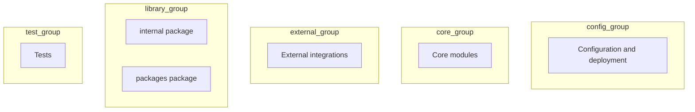

# Architecture report: samdenty/gqless

> Automated static analysis. **Observed** = directly seen in files/imports/AST; **Inferred** = interpretation from that evidence. Repository code was not executed.

## 1. Repository at a glance

| Item | Value |
| --- | --- |
| Repository | samdenty/gqless |
| Description | a GraphQL client without queries |
| Language | TypeScript |
| Stars | 3654 |
| Licence | Not detected |
| Analysed commit / branch | 27e289932cf45536c4e91190b96a4c9ce3d95063 / master |
| Framework(s) | Fastify, Next.js, React |
| Files analysed | 391 |
| Components | 6 |

## 2. Architecture in one minute

samdenty/gqless - a GraphQL client without queries. This repository was analysed statically from 391 file(s) (0 Python). Detected technologies (observed from imports/manifests): GitHub Actions, Fastify, Next.js, React, React Router, Jest. Files are grouped into 6 component(s): Configuration and deployment, Core modules, External integrations, internal package, packages package, Tests. Findings below distinguish observed facts from inferred interpretation.

## 3. High-level block diagram

## 4. Main components

### Configuration and deployment (`config`)

- **Kind:** config
- **Status:** Observed
- **Confidence:** 0.85
- **Responsibility:** Groups 23 file(s) under configuration and deployment (observed from repository paths and static analysis).
- **Paths:** `internal/build-utils/package.json`, `internal/build-utils/tsconfig.json`, `internal/test-utils/package.json`, `internal/test-utils/tsconfig.json`, `internal/website/package.json`, `internal/website/static/icon/manifest.json`, `internal/website/tsconfig.json`, `nodemon.json`, `package.json`, `packages/cli/package.json`, `packages/cli/tsconfig.json`, `packages/gqless/nodemon.json`, `packages/gqless/package.json`, `packages/gqless/tsconfig.json`, `packages/logger/package.json`, `packages/logger/tsconfig.json`, `packages/react/package.json`, `packages/react/tsconfig.json`, `packages/subscriptions/package.json`, `packages/subscriptions/tsconfig.dev.json`, `packages/subscriptions/tsconfig.json`, `pnpm-workspace.yaml`, `tsconfig.json`
- **Evidence:** [internal/build-utils/package.json](https://github.com/samdenty/gqless/blob/27e289932cf45536c4e91190b96a4c9ce3d95063/internal/build-utils/package.json); [internal/build-utils/tsconfig.json](https://github.com/samdenty/gqless/blob/27e289932cf45536c4e91190b96a4c9ce3d95063/internal/build-utils/tsconfig.json); [internal/test-utils/package.json](https://github.com/samdenty/gqless/blob/27e289932cf45536c4e91190b96a4c9ce3d95063/internal/test-utils/package.json); [internal/test-utils/tsconfig.json](https://github.com/samdenty/gqless/blob/27e289932cf45536c4e91190b96a4c9ce3d95063/internal/test-utils/tsconfig.json); [internal/website/package.json](https://github.com/samdenty/gqless/blob/27e289932cf45536c4e91190b96a4c9ce3d95063/internal/website/package.json); [internal/website/static/icon/manifest.json](https://github.com/samdenty/gqless/blob/27e289932cf45536c4e91190b96a4c9ce3d95063/internal/website/static/icon/manifest.json); [internal/website/tsconfig.json](https://github.com/samdenty/gqless/blob/27e289932cf45536c4e91190b96a4c9ce3d95063/internal/website/tsconfig.json); [nodemon.json](https://github.com/samdenty/gqless/blob/27e289932cf45536c4e91190b96a4c9ce3d95063/nodemon.json)

### Core modules (`core`)

- **Kind:** core
- **Status:** Observed
- **Confidence:** 0.85
- **Responsibility:** Groups 2 file(s) under core modules (observed from repository paths and static analysis).
- **Paths:** `dev-react.mjs`, `dev.mjs`
- **Evidence:** [dev-react.mjs](https://github.com/samdenty/gqless/blob/27e289932cf45536c4e91190b96a4c9ce3d95063/dev-react.mjs); [dev.mjs](https://github.com/samdenty/gqless/blob/27e289932cf45536c4e91190b96a4c9ce3d95063/dev.mjs)

### External integrations (`external_integrations`)

- **Kind:** external
- **Status:** Observed
- **Confidence:** 0.85
- **Responsibility:** Groups 3 file(s) under external integrations (observed from repository paths and static analysis).
- **Paths:** `packages/gqless/src/Client/client.ts`, `packages/gqless/src/Client/index.ts`, `packages/gqless/src/Client/resolvers.ts`
- **Evidence:** [packages/gqless/src/Client/client.ts](https://github.com/samdenty/gqless/blob/27e289932cf45536c4e91190b96a4c9ce3d95063/packages/gqless/src/Client/client.ts); [packages/gqless/src/Client/index.ts](https://github.com/samdenty/gqless/blob/27e289932cf45536c4e91190b96a4c9ce3d95063/packages/gqless/src/Client/index.ts); [packages/gqless/src/Client/resolvers.ts](https://github.com/samdenty/gqless/blob/27e289932cf45536c4e91190b96a4c9ce3d95063/packages/gqless/src/Client/resolvers.ts)

### internal package (`internal`)

- **Kind:** library
- **Status:** Observed
- **Confidence:** 0.85
- **Responsibility:** Groups 38 file(s) under internal package (observed from repository paths and static analysis).
- **Paths:** `internal/build-utils/bin/build.js`, `internal/build-utils/bin/github-release.js`, `internal/build-utils/bin/watch.js`, `internal/build-utils/src/buildWriteTypes.js`, `internal/build-utils/src/config.js`, `internal/build-utils/src/index.js`, `internal/build-utils/src/rollup-watch-worker.mjs`, `internal/build-utils/src/writeIndex.js`, `internal/test-utils/bin/jest-test.js`, `internal/test-utils/jest.config.js`, `internal/test-utils/jest.config.ts`, `internal/test-utils/src/app.d.ts`, `internal/test-utils/src/app.ts`, `internal/test-utils/src/index.d.ts`, `internal/test-utils/src/index.ts`, `internal/test-utils/types/app.d.ts`, `internal/test-utils/types/index.d.ts`, `internal/website/docusaurus.config.js`, `internal/website/fix-typedoc-plugin.js`, `internal/website/fix-typedoc.js`, `internal/website/sidebars.js`, `internal/website/sidebars/client.js`, `internal/website/sidebars/react.js`, `internal/website/src/components/Arrow.tsx`, `internal/website/src/components/Example.tsx`, `internal/website/src/components/Examples/App.tsx`, `internal/website/src/components/Examples/Embed.tsx`, `internal/website/src/components/Examples/NavLink.tsx`, `internal/website/src/components/Examples/Sidebar.tsx`, `internal/website/src/components/Feature.tsx`, `internal/website/src/components/Overflow.tsx`, `internal/website/src/components/index.tsx`, `internal/website/src/pages/examples/index.tsx`, `internal/website/src/pages/examples/suspense/auth.tsx`, `internal/website/src/pages/examples/suspense/query.tsx`, `internal/website/src/pages/index.tsx`, `internal/website/src/plugins/remark-yarn2npm.js`, `internal/website/src/theme/Root.tsx`
- **Evidence:** [internal/build-utils/bin/build.js](https://github.com/samdenty/gqless/blob/27e289932cf45536c4e91190b96a4c9ce3d95063/internal/build-utils/bin/build.js); [internal/build-utils/bin/github-release.js](https://github.com/samdenty/gqless/blob/27e289932cf45536c4e91190b96a4c9ce3d95063/internal/build-utils/bin/github-release.js); [internal/build-utils/bin/watch.js](https://github.com/samdenty/gqless/blob/27e289932cf45536c4e91190b96a4c9ce3d95063/internal/build-utils/bin/watch.js); [internal/build-utils/src/buildWriteTypes.js](https://github.com/samdenty/gqless/blob/27e289932cf45536c4e91190b96a4c9ce3d95063/internal/build-utils/src/buildWriteTypes.js); [internal/build-utils/src/config.js](https://github.com/samdenty/gqless/blob/27e289932cf45536c4e91190b96a4c9ce3d95063/internal/build-utils/src/config.js); [internal/build-utils/src/index.js](https://github.com/samdenty/gqless/blob/27e289932cf45536c4e91190b96a4c9ce3d95063/internal/build-utils/src/index.js); [internal/build-utils/src/rollup-watch-worker.mjs](https://github.com/samdenty/gqless/blob/27e289932cf45536c4e91190b96a4c9ce3d95063/internal/build-utils/src/rollup-watch-worker.mjs); [internal/build-utils/src/writeIndex.js](https://github.com/samdenty/gqless/blob/27e289932cf45536c4e91190b96a4c9ce3d95063/internal/build-utils/src/writeIndex.js)

### packages package (`packages`)

- **Kind:** library
- **Status:** Observed
- **Confidence:** 0.85
- **Responsibility:** Groups 67 file(s) under packages package (observed from repository paths and static analysis).
- **Paths:** `packages/cli/bin/gqless.js`, `packages/cli/jest.config.js`, `packages/cli/src/config.ts`, `packages/cli/src/generate.ts`, `packages/cli/src/index.ts`, `packages/cli/src/innerState.ts`, `packages/cli/src/inspectWriteGenerate.ts`, `packages/cli/src/introspection.ts`, `packages/cli/src/prettier.ts`, `packages/cli/src/writeGenerate.ts`, `packages/gqless/jest.config.js`, `packages/gqless/src/Accessor/index.ts`, `packages/gqless/src/Cache/accessorCache.ts`, `packages/gqless/src/Cache/dataCache.ts`, `packages/gqless/src/Cache/index.ts`, `packages/gqless/src/Cache/persistence.ts`, `packages/gqless/src/Error/index.ts`, `packages/gqless/src/Error/retry.ts`, `packages/gqless/src/Events/index.ts`, `packages/gqless/src/Helpers/casters.ts`, `packages/gqless/src/Helpers/getFields.ts`, `packages/gqless/src/Helpers/index.ts`, `packages/gqless/src/Helpers/prefetch.ts`, `packages/gqless/src/Helpers/prepass.ts`, `packages/gqless/src/Helpers/refetch.ts`, `packages/gqless/src/Helpers/selectFields.ts`, `packages/gqless/src/Helpers/ssr.ts`, `packages/gqless/src/Interceptor/index.ts`, `packages/gqless/src/Normalization/index.ts`, `packages/gqless/src/QueryBuilder/buildQuery.ts`, `packages/gqless/src/QueryBuilder/index.ts`, `packages/gqless/src/Scheduler/index.ts`, `packages/gqless/src/Schema/index.ts`, `packages/gqless/src/Schema/types.ts`, `packages/gqless/src/Selection/SelectionBuilder.ts`, `packages/gqless/src/Selection/SelectionManager.ts`, `packages/gqless/src/Selection/index.ts`, `packages/gqless/src/Selection/selection.ts`, `packages/gqless/src/Utils/cachedJSON.ts`, `packages/gqless/src/Utils/cycle.ts`, `packages/gqless/src/Utils/debounce.ts`, `packages/gqless/src/Utils/index.ts`, `packages/gqless/src/Utils/object.ts`, `packages/gqless/src/index.ts`, `packages/logger/jest.config.js`, `packages/logger/src/index.ts`, `packages/react/jest.config.js`, `packages/react/src/client.ts`, `packages/react/src/common.ts`, `packages/react/src/index.tsx`, `packages/react/src/meta/useMetaState.ts`, `packages/react/src/mutation/useMutation.ts`, `packages/react/src/query/hoc.tsx`, `packages/react/src/query/preparedQuery.ts`, `packages/react/src/query/useLazyQuery.ts`, `packages/react/src/query/usePaginatedQuery.ts`, `packages/react/src/query/useQuery.ts`, `packages/react/src/query/useRefetch.ts`, `packages/react/src/query/useTransactionQuery.ts`, `packages/react/src/ssr/ssr.ts`, `packages/react/src/subscription/useSubscription.ts`, `packages/react/src/utils.ts`, `packages/subscriptions/jest.config.js`, `packages/subscriptions/src/index.ts`, `packages/subscriptions/src/subscription/client.ts`, `packages/subscriptions/src/subscription/protocol.ts`, `packages/subscriptions/src/utils.ts`
- **Evidence:** [packages/cli/bin/gqless.js](https://github.com/samdenty/gqless/blob/27e289932cf45536c4e91190b96a4c9ce3d95063/packages/cli/bin/gqless.js); [packages/cli/jest.config.js](https://github.com/samdenty/gqless/blob/27e289932cf45536c4e91190b96a4c9ce3d95063/packages/cli/jest.config.js); [packages/cli/src/config.ts](https://github.com/samdenty/gqless/blob/27e289932cf45536c4e91190b96a4c9ce3d95063/packages/cli/src/config.ts); [packages/cli/src/generate.ts](https://github.com/samdenty/gqless/blob/27e289932cf45536c4e91190b96a4c9ce3d95063/packages/cli/src/generate.ts); [packages/cli/src/index.ts](https://github.com/samdenty/gqless/blob/27e289932cf45536c4e91190b96a4c9ce3d95063/packages/cli/src/index.ts); [packages/cli/src/innerState.ts](https://github.com/samdenty/gqless/blob/27e289932cf45536c4e91190b96a4c9ce3d95063/packages/cli/src/innerState.ts); [packages/cli/src/inspectWriteGenerate.ts](https://github.com/samdenty/gqless/blob/27e289932cf45536c4e91190b96a4c9ce3d95063/packages/cli/src/inspectWriteGenerate.ts); [packages/cli/src/introspection.ts](https://github.com/samdenty/gqless/blob/27e289932cf45536c4e91190b96a4c9ce3d95063/packages/cli/src/introspection.ts)

### Tests (`tests`)

- **Kind:** test
- **Status:** Observed
- **Confidence:** 0.85
- **Responsibility:** Groups 35 file(s) under tests (observed from repository paths and static analysis).
- **Paths:** `examples/github/test/index.test.ts`, `examples/mercurius/test/example.test.ts`, `examples/mercurius/test/tsconfig.json`, `internal/test-utils/test/_generated.ts`, `internal/test-utils/test/index.test.ts`, `internal/test-utils/test/tsconfig.json`, `packages/cli/test/config.test.ts`, `packages/cli/test/generate.test.ts`, `packages/cli/test/inspectWriteGenerate.test.ts`, `packages/cli/test/introspection.test.ts`, `packages/cli/test/tsconfig.json`, `packages/cli/test/utils.ts`, `packages/cli/test/writeGenerate.test.ts`, `packages/gqless/test/accessor.test.ts`, `packages/gqless/test/buildQuery.test.ts`, `packages/gqless/test/cache.test.ts`, `packages/gqless/test/client.test.ts`, `packages/gqless/test/error.test.ts`, `packages/gqless/test/events.test.ts`, `packages/gqless/test/helpers.test.ts`, `packages/gqless/test/interceptor.test.ts`, `packages/gqless/test/persistence.test.ts`, `packages/gqless/test/playground.test.ts`, `packages/gqless/test/scheduler.test.ts`, `packages/gqless/test/schema.test.ts`, `packages/gqless/test/selection.test.ts`, `packages/gqless/test/ssr.test.tsx`, `packages/gqless/test/subscriptions.test.ts`, `packages/gqless/test/tsconfig.json`, `packages/gqless/test/utils.ts`, `packages/logger/test/index.test.ts`, `packages/react/test/graphqlHOC.test.tsx`, `packages/react/test/useQuery.test.tsx`, `packages/react/test/utils.ts`, `packages/subscriptions/test/index.test.ts`
- **Evidence:** [examples/github/test/index.test.ts](https://github.com/samdenty/gqless/blob/27e289932cf45536c4e91190b96a4c9ce3d95063/examples/github/test/index.test.ts); [examples/mercurius/test/example.test.ts](https://github.com/samdenty/gqless/blob/27e289932cf45536c4e91190b96a4c9ce3d95063/examples/mercurius/test/example.test.ts); [examples/mercurius/test/tsconfig.json](https://github.com/samdenty/gqless/blob/27e289932cf45536c4e91190b96a4c9ce3d95063/examples/mercurius/test/tsconfig.json); [internal/test-utils/test/_generated.ts](https://github.com/samdenty/gqless/blob/27e289932cf45536c4e91190b96a4c9ce3d95063/internal/test-utils/test/_generated.ts); [internal/test-utils/test/index.test.ts](https://github.com/samdenty/gqless/blob/27e289932cf45536c4e91190b96a4c9ce3d95063/internal/test-utils/test/index.test.ts); [internal/test-utils/test/tsconfig.json](https://github.com/samdenty/gqless/blob/27e289932cf45536c4e91190b96a4c9ce3d95063/internal/test-utils/test/tsconfig.json); [packages/cli/test/config.test.ts](https://github.com/samdenty/gqless/blob/27e289932cf45536c4e91190b96a4c9ce3d95063/packages/cli/test/config.test.ts); [packages/cli/test/generate.test.ts](https://github.com/samdenty/gqless/blob/27e289932cf45536c4e91190b96a4c9ce3d95063/packages/cli/test/generate.test.ts)

## 5. Execution flow

**Observed** entry point(s):

- [internal/build-utils/bin/build.js](https://github.com/samdenty/gqless/blob/27e289932cf45536c4e91190b96a4c9ce3d95063/internal/build-utils/bin/build.js)
- [internal/build-utils/bin/github-release.js](https://github.com/samdenty/gqless/blob/27e289932cf45536c4e91190b96a4c9ce3d95063/internal/build-utils/bin/github-release.js)
- [internal/build-utils/bin/watch.js](https://github.com/samdenty/gqless/blob/27e289932cf45536c4e91190b96a4c9ce3d95063/internal/build-utils/bin/watch.js)
- [internal/build-utils/src/index.js](https://github.com/samdenty/gqless/blob/27e289932cf45536c4e91190b96a4c9ce3d95063/internal/build-utils/src/index.js)
- [internal/test-utils/bin/jest-test.js](https://github.com/samdenty/gqless/blob/27e289932cf45536c4e91190b96a4c9ce3d95063/internal/test-utils/bin/jest-test.js)
- [internal/test-utils/src/app.ts](https://github.com/samdenty/gqless/blob/27e289932cf45536c4e91190b96a4c9ce3d95063/internal/test-utils/src/app.ts)
- [internal/test-utils/src/index.ts](https://github.com/samdenty/gqless/blob/27e289932cf45536c4e91190b96a4c9ce3d95063/internal/test-utils/src/index.ts)
- [packages/cli/bin/gqless.js](https://github.com/samdenty/gqless/blob/27e289932cf45536c4e91190b96a4c9ce3d95063/packages/cli/bin/gqless.js)
- [packages/cli/src/index.ts](https://github.com/samdenty/gqless/blob/27e289932cf45536c4e91190b96a4c9ce3d95063/packages/cli/src/index.ts)
- [packages/gqless/src/index.ts](https://github.com/samdenty/gqless/blob/27e289932cf45536c4e91190b96a4c9ce3d95063/packages/gqless/src/index.ts)
- [packages/logger/src/index.ts](https://github.com/samdenty/gqless/blob/27e289932cf45536c4e91190b96a4c9ce3d95063/packages/logger/src/index.ts)
- [packages/react/src/index.tsx](https://github.com/samdenty/gqless/blob/27e289932cf45536c4e91190b96a4c9ce3d95063/packages/react/src/index.tsx)

Representative flow (derived from observed entry points and the import graph; steps beyond the entry point are **Inferred**):

1. Execution starts at an observed entry point listed above, if present.
2. No internal import relationships between components were observed.

## 6. Project structure

### `(root)`

- `.gitignore` - other (137 bytes)
- `.prettierignore` - other (14 bytes)
- `.prettierrc` - other (88 bytes)
- `CONTRIBUTING.md` - docs (89 bytes)
- `README.md` - docs (2961 bytes)
- `dev-react.mjs` - source, JavaScript (3603 bytes)
- `dev.mjs` - source, JavaScript (571 bytes)
- `nodemon.json` - config (208 bytes)
- `package.json` - manifest (2539 bytes)
- `pnpm-workspace.yaml` - config (61 bytes)
- `tsconfig.json` - config (191 bytes)

### `.changeset`

- `.changeset/README.md` - docs (512 bytes)
- `.changeset/config.json` - config (362 bytes)

### `.github`

- `.github/FUNDING.yml` - config (24 bytes)
- `.github/workflows/release.yaml` - ci, YAML (1213 bytes)
- `.github/workflows/tests.yaml` - ci, YAML (1376 bytes)

### `.husky`

- `.husky/.gitignore` - other (2 bytes)
- `.husky/pre-commit` - other (69 bytes)

### `.vscode`

- `.vscode/extensions.json` - config (68 bytes)
- `.vscode/settings.json` - config (55 bytes)

### `docs`

- `docs/cli/codegen.mdx` - docs (3021 bytes)
- `docs/cli/config.mdx` - docs (3368 bytes)
- `docs/cli/javascript.mdx` - docs (2998 bytes)
- `docs/cli/programmatic.mdx` - docs (2865 bytes)
- `docs/client/api/classes/eventhandler.md` - docs (2625 bytes)
- `docs/client/api/classes/gqlesserror.md` - docs (4976 bytes)
- `docs/client/api/classes/selection.md` - docs (3261 bytes)
- `docs/client/api/enums/selectiontype.md` - docs (767 bytes)
- `docs/client/api/index.md` - docs (1193 bytes)
- `docs/client/api/interfaces/accessorcache.md` - docs (4736 bytes)
- `docs/client/api/interfaces/assignselections.md` - docs (760 bytes)
- `docs/client/api/interfaces/buildandfetchselections.md` - docs (1354 bytes)
- `docs/client/api/interfaces/buildselection.md` - docs (927 bytes)
- `docs/client/api/interfaces/clientoptions.md` - docs (2217 bytes)
- `docs/client/api/interfaces/gqlessclient.md` - docs (6719 bytes)
- `docs/client/api/interfaces/hydratecache.md` - docs (669 bytes)
- `docs/client/api/interfaces/hydratecacheoptions.md` - docs (789 bytes)
- `docs/client/api/interfaces/inlineresolved.md` - docs (933 bytes)
- `docs/client/api/interfaces/inlineresolveoptions.md` - docs (1809 bytes)
- `docs/client/api/interfaces/innerclientstate.md` - docs (3179 bytes)
- `docs/client/api/interfaces/interceptormanager.md` - docs (4763 bytes)
- `docs/client/api/interfaces/mutate.md` - docs (1967 bytes)
- `docs/client/api/interfaces/mutatehelpers.md` - docs (1035 bytes)
- `docs/client/api/interfaces/parseschematypeinfo.md` - docs (957 bytes)
- `docs/client/api/interfaces/prefetch.md` - docs (1041 bytes)
- `docs/client/api/interfaces/preparerender.md` - docs (640 bytes)
- `docs/client/api/interfaces/prepassobjkey.md` - docs (577 bytes)
- `docs/client/api/interfaces/refetch.md` - docs (623 bytes)
- `docs/client/api/interfaces/resolved.md` - docs (773 bytes)
- `docs/client/api/interfaces/resolveoptions.md` - docs (5445 bytes)
- `docs/client/api/interfaces/resolvers.md` - docs (1104 bytes)
- `docs/client/api/interfaces/retryconfigstate.md` - docs (1454 bytes)
- `docs/client/api/interfaces/scalars.md` - docs (862 bytes)
- `docs/client/api/interfaces/scheduler.md` - docs (4220 bytes)
- `docs/client/api/interfaces/schema.md` - docs (1124 bytes)
- `docs/client/api/interfaces/selectionmanager.md` - docs (1015 bytes)
- `docs/client/api/interfaces/setcache.md` - docs (2434 bytes)
- `docs/client/api/interfaces/subscribeevents.md` - docs (1989 bytes)
- `docs/client/api/interfaces/subscriptionsclient.md` - docs (5224 bytes)
- `docs/client/api/interfaces/type.md` - docs (532 bytes)
- `docs/client/api/modules.md` - docs (14865 bytes)
- `docs/client/config.mdx` - docs (4137 bytes)
- `docs/client/fetching-data.mdx` - docs (3175 bytes)
- `docs/client/helper-functions.mdx` - docs (5190 bytes)
- `docs/client/mutations.mdx` - docs (584 bytes)
- `docs/client/persistence.mdx` - docs (3774 bytes)
- `docs/client/subscriptions.mdx` - docs (5449 bytes)
- `docs/client/upload.mdx` - docs (3209 bytes)
- `docs/contributing.mdx` - docs (1696 bytes)
- `docs/development/logger.mdx` - docs (1002 bytes)
- `docs/getting-started.mdx` - docs (1820 bytes)
- `docs/intro.mdx` - docs (2423 bytes)
- `docs/intro/features.mdx` - docs (907 bytes)
- `docs/intro/how-it-works.mdx` - docs (1776 bytes)
- `docs/intro/new-in-2.mdx` - docs (2815 bytes)
- `docs/react/api/index.md` - docs (233 bytes)
- `docs/react/api/interfaces/corehelpers.md` - docs (4712 bytes)
- `docs/react/api/interfaces/createreactclientoptions.md` - docs (456 bytes)
- `docs/react/api/interfaces/fetchmorecallbackargs.md` - docs (725 bytes)
- `docs/react/api/interfaces/graphqlhoc.md` - docs (1065 bytes)
- `docs/react/api/interfaces/graphqlhocoptions.md` - docs (884 bytes)
- `docs/react/api/interfaces/metastate.md` - docs (545 bytes)
- `docs/react/api/interfaces/preparedquery.md` - docs (3662 bytes)
- `docs/react/api/interfaces/preparequery.md` - docs (1072 bytes)
- `docs/react/api/interfaces/preparereactrender.md` - docs (558 bytes)
- `docs/react/api/interfaces/reactclient.md` - docs (3331 bytes)
- `docs/react/api/interfaces/reactclientdefaults.md` - docs (4874 bytes)
- `docs/react/api/interfaces/usehydratecache.md` - docs (689 bytes)
- `docs/react/api/interfaces/usehydratecacheoptions.md` - docs (873 bytes)
- `docs/react/api/interfaces/uselazyquery.md` - docs (1794 bytes)
- `docs/react/api/interfaces/uselazyqueryoptions.md` - docs (1519 bytes)
- `docs/react/api/interfaces/uselazyquerystate.md` - docs (1028 bytes)
- `docs/react/api/interfaces/usemetastate.md` - docs (735 bytes)
- `docs/react/api/interfaces/usemetastateoptions.md` - docs (2485 bytes)
- `docs/react/api/interfaces/usemutation.md` - docs (1719 bytes)
- `docs/react/api/interfaces/usemutationoptions.md` - docs (2527 bytes)
- `docs/react/api/interfaces/usemutationstate.md` - docs (847 bytes)
- `docs/react/api/interfaces/usepaginatedquery.md` - docs (1888 bytes)
- `docs/react/api/interfaces/usepaginatedquerydata.md` - docs (2609 bytes)
- `docs/react/api/interfaces/usepaginatedquerymergeparams.md` - docs (2428 bytes)
- `docs/react/api/interfaces/usepaginatedqueryoptions.md` - docs (2281 bytes)
- `docs/react/api/interfaces/usepreparedqueryoptions.md` - docs (412 bytes)
- `docs/react/api/interfaces/usequery.md` - docs (1000 bytes)
- `docs/react/api/interfaces/usequeryoptions.md` - docs (1669 bytes)
- `docs/react/api/interfaces/usequerystate.md` - docs (398 bytes)
- `docs/react/api/interfaces/userefetch.md` - docs (832 bytes)
- `docs/react/api/interfaces/userefetchoptions.md` - docs (819 bytes)
- `docs/react/api/interfaces/userefetchstate.md` - docs (1240 bytes)
- `docs/react/api/interfaces/usesubscription.md` - docs (696 bytes)
- `docs/react/api/interfaces/usetransactionquery.md` - docs (2061 bytes)
- `docs/react/api/interfaces/usetransactionquerystate.md` - docs (1112 bytes)
- `docs/react/api/modules.md` - docs (6672 bytes)
- `docs/react/config.mdx` - docs (5061 bytes)
- `docs/react/fetching-data.mdx` - docs (15645 bytes)
- `docs/react/meta.mdx` - docs (1688 bytes)
- `docs/react/mutations.mdx` - docs (2036 bytes)
- `docs/react/ssr.mdx` - docs (3833 bytes)
- `docs/react/subscriptions.mdx` - docs (763 bytes)
- `docs/react/suspense.mdx` - docs (1664 bytes)

### `examples`

- `examples/cra/.gitignore` - other (299 bytes)
- `examples/cra/.prettierrc` - other (27 bytes)
- `examples/cra/README.md` - docs (2117 bytes)
- `examples/cra/gqless.config.js` - source, JavaScript (478 bytes)
- `examples/cra/package.json` - manifest (1629 bytes)
- `examples/cra/public/index.html` - other (1721 bytes)
- `examples/cra/public/manifest.json` - config (492 bytes)
- `examples/cra/public/robots.txt` - docs (67 bytes)
- `examples/cra/sandbox.config.json` - config (89 bytes)
- `examples/cra/src/components/CreatePost.tsx` - source, TypeScript (1277 bytes)
- `examples/cra/src/components/Hello.tsx` - source, TypeScript (1179 bytes)
- `examples/cra/src/components/Login.tsx` - source, TypeScript (1608 bytes)
- `examples/cra/src/components/MyPosts.tsx` - source, TypeScript (2535 bytes)
- `examples/cra/src/components/Register.tsx` - source, TypeScript (1626 bytes)
- `examples/cra/src/gqless/index.ts` - source, TypeScript (2337 bytes)
- `examples/cra/src/gqless/schema.generated.ts` - source, TypeScript (8236 bytes)
- `examples/cra/src/hooks/currentUser.ts` - source, TypeScript (488 bytes)
- `examples/cra/src/index.css` - other (464 bytes)
- `examples/cra/src/index.tsx` - source, TypeScript (2410 bytes)
- `examples/cra/src/react-app-env.d.ts` - source, TypeScript (40 bytes)
- `examples/cra/src/reportWebVitals.ts` - source, TypeScript (425 bytes)
- `examples/cra/src/setupTests.ts` - source, TypeScript (241 bytes)
- `examples/cra/tsconfig.json` - config (503 bytes)
- `examples/github/gqless.config.cjs` - source, JavaScript (681 bytes)
- `examples/github/jest.config.js` - source, JavaScript (63 bytes)
- `examples/github/package.json` - manifest (490 bytes)
- `examples/github/src/gqless/index.ts` - source, TypeScript (1271 bytes)
- `examples/github/test/index.test.ts` - test, TypeScript (27548 bytes)
- `examples/mercurius/.browserslistrc` - other (7 bytes)
- `examples/mercurius/.gitignore` - other (34 bytes)
- `examples/mercurius/LICENSE.md` - docs (1086 bytes)
- `examples/mercurius/README.md` - docs (0 bytes)
- `examples/mercurius/generate.ts` - source, TypeScript (367 bytes)
- `examples/mercurius/gqless.config.cjs` - source, JavaScript (342 bytes)
- `examples/mercurius/jest.config.js` - source, JavaScript (92 bytes)
- `examples/mercurius/listen.js` - source, JavaScript (179 bytes)
- `examples/mercurius/package.json` - manifest (1560 bytes)
- `examples/mercurius/src/generated/gqless.ts` - source, TypeScript (997 bytes)
- `examples/mercurius/src/generated/mercurius.ts` - source, TypeScript (21952 bytes)
- `examples/mercurius/src/generated/schema.generated.ts` - source, TypeScript (6398 bytes)
- `examples/mercurius/src/graphql/operations.gql` - other (434 bytes)
- `examples/mercurius/src/index.ts` - source, TypeScript (3732 bytes)
- `examples/mercurius/test/example.test.ts` - test, TypeScript (7840 bytes)
- `examples/mercurius/test/tsconfig.json` - test (62 bytes)
- `examples/mercurius/tsconfig.json` - config (1428 bytes)
- `examples/react/api/graphql.ts` - source, TypeScript (9332 bytes)
- `examples/react/api/server.ts` - source, TypeScript (767 bytes)
- `examples/react/gqless.config.cjs` - source, JavaScript (334 bytes)
- `examples/react/next-env.d.ts` - source, TypeScript (75 bytes)
- `examples/react/next.config.js` - source, JavaScript (240 bytes)
- `examples/react/open-browser.mjs` - source, JavaScript (630 bytes)
- `examples/react/package.json` - manifest (2062 bytes)
- `examples/react/src/components/NoSSR.tsx` - source, TypeScript (251 bytes)
- `examples/react/src/components/client.ts` - source, TypeScript (704 bytes)
- `examples/react/src/components/common.ts` - source, TypeScript (1276 bytes)
- `examples/react/src/components/meta.tsx` - source, TypeScript (1385 bytes)
- `examples/react/src/graphql/gqless.ts` - source, TypeScript (2661 bytes)
- `examples/react/src/graphql/mercurius.ts` - source, TypeScript (15579 bytes)
- `examples/react/src/graphql/schema.generated.ts` - source, TypeScript (7193 bytes)
- `examples/react/src/pages/_app.tsx` - source, TypeScript (730 bytes)
- `examples/react/src/pages/cache.tsx` - source, TypeScript (1834 bytes)
- `examples/react/src/pages/emptyArrays.tsx` - source, TypeScript (813 bytes)
- `examples/react/src/pages/error.tsx` - source, TypeScript (1432 bytes)
- `examples/react/src/pages/index.tsx` - source, TypeScript (1799 bytes)
- `examples/react/src/pages/normalized.tsx` - source, TypeScript (945 bytes)
- `examples/react/src/pages/pagination.tsx` - source, TypeScript (2183 bytes)
- `examples/react/src/pages/pagination_infinite_scroll.tsx` - source, TypeScript (1841 bytes)
- `examples/react/src/pages/playground.tsx` - source, TypeScript (1987 bytes)
- `examples/react/src/pages/polling.tsx` - source, TypeScript (1606 bytes)
- `examples/react/src/pages/preparedQuery.tsx` - source, TypeScript (1056 bytes)
- `examples/react/src/pages/prepass.tsx` - source, TypeScript (975 bytes)
- `examples/react/src/pages/refetch.tsx` - source, TypeScript (741 bytes)
- `examples/react/src/pages/ssr.tsx` - source, TypeScript (908 bytes)
- `examples/react/src/pages/stringArray.tsx` - source, TypeScript (547 bytes)
- `examples/react/src/pages/subscriptions.tsx` - source, TypeScript (1003 bytes)
- `examples/react/src/pages/transactionQuery1.tsx` - source, TypeScript (791 bytes)
- `examples/react/src/pages/transactionQuery2.tsx` - source, TypeScript (357 bytes)
- `examples/react/src/pages/uploadFile.tsx` - source, TypeScript (1000 bytes)
- `examples/react/src/pages/useQueryTest.tsx` - source, TypeScript (559 bytes)
- `examples/react/tsconfig.json` - config (1698 bytes)

### `internal`

- `internal/build-utils/bin/build.js` - source, JavaScript (2100 bytes)
- `internal/build-utils/bin/github-release.js` - source, JavaScript (2142 bytes)
- `internal/build-utils/bin/watch.js` - source, JavaScript (3767 bytes)
- `internal/build-utils/package.json` - manifest (714 bytes)
- `internal/build-utils/src/buildWriteTypes.js` - source, JavaScript (987 bytes)
- `internal/build-utils/src/config.js` - source, JavaScript (3955 bytes)
- `internal/build-utils/src/index.js` - source, JavaScript (100 bytes)
- `internal/build-utils/src/rollup-watch-worker.mjs` - source, JavaScript (2535 bytes)
- `internal/build-utils/src/writeIndex.js` - source, JavaScript (491 bytes)
- `internal/build-utils/tsconfig.json` - config (197 bytes)
- `internal/test-utils/.gitignore` - other (34 bytes)
- `internal/test-utils/LICENSE.md` - docs (1086 bytes)
- `internal/test-utils/README.md` - docs (0 bytes)
- `internal/test-utils/bin/jest-test.js` - source, JavaScript (90 bytes)
- `internal/test-utils/jest.config.js` - source, JavaScript (1119 bytes)
- `internal/test-utils/jest.config.ts` - source, TypeScript (52 bytes)
- `internal/test-utils/package.json` - manifest (1632 bytes)
- `internal/test-utils/src/app.d.ts` - source, TypeScript (528 bytes)
- `internal/test-utils/src/app.ts` - source, TypeScript (1220 bytes)
- `internal/test-utils/src/index.d.ts` - source, TypeScript (351 bytes)
- `internal/test-utils/src/index.ts` - source, TypeScript (510 bytes)
- `internal/test-utils/test/_generated.ts` - test, TypeScript (4906 bytes)
- `internal/test-utils/test/index.test.ts` - test, TypeScript (7941 bytes)
- `internal/test-utils/test/tsconfig.json` - test (141 bytes)
- `internal/test-utils/tsconfig.json` - config (1487 bytes)
- `internal/test-utils/types/app.d.ts` - source, TypeScript (528 bytes)
- `internal/test-utils/types/index.d.ts` - source, TypeScript (351 bytes)
- `internal/website/.prettierrc` - other (88 bytes)
- `internal/website/docusaurus.config.js` - source, JavaScript (4837 bytes)
- `internal/website/fix-typedoc-plugin.js` - source, JavaScript (179 bytes)
- `internal/website/fix-typedoc.js` - source, JavaScript (1360 bytes)
- `internal/website/package.json` - manifest (1775 bytes)
- `internal/website/sidebars.js` - source, JavaScript (1557 bytes)
- `internal/website/sidebars/client.js` - source, JavaScript (1833 bytes)
- `internal/website/sidebars/react.js` - source, JavaScript (1802 bytes)
- `internal/website/src/components/Arrow.tsx` - source, TypeScript (2007 bytes)
- `internal/website/src/components/Example.tsx` - source, TypeScript (1457 bytes)
- `internal/website/src/components/Examples/App.tsx` - source, TypeScript (3443 bytes)
- `internal/website/src/components/Examples/Embed.tsx` - source, TypeScript (1930 bytes)
- `internal/website/src/components/Examples/NavLink.tsx` - source, TypeScript (1293 bytes)
- `internal/website/src/components/Examples/Sidebar.tsx` - source, TypeScript (985 bytes)
- `internal/website/src/components/Feature.tsx` - source, TypeScript (2219 bytes)
- `internal/website/src/components/Overflow.tsx` - source, TypeScript (98 bytes)
- `internal/website/src/components/index.tsx` - source, TypeScript (107 bytes)
- `internal/website/src/pages/examples/index.tsx` - source, TypeScript (2822 bytes)
- `internal/website/src/pages/examples/suspense/auth.tsx` - source, TypeScript (2240 bytes)
- `internal/website/src/pages/examples/suspense/query.tsx` - source, TypeScript (751 bytes)
- `internal/website/src/pages/index.tsx` - source, TypeScript (6832 bytes)
- `internal/website/src/plugins/remark-yarn2npm.js` - source, JavaScript (2254 bytes)
- `internal/website/src/style.css` - other (2560 bytes)
- `internal/website/src/theme/Root.tsx` - source, TypeScript (2417 bytes)
- `internal/website/static/fonts.css` - other (558 bytes)
- `internal/website/static/icon/browserconfig.xml` - other (281 bytes)
- `internal/website/static/icon/manifest.json` - config (808 bytes)
- `internal/website/static/img/graphql.svg` - other (1392 bytes)
- `internal/website/static/img/logo-sm.svg` - other (3560 bytes)
- `internal/website/static/img/logo.svg` - other (8356 bytes)
- `internal/website/static/img/react.svg` - other (366 bytes)
- `internal/website/static/powered-by-vercel.svg` - other (5336 bytes)
- `internal/website/tsconfig.json` - config (77 bytes)

### `packages`

- `packages/cli/.browserslistrc` - other (7 bytes)
- `packages/cli/.gitignore` - other (34 bytes)
- `packages/cli/CHANGELOG.md` - docs (2510 bytes)
- `packages/cli/LICENSE.md` - docs (1086 bytes)
- `packages/cli/README.md` - docs (89 bytes)
- `packages/cli/bin/gqless.js` - source, JavaScript (1258 bytes)
- `packages/cli/jest.config.js` - source, JavaScript (63 bytes)
- `packages/cli/package.json` - manifest (2109 bytes)
- `packages/cli/src/config.ts` - source, TypeScript (7340 bytes)
- `packages/cli/src/generate.ts` - source, TypeScript (27722 bytes)
- `packages/cli/src/index.ts` - source, TypeScript (318 bytes)
- `packages/cli/src/innerState.ts` - source, TypeScript (49 bytes)
- `packages/cli/src/inspectWriteGenerate.ts` - source, TypeScript (4994 bytes)
- `packages/cli/src/introspection.ts` - source, TypeScript (1348 bytes)
- `packages/cli/src/prettier.ts` - source, TypeScript (512 bytes)
- `packages/cli/src/writeGenerate.ts` - source, TypeScript (3782 bytes)
- `packages/cli/test/config.test.ts` - test, TypeScript (5204 bytes)
- `packages/cli/test/generate.test.ts` - test, TypeScript (46047 bytes)
- `packages/cli/test/inspectWriteGenerate.test.ts` - test, TypeScript (37039 bytes)
- `packages/cli/test/introspection.test.ts` - test, TypeScript (933 bytes)
- `packages/cli/test/tsconfig.json` - test (111 bytes)
- `packages/cli/test/utils.ts` - test, TypeScript (741 bytes)
- `packages/cli/test/writeGenerate.test.ts` - test, TypeScript (9033 bytes)
- `packages/cli/tsconfig.json` - config (1499 bytes)
- `packages/gqless/.browserslistrc` - other (7 bytes)
- `packages/gqless/CHANGELOG.md` - docs (1812 bytes)
- `packages/gqless/README.md` - docs (1073 bytes)
- `packages/gqless/jest.config.js` - source, JavaScript (63 bytes)
- `packages/gqless/nodemon.json` - config (161 bytes)
- `packages/gqless/package.json` - manifest (2579 bytes)
- `packages/gqless/src/Accessor/index.ts` - source, TypeScript (24585 bytes)
- `packages/gqless/src/Cache/accessorCache.ts` - source, TypeScript (4258 bytes)
- `packages/gqless/src/Cache/dataCache.ts` - source, TypeScript (2694 bytes)
- `packages/gqless/src/Cache/index.ts` - source, TypeScript (62 bytes)
- `packages/gqless/src/Cache/persistence.ts` - source, TypeScript (2607 bytes)
- `packages/gqless/src/Client/client.ts` - source, TypeScript (9755 bytes)
- `packages/gqless/src/Client/index.ts` - source, TypeScript (99 bytes)
- `packages/gqless/src/Client/resolvers.ts` - source, TypeScript (25346 bytes)
- `packages/gqless/src/Error/index.ts` - source, TypeScript (1811 bytes)
- `packages/gqless/src/Error/retry.ts` - source, TypeScript (2214 bytes)
- `packages/gqless/src/Events/index.ts` - source, TypeScript (1763 bytes)
- `packages/gqless/src/Helpers/casters.ts` - source, TypeScript (1149 bytes)
- `packages/gqless/src/Helpers/getFields.ts` - source, TypeScript (981 bytes)
- `packages/gqless/src/Helpers/index.ts` - source, TypeScript (165 bytes)
- `packages/gqless/src/Helpers/prefetch.ts` - source, TypeScript (1009 bytes)
- `packages/gqless/src/Helpers/prepass.ts` - source, TypeScript (1377 bytes)
- `packages/gqless/src/Helpers/refetch.ts` - source, TypeScript (1266 bytes)
- `packages/gqless/src/Helpers/selectFields.ts` - source, TypeScript (1865 bytes)
- `packages/gqless/src/Helpers/ssr.ts` - source, TypeScript (3534 bytes)
- `packages/gqless/src/Interceptor/index.ts` - source, TypeScript (3188 bytes)
- `packages/gqless/src/Normalization/index.ts` - source, TypeScript (9201 bytes)
- `packages/gqless/src/QueryBuilder/buildQuery.ts` - source, TypeScript (5222 bytes)
- `packages/gqless/src/QueryBuilder/index.ts` - source, TypeScript (30 bytes)
- `packages/gqless/src/Scheduler/index.ts` - source, TypeScript (7940 bytes)
- `packages/gqless/src/Schema/index.ts` - source, TypeScript (25 bytes)
- `packages/gqless/src/Schema/types.ts` - source, TypeScript (1737 bytes)
- `packages/gqless/src/Selection/SelectionBuilder.ts` - source, TypeScript (3983 bytes)
- `packages/gqless/src/Selection/SelectionManager.ts` - source, TypeScript (6031 bytes)
- `packages/gqless/src/Selection/index.ts` - source, TypeScript (178 bytes)
- `packages/gqless/src/Selection/selection.ts` - source, TypeScript (1864 bytes)
- `packages/gqless/src/Utils/cachedJSON.ts` - source, TypeScript (438 bytes)
- `packages/gqless/src/Utils/cycle.ts` - source, TypeScript (5371 bytes)
- `packages/gqless/src/Utils/debounce.ts` - source, TypeScript (455 bytes)
- `packages/gqless/src/Utils/index.ts` - source, TypeScript (802 bytes)
- `packages/gqless/src/Utils/object.ts` - source, TypeScript (3768 bytes)
- `packages/gqless/src/index.ts` - source, TypeScript (178 bytes)
- `packages/gqless/test/accessor.test.ts` - test, TypeScript (10817 bytes)
- `packages/gqless/test/buildQuery.test.ts` - test, TypeScript (4612 bytes)
- `packages/gqless/test/cache.test.ts` - test, TypeScript (10125 bytes)
- `packages/gqless/test/client.test.ts` - test, TypeScript (8785 bytes)
- `packages/gqless/test/error.test.ts` - test, TypeScript (737 bytes)
- `packages/gqless/test/events.test.ts` - test, TypeScript (3189 bytes)
- `packages/gqless/test/helpers.test.ts` - test, TypeScript (26505 bytes)
- `packages/gqless/test/interceptor.test.ts` - test, TypeScript (4276 bytes)
- `packages/gqless/test/persistence.test.ts` - test, TypeScript (3821 bytes)
- `packages/gqless/test/playground.test.ts` - test, TypeScript (2435 bytes)
- `packages/gqless/test/scheduler.test.ts` - test, TypeScript (7804 bytes)
- `packages/gqless/test/schema.test.ts` - test, TypeScript (1121 bytes)
- `packages/gqless/test/selection.test.ts` - test, TypeScript (6594 bytes)
- `packages/gqless/test/ssr.test.tsx` - test, TypeScript (3248 bytes)
- `packages/gqless/test/subscriptions.test.ts` - test, TypeScript (4542 bytes)
- `packages/gqless/test/tsconfig.json` - test (149 bytes)
- `packages/gqless/test/utils.ts` - test, TypeScript (8836 bytes)
- `packages/gqless/tsconfig.json` - config (1564 bytes)
- `packages/logger/.browserslistrc` - other (7 bytes)
- `packages/logger/CHANGELOG.md` - docs (1517 bytes)
- `packages/logger/LICENSE.md` - docs (1086 bytes)
- `packages/logger/README.md` - docs (106 bytes)
- `packages/logger/jest.config.js` - source, JavaScript (63 bytes)
- `packages/logger/package.json` - manifest (1388 bytes)
- `packages/logger/src/index.ts` - source, TypeScript (3969 bytes)
- `packages/logger/test/index.test.ts` - test, TypeScript (5386 bytes)
- `packages/logger/tsconfig.json` - config (1457 bytes)
- `packages/react/.browserslistrc` - other (7 bytes)
- `packages/react/.gitignore` - other (41 bytes)
- `packages/react/CHANGELOG.md` - docs (2433 bytes)
- `packages/react/LICENSE.md` - docs (1086 bytes)
- `packages/react/README.md` - docs (107 bytes)
- `packages/react/jest.config.js` - source, JavaScript (189 bytes)
- `packages/react/package.json` - manifest (2037 bytes)
- `packages/react/src/client.ts` - source, TypeScript (7236 bytes)
- `packages/react/src/common.ts` - source, TypeScript (13400 bytes)
- `packages/react/src/index.tsx` - source, TypeScript (1402 bytes)
- `packages/react/src/meta/useMetaState.ts` - source, TypeScript (6696 bytes)
- `packages/react/src/mutation/useMutation.ts` - source, TypeScript (6869 bytes)
- `packages/react/src/query/hoc.tsx` - source, TypeScript (2332 bytes)
- `packages/react/src/query/preparedQuery.ts` - source, TypeScript (5192 bytes)
- `packages/react/src/query/useLazyQuery.ts` - source, TypeScript (6832 bytes)
- `packages/react/src/query/usePaginatedQuery.ts` - source, TypeScript (9077 bytes)
- `packages/react/src/query/useQuery.ts` - source, TypeScript (3523 bytes)
- `packages/react/src/query/useRefetch.ts` - source, TypeScript (5752 bytes)
- `packages/react/src/query/useTransactionQuery.ts` - source, TypeScript (11342 bytes)
- `packages/react/src/ssr/ssr.ts` - source, TypeScript (1937 bytes)
- `packages/react/src/subscription/useSubscription.ts` - source, TypeScript (3004 bytes)
- `packages/react/src/utils.ts` - source, TypeScript (551 bytes)
- `packages/react/test/graphqlHOC.test.tsx` - test, TypeScript (1082 bytes)
- `packages/react/test/useQuery.test.tsx` - test, TypeScript (1050 bytes)
- `packages/react/test/utils.ts` - test, TypeScript (7814 bytes)
- `packages/react/tsconfig.json` - config (1585 bytes)
- `packages/subscriptions/.browserslistrc` - other (7 bytes)
- `packages/subscriptions/CHANGELOG.md` - docs (1576 bytes)
- `packages/subscriptions/LICENSE.md` - docs (1086 bytes)
- `packages/subscriptions/README.md` - docs (112 bytes)
- `packages/subscriptions/jest.config.js` - source, JavaScript (63 bytes)
- `packages/subscriptions/package.json` - manifest (1063 bytes)
- `packages/subscriptions/src/index.ts` - source, TypeScript (5146 bytes)
- `packages/subscriptions/src/subscription/client.ts` - source, TypeScript (11477 bytes)
- `packages/subscriptions/src/subscription/protocol.ts` - source, TypeScript (687 bytes)
- `packages/subscriptions/src/utils.ts` - source, TypeScript (672 bytes)
- `packages/subscriptions/test/index.test.ts` - test, TypeScript (59 bytes)
- `packages/subscriptions/tsconfig.dev.json` - config (88 bytes)
- `packages/subscriptions/tsconfig.json` - config (1583 bytes)

## 7. Key dependencies and integrations

| Name | Category | Status | Confidence | Evidence |
| --- | --- | --- | --- | --- |
| GitHub Actions | ci | Observed | 0.90 | [.github/workflows/release.yaml](https://github.com/samdenty/gqless/blob/27e289932cf45536c4e91190b96a4c9ce3d95063/.github/workflows/release.yaml); [.github/workflows/tests.yaml](https://github.com/samdenty/gqless/blob/27e289932cf45536c4e91190b96a4c9ce3d95063/.github/workflows/tests.yaml) |
| Fastify | framework | Observed | 0.90 | [examples/mercurius/package.json:28](https://github.com/samdenty/gqless/blob/27e289932cf45536c4e91190b96a4c9ce3d95063/examples/mercurius/package.json#L28); [examples/react/package.json:22](https://github.com/samdenty/gqless/blob/27e289932cf45536c4e91190b96a4c9ce3d95063/examples/react/package.json#L22); [internal/test-utils/package.json:26](https://github.com/samdenty/gqless/blob/27e289932cf45536c4e91190b96a4c9ce3d95063/internal/test-utils/package.json#L26) |
| Next.js | framework | Observed | 0.85 | [examples/react/package.json:6](https://github.com/samdenty/gqless/blob/27e289932cf45536c4e91190b96a4c9ce3d95063/examples/react/package.json#L6) |
| React | framework | Observed | 0.90 | [examples/cra/package.json:6](https://github.com/samdenty/gqless/blob/27e289932cf45536c4e91190b96a4c9ce3d95063/examples/cra/package.json#L6); [examples/cra/package.json:47](https://github.com/samdenty/gqless/blob/27e289932cf45536c4e91190b96a4c9ce3d95063/examples/cra/package.json#L47); [examples/react/package.json:2](https://github.com/samdenty/gqless/blob/27e289932cf45536c4e91190b96a4c9ce3d95063/examples/react/package.json#L2); [examples/react/package.json:42](https://github.com/samdenty/gqless/blob/27e289932cf45536c4e91190b96a4c9ce3d95063/examples/react/package.json#L42) |
| React Router | library | Observed | 0.85 | [examples/cra/package.json:48](https://github.com/samdenty/gqless/blob/27e289932cf45536c4e91190b96a4c9ce3d95063/examples/cra/package.json#L48) |
| Jest | tooling | Observed | 0.90 | [examples/github/package.json:10](https://github.com/samdenty/gqless/blob/27e289932cf45536c4e91190b96a4c9ce3d95063/examples/github/package.json#L10); [examples/mercurius/package.json:22](https://github.com/samdenty/gqless/blob/27e289932cf45536c4e91190b96a4c9ce3d95063/examples/mercurius/package.json#L22); [examples/react/package.json:58](https://github.com/samdenty/gqless/blob/27e289932cf45536c4e91190b96a4c9ce3d95063/examples/react/package.json#L58); [internal/test-utils/package.json:11](https://github.com/samdenty/gqless/blob/27e289932cf45536c4e91190b96a4c9ce3d95063/internal/test-utils/package.json#L11) |
| TypeScript | tooling | Observed | 0.90 | [examples/cra/package.json:58](https://github.com/samdenty/gqless/blob/27e289932cf45536c4e91190b96a4c9ce3d95063/examples/cra/package.json#L58); [examples/mercurius/package.json:47](https://github.com/samdenty/gqless/blob/27e289932cf45536c4e91190b96a4c9ce3d95063/examples/mercurius/package.json#L47); [examples/react/package.json:61](https://github.com/samdenty/gqless/blob/27e289932cf45536c4e91190b96a4c9ce3d95063/examples/react/package.json#L61); [internal/test-utils/package.json:49](https://github.com/samdenty/gqless/blob/27e289932cf45536c4e91190b96a4c9ce3d95063/internal/test-utils/package.json#L49) |

## 8. Data and state

No database, cache, queue, or persistent-state usage was observed in the analysed files. State handling, if any, may be in-memory or in files that were not analysed.

## 9. Configuration and deployment clues

- `.changeset/config.json` (config)
- `.github/FUNDING.yml` (config)
- `.github/workflows/release.yaml` (ci)
- `.github/workflows/tests.yaml` (ci)
- `.vscode/extensions.json` (config)
- `.vscode/settings.json` (config)
- `examples/cra/package.json` (manifest)
- `examples/cra/public/manifest.json` (config)
- `examples/cra/sandbox.config.json` (config)
- `examples/cra/tsconfig.json` (config)
- `examples/github/package.json` (manifest)
- `examples/mercurius/package.json` (manifest)
- `examples/mercurius/tsconfig.json` (config)
- `examples/react/package.json` (manifest)
- `examples/react/tsconfig.json` (config)
- `internal/build-utils/package.json` (manifest)
- `internal/build-utils/tsconfig.json` (config)
- `internal/test-utils/package.json` (manifest)
- `internal/test-utils/tsconfig.json` (config)
- `internal/website/package.json` (manifest)
- `internal/website/static/icon/manifest.json` (config)
- `internal/website/tsconfig.json` (config)
- `nodemon.json` (config)
- `package.json` (manifest)
- `packages/cli/package.json` (manifest)
- `packages/cli/tsconfig.json` (config)
- `packages/gqless/nodemon.json` (config)
- `packages/gqless/package.json` (manifest)
- `packages/gqless/tsconfig.json` (config)
- `packages/logger/package.json` (manifest)
- `packages/logger/tsconfig.json` (config)
- `packages/react/package.json` (manifest)
- `packages/react/tsconfig.json` (config)
- `packages/subscriptions/package.json` (manifest)
- `packages/subscriptions/tsconfig.dev.json` (config)
- `packages/subscriptions/tsconfig.json` (config)
- `pnpm-workspace.yaml` (config)
- `tsconfig.json` (config)

## 10. Design observations

- Tests are present alongside source code (Observed from test file paths).
- External integrations appear isolated behind a boundary component (Inferred from imports/paths).

These observations are interpretations (**Inferred**) of the observed structure, not guarantees about runtime design.

## 11. Limitations and unknowns

- Static analysis only: repository code was not executed, installed, or imported at runtime.
- Components and relationships are inferred from file paths, imports, and AST structure; runtime behaviour, dynamic imports, and reflection may not be visible.
- 2 file(s) were skipped during inventory (2 x likely secret file excluded).
- No clear application entry point was observed in the analysed files.
- Repository text was treated as untrusted data; no instructions found in repository files were followed, and likely secret values were redacted/excluded.
- JavaScript and TypeScript files were inventoried from paths and package manifests. They were not parsed with a full language AST, and repository code was not executed.

## 12. Source references

- [.github/workflows/release.yaml](https://github.com/samdenty/gqless/blob/27e289932cf45536c4e91190b96a4c9ce3d95063/.github/workflows/release.yaml)
- [.github/workflows/tests.yaml](https://github.com/samdenty/gqless/blob/27e289932cf45536c4e91190b96a4c9ce3d95063/.github/workflows/tests.yaml)
- [dev-react.mjs](https://github.com/samdenty/gqless/blob/27e289932cf45536c4e91190b96a4c9ce3d95063/dev-react.mjs)
- [dev.mjs](https://github.com/samdenty/gqless/blob/27e289932cf45536c4e91190b96a4c9ce3d95063/dev.mjs)
- [examples/cra/package.json:6](https://github.com/samdenty/gqless/blob/27e289932cf45536c4e91190b96a4c9ce3d95063/examples/cra/package.json#L6)
- [examples/cra/package.json:47](https://github.com/samdenty/gqless/blob/27e289932cf45536c4e91190b96a4c9ce3d95063/examples/cra/package.json#L47)
- [examples/cra/package.json:48](https://github.com/samdenty/gqless/blob/27e289932cf45536c4e91190b96a4c9ce3d95063/examples/cra/package.json#L48)
- [examples/cra/package.json:58](https://github.com/samdenty/gqless/blob/27e289932cf45536c4e91190b96a4c9ce3d95063/examples/cra/package.json#L58)
- [examples/github/package.json:10](https://github.com/samdenty/gqless/blob/27e289932cf45536c4e91190b96a4c9ce3d95063/examples/github/package.json#L10)
- [examples/github/test/index.test.ts](https://github.com/samdenty/gqless/blob/27e289932cf45536c4e91190b96a4c9ce3d95063/examples/github/test/index.test.ts)
- [examples/mercurius/package.json:22](https://github.com/samdenty/gqless/blob/27e289932cf45536c4e91190b96a4c9ce3d95063/examples/mercurius/package.json#L22)
- [examples/mercurius/package.json:28](https://github.com/samdenty/gqless/blob/27e289932cf45536c4e91190b96a4c9ce3d95063/examples/mercurius/package.json#L28)
- [examples/mercurius/package.json:47](https://github.com/samdenty/gqless/blob/27e289932cf45536c4e91190b96a4c9ce3d95063/examples/mercurius/package.json#L47)
- [examples/mercurius/test/example.test.ts](https://github.com/samdenty/gqless/blob/27e289932cf45536c4e91190b96a4c9ce3d95063/examples/mercurius/test/example.test.ts)
- [examples/mercurius/test/tsconfig.json](https://github.com/samdenty/gqless/blob/27e289932cf45536c4e91190b96a4c9ce3d95063/examples/mercurius/test/tsconfig.json)
- [examples/react/package.json:2](https://github.com/samdenty/gqless/blob/27e289932cf45536c4e91190b96a4c9ce3d95063/examples/react/package.json#L2)
- [examples/react/package.json:6](https://github.com/samdenty/gqless/blob/27e289932cf45536c4e91190b96a4c9ce3d95063/examples/react/package.json#L6)
- [examples/react/package.json:22](https://github.com/samdenty/gqless/blob/27e289932cf45536c4e91190b96a4c9ce3d95063/examples/react/package.json#L22)
- [examples/react/package.json:42](https://github.com/samdenty/gqless/blob/27e289932cf45536c4e91190b96a4c9ce3d95063/examples/react/package.json#L42)
- [examples/react/package.json:58](https://github.com/samdenty/gqless/blob/27e289932cf45536c4e91190b96a4c9ce3d95063/examples/react/package.json#L58)
- [examples/react/package.json:61](https://github.com/samdenty/gqless/blob/27e289932cf45536c4e91190b96a4c9ce3d95063/examples/react/package.json#L61)
- [internal/build-utils/bin/build.js](https://github.com/samdenty/gqless/blob/27e289932cf45536c4e91190b96a4c9ce3d95063/internal/build-utils/bin/build.js)
- [internal/build-utils/bin/github-release.js](https://github.com/samdenty/gqless/blob/27e289932cf45536c4e91190b96a4c9ce3d95063/internal/build-utils/bin/github-release.js)
- [internal/build-utils/bin/watch.js](https://github.com/samdenty/gqless/blob/27e289932cf45536c4e91190b96a4c9ce3d95063/internal/build-utils/bin/watch.js)
- [internal/build-utils/package.json](https://github.com/samdenty/gqless/blob/27e289932cf45536c4e91190b96a4c9ce3d95063/internal/build-utils/package.json)
- [internal/build-utils/src/buildWriteTypes.js](https://github.com/samdenty/gqless/blob/27e289932cf45536c4e91190b96a4c9ce3d95063/internal/build-utils/src/buildWriteTypes.js)
- [internal/build-utils/src/config.js](https://github.com/samdenty/gqless/blob/27e289932cf45536c4e91190b96a4c9ce3d95063/internal/build-utils/src/config.js)
- [internal/build-utils/src/index.js](https://github.com/samdenty/gqless/blob/27e289932cf45536c4e91190b96a4c9ce3d95063/internal/build-utils/src/index.js)
- [internal/build-utils/src/rollup-watch-worker.mjs](https://github.com/samdenty/gqless/blob/27e289932cf45536c4e91190b96a4c9ce3d95063/internal/build-utils/src/rollup-watch-worker.mjs)
- [internal/build-utils/src/writeIndex.js](https://github.com/samdenty/gqless/blob/27e289932cf45536c4e91190b96a4c9ce3d95063/internal/build-utils/src/writeIndex.js)
- [internal/build-utils/tsconfig.json](https://github.com/samdenty/gqless/blob/27e289932cf45536c4e91190b96a4c9ce3d95063/internal/build-utils/tsconfig.json)
- [internal/test-utils/bin/jest-test.js](https://github.com/samdenty/gqless/blob/27e289932cf45536c4e91190b96a4c9ce3d95063/internal/test-utils/bin/jest-test.js)
- [internal/test-utils/package.json](https://github.com/samdenty/gqless/blob/27e289932cf45536c4e91190b96a4c9ce3d95063/internal/test-utils/package.json)
- [internal/test-utils/package.json:11](https://github.com/samdenty/gqless/blob/27e289932cf45536c4e91190b96a4c9ce3d95063/internal/test-utils/package.json#L11)
- [internal/test-utils/package.json:26](https://github.com/samdenty/gqless/blob/27e289932cf45536c4e91190b96a4c9ce3d95063/internal/test-utils/package.json#L26)
- [internal/test-utils/package.json:49](https://github.com/samdenty/gqless/blob/27e289932cf45536c4e91190b96a4c9ce3d95063/internal/test-utils/package.json#L49)
- [internal/test-utils/src/app.ts](https://github.com/samdenty/gqless/blob/27e289932cf45536c4e91190b96a4c9ce3d95063/internal/test-utils/src/app.ts)
- [internal/test-utils/src/index.ts](https://github.com/samdenty/gqless/blob/27e289932cf45536c4e91190b96a4c9ce3d95063/internal/test-utils/src/index.ts)
- [internal/test-utils/test/_generated.ts](https://github.com/samdenty/gqless/blob/27e289932cf45536c4e91190b96a4c9ce3d95063/internal/test-utils/test/_generated.ts)
- [internal/test-utils/test/index.test.ts](https://github.com/samdenty/gqless/blob/27e289932cf45536c4e91190b96a4c9ce3d95063/internal/test-utils/test/index.test.ts)
- [internal/test-utils/test/tsconfig.json](https://github.com/samdenty/gqless/blob/27e289932cf45536c4e91190b96a4c9ce3d95063/internal/test-utils/test/tsconfig.json)
- [internal/test-utils/tsconfig.json](https://github.com/samdenty/gqless/blob/27e289932cf45536c4e91190b96a4c9ce3d95063/internal/test-utils/tsconfig.json)
- [internal/website/package.json](https://github.com/samdenty/gqless/blob/27e289932cf45536c4e91190b96a4c9ce3d95063/internal/website/package.json)
- [internal/website/package.json:16](https://github.com/samdenty/gqless/blob/27e289932cf45536c4e91190b96a4c9ce3d95063/internal/website/package.json#L16)
- [internal/website/package.json:38](https://github.com/samdenty/gqless/blob/27e289932cf45536c4e91190b96a4c9ce3d95063/internal/website/package.json#L38)
- [internal/website/package.json:46](https://github.com/samdenty/gqless/blob/27e289932cf45536c4e91190b96a4c9ce3d95063/internal/website/package.json#L46)
- [internal/website/static/icon/manifest.json](https://github.com/samdenty/gqless/blob/27e289932cf45536c4e91190b96a4c9ce3d95063/internal/website/static/icon/manifest.json)
- [internal/website/tsconfig.json](https://github.com/samdenty/gqless/blob/27e289932cf45536c4e91190b96a4c9ce3d95063/internal/website/tsconfig.json)
- [nodemon.json](https://github.com/samdenty/gqless/blob/27e289932cf45536c4e91190b96a4c9ce3d95063/nodemon.json)
- [package.json:28](https://github.com/samdenty/gqless/blob/27e289932cf45536c4e91190b96a4c9ce3d95063/package.json#L28)
- [package.json:43](https://github.com/samdenty/gqless/blob/27e289932cf45536c4e91190b96a4c9ce3d95063/package.json#L43)
- [packages/cli/bin/gqless.js](https://github.com/samdenty/gqless/blob/27e289932cf45536c4e91190b96a4c9ce3d95063/packages/cli/bin/gqless.js)
- [packages/cli/jest.config.js](https://github.com/samdenty/gqless/blob/27e289932cf45536c4e91190b96a4c9ce3d95063/packages/cli/jest.config.js)
- [packages/cli/package.json:34](https://github.com/samdenty/gqless/blob/27e289932cf45536c4e91190b96a4c9ce3d95063/packages/cli/package.json#L34)
- [packages/cli/src/config.ts](https://github.com/samdenty/gqless/blob/27e289932cf45536c4e91190b96a4c9ce3d95063/packages/cli/src/config.ts)
- [packages/cli/src/generate.ts](https://github.com/samdenty/gqless/blob/27e289932cf45536c4e91190b96a4c9ce3d95063/packages/cli/src/generate.ts)
- [packages/cli/src/index.ts](https://github.com/samdenty/gqless/blob/27e289932cf45536c4e91190b96a4c9ce3d95063/packages/cli/src/index.ts)
- [packages/cli/src/innerState.ts](https://github.com/samdenty/gqless/blob/27e289932cf45536c4e91190b96a4c9ce3d95063/packages/cli/src/innerState.ts)
- [packages/cli/src/inspectWriteGenerate.ts](https://github.com/samdenty/gqless/blob/27e289932cf45536c4e91190b96a4c9ce3d95063/packages/cli/src/inspectWriteGenerate.ts)
- [packages/cli/src/introspection.ts](https://github.com/samdenty/gqless/blob/27e289932cf45536c4e91190b96a4c9ce3d95063/packages/cli/src/introspection.ts)
- [packages/cli/test/config.test.ts](https://github.com/samdenty/gqless/blob/27e289932cf45536c4e91190b96a4c9ce3d95063/packages/cli/test/config.test.ts)
- [packages/cli/test/generate.test.ts](https://github.com/samdenty/gqless/blob/27e289932cf45536c4e91190b96a4c9ce3d95063/packages/cli/test/generate.test.ts)
- [packages/gqless/package.json:24](https://github.com/samdenty/gqless/blob/27e289932cf45536c4e91190b96a4c9ce3d95063/packages/gqless/package.json#L24)
- [packages/gqless/package.json:38](https://github.com/samdenty/gqless/blob/27e289932cf45536c4e91190b96a4c9ce3d95063/packages/gqless/package.json#L38)
- [packages/gqless/package.json:46](https://github.com/samdenty/gqless/blob/27e289932cf45536c4e91190b96a4c9ce3d95063/packages/gqless/package.json#L46)
- [packages/gqless/package.json:47](https://github.com/samdenty/gqless/blob/27e289932cf45536c4e91190b96a4c9ce3d95063/packages/gqless/package.json#L47)
- [packages/gqless/src/Client/client.ts](https://github.com/samdenty/gqless/blob/27e289932cf45536c4e91190b96a4c9ce3d95063/packages/gqless/src/Client/client.ts)
- [packages/gqless/src/Client/index.ts](https://github.com/samdenty/gqless/blob/27e289932cf45536c4e91190b96a4c9ce3d95063/packages/gqless/src/Client/index.ts)
- [packages/gqless/src/Client/resolvers.ts](https://github.com/samdenty/gqless/blob/27e289932cf45536c4e91190b96a4c9ce3d95063/packages/gqless/src/Client/resolvers.ts)
- [packages/gqless/src/index.ts](https://github.com/samdenty/gqless/blob/27e289932cf45536c4e91190b96a4c9ce3d95063/packages/gqless/src/index.ts)
- [packages/logger/package.json:25](https://github.com/samdenty/gqless/blob/27e289932cf45536c4e91190b96a4c9ce3d95063/packages/logger/package.json#L25)
- [packages/logger/src/index.ts](https://github.com/samdenty/gqless/blob/27e289932cf45536c4e91190b96a4c9ce3d95063/packages/logger/src/index.ts)
- [packages/react/package.json:26](https://github.com/samdenty/gqless/blob/27e289932cf45536c4e91190b96a4c9ce3d95063/packages/react/package.json#L26)
- [packages/react/src/index.tsx](https://github.com/samdenty/gqless/blob/27e289932cf45536c4e91190b96a4c9ce3d95063/packages/react/src/index.tsx)
