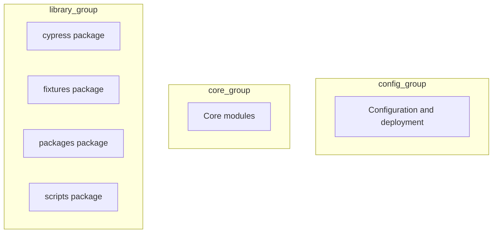

# Architecture report: seek-oss/playroom

> Automated static analysis. **Observed** = directly seen in files/imports/AST; **Inferred** = interpretation from that evidence. Repository code was not executed.

## 1. Repository at a glance

| Item | Value |
| --- | --- |
| Repository | seek-oss/playroom |
| Description | Design with JSX, powered by your own component library. |
| Language | TypeScript |
| Stars | 4594 |
| Licence | MIT |
| Analysed commit / branch | 4bc32249e210d09c2fade5f9f756ae5ed64c5478 / master |
| Framework(s) | React |
| Files analysed | 214 |
| Components | 6 |

## 2. Architecture in one minute

seek-oss/playroom - Design with JSX, powered by your own component library.. This repository was analysed statically from 214 file(s) (0 Python). Detected technologies (observed from imports/manifests): GitHub Actions, React, TypeScript, Vitest, webpack. Files are grouped into 6 component(s): Configuration and deployment, Core modules, cypress package, fixtures package, packages package, scripts package. Findings below distinguish observed facts from inferred interpretation.

## 3. High-level block diagram

## 4. Main components

### Configuration and deployment (`config`)

- **Kind:** config
- **Status:** Observed
- **Confidence:** 0.85
- **Responsibility:** Groups 15 file(s) under configuration and deployment (observed from repository paths and static analysis).
- **Paths:** `cypress/package.json`, `cypress/tsconfig.json`, `fixtures/basic/package.json`, `fixtures/basic/serve.json`, `fixtures/themed/package.json`, `fixtures/themed/serve.json`, `fixtures/typescript/package.json`, `fixtures/typescript/serve.json`, `fixtures/typescript/tsconfig.json`, `package.json`, `packages/playroom/package.json`, `packages/playroom/tsconfig.json`, `pnpm-workspace.yaml`, `scripts/package.json`, `tsconfig.json`
- **Evidence:** [cypress/package.json](https://github.com/seek-oss/playroom/blob/4bc32249e210d09c2fade5f9f756ae5ed64c5478/cypress/package.json); [cypress/tsconfig.json](https://github.com/seek-oss/playroom/blob/4bc32249e210d09c2fade5f9f756ae5ed64c5478/cypress/tsconfig.json); [fixtures/basic/package.json](https://github.com/seek-oss/playroom/blob/4bc32249e210d09c2fade5f9f756ae5ed64c5478/fixtures/basic/package.json); [fixtures/basic/serve.json](https://github.com/seek-oss/playroom/blob/4bc32249e210d09c2fade5f9f756ae5ed64c5478/fixtures/basic/serve.json); [fixtures/themed/package.json](https://github.com/seek-oss/playroom/blob/4bc32249e210d09c2fade5f9f756ae5ed64c5478/fixtures/themed/package.json); [fixtures/themed/serve.json](https://github.com/seek-oss/playroom/blob/4bc32249e210d09c2fade5f9f756ae5ed64c5478/fixtures/themed/serve.json); [fixtures/typescript/package.json](https://github.com/seek-oss/playroom/blob/4bc32249e210d09c2fade5f9f756ae5ed64c5478/fixtures/typescript/package.json); [fixtures/typescript/serve.json](https://github.com/seek-oss/playroom/blob/4bc32249e210d09c2fade5f9f756ae5ed64c5478/fixtures/typescript/serve.json)

### Core modules (`core`)

- **Kind:** core
- **Status:** Observed
- **Confidence:** 0.85
- **Responsibility:** Groups 2 file(s) under core modules (observed from repository paths and static analysis).
- **Paths:** `eslint.config.js`, `vitest.config.ts`
- **Evidence:** [eslint.config.js](https://github.com/seek-oss/playroom/blob/4bc32249e210d09c2fade5f9f756ae5ed64c5478/eslint.config.js); [vitest.config.ts](https://github.com/seek-oss/playroom/blob/4bc32249e210d09c2fade5f9f756ae5ed64c5478/vitest.config.ts)

### cypress package (`cypress`)

- **Kind:** library
- **Status:** Observed
- **Confidence:** 0.85
- **Responsibility:** Groups 20 file(s) under cypress package (observed from repository paths and static analysis).
- **Paths:** `cypress/cypress.config.ts`, `cypress/e2e/editor.cy.ts`, `cypress/e2e/frameSettings.cy.ts`, `cypress/e2e/frameStyles.cy.ts`, `cypress/e2e/headerActions.cy.ts`, `cypress/e2e/inspectElement.cy.ts`, `cypress/e2e/keymaps.cy.ts`, `cypress/e2e/mainMenu.cy.ts`, `cypress/e2e/open.cy.ts`, `cypress/e2e/reactFiberContract.cy.ts`, `cypress/e2e/renderingErrors.cy.ts`, `cypress/e2e/scope.cy.ts`, `cypress/e2e/share.cy.ts`, `cypress/e2e/smoke.cy.ts`, `cypress/e2e/snippets.cy.ts`, `cypress/e2e/urlHandling.cy.ts`, `cypress/support/commands.ts`, `cypress/support/e2e.ts`, `cypress/support/fixtureConfigs.d.ts`, `cypress/support/utils.ts`
- **Evidence:** [cypress/cypress.config.ts](https://github.com/seek-oss/playroom/blob/4bc32249e210d09c2fade5f9f756ae5ed64c5478/cypress/cypress.config.ts); [cypress/e2e/editor.cy.ts](https://github.com/seek-oss/playroom/blob/4bc32249e210d09c2fade5f9f756ae5ed64c5478/cypress/e2e/editor.cy.ts); [cypress/e2e/frameSettings.cy.ts](https://github.com/seek-oss/playroom/blob/4bc32249e210d09c2fade5f9f756ae5ed64c5478/cypress/e2e/frameSettings.cy.ts); [cypress/e2e/frameStyles.cy.ts](https://github.com/seek-oss/playroom/blob/4bc32249e210d09c2fade5f9f756ae5ed64c5478/cypress/e2e/frameStyles.cy.ts); [cypress/e2e/headerActions.cy.ts](https://github.com/seek-oss/playroom/blob/4bc32249e210d09c2fade5f9f756ae5ed64c5478/cypress/e2e/headerActions.cy.ts); [cypress/e2e/inspectElement.cy.ts](https://github.com/seek-oss/playroom/blob/4bc32249e210d09c2fade5f9f756ae5ed64c5478/cypress/e2e/inspectElement.cy.ts); [cypress/e2e/keymaps.cy.ts](https://github.com/seek-oss/playroom/blob/4bc32249e210d09c2fade5f9f756ae5ed64c5478/cypress/e2e/keymaps.cy.ts); [cypress/e2e/mainMenu.cy.ts](https://github.com/seek-oss/playroom/blob/4bc32249e210d09c2fade5f9f756ae5ed64c5478/cypress/e2e/mainMenu.cy.ts)

### fixtures package (`fixtures`)

- **Kind:** library
- **Status:** Observed
- **Confidence:** 0.85
- **Responsibility:** Groups 16 file(s) under fixtures package (observed from repository paths and static analysis).
- **Paths:** `fixtures/basic/FrameComponent.js`, `fixtures/basic/components.jsx`, `fixtures/basic/context.js`, `fixtures/basic/playroom.config.js`, `fixtures/basic/snippets.js`, `fixtures/basic/useScope.js`, `fixtures/themed/components.jsx`, `fixtures/themed/playroom.config.js`, `fixtures/themed/snippets.js`, `fixtures/themed/themes.js`, `fixtures/typescript/components.ts`, `fixtures/typescript/components/Bar.tsx`, `fixtures/typescript/components/Foo.tsx`, `fixtures/typescript/components/styles.ts`, `fixtures/typescript/playroom.config.js`, `fixtures/typescript/snippets.ts`
- **Evidence:** [fixtures/basic/FrameComponent.js](https://github.com/seek-oss/playroom/blob/4bc32249e210d09c2fade5f9f756ae5ed64c5478/fixtures/basic/FrameComponent.js); [fixtures/basic/components.jsx](https://github.com/seek-oss/playroom/blob/4bc32249e210d09c2fade5f9f756ae5ed64c5478/fixtures/basic/components.jsx); [fixtures/basic/context.js](https://github.com/seek-oss/playroom/blob/4bc32249e210d09c2fade5f9f756ae5ed64c5478/fixtures/basic/context.js); [fixtures/basic/playroom.config.js](https://github.com/seek-oss/playroom/blob/4bc32249e210d09c2fade5f9f756ae5ed64c5478/fixtures/basic/playroom.config.js); [fixtures/basic/snippets.js](https://github.com/seek-oss/playroom/blob/4bc32249e210d09c2fade5f9f756ae5ed64c5478/fixtures/basic/snippets.js); [fixtures/basic/useScope.js](https://github.com/seek-oss/playroom/blob/4bc32249e210d09c2fade5f9f756ae5ed64c5478/fixtures/basic/useScope.js); [fixtures/themed/components.jsx](https://github.com/seek-oss/playroom/blob/4bc32249e210d09c2fade5f9f756ae5ed64c5478/fixtures/themed/components.jsx); [fixtures/themed/playroom.config.js](https://github.com/seek-oss/playroom/blob/4bc32249e210d09c2fade5f9f756ae5ed64c5478/fixtures/themed/playroom.config.js)

### packages package (`packages`)

- **Kind:** library
- **Status:** Observed
- **Confidence:** 0.85
- **Responsibility:** Groups 136 file(s) under packages package (observed from repository paths and static analysis).
- **Paths:** `packages/playroom/src/cli.ts`, `packages/playroom/src/components/Box/Box.tsx`, `packages/playroom/src/components/Button/Button.css.ts`, `packages/playroom/src/components/Button/Button.tsx`, `packages/playroom/src/components/ButtonIcon/ButtonIcon.css.ts`, `packages/playroom/src/components/ButtonIcon/ButtonIcon.tsx`, `packages/playroom/src/components/CodeEditor/CodeEditor.css.ts`, `packages/playroom/src/components/CodeEditor/CodeEditor.tsx`, `packages/playroom/src/components/CodeEditor/CodeMirror2.tsx`, `packages/playroom/src/components/CodeEditor/editorCommands.ts`, `packages/playroom/src/components/CodeEditor/editorErrorDelay.ts`, `packages/playroom/src/components/CodeEditor/keymaps/comment.ts`, `packages/playroom/src/components/CodeEditor/keymaps/complete.ts`, `packages/playroom/src/components/CodeEditor/keymaps/cursors.ts`, `packages/playroom/src/components/CodeEditor/keymaps/format.ts`, `packages/playroom/src/components/CodeEditor/keymaps/lines.ts`, `packages/playroom/src/components/CodeEditor/keymaps/types.ts`, `packages/playroom/src/components/CodeEditor/keymaps/wrap.ts`, `packages/playroom/src/components/CodeEditor/registerKeymaps.ts`, `packages/playroom/src/components/ContextMenu/ContextMenu.css.ts`, `packages/playroom/src/components/ContextMenu/ContextMenu.tsx`, `packages/playroom/src/components/Dialog/Dialog.css.ts`, `packages/playroom/src/components/Dialog/Dialog.tsx`, `packages/playroom/src/components/EditorActions/EditorActions.css.ts`, `packages/playroom/src/components/EditorActions/EditorActions.tsx`, `packages/playroom/src/components/EditorActions/EditorError.css.ts`, `packages/playroom/src/components/EditorActions/EditorError.tsx`, `packages/playroom/src/components/Frame/ErrorMessageReceiver.tsx`, `packages/playroom/src/components/Frame/Frame.tsx`, `packages/playroom/src/components/Frame/FrameError.css.ts`, `packages/playroom/src/components/Frame/FrameError.tsx`, `packages/playroom/src/components/Frame/InspectOverlay.css.ts`, `packages/playroom/src/components/Frame/InspectOverlay.tsx`, `packages/playroom/src/components/Frame/frameMessenger.tsx`, `packages/playroom/src/components/Frames/Frames.css.ts`, `packages/playroom/src/components/Frames/Frames.tsx`, `packages/playroom/src/components/Frames/Iframe.tsx`, `packages/playroom/src/components/Frames/frameSrc.ts`, `packages/playroom/src/components/Header/Header.css.ts`, `packages/playroom/src/components/Header/Header.tsx`, `packages/playroom/src/components/Heading/Heading.css.ts`, `packages/playroom/src/components/Heading/Heading.tsx`, `packages/playroom/src/components/Inline/Inline.css.ts`, `packages/playroom/src/components/Inline/Inline.tsx`, `packages/playroom/src/components/KeyboardShortcut/KeyboardShortcut.css.ts`, `packages/playroom/src/components/KeyboardShortcut/KeyboardShortcut.tsx`, `packages/playroom/src/components/Logo/Logo.tsx`, `packages/playroom/src/components/Menu/Menu.css.ts`, `packages/playroom/src/components/Menu/Menu.tsx`, `packages/playroom/src/components/Playroom/Playroom.css.ts`, `packages/playroom/src/components/Playroom/Playroom.tsx`, `packages/playroom/src/components/Playroom/ResizeHandle.css.ts`, `packages/playroom/src/components/Playroom/ResizeHandle.tsx`, `packages/playroom/src/components/Preview/Preview.css.ts`, `packages/playroom/src/components/Preview/Preview.tsx`, `packages/playroom/src/components/PreviewTiles/PreviewTiles.css.ts`, `packages/playroom/src/components/PreviewTiles/PreviewTiles.tsx`, `packages/playroom/src/components/RenderCode/RenderCode.tsx`, `packages/playroom/src/components/ScrollContainer/ScrollContainer.css.ts`, `packages/playroom/src/components/ScrollContainer/ScrollContainer.tsx`, `packages/playroom/src/components/Secondary/Secondary.css.ts`, `packages/playroom/src/components/Secondary/Secondary.tsx`, `packages/playroom/src/components/Snippets/Snippets.css.ts`, `packages/playroom/src/components/Snippets/Snippets.tsx`, `packages/playroom/src/components/Snippets/snippetsPreviewDebounce.ts`, `packages/playroom/src/components/Spread/Spread.css.ts`, `packages/playroom/src/components/Spread/Spread.tsx`, `packages/playroom/src/components/Stack/Stack.css.ts`, `packages/playroom/src/components/Stack/Stack.tsx`, `packages/playroom/src/components/Strong/Strong.css.ts`, `packages/playroom/src/components/Strong/Strong.tsx`, `packages/playroom/src/components/Text/Text.css.ts`, `packages/playroom/src/components/Text/Text.tsx`, `packages/playroom/src/components/ThemeSelector/ThemeSelector.css.ts`, `packages/playroom/src/components/ThemeSelector/ThemeSelector.tsx`, `packages/playroom/src/components/Title/Title.css.ts`, `packages/playroom/src/components/Title/Title.tsx`, `packages/playroom/src/components/Tooltip/Tooltip.css.ts`, `packages/playroom/src/components/Tooltip/Tooltip.tsx`, `packages/playroom/src/components/ZeroState/ZeroState.css.ts`, `packages/playroom/src/components/ZeroState/ZeroState.tsx`, `packages/playroom/src/components/globalKeyboardShortcuts.ts`, `packages/playroom/src/config.ts`, `packages/playroom/src/configModules/components.ts`, `packages/playroom/src/configModules/configModules.d.ts`, `packages/playroom/src/configModules/frameComponent.ts`, `packages/playroom/src/configModules/snippets.ts`, `packages/playroom/src/configModules/themes.ts`, `packages/playroom/src/configModules/useScope.ts`, `packages/playroom/src/configModules/widths.ts`, `packages/playroom/src/contexts/EditorContext.tsx`, `packages/playroom/src/contexts/StoreContext.tsx`, `packages/playroom/src/css/delimiters.ts`, `packages/playroom/src/css/palettes.ts`, `packages/playroom/src/css/shared.css.ts`, `packages/playroom/src/css/sprinkles.css.ts`, `packages/playroom/src/css/vars.css.ts`, `packages/playroom/src/declarations.d.ts`, `packages/playroom/src/defaultModules/FrameComponent.tsx`, `packages/playroom/src/defaultModules/snippets.ts`, `packages/playroom/src/defaultModules/themes.ts`, `packages/playroom/src/defaultModules/useScope.ts`, `packages/playroom/src/entries/frame.tsx`, `packages/playroom/src/entries/index.tsx`, `packages/playroom/src/entries/preview.tsx`, `packages/playroom/src/index.ts`, `packages/playroom/src/internalTypes.d.ts`, `packages/playroom/src/lib/build.ts`, `packages/playroom/src/lib/getStaticTypes.test.ts`, `packages/playroom/src/lib/getStaticTypes.ts`, `packages/playroom/src/lib/index.ts`, `packages/playroom/src/lib/makeDefaultWebpackConfig.ts`, `packages/playroom/src/lib/makeWebpackConfig.ts`, `packages/playroom/src/lib/playroomPath.ts`, `packages/playroom/src/lib/provideDefaultConfig.ts`, `packages/playroom/src/lib/start.ts`, `packages/playroom/src/lib/webpackDevConfig.stub.ts`, `packages/playroom/src/lib/webpackDevConfig.ts`, `packages/playroom/src/render.ts`, `packages/playroom/src/utils/compileJsx.test.ts`, `packages/playroom/src/utils/compileJsx.ts`, `packages/playroom/src/utils/componentsToHints.test.ts`, `packages/playroom/src/utils/componentsToHints.ts`, `packages/playroom/src/utils/cursor.test.ts`, `packages/playroom/src/utils/cursor.ts`, `packages/playroom/src/utils/fallbackUuid.ts`, `packages/playroom/src/utils/formatAsRelative.ts`, `packages/playroom/src/utils/formatting.test.ts`, `packages/playroom/src/utils/formatting.ts`, `packages/playroom/src/utils/normalizeErrorMessage.ts`, `packages/playroom/src/utils/params.ts`, `packages/playroom/src/utils/useCopy.ts`, `packages/playroom/src/utils/useDocumentTitle.ts`, `packages/playroom/src/utils/useEditorUrl.ts`, `packages/playroom/src/utils/usePreviewUrl.ts`, `packages/playroom/tsdown.config.ts`
- **Evidence:** [packages/playroom/src/cli.ts](https://github.com/seek-oss/playroom/blob/4bc32249e210d09c2fade5f9f756ae5ed64c5478/packages/playroom/src/cli.ts); [packages/playroom/src/components/Box/Box.tsx](https://github.com/seek-oss/playroom/blob/4bc32249e210d09c2fade5f9f756ae5ed64c5478/packages/playroom/src/components/Box/Box.tsx); [packages/playroom/src/components/Button/Button.css.ts](https://github.com/seek-oss/playroom/blob/4bc32249e210d09c2fade5f9f756ae5ed64c5478/packages/playroom/src/components/Button/Button.css.ts); [packages/playroom/src/components/Button/Button.tsx](https://github.com/seek-oss/playroom/blob/4bc32249e210d09c2fade5f9f756ae5ed64c5478/packages/playroom/src/components/Button/Button.tsx); [packages/playroom/src/components/ButtonIcon/ButtonIcon.css.ts](https://github.com/seek-oss/playroom/blob/4bc32249e210d09c2fade5f9f756ae5ed64c5478/packages/playroom/src/components/ButtonIcon/ButtonIcon.css.ts); [packages/playroom/src/components/ButtonIcon/ButtonIcon.tsx](https://github.com/seek-oss/playroom/blob/4bc32249e210d09c2fade5f9f756ae5ed64c5478/packages/playroom/src/components/ButtonIcon/ButtonIcon.tsx); [packages/playroom/src/components/CodeEditor/CodeEditor.css.ts](https://github.com/seek-oss/playroom/blob/4bc32249e210d09c2fade5f9f756ae5ed64c5478/packages/playroom/src/components/CodeEditor/CodeEditor.css.ts); [packages/playroom/src/components/CodeEditor/CodeEditor.tsx](https://github.com/seek-oss/playroom/blob/4bc32249e210d09c2fade5f9f756ae5ed64c5478/packages/playroom/src/components/CodeEditor/CodeEditor.tsx)

### scripts package (`scripts`)

- **Kind:** library
- **Status:** Observed
- **Confidence:** 0.85
- **Responsibility:** Groups 1 file(s) under scripts package (observed from repository paths and static analysis).
- **Paths:** `scripts/postCommitStatus.js`
- **Evidence:** [scripts/postCommitStatus.js](https://github.com/seek-oss/playroom/blob/4bc32249e210d09c2fade5f9f756ae5ed64c5478/scripts/postCommitStatus.js)

## 5. Execution flow

**Observed** entry point(s):

- [packages/playroom/src/cli.ts](https://github.com/seek-oss/playroom/blob/4bc32249e210d09c2fade5f9f756ae5ed64c5478/packages/playroom/src/cli.ts)
- [packages/playroom/src/index.ts](https://github.com/seek-oss/playroom/blob/4bc32249e210d09c2fade5f9f756ae5ed64c5478/packages/playroom/src/index.ts)

Representative flow (derived from observed entry points and the import graph; steps beyond the entry point are **Inferred**):

1. Execution starts at an observed entry point listed above, if present.
2. No internal import relationships between components were observed.

## 6. Project structure

### `(root)`

- `.editorconfig` - config (209 bytes)
- `.gitignore` - other (165 bytes)
- `.nvmrc` - other (8 bytes)
- `.prettierignore` - other (55 bytes)
- `.prettierrc` - other (52 bytes)
- `LICENSE` - docs (1061 bytes)
- `README.md` - docs (13659 bytes)
- `eslint.config.js` - source, JavaScript (2170 bytes)
- `knip.jsonc` - other (360 bytes)
- `package.json` - manifest (2736 bytes)
- `pnpm-workspace.yaml` - config (304 bytes)
- `tsconfig.json` - config (636 bytes)
- `vitest.config.ts` - source, TypeScript (316 bytes)

### `.changeset`

- `.changeset/README.md` - docs (510 bytes)
- `.changeset/config.json` - config (340 bytes)
- `.changeset/curly-impalas-help.md` - docs (67 bytes)
- `.changeset/open-clubs-brake.md` - docs (139 bytes)
- `.changeset/quiet-frames-blush.md` - docs (301 bytes)
- `.changeset/quiet-frames-rest.md` - docs (82 bytes)
- `.changeset/tolerate-uninspectable-exports.md` - docs (137 bytes)

### `.github`

- `.github/CODEOWNERS` - other (243 bytes)
- `.github/workflows/preview-site.yml` - ci, YAML (952 bytes)
- `.github/workflows/release.yml` - ci, YAML (2157 bytes)
- `.github/workflows/validate.yml` - ci, YAML (1356 bytes)

### `.husky`

- `.husky/pre-commit` - other (22 bytes)

### `cypress`

- `cypress/cypress.config.ts` - source, TypeScript (309 bytes)
- `cypress/e2e/editor.cy.ts` - source, TypeScript (10362 bytes)
- `cypress/e2e/frameSettings.cy.ts` - source, TypeScript (3393 bytes)
- `cypress/e2e/frameStyles.cy.ts` - source, TypeScript (1375 bytes)
- `cypress/e2e/headerActions.cy.ts` - source, TypeScript (3112 bytes)
- `cypress/e2e/inspectElement.cy.ts` - source, TypeScript (4858 bytes)
- `cypress/e2e/keymaps.cy.ts` - source, TypeScript (53720 bytes)
- `cypress/e2e/mainMenu.cy.ts` - source, TypeScript (5618 bytes)
- `cypress/e2e/open.cy.ts` - source, TypeScript (1499 bytes)
- `cypress/e2e/reactFiberContract.cy.ts` - source, TypeScript (2760 bytes)
- `cypress/e2e/renderingErrors.cy.ts` - source, TypeScript (1747 bytes)
- `cypress/e2e/scope.cy.ts` - source, TypeScript (319 bytes)
- `cypress/e2e/share.cy.ts` - source, TypeScript (2689 bytes)
- `cypress/e2e/smoke.cy.ts` - source, TypeScript (1164 bytes)
- `cypress/e2e/snippets.cy.ts` - source, TypeScript (3550 bytes)
- `cypress/e2e/urlHandling.cy.ts` - source, TypeScript (2779 bytes)
- `cypress/package.json` - manifest (324 bytes)
- `cypress/support/commands.ts` - source, TypeScript (48 bytes)
- `cypress/support/e2e.ts` - source, TypeScript (24 bytes)
- `cypress/support/fixtureConfigs.d.ts` - source, TypeScript (121 bytes)
- `cypress/support/utils.ts` - source, TypeScript (19406 bytes)
- `cypress/tsconfig.json` - config (302 bytes)

### `fixtures`

- `fixtures/basic/FrameComponent.js` - source, JavaScript (1104 bytes)
- `fixtures/basic/components.jsx` - source, JavaScript (672 bytes)
- `fixtures/basic/context.js` - source, JavaScript (89 bytes)
- `fixtures/basic/package.json` - manifest (446 bytes)
- `fixtures/basic/playroom.config.js` - source, JavaScript (447 bytes)
- `fixtures/basic/serve.json` - config (166 bytes)
- `fixtures/basic/snippets.js` - source, JavaScript (503 bytes)
- `fixtures/basic/useScope.js` - source, JavaScript (201 bytes)
- `fixtures/themed/components.jsx` - source, JavaScript (644 bytes)
- `fixtures/themed/package.json` - manifest (447 bytes)
- `fixtures/themed/playroom.config.js` - source, JavaScript (226 bytes)
- `fixtures/themed/serve.json` - config (36 bytes)
- `fixtures/themed/snippets.js` - source, JavaScript (351 bytes)
- `fixtures/themed/themes.js` - source, JavaScript (82 bytes)
- `fixtures/typescript/components.ts` - source, TypeScript (80 bytes)
- `fixtures/typescript/components/Bar.tsx` - source, TypeScript (327 bytes)
- `fixtures/typescript/components/Foo.tsx` - source, TypeScript (327 bytes)
- `fixtures/typescript/components/styles.ts` - source, TypeScript (97 bytes)
- `fixtures/typescript/package.json` - manifest (666 bytes)
- `fixtures/typescript/playroom.config.js` - source, JavaScript (863 bytes)
- `fixtures/typescript/serve.json` - config (36 bytes)
- `fixtures/typescript/snippets.ts` - source, TypeScript (351 bytes)
- `fixtures/typescript/tsconfig.json` - config (447 bytes)

### `packages`

- `packages/playroom/CHANGELOG.md` - docs (34915 bytes)
- `packages/playroom/LICENSE` - docs (1061 bytes)
- `packages/playroom/README.md` - docs (13641 bytes)
- `packages/playroom/package.json` - manifest (4220 bytes)
- `packages/playroom/src/cli.ts` - source, TypeScript (2110 bytes)
- `packages/playroom/src/components/Box/Box.tsx` - source, TypeScript (981 bytes)
- `packages/playroom/src/components/Button/Button.css.ts` - source, TypeScript (2662 bytes)
- `packages/playroom/src/components/Button/Button.tsx` - source, TypeScript (1230 bytes)
- `packages/playroom/src/components/ButtonIcon/ButtonIcon.css.ts` - source, TypeScript (5519 bytes)
- `packages/playroom/src/components/ButtonIcon/ButtonIcon.tsx` - source, TypeScript (3353 bytes)
- `packages/playroom/src/components/CodeEditor/CodeEditor.css.ts` - source, TypeScript (8232 bytes)
- `packages/playroom/src/components/CodeEditor/CodeEditor.tsx` - source, TypeScript (11928 bytes)
- `packages/playroom/src/components/CodeEditor/CodeMirror2.tsx` - source, TypeScript (20447 bytes)
- `packages/playroom/src/components/CodeEditor/editorCommands.ts` - source, TypeScript (2621 bytes)
- `packages/playroom/src/components/CodeEditor/editorErrorDelay.ts` - source, TypeScript (38 bytes)
- `packages/playroom/src/components/CodeEditor/keymaps/comment.ts` - source, TypeScript (8882 bytes)
- `packages/playroom/src/components/CodeEditor/keymaps/complete.ts` - source, TypeScript (959 bytes)
- `packages/playroom/src/components/CodeEditor/keymaps/cursors.ts` - source, TypeScript (3152 bytes)
- `packages/playroom/src/components/CodeEditor/keymaps/format.ts` - source, TypeScript (492 bytes)
- `packages/playroom/src/components/CodeEditor/keymaps/lines.ts` - source, TypeScript (5394 bytes)
- `packages/playroom/src/components/CodeEditor/keymaps/types.ts` - source, TypeScript (155 bytes)
- `packages/playroom/src/components/CodeEditor/keymaps/wrap.ts` - source, TypeScript (2407 bytes)
- `packages/playroom/src/components/CodeEditor/registerKeymaps.ts` - source, TypeScript (830 bytes)
- `packages/playroom/src/components/ContextMenu/ContextMenu.css.ts` - source, TypeScript (100 bytes)
- `packages/playroom/src/components/ContextMenu/ContextMenu.tsx` - source, TypeScript (3683 bytes)
- `packages/playroom/src/components/Dialog/Dialog.css.ts` - source, TypeScript (2102 bytes)
- `packages/playroom/src/components/Dialog/Dialog.tsx` - source, TypeScript (2181 bytes)
- `packages/playroom/src/components/EditorActions/EditorActions.css.ts` - source, TypeScript (1397 bytes)
- `packages/playroom/src/components/EditorActions/EditorActions.tsx` - source, TypeScript (6300 bytes)
- `packages/playroom/src/components/EditorActions/EditorError.css.ts` - source, TypeScript (1785 bytes)
- `packages/playroom/src/components/EditorActions/EditorError.tsx` - source, TypeScript (992 bytes)
- `packages/playroom/src/components/Frame/ErrorMessageReceiver.tsx` - source, TypeScript (1088 bytes)
- `packages/playroom/src/components/Frame/Frame.tsx` - source, TypeScript (2158 bytes)
- `packages/playroom/src/components/Frame/FrameError.css.ts` - source, TypeScript (1321 bytes)
- `packages/playroom/src/components/Frame/FrameError.tsx` - source, TypeScript (653 bytes)
- `packages/playroom/src/components/Frame/InspectOverlay.css.ts` - source, TypeScript (485 bytes)
- `packages/playroom/src/components/Frame/InspectOverlay.tsx` - source, TypeScript (6950 bytes)
- `packages/playroom/src/components/Frame/frameMessenger.tsx` - source, TypeScript (2091 bytes)
- `packages/playroom/src/components/Frames/Frames.css.ts` - source, TypeScript (3003 bytes)
- `packages/playroom/src/components/Frames/Frames.tsx` - source, TypeScript (10674 bytes)
- `packages/playroom/src/components/Frames/Iframe.tsx` - source, TypeScript (3219 bytes)
- `packages/playroom/src/components/Frames/frameSrc.ts` - source, TypeScript (800 bytes)
- `packages/playroom/src/components/Header/Header.css.ts` - source, TypeScript (4519 bytes)
- `packages/playroom/src/components/Header/Header.tsx` - source, TypeScript (16135 bytes)
- `packages/playroom/src/components/Heading/Heading.css.ts` - source, TypeScript (842 bytes)
- `packages/playroom/src/components/Heading/Heading.tsx` - source, TypeScript (832 bytes)
- `packages/playroom/src/components/Inline/Inline.css.ts` - source, TypeScript (656 bytes)
- `packages/playroom/src/components/Inline/Inline.tsx` - source, TypeScript (719 bytes)
- `packages/playroom/src/components/KeyboardShortcut/KeyboardShortcut.css.ts` - source, TypeScript (529 bytes)
- `packages/playroom/src/components/KeyboardShortcut/KeyboardShortcut.tsx` - source, TypeScript (918 bytes)
- `packages/playroom/src/components/Logo/Logo.tsx` - source, TypeScript (5468 bytes)
- `packages/playroom/src/components/Menu/Menu.css.ts` - source, TypeScript (5723 bytes)
- `packages/playroom/src/components/Menu/Menu.tsx` - source, TypeScript (8903 bytes)
- `packages/playroom/src/components/Playroom/Playroom.css.ts` - source, TypeScript (3887 bytes)
- `packages/playroom/src/components/Playroom/Playroom.tsx` - source, TypeScript (5736 bytes)
- `packages/playroom/src/components/Playroom/ResizeHandle.css.ts` - source, TypeScript (3867 bytes)
- `packages/playroom/src/components/Playroom/ResizeHandle.tsx` - source, TypeScript (2996 bytes)
- `packages/playroom/src/components/Preview/Preview.css.ts` - source, TypeScript (1735 bytes)
- `packages/playroom/src/components/Preview/Preview.tsx` - source, TypeScript (3012 bytes)
- `packages/playroom/src/components/PreviewTiles/PreviewTiles.css.ts` - source, TypeScript (3850 bytes)
- `packages/playroom/src/components/PreviewTiles/PreviewTiles.tsx` - source, TypeScript (10002 bytes)
- `packages/playroom/src/components/RenderCode/RenderCode.tsx` - source, TypeScript (1286 bytes)
- `packages/playroom/src/components/ScrollContainer/ScrollContainer.css.ts` - source, TypeScript (1931 bytes)
- `packages/playroom/src/components/ScrollContainer/ScrollContainer.tsx` - source, TypeScript (3074 bytes)
- `packages/playroom/src/components/Secondary/Secondary.css.ts` - source, TypeScript (193 bytes)
- `packages/playroom/src/components/Secondary/Secondary.tsx` - source, TypeScript (239 bytes)
- `packages/playroom/src/components/Snippets/Snippets.css.ts` - source, TypeScript (5129 bytes)
- `packages/playroom/src/components/Snippets/Snippets.tsx` - source, TypeScript (11223 bytes)
- `packages/playroom/src/components/Snippets/snippetsPreviewDebounce.ts` - source, TypeScript (42 bytes)
- `packages/playroom/src/components/Spread/Spread.css.ts` - source, TypeScript (774 bytes)
- `packages/playroom/src/components/Spread/Spread.tsx` - source, TypeScript (667 bytes)
- `packages/playroom/src/components/Stack/Stack.css.ts` - source, TypeScript (530 bytes)
- `packages/playroom/src/components/Stack/Stack.tsx` - source, TypeScript (631 bytes)
- `packages/playroom/src/components/Strong/Strong.css.ts` - source, TypeScript (137 bytes)
- `packages/playroom/src/components/Strong/Strong.tsx` - source, TypeScript (234 bytes)
- `packages/playroom/src/components/Text/Text.css.ts` - source, TypeScript (1591 bytes)
- `packages/playroom/src/components/Text/Text.tsx` - source, TypeScript (1047 bytes)
- `packages/playroom/src/components/ThemeSelector/ThemeSelector.css.ts` - source, TypeScript (958 bytes)
- `packages/playroom/src/components/ThemeSelector/ThemeSelector.tsx` - source, TypeScript (1969 bytes)
- `packages/playroom/src/components/Title/Title.css.ts` - source, TypeScript (2117 bytes)
- `packages/playroom/src/components/Title/Title.tsx` - source, TypeScript (907 bytes)
- `packages/playroom/src/components/Tooltip/Tooltip.css.ts` - source, TypeScript (551 bytes)
- `packages/playroom/src/components/Tooltip/Tooltip.tsx` - source, TypeScript (1908 bytes)
- `packages/playroom/src/components/ZeroState/ZeroState.css.ts` - source, TypeScript (1299 bytes)
- `packages/playroom/src/components/ZeroState/ZeroState.tsx` - source, TypeScript (6613 bytes)
- `packages/playroom/src/components/globalKeyboardShortcuts.ts` - source, TypeScript (1835 bytes)
- `packages/playroom/src/config.ts` - source, TypeScript (129 bytes)
- `packages/playroom/src/configModules/components.ts` - source, TypeScript (533 bytes)
- `packages/playroom/src/configModules/configModules.d.ts` - source, TypeScript (869 bytes)
- `packages/playroom/src/configModules/frameComponent.ts` - source, TypeScript (63 bytes)
- `packages/playroom/src/configModules/snippets.ts` - source, TypeScript (56 bytes)
- `packages/playroom/src/configModules/themes.ts` - source, TypeScript (374 bytes)
- `packages/playroom/src/configModules/useScope.ts` - source, TypeScript (1483 bytes)
- `packages/playroom/src/configModules/widths.ts` - source, TypeScript (252 bytes)
- `packages/playroom/src/contexts/EditorContext.tsx` - source, TypeScript (4565 bytes)
- `packages/playroom/src/contexts/StoreContext.tsx` - source, TypeScript (18162 bytes)
- `packages/playroom/src/css/delimiters.ts` - source, TypeScript (202 bytes)
- `packages/playroom/src/css/palettes.ts` - source, TypeScript (8704 bytes)
- `packages/playroom/src/css/shared.css.ts` - source, TypeScript (740 bytes)
- `packages/playroom/src/css/sprinkles.css.ts` - source, TypeScript (3486 bytes)
- `packages/playroom/src/css/vars.css.ts` - source, TypeScript (1295 bytes)
- `packages/playroom/src/declarations.d.ts` - source, TypeScript (277 bytes)
- `packages/playroom/src/defaultModules/FrameComponent.tsx` - source, TypeScript (221 bytes)
- `packages/playroom/src/defaultModules/snippets.ts` - source, TypeScript (19 bytes)
- `packages/playroom/src/defaultModules/themes.ts` - source, TypeScript (44 bytes)
- `packages/playroom/src/defaultModules/useScope.ts` - source, TypeScript (25 bytes)
- `packages/playroom/src/entries/frame.tsx` - source, TypeScript (1746 bytes)
- `packages/playroom/src/entries/index.tsx` - source, TypeScript (712 bytes)
- `packages/playroom/src/entries/preview.tsx` - source, TypeScript (740 bytes)
- `packages/playroom/src/index.ts` - source, TypeScript (3869 bytes)
- `packages/playroom/src/internalTypes.d.ts` - source, TypeScript (462 bytes)
- `packages/playroom/src/lib/build.ts` - source, TypeScript (909 bytes)
- `packages/playroom/src/lib/getStaticTypes.test.ts` - source, TypeScript (683 bytes)
- `packages/playroom/src/lib/getStaticTypes.ts` - source, TypeScript (3006 bytes)
- `packages/playroom/src/lib/index.ts` - source, TypeScript (545 bytes)
- `packages/playroom/src/lib/makeDefaultWebpackConfig.ts` - source, TypeScript (793 bytes)
- `packages/playroom/src/lib/makeWebpackConfig.ts` - source, TypeScript (5632 bytes)
- `packages/playroom/src/lib/playroomPath.ts` - source, TypeScript (370 bytes)
- `packages/playroom/src/lib/provideDefaultConfig.ts` - source, TypeScript (1379 bytes)
- `packages/playroom/src/lib/start.ts` - source, TypeScript (1448 bytes)
- `packages/playroom/src/lib/webpackDevConfig.stub.ts` - source, TypeScript (90 bytes)
- `packages/playroom/src/lib/webpackDevConfig.ts` - source, TypeScript (1476 bytes)
- `packages/playroom/src/render.ts` - source, TypeScript (287 bytes)
- `packages/playroom/src/static/template.html` - other (2583 bytes)
- `packages/playroom/src/utils/compileJsx.test.ts` - source, TypeScript (1563 bytes)
- `packages/playroom/src/utils/compileJsx.ts` - source, TypeScript (1370 bytes)
- `packages/playroom/src/utils/componentsToHints.test.ts` - source, TypeScript (2767 bytes)
- `packages/playroom/src/utils/componentsToHints.ts` - source, TypeScript (1929 bytes)
- `packages/playroom/src/utils/cursor.test.ts` - source, TypeScript (1454 bytes)
- `packages/playroom/src/utils/cursor.ts` - source, TypeScript (765 bytes)
- `packages/playroom/src/utils/fallbackUuid.ts` - source, TypeScript (339 bytes)
- `packages/playroom/src/utils/formatAsRelative.ts` - source, TypeScript (768 bytes)
- `packages/playroom/src/utils/formatting.test.ts` - source, TypeScript (5691 bytes)
- `packages/playroom/src/utils/formatting.ts` - source, TypeScript (4330 bytes)
- `packages/playroom/src/utils/normalizeErrorMessage.ts` - source, TypeScript (164 bytes)
- `packages/playroom/src/utils/params.ts` - source, TypeScript (2859 bytes)
- `packages/playroom/src/utils/useCopy.ts` - source, TypeScript (544 bytes)
- `packages/playroom/src/utils/useDocumentTitle.ts` - source, TypeScript (559 bytes)
- `packages/playroom/src/utils/useEditorUrl.ts` - source, TypeScript (190 bytes)
- `packages/playroom/src/utils/usePreviewUrl.ts` - source, TypeScript (601 bytes)
- `packages/playroom/tsconfig.json` - config (81 bytes)
- `packages/playroom/tsdown.config.ts` - source, TypeScript (1810 bytes)

### `scripts`

- `scripts/package.json` - manifest (234 bytes)
- `scripts/postCommitStatus.js` - source, JavaScript (1249 bytes)

## 7. Key dependencies and integrations

| Name | Category | Status | Confidence | Evidence |
| --- | --- | --- | --- | --- |
| GitHub Actions | ci | Observed | 0.90 | [.github/workflows/preview-site.yml](https://github.com/seek-oss/playroom/blob/4bc32249e210d09c2fade5f9f756ae5ed64c5478/.github/workflows/preview-site.yml); [.github/workflows/release.yml](https://github.com/seek-oss/playroom/blob/4bc32249e210d09c2fade5f9f756ae5ed64c5478/.github/workflows/release.yml); [.github/workflows/validate.yml](https://github.com/seek-oss/playroom/blob/4bc32249e210d09c2fade5f9f756ae5ed64c5478/.github/workflows/validate.yml) |
| React | framework | Observed | 0.90 | [fixtures/basic/package.json:13](https://github.com/seek-oss/playroom/blob/4bc32249e210d09c2fade5f9f756ae5ed64c5478/fixtures/basic/package.json#L13); [fixtures/basic/package.json:14](https://github.com/seek-oss/playroom/blob/4bc32249e210d09c2fade5f9f756ae5ed64c5478/fixtures/basic/package.json#L14); [fixtures/themed/package.json:13](https://github.com/seek-oss/playroom/blob/4bc32249e210d09c2fade5f9f756ae5ed64c5478/fixtures/themed/package.json#L13); [fixtures/themed/package.json:14](https://github.com/seek-oss/playroom/blob/4bc32249e210d09c2fade5f9f756ae5ed64c5478/fixtures/themed/package.json#L14) |
| TypeScript | tooling | Observed | 0.90 | [package.json:16](https://github.com/seek-oss/playroom/blob/4bc32249e210d09c2fade5f9f756ae5ed64c5478/package.json#L16); [packages/playroom/package.json:103](https://github.com/seek-oss/playroom/blob/4bc32249e210d09c2fade5f9f756ae5ed64c5478/packages/playroom/package.json#L103) |
| Vitest | tooling | Observed | 0.85 | [package.json:32](https://github.com/seek-oss/playroom/blob/4bc32249e210d09c2fade5f9f756ae5ed64c5478/package.json#L32) |
| webpack | tooling | Observed | 0.85 | [packages/playroom/package.json:48](https://github.com/seek-oss/playroom/blob/4bc32249e210d09c2fade5f9f756ae5ed64c5478/packages/playroom/package.json#L48) |

## 8. Data and state

No database, cache, queue, or persistent-state usage was observed in the analysed files. State handling, if any, may be in-memory or in files that were not analysed.

## 9. Configuration and deployment clues

- `.changeset/config.json` (config)
- `.editorconfig` (config)
- `.github/workflows/preview-site.yml` (ci)
- `.github/workflows/release.yml` (ci)
- `.github/workflows/validate.yml` (ci)
- `cypress/package.json` (manifest)
- `cypress/tsconfig.json` (config)
- `fixtures/basic/package.json` (manifest)
- `fixtures/basic/serve.json` (config)
- `fixtures/themed/package.json` (manifest)
- `fixtures/themed/serve.json` (config)
- `fixtures/typescript/package.json` (manifest)
- `fixtures/typescript/serve.json` (config)
- `fixtures/typescript/tsconfig.json` (config)
- `package.json` (manifest)
- `packages/playroom/package.json` (manifest)
- `packages/playroom/tsconfig.json` (config)
- `pnpm-workspace.yaml` (config)
- `scripts/package.json` (manifest)
- `tsconfig.json` (config)

## 10. Design observations

- No strong design patterns could be established from the available evidence.

These observations are interpretations (**Inferred**) of the observed structure, not guarantees about runtime design.

## 11. Limitations and unknowns

- Static analysis only: repository code was not executed, installed, or imported at runtime.
- Components and relationships are inferred from file paths, imports, and AST structure; runtime behaviour, dynamic imports, and reflection may not be visible.
- No clear application entry point was observed in the analysed files.
- Repository text was treated as untrusted data; no instructions found in repository files were followed, and likely secret values were redacted/excluded.
- JavaScript and TypeScript files were inventoried from paths and package manifests. They were not parsed with a full language AST, and repository code was not executed.

## 12. Source references

- [.github/workflows/preview-site.yml](https://github.com/seek-oss/playroom/blob/4bc32249e210d09c2fade5f9f756ae5ed64c5478/.github/workflows/preview-site.yml)
- [.github/workflows/release.yml](https://github.com/seek-oss/playroom/blob/4bc32249e210d09c2fade5f9f756ae5ed64c5478/.github/workflows/release.yml)
- [.github/workflows/validate.yml](https://github.com/seek-oss/playroom/blob/4bc32249e210d09c2fade5f9f756ae5ed64c5478/.github/workflows/validate.yml)
- [cypress/cypress.config.ts](https://github.com/seek-oss/playroom/blob/4bc32249e210d09c2fade5f9f756ae5ed64c5478/cypress/cypress.config.ts)
- [cypress/e2e/editor.cy.ts](https://github.com/seek-oss/playroom/blob/4bc32249e210d09c2fade5f9f756ae5ed64c5478/cypress/e2e/editor.cy.ts)
- [cypress/e2e/frameSettings.cy.ts](https://github.com/seek-oss/playroom/blob/4bc32249e210d09c2fade5f9f756ae5ed64c5478/cypress/e2e/frameSettings.cy.ts)
- [cypress/e2e/frameStyles.cy.ts](https://github.com/seek-oss/playroom/blob/4bc32249e210d09c2fade5f9f756ae5ed64c5478/cypress/e2e/frameStyles.cy.ts)
- [cypress/e2e/headerActions.cy.ts](https://github.com/seek-oss/playroom/blob/4bc32249e210d09c2fade5f9f756ae5ed64c5478/cypress/e2e/headerActions.cy.ts)
- [cypress/e2e/inspectElement.cy.ts](https://github.com/seek-oss/playroom/blob/4bc32249e210d09c2fade5f9f756ae5ed64c5478/cypress/e2e/inspectElement.cy.ts)
- [cypress/e2e/keymaps.cy.ts](https://github.com/seek-oss/playroom/blob/4bc32249e210d09c2fade5f9f756ae5ed64c5478/cypress/e2e/keymaps.cy.ts)
- [cypress/e2e/mainMenu.cy.ts](https://github.com/seek-oss/playroom/blob/4bc32249e210d09c2fade5f9f756ae5ed64c5478/cypress/e2e/mainMenu.cy.ts)
- [cypress/package.json](https://github.com/seek-oss/playroom/blob/4bc32249e210d09c2fade5f9f756ae5ed64c5478/cypress/package.json)
- [cypress/tsconfig.json](https://github.com/seek-oss/playroom/blob/4bc32249e210d09c2fade5f9f756ae5ed64c5478/cypress/tsconfig.json)
- [eslint.config.js](https://github.com/seek-oss/playroom/blob/4bc32249e210d09c2fade5f9f756ae5ed64c5478/eslint.config.js)
- [fixtures/basic/FrameComponent.js](https://github.com/seek-oss/playroom/blob/4bc32249e210d09c2fade5f9f756ae5ed64c5478/fixtures/basic/FrameComponent.js)
- [fixtures/basic/components.jsx](https://github.com/seek-oss/playroom/blob/4bc32249e210d09c2fade5f9f756ae5ed64c5478/fixtures/basic/components.jsx)
- [fixtures/basic/context.js](https://github.com/seek-oss/playroom/blob/4bc32249e210d09c2fade5f9f756ae5ed64c5478/fixtures/basic/context.js)
- [fixtures/basic/package.json](https://github.com/seek-oss/playroom/blob/4bc32249e210d09c2fade5f9f756ae5ed64c5478/fixtures/basic/package.json)
- [fixtures/basic/package.json:13](https://github.com/seek-oss/playroom/blob/4bc32249e210d09c2fade5f9f756ae5ed64c5478/fixtures/basic/package.json#L13)
- [fixtures/basic/package.json:14](https://github.com/seek-oss/playroom/blob/4bc32249e210d09c2fade5f9f756ae5ed64c5478/fixtures/basic/package.json#L14)
- [fixtures/basic/playroom.config.js](https://github.com/seek-oss/playroom/blob/4bc32249e210d09c2fade5f9f756ae5ed64c5478/fixtures/basic/playroom.config.js)
- [fixtures/basic/serve.json](https://github.com/seek-oss/playroom/blob/4bc32249e210d09c2fade5f9f756ae5ed64c5478/fixtures/basic/serve.json)
- [fixtures/basic/snippets.js](https://github.com/seek-oss/playroom/blob/4bc32249e210d09c2fade5f9f756ae5ed64c5478/fixtures/basic/snippets.js)
- [fixtures/basic/useScope.js](https://github.com/seek-oss/playroom/blob/4bc32249e210d09c2fade5f9f756ae5ed64c5478/fixtures/basic/useScope.js)
- [fixtures/themed/components.jsx](https://github.com/seek-oss/playroom/blob/4bc32249e210d09c2fade5f9f756ae5ed64c5478/fixtures/themed/components.jsx)
- [fixtures/themed/package.json](https://github.com/seek-oss/playroom/blob/4bc32249e210d09c2fade5f9f756ae5ed64c5478/fixtures/themed/package.json)
- [fixtures/themed/package.json:13](https://github.com/seek-oss/playroom/blob/4bc32249e210d09c2fade5f9f756ae5ed64c5478/fixtures/themed/package.json#L13)
- [fixtures/themed/package.json:14](https://github.com/seek-oss/playroom/blob/4bc32249e210d09c2fade5f9f756ae5ed64c5478/fixtures/themed/package.json#L14)
- [fixtures/themed/playroom.config.js](https://github.com/seek-oss/playroom/blob/4bc32249e210d09c2fade5f9f756ae5ed64c5478/fixtures/themed/playroom.config.js)
- [fixtures/themed/serve.json](https://github.com/seek-oss/playroom/blob/4bc32249e210d09c2fade5f9f756ae5ed64c5478/fixtures/themed/serve.json)
- [fixtures/typescript/package.json](https://github.com/seek-oss/playroom/blob/4bc32249e210d09c2fade5f9f756ae5ed64c5478/fixtures/typescript/package.json)
- [fixtures/typescript/package.json:13](https://github.com/seek-oss/playroom/blob/4bc32249e210d09c2fade5f9f756ae5ed64c5478/fixtures/typescript/package.json#L13)
- [fixtures/typescript/package.json:16](https://github.com/seek-oss/playroom/blob/4bc32249e210d09c2fade5f9f756ae5ed64c5478/fixtures/typescript/package.json#L16)
- [fixtures/typescript/serve.json](https://github.com/seek-oss/playroom/blob/4bc32249e210d09c2fade5f9f756ae5ed64c5478/fixtures/typescript/serve.json)
- [package.json:16](https://github.com/seek-oss/playroom/blob/4bc32249e210d09c2fade5f9f756ae5ed64c5478/package.json#L16)
- [package.json:32](https://github.com/seek-oss/playroom/blob/4bc32249e210d09c2fade5f9f756ae5ed64c5478/package.json#L32)
- [packages/playroom/package.json:48](https://github.com/seek-oss/playroom/blob/4bc32249e210d09c2fade5f9f756ae5ed64c5478/packages/playroom/package.json#L48)
- [packages/playroom/package.json:79](https://github.com/seek-oss/playroom/blob/4bc32249e210d09c2fade5f9f756ae5ed64c5478/packages/playroom/package.json#L79)
- [packages/playroom/package.json:103](https://github.com/seek-oss/playroom/blob/4bc32249e210d09c2fade5f9f756ae5ed64c5478/packages/playroom/package.json#L103)
- [packages/playroom/package.json:123](https://github.com/seek-oss/playroom/blob/4bc32249e210d09c2fade5f9f756ae5ed64c5478/packages/playroom/package.json#L123)
- [packages/playroom/src/cli.ts](https://github.com/seek-oss/playroom/blob/4bc32249e210d09c2fade5f9f756ae5ed64c5478/packages/playroom/src/cli.ts)
- [packages/playroom/src/components/Box/Box.tsx](https://github.com/seek-oss/playroom/blob/4bc32249e210d09c2fade5f9f756ae5ed64c5478/packages/playroom/src/components/Box/Box.tsx)
- [packages/playroom/src/components/Button/Button.css.ts](https://github.com/seek-oss/playroom/blob/4bc32249e210d09c2fade5f9f756ae5ed64c5478/packages/playroom/src/components/Button/Button.css.ts)
- [packages/playroom/src/components/Button/Button.tsx](https://github.com/seek-oss/playroom/blob/4bc32249e210d09c2fade5f9f756ae5ed64c5478/packages/playroom/src/components/Button/Button.tsx)
- [packages/playroom/src/components/ButtonIcon/ButtonIcon.css.ts](https://github.com/seek-oss/playroom/blob/4bc32249e210d09c2fade5f9f756ae5ed64c5478/packages/playroom/src/components/ButtonIcon/ButtonIcon.css.ts)
- [packages/playroom/src/components/ButtonIcon/ButtonIcon.tsx](https://github.com/seek-oss/playroom/blob/4bc32249e210d09c2fade5f9f756ae5ed64c5478/packages/playroom/src/components/ButtonIcon/ButtonIcon.tsx)
- [packages/playroom/src/components/CodeEditor/CodeEditor.css.ts](https://github.com/seek-oss/playroom/blob/4bc32249e210d09c2fade5f9f756ae5ed64c5478/packages/playroom/src/components/CodeEditor/CodeEditor.css.ts)
- [packages/playroom/src/components/CodeEditor/CodeEditor.tsx](https://github.com/seek-oss/playroom/blob/4bc32249e210d09c2fade5f9f756ae5ed64c5478/packages/playroom/src/components/CodeEditor/CodeEditor.tsx)
- [packages/playroom/src/index.ts](https://github.com/seek-oss/playroom/blob/4bc32249e210d09c2fade5f9f756ae5ed64c5478/packages/playroom/src/index.ts)
- [scripts/postCommitStatus.js](https://github.com/seek-oss/playroom/blob/4bc32249e210d09c2fade5f9f756ae5ed64c5478/scripts/postCommitStatus.js)
- [vitest.config.ts](https://github.com/seek-oss/playroom/blob/4bc32249e210d09c2fade5f9f756ae5ed64c5478/vitest.config.ts)
