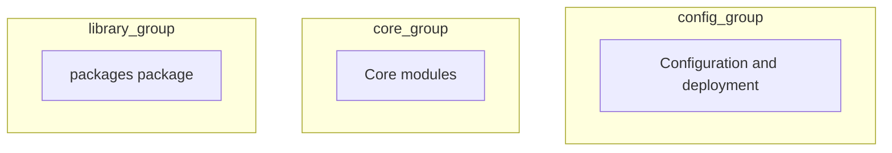

# Architecture report: shadcnblocks/kibo

> Automated static analysis. **Observed** = directly seen in files/imports/AST; **Inferred** = interpretation from that evidence. Repository code was not executed.

## 1. Repository at a glance

| Item | Value |
| --- | --- |
| Repository | shadcnblocks/kibo |
| Description | A custom registry of composable, accessible and extensible components designed for use with shadcn/ui. Free and open source, forever. |
| Language | TypeScript |
| Stars | 3986 |
| Licence | MIT |
| Analysed commit / branch | 3d63cdb15b79d972e3dc38a10997987672f9b263 / main |
| Framework(s) | Next.js, React |
| Files analysed | 800 |
| Components | 3 |

## 2. Architecture in one minute

shadcnblocks/kibo - A custom registry of composable, accessible and extensible components designed for use with shadcn/ui. Free and open source, forever.. This repository was analysed statically from 800 file(s) (0 Python). Detected technologies (observed from imports/manifests): GitHub Actions, Next.js, React, Tailwind CSS, TypeScript. Files are grouped into 3 component(s): Configuration and deployment, Core modules, packages package. Findings below distinguish observed facts from inferred interpretation.

## 3. High-level block diagram

## 4. Main components

### Configuration and deployment (`config`)

- **Kind:** config
- **Status:** Observed
- **Confidence:** 0.85
- **Responsibility:** Groups 54 file(s) under configuration and deployment (observed from repository paths and static analysis).
- **Paths:** `apps/docs/content/blocks/meta.json`, `apps/docs/content/components/meta.json`, `apps/docs/content/docs/meta.json`, `apps/docs/package.json`, `apps/docs/tsconfig.json`, `package.json`, `packages/announcement/package.json`, `packages/announcement/tsconfig.json`, `packages/avatar-stack/package.json`, `packages/avatar-stack/tsconfig.json`, `packages/banner/package.json`, `packages/banner/tsconfig.json`, `packages/calendar/package.json`, `packages/calendar/tsconfig.json`, `packages/choicebox/package.json`, `packages/choicebox/tsconfig.json`, `packages/code-block/package.json`, `packages/code-block/tsconfig.json`, `packages/color-picker/package.json`, `packages/color-picker/tsconfig.json`, `packages/combobox/package.json`, `packages/combobox/tsconfig.json`, `packages/comparison/package.json`, `packages/comparison/tsconfig.json`, `packages/contribution-graph/package.json`, `packages/contribution-graph/tsconfig.json`, `packages/credit-card/package.json`, `packages/credit-card/tsconfig.json`, `packages/cursor/package.json`, `packages/cursor/tsconfig.json`, `packages/deck/package.json`, `packages/deck/tsconfig.json`, `packages/dialog-stack/package.json`, `packages/dialog-stack/tsconfig.json`, `packages/dropzone/package.json`, `packages/dropzone/tsconfig.json`, `packages/editor/package.json`, `packages/editor/tsconfig.json`, `packages/gantt/package.json`, `packages/gantt/tsconfig.json`, `packages/glimpse/package.json`, `packages/glimpse/tsconfig.json`, `packages/image-crop/package.json`, `packages/image-crop/tsconfig.json`, `packages/image-zoom/package.json`, `packages/image-zoom/tsconfig.json`, `packages/kanban/package.json`, `packages/kanban/tsconfig.json`, `packages/list/package.json`, `packages/list/tsconfig.json`, `packages/marquee/package.json`, `packages/marquee/tsconfig.json`, `packages/mini-calendar/package.json`, `packages/mini-calendar/tsconfig.json`
- **Evidence:** [apps/docs/content/blocks/meta.json](https://github.com/shadcnblocks/kibo/blob/3d63cdb15b79d972e3dc38a10997987672f9b263/apps/docs/content/blocks/meta.json); [apps/docs/content/components/meta.json](https://github.com/shadcnblocks/kibo/blob/3d63cdb15b79d972e3dc38a10997987672f9b263/apps/docs/content/components/meta.json); [apps/docs/content/docs/meta.json](https://github.com/shadcnblocks/kibo/blob/3d63cdb15b79d972e3dc38a10997987672f9b263/apps/docs/content/docs/meta.json); [apps/docs/package.json](https://github.com/shadcnblocks/kibo/blob/3d63cdb15b79d972e3dc38a10997987672f9b263/apps/docs/package.json); [apps/docs/tsconfig.json](https://github.com/shadcnblocks/kibo/blob/3d63cdb15b79d972e3dc38a10997987672f9b263/apps/docs/tsconfig.json); [package.json](https://github.com/shadcnblocks/kibo/blob/3d63cdb15b79d972e3dc38a10997987672f9b263/package.json); [packages/announcement/package.json](https://github.com/shadcnblocks/kibo/blob/3d63cdb15b79d972e3dc38a10997987672f9b263/packages/announcement/package.json); [packages/announcement/tsconfig.json](https://github.com/shadcnblocks/kibo/blob/3d63cdb15b79d972e3dc38a10997987672f9b263/packages/announcement/tsconfig.json)

### Core modules (`core`)

- **Kind:** core
- **Status:** Observed
- **Confidence:** 0.85
- **Responsibility:** Groups 1 file(s) under core modules (observed from repository paths and static analysis).
- **Paths:** `next-env.d.ts`
- **Evidence:** [next-env.d.ts](https://github.com/shadcnblocks/kibo/blob/3d63cdb15b79d972e3dc38a10997987672f9b263/next-env.d.ts)

### packages package (`packages`)

- **Kind:** library
- **Status:** Observed
- **Confidence:** 0.85
- **Responsibility:** Groups 416 file(s) under packages package (observed from repository paths and static analysis).
- **Paths:** `packages/announcement/index.tsx`, `packages/avatar-stack/index.tsx`, `packages/banner/index.tsx`, `packages/calendar/index.tsx`, `packages/choicebox/index.tsx`, `packages/code-block/index.tsx`, `packages/code-block/server.tsx`, `packages/color-picker/index.tsx`, `packages/combobox/index.tsx`, `packages/comparison/index.tsx`, `packages/contribution-graph/index.tsx`, `packages/credit-card/index.tsx`, `packages/cursor/index.tsx`, `packages/deck/index.tsx`, `packages/dialog-stack/index.tsx`, `packages/dropzone/index.tsx`, `packages/editor/index.tsx`, `packages/gantt/index.tsx`, `packages/glimpse/index.tsx`, `packages/glimpse/server.tsx`, `packages/image-crop/index.tsx`, `packages/image-zoom/index.tsx`, `packages/kanban/index.tsx`, `packages/list/index.tsx`, `packages/marquee/index.tsx`, `packages/mini-calendar/index.tsx`, `packages/patterns/accordion/form/accordion-form-1.tsx`, `packages/patterns/accordion/form/accordion-form-2.tsx`, `packages/patterns/accordion/multi-level/accordion-multi-level-1.tsx`, `packages/patterns/accordion/multi-level/accordion-multi-level-2.tsx`, `packages/patterns/accordion/multi-level/accordion-multi-level-3.tsx`, `packages/patterns/accordion/multi-level/accordion-multi-level-4.tsx`, `packages/patterns/accordion/standard/accordion-standard-1.tsx`, `packages/patterns/accordion/standard/accordion-standard-2.tsx`, `packages/patterns/accordion/standard/accordion-standard-3.tsx`, `packages/patterns/accordion/standard/accordion-standard-4.tsx`, `packages/patterns/accordion/standard/accordion-standard-5.tsx`, `packages/patterns/accordion/standard/accordion-standard-6.tsx`, `packages/patterns/accordion/standard/accordion-standard-7.tsx`, `packages/patterns/accordion/subtitle/accordion-subtitle-1.tsx`, `packages/patterns/accordion/subtitle/accordion-subtitle-2.tsx`, `packages/patterns/accordion/subtitle/accordion-subtitle-3.tsx`, `packages/patterns/accordion/subtitle/accordion-subtitle-4.tsx`, `packages/patterns/accordion/tabs/accordion-tabs-1.tsx`, `packages/patterns/accordion/tabs/accordion-tabs-2.tsx`, `packages/patterns/accordion/tabs/accordion-tabs-3.tsx`, `packages/patterns/accordion/tabs/accordion-tabs-4.tsx`, `packages/patterns/alert-dialog/confirmation/alert-dialog-confirmation-1.tsx`, `packages/patterns/alert-dialog/confirmation/alert-dialog-confirmation-2.tsx`, `packages/patterns/alert-dialog/confirmation/alert-dialog-confirmation-3.tsx`, `packages/patterns/alert-dialog/confirmation/alert-dialog-confirmation-4.tsx`, `packages/patterns/alert-dialog/confirmation/alert-dialog-confirmation-5.tsx`, `packages/patterns/alert-dialog/confirmation/alert-dialog-confirmation-6.tsx`, `packages/patterns/alert-dialog/custom-actions/alert-dialog-custom-actions-1.tsx`, `packages/patterns/alert-dialog/custom-actions/alert-dialog-custom-actions-2.tsx`, `packages/patterns/alert-dialog/custom-actions/alert-dialog-custom-actions-3.tsx`, `packages/patterns/alert-dialog/custom-actions/alert-dialog-custom-actions-4.tsx`, `packages/patterns/alert-dialog/custom-actions/alert-dialog-custom-actions-5.tsx`, `packages/patterns/alert-dialog/destructive/alert-dialog-destructive-1.tsx`, `packages/patterns/alert-dialog/destructive/alert-dialog-destructive-2.tsx`, `packages/patterns/alert-dialog/destructive/alert-dialog-destructive-3.tsx`, `packages/patterns/alert-dialog/destructive/alert-dialog-destructive-4.tsx`, `packages/patterns/alert-dialog/destructive/alert-dialog-destructive-5.tsx`, `packages/patterns/alert-dialog/destructive/alert-dialog-destructive-6.tsx`, `packages/patterns/alert-dialog/destructive/alert-dialog-destructive-7.tsx`, `packages/patterns/alert-dialog/form/alert-dialog-form-1.tsx`, `packages/patterns/alert-dialog/form/alert-dialog-form-2.tsx`, `packages/patterns/alert-dialog/form/alert-dialog-form-3.tsx`, `packages/patterns/alert-dialog/form/alert-dialog-form-4.tsx`, `packages/patterns/alert-dialog/form/alert-dialog-form-5.tsx`, `packages/patterns/alert-dialog/form/alert-dialog-form-6.tsx`, `packages/patterns/alert-dialog/form/alert-dialog-form-7.tsx`, `packages/patterns/alert-dialog/informational/alert-dialog-informational-1.tsx`, `packages/patterns/alert-dialog/informational/alert-dialog-informational-2.tsx`, `packages/patterns/alert-dialog/informational/alert-dialog-informational-3.tsx`, `packages/patterns/alert-dialog/informational/alert-dialog-informational-4.tsx`, `packages/patterns/alert-dialog/informational/alert-dialog-informational-5.tsx`, `packages/patterns/alert-dialog/informational/alert-dialog-informational-6.tsx`, `packages/patterns/alert-dialog/informational/alert-dialog-informational-7.tsx`, `packages/patterns/alert-dialog/success/alert-dialog-success-1.tsx`, `packages/patterns/alert-dialog/success/alert-dialog-success-2.tsx`, `packages/patterns/alert-dialog/success/alert-dialog-success-3.tsx`, `packages/patterns/alert-dialog/success/alert-dialog-success-4.tsx`, `packages/patterns/alert-dialog/success/alert-dialog-success-5.tsx`, `packages/patterns/alert-dialog/success/alert-dialog-success-6.tsx`, `packages/patterns/alert-dialog/success/alert-dialog-success-7.tsx`, `packages/patterns/alert/error/alert-error-1.tsx`, `packages/patterns/alert/error/alert-error-2.tsx`, `packages/patterns/alert/error/alert-error-3.tsx`, `packages/patterns/alert/error/alert-error-4.tsx`, `packages/patterns/alert/error/alert-error-5.tsx`, `packages/patterns/alert/info/alert-info-1.tsx`, `packages/patterns/alert/info/alert-info-2.tsx`, `packages/patterns/alert/info/alert-info-3.tsx`, `packages/patterns/alert/info/alert-info-4.tsx`, `packages/patterns/alert/info/alert-info-5.tsx`, `packages/patterns/alert/standard/alert-standard-1.tsx`, `packages/patterns/alert/standard/alert-standard-2.tsx`, `packages/patterns/alert/standard/alert-standard-3.tsx`, `packages/patterns/alert/standard/alert-standard-4.tsx`, `packages/patterns/alert/standard/alert-standard-5.tsx`, `packages/patterns/alert/success/alert-success-1.tsx`, `packages/patterns/alert/success/alert-success-2.tsx`, `packages/patterns/alert/success/alert-success-3.tsx`, `packages/patterns/alert/success/alert-success-4.tsx`, `packages/patterns/alert/success/alert-success-5.tsx`, `packages/patterns/alert/warning/alert-warning-1.tsx`, `packages/patterns/alert/warning/alert-warning-2.tsx`, `packages/patterns/alert/warning/alert-warning-3.tsx`, `packages/patterns/alert/warning/alert-warning-4.tsx`, `packages/patterns/alert/warning/alert-warning-5.tsx`, `packages/patterns/aspect-ratio/standard/aspect-ratio-standard-1.tsx`, `packages/patterns/aspect-ratio/standard/aspect-ratio-standard-2.tsx`, `packages/patterns/aspect-ratio/standard/aspect-ratio-standard-3.tsx`, `packages/patterns/aspect-ratio/standard/aspect-ratio-standard-4.tsx`, `packages/patterns/aspect-ratio/standard/aspect-ratio-standard-5.tsx`, `packages/patterns/aspect-ratio/standard/aspect-ratio-standard-6.tsx`, `packages/patterns/aspect-ratio/standard/aspect-ratio-standard-7.tsx`, `packages/patterns/avatar/square/avatar-square-1.tsx`, `packages/patterns/avatar/square/avatar-square-2.tsx`, `packages/patterns/avatar/square/avatar-square-3.tsx`, `packages/patterns/avatar/square/avatar-square-4.tsx`, `packages/patterns/avatar/square/avatar-square-5.tsx`, `packages/patterns/avatar/square/avatar-square-6.tsx`, `packages/patterns/avatar/square/avatar-square-7.tsx`, `packages/patterns/avatar/standard/avatar-standard-1.tsx`, `packages/patterns/avatar/standard/avatar-standard-2.tsx`, `packages/patterns/avatar/standard/avatar-standard-3.tsx`, `packages/patterns/avatar/standard/avatar-standard-4.tsx`, `packages/patterns/avatar/standard/avatar-standard-5.tsx`, `packages/patterns/avatar/standard/avatar-standard-6.tsx`, `packages/patterns/avatar/standard/avatar-standard-7.tsx`, `packages/patterns/badge/destructive/badge-destructive-1.tsx`, `packages/patterns/badge/destructive/badge-destructive-2.tsx`, `packages/patterns/badge/destructive/badge-destructive-3.tsx`, `packages/patterns/badge/destructive/badge-destructive-4.tsx`, `packages/patterns/badge/destructive/badge-destructive-5.tsx`, `packages/patterns/badge/outline/badge-outline-1.tsx`, `packages/patterns/badge/outline/badge-outline-2.tsx`, `packages/patterns/badge/outline/badge-outline-3.tsx`, `packages/patterns/badge/outline/badge-outline-4.tsx`, `packages/patterns/badge/outline/badge-outline-5.tsx`, `packages/patterns/badge/secondary/badge-secondary-1.tsx`, `packages/patterns/badge/secondary/badge-secondary-2.tsx`, `packages/patterns/badge/secondary/badge-secondary-3.tsx`, `packages/patterns/badge/secondary/badge-secondary-4.tsx`, `packages/patterns/badge/secondary/badge-secondary-5.tsx`, `packages/patterns/badge/standard/badge-standard-1.tsx`, `packages/patterns/badge/standard/badge-standard-2.tsx`, `packages/patterns/badge/standard/badge-standard-3.tsx`, `packages/patterns/badge/standard/badge-standard-4.tsx`, `packages/patterns/badge/standard/badge-standard-5.tsx`, `packages/patterns/breadcrumb/home-icon/breadcrumb-home-icon-1.tsx`, `packages/patterns/breadcrumb/home-icon/breadcrumb-home-icon-2.tsx`, `packages/patterns/breadcrumb/home-icon/breadcrumb-home-icon-3.tsx`, `packages/patterns/breadcrumb/home-icon/breadcrumb-home-icon-4.tsx`, `packages/patterns/breadcrumb/home-icon/breadcrumb-home-icon-5.tsx`, `packages/patterns/breadcrumb/home-icon/breadcrumb-home-icon-6.tsx`, `packages/patterns/breadcrumb/home-icon/breadcrumb-home-icon-7.tsx`, `packages/patterns/breadcrumb/standard/breadcrumb-standard-1.tsx`, `packages/patterns/breadcrumb/standard/breadcrumb-standard-2.tsx`, `packages/patterns/breadcrumb/standard/breadcrumb-standard-3.tsx`, `packages/patterns/breadcrumb/standard/breadcrumb-standard-4.tsx`, `packages/patterns/breadcrumb/standard/breadcrumb-standard-5.tsx`, `packages/patterns/breadcrumb/standard/breadcrumb-standard-6.tsx`, `packages/patterns/breadcrumb/standard/breadcrumb-standard-7.tsx`, `packages/patterns/button-group/actions/button-group-actions-1.tsx`, `packages/patterns/button-group/actions/button-group-actions-2.tsx`, `packages/patterns/button-group/actions/button-group-actions-3.tsx`, `packages/patterns/button-group/actions/button-group-actions-4.tsx`, `packages/patterns/button-group/advanced/button-group-advanced-1.tsx`, `packages/patterns/button-group/advanced/button-group-advanced-2.tsx`, `packages/patterns/button-group/advanced/button-group-advanced-3.tsx`, `packages/patterns/button-group/advanced/button-group-advanced-4.tsx`, `packages/patterns/button-group/badges/button-group-badges-1.tsx`, `packages/patterns/button-group/badges/button-group-badges-2.tsx`, `packages/patterns/button-group/badges/button-group-badges-3.tsx`, `packages/patterns/button-group/badges/button-group-badges-4.tsx`, `packages/patterns/button-group/display/button-group-display-1.tsx`, `packages/patterns/button-group/display/button-group-display-2.tsx`, `packages/patterns/button-group/display/button-group-display-3.tsx`, `packages/patterns/button-group/display/button-group-display-4.tsx`, `packages/patterns/button-group/forms/button-group-forms-1.tsx`, `packages/patterns/button-group/forms/button-group-forms-2.tsx`, `packages/patterns/button-group/forms/button-group-forms-3.tsx`, `packages/patterns/button-group/forms/button-group-forms-4.tsx`, `packages/patterns/button-group/interactive/button-group-interactive-1.tsx`, `packages/patterns/button-group/interactive/button-group-interactive-2.tsx`, `packages/patterns/button-group/interactive/button-group-interactive-3.tsx`, `packages/patterns/button-group/interactive/button-group-interactive-4.tsx`, `packages/patterns/button-group/media/button-group-media-1.tsx`, `packages/patterns/button-group/media/button-group-media-2.tsx`, `packages/patterns/button-group/media/button-group-media-3.tsx`, `packages/patterns/button-group/media/button-group-media-4.tsx`, `packages/patterns/button-group/navigation/button-group-navigation-1.tsx`, `packages/patterns/button-group/navigation/button-group-navigation-2.tsx`, `packages/patterns/button-group/navigation/button-group-navigation-3.tsx`, `packages/patterns/button-group/patterns/button-group-patterns-1.tsx`, `packages/patterns/button-group/patterns/button-group-patterns-2.tsx`, `packages/patterns/button-group/patterns/button-group-patterns-3.tsx`, `packages/patterns/button-group/patterns/button-group-patterns-4.tsx`, `packages/patterns/button-group/standard/button-group-standard-1.tsx`, `packages/patterns/button-group/standard/button-group-standard-2.tsx`, `packages/patterns/button-group/standard/button-group-standard-3.tsx`, `packages/patterns/button-group/standard/button-group-standard-4.tsx`, `packages/patterns/button/destructive/button-destructive-1.tsx`, `packages/patterns/button/destructive/button-destructive-2.tsx`, `packages/patterns/button/destructive/button-destructive-3.tsx`, `packages/patterns/button/destructive/button-destructive-4.tsx`, `packages/patterns/button/destructive/button-destructive-5.tsx`, `packages/patterns/button/destructive/button-destructive-6.tsx`, `packages/patterns/button/destructive/button-destructive-7.tsx`, `packages/patterns/button/link/button-link-1.tsx`, `packages/patterns/button/link/button-link-2.tsx`, `packages/patterns/button/link/button-link-3.tsx`, `packages/patterns/button/link/button-link-4.tsx`, `packages/patterns/button/link/button-link-5.tsx`, `packages/patterns/button/link/button-link-6.tsx`, `packages/patterns/button/link/button-link-7.tsx`, `packages/patterns/button/outline/button-outline-1.tsx`, `packages/patterns/button/outline/button-outline-2.tsx`, `packages/patterns/button/outline/button-outline-3.tsx`, `packages/patterns/button/outline/button-outline-4.tsx`, `packages/patterns/button/outline/button-outline-5.tsx`, `packages/patterns/button/outline/button-outline-6.tsx`, `packages/patterns/button/outline/button-outline-7.tsx`, `packages/patterns/button/secondary/button-secondary-1.tsx`, `packages/patterns/button/secondary/button-secondary-2.tsx`, `packages/patterns/button/secondary/button-secondary-3.tsx`, `packages/patterns/button/secondary/button-secondary-4.tsx`, `packages/patterns/button/secondary/button-secondary-5.tsx`, `packages/patterns/button/secondary/button-secondary-6.tsx`, `packages/patterns/button/secondary/button-secondary-7.tsx`, `packages/patterns/button/standard/button-standard-1.tsx`, `packages/patterns/button/standard/button-standard-2.tsx`, `packages/patterns/button/standard/button-standard-3.tsx`, `packages/patterns/button/standard/button-standard-4.tsx`, `packages/patterns/button/standard/button-standard-5.tsx`, `packages/patterns/button/standard/button-standard-6.tsx`, `packages/patterns/button/standard/button-standard-7.tsx`, `packages/patterns/calendar/dialog/calendar-dialog-1.tsx`, `packages/patterns/calendar/dialog/calendar-dialog-2.tsx`, `packages/patterns/calendar/dialog/calendar-dialog-3.tsx`, `packages/patterns/calendar/dialog/calendar-dialog-4.tsx`, `packages/patterns/calendar/dialog/calendar-dialog-5.tsx`, `packages/patterns/calendar/dialog/calendar-dialog-6.tsx`, `packages/patterns/calendar/dialog/calendar-dialog-7.tsx`, `packages/patterns/calendar/dialog/calendar-dialog-8.tsx`, `packages/patterns/calendar/standard/calendar-standard-1.tsx`, `packages/patterns/calendar/standard/calendar-standard-2.tsx`, `packages/patterns/calendar/standard/calendar-standard-3.tsx`, `packages/patterns/calendar/standard/calendar-standard-4.tsx`, `packages/patterns/calendar/standard/calendar-standard-5.tsx`, `packages/patterns/calendar/standard/calendar-standard-6.tsx`, `packages/patterns/calendar/standard/calendar-standard-7.tsx`, `packages/patterns/calendar/standard/calendar-standard-8.tsx`, `packages/patterns/card/standard/card-standard-1.tsx`, `packages/patterns/card/standard/card-standard-2.tsx`, `packages/patterns/card/standard/card-standard-3.tsx`, `packages/patterns/card/standard/card-standard-4.tsx`, `packages/patterns/carousel/standard/carousel-standard-1.tsx`, `packages/patterns/carousel/standard/carousel-standard-2.tsx`, `packages/patterns/carousel/standard/carousel-standard-3.tsx`, `packages/patterns/carousel/standard/carousel-standard-4.tsx`, `packages/patterns/chart/area/chart-area-axes.tsx`, `packages/patterns/chart/area/chart-area-default.tsx`, `packages/patterns/chart/area/chart-area-gradient.tsx`, `packages/patterns/chart/area/chart-area-icons.tsx`, `packages/patterns/chart/area/chart-area-interactive.tsx`, `packages/patterns/chart/area/chart-area-legend.tsx`, `packages/patterns/chart/area/chart-area-linear.tsx`, `packages/patterns/chart/area/chart-area-stacked-expand.tsx`, `packages/patterns/chart/area/chart-area-stacked.tsx`, `packages/patterns/chart/area/chart-area-step.tsx`, `packages/patterns/chart/bar/chart-bar-active.tsx`, `packages/patterns/chart/bar/chart-bar-default.tsx`, `packages/patterns/chart/bar/chart-bar-horizontal.tsx`, `packages/patterns/chart/bar/chart-bar-interactive.tsx`, `packages/patterns/chart/bar/chart-bar-label-custom.tsx`, `packages/patterns/chart/bar/chart-bar-label.tsx`, `packages/patterns/chart/bar/chart-bar-mixed.tsx`, `packages/patterns/chart/bar/chart-bar-multiple.tsx`, `packages/patterns/chart/bar/chart-bar-negative.tsx`, `packages/patterns/chart/bar/chart-bar-stacked.tsx`, `packages/patterns/chart/line/chart-line-default.tsx`, `packages/patterns/chart/line/chart-line-dots-colors.tsx`, `packages/patterns/chart/line/chart-line-dots-custom.tsx`, `packages/patterns/chart/line/chart-line-dots.tsx`, `packages/patterns/chart/line/chart-line-interactive.tsx`, `packages/patterns/chart/line/chart-line-label-custom.tsx`, `packages/patterns/chart/line/chart-line-label.tsx`, `packages/patterns/chart/line/chart-line-linear.tsx`, `packages/patterns/chart/line/chart-line-multiple.tsx`, `packages/patterns/chart/line/chart-line-step.tsx`, `packages/patterns/chart/pie/chart-pie-donut-active.tsx`, `packages/patterns/chart/pie/chart-pie-donut-text.tsx`, `packages/patterns/chart/pie/chart-pie-donut.tsx`, `packages/patterns/chart/pie/chart-pie-interactive.tsx`, `packages/patterns/chart/pie/chart-pie-label-custom.tsx`, `packages/patterns/chart/pie/chart-pie-label-list.tsx`, `packages/patterns/chart/pie/chart-pie-label.tsx`, `packages/patterns/chart/pie/chart-pie-legend.tsx`, `packages/patterns/chart/pie/chart-pie-separator-none.tsx`, `packages/patterns/chart/pie/chart-pie-simple.tsx`, `packages/patterns/chart/pie/chart-pie-stacked.tsx`, `packages/patterns/chart/radar/chart-radar-default.tsx`, `packages/patterns/chart/radar/chart-radar-dots.tsx`, `packages/patterns/chart/radar/chart-radar-grid-circle-fill.tsx`, `packages/patterns/chart/radar/chart-radar-grid-circle-no-lines.tsx`, `packages/patterns/chart/radar/chart-radar-grid-circle.tsx`, `packages/patterns/chart/radar/chart-radar-grid-custom.tsx`, `packages/patterns/chart/radar/chart-radar-grid-fill.tsx`, `packages/patterns/chart/radar/chart-radar-grid-none.tsx`, `packages/patterns/chart/radar/chart-radar-icons.tsx`, `packages/patterns/chart/radar/chart-radar-label-custom.tsx`, `packages/patterns/chart/radar/chart-radar-legend.tsx`, `packages/patterns/chart/radar/chart-radar-lines-only.tsx`, `packages/patterns/chart/radar/chart-radar-multiple.tsx`, `packages/patterns/chart/radar/chart-radar-radius.tsx`, `packages/patterns/chart/radial/chart-radial-grid.tsx`, `packages/patterns/chart/radial/chart-radial-label.tsx`, `packages/patterns/chart/radial/chart-radial-shape.tsx`, `packages/patterns/chart/radial/chart-radial-simple.tsx`, `packages/patterns/chart/radial/chart-radial-stacked.tsx`, `packages/patterns/chart/radial/chart-radial-text.tsx`, `packages/patterns/chart/tooltip/chart-tooltip-advanced.tsx`, `packages/patterns/chart/tooltip/chart-tooltip-default.tsx`, `packages/patterns/chart/tooltip/chart-tooltip-formatter.tsx`, `packages/patterns/chart/tooltip/chart-tooltip-icons.tsx`, `packages/patterns/chart/tooltip/chart-tooltip-indicator-line.tsx`, `packages/patterns/chart/tooltip/chart-tooltip-indicator-none.tsx`, `packages/patterns/chart/tooltip/chart-tooltip-label-custom.tsx`, `packages/patterns/chart/tooltip/chart-tooltip-label-formatter.tsx`, `packages/patterns/chart/tooltip/chart-tooltip-label-none.tsx`, `packages/patterns/checkbox/standard/checkbox-standard-1.tsx`, `packages/patterns/checkbox/standard/checkbox-standard-11.tsx`, `packages/patterns/checkbox/standard/checkbox-standard-12.tsx`, `packages/patterns/checkbox/standard/checkbox-standard-13.tsx`, `packages/patterns/checkbox/standard/checkbox-standard-2.tsx`, `packages/patterns/checkbox/standard/checkbox-standard-3.tsx`, `packages/patterns/checkbox/standard/checkbox-standard-4.tsx`, `packages/patterns/checkbox/standard/checkbox-standard-5.tsx`, `packages/patterns/checkbox/standard/checkbox-standard-6.tsx`, `packages/patterns/checkbox/standard/checkbox-standard-7.tsx`, `packages/patterns/checkbox/standard/checkbox-standard-8.tsx`, `packages/patterns/checkbox/standard/checkbox-standard-9.tsx`, `packages/patterns/collapsible/card/collapsible-card-1.tsx`, `packages/patterns/collapsible/card/collapsible-card-2.tsx`, `packages/patterns/collapsible/card/collapsible-card-3.tsx`, `packages/patterns/collapsible/card/collapsible-card-4.tsx`, `packages/patterns/collapsible/card/collapsible-card-5.tsx`, `packages/patterns/collapsible/faq/collapsible-faq-1.tsx`, `packages/patterns/collapsible/faq/collapsible-faq-2.tsx`, `packages/patterns/collapsible/faq/collapsible-faq-3.tsx`, `packages/patterns/collapsible/faq/collapsible-faq-4.tsx`, `packages/patterns/collapsible/faq/collapsible-faq-5.tsx`, `packages/patterns/collapsible/outline/collapsible-outline-1.tsx`, `packages/patterns/collapsible/outline/collapsible-outline-2.tsx`, `packages/patterns/collapsible/outline/collapsible-outline-3.tsx`, `packages/patterns/collapsible/outline/collapsible-outline-4.tsx`, `packages/patterns/collapsible/sidebar/collapsible-sidebar-1.tsx`, `packages/patterns/collapsible/sidebar/collapsible-sidebar-2.tsx`, `packages/patterns/collapsible/sidebar/collapsible-sidebar-3.tsx`, `packages/patterns/collapsible/sidebar/collapsible-sidebar-4.tsx`, `packages/patterns/collapsible/standard/collapsible-standard-1.tsx`, `packages/patterns/collapsible/standard/collapsible-standard-2.tsx`, `packages/patterns/collapsible/standard/collapsible-standard-3.tsx`, `packages/patterns/collapsible/standard/collapsible-standard-4.tsx`, `packages/patterns/collapsible/standard/collapsible-standard-5.tsx`, `packages/patterns/combobox/custom-actions/combobox-custom-actions-1.tsx`, `packages/patterns/combobox/custom-actions/combobox-custom-actions-2.tsx`, `packages/patterns/combobox/custom-actions/combobox-custom-actions-3.tsx`, `packages/patterns/combobox/custom-actions/combobox-custom-actions-4.tsx`, `packages/patterns/combobox/custom-actions/combobox-custom-actions-5.tsx`, `packages/patterns/combobox/custom-actions/combobox-custom-actions-6.tsx`, `packages/patterns/combobox/custom-actions/combobox-custom-actions-7.tsx`, `packages/patterns/combobox/grouped/combobox-grouped-1.tsx`, `packages/patterns/combobox/grouped/combobox-grouped-2.tsx`, `packages/patterns/combobox/grouped/combobox-grouped-3.tsx`, `packages/patterns/combobox/grouped/combobox-grouped-4.tsx`, `packages/patterns/combobox/grouped/combobox-grouped-5.tsx`, `packages/patterns/combobox/grouped/combobox-grouped-6.tsx`, `packages/patterns/combobox/grouped/combobox-grouped-7.tsx`, `packages/patterns/combobox/multi-select/combobox-multi-select-1.tsx`, `packages/patterns/combobox/multi-select/combobox-multi-select-2.tsx`, `packages/patterns/combobox/multi-select/combobox-multi-select-3.tsx`, `packages/patterns/combobox/multi-select/combobox-multi-select-4.tsx`, `packages/patterns/combobox/multi-select/combobox-multi-select-5.tsx`, `packages/patterns/combobox/multi-select/combobox-multi-select-6.tsx`, `packages/patterns/combobox/multi-select/combobox-multi-select-7.tsx`, `packages/patterns/combobox/rich-content/combobox-rich-content-1.tsx`, `packages/patterns/combobox/rich-content/combobox-rich-content-2.tsx`, `packages/patterns/combobox/rich-content/combobox-rich-content-3.tsx`, `packages/patterns/combobox/rich-content/combobox-rich-content-4.tsx`, `packages/patterns/combobox/rich-content/combobox-rich-content-5.tsx`, `packages/patterns/combobox/rich-content/combobox-rich-content-6.tsx`, `packages/patterns/combobox/rich-content/combobox-rich-content-7.tsx`, `packages/patterns/combobox/standard/combobox-standard-1.tsx`, `packages/patterns/combobox/standard/combobox-standard-2.tsx`, `packages/patterns/combobox/standard/combobox-standard-3.tsx`, `packages/patterns/combobox/standard/combobox-standard-4.tsx`, `packages/patterns/combobox/standard/combobox-standard-5.tsx`, `packages/patterns/combobox/standard/combobox-standard-6.tsx`, `packages/patterns/combobox/standard/combobox-standard-7.tsx`, `packages/patterns/combobox/with-states/combobox-with-states-1.tsx`, `packages/patterns/combobox/with-states/combobox-with-states-2.tsx`, `packages/patterns/combobox/with-states/combobox-with-states-3.tsx`, `packages/patterns/combobox/with-states/combobox-with-states-4.tsx`, `packages/patterns/combobox/with-states/combobox-with-states-5.tsx`, `packages/patterns/combobox/with-states/combobox-with-states-6.tsx`, `packages/patterns/combobox/with-states/combobox-with-states-7.tsx`, `packages/patterns/command/dialog/command-dialog-1.tsx`, `packages/patterns/command/dialog/command-dialog-2.tsx`, `packages/patterns/command/dialog/command-dialog-3.tsx`, `packages/patterns/command/dialog/command-dialog-4.tsx`, `packages/patterns/command/dialog/command-dialog-5.tsx`
- **Evidence:** [packages/announcement/index.tsx](https://github.com/shadcnblocks/kibo/blob/3d63cdb15b79d972e3dc38a10997987672f9b263/packages/announcement/index.tsx); [packages/avatar-stack/index.tsx](https://github.com/shadcnblocks/kibo/blob/3d63cdb15b79d972e3dc38a10997987672f9b263/packages/avatar-stack/index.tsx); [packages/banner/index.tsx](https://github.com/shadcnblocks/kibo/blob/3d63cdb15b79d972e3dc38a10997987672f9b263/packages/banner/index.tsx); [packages/calendar/index.tsx](https://github.com/shadcnblocks/kibo/blob/3d63cdb15b79d972e3dc38a10997987672f9b263/packages/calendar/index.tsx); [packages/choicebox/index.tsx](https://github.com/shadcnblocks/kibo/blob/3d63cdb15b79d972e3dc38a10997987672f9b263/packages/choicebox/index.tsx); [packages/code-block/index.tsx](https://github.com/shadcnblocks/kibo/blob/3d63cdb15b79d972e3dc38a10997987672f9b263/packages/code-block/index.tsx); [packages/code-block/server.tsx](https://github.com/shadcnblocks/kibo/blob/3d63cdb15b79d972e3dc38a10997987672f9b263/packages/code-block/server.tsx); [packages/color-picker/index.tsx](https://github.com/shadcnblocks/kibo/blob/3d63cdb15b79d972e3dc38a10997987672f9b263/packages/color-picker/index.tsx)

## 5. Execution flow

**Observed** entry point(s):

- [packages/announcement/index.tsx](https://github.com/shadcnblocks/kibo/blob/3d63cdb15b79d972e3dc38a10997987672f9b263/packages/announcement/index.tsx)
- [packages/avatar-stack/index.tsx](https://github.com/shadcnblocks/kibo/blob/3d63cdb15b79d972e3dc38a10997987672f9b263/packages/avatar-stack/index.tsx)
- [packages/banner/index.tsx](https://github.com/shadcnblocks/kibo/blob/3d63cdb15b79d972e3dc38a10997987672f9b263/packages/banner/index.tsx)
- [packages/calendar/index.tsx](https://github.com/shadcnblocks/kibo/blob/3d63cdb15b79d972e3dc38a10997987672f9b263/packages/calendar/index.tsx)
- [packages/choicebox/index.tsx](https://github.com/shadcnblocks/kibo/blob/3d63cdb15b79d972e3dc38a10997987672f9b263/packages/choicebox/index.tsx)
- [packages/code-block/index.tsx](https://github.com/shadcnblocks/kibo/blob/3d63cdb15b79d972e3dc38a10997987672f9b263/packages/code-block/index.tsx)
- [packages/color-picker/index.tsx](https://github.com/shadcnblocks/kibo/blob/3d63cdb15b79d972e3dc38a10997987672f9b263/packages/color-picker/index.tsx)
- [packages/combobox/index.tsx](https://github.com/shadcnblocks/kibo/blob/3d63cdb15b79d972e3dc38a10997987672f9b263/packages/combobox/index.tsx)
- [packages/comparison/index.tsx](https://github.com/shadcnblocks/kibo/blob/3d63cdb15b79d972e3dc38a10997987672f9b263/packages/comparison/index.tsx)
- [packages/contribution-graph/index.tsx](https://github.com/shadcnblocks/kibo/blob/3d63cdb15b79d972e3dc38a10997987672f9b263/packages/contribution-graph/index.tsx)
- [packages/credit-card/index.tsx](https://github.com/shadcnblocks/kibo/blob/3d63cdb15b79d972e3dc38a10997987672f9b263/packages/credit-card/index.tsx)
- [packages/cursor/index.tsx](https://github.com/shadcnblocks/kibo/blob/3d63cdb15b79d972e3dc38a10997987672f9b263/packages/cursor/index.tsx)

Representative flow (derived from observed entry points and the import graph; steps beyond the entry point are **Inferred**):

1. Execution starts at an observed entry point listed above, if present.
2. No internal import relationships between components were observed.

## 6. Project structure

### `(root)`

- `.autorc` - other (184 bytes)
- `.coderabbit.yaml` - config (1257 bytes)
- `.gitattributes` - other (66 bytes)
- `.gitignore` - other (476 bytes)
- `CHANGELOG.md` - docs (45980 bytes)
- `README.md` - docs (1442 bytes)
- `biome.jsonc` - other (311 bytes)
- `license.md` - docs (1068 bytes)
- `next-env.d.ts` - source, TypeScript (213 bytes)
- `package.json` - manifest (1015 bytes)

### `.cursor`

- `.cursor/rules/ultracite.mdc` - other (15460 bytes)

### `.github`

- `.github/CODE_OF_CONDUCT.md` - docs (5198 bytes)
- `.github/CONTRIBUTING.md` - docs (1482 bytes)
- `.github/ISSUE_TEMPLATE/bug_report.md` - docs (629 bytes)
- `.github/ISSUE_TEMPLATE/feature_request.md` - docs (511 bytes)
- `.github/SECURITY.md` - docs (198 bytes)
- `.github/dependabot.yml` - config (412 bytes)
- `.github/pull_request_template.md` - docs (753 bytes)
- `.github/workflows/release.yml` - ci, YAML (1131 bytes)

### `.vscode`

- `.vscode/launch.json` - config (1571 bytes)
- `.vscode/settings.json` - config (486 bytes)

### `apps`

- `apps/docs/.gitignore` - docs (276 bytes)
- `apps/docs/app/(docs)/[[...slug]]/(home)/components/blocks.tsx` - docs (3548 bytes)
- `apps/docs/app/(docs)/[[...slug]]/(home)/components/call-to-action.tsx` - docs (2150 bytes)
- `apps/docs/app/(docs)/[[...slug]]/(home)/components/code-block-example.tsx` - docs (2115 bytes)
- `apps/docs/app/(docs)/[[...slug]]/(home)/components/components.tsx` - docs (6236 bytes)
- `apps/docs/app/(docs)/[[...slug]]/(home)/components/demo-video.tsx` - docs (737 bytes)
- `apps/docs/app/(docs)/[[...slug]]/(home)/components/footer/index.tsx` - docs (4512 bytes)
- `apps/docs/app/(docs)/[[...slug]]/(home)/components/footer/theme.tsx` - docs (509 bytes)
- `apps/docs/app/(docs)/[[...slug]]/(home)/components/github-button.tsx` - docs (1502 bytes)
- `apps/docs/app/(docs)/[[...slug]]/(home)/components/hero/index.tsx` - docs (4191 bytes)
- `apps/docs/app/(docs)/[[...slug]]/(home)/components/patterns.tsx` - docs (10747 bytes)
- `apps/docs/app/(docs)/[[...slug]]/(home)/components/tweets.tsx` - docs (1955 bytes)
- `apps/docs/app/(docs)/[[...slug]]/(home)/index.tsx` - docs (605 bytes)
- `apps/docs/app/(docs)/[[...slug]]/page.tsx` - docs (3346 bytes)
- `apps/docs/app/(docs)/layout.tsx` - docs (840 bytes)
- `apps/docs/app/api/mcp/[transport]/route.ts` - docs (2090 bytes)
- `apps/docs/app/api/search/route.ts` - docs (160 bytes)
- `apps/docs/app/global.css` - docs (6030 bytes)
- `apps/docs/app/layout.tsx` - docs (1193 bytes)
- `apps/docs/app/og/route.tsx` - docs (3372 bytes)
- `apps/docs/app/patterns/[component]/[collection]/[comp]/components/preview.tsx` - docs (2938 bytes)
- `apps/docs/app/patterns/[component]/[collection]/[comp]/page.tsx` - docs (3919 bytes)
- `apps/docs/app/patterns/[component]/[collection]/page.tsx` - docs (1016 bytes)
- `apps/docs/app/patterns/[component]/page.tsx` - docs (1414 bytes)
- `apps/docs/app/patterns/components/client.tsx` - docs (8322 bytes)
- `apps/docs/app/patterns/components/link.tsx` - docs (747 bytes)
- `apps/docs/app/patterns/components/sidebar.tsx` - docs (3601 bytes)
- `apps/docs/app/patterns/layout.tsx` - docs (897 bytes)
- `apps/docs/app/r/[component]/route.ts` - docs (1628 bytes)
- `apps/docs/app/r/registry.json/route.ts` - docs (1285 bytes)
- `apps/docs/components/blocks-cta.tsx` - docs (1368 bytes)
- `apps/docs/components/conditional-container.tsx` - docs (456 bytes)
- `apps/docs/components/installer.tsx` - docs (2065 bytes)
- `apps/docs/components/json-ld.tsx` - docs (417 bytes)
- `apps/docs/components/motion-primitives/text-loop.tsx` - docs (1793 bytes)
- `apps/docs/components/navbar/github.tsx` - docs (1004 bytes)
- `apps/docs/components/navbar/index.tsx` - docs (1571 bytes)
- `apps/docs/components/navbar/links.tsx` - docs (2024 bytes)
- `apps/docs/components/navbar/logo.tsx` - docs (575 bytes)
- `apps/docs/components/navbar/mobile-menu.tsx` - docs (1656 bytes)
- `apps/docs/components/navbar/mobile-search.tsx` - docs (466 bytes)
- `apps/docs/components/navbar/search.tsx` - docs (991 bytes)
- `apps/docs/components/navbar/shadcnblocks.tsx` - docs (494 bytes)
- `apps/docs/components/powered-by.tsx` - docs (1554 bytes)
- `apps/docs/components/preview/code.tsx` - docs (1058 bytes)
- `apps/docs/components/preview/content.tsx` - docs (1033 bytes)
- `apps/docs/components/preview/index.tsx` - docs (3764 bytes)
- `apps/docs/components/preview/render.tsx` - docs (913 bytes)
- `apps/docs/components/preview/source.tsx` - docs (2074 bytes)
- `apps/docs/content/blocks/about.mdx` - docs (181 bytes)
- `apps/docs/content/blocks/awards.mdx` - docs (154 bytes)
- `apps/docs/content/blocks/blog.mdx` - docs (169 bytes)
- `apps/docs/content/blocks/blogpost.mdx` - docs (204 bytes)
- `apps/docs/content/blocks/careers.mdx` - docs (211 bytes)
- `apps/docs/content/blocks/case-studies.mdx` - docs (183 bytes)
- `apps/docs/content/blocks/case-study.mdx` - docs (207 bytes)
- `apps/docs/content/blocks/changelog.mdx` - docs (182 bytes)
- `apps/docs/content/blocks/code-example.mdx` - docs (199 bytes)
- `apps/docs/content/blocks/codebase.mdx` - docs (241 bytes)
- `apps/docs/content/blocks/collaborative-canvas.mdx` - docs (240 bytes)
- `apps/docs/content/blocks/community.mdx` - docs (237 bytes)
- `apps/docs/content/blocks/compare.mdx` - docs (186 bytes)
- `apps/docs/content/blocks/compliance.mdx` - docs (256 bytes)
- `apps/docs/content/blocks/contact.mdx` - docs (186 bytes)
- `apps/docs/content/blocks/cta.mdx` - docs (161 bytes)
- `apps/docs/content/blocks/download.mdx` - docs (238 bytes)
- `apps/docs/content/blocks/experience.mdx` - docs (194 bytes)
- `apps/docs/content/blocks/faq.mdx` - docs (157 bytes)
- `apps/docs/content/blocks/feature.mdx` - docs (193 bytes)
- `apps/docs/content/blocks/footer.mdx` - docs (191 bytes)
- `apps/docs/content/blocks/form.mdx` - docs (284 bytes)
- `apps/docs/content/blocks/hero.mdx` - docs (261 bytes)
- `apps/docs/content/blocks/meta.json` - config (175 bytes)
- `apps/docs/content/blocks/pricing.mdx` - docs (118 bytes)
- `apps/docs/content/blocks/roadmap.mdx` - docs (303 bytes)
- `apps/docs/content/blocks/stats.mdx` - docs (177 bytes)
- `apps/docs/content/blocks/team.mdx` - docs (175 bytes)
- `apps/docs/content/blocks/testimonial.mdx` - docs (178 bytes)
- `apps/docs/content/components/announcement.mdx` - docs (645 bytes)
- `apps/docs/content/components/avatar-stack.mdx` - docs (313 bytes)
- `apps/docs/content/components/banner.mdx` - docs (589 bytes)
- `apps/docs/content/components/calendar.mdx` - docs (651 bytes)
- `apps/docs/content/components/choicebox.mdx` - docs (736 bytes)
- `apps/docs/content/components/code-block.mdx` - docs (1386 bytes)
- `apps/docs/content/components/color-picker.mdx` - docs (544 bytes)
- `apps/docs/content/components/combobox.mdx` - docs (683 bytes)
- `apps/docs/content/components/comparison.mdx` - docs (633 bytes)
- `apps/docs/content/components/contribution-graph.mdx` - docs (2432 bytes)
- `apps/docs/content/components/credit-card.mdx` - docs (522 bytes)
- `apps/docs/content/components/cursor.mdx` - docs (744 bytes)
- `apps/docs/content/components/deck.mdx` - docs (685 bytes)
- `apps/docs/content/components/dialog-stack.mdx` - docs (756 bytes)
- `apps/docs/content/components/dropzone.mdx` - docs (993 bytes)
- `apps/docs/content/components/editor.mdx` - docs (915 bytes)
- `apps/docs/content/components/gantt.mdx` - docs (1112 bytes)
- `apps/docs/content/components/glimpse.mdx` - docs (636 bytes)
- `apps/docs/content/components/image-crop.mdx` - docs (962 bytes)
- `apps/docs/content/components/image-zoom.mdx` - docs (809 bytes)
- `apps/docs/content/components/kanban.mdx` - docs (445 bytes)
- `apps/docs/content/components/list.mdx` - docs (361 bytes)
- `apps/docs/content/components/marquee.mdx` - docs (516 bytes)
- `apps/docs/content/components/meta.json` - config (891 bytes)
- `apps/docs/content/components/mini-calendar.mdx` - docs (1254 bytes)
- `apps/docs/content/components/pill.mdx` - docs (1191 bytes)
- `apps/docs/content/components/qr-code.mdx` - docs (1055 bytes)
- `apps/docs/content/components/rating.mdx` - docs (580 bytes)
- `apps/docs/content/components/reel.mdx` - docs (1266 bytes)
- `apps/docs/content/components/relative-time.mdx` - docs (666 bytes)
- `apps/docs/content/components/sandbox.mdx` - docs (673 bytes)
- `apps/docs/content/components/snippet.mdx` - docs (562 bytes)
- `apps/docs/content/components/spinner.mdx` - docs (823 bytes)
- `apps/docs/content/components/status.mdx` - docs (350 bytes)
- `apps/docs/content/components/stories.mdx` - docs (754 bytes)
- `apps/docs/content/components/table.mdx` - docs (419 bytes)
- `apps/docs/content/components/tags.mdx` - docs (596 bytes)
- `apps/docs/content/components/theme-switcher.mdx` - docs (424 bytes)
- `apps/docs/content/components/ticker.mdx` - docs (738 bytes)
- `apps/docs/content/components/tree.mdx` - docs (830 bytes)
- `apps/docs/content/components/typography.mdx` - docs (712 bytes)
- `apps/docs/content/components/video-player.mdx` - docs (721 bytes)
- `apps/docs/content/docs/benefits.mdx` - docs (2729 bytes)
- `apps/docs/content/docs/community.mdx` - docs (964 bytes)
- `apps/docs/content/docs/how-to-contribute.mdx` - docs (1929 bytes)
- `apps/docs/content/docs/index.mdx` - docs (3752 bytes)
- `apps/docs/content/docs/mcp.mdx` - docs (3223 bytes)
- `apps/docs/content/docs/meta.json` - config (332 bytes)
- `apps/docs/content/docs/new-components.mdx` - docs (2315 bytes)
- `apps/docs/content/docs/philosophy.mdx` - docs (7552 bytes)
- `apps/docs/content/docs/setup.mdx` - docs (2773 bytes)
- `apps/docs/content/docs/troubleshooting.mdx` - docs (2133 bytes)
- `apps/docs/content/docs/usage.mdx` - docs (2313 bytes)
- `apps/docs/examples/about.tsx` - docs (8994 bytes)
- `apps/docs/examples/announcement-tagless.tsx` - docs (375 bytes)
- `apps/docs/examples/announcement-themes.tsx` - docs (1594 bytes)
- `apps/docs/examples/announcement.tsx` - docs (452 bytes)
- `apps/docs/examples/avatar-stack-hover.tsx` - docs (758 bytes)
- `apps/docs/examples/avatar-stack.tsx` - docs (750 bytes)
- `apps/docs/examples/awards.tsx` - docs (2464 bytes)
- `apps/docs/examples/banner-inset.tsx` - docs (394 bytes)
- `apps/docs/examples/banner-themes.tsx` - docs (1620 bytes)
- `apps/docs/examples/banner.tsx` - docs (388 bytes)
- `apps/docs/examples/blog.tsx` - docs (4850 bytes)
- `apps/docs/examples/blogpost.tsx` - docs (6357 bytes)
- `apps/docs/examples/calendar-headless.tsx` - docs (1077 bytes)
- `apps/docs/examples/calendar.tsx` - docs (1701 bytes)
- `apps/docs/examples/careers.tsx` - docs (2606 bytes)
- `apps/docs/examples/case-studies.tsx` - docs (5389 bytes)
- `apps/docs/examples/case-study.tsx` - docs (6901 bytes)
- `apps/docs/examples/changelog.tsx` - docs (5632 bytes)
- `apps/docs/examples/choicebox-inline.tsx` - docs (934 bytes)
- `apps/docs/examples/choicebox.tsx` - docs (1045 bytes)
- `apps/docs/examples/code-block-diff.tsx` - docs (2414 bytes)
- `apps/docs/examples/code-block-focus.tsx` - docs (2271 bytes)
- `apps/docs/examples/code-block-headless.tsx` - docs (1085 bytes)
- `apps/docs/examples/code-block-highlight-line.tsx` - docs (2191 bytes)
- `apps/docs/examples/code-block-highlight-word.tsx` - docs (2173 bytes)
- `apps/docs/examples/code-block-no-highlighting.tsx` - docs (2169 bytes)
- `apps/docs/examples/code-block-numberless.tsx` - docs (2166 bytes)
- `apps/docs/examples/code-block-theme.tsx` - docs (2241 bytes)
- `apps/docs/examples/code-block.tsx` - docs (2107 bytes)
- `apps/docs/examples/code-example.tsx` - docs (6765 bytes)
- `apps/docs/examples/codebase.tsx` - docs (12576 bytes)
- `apps/docs/examples/collaborative-canvas.tsx` - docs (4276 bytes)
- `apps/docs/examples/color-picker.tsx` - docs (692 bytes)
- `apps/docs/examples/combobox-controlled.tsx` - docs (1536 bytes)
- `apps/docs/examples/combobox-create-new.tsx` - docs (1780 bytes)
- `apps/docs/examples/combobox-fixed-width.tsx` - docs (1203 bytes)
- `apps/docs/examples/combobox.tsx` - docs (1183 bytes)
- `apps/docs/examples/community.tsx` - docs (2642 bytes)
- `apps/docs/examples/compare.tsx` - docs (4721 bytes)
- `apps/docs/examples/comparison-event-handlers.tsx` - docs (927 bytes)
- `apps/docs/examples/comparison-hover.tsx` - docs (837 bytes)
- `apps/docs/examples/comparison.tsx` - docs (824 bytes)
- `apps/docs/examples/compliance.tsx` - docs (4291 bytes)
- `apps/docs/examples/contact.tsx` - docs (10652 bytes)
- `apps/docs/examples/contribution-graph-custom-blocks.tsx` - docs (1612 bytes)
- `apps/docs/examples/contribution-graph-custom-footer.tsx` - docs (2458 bytes)
- `apps/docs/examples/contribution-graph-custom-theme.tsx` - docs (1602 bytes)
- `apps/docs/examples/contribution-graph-minimal.tsx` - docs (1068 bytes)
- `apps/docs/examples/contribution-graph-size.tsx` - docs (1315 bytes)
- `apps/docs/examples/contribution-graph-tooltip.tsx` - docs (1679 bytes)
- `apps/docs/examples/contribution-graph.tsx` - docs (1270 bytes)
- `apps/docs/examples/credit-card-amex.tsx` - docs (6399 bytes)
- `apps/docs/examples/credit-card-apple.tsx` - docs (7441 bytes)
- `apps/docs/examples/credit-card-back.tsx` - docs (854 bytes)
- `apps/docs/examples/credit-card.tsx` - docs (4026 bytes)
- `apps/docs/examples/cta.tsx` - docs (1859 bytes)
- `apps/docs/examples/cursor-color.tsx` - docs (429 bytes)
- `apps/docs/examples/cursor-message.tsx` - docs (300 bytes)
- `apps/docs/examples/cursor-name-message.tsx` - docs (361 bytes)
- `apps/docs/examples/cursor-name.tsx` - docs (264 bytes)
- `apps/docs/examples/cursor-only.tsx` - docs (167 bytes)
- `apps/docs/examples/cursor.tsx` - docs (1075 bytes)
- `apps/docs/examples/deck-controlled.tsx` - docs (2767 bytes)
- `apps/docs/examples/deck-product-cards.tsx` - docs (3284 bytes)
- `apps/docs/examples/deck.tsx` - docs (1169 bytes)
- `apps/docs/examples/dialog-stack-controlled.tsx` - docs (2527 bytes)
- `apps/docs/examples/dialog-stack-navigation.tsx` - docs (2233 bytes)
- `apps/docs/examples/dialog-stack-six.tsx` - docs (4082 bytes)
- `apps/docs/examples/dialog-stack.tsx` - docs (2223 bytes)
- `apps/docs/examples/download.tsx` - docs (4522 bytes)
- `apps/docs/examples/dropzone-accept.tsx` - docs (550 bytes)
- `apps/docs/examples/dropzone-custom-empty-state.tsx` - docs (1046 bytes)
- `apps/docs/examples/dropzone-image-preview.tsx` - docs (1192 bytes)
- `apps/docs/examples/dropzone-min-max.tsx` - docs (571 bytes)
- `apps/docs/examples/dropzone-multiple.tsx` - docs (536 bytes)
- `apps/docs/examples/dropzone.tsx` - docs (624 bytes)
- `apps/docs/examples/editor.tsx` - docs (10691 bytes)
- `apps/docs/examples/experience.tsx` - docs (3665 bytes)
- `apps/docs/examples/faq.tsx` - docs (2985 bytes)
- `apps/docs/examples/feature-tabs.tsx` - docs (3966 bytes)
- `apps/docs/examples/feature.tsx` - docs (4729 bytes)
- `apps/docs/examples/footer.tsx` - docs (3790 bytes)
- `apps/docs/examples/form.tsx` - docs (9266 bytes)
- `apps/docs/examples/gantt-lanes.tsx` - docs (9845 bytes)
- `apps/docs/examples/gantt-no-sidebar.tsx` - docs (7217 bytes)
- `apps/docs/examples/gantt-read-only.tsx` - docs (3956 bytes)
- `apps/docs/examples/gantt.tsx` - docs (7713 bytes)
- `apps/docs/examples/glimpse-custom.tsx` - docs (1089 bytes)
- `apps/docs/examples/glimpse.tsx` - docs (939 bytes)
- `apps/docs/examples/hero.tsx` - docs (3878 bytes)
- `apps/docs/examples/image-crop-circular.tsx` - docs (2156 bytes)
- `apps/docs/examples/image-crop-custom.tsx` - docs (2265 bytes)
- `apps/docs/examples/image-crop.tsx` - docs (2084 bytes)
- `apps/docs/examples/image-zoom-background.tsx` - docs (482 bytes)
- `apps/docs/examples/image-zoom-margin.tsx` - docs (368 bytes)
- `apps/docs/examples/image-zoom.tsx` - docs (351 bytes)
- `apps/docs/examples/kanban-simple.tsx` - docs (2236 bytes)
- `apps/docs/examples/kanban.tsx` - docs (3254 bytes)
- `apps/docs/examples/list-simple.tsx` - docs (2349 bytes)
- `apps/docs/examples/list.tsx` - docs (3101 bytes)
- `apps/docs/examples/marquee-no-fade.tsx` - docs (532 bytes)
- `apps/docs/examples/marquee-raw.tsx` - docs (782 bytes)
- `apps/docs/examples/marquee-spacing.tsx` - docs (764 bytes)
- `apps/docs/examples/marquee.tsx` - docs (737 bytes)
- `apps/docs/examples/mini-calendar-controlled.tsx` - docs (1005 bytes)
- `apps/docs/examples/mini-calendar-custom.tsx` - docs (988 bytes)
- `apps/docs/examples/mini-calendar-days.tsx` - docs (450 bytes)
- `apps/docs/examples/mini-calendar.tsx` - docs (441 bytes)
- `apps/docs/examples/pill-avatar-group.tsx` - docs (641 bytes)
- `apps/docs/examples/pill-avatar.tsx` - docs (286 bytes)
- `apps/docs/examples/pill-button.tsx` - docs (274 bytes)
- `apps/docs/examples/pill-delta.tsx` - docs (329 bytes)
- `apps/docs/examples/pill-icon.tsx` - docs (221 bytes)
- `apps/docs/examples/pill-indicator.tsx` - docs (288 bytes)
- `apps/docs/examples/pill-status.tsx` - docs (315 bytes)
- `apps/docs/examples/pill.tsx` - docs (1817 bytes)
- `apps/docs/examples/pricing.tsx` - docs (5310 bytes)
- `apps/docs/examples/qr-code-robust.tsx` - docs (635 bytes)
- `apps/docs/examples/qr-code-server.tsx` - docs (201 bytes)
- `apps/docs/examples/qr-code-styling.tsx` - docs (227 bytes)
- `apps/docs/examples/qr-code.tsx` - docs (153 bytes)
- `apps/docs/examples/rating-colors.tsx` - docs (283 bytes)
- `apps/docs/examples/rating-controlled.tsx` - docs (661 bytes)
- `apps/docs/examples/rating-icon.tsx` - docs (318 bytes)
- `apps/docs/examples/rating-size.tsx` - docs (265 bytes)
- `apps/docs/examples/rating.tsx` - docs (255 bytes)
- `apps/docs/examples/reel-custom.tsx` - docs (3907 bytes)
- `apps/docs/examples/reel-images.tsx` - docs (1864 bytes)
- `apps/docs/examples/reel-minimal.tsx` - docs (1074 bytes)
- `apps/docs/examples/reel.tsx` - docs (1375 bytes)
- `apps/docs/examples/relative-time-controlled.tsx` - docs (1068 bytes)
- `apps/docs/examples/relative-time-format-date.tsx` - docs (788 bytes)
- `apps/docs/examples/relative-time-format-time.tsx` - docs (805 bytes)
- `apps/docs/examples/relative-time.tsx` - docs (746 bytes)
- `apps/docs/examples/roadmap.tsx` - docs (17684 bytes)
- `apps/docs/examples/sandbox-no-file-explorer.tsx` - docs (1357 bytes)
- `apps/docs/examples/sandbox.tsx` - docs (1977 bytes)
- `apps/docs/examples/snippet-npm.tsx` - docs (1616 bytes)
- `apps/docs/examples/snippet.tsx` - docs (1663 bytes)
- `apps/docs/examples/spinner-customization.tsx` - docs (153 bytes)
- `apps/docs/examples/spinner-variants.tsx` - docs (700 bytes)
- `apps/docs/examples/spinner.tsx` - docs (117 bytes)
- `apps/docs/examples/stats.tsx` - docs (1988 bytes)
- `apps/docs/examples/status-custom.tsx` - docs (353 bytes)
- `apps/docs/examples/status.tsx` - docs (552 bytes)
- `apps/docs/examples/stories-avatars.tsx` - docs (1531 bytes)
- `apps/docs/examples/stories-images.tsx` - docs (2509 bytes)
- `apps/docs/examples/stories.tsx` - docs (2201 bytes)
- `apps/docs/examples/table-simple.tsx` - docs (3846 bytes)
- `apps/docs/examples/table.tsx` - docs (4802 bytes)
- `apps/docs/examples/tags-create.tsx` - docs (2875 bytes)
- `apps/docs/examples/tags-filter.tsx` - docs (2182 bytes)
- `apps/docs/examples/tags.tsx` - docs (2114 bytes)
- `apps/docs/examples/team.tsx` - docs (2783 bytes)
- `apps/docs/examples/testimonial.tsx` - docs (1772 bytes)
- `apps/docs/examples/theme-switcher-uncontrolled.tsx` - docs (187 bytes)
- `apps/docs/examples/theme-switcher.tsx` - docs (328 bytes)
- `apps/docs/examples/ticker-currency.tsx` - docs (1188 bytes)
- `apps/docs/examples/ticker-inline.tsx` - docs (831 bytes)
- `apps/docs/examples/ticker-percent.tsx` - docs (938 bytes)
- `apps/docs/examples/ticker.tsx` - docs (614 bytes)
- `apps/docs/examples/tree-controlled.tsx` - docs (4630 bytes)
- `apps/docs/examples/tree-custom-icons.tsx` - docs (4715 bytes)
- `apps/docs/examples/tree-no-lines.tsx` - docs (3954 bytes)
- `apps/docs/examples/tree-simple.tsx` - docs (3290 bytes)
- `apps/docs/examples/tree.tsx` - docs (5739 bytes)
- `apps/docs/examples/typography.tsx` - docs (4625 bytes)
- `apps/docs/examples/video-player.tsx` - docs (932 bytes)
- `apps/docs/hooks/use-copy-to-clipboard.ts` - docs (681 bytes)
- `apps/docs/lib/fonts.ts` - docs (320 bytes)
- `apps/docs/lib/octokit.ts` - docs (89 bytes)
- `apps/docs/lib/package.ts` - docs (4626 bytes)
- `apps/docs/lib/patterns.ts` - docs (309 bytes)
- `apps/docs/lib/source.ts` - docs (514 bytes)
- `apps/docs/next.config.ts` - docs (4677 bytes)
- `apps/docs/package.json` - manifest (3309 bytes)
- `apps/docs/postcss.config.mjs` - docs (146 bytes)
- `apps/docs/providers/theme.tsx` - docs (391 bytes)
- `apps/docs/public/logomark.svg` - docs (302 bytes)
- `apps/docs/public/shadcn.svg` - docs (284 bytes)
- `apps/docs/public/shadcnblocks-logo-word.svg` - docs (17325 bytes)
- `apps/docs/public/shadcnblocks-logo.svg` - docs (1501 bytes)
- `apps/docs/source.config.ts` - docs (367 bytes)
- `apps/docs/tsconfig.json` - config (464 bytes)

### `packages`

- `packages/announcement/index.tsx` - source, TypeScript (1275 bytes)
- `packages/announcement/package.json` - manifest (432 bytes)
- `packages/announcement/tsconfig.json` - config (315 bytes)
- `packages/avatar-stack/index.tsx` - source, TypeScript (1114 bytes)
- `packages/avatar-stack/package.json` - manifest (452 bytes)
- `packages/avatar-stack/tsconfig.json` - config (315 bytes)
- `packages/banner/index.tsx` - source, TypeScript (2991 bytes)
- `packages/banner/package.json` - manifest (554 bytes)
- `packages/banner/tsconfig.json` - config (315 bytes)
- `packages/calendar/index.tsx` - source, TypeScript (12500 bytes)
- `packages/calendar/package.json` - manifest (592 bytes)
- `packages/calendar/tsconfig.json` - config (315 bytes)
- `packages/choicebox/index.tsx` - source, TypeScript (2679 bytes)
- `packages/choicebox/package.json` - manifest (514 bytes)
- `packages/choicebox/tsconfig.json` - config (315 bytes)
- `packages/code-block/index.tsx` - source, TypeScript (14830 bytes)
- `packages/code-block/package.json` - manifest (653 bytes)
- `packages/code-block/server.tsx` - source, TypeScript (1605 bytes)
- `packages/code-block/tsconfig.json` - config (315 bytes)
- `packages/color-picker/index.tsx` - source, TypeScript (12940 bytes)
- `packages/color-picker/package.json` - manifest (562 bytes)
- `packages/color-picker/tsconfig.json` - config (315 bytes)
- `packages/combobox/index.tsx` - source, TypeScript (7530 bytes)
- `packages/combobox/package.json` - manifest (529 bytes)
- `packages/combobox/tsconfig.json` - config (315 bytes)
- `packages/comparison/index.tsx` - source, TypeScript (5183 bytes)
- `packages/comparison/package.json` - manifest (499 bytes)
- `packages/comparison/tsconfig.json` - config (315 bytes)
- `packages/contribution-graph/index.tsx` - source, TypeScript (12269 bytes)
- `packages/contribution-graph/package.json` - manifest (495 bytes)
- `packages/contribution-graph/tsconfig.json` - config (315 bytes)
- `packages/credit-card/index.tsx` - source, TypeScript (8494 bytes)
- `packages/credit-card/package.json` - manifest (508 bytes)
- `packages/credit-card/tsconfig.json` - config (315 bytes)
- `packages/cursor/index.tsx` - source, TypeScript (1683 bytes)
- `packages/cursor/package.json` - manifest (437 bytes)
- `packages/cursor/tsconfig.json` - config (315 bytes)
- `packages/deck/index.tsx` - source, TypeScript (7561 bytes)
- `packages/deck/package.json` - manifest (554 bytes)
- `packages/deck/tsconfig.json` - config (315 bytes)
- `packages/dialog-stack/index.tsx` - source, TypeScript (12091 bytes)
- `packages/dialog-stack/package.json` - manifest (649 bytes)
- `packages/dialog-stack/tsconfig.json` - config (315 bytes)
- `packages/dropzone/index.tsx` - source, TypeScript (5044 bytes)
- `packages/dropzone/package.json` - manifest (519 bytes)
- `packages/dropzone/tsconfig.json` - config (315 bytes)
- `packages/editor/index.tsx` - source, TypeScript (49132 bytes)
- `packages/editor/package.json` - manifest (1147 bytes)
- `packages/editor/tsconfig.json` - config (315 bytes)
- `packages/gantt/index.tsx` - source, TypeScript (40008 bytes)
- `packages/gantt/package.json` - manifest (841 bytes)
- `packages/gantt/tsconfig.json` - config (315 bytes)
- `packages/glimpse/index.tsx` - source, TypeScript (1617 bytes)
- `packages/glimpse/package.json` - manifest (442 bytes)
- `packages/glimpse/server.tsx` - source, TypeScript (873 bytes)
- `packages/glimpse/tsconfig.json` - config (315 bytes)
- `packages/image-crop/index.tsx` - source, TypeScript (8261 bytes)
- `packages/image-crop/package.json` - manifest (528 bytes)
- `packages/image-crop/tsconfig.json` - config (315 bytes)
- `packages/image-zoom/index.tsx` - source, TypeScript (3661 bytes)
- `packages/image-zoom/package.json` - manifest (483 bytes)
- `packages/image-zoom/tsconfig.json` - config (315 bytes)
- `packages/kanban/index.tsx` - source, TypeScript (8650 bytes)
- `packages/kanban/package.json` - manifest (692 bytes)
- `packages/kanban/tsconfig.json` - config (315 bytes)
- `packages/list/index.tsx` - source, TypeScript (3170 bytes)
- `packages/list/package.json` - manifest (530 bytes)
- `packages/list/tsconfig.json` - config (315 bytes)
- `packages/marquee/index.tsx` - source, TypeScript (1387 bytes)
- `packages/marquee/package.json` - manifest (492 bytes)
- `packages/marquee/tsconfig.json` - config (315 bytes)
- `packages/mini-calendar/index.tsx` - source, TypeScript (5558 bytes)
- `packages/mini-calendar/package.json` - manifest (590 bytes)
- `packages/mini-calendar/tsconfig.json` - config (315 bytes)
- `packages/patterns/accordion/form/accordion-form-1.tsx` - source, TypeScript (2363 bytes)
- `packages/patterns/accordion/form/accordion-form-2.tsx` - source, TypeScript (2925 bytes)
- `packages/patterns/accordion/multi-level/accordion-multi-level-1.tsx` - source, TypeScript (2410 bytes)
- `packages/patterns/accordion/multi-level/accordion-multi-level-2.tsx` - source, TypeScript (2737 bytes)
- `packages/patterns/accordion/multi-level/accordion-multi-level-3.tsx` - source, TypeScript (2982 bytes)
- `packages/patterns/accordion/multi-level/accordion-multi-level-4.tsx` - source, TypeScript (2984 bytes)
- `packages/patterns/accordion/standard/accordion-standard-1.tsx` - source, TypeScript (1060 bytes)
- `packages/patterns/accordion/standard/accordion-standard-2.tsx` - source, TypeScript (1208 bytes)
- `packages/patterns/accordion/standard/accordion-standard-3.tsx` - source, TypeScript (1714 bytes)
- `packages/patterns/accordion/standard/accordion-standard-4.tsx` - source, TypeScript (1733 bytes)
- `packages/patterns/accordion/standard/accordion-standard-5.tsx` - source, TypeScript (1514 bytes)
- `packages/patterns/accordion/standard/accordion-standard-6.tsx` - source, TypeScript (2070 bytes)
- `packages/patterns/accordion/standard/accordion-standard-7.tsx` - source, TypeScript (2315 bytes)
- `packages/patterns/accordion/subtitle/accordion-subtitle-1.tsx` - source, TypeScript (1387 bytes)
- `packages/patterns/accordion/subtitle/accordion-subtitle-2.tsx` - source, TypeScript (1777 bytes)
- `packages/patterns/accordion/subtitle/accordion-subtitle-3.tsx` - source, TypeScript (1965 bytes)
- `packages/patterns/accordion/subtitle/accordion-subtitle-4.tsx` - source, TypeScript (1781 bytes)
- `packages/patterns/accordion/tabs/accordion-tabs-1.tsx` - source, TypeScript (1711 bytes)
- `packages/patterns/accordion/tabs/accordion-tabs-2.tsx` - source, TypeScript (1038 bytes)
- `packages/patterns/accordion/tabs/accordion-tabs-3.tsx` - source, TypeScript (1692 bytes)
- `packages/patterns/accordion/tabs/accordion-tabs-4.tsx` - source, TypeScript (1186 bytes)
- `packages/patterns/alert-dialog/confirmation/alert-dialog-confirmation-1.tsx` - source, TypeScript (1060 bytes)
- `packages/patterns/alert-dialog/confirmation/alert-dialog-confirmation-2.tsx` - source, TypeScript (1207 bytes)
- `packages/patterns/alert-dialog/confirmation/alert-dialog-confirmation-3.tsx` - source, TypeScript (1322 bytes)
- `packages/patterns/alert-dialog/confirmation/alert-dialog-confirmation-4.tsx` - source, TypeScript (1079 bytes)
- `packages/patterns/alert-dialog/confirmation/alert-dialog-confirmation-5.tsx` - source, TypeScript (986 bytes)
- `packages/patterns/alert-dialog/confirmation/alert-dialog-confirmation-6.tsx` - source, TypeScript (1312 bytes)
- `packages/patterns/alert-dialog/custom-actions/alert-dialog-custom-actions-1.tsx` - source, TypeScript (1162 bytes)
- `packages/patterns/alert-dialog/custom-actions/alert-dialog-custom-actions-2.tsx` - source, TypeScript (1242 bytes)
- `packages/patterns/alert-dialog/custom-actions/alert-dialog-custom-actions-3.tsx` - source, TypeScript (1210 bytes)
- `packages/patterns/alert-dialog/custom-actions/alert-dialog-custom-actions-4.tsx` - source, TypeScript (1608 bytes)
- `packages/patterns/alert-dialog/custom-actions/alert-dialog-custom-actions-5.tsx` - source, TypeScript (1186 bytes)
- `packages/patterns/alert-dialog/destructive/alert-dialog-destructive-1.tsx` - source, TypeScript (1114 bytes)
- `packages/patterns/alert-dialog/destructive/alert-dialog-destructive-2.tsx` - source, TypeScript (1299 bytes)
- `packages/patterns/alert-dialog/destructive/alert-dialog-destructive-3.tsx` - source, TypeScript (1852 bytes)
- `packages/patterns/alert-dialog/destructive/alert-dialog-destructive-4.tsx` - source, TypeScript (1494 bytes)
- `packages/patterns/alert-dialog/destructive/alert-dialog-destructive-5.tsx` - source, TypeScript (1441 bytes)
- `packages/patterns/alert-dialog/destructive/alert-dialog-destructive-6.tsx` - source, TypeScript (1489 bytes)
- `packages/patterns/alert-dialog/destructive/alert-dialog-destructive-7.tsx` - source, TypeScript (1415 bytes)
- `packages/patterns/alert-dialog/form/alert-dialog-form-1.tsx` - source, TypeScript (1296 bytes)
- `packages/patterns/alert-dialog/form/alert-dialog-form-2.tsx` - source, TypeScript (1580 bytes)
- `packages/patterns/alert-dialog/form/alert-dialog-form-3.tsx` - source, TypeScript (1922 bytes)
- `packages/patterns/alert-dialog/form/alert-dialog-form-4.tsx` - source, TypeScript (1463 bytes)
- `packages/patterns/alert-dialog/form/alert-dialog-form-5.tsx` - source, TypeScript (1651 bytes)
- `packages/patterns/alert-dialog/form/alert-dialog-form-6.tsx` - source, TypeScript (2502 bytes)
- `packages/patterns/alert-dialog/form/alert-dialog-form-7.tsx` - source, TypeScript (2442 bytes)
- `packages/patterns/alert-dialog/informational/alert-dialog-informational-1.tsx` - source, TypeScript (963 bytes)
- `packages/patterns/alert-dialog/informational/alert-dialog-informational-2.tsx` - source, TypeScript (1155 bytes)
- `packages/patterns/alert-dialog/informational/alert-dialog-informational-3.tsx` - source, TypeScript (1641 bytes)
- `packages/patterns/alert-dialog/informational/alert-dialog-informational-4.tsx` - source, TypeScript (1207 bytes)
- `packages/patterns/alert-dialog/informational/alert-dialog-informational-5.tsx` - source, TypeScript (1370 bytes)
- `packages/patterns/alert-dialog/informational/alert-dialog-informational-6.tsx` - source, TypeScript (1390 bytes)
- `packages/patterns/alert-dialog/informational/alert-dialog-informational-7.tsx` - source, TypeScript (1849 bytes)
- `packages/patterns/alert-dialog/success/alert-dialog-success-1.tsx` - source, TypeScript (884 bytes)
- `packages/patterns/alert-dialog/success/alert-dialog-success-2.tsx` - source, TypeScript (1120 bytes)
- `packages/patterns/alert-dialog/success/alert-dialog-success-3.tsx` - source, TypeScript (1249 bytes)
- `packages/patterns/alert-dialog/success/alert-dialog-success-4.tsx` - source, TypeScript (1683 bytes)
- `packages/patterns/alert-dialog/success/alert-dialog-success-5.tsx` - source, TypeScript (1653 bytes)
- `packages/patterns/alert-dialog/success/alert-dialog-success-6.tsx` - source, TypeScript (1350 bytes)
- `packages/patterns/alert-dialog/success/alert-dialog-success-7.tsx` - source, TypeScript (1607 bytes)
- `packages/patterns/alert/error/alert-error-1.tsx` - source, TypeScript (294 bytes)
- `packages/patterns/alert/error/alert-error-2.tsx` - source, TypeScript (476 bytes)
- `packages/patterns/alert/error/alert-error-3.tsx` - source, TypeScript (661 bytes)
- `packages/patterns/alert/error/alert-error-4.tsx` - source, TypeScript (914 bytes)
- `packages/patterns/alert/error/alert-error-5.tsx` - source, TypeScript (1047 bytes)
- `packages/patterns/alert/info/alert-info-1.tsx` - source, TypeScript (271 bytes)
- `packages/patterns/alert/info/alert-info-2.tsx` - source, TypeScript (453 bytes)
- `packages/patterns/alert/info/alert-info-3.tsx` - source, TypeScript (726 bytes)
- `packages/patterns/alert/info/alert-info-4.tsx` - source, TypeScript (979 bytes)
- `packages/patterns/alert/info/alert-info-5.tsx` - source, TypeScript (1113 bytes)
- `packages/patterns/alert/standard/alert-standard-1.tsx` - source, TypeScript (243 bytes)
- `packages/patterns/alert/standard/alert-standard-2.tsx` - source, TypeScript (373 bytes)
- `packages/patterns/alert/standard/alert-standard-3.tsx` - source, TypeScript (613 bytes)
- `packages/patterns/alert/standard/alert-standard-4.tsx` - source, TypeScript (814 bytes)
- `packages/patterns/alert/standard/alert-standard-5.tsx` - source, TypeScript (946 bytes)
- `packages/patterns/alert/success/alert-success-1.tsx` - source, TypeScript (286 bytes)
- `packages/patterns/alert/success/alert-success-2.tsx` - source, TypeScript (444 bytes)
- `packages/patterns/alert/success/alert-success-3.tsx` - source, TypeScript (749 bytes)
- `packages/patterns/alert/success/alert-success-4.tsx` - source, TypeScript (978 bytes)
- `packages/patterns/alert/success/alert-success-5.tsx` - source, TypeScript (1126 bytes)
- `packages/patterns/alert/warning/alert-warning-1.tsx` - source, TypeScript (286 bytes)
- `packages/patterns/alert/warning/alert-warning-2.tsx` - source, TypeScript (476 bytes)
- `packages/patterns/alert/warning/alert-warning-3.tsx` - source, TypeScript (743 bytes)
- `packages/patterns/alert/warning/alert-warning-4.tsx` - source, TypeScript (1014 bytes)
- `packages/patterns/alert/warning/alert-warning-5.tsx` - source, TypeScript (1131 bytes)
- `packages/patterns/aspect-ratio/standard/aspect-ratio-standard-1.tsx` - source, TypeScript (434 bytes)
- `packages/patterns/aspect-ratio/standard/aspect-ratio-standard-2.tsx` - source, TypeScript (432 bytes)
- `packages/patterns/aspect-ratio/standard/aspect-ratio-standard-3.tsx` - source, TypeScript (423 bytes)
- `packages/patterns/aspect-ratio/standard/aspect-ratio-standard-4.tsx` - source, TypeScript (433 bytes)
- `packages/patterns/aspect-ratio/standard/aspect-ratio-standard-5.tsx` - source, TypeScript (432 bytes)
- `packages/patterns/aspect-ratio/standard/aspect-ratio-standard-6.tsx` - source, TypeScript (439 bytes)
- `packages/patterns/aspect-ratio/standard/aspect-ratio-standard-7.tsx` - source, TypeScript (426 bytes)
- `packages/patterns/avatar/square/avatar-square-1.tsx` - source, TypeScript (372 bytes)
- `packages/patterns/avatar/square/avatar-square-2.tsx` - source, TypeScript (285 bytes)
- `packages/patterns/avatar/square/avatar-square-3.tsx` - source, TypeScript (355 bytes)
- `packages/patterns/avatar/square/avatar-square-4.tsx` - source, TypeScript (565 bytes)
- `packages/patterns/avatar/square/avatar-square-5.tsx` - source, TypeScript (565 bytes)
- `packages/patterns/avatar/square/avatar-square-6.tsx` - source, TypeScript (699 bytes)
- `packages/patterns/avatar/square/avatar-square-7.tsx` - source, TypeScript (641 bytes)
- `packages/patterns/avatar/standard/avatar-standard-1.tsx` - source, TypeScript (326 bytes)
- `packages/patterns/avatar/standard/avatar-standard-2.tsx` - source, TypeScript (239 bytes)
- `packages/patterns/avatar/standard/avatar-standard-3.tsx` - source, TypeScript (309 bytes)
- `packages/patterns/avatar/standard/avatar-standard-4.tsx` - source, TypeScript (519 bytes)
- `packages/patterns/avatar/standard/avatar-standard-5.tsx` - source, TypeScript (519 bytes)
- `packages/patterns/avatar/standard/avatar-standard-6.tsx` - source, TypeScript (653 bytes)
- `packages/patterns/avatar/standard/avatar-standard-7.tsx` - source, TypeScript (595 bytes)
- `packages/patterns/badge/destructive/badge-destructive-1.tsx` - source, TypeScript (180 bytes)
- `packages/patterns/badge/destructive/badge-destructive-2.tsx` - source, TypeScript (250 bytes)
- `packages/patterns/badge/destructive/badge-destructive-3.tsx` - source, TypeScript (276 bytes)
- `packages/patterns/badge/destructive/badge-destructive-4.tsx` - source, TypeScript (277 bytes)
- `packages/patterns/badge/destructive/badge-destructive-5.tsx` - source, TypeScript (280 bytes)
- `packages/patterns/badge/outline/badge-outline-1.tsx` - source, TypeScript (176 bytes)
- `packages/patterns/badge/outline/badge-outline-2.tsx` - source, TypeScript (246 bytes)
- `packages/patterns/badge/outline/badge-outline-3.tsx` - source, TypeScript (272 bytes)
- `packages/patterns/badge/outline/badge-outline-4.tsx` - source, TypeScript (273 bytes)
- `packages/patterns/badge/outline/badge-outline-5.tsx` - source, TypeScript (276 bytes)
- `packages/patterns/badge/secondary/badge-secondary-1.tsx` - source, TypeScript (178 bytes)
- `packages/patterns/badge/secondary/badge-secondary-2.tsx` - source, TypeScript (248 bytes)
- `packages/patterns/badge/secondary/badge-secondary-3.tsx` - source, TypeScript (274 bytes)
- `packages/patterns/badge/secondary/badge-secondary-4.tsx` - source, TypeScript (275 bytes)
- `packages/patterns/badge/secondary/badge-secondary-5.tsx` - source, TypeScript (278 bytes)
- `packages/patterns/badge/standard/badge-standard-1.tsx` - source, TypeScript (158 bytes)
- `packages/patterns/badge/standard/badge-standard-2.tsx` - source, TypeScript (228 bytes)
- `packages/patterns/badge/standard/badge-standard-3.tsx` - source, TypeScript (254 bytes)
- `packages/patterns/badge/standard/badge-standard-4.tsx` - source, TypeScript (255 bytes)
- `packages/patterns/badge/standard/badge-standard-5.tsx` - source, TypeScript (247 bytes)
- `packages/patterns/breadcrumb/home-icon/breadcrumb-home-icon-1.tsx` - source, TypeScript (921 bytes)
- `packages/patterns/breadcrumb/home-icon/breadcrumb-home-icon-2.tsx` - source, TypeScript (1451 bytes)
- `packages/patterns/breadcrumb/home-icon/breadcrumb-home-icon-3.tsx` - source, TypeScript (1033 bytes)
- `packages/patterns/breadcrumb/home-icon/breadcrumb-home-icon-4.tsx` - source, TypeScript (835 bytes)
- `packages/patterns/breadcrumb/home-icon/breadcrumb-home-icon-5.tsx` - source, TypeScript (845 bytes)
- `packages/patterns/breadcrumb/home-icon/breadcrumb-home-icon-6.tsx` - source, TypeScript (895 bytes)
- `packages/patterns/breadcrumb/home-icon/breadcrumb-home-icon-7.tsx` - source, TypeScript (1263 bytes)
- `packages/patterns/breadcrumb/standard/breadcrumb-standard-1.tsx` - source, TypeScript (841 bytes)
- `packages/patterns/breadcrumb/standard/breadcrumb-standard-2.tsx` - source, TypeScript (1402 bytes)
- `packages/patterns/breadcrumb/standard/breadcrumb-standard-3.tsx` - source, TypeScript (1082 bytes)
- `packages/patterns/breadcrumb/standard/breadcrumb-standard-4.tsx` - source, TypeScript (755 bytes)
- `packages/patterns/breadcrumb/standard/breadcrumb-standard-5.tsx` - source, TypeScript (765 bytes)
- `packages/patterns/breadcrumb/standard/breadcrumb-standard-6.tsx` - source, TypeScript (846 bytes)
- `packages/patterns/breadcrumb/standard/breadcrumb-standard-7.tsx` - source, TypeScript (1183 bytes)
- `packages/patterns/button-group/actions/button-group-actions-1.tsx` - source, TypeScript (945 bytes)
- `packages/patterns/button-group/actions/button-group-actions-2.tsx` - source, TypeScript (1123 bytes)
- `packages/patterns/button-group/actions/button-group-actions-3.tsx` - source, TypeScript (1054 bytes)
- `packages/patterns/button-group/actions/button-group-actions-4.tsx` - source, TypeScript (1018 bytes)
- `packages/patterns/button-group/advanced/button-group-advanced-1.tsx` - source, TypeScript (1552 bytes)
- `packages/patterns/button-group/advanced/button-group-advanced-2.tsx` - source, TypeScript (1412 bytes)
- `packages/patterns/button-group/advanced/button-group-advanced-3.tsx` - source, TypeScript (1561 bytes)
- `packages/patterns/button-group/advanced/button-group-advanced-4.tsx` - source, TypeScript (1938 bytes)
- `packages/patterns/button-group/badges/button-group-badges-1.tsx` - source, TypeScript (805 bytes)
- `packages/patterns/button-group/badges/button-group-badges-2.tsx` - source, TypeScript (854 bytes)
- `packages/patterns/button-group/badges/button-group-badges-3.tsx` - source, TypeScript (1028 bytes)
- `packages/patterns/button-group/badges/button-group-badges-4.tsx` - source, TypeScript (1081 bytes)
- `packages/patterns/button-group/display/button-group-display-1.tsx` - source, TypeScript (1789 bytes)
- `packages/patterns/button-group/display/button-group-display-2.tsx` - source, TypeScript (1720 bytes)
- `packages/patterns/button-group/display/button-group-display-3.tsx` - source, TypeScript (2138 bytes)
- `packages/patterns/button-group/display/button-group-display-4.tsx` - source, TypeScript (1967 bytes)
- `packages/patterns/button-group/forms/button-group-forms-1.tsx` - source, TypeScript (2034 bytes)
- `packages/patterns/button-group/forms/button-group-forms-2.tsx` - source, TypeScript (1957 bytes)
- `packages/patterns/button-group/forms/button-group-forms-3.tsx` - source, TypeScript (1803 bytes)
- `packages/patterns/button-group/forms/button-group-forms-4.tsx` - source, TypeScript (1576 bytes)
- `packages/patterns/button-group/interactive/button-group-interactive-1.tsx` - source, TypeScript (1736 bytes)
- `packages/patterns/button-group/interactive/button-group-interactive-2.tsx` - source, TypeScript (2317 bytes)
- `packages/patterns/button-group/interactive/button-group-interactive-3.tsx` - source, TypeScript (2227 bytes)
- `packages/patterns/button-group/interactive/button-group-interactive-4.tsx` - source, TypeScript (2024 bytes)
- `packages/patterns/button-group/media/button-group-media-1.tsx` - source, TypeScript (1498 bytes)
- `packages/patterns/button-group/media/button-group-media-2.tsx` - source, TypeScript (1631 bytes)
- `packages/patterns/button-group/media/button-group-media-3.tsx` - source, TypeScript (1595 bytes)
- `packages/patterns/button-group/media/button-group-media-4.tsx` - source, TypeScript (1444 bytes)
- `packages/patterns/button-group/navigation/button-group-navigation-1.tsx` - source, TypeScript (2162 bytes)
- `packages/patterns/button-group/navigation/button-group-navigation-2.tsx` - source, TypeScript (1884 bytes)
- `packages/patterns/button-group/navigation/button-group-navigation-3.tsx` - source, TypeScript (1873 bytes)
- `packages/patterns/button-group/patterns/button-group-patterns-1.tsx` - source, TypeScript (1960 bytes)
- `packages/patterns/button-group/patterns/button-group-patterns-2.tsx` - source, TypeScript (1651 bytes)
- `packages/patterns/button-group/patterns/button-group-patterns-3.tsx` - source, TypeScript (2052 bytes)
- `packages/patterns/button-group/patterns/button-group-patterns-4.tsx` - source, TypeScript (1516 bytes)
- `packages/patterns/button-group/standard/button-group-standard-1.tsx` - source, TypeScript (799 bytes)
- `packages/patterns/button-group/standard/button-group-standard-2.tsx` - source, TypeScript (814 bytes)
- `packages/patterns/button-group/standard/button-group-standard-3.tsx` - source, TypeScript (562 bytes)
- `packages/patterns/button-group/standard/button-group-standard-4.tsx` - source, TypeScript (1014 bytes)
- `packages/patterns/button/destructive/button-destructive-1.tsx` - source, TypeScript (186 bytes)
- `packages/patterns/button/destructive/button-destructive-2.tsx` - source, TypeScript (292 bytes)
- `packages/patterns/button/destructive/button-destructive-3.tsx` - source, TypeScript (305 bytes)
- `packages/patterns/button/destructive/button-destructive-4.tsx` - source, TypeScript (223 bytes)
- `packages/patterns/button/destructive/button-destructive-5.tsx` - source, TypeScript (314 bytes)
- `packages/patterns/button/destructive/button-destructive-6.tsx` - source, TypeScript (365 bytes)
- `packages/patterns/button/destructive/button-destructive-7.tsx` - source, TypeScript (315 bytes)
- `packages/patterns/button/link/button-link-1.tsx` - source, TypeScript (179 bytes)
- `packages/patterns/button/link/button-link-2.tsx` - source, TypeScript (285 bytes)
- `packages/patterns/button/link/button-link-3.tsx` - source, TypeScript (298 bytes)
- `packages/patterns/button/link/button-link-4.tsx` - source, TypeScript (216 bytes)
- `packages/patterns/button/link/button-link-5.tsx` - source, TypeScript (307 bytes)
- `packages/patterns/button/link/button-link-6.tsx` - source, TypeScript (337 bytes)
- `packages/patterns/button/link/button-link-7.tsx` - source, TypeScript (273 bytes)
- `packages/patterns/button/outline/button-outline-1.tsx` - source, TypeScript (182 bytes)
- `packages/patterns/button/outline/button-outline-2.tsx` - source, TypeScript (288 bytes)
- `packages/patterns/button/outline/button-outline-3.tsx` - source, TypeScript (301 bytes)
- `packages/patterns/button/outline/button-outline-4.tsx` - source, TypeScript (219 bytes)
- `packages/patterns/button/outline/button-outline-5.tsx` - source, TypeScript (310 bytes)
- `packages/patterns/button/outline/button-outline-6.tsx` - source, TypeScript (340 bytes)
- `packages/patterns/button/outline/button-outline-7.tsx` - source, TypeScript (276 bytes)
- `packages/patterns/button/secondary/button-secondary-1.tsx` - source, TypeScript (184 bytes)
- `packages/patterns/button/secondary/button-secondary-2.tsx` - source, TypeScript (290 bytes)
- `packages/patterns/button/secondary/button-secondary-3.tsx` - source, TypeScript (303 bytes)
- `packages/patterns/button/secondary/button-secondary-4.tsx` - source, TypeScript (221 bytes)
- `packages/patterns/button/secondary/button-secondary-5.tsx` - source, TypeScript (312 bytes)
- `packages/patterns/button/secondary/button-secondary-6.tsx` - source, TypeScript (340 bytes)
- `packages/patterns/button/secondary/button-secondary-7.tsx` - source, TypeScript (297 bytes)
- `packages/patterns/button/standard/button-standard-1.tsx` - source, TypeScript (164 bytes)
- `packages/patterns/button/standard/button-standard-2.tsx` - source, TypeScript (270 bytes)
- `packages/patterns/button/standard/button-standard-3.tsx` - source, TypeScript (283 bytes)
- `packages/patterns/button/standard/button-standard-4.tsx` - source, TypeScript (187 bytes)
- `packages/patterns/button/standard/button-standard-5.tsx` - source, TypeScript (292 bytes)
- `packages/patterns/button/standard/button-standard-6.tsx` - source, TypeScript (344 bytes)
- `packages/patterns/button/standard/button-standard-7.tsx` - source, TypeScript (316 bytes)
- `packages/patterns/calendar/dialog/calendar-dialog-1.tsx` - source, TypeScript (1454 bytes)
- `packages/patterns/calendar/dialog/calendar-dialog-2.tsx` - source, TypeScript (2694 bytes)
- `packages/patterns/calendar/dialog/calendar-dialog-3.tsx` - source, TypeScript (2261 bytes)
- `packages/patterns/calendar/dialog/calendar-dialog-4.tsx` - source, TypeScript (1751 bytes)
- `packages/patterns/calendar/dialog/calendar-dialog-5.tsx` - source, TypeScript (2483 bytes)
- `packages/patterns/calendar/dialog/calendar-dialog-6.tsx` - source, TypeScript (1720 bytes)
- `packages/patterns/calendar/dialog/calendar-dialog-7.tsx` - source, TypeScript (1548 bytes)
- `packages/patterns/calendar/dialog/calendar-dialog-8.tsx` - source, TypeScript (2009 bytes)
- `packages/patterns/calendar/standard/calendar-standard-1.tsx` - source, TypeScript (933 bytes)
- `packages/patterns/calendar/standard/calendar-standard-2.tsx` - source, TypeScript (2017 bytes)
- `packages/patterns/calendar/standard/calendar-standard-3.tsx` - source, TypeScript (1687 bytes)
- `packages/patterns/calendar/standard/calendar-standard-4.tsx` - source, TypeScript (1204 bytes)
- `packages/patterns/calendar/standard/calendar-standard-5.tsx` - source, TypeScript (1955 bytes)
- `packages/patterns/calendar/standard/calendar-standard-6.tsx` - source, TypeScript (1211 bytes)
- `packages/patterns/calendar/standard/calendar-standard-7.tsx` - source, TypeScript (1032 bytes)
- `packages/patterns/calendar/standard/calendar-standard-8.tsx` - source, TypeScript (1476 bytes)
- `packages/patterns/card/standard/card-standard-1.tsx` - source, TypeScript (707 bytes)
- `packages/patterns/card/standard/card-standard-2.tsx` - source, TypeScript (2001 bytes)
- `packages/patterns/card/standard/card-standard-3.tsx` - source, TypeScript (1639 bytes)
- `packages/patterns/card/standard/card-standard-4.tsx` - source, TypeScript (2008 bytes)
- `packages/patterns/carousel/standard/carousel-standard-1.tsx` - source, TypeScript (913 bytes)
- `packages/patterns/carousel/standard/carousel-standard-2.tsx` - source, TypeScript (1691 bytes)
- `packages/patterns/carousel/standard/carousel-standard-3.tsx` - source, TypeScript (2878 bytes)
- `packages/patterns/carousel/standard/carousel-standard-4.tsx` - source, TypeScript (1522 bytes)
- `packages/patterns/chart/area/chart-area-axes.tsx` - source, TypeScript (1928 bytes)
- `packages/patterns/chart/area/chart-area-default.tsx` - source, TypeScript (1517 bytes)
- `packages/patterns/chart/area/chart-area-gradient.tsx` - source, TypeScript (2632 bytes)
- `packages/patterns/chart/area/chart-area-icons.tsx` - source, TypeScript (2084 bytes)
- `packages/patterns/chart/area/chart-area-interactive.tsx` - source, TypeScript (7669 bytes)
- `packages/patterns/chart/area/chart-area-legend.tsx` - source, TypeScript (1986 bytes)
- `packages/patterns/chart/area/chart-area-linear.tsx` - source, TypeScript (1522 bytes)
- `packages/patterns/chart/area/chart-area-stacked-expand.tsx` - source, TypeScript (2303 bytes)
- `packages/patterns/chart/area/chart-area-stacked.tsx` - source, TypeScript (1886 bytes)
- `packages/patterns/chart/area/chart-area-step.tsx` - source, TypeScript (1560 bytes)
- `packages/patterns/chart/bar/chart-bar-active.tsx` - source, TypeScript (2122 bytes)
- `packages/patterns/chart/bar/chart-bar-default.tsx` - source, TypeScript (1293 bytes)
- `packages/patterns/chart/bar/chart-bar-horizontal.tsx` - source, TypeScript (1439 bytes)
- `packages/patterns/chart/bar/chart-bar-interactive.tsx` - source, TypeScript (6815 bytes)
- `packages/patterns/chart/bar/chart-bar-label-custom.tsx` - source, TypeScript (2200 bytes)
- `packages/patterns/chart/bar/chart-bar-label.tsx` - source, TypeScript (1548 bytes)
- `packages/patterns/chart/bar/chart-bar-mixed.tsx` - source, TypeScript (1902 bytes)
- `packages/patterns/chart/bar/chart-bar-multiple.tsx` - source, TypeScript (1528 bytes)
- `packages/patterns/chart/bar/chart-bar-negative.tsx` - source, TypeScript (1373 bytes)
- `packages/patterns/chart/bar/chart-bar-stacked.tsx` - source, TypeScript (1723 bytes)
- `packages/patterns/chart/line/chart-line-default.tsx` - source, TypeScript (1485 bytes)
- `packages/patterns/chart/line/chart-line-dots-colors.tsx` - source, TypeScript (2164 bytes)
- `packages/patterns/chart/line/chart-line-dots-custom.tsx` - source, TypeScript (2090 bytes)
- `packages/patterns/chart/line/chart-line-dots.tsx` - source, TypeScript (1737 bytes)
- `packages/patterns/chart/line/chart-line-interactive.tsx` - source, TypeScript (6939 bytes)
- `packages/patterns/chart/line/chart-line-label-custom.tsx` - source, TypeScript (2337 bytes)
- `packages/patterns/chart/line/chart-line-label.tsx` - source, TypeScript (1945 bytes)
- `packages/patterns/chart/line/chart-line-linear.tsx` - source, TypeScript (1489 bytes)
- `packages/patterns/chart/line/chart-line-multiple.tsx` - source, TypeScript (1768 bytes)
- `packages/patterns/chart/line/chart-line-step.tsx` - source, TypeScript (1486 bytes)
- `packages/patterns/chart/pie/chart-pie-donut-active.tsx` - source, TypeScript (1875 bytes)
- `packages/patterns/chart/pie/chart-pie-donut-text.tsx` - source, TypeScript (2630 bytes)
- `packages/patterns/chart/pie/chart-pie-donut.tsx` - source, TypeScript (1557 bytes)
- `packages/patterns/chart/pie/chart-pie-interactive.tsx` - source, TypeScript (3358 bytes)
- `packages/patterns/chart/pie/chart-pie-label-custom.tsx` - source, TypeScript (1984 bytes)
- `packages/patterns/chart/pie/chart-pie-label-list.tsx` - source, TypeScript (1821 bytes)
- `packages/patterns/chart/pie/chart-pie-label.tsx` - source, TypeScript (1516 bytes)
- `packages/patterns/chart/pie/chart-pie-legend.tsx` - source, TypeScript (1549 bytes)
- `packages/patterns/chart/pie/chart-pie-separator-none.tsx` - source, TypeScript (1535 bytes)
- `packages/patterns/chart/pie/chart-pie-simple.tsx` - source, TypeScript (1499 bytes)
- `packages/patterns/chart/pie/chart-pie-stacked.tsx` - source, TypeScript (2321 bytes)
- `packages/patterns/chart/radar/chart-radar-default.tsx` - source, TypeScript (1203 bytes)
- `packages/patterns/chart/radar/chart-radar-dots.tsx` - source, TypeScript (1283 bytes)
- `packages/patterns/chart/radar/chart-radar-grid-circle-fill.tsx` - source, TypeScript (1337 bytes)
- `packages/patterns/chart/radar/chart-radar-grid-circle-no-lines.tsx` - source, TypeScript (1414 bytes)
- `packages/patterns/chart/radar/chart-radar-grid-circle.tsx` - source, TypeScript (1364 bytes)
- `packages/patterns/chart/radar/chart-radar-grid-custom.tsx` - source, TypeScript (1321 bytes)
- `packages/patterns/chart/radar/chart-radar-grid-fill.tsx` - source, TypeScript (1308 bytes)
- `packages/patterns/chart/radar/chart-radar-grid-none.tsx` - source, TypeScript (1299 bytes)
- `packages/patterns/chart/radar/chart-radar-icons.tsx` - source, TypeScript (1781 bytes)
- `packages/patterns/chart/radar/chart-radar-label-custom.tsx` - source, TypeScript (2435 bytes)
- `packages/patterns/chart/radar/chart-radar-legend.tsx` - source, TypeScript (1663 bytes)
- `packages/patterns/chart/radar/chart-radar-lines-only.tsx` - source, TypeScript (1678 bytes)
- `packages/patterns/chart/radar/chart-radar-multiple.tsx` - source, TypeScript (1474 bytes)
- `packages/patterns/chart/radar/chart-radar-radius.tsx` - source, TypeScript (1603 bytes)
- `packages/patterns/chart/radial/chart-radial-grid.tsx` - source, TypeScript (1625 bytes)
- `packages/patterns/chart/radial/chart-radial-label.tsx` - source, TypeScript (1889 bytes)
- `packages/patterns/chart/radial/chart-radial-shape.tsx` - source, TypeScript (2265 bytes)
- `packages/patterns/chart/radial/chart-radial-simple.tsx` - source, TypeScript (1577 bytes)
- `packages/patterns/chart/radial/chart-radial-stacked.tsx` - source, TypeScript (2480 bytes)
- `packages/patterns/chart/radial/chart-radial-text.tsx` - source, TypeScript (2293 bytes)
- `packages/patterns/chart/tooltip/chart-tooltip-advanced.tsx` - source, TypeScript (3331 bytes)
- `packages/patterns/chart/tooltip/chart-tooltip-default.tsx` - source, TypeScript (1915 bytes)
- `packages/patterns/chart/tooltip/chart-tooltip-formatter.tsx` - source, TypeScript (2395 bytes)
- `packages/patterns/chart/tooltip/chart-tooltip-icons.tsx` - source, TypeScript (1857 bytes)
- `packages/patterns/chart/tooltip/chart-tooltip-indicator-line.tsx` - source, TypeScript (1951 bytes)
- `packages/patterns/chart/tooltip/chart-tooltip-indicator-none.tsx` - source, TypeScript (1795 bytes)
- `packages/patterns/chart/tooltip/chart-tooltip-label-custom.tsx` - source, TypeScript (1886 bytes)
- `packages/patterns/chart/tooltip/chart-tooltip-label-formatter.tsx` - source, TypeScript (2062 bytes)
- `packages/patterns/chart/tooltip/chart-tooltip-label-none.tsx` - source, TypeScript (1793 bytes)
- `packages/patterns/checkbox/standard/checkbox-standard-1.tsx` - source, TypeScript (342 bytes)
- `packages/patterns/checkbox/standard/checkbox-standard-11.tsx` - source, TypeScript (534 bytes)
- `packages/patterns/checkbox/standard/checkbox-standard-12.tsx` - source, TypeScript (739 bytes)
- `packages/patterns/checkbox/standard/checkbox-standard-13.tsx` - source, TypeScript (1885 bytes)
- `packages/patterns/checkbox/standard/checkbox-standard-2.tsx` - source, TypeScript (602 bytes)
- `packages/patterns/checkbox/standard/checkbox-standard-3.tsx` - source, TypeScript (473 bytes)
- `packages/patterns/checkbox/standard/checkbox-standard-4.tsx` - source, TypeScript (681 bytes)
- `packages/patterns/checkbox/standard/checkbox-standard-5.tsx` - source, TypeScript (765 bytes)
- `packages/patterns/checkbox/standard/checkbox-standard-6.tsx` - source, TypeScript (549 bytes)
- `packages/patterns/checkbox/standard/checkbox-standard-7.tsx` - source, TypeScript (672 bytes)
- `packages/patterns/checkbox/standard/checkbox-standard-8.tsx` - source, TypeScript (655 bytes)
- `packages/patterns/checkbox/standard/checkbox-standard-9.tsx` - source, TypeScript (609 bytes)
- `packages/patterns/collapsible/card/collapsible-card-1.tsx` - source, TypeScript (862 bytes)
- `packages/patterns/collapsible/card/collapsible-card-2.tsx` - source, TypeScript (994 bytes)
- `packages/patterns/collapsible/card/collapsible-card-3.tsx` - source, TypeScript (1147 bytes)
- `packages/patterns/collapsible/card/collapsible-card-4.tsx` - source, TypeScript (967 bytes)
- `packages/patterns/collapsible/card/collapsible-card-5.tsx` - source, TypeScript (691 bytes)
- `packages/patterns/collapsible/faq/collapsible-faq-1.tsx` - source, TypeScript (862 bytes)
- `packages/patterns/collapsible/faq/collapsible-faq-2.tsx` - source, TypeScript (896 bytes)
- `packages/patterns/collapsible/faq/collapsible-faq-3.tsx` - source, TypeScript (874 bytes)
- `packages/patterns/collapsible/faq/collapsible-faq-4.tsx` - source, TypeScript (930 bytes)
- `packages/patterns/collapsible/faq/collapsible-faq-5.tsx` - source, TypeScript (1061 bytes)
- `packages/patterns/collapsible/outline/collapsible-outline-1.tsx` - source, TypeScript (969 bytes)
- `packages/patterns/collapsible/outline/collapsible-outline-2.tsx` - source, TypeScript (1138 bytes)
- `packages/patterns/collapsible/outline/collapsible-outline-3.tsx` - source, TypeScript (926 bytes)
- `packages/patterns/collapsible/outline/collapsible-outline-4.tsx` - source, TypeScript (1026 bytes)
- `packages/patterns/collapsible/sidebar/collapsible-sidebar-1.tsx` - source, TypeScript (1449 bytes)
- `packages/patterns/collapsible/sidebar/collapsible-sidebar-2.tsx` - source, TypeScript (1437 bytes)
- `packages/patterns/collapsible/sidebar/collapsible-sidebar-3.tsx` - source, TypeScript (1233 bytes)
- `packages/patterns/collapsible/sidebar/collapsible-sidebar-4.tsx` - source, TypeScript (1033 bytes)
- `packages/patterns/collapsible/standard/collapsible-standard-1.tsx` - source, TypeScript (721 bytes)
- `packages/patterns/collapsible/standard/collapsible-standard-2.tsx` - source, TypeScript (732 bytes)
- `packages/patterns/collapsible/standard/collapsible-standard-3.tsx` - source, TypeScript (860 bytes)
- `packages/patterns/collapsible/standard/collapsible-standard-4.tsx` - source, TypeScript (836 bytes)
- `packages/patterns/collapsible/standard/collapsible-standard-5.tsx` - source, TypeScript (999 bytes)
- `packages/patterns/combobox/custom-actions/combobox-custom-actions-1.tsx` - source, TypeScript (3046 bytes)
- `packages/patterns/combobox/custom-actions/combobox-custom-actions-2.tsx` - source, TypeScript (2758 bytes)
- `packages/patterns/combobox/custom-actions/combobox-custom-actions-3.tsx` - source, TypeScript (3467 bytes)
- `packages/patterns/combobox/custom-actions/combobox-custom-actions-4.tsx` - source, TypeScript (3497 bytes)
- `packages/patterns/combobox/custom-actions/combobox-custom-actions-5.tsx` - source, TypeScript (3622 bytes)
- `packages/patterns/combobox/custom-actions/combobox-custom-actions-6.tsx` - source, TypeScript (2774 bytes)
- `packages/patterns/combobox/custom-actions/combobox-custom-actions-7.tsx` - source, TypeScript (2660 bytes)
- `packages/patterns/combobox/grouped/combobox-grouped-1.tsx` - source, TypeScript (3152 bytes)
- `packages/patterns/combobox/grouped/combobox-grouped-2.tsx` - source, TypeScript (3936 bytes)
- `packages/patterns/combobox/grouped/combobox-grouped-3.tsx` - source, TypeScript (2813 bytes)
- `packages/patterns/combobox/grouped/combobox-grouped-4.tsx` - source, TypeScript (3163 bytes)
- `packages/patterns/combobox/grouped/combobox-grouped-5.tsx` - source, TypeScript (3608 bytes)
- `packages/patterns/combobox/grouped/combobox-grouped-6.tsx` - source, TypeScript (3575 bytes)
- `packages/patterns/combobox/grouped/combobox-grouped-7.tsx` - source, TypeScript (3492 bytes)
- `packages/patterns/combobox/multi-select/combobox-multi-select-1.tsx` - source, TypeScript (3779 bytes)
- `packages/patterns/combobox/multi-select/combobox-multi-select-2.tsx` - source, TypeScript (3298 bytes)
- `packages/patterns/combobox/multi-select/combobox-multi-select-3.tsx` - source, TypeScript (2732 bytes)
- `packages/patterns/combobox/multi-select/combobox-multi-select-4.tsx` - source, TypeScript (2504 bytes)
- `packages/patterns/combobox/multi-select/combobox-multi-select-5.tsx` - source, TypeScript (3046 bytes)
- `packages/patterns/combobox/multi-select/combobox-multi-select-6.tsx` - source, TypeScript (3326 bytes)
- `packages/patterns/combobox/multi-select/combobox-multi-select-7.tsx` - source, TypeScript (3070 bytes)
- `packages/patterns/combobox/rich-content/combobox-rich-content-1.tsx` - source, TypeScript (3214 bytes)
- `packages/patterns/combobox/rich-content/combobox-rich-content-2.tsx` - source, TypeScript (2750 bytes)
- `packages/patterns/combobox/rich-content/combobox-rich-content-3.tsx` - source, TypeScript (2941 bytes)
- `packages/patterns/combobox/rich-content/combobox-rich-content-4.tsx` - source, TypeScript (3462 bytes)
- `packages/patterns/combobox/rich-content/combobox-rich-content-5.tsx` - source, TypeScript (2938 bytes)
- `packages/patterns/combobox/rich-content/combobox-rich-content-6.tsx` - source, TypeScript (2838 bytes)
- `packages/patterns/combobox/rich-content/combobox-rich-content-7.tsx` - source, TypeScript (3441 bytes)
- `packages/patterns/combobox/standard/combobox-standard-1.tsx` - source, TypeScript (2337 bytes)
- `packages/patterns/combobox/standard/combobox-standard-2.tsx` - source, TypeScript (2310 bytes)
- `packages/patterns/combobox/standard/combobox-standard-3.tsx` - source, TypeScript (2687 bytes)
- `packages/patterns/combobox/standard/combobox-standard-4.tsx` - source, TypeScript (2368 bytes)
- `packages/patterns/combobox/standard/combobox-standard-5.tsx` - source, TypeScript (2427 bytes)
- `packages/patterns/combobox/standard/combobox-standard-6.tsx` - source, TypeScript (2241 bytes)
- `packages/patterns/combobox/standard/combobox-standard-7.tsx` - source, TypeScript (2425 bytes)
- `packages/patterns/combobox/with-states/combobox-with-states-1.tsx` - source, TypeScript (2618 bytes)
- `packages/patterns/combobox/with-states/combobox-with-states-2.tsx` - source, TypeScript (3006 bytes)
- `packages/patterns/combobox/with-states/combobox-with-states-3.tsx` - source, TypeScript (2918 bytes)
- `packages/patterns/combobox/with-states/combobox-with-states-4.tsx` - source, TypeScript (2457 bytes)
- `packages/patterns/combobox/with-states/combobox-with-states-5.tsx` - source, TypeScript (2531 bytes)
- `packages/patterns/combobox/with-states/combobox-with-states-6.tsx` - source, TypeScript (2582 bytes)
- `packages/patterns/combobox/with-states/combobox-with-states-7.tsx` - source, TypeScript (653 bytes)
- `packages/patterns/command/dialog/command-dialog-1.tsx` - source, TypeScript (954 bytes)
- `packages/patterns/command/dialog/command-dialog-2.tsx` - source, TypeScript (1871 bytes)
- `packages/patterns/command/dialog/command-dialog-3.tsx` - source, TypeScript (1759 bytes)
- `packages/patterns/command/dialog/command-dialog-4.tsx` - source, TypeScript (1792 bytes)
- `packages/patterns/command/dialog/command-dialog-5.tsx` - source, TypeScript (1973 bytes)

## 7. Key dependencies and integrations

| Name | Category | Status | Confidence | Evidence |
| --- | --- | --- | --- | --- |
| GitHub Actions | ci | Observed | 0.85 | [.github/workflows/release.yml](https://github.com/shadcnblocks/kibo/blob/3d63cdb15b79d972e3dc38a10997987672f9b263/.github/workflows/release.yml) |
| Next.js | framework | Observed | 0.85 | [apps/docs/package.json:6](https://github.com/shadcnblocks/kibo/blob/3d63cdb15b79d972e3dc38a10997987672f9b263/apps/docs/package.json#L6) |
| React | framework | Observed | 0.90 | [apps/docs/package.json:14](https://github.com/shadcnblocks/kibo/blob/3d63cdb15b79d972e3dc38a10997987672f9b263/apps/docs/package.json#L14); [apps/docs/package.json:79](https://github.com/shadcnblocks/kibo/blob/3d63cdb15b79d972e3dc38a10997987672f9b263/apps/docs/package.json#L79); [packages/announcement/package.json:8](https://github.com/shadcnblocks/kibo/blob/3d63cdb15b79d972e3dc38a10997987672f9b263/packages/announcement/package.json#L8); [packages/announcement/package.json:9](https://github.com/shadcnblocks/kibo/blob/3d63cdb15b79d972e3dc38a10997987672f9b263/packages/announcement/package.json#L9) |
| Tailwind CSS | library | Observed | 0.85 | [apps/docs/package.json:61](https://github.com/shadcnblocks/kibo/blob/3d63cdb15b79d972e3dc38a10997987672f9b263/apps/docs/package.json#L61) |
| TypeScript | tooling | Observed | 0.90 | [apps/docs/package.json:66](https://github.com/shadcnblocks/kibo/blob/3d63cdb15b79d972e3dc38a10997987672f9b263/apps/docs/package.json#L66); [package.json:26](https://github.com/shadcnblocks/kibo/blob/3d63cdb15b79d972e3dc38a10997987672f9b263/package.json#L26); [packages/announcement/package.json:12](https://github.com/shadcnblocks/kibo/blob/3d63cdb15b79d972e3dc38a10997987672f9b263/packages/announcement/package.json#L12); [packages/avatar-stack/package.json:12](https://github.com/shadcnblocks/kibo/blob/3d63cdb15b79d972e3dc38a10997987672f9b263/packages/avatar-stack/package.json#L12) |

## 8. Data and state

No database, cache, queue, or persistent-state usage was observed in the analysed files. State handling, if any, may be in-memory or in files that were not analysed.

## 9. Configuration and deployment clues

- `.coderabbit.yaml` (config)
- `.github/dependabot.yml` (config)
- `.github/workflows/release.yml` (ci)
- `.vscode/launch.json` (config)
- `.vscode/settings.json` (config)
- `apps/docs/content/blocks/meta.json` (config)
- `apps/docs/content/components/meta.json` (config)
- `apps/docs/content/docs/meta.json` (config)
- `apps/docs/package.json` (manifest)
- `apps/docs/tsconfig.json` (config)
- `package.json` (manifest)
- `packages/announcement/package.json` (manifest)
- `packages/announcement/tsconfig.json` (config)
- `packages/avatar-stack/package.json` (manifest)
- `packages/avatar-stack/tsconfig.json` (config)
- `packages/banner/package.json` (manifest)
- `packages/banner/tsconfig.json` (config)
- `packages/calendar/package.json` (manifest)
- `packages/calendar/tsconfig.json` (config)
- `packages/choicebox/package.json` (manifest)
- `packages/choicebox/tsconfig.json` (config)
- `packages/code-block/package.json` (manifest)
- `packages/code-block/tsconfig.json` (config)
- `packages/color-picker/package.json` (manifest)
- `packages/color-picker/tsconfig.json` (config)
- `packages/combobox/package.json` (manifest)
- `packages/combobox/tsconfig.json` (config)
- `packages/comparison/package.json` (manifest)
- `packages/comparison/tsconfig.json` (config)
- `packages/contribution-graph/package.json` (manifest)
- `packages/contribution-graph/tsconfig.json` (config)
- `packages/credit-card/package.json` (manifest)
- `packages/credit-card/tsconfig.json` (config)
- `packages/cursor/package.json` (manifest)
- `packages/cursor/tsconfig.json` (config)
- `packages/deck/package.json` (manifest)
- `packages/deck/tsconfig.json` (config)
- `packages/dialog-stack/package.json` (manifest)
- `packages/dialog-stack/tsconfig.json` (config)
- `packages/dropzone/package.json` (manifest)
- `packages/dropzone/tsconfig.json` (config)
- `packages/editor/package.json` (manifest)
- `packages/editor/tsconfig.json` (config)
- `packages/gantt/package.json` (manifest)
- `packages/gantt/tsconfig.json` (config)
- `packages/glimpse/package.json` (manifest)
- `packages/glimpse/tsconfig.json` (config)
- `packages/image-crop/package.json` (manifest)
- `packages/image-crop/tsconfig.json` (config)
- `packages/image-zoom/package.json` (manifest)
- `packages/image-zoom/tsconfig.json` (config)
- `packages/kanban/package.json` (manifest)
- `packages/kanban/tsconfig.json` (config)
- `packages/list/package.json` (manifest)
- `packages/list/tsconfig.json` (config)
- `packages/marquee/package.json` (manifest)
- `packages/marquee/tsconfig.json` (config)
- `packages/mini-calendar/package.json` (manifest)
- `packages/mini-calendar/tsconfig.json` (config)

## 10. Design observations

- No strong design patterns could be established from the available evidence.

These observations are interpretations (**Inferred**) of the observed structure, not guarantees about runtime design.

## 11. Limitations and unknowns

- Static analysis only: repository code was not executed, installed, or imported at runtime.
- Components and relationships are inferred from file paths, imports, and AST structure; runtime behaviour, dynamic imports, and reflection may not be visible.
- No clear application entry point was observed in the analysed files.
- Repository text was treated as untrusted data; no instructions found in repository files were followed, and likely secret values were redacted/excluded.
- JavaScript and TypeScript files were inventoried from paths and package manifests. They were not parsed with a full language AST, and repository code was not executed.

## 12. Source references

- [.github/workflows/release.yml](https://github.com/shadcnblocks/kibo/blob/3d63cdb15b79d972e3dc38a10997987672f9b263/.github/workflows/release.yml)
- [apps/docs/content/blocks/meta.json](https://github.com/shadcnblocks/kibo/blob/3d63cdb15b79d972e3dc38a10997987672f9b263/apps/docs/content/blocks/meta.json)
- [apps/docs/content/components/meta.json](https://github.com/shadcnblocks/kibo/blob/3d63cdb15b79d972e3dc38a10997987672f9b263/apps/docs/content/components/meta.json)
- [apps/docs/content/docs/meta.json](https://github.com/shadcnblocks/kibo/blob/3d63cdb15b79d972e3dc38a10997987672f9b263/apps/docs/content/docs/meta.json)
- [apps/docs/package.json](https://github.com/shadcnblocks/kibo/blob/3d63cdb15b79d972e3dc38a10997987672f9b263/apps/docs/package.json)
- [apps/docs/package.json:6](https://github.com/shadcnblocks/kibo/blob/3d63cdb15b79d972e3dc38a10997987672f9b263/apps/docs/package.json#L6)
- [apps/docs/package.json:14](https://github.com/shadcnblocks/kibo/blob/3d63cdb15b79d972e3dc38a10997987672f9b263/apps/docs/package.json#L14)
- [apps/docs/package.json:61](https://github.com/shadcnblocks/kibo/blob/3d63cdb15b79d972e3dc38a10997987672f9b263/apps/docs/package.json#L61)
- [apps/docs/package.json:66](https://github.com/shadcnblocks/kibo/blob/3d63cdb15b79d972e3dc38a10997987672f9b263/apps/docs/package.json#L66)
- [apps/docs/package.json:79](https://github.com/shadcnblocks/kibo/blob/3d63cdb15b79d972e3dc38a10997987672f9b263/apps/docs/package.json#L79)
- [apps/docs/tsconfig.json](https://github.com/shadcnblocks/kibo/blob/3d63cdb15b79d972e3dc38a10997987672f9b263/apps/docs/tsconfig.json)
- [next-env.d.ts](https://github.com/shadcnblocks/kibo/blob/3d63cdb15b79d972e3dc38a10997987672f9b263/next-env.d.ts)
- [package.json](https://github.com/shadcnblocks/kibo/blob/3d63cdb15b79d972e3dc38a10997987672f9b263/package.json)
- [package.json:26](https://github.com/shadcnblocks/kibo/blob/3d63cdb15b79d972e3dc38a10997987672f9b263/package.json#L26)
- [packages/announcement/index.tsx](https://github.com/shadcnblocks/kibo/blob/3d63cdb15b79d972e3dc38a10997987672f9b263/packages/announcement/index.tsx)
- [packages/announcement/package.json](https://github.com/shadcnblocks/kibo/blob/3d63cdb15b79d972e3dc38a10997987672f9b263/packages/announcement/package.json)
- [packages/announcement/package.json:8](https://github.com/shadcnblocks/kibo/blob/3d63cdb15b79d972e3dc38a10997987672f9b263/packages/announcement/package.json#L8)
- [packages/announcement/package.json:9](https://github.com/shadcnblocks/kibo/blob/3d63cdb15b79d972e3dc38a10997987672f9b263/packages/announcement/package.json#L9)
- [packages/announcement/package.json:12](https://github.com/shadcnblocks/kibo/blob/3d63cdb15b79d972e3dc38a10997987672f9b263/packages/announcement/package.json#L12)
- [packages/announcement/tsconfig.json](https://github.com/shadcnblocks/kibo/blob/3d63cdb15b79d972e3dc38a10997987672f9b263/packages/announcement/tsconfig.json)
- [packages/avatar-stack/index.tsx](https://github.com/shadcnblocks/kibo/blob/3d63cdb15b79d972e3dc38a10997987672f9b263/packages/avatar-stack/index.tsx)
- [packages/avatar-stack/package.json:8](https://github.com/shadcnblocks/kibo/blob/3d63cdb15b79d972e3dc38a10997987672f9b263/packages/avatar-stack/package.json#L8)
- [packages/avatar-stack/package.json:9](https://github.com/shadcnblocks/kibo/blob/3d63cdb15b79d972e3dc38a10997987672f9b263/packages/avatar-stack/package.json#L9)
- [packages/avatar-stack/package.json:12](https://github.com/shadcnblocks/kibo/blob/3d63cdb15b79d972e3dc38a10997987672f9b263/packages/avatar-stack/package.json#L12)
- [packages/banner/index.tsx](https://github.com/shadcnblocks/kibo/blob/3d63cdb15b79d972e3dc38a10997987672f9b263/packages/banner/index.tsx)
- [packages/banner/package.json:7](https://github.com/shadcnblocks/kibo/blob/3d63cdb15b79d972e3dc38a10997987672f9b263/packages/banner/package.json#L7)
- [packages/banner/package.json:11](https://github.com/shadcnblocks/kibo/blob/3d63cdb15b79d972e3dc38a10997987672f9b263/packages/banner/package.json#L11)
- [packages/banner/package.json:14](https://github.com/shadcnblocks/kibo/blob/3d63cdb15b79d972e3dc38a10997987672f9b263/packages/banner/package.json#L14)
- [packages/calendar/index.tsx](https://github.com/shadcnblocks/kibo/blob/3d63cdb15b79d972e3dc38a10997987672f9b263/packages/calendar/index.tsx)
- [packages/calendar/package.json:15](https://github.com/shadcnblocks/kibo/blob/3d63cdb15b79d972e3dc38a10997987672f9b263/packages/calendar/package.json#L15)
- [packages/choicebox/index.tsx](https://github.com/shadcnblocks/kibo/blob/3d63cdb15b79d972e3dc38a10997987672f9b263/packages/choicebox/index.tsx)
- [packages/choicebox/package.json:14](https://github.com/shadcnblocks/kibo/blob/3d63cdb15b79d972e3dc38a10997987672f9b263/packages/choicebox/package.json#L14)
- [packages/code-block/index.tsx](https://github.com/shadcnblocks/kibo/blob/3d63cdb15b79d972e3dc38a10997987672f9b263/packages/code-block/index.tsx)
- [packages/code-block/package.json:17](https://github.com/shadcnblocks/kibo/blob/3d63cdb15b79d972e3dc38a10997987672f9b263/packages/code-block/package.json#L17)
- [packages/code-block/server.tsx](https://github.com/shadcnblocks/kibo/blob/3d63cdb15b79d972e3dc38a10997987672f9b263/packages/code-block/server.tsx)
- [packages/color-picker/index.tsx](https://github.com/shadcnblocks/kibo/blob/3d63cdb15b79d972e3dc38a10997987672f9b263/packages/color-picker/index.tsx)
- [packages/combobox/index.tsx](https://github.com/shadcnblocks/kibo/blob/3d63cdb15b79d972e3dc38a10997987672f9b263/packages/combobox/index.tsx)
- [packages/comparison/index.tsx](https://github.com/shadcnblocks/kibo/blob/3d63cdb15b79d972e3dc38a10997987672f9b263/packages/comparison/index.tsx)
- [packages/contribution-graph/index.tsx](https://github.com/shadcnblocks/kibo/blob/3d63cdb15b79d972e3dc38a10997987672f9b263/packages/contribution-graph/index.tsx)
- [packages/credit-card/index.tsx](https://github.com/shadcnblocks/kibo/blob/3d63cdb15b79d972e3dc38a10997987672f9b263/packages/credit-card/index.tsx)
- [packages/cursor/index.tsx](https://github.com/shadcnblocks/kibo/blob/3d63cdb15b79d972e3dc38a10997987672f9b263/packages/cursor/index.tsx)
