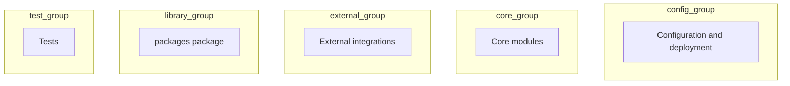

# Architecture report: shuding/nextra

> Automated static analysis. **Observed** = directly seen in files/imports/AST; **Inferred** = interpretation from that evidence. Repository code was not executed.

## 1. Repository at a glance

| Item | Value |
| --- | --- |
| Repository | shuding/nextra |
| Description | Simple, powerful and flexible site generation framework with everything you love from Next.js. |
| Language | TypeScript |
| Stars | 13954 |
| Licence | MIT |
| Analysed commit / branch | d6e80e1dd627b781429a6ee989b15ebba688c8ea / main |
| Framework(s) | Next.js, React |
| Files analysed | 749 |
| Components | 5 |

## 2. Architecture in one minute

shuding/nextra - Simple, powerful and flexible site generation framework with everything you love from Next.js.. This repository was analysed statically from 749 file(s) (0 Python). Detected technologies (observed from imports/manifests): GitHub Actions, Next.js, React, Tailwind CSS, TypeScript, Vitest. Files are grouped into 5 component(s): Configuration and deployment, Core modules, External integrations, packages package, Tests. Findings below distinguish observed facts from inferred interpretation.

## 3. High-level block diagram

## 4. Main components

### Configuration and deployment (`config`)

- **Kind:** config
- **Status:** Observed
- **Confidence:** 0.85
- **Responsibility:** Groups 27 file(s) under configuration and deployment (observed from repository paths and static analysis).
- **Paths:** `package.json`, `packages/esbuild-react-compiler-plugin/package.json`, `packages/esbuild-react-compiler-plugin/tsconfig.json`, `packages/eslint-config/package.json`, `packages/eslint-config/tsconfig.json`, `packages/nextra-theme-blog/package.json`, `packages/nextra-theme-blog/tsconfig.json`, `packages/nextra-theme-docs/package.json`, `packages/nextra-theme-docs/tsconfig.json`, `packages/nextra/package.json`, `packages/nextra/tsconfig.json`, `packages/prettier-config/package.json`, `packages/tsdoc/package.json`, `packages/tsdoc/src/__tests__/snapshots/flattened.json`, `packages/tsdoc/src/__tests__/snapshots/get-smooth-step-path.json`, `packages/tsdoc/src/__tests__/snapshots/get-viewport-for-bounds.json`, `packages/tsdoc/src/__tests__/snapshots/head.json`, `packages/tsdoc/src/__tests__/snapshots/layout-props.json`, `packages/tsdoc/src/__tests__/snapshots/navbar.json`, `packages/tsdoc/src/__tests__/snapshots/nextra-config.json`, `packages/tsdoc/src/__tests__/snapshots/react-flow-instance.json`, `packages/tsdoc/src/__tests__/snapshots/search.json`, `packages/tsdoc/src/__tests__/snapshots/use-config.json`, `packages/tsdoc/src/__tests__/snapshots/use-edges-state.json`, `packages/tsdoc/src/__tests__/snapshots/use-theme-config.json`, `packages/tsdoc/tsconfig.json`, `pnpm-workspace.yaml`
- **Evidence:** [package.json](https://github.com/shuding/nextra/blob/d6e80e1dd627b781429a6ee989b15ebba688c8ea/package.json); [packages/esbuild-react-compiler-plugin/package.json](https://github.com/shuding/nextra/blob/d6e80e1dd627b781429a6ee989b15ebba688c8ea/packages/esbuild-react-compiler-plugin/package.json); [packages/esbuild-react-compiler-plugin/tsconfig.json](https://github.com/shuding/nextra/blob/d6e80e1dd627b781429a6ee989b15ebba688c8ea/packages/esbuild-react-compiler-plugin/tsconfig.json); [packages/eslint-config/package.json](https://github.com/shuding/nextra/blob/d6e80e1dd627b781429a6ee989b15ebba688c8ea/packages/eslint-config/package.json); [packages/eslint-config/tsconfig.json](https://github.com/shuding/nextra/blob/d6e80e1dd627b781429a6ee989b15ebba688c8ea/packages/eslint-config/tsconfig.json); [packages/nextra-theme-blog/package.json](https://github.com/shuding/nextra/blob/d6e80e1dd627b781429a6ee989b15ebba688c8ea/packages/nextra-theme-blog/package.json); [packages/nextra-theme-blog/tsconfig.json](https://github.com/shuding/nextra/blob/d6e80e1dd627b781429a6ee989b15ebba688c8ea/packages/nextra-theme-blog/tsconfig.json); [packages/nextra-theme-docs/package.json](https://github.com/shuding/nextra/blob/d6e80e1dd627b781429a6ee989b15ebba688c8ea/packages/nextra-theme-docs/package.json)

### Core modules (`core`)

- **Kind:** core
- **Status:** Observed
- **Confidence:** 0.85
- **Responsibility:** Groups 1 file(s) under core modules (observed from repository paths and static analysis).
- **Paths:** `prettier.config.mjs`
- **Evidence:** [prettier.config.mjs](https://github.com/shuding/nextra/blob/d6e80e1dd627b781429a6ee989b15ebba688c8ea/prettier.config.mjs)

### External integrations (`external_integrations`)

- **Kind:** external
- **Status:** Observed
- **Confidence:** 0.85
- **Responsibility:** Groups 54 file(s) under external integrations (observed from repository paths and static analysis).
- **Paths:** `packages/nextra/src/client/__tests__/mdx-components.test-d.ts`, `packages/nextra/src/client/__tests__/remove-links.test.tsx`, `packages/nextra/src/client/__tests__/use-fs-route.test.ts`, `packages/nextra/src/client/components/banner/close-banner-button.tsx`, `packages/nextra/src/client/components/banner/index.client.tsx`, `packages/nextra/src/client/components/banner/index.tsx`, `packages/nextra/src/client/components/bleed.tsx`, `packages/nextra/src/client/components/button.tsx`, `packages/nextra/src/client/components/callout.tsx`, `packages/nextra/src/client/components/cards.tsx`, `packages/nextra/src/client/components/collapse.tsx`, `packages/nextra/src/client/components/file-tree/file.tsx`, `packages/nextra/src/client/components/file-tree/folder.tsx`, `packages/nextra/src/client/components/file-tree/index.tsx`, `packages/nextra/src/client/components/file-tree/tree.tsx`, `packages/nextra/src/client/components/head.tsx`, `packages/nextra/src/client/components/image-zoom.tsx`, `packages/nextra/src/client/components/index.ts`, `packages/nextra/src/client/components/playground.tsx`, `packages/nextra/src/client/components/popup/index.client.tsx`, `packages/nextra/src/client/components/popup/index.tsx`, `packages/nextra/src/client/components/search.tsx`, `packages/nextra/src/client/components/select.tsx`, `packages/nextra/src/client/components/skip-nav/index.client.tsx`, `packages/nextra/src/client/components/skip-nav/index.tsx`, `packages/nextra/src/client/components/steps.tsx`, `packages/nextra/src/client/components/tabs/index.client.tsx`, `packages/nextra/src/client/components/tabs/index.tsx`, `packages/nextra/src/client/evaluate.ts`, `packages/nextra/src/client/hocs/index.ts`, `packages/nextra/src/client/hocs/with-github-alert.tsx`, `packages/nextra/src/client/hocs/with-icons.tsx`, `packages/nextra/src/client/hooks/index.ts`, `packages/nextra/src/client/hooks/use-copy.ts`, `packages/nextra/src/client/hooks/use-fs-route.ts`, `packages/nextra/src/client/hooks/use-hash.ts`, `packages/nextra/src/client/hooks/use-mounted.ts`, `packages/nextra/src/client/icons/index.ts`, `packages/nextra/src/client/mdx-components.ts`, `packages/nextra/src/client/mdx-components/anchor.tsx`, `packages/nextra/src/client/mdx-components/code.tsx`, `packages/nextra/src/client/mdx-components/details.tsx`, `packages/nextra/src/client/mdx-components/image.tsx`, `packages/nextra/src/client/mdx-components/index.ts`, `packages/nextra/src/client/mdx-components/pre/copy-to-clipboard.tsx`, `packages/nextra/src/client/mdx-components/pre/index.tsx`, `packages/nextra/src/client/mdx-components/pre/toggle-word-wrap-button.tsx`, `packages/nextra/src/client/mdx-components/summary.tsx`, `packages/nextra/src/client/mdx-components/table.tsx`, `packages/nextra/src/client/mdx-remote.tsx`, `packages/nextra/src/client/normalize-pages.ts`, `packages/nextra/src/client/pages.ts`, `packages/nextra/src/client/remove-links.ts`, `packages/nextra/src/client/setup-page.tsx`
- **Evidence:** [packages/nextra/src/client/__tests__/mdx-components.test-d.ts](https://github.com/shuding/nextra/blob/d6e80e1dd627b781429a6ee989b15ebba688c8ea/packages/nextra/src/client/__tests__/mdx-components.test-d.ts); [packages/nextra/src/client/__tests__/remove-links.test.tsx](https://github.com/shuding/nextra/blob/d6e80e1dd627b781429a6ee989b15ebba688c8ea/packages/nextra/src/client/__tests__/remove-links.test.tsx); [packages/nextra/src/client/__tests__/use-fs-route.test.ts](https://github.com/shuding/nextra/blob/d6e80e1dd627b781429a6ee989b15ebba688c8ea/packages/nextra/src/client/__tests__/use-fs-route.test.ts); [packages/nextra/src/client/components/banner/close-banner-button.tsx](https://github.com/shuding/nextra/blob/d6e80e1dd627b781429a6ee989b15ebba688c8ea/packages/nextra/src/client/components/banner/close-banner-button.tsx); [packages/nextra/src/client/components/banner/index.client.tsx](https://github.com/shuding/nextra/blob/d6e80e1dd627b781429a6ee989b15ebba688c8ea/packages/nextra/src/client/components/banner/index.client.tsx); [packages/nextra/src/client/components/banner/index.tsx](https://github.com/shuding/nextra/blob/d6e80e1dd627b781429a6ee989b15ebba688c8ea/packages/nextra/src/client/components/banner/index.tsx); [packages/nextra/src/client/components/bleed.tsx](https://github.com/shuding/nextra/blob/d6e80e1dd627b781429a6ee989b15ebba688c8ea/packages/nextra/src/client/components/bleed.tsx); [packages/nextra/src/client/components/button.tsx](https://github.com/shuding/nextra/blob/d6e80e1dd627b781429a6ee989b15ebba688c8ea/packages/nextra/src/client/components/button.tsx)

### packages package (`packages`)

- **Kind:** library
- **Status:** Observed
- **Confidence:** 0.85
- **Responsibility:** Groups 170 file(s) under packages package (observed from repository paths and static analysis).
- **Paths:** `packages/esbuild-react-compiler-plugin/src/env.d.ts`, `packages/esbuild-react-compiler-plugin/src/index.ts`, `packages/esbuild-react-compiler-plugin/tsup.config.ts`, `packages/eslint-config/src/index.ts`, `packages/nextra-theme-blog/__test__/is-valid-date.test.ts`, `packages/nextra-theme-blog/postcss.config.mjs`, `packages/nextra-theme-blog/src/components/cusdis.tsx`, `packages/nextra-theme-blog/src/components/go-back.tsx`, `packages/nextra-theme-blog/src/components/index.ts`, `packages/nextra-theme-blog/src/components/layout.tsx`, `packages/nextra-theme-blog/src/components/meta.tsx`, `packages/nextra-theme-blog/src/components/navbar-link.tsx`, `packages/nextra-theme-blog/src/components/navbar.tsx`, `packages/nextra-theme-blog/src/components/post-card.tsx`, `packages/nextra-theme-blog/src/components/theme-switch.tsx`, `packages/nextra-theme-blog/src/env.d.ts`, `packages/nextra-theme-blog/src/index.ts`, `packages/nextra-theme-blog/src/is-valid-date.ts`, `packages/nextra-theme-blog/src/mdx-components.tsx`, `packages/nextra-theme-blog/src/types.ts`, `packages/nextra-theme-blog/tsup.config.ts`, `packages/nextra-theme-docs/postcss.config.mjs`, `packages/nextra-theme-docs/setup-files.ts`, `packages/nextra-theme-docs/src/__tests__/git-url-parse.test.ts`, `packages/nextra-theme-docs/src/__tests__/layout-props.test-d.ts`, `packages/nextra-theme-docs/src/__tests__/mdx-components.test-d.ts`, `packages/nextra-theme-docs/src/components/404/index.client.tsx`, `packages/nextra-theme-docs/src/components/404/index.tsx`, `packages/nextra-theme-docs/src/components/back-to-top.tsx`, `packages/nextra-theme-docs/src/components/breadcrumb.tsx`, `packages/nextra-theme-docs/src/components/copy-page.tsx`, `packages/nextra-theme-docs/src/components/footer/index.tsx`, `packages/nextra-theme-docs/src/components/footer/switchers.ts`, `packages/nextra-theme-docs/src/components/index.ts`, `packages/nextra-theme-docs/src/components/last-updated.tsx`, `packages/nextra-theme-docs/src/components/locale-switch.tsx`, `packages/nextra-theme-docs/src/components/navbar/index.client.tsx`, `packages/nextra-theme-docs/src/components/navbar/index.tsx`, `packages/nextra-theme-docs/src/components/pagination.tsx`, `packages/nextra-theme-docs/src/components/sidebar.tsx`, `packages/nextra-theme-docs/src/components/theme-switch.tsx`, `packages/nextra-theme-docs/src/components/toc.tsx`, `packages/nextra-theme-docs/src/index.ts`, `packages/nextra-theme-docs/src/layout.tsx`, `packages/nextra-theme-docs/src/mdx-components/heading-anchor.client.tsx`, `packages/nextra-theme-docs/src/mdx-components/heading.tsx`, `packages/nextra-theme-docs/src/mdx-components/index.tsx`, `packages/nextra-theme-docs/src/mdx-components/link.tsx`, `packages/nextra-theme-docs/src/mdx-components/wrapper.client.tsx`, `packages/nextra-theme-docs/src/schemas.tsx`, `packages/nextra-theme-docs/src/stores/active-anchor.ts`, `packages/nextra-theme-docs/src/stores/config.tsx`, `packages/nextra-theme-docs/src/stores/focused-route.ts`, `packages/nextra-theme-docs/src/stores/index.ts`, `packages/nextra-theme-docs/src/stores/menu.ts`, `packages/nextra-theme-docs/src/stores/theme-config.ts`, `packages/nextra-theme-docs/src/stores/toc.ts`, `packages/nextra-theme-docs/src/types.generated.ts`, `packages/nextra-theme-docs/src/utils/extract-only-strings-from-react-node.ts`, `packages/nextra-theme-docs/src/utils/get-git-issue-url.ts`, `packages/nextra-theme-docs/src/utils/git-url-parse.ts`, `packages/nextra-theme-docs/src/utils/index.ts`, `packages/nextra-theme-docs/tailwind.config.ts`, `packages/nextra-theme-docs/tsup.config.ts`, `packages/nextra/default-entry.ts`, `packages/nextra/loader.cjs`, `packages/nextra/setup-files.ts`, `packages/nextra/src/env.d.ts`, `packages/nextra/src/icon.ts`, `packages/nextra/src/server/__tests__/compile-metadata.test.ts`, `packages/nextra/src/server/__tests__/compile.test.ts`, `packages/nextra/src/server/__tests__/fixture/page-maps/active-type-should-be-initialized-from-star/1-level/_meta.ts`, `packages/nextra/src/server/__tests__/fixture/page-maps/active-type-should-be-initialized-from-star/_meta.ts`, `packages/nextra/src/server/__tests__/fixture/page-maps/active-type-should-be-initialized-from-star/generated-page-map.ts`, `packages/nextra/src/server/__tests__/fixture/page-maps/first-child-route-should-return-index-as-first/_meta.ts`, `packages/nextra/src/server/__tests__/fixture/page-maps/first-child-route-should-return-index-as-first/generated-page-map.ts`, `packages/nextra/src/server/__tests__/fixture/page-maps/folder-index-page-and-folder-should-be-merged/generated-page-map.ts`, `packages/nextra/src/server/__tests__/fixture/page-maps/folder-with-symlinks/pages/generated-page-map.ts`, `packages/nextra/src/server/__tests__/fixture/page-maps/folder-without-markdown-files/generated-page-map.ts`, `packages/nextra/src/server/__tests__/fixture/page-maps/folder-without-markdown-files/test.ts`, `packages/nextra/src/server/__tests__/fixture/page-maps/folder-without-meta-json/generated-page-map.ts`, `packages/nextra/src/server/__tests__/fixture/page-maps/hidden-route-should-have-theme-context/1-level/2-level/_meta.ts`, `packages/nextra/src/server/__tests__/fixture/page-maps/hidden-route-should-have-theme-context/_meta.ts`, `packages/nextra/src/server/__tests__/fixture/page-maps/hidden-route-should-have-theme-context/generated-page-map.ts`, `packages/nextra/src/server/__tests__/fixture/page-maps/non-english-characters-in-filename/generated-page-map.ts`, `packages/nextra/src/server/__tests__/fixture/page-maps/page-map.ts`, `packages/nextra/src/server/__tests__/fixture/page-maps/pages-order-without-type-page/_meta.ts`, `packages/nextra/src/server/__tests__/fixture/page-maps/pages-order-without-type-page/generated-page-map.ts`, `packages/nextra/src/server/__tests__/fixture/page-maps/respect-order-for-type-separator-menu-and-item-with-href/generated-page-map.ts`, `packages/nextra/src/server/__tests__/fixture/page-maps/respect-order-for-type-separator-menu-and-item-with-href/one/two/_meta.ts`, `packages/nextra/src/server/__tests__/fixture/page-maps/should-move-file-with-index-name/_meta.ts`, `packages/nextra/src/server/__tests__/fixture/page-maps/should-move-file-with-index-name/generated-page-map.ts`, `packages/nextra/src/server/__tests__/fixture/page-maps/should-rename-folder/_meta.js`, `packages/nextra/src/server/__tests__/fixture/page-maps/should-rename-folder/generated-page-map.ts`, `packages/nextra/src/server/__tests__/fixture/page-maps/title/_meta.ts`, `packages/nextra/src/server/__tests__/fixture/page-maps/title/generated-page-map.ts`, `packages/nextra/src/server/__tests__/fixture/page-maps/type-menu-should-contain-items/_meta.ts`, `packages/nextra/src/server/__tests__/fixture/page-maps/type-menu-should-contain-items/generated-page-map.ts`, `packages/nextra/src/server/__tests__/latex.test.ts`, `packages/nextra/src/server/__tests__/merge-meta-with-page-map.test.ts`, `packages/nextra/src/server/__tests__/nextra-config.test-d.ts`, `packages/nextra/src/server/__tests__/normalize.test.ts`, `packages/nextra/src/server/__tests__/page-map.test.ts`, `packages/nextra/src/server/__tests__/recma-rewrite.test.ts`, `packages/nextra/src/server/__tests__/rehype-extract-toc-content.test.ts`, `packages/nextra/src/server/__tests__/remark-mdx-frontmatter.test.ts`, `packages/nextra/src/server/__tests__/remark-mdx-title.test.ts`, `packages/nextra/src/server/__tests__/remark-remove-imports.test.ts`, `packages/nextra/src/server/__tests__/remark-static-images.test.ts`, `packages/nextra/src/server/__tests__/test-utils.ts`, `packages/nextra/src/server/__tests__/to-js.test.ts`, `packages/nextra/src/server/__tests__/to-page-map.test.ts`, `packages/nextra/src/server/compile-metadata.ts`, `packages/nextra/src/server/compile.ts`, `packages/nextra/src/server/constants.ts`, `packages/nextra/src/server/fetch-filepaths-from-github.ts`, `packages/nextra/src/server/index.ts`, `packages/nextra/src/server/loader.ts`, `packages/nextra/src/server/locales.ts`, `packages/nextra/src/server/page-map/find-meta-and-page-file-paths.ts`, `packages/nextra/src/server/page-map/get.ts`, `packages/nextra/src/server/page-map/index-page.ts`, `packages/nextra/src/server/page-map/index.ts`, `packages/nextra/src/server/page-map/merge-meta-with-page-map.ts`, `packages/nextra/src/server/page-map/normalize.ts`, `packages/nextra/src/server/page-map/placeholder.ts`, `packages/nextra/src/server/page-map/to-ast.ts`, `packages/nextra/src/server/page-map/to-js.ts`, `packages/nextra/src/server/page-map/to-page-map.ts`, `packages/nextra/src/server/recma-plugins/index.ts`, `packages/nextra/src/server/recma-plugins/recma-rewrite.ts`, `packages/nextra/src/server/rehype-plugins/index.ts`, `packages/nextra/src/server/rehype-plugins/rehype-better-react-mathjax.ts`, `packages/nextra/src/server/rehype-plugins/rehype-extract-toc-content.ts`, `packages/nextra/src/server/rehype-plugins/rehype-twoslash-popup.ts`, `packages/nextra/src/server/rehype-plugins/rehype.ts`, `packages/nextra/src/server/remark-plugins/index.ts`, `packages/nextra/src/server/remark-plugins/remark-assign-frontmatter.ts`, `packages/nextra/src/server/remark-plugins/remark-custom-heading-id.ts`, `packages/nextra/src/server/remark-plugins/remark-export-only-metadata.ts`, `packages/nextra/src/server/remark-plugins/remark-export-source-code.ts`, `packages/nextra/src/server/remark-plugins/remark-headings.ts`, `packages/nextra/src/server/remark-plugins/remark-link-rewrite.ts`, `packages/nextra/src/server/remark-plugins/remark-mdx-disable-explicit-jsx.ts`, `packages/nextra/src/server/remark-plugins/remark-mdx-frontmatter.ts`, `packages/nextra/src/server/remark-plugins/remark-mdx-title.ts`, `packages/nextra/src/server/remark-plugins/remark-remove-imports.ts`, `packages/nextra/src/server/remark-plugins/remark-static-image.ts`, `packages/nextra/src/server/schemas.ts`, `packages/nextra/src/server/tsdoc/base.ts`, `packages/nextra/src/server/tsdoc/index.ts`, `packages/nextra/src/server/tsdoc/tsdoc.tsx`, `packages/nextra/src/server/tsdoc/types.ts`, `packages/nextra/src/server/tsdoc/zod-to-ts.ts`, `packages/nextra/src/server/twoslash.ts`, `packages/nextra/src/server/utils.ts`, `packages/nextra/src/types.generated.ts`, `packages/nextra/src/types.ts`, `packages/nextra/tsup.config.ts`, `packages/nextra/vitest.config.ts`, `packages/prettier-config/src/index.js`, `packages/tsdoc/src/__tests__/base.test.ts`, `packages/tsdoc/src/__tests__/fixtures/flattened.ts`, `packages/tsdoc/src/__tests__/snapshots/head-props.ts`, `packages/tsdoc/src/__tests__/snapshots/layout-props.ts`, `packages/tsdoc/src/__tests__/zod-to-ts.test.ts`, `packages/tsdoc/src/env.d.ts`, `packages/tsdoc/src/index.ts`, `packages/tsdoc/tsup.config.ts`, `packages/tsdoc/vitest.config.ts`
- **Evidence:** [packages/esbuild-react-compiler-plugin/src/env.d.ts](https://github.com/shuding/nextra/blob/d6e80e1dd627b781429a6ee989b15ebba688c8ea/packages/esbuild-react-compiler-plugin/src/env.d.ts); [packages/esbuild-react-compiler-plugin/src/index.ts](https://github.com/shuding/nextra/blob/d6e80e1dd627b781429a6ee989b15ebba688c8ea/packages/esbuild-react-compiler-plugin/src/index.ts); [packages/esbuild-react-compiler-plugin/tsup.config.ts](https://github.com/shuding/nextra/blob/d6e80e1dd627b781429a6ee989b15ebba688c8ea/packages/esbuild-react-compiler-plugin/tsup.config.ts); [packages/eslint-config/src/index.ts](https://github.com/shuding/nextra/blob/d6e80e1dd627b781429a6ee989b15ebba688c8ea/packages/eslint-config/src/index.ts); [packages/nextra-theme-blog/__test__/is-valid-date.test.ts](https://github.com/shuding/nextra/blob/d6e80e1dd627b781429a6ee989b15ebba688c8ea/packages/nextra-theme-blog/__test__/is-valid-date.test.ts); [packages/nextra-theme-blog/postcss.config.mjs](https://github.com/shuding/nextra/blob/d6e80e1dd627b781429a6ee989b15ebba688c8ea/packages/nextra-theme-blog/postcss.config.mjs); [packages/nextra-theme-blog/src/components/cusdis.tsx](https://github.com/shuding/nextra/blob/d6e80e1dd627b781429a6ee989b15ebba688c8ea/packages/nextra-theme-blog/src/components/cusdis.tsx); [packages/nextra-theme-blog/src/components/go-back.tsx](https://github.com/shuding/nextra/blob/d6e80e1dd627b781429a6ee989b15ebba688c8ea/packages/nextra-theme-blog/src/components/go-back.tsx)

### Tests (`tests`)

- **Kind:** test
- **Status:** Observed
- **Confidence:** 0.85
- **Responsibility:** Groups 1 file(s) under tests (observed from repository paths and static analysis).
- **Paths:** `packages/nextra/src/server/__tests__/fixture/page-maps/should-rename-folder/test/foo.md`
- **Evidence:** [packages/nextra/src/server/__tests__/fixture/page-maps/should-rename-folder/test/foo.md](https://github.com/shuding/nextra/blob/d6e80e1dd627b781429a6ee989b15ebba688c8ea/packages/nextra/src/server/__tests__/fixture/page-maps/should-rename-folder/test/foo.md)

## 5. Execution flow

**Observed** entry point(s):

- [packages/esbuild-react-compiler-plugin/src/index.ts](https://github.com/shuding/nextra/blob/d6e80e1dd627b781429a6ee989b15ebba688c8ea/packages/esbuild-react-compiler-plugin/src/index.ts)
- [packages/eslint-config/src/index.ts](https://github.com/shuding/nextra/blob/d6e80e1dd627b781429a6ee989b15ebba688c8ea/packages/eslint-config/src/index.ts)
- [packages/nextra-theme-blog/src/index.ts](https://github.com/shuding/nextra/blob/d6e80e1dd627b781429a6ee989b15ebba688c8ea/packages/nextra-theme-blog/src/index.ts)
- [packages/nextra-theme-docs/src/index.ts](https://github.com/shuding/nextra/blob/d6e80e1dd627b781429a6ee989b15ebba688c8ea/packages/nextra-theme-docs/src/index.ts)
- [packages/prettier-config/src/index.js](https://github.com/shuding/nextra/blob/d6e80e1dd627b781429a6ee989b15ebba688c8ea/packages/prettier-config/src/index.js)
- [packages/tsdoc/src/index.ts](https://github.com/shuding/nextra/blob/d6e80e1dd627b781429a6ee989b15ebba688c8ea/packages/tsdoc/src/index.ts)

Representative flow (derived from observed entry points and the import graph; steps beyond the entry point are **Inferred**):

1. Execution starts at an observed entry point listed above, if present.
2. No internal import relationships between components were observed.

## 6. Project structure

### `(root)`

- `.editorconfig` - config (41 bytes)
- `.gitignore` - other (217 bytes)
- `.node-version` - other (3 bytes)
- `.prettierignore` - other (365 bytes)
- `LICENSE` - docs (1065 bytes)
- `README.md` - docs (1592 bytes)
- `package.json` - manifest (1942 bytes)
- `pnpm-workspace.yaml` - config (49 bytes)
- `prettier.config.mjs` - source, JavaScript (50 bytes)
- `renovate.json5` - other (1081 bytes)
- `turbo.jsonc` - other (740 bytes)

### `.changeset`

- `.changeset/config.json` - config (587 bytes)

### `.github`

- `.github/CODE_OF_CONDUCT.md` - docs (5210 bytes)
- `.github/ISSUE_TEMPLATE/bug_report.md` - docs (830 bytes)
- `.github/ISSUE_TEMPLATE/feature_request.md` - docs (603 bytes)
- `.github/PULL_REQUEST_TEMPLATE.md` - docs (789 bytes)
- `.github/workflows/lint.yml` - ci, YAML (923 bytes)
- `.github/workflows/release.yml` - ci, YAML (1409 bytes)
- `.github/workflows/test.yml` - ci, YAML (993 bytes)

### `docs`

- `docs/app/_components/features/index.tsx` - docs (1386 bytes)
- `docs/app/_components/features/style.module.css` - docs (2708 bytes)
- `docs/app/_components/features/themes-animation.tsx` - docs (18320 bytes)
- `docs/app/_components/framer-motion.ts` - docs (124 bytes)
- `docs/app/_components/i18n-demo.tsx` - docs (1505 bytes)
- `docs/app/_components/overview-page.tsx` - docs (1459 bytes)
- `docs/app/_meta.global.tsx` - docs (4779 bytes)
- `docs/app/about/page.mdx` - docs (2808 bytes)
- `docs/app/api/[name]/page.tsx` - docs (3920 bytes)
- `docs/app/api/page.mdx` - docs (498 bytes)
- `docs/app/blog/page.mdx` - docs (2194 bytes)
- `docs/app/docs/advanced/customize-the-cascade-layers/page.mdx` - docs (1304 bytes)
- `docs/app/docs/advanced/latex/page.mdx` - docs (6871 bytes)
- `docs/app/docs/advanced/mermaid/page.mdx` - docs (1024 bytes)
- `docs/app/docs/advanced/npm2yarn/page.mdx` - docs (846 bytes)
- `docs/app/docs/advanced/page.mdx` - docs (453 bytes)
- `docs/app/docs/advanced/remote/page.mdx` - docs (1448 bytes)
- `docs/app/docs/advanced/table/page.mdx` - docs (1873 bytes)
- `docs/app/docs/advanced/tailwind-css/page.mdx` - docs (960 bytes)
- `docs/app/docs/advanced/twoslash/page.mdx` - docs (1343 bytes)
- `docs/app/docs/advanced/typescript/page.mdx` - docs (1389 bytes)
- `docs/app/docs/blog-theme/get-posts-and-tags/page.mdx` - docs (304 bytes)
- `docs/app/docs/blog-theme/page.mdx` - docs (409 bytes)
- `docs/app/docs/blog-theme/posts/page.mdx` - docs (262 bytes)
- `docs/app/docs/blog-theme/rss/page.mdx` - docs (263 bytes)
- `docs/app/docs/blog-theme/start/page.mdx` - docs (1966 bytes)
- `docs/app/docs/blog-theme/tags/page.mdx` - docs (270 bytes)
- `docs/app/docs/built-ins/[name]/page.tsx` - docs (5511 bytes)
- `docs/app/docs/built-ins/page.mdx` - docs (1129 bytes)
- `docs/app/docs/custom-theme/old.mdx` - docs (2369 bytes)
- `docs/app/docs/custom-theme/page.mdx` - docs (1930 bytes)
- `docs/app/docs/docs-theme/api/page.mdx` - docs (597 bytes)
- `docs/app/docs/docs-theme/built-ins/footer/page.mdx` - docs (919 bytes)
- `docs/app/docs/docs-theme/built-ins/layout/old.mdx` - docs (194 bytes)
- `docs/app/docs/docs-theme/built-ins/layout/page.mdx` - docs (6285 bytes)
- `docs/app/docs/docs-theme/built-ins/navbar/page.mdx` - docs (3406 bytes)
- `docs/app/docs/docs-theme/built-ins/not-found/page.mdx` - docs (488 bytes)
- `docs/app/docs/docs-theme/built-ins/page.mdx` - docs (201 bytes)
- `docs/app/docs/docs-theme/page.mdx` - docs (297 bytes)
- `docs/app/docs/docs-theme/start/page.mdx` - docs (2793 bytes)
- `docs/app/docs/file-conventions/content-directory/page.mdx` - docs (3590 bytes)
- `docs/app/docs/file-conventions/mdx-components-file/page.mdx` - docs (2058 bytes)
- `docs/app/docs/file-conventions/meta-file/page.mdx` - docs (16625 bytes)
- `docs/app/docs/file-conventions/page-file/page.mdx` - docs (1215 bytes)
- `docs/app/docs/file-conventions/page.mdx` - docs (530 bytes)
- `docs/app/docs/file-conventions/src-directory/page.mdx` - docs (1774 bytes)
- `docs/app/docs/guide/custom-css/page.mdx` - docs (967 bytes)
- `docs/app/docs/guide/github-alert-syntax/page.mdx` - docs (2409 bytes)
- `docs/app/docs/guide/i18n/page.mdx` - docs (2284 bytes)
- `docs/app/docs/guide/image/page.mdx` - docs (2122 bytes)
- `docs/app/docs/guide/link/page.mdx` - docs (736 bytes)
- `docs/app/docs/guide/markdown/_counter.tsx` - docs (321 bytes)
- `docs/app/docs/guide/markdown/page.mdx` - docs (2297 bytes)
- `docs/app/docs/guide/page.mdx` - docs (588 bytes)
- `docs/app/docs/guide/search/ai/page.mdx` - docs (2967 bytes)
- `docs/app/docs/guide/search/page.mdx` - docs (2127 bytes)
- `docs/app/docs/guide/search/typesense/page.mdx` - docs (3436 bytes)
- `docs/app/docs/guide/ssg/page.mdx` - docs (2057 bytes)
- `docs/app/docs/guide/static-exports/page.mdx` - docs (1375 bytes)
- `docs/app/docs/guide/syntax-highlighting/_dynamic-code.tsx` - docs (1193 bytes)
- `docs/app/docs/guide/syntax-highlighting/page.mdx` - docs (7311 bytes)
- `docs/app/docs/guide/turbopack/page.mdx` - docs (1429 bytes)
- `docs/app/docs/page.mdx` - docs (2361 bytes)
- `docs/app/env.d.ts` - docs (378 bytes)
- `docs/app/globals.css` - docs (927 bytes)
- `docs/app/icon.svg` - docs (1000 bytes)
- `docs/app/layout.tsx` - docs (4215 bytes)
- `docs/app/not-found.ts` - docs (60 bytes)
- `docs/app/og/route.tsx` - docs (1907 bytes)
- `docs/app/page.css` - docs (3922 bytes)
- `docs/app/page.module.css` - docs (1651 bytes)
- `docs/app/page.tsx` - docs (12374 bytes)
- `docs/app/showcase/_logos/cloudquery.svg` - docs (5964 bytes)
- `docs/app/showcase/page.mdx` - docs (5148 bytes)
- `docs/app/sponsors/page.mdx` - docs (1428 bytes)
- `docs/components/_slider.tsx` - docs (1758 bytes)
- `docs/components/_table/index.tsx` - docs (1446 bytes)
- `docs/components/_table/style.module.css` - docs (225 bytes)
- `docs/components/content-and-app-file-tree.tsx` - docs (2365 bytes)
- `docs/components/example-code.tsx` - docs (709 bytes)
- `docs/components/example-tsdoc.mdx` - docs (475 bytes)
- `docs/components/generate-api-reference.ts` - docs (2133 bytes)
- `docs/components/get-page-map.ts` - docs (1926 bytes)
- `docs/components/icons/arrow-right.svg` - docs (294 bytes)
- `docs/components/icons/box.svg` - docs (294 bytes)
- `docs/components/icons/brush.svg` - docs (551 bytes)
- `docs/components/icons/cards.svg` - docs (561 bytes)
- `docs/components/icons/chevron-right.svg` - docs (234 bytes)
- `docs/components/icons/cloud.svg` - docs (930 bytes)
- `docs/components/icons/code.svg` - docs (280 bytes)
- `docs/components/icons/diagram.svg` - docs (2470 bytes)
- `docs/components/icons/dropper.svg` - docs (444 bytes)
- `docs/components/icons/file.svg` - docs (486 bytes)
- `docs/components/icons/files.svg` - docs (670 bytes)
- `docs/components/icons/folder-tree.svg` - docs (560 bytes)
- `docs/components/icons/formula.svg` - docs (1051 bytes)
- `docs/components/icons/gear.svg` - docs (660 bytes)
- `docs/components/icons/globe.svg` - docs (670 bytes)
- `docs/components/icons/id-card.svg` - docs (902 bytes)
- `docs/components/icons/index.ts` - docs (1748 bytes)
- `docs/components/icons/lightning.svg` - docs (338 bytes)
- `docs/components/icons/newsletter.svg` - docs (482 bytes)
- `docs/components/icons/nextra.svg` - docs (4118 bytes)
- `docs/components/icons/one.svg` - docs (266 bytes)
- `docs/components/icons/picture.svg` - docs (506 bytes)
- `docs/components/icons/rows.svg` - docs (322 bytes)
- `docs/components/icons/rss.svg` - docs (288 bytes)
- `docs/components/icons/stars.svg` - docs (802 bytes)
- `docs/components/icons/switch.svg` - docs (450 bytes)
- `docs/components/icons/table.svg` - docs (2161 bytes)
- `docs/components/icons/tags.svg` - docs (461 bytes)
- `docs/components/icons/tailwind.svg` - docs (943 bytes)
- `docs/components/icons/vercel.svg` - docs (1081 bytes)
- `docs/components/icons/warning.svg` - docs (385 bytes)
- `docs/components/inkeep-chat-button.tsx` - docs (990 bytes)
- `docs/components/install-nextra-theme.mdx` - docs (1684 bytes)
- `docs/components/playground-demo.tsx` - docs (2529 bytes)
- `docs/components/ready-to-go.mdx` - docs (380 bytes)
- `docs/components/shadow.jsx` - docs (624 bytes)
- `docs/components/toggle-visibility-section.tsx` - docs (671 bytes)
- `docs/components/video.tsx` - docs (343 bytes)
- `docs/mdx-components.tsx` - docs (4983 bytes)
- `docs/next-sitemap.config.js` - docs (198 bytes)
- `docs/next.config.ts` - docs (4037 bytes)
- `docs/package.json` - manifest (841 bytes)
- `docs/postcss.config.mjs` - docs (229 bytes)
- `docs/public/assets/syntax-highlighting.svg` - docs (55248 bytes)
- `docs/public/logo.svg` - docs (4263 bytes)
- `docs/tsconfig.json` - config (1107 bytes)
- `docs/vercel.json` - config (21 bytes)

### `examples`

- `examples/blog/app/_meta.global.js` - source, JavaScript (153 bytes)
- `examples/blog/app/layout.jsx` - source, JavaScript (1445 bytes)
- `examples/blog/app/page.mdx` - other (188 bytes)
- `examples/blog/app/posts/(with-comments)/aaron-swartz-a-programmable-web/page.mdx` - other (5220 bytes)
- `examples/blog/app/posts/(with-comments)/code-blocks/page.mdx` - other (1112 bytes)
- `examples/blog/app/posts/(with-comments)/draft/page.mdx` - other (367 bytes)
- `examples/blog/app/posts/(with-comments)/layout.jsx` - source, JavaScript (224 bytes)
- `examples/blog/app/posts/(with-comments)/lists/page.mdx` - other (297 bytes)
- `examples/blog/app/posts/(with-comments)/nextra-components/page.mdx` - other (3362 bytes)
- `examples/blog/app/posts/(with-comments)/table/page.mdx` - other (553 bytes)
- `examples/blog/app/posts/get-posts.js` - source, JavaScript (534 bytes)
- `examples/blog/app/posts/page.jsx` - source, JavaScript (894 bytes)
- `examples/blog/app/rss.xml/route.js` - source, JavaScript (956 bytes)
- `examples/blog/app/tags/[tag]/page.jsx` - source, JavaScript (847 bytes)
- `examples/blog/mdx-components.jsx` - source, JavaScript (669 bytes)
- `examples/blog/next.config.js` - source, JavaScript (187 bytes)
- `examples/blog/package.json` - manifest (483 bytes)
- `examples/custom-theme/app/_components/footer.tsx` - source, TypeScript (213 bytes)
- `examples/custom-theme/app/_components/navbar.tsx` - source, TypeScript (957 bytes)
- `examples/custom-theme/app/_components/nextra-theme.tsx` - source, TypeScript (779 bytes)
- `examples/custom-theme/app/_components/sidebar.tsx` - source, TypeScript (1533 bytes)
- `examples/custom-theme/app/_components/toc.tsx` - source, TypeScript (366 bytes)
- `examples/custom-theme/app/_meta.global.ts` - source, TypeScript (241 bytes)
- `examples/custom-theme/app/docs/nested-level/bar/page.mdx` - docs (14 bytes)
- `examples/custom-theme/app/docs/one-level/page.mdx` - docs (17 bytes)
- `examples/custom-theme/app/docs/page.mdx` - docs (18 bytes)
- `examples/custom-theme/app/layout.tsx` - source, TypeScript (669 bytes)
- `examples/custom-theme/app/page.mdx` - other (52 bytes)
- `examples/custom-theme/mdx-components.jsx` - source, JavaScript (435 bytes)
- `examples/custom-theme/next.config.ts` - source, TypeScript (115 bytes)
- `examples/custom-theme/package.json` - manifest (510 bytes)
- `examples/custom-theme/public/.gitkeep` - other (0 bytes)
- `examples/custom-theme/tsconfig.json` - config (637 bytes)
- `examples/docs/mdx-components.js` - docs (214 bytes)
- `examples/docs/next.config.mjs` - docs (200 bytes)
- `examples/docs/package.json` - manifest (473 bytes)
- `examples/docs/src/app/_ignored/_meta.js` - docs (107 bytes)
- `examples/docs/src/app/_ignored/page.mdx` - docs (78 bytes)
- `examples/docs/src/app/_meta.js` - docs (167 bytes)
- `examples/docs/src/app/blog/page.jsx` - docs (222 bytes)
- `examples/docs/src/app/docs/[[...mdxPath]]/page.jsx` - docs (767 bytes)
- `examples/docs/src/app/layout.jsx` - docs (1607 bytes)
- `examples/docs/src/app/page.jsx` - docs (224 bytes)
- `examples/docs/src/app/showcase/(overview)/page.jsx` - docs (217 bytes)
- `examples/docs/src/content/_meta.js` - docs (142 bytes)
- `examples/docs/src/content/advanced/code-highlighting.mdx` - docs (1358 bytes)
- `examples/docs/src/content/features/_meta.js` - docs (92 bytes)
- `examples/docs/src/content/features/i18n.mdx` - docs (1095 bytes)
- `examples/docs/src/content/features/image.mdx` - docs (847 bytes)
- `examples/docs/src/content/features/latex.mdx` - docs (867 bytes)
- `examples/docs/src/content/features/mdx.mdx` - docs (3408 bytes)
- `examples/docs/src/content/features/ssg.mdx` - docs (1625 bytes)
- `examples/docs/src/content/features/themes.mdx` - docs (591 bytes)
- `examples/docs/src/content/get-started.mdx` - docs (2986 bytes)
- `examples/docs/src/content/index.mdx` - docs (520 bytes)
- `examples/docs/src/content/mermaid.mdx` - docs (295 bytes)
- `examples/docs/src/content/page.mdx` - docs (72 bytes)
- `examples/docs/src/content/themes/_meta.js` - docs (62 bytes)
- `examples/docs/src/content/themes/blog/_meta.js` - docs (31 bytes)
- `examples/docs/src/content/themes/blog/index.mdx` - docs (1907 bytes)
- `examples/docs/src/content/themes/docs/_meta.js` - docs (80 bytes)
- `examples/docs/src/content/themes/docs/bleed.mdx` - docs (1778 bytes)
- `examples/docs/src/content/themes/docs/callout.mdx` - docs (1218 bytes)
- `examples/docs/src/content/themes/docs/configuration.mdx` - docs (9096 bytes)
- `examples/docs/src/content/themes/docs/index.mdx` - docs (1754 bytes)
- `examples/docs/src/content/themes/docs/tabs.mdx` - docs (1532 bytes)
- `examples/swr-site/README.md` - docs (27 bytes)
- `examples/swr-site/app/[lang]/[[...mdxPath]]/page.tsx` - source, TypeScript (957 bytes)
- `examples/swr-site/app/[lang]/graphql-eslint/[[...slug]]/page.tsx` - source, TypeScript (2133 bytes)
- `examples/swr-site/app/[lang]/layout.tsx` - source, TypeScript (4178 bytes)
- `examples/swr-site/app/[lang]/not-found.ts` - source, TypeScript (60 bytes)
- `examples/swr-site/app/[lang]/remote/graphql-yoga/[[...slug]]/page.tsx` - source, TypeScript (2778 bytes)
- `examples/swr-site/app/[lang]/styles.css` - other (469 bytes)
- `examples/swr-site/app/_components/authors.tsx` - source, TypeScript (1151 bytes)
- `examples/swr-site/app/_components/blog.tsx` - source, TypeScript (1057 bytes)
- `examples/swr-site/app/_components/example-dynamic-markdown-import.tsx` - source, TypeScript (564 bytes)
- `examples/swr-site/app/_components/external.mdx` - other (136 bytes)
- `examples/swr-site/app/_components/features.css` - other (605 bytes)
- `examples/swr-site/app/_components/features.tsx` - source, TypeScript (1620 bytes)
- `examples/swr-site/app/_components/video.tsx` - source, TypeScript (1612 bytes)
- `examples/swr-site/app/_dictionaries/en.ts` - source, TypeScript (638 bytes)
- `examples/swr-site/app/_dictionaries/es.ts` - source, TypeScript (765 bytes)
- `examples/swr-site/app/_dictionaries/get-dictionary.ts` - source, TypeScript (658 bytes)
- `examples/swr-site/app/_dictionaries/i18n-config.ts` - source, TypeScript (316 bytes)
- `examples/swr-site/app/_dictionaries/ru.ts` - source, TypeScript (931 bytes)
- `examples/swr-site/app/_icons/box.svg` - other (337 bytes)
- `examples/swr-site/app/_icons/dots-vertical.svg` - other (234 bytes)
- `examples/swr-site/app/_icons/feather.svg` - other (329 bytes)
- `examples/swr-site/app/_icons/image.cache.svg` - other (9550 bytes)
- `examples/swr-site/app/_icons/image.infinite.svg` - other (3670 bytes)
- `examples/swr-site/app/_icons/image.pagination.svg` - other (5642 bytes)
- `examples/swr-site/app/_icons/image.welcome.svg` - other (2720 bytes)
- `examples/swr-site/app/_icons/index.ts` - source, TypeScript (854 bytes)
- `examples/swr-site/app/_icons/layers.svg` - other (252 bytes)
- `examples/swr-site/app/_icons/lightning.svg` - other (203 bytes)
- `examples/swr-site/app/_icons/pause.svg` - other (275 bytes)
- `examples/swr-site/app/_icons/pulse.svg` - other (319 bytes)
- `examples/swr-site/app/_icons/rain.svg` - other (395 bytes)
- `examples/swr-site/app/_icons/swr.svg` - other (852 bytes)
- `examples/swr-site/app/_icons/vercel.svg` - other (1081 bytes)
- `examples/swr-site/app/env.d.ts` - source, TypeScript (378 bytes)
- `examples/swr-site/app/icon.svg` - other (1577 bytes)
- `examples/swr-site/app/manifest.ts` - source, TypeScript (487 bytes)
- `examples/swr-site/content/en/_meta.ts` - source, TypeScript (783 bytes)
- `examples/swr-site/content/en/about/_meta.ts` - source, TypeScript (98 bytes)
- `examples/swr-site/content/en/about/a-page.mdx` - other (17 bytes)
- `examples/swr-site/content/en/about/acknowledgement.mdx` - other (18 bytes)
- `examples/swr-site/content/en/about/team.mdx` - other (48 bytes)
- `examples/swr-site/content/en/blog.mdx` - other (119 bytes)
- `examples/swr-site/content/en/blog/swr-v1.mdx` - other (10053 bytes)
- `examples/swr-site/content/en/docs/_meta.tsx` - docs (1157 bytes)
- `examples/swr-site/content/en/docs/advanced.mdx` - docs (669 bytes)
- `examples/swr-site/content/en/docs/advanced/_meta.tsx` - docs (303 bytes)
- `examples/swr-site/content/en/docs/advanced/cache.mdx` - docs (6225 bytes)
- `examples/swr-site/content/en/docs/advanced/code-highlighting.mdx` - docs (669 bytes)
- `examples/swr-site/content/en/docs/advanced/dynamic-markdown-import.mdx` - docs (162 bytes)
- `examples/swr-site/content/en/docs/advanced/file-name.with.DOTS.mdx` - docs (38 bytes)
- `examples/swr-site/content/en/docs/advanced/images.mdx` - docs (308 bytes)
- `examples/swr-site/content/en/docs/advanced/markdown-import.mdx` - docs (448 bytes)
- `examples/swr-site/content/en/docs/advanced/more/loooooooooooooooooooong-title.mdx` - docs (109 bytes)
- `examples/swr-site/content/en/docs/advanced/more/tree/one.mdx` - docs (6 bytes)
- `examples/swr-site/content/en/docs/advanced/more/tree/three.mdx` - docs (8 bytes)
- `examples/swr-site/content/en/docs/advanced/more/tree/two.mdx` - docs (6 bytes)
- `examples/swr-site/content/en/docs/advanced/performance.mdx` - docs (3679 bytes)
- `examples/swr-site/content/en/docs/advanced/react-native.mdx` - docs (2903 bytes)
- `examples/swr-site/content/en/docs/advanced/scrollbar-x.mdx` - docs (3543 bytes)
- `examples/swr-site/content/en/docs/arguments.mdx` - docs (1876 bytes)
- `examples/swr-site/content/en/docs/callout.mdx` - docs (398 bytes)
- `examples/swr-site/content/en/docs/change-log.mdx` - docs (112 bytes)
- `examples/swr-site/content/en/docs/code-block-without-language.mdx` - docs (76 bytes)
- `examples/swr-site/content/en/docs/conditional-fetching.md` - docs (1249 bytes)
- `examples/swr-site/content/en/docs/custom-header-ids.mdx` - docs (459 bytes)
- `examples/swr-site/content/en/docs/data-fetching.mdx` - docs (1812 bytes)
- `examples/swr-site/content/en/docs/error-handling.mdx` - docs (3147 bytes)
- `examples/swr-site/content/en/docs/getting-started.mdx` - docs (7831 bytes)
- `examples/swr-site/content/en/docs/global-configuration.md` - docs (1581 bytes)
- `examples/swr-site/content/en/docs/middleware.mdx` - docs (5460 bytes)
- `examples/swr-site/content/en/docs/mutation.md` - docs (4740 bytes)
- `examples/swr-site/content/en/docs/options.mdx` - docs (3571 bytes)
- `examples/swr-site/content/en/docs/pagination.mdx` - docs (9454 bytes)
- `examples/swr-site/content/en/docs/prefetching.md` - docs (1843 bytes)
- `examples/swr-site/content/en/docs/revalidation.mdx` - docs (3131 bytes)
- `examples/swr-site/content/en/docs/suspense.mdx` - docs (2090 bytes)
- `examples/swr-site/content/en/docs/typescript.mdx` - docs (2546 bytes)
- `examples/swr-site/content/en/docs/understanding.mdx` - docs (4645 bytes)
- `examples/swr-site/content/en/docs/with-nextjs.mdx` - docs (2322 bytes)
- `examples/swr-site/content/en/docs/wrap-toc-items.mdx` - docs (6089 bytes)
- `examples/swr-site/content/en/examples/_meta.ts` - source, TypeScript (140 bytes)
- `examples/swr-site/content/en/examples/auth.mdx` - other (592 bytes)
- `examples/swr-site/content/en/examples/basic.mdx` - other (229 bytes)
- `examples/swr-site/content/en/examples/error-handling.mdx` - other (594 bytes)
- `examples/swr-site/content/en/examples/full.mdx` - other (559 bytes)
- `examples/swr-site/content/en/examples/infinite-loading.mdx` - other (617 bytes)
- `examples/swr-site/content/en/examples/ssr.mdx` - other (606 bytes)
- `examples/swr-site/content/en/foo.md` - docs (184 bytes)
- `examples/swr-site/content/en/index.mdx` - other (3664 bytes)
- `examples/swr-site/content/en/test.md` - docs (187 bytes)
- `examples/swr-site/content/es/_meta.ts` - source, TypeScript (216 bytes)
- `examples/swr-site/content/es/docs/_meta.ts` - docs (620 bytes)
- `examples/swr-site/content/es/docs/advanced/_meta.ts` - docs (107 bytes)
- `examples/swr-site/content/es/docs/advanced/file-name.with.DOTS.mdx` - docs (54 bytes)
- `examples/swr-site/content/es/docs/advanced/performance.mdx` - docs (4061 bytes)
- `examples/swr-site/content/es/docs/arguments.mdx` - docs (1952 bytes)
- `examples/swr-site/content/es/docs/change-log.mdx` - docs (1039 bytes)
- `examples/swr-site/content/es/docs/conditional-fetching.md` - docs (1303 bytes)
- `examples/swr-site/content/es/docs/data-fetching.mdx` - docs (1850 bytes)
- `examples/swr-site/content/es/docs/error-handling.mdx` - docs (3360 bytes)
- `examples/swr-site/content/es/docs/getting-started.mdx` - docs (5589 bytes)
- `examples/swr-site/content/es/docs/global-configuration.md` - docs (1633 bytes)
- `examples/swr-site/content/es/docs/mutation.md` - docs (4847 bytes)
- `examples/swr-site/content/es/docs/options.mdx` - docs (3769 bytes)
- `examples/swr-site/content/es/docs/pagination.mdx` - docs (10113 bytes)
- `examples/swr-site/content/es/docs/prefetching.md` - docs (1953 bytes)
- `examples/swr-site/content/es/docs/revalidation.mdx` - docs (3369 bytes)
- `examples/swr-site/content/es/docs/suspense.mdx` - docs (2201 bytes)
- `examples/swr-site/content/es/docs/understanding.mdx` - docs (4645 bytes)
- `examples/swr-site/content/es/docs/with-nextjs.mdx` - docs (2518 bytes)
- `examples/swr-site/content/es/docs/wrap-toc-items.mdx` - docs (6089 bytes)
- `examples/swr-site/content/es/examples/_meta.ts` - source, TypeScript (149 bytes)
- `examples/swr-site/content/es/examples/auth.mdx` - other (592 bytes)
- `examples/swr-site/content/es/examples/basic.mdx` - other (587 bytes)
- `examples/swr-site/content/es/examples/error-handling.mdx` - other (600 bytes)
- `examples/swr-site/content/es/examples/infinite-loading.mdx` - other (613 bytes)
- `examples/swr-site/content/es/index.mdx` - other (3089 bytes)
- `examples/swr-site/content/ru/_meta.ts` - source, TypeScript (266 bytes)
- `examples/swr-site/content/ru/blog.mdx` - other (96 bytes)
- `examples/swr-site/content/ru/blog/swr-v1.mdx` - other (15355 bytes)
- `examples/swr-site/content/ru/docs/_meta.ts` - docs (871 bytes)
- `examples/swr-site/content/ru/docs/advanced/_meta.ts` - docs (213 bytes)
- `examples/swr-site/content/ru/docs/advanced/cache.mdx` - docs (9829 bytes)
- `examples/swr-site/content/ru/docs/advanced/file-name.with.DOTS.mdx` - docs (82 bytes)
- `examples/swr-site/content/ru/docs/advanced/performance.mdx` - docs (6339 bytes)
- `examples/swr-site/content/ru/docs/advanced/react-native.mdx` - docs (4486 bytes)
- `examples/swr-site/content/ru/docs/arguments.mdx` - docs (2436 bytes)
- `examples/swr-site/content/ru/docs/change-log.mdx` - docs (1154 bytes)
- `examples/swr-site/content/ru/docs/conditional-fetching.md` - docs (1953 bytes)
- `examples/swr-site/content/ru/docs/data-fetching.mdx` - docs (2478 bytes)
- `examples/swr-site/content/ru/docs/error-handling.mdx` - docs (4864 bytes)
- `examples/swr-site/content/ru/docs/getting-started.mdx` - docs (7523 bytes)
- `examples/swr-site/content/ru/docs/global-configuration.md` - docs (2213 bytes)
- `examples/swr-site/content/ru/docs/middleware.mdx` - docs (7674 bytes)
- `examples/swr-site/content/ru/docs/mutation.md` - docs (7343 bytes)
- `examples/swr-site/content/ru/docs/options.mdx` - docs (5735 bytes)
- `examples/swr-site/content/ru/docs/pagination.mdx` - docs (13844 bytes)
- `examples/swr-site/content/ru/docs/prefetching.md` - docs (3204 bytes)
- `examples/swr-site/content/ru/docs/revalidation.mdx` - docs (5499 bytes)
- `examples/swr-site/content/ru/docs/suspense.mdx` - docs (3025 bytes)
- `examples/swr-site/content/ru/docs/understanding.mdx` - docs (4645 bytes)
- `examples/swr-site/content/ru/docs/with-nextjs.mdx` - docs (4194 bytes)
- `examples/swr-site/content/ru/docs/wrap-toc-items.mdx` - docs (6089 bytes)
- `examples/swr-site/content/ru/examples/_meta.ts` - source, TypeScript (256 bytes)
- `examples/swr-site/content/ru/examples/auth.mdx` - other (620 bytes)
- `examples/swr-site/content/ru/examples/basic.mdx` - other (651 bytes)
- `examples/swr-site/content/ru/examples/error-handling.mdx` - other (628 bytes)
- `examples/swr-site/content/ru/examples/infinite-loading.mdx` - other (663 bytes)
- `examples/swr-site/content/ru/examples/ssr.mdx` - other (606 bytes)
- `examples/swr-site/content/ru/index.mdx` - other (4404 bytes)
- `examples/swr-site/mdx-components.ts` - source, TypeScript (468 bytes)
- `examples/swr-site/next.config.ts` - source, TypeScript (1339 bytes)
- `examples/swr-site/nextra-remote-filepaths/fetch.js` - source, JavaScript (572 bytes)
- `examples/swr-site/nextra-remote-filepaths/graphql-eslint.json` - config (330 bytes)
- `examples/swr-site/nextra-remote-filepaths/graphql-yoga.json` - config (1109 bytes)
- `examples/swr-site/package.json` - manifest (998 bytes)
- `examples/swr-site/postcss.config.js` - source, JavaScript (108 bytes)
- `examples/swr-site/proxy.ts` - source, TypeScript (226 bytes)
- `examples/swr-site/public/favicon/browserconfig.xml` - other (246 bytes)
- `examples/swr-site/public/favicon/safari-pinned-tab.svg` - other (7633 bytes)
- `examples/swr-site/public/img/understanding/fallback.svg` - other (23186 bytes)
- `examples/swr-site/public/img/understanding/fetch-and-revalidate.svg` - other (23254 bytes)
- `examples/swr-site/public/img/understanding/key-change-fallback.svg` - other (36033 bytes)
- `examples/swr-site/public/img/understanding/key-change-previous-data-fallback.svg` - other (36012 bytes)
- `examples/swr-site/public/img/understanding/key-change-previous-data.svg` - other (36012 bytes)
- `examples/swr-site/public/img/understanding/key-change.svg` - other (35927 bytes)
- `examples/swr-site/tsconfig.json` - config (798 bytes)
- `examples/swr-site/vercel.json` - config (21 bytes)

### `packages`

- `packages/esbuild-react-compiler-plugin/package.json` - manifest (633 bytes)
- `packages/esbuild-react-compiler-plugin/src/env.d.ts` - source, TypeScript (168 bytes)
- `packages/esbuild-react-compiler-plugin/src/index.ts` - source, TypeScript (2193 bytes)
- `packages/esbuild-react-compiler-plugin/tsconfig.json` - config (382 bytes)
- `packages/esbuild-react-compiler-plugin/tsup.config.ts` - source, TypeScript (261 bytes)
- `packages/eslint-config/CHANGELOG.md` - docs (34 bytes)
- `packages/eslint-config/package.json` - manifest (745 bytes)
- `packages/eslint-config/src/index.ts` - source, TypeScript (11907 bytes)
- `packages/eslint-config/tsconfig.json` - config (351 bytes)
- `packages/nextra-theme-blog/CHANGELOG.md` - docs (73293 bytes)
- `packages/nextra-theme-blog/LICENSE` - docs (1065 bytes)
- `packages/nextra-theme-blog/README.md` - docs (164 bytes)
- `packages/nextra-theme-blog/__test__/is-valid-date.test.ts` - source, TypeScript (588 bytes)
- `packages/nextra-theme-blog/package.json` - manifest (1336 bytes)
- `packages/nextra-theme-blog/postcss.config.mjs` - source, JavaScript (66 bytes)
- `packages/nextra-theme-blog/src/components/cusdis.tsx` - source, TypeScript (1239 bytes)
- `packages/nextra-theme-blog/src/components/go-back.tsx` - source, TypeScript (506 bytes)
- `packages/nextra-theme-blog/src/components/index.ts` - source, TypeScript (196 bytes)
- `packages/nextra-theme-blog/src/components/layout.tsx` - source, TypeScript (1052 bytes)
- `packages/nextra-theme-blog/src/components/meta.tsx` - source, TypeScript (1327 bytes)
- `packages/nextra-theme-blog/src/components/navbar-link.tsx` - source, TypeScript (437 bytes)
- `packages/nextra-theme-blog/src/components/navbar.tsx` - source, TypeScript (721 bytes)
- `packages/nextra-theme-blog/src/components/post-card.tsx` - source, TypeScript (1137 bytes)
- `packages/nextra-theme-blog/src/components/theme-switch.tsx` - source, TypeScript (671 bytes)
- `packages/nextra-theme-blog/src/env.d.ts` - source, TypeScript (91 bytes)
- `packages/nextra-theme-blog/src/index.ts` - source, TypeScript (219 bytes)
- `packages/nextra-theme-blog/src/is-valid-date.ts` - source, TypeScript (268 bytes)
- `packages/nextra-theme-blog/src/mdx-components.tsx` - source, TypeScript (2944 bytes)
- `packages/nextra-theme-blog/src/style.css` - other (1113 bytes)
- `packages/nextra-theme-blog/src/types.ts` - source, TypeScript (239 bytes)
- `packages/nextra-theme-blog/tsconfig.json` - config (381 bytes)
- `packages/nextra-theme-blog/tsup.config.ts` - source, TypeScript (638 bytes)
- `packages/nextra-theme-blog/vitest.config.mts` - other (137 bytes)
- `packages/nextra-theme-docs/CHANGELOG.md` - docs (123645 bytes)
- `packages/nextra-theme-docs/LICENSE` - docs (1065 bytes)
- `packages/nextra-theme-docs/README.md` - docs (130 bytes)
- `packages/nextra-theme-docs/css/hamburger.css` - other (818 bytes)
- `packages/nextra-theme-docs/css/typesetting-article.css` - other (488 bytes)
- `packages/nextra-theme-docs/package.json` - manifest (1585 bytes)
- `packages/nextra-theme-docs/postcss.config.mjs` - source, JavaScript (108 bytes)
- `packages/nextra-theme-docs/setup-files.ts` - source, TypeScript (327 bytes)
- `packages/nextra-theme-docs/src/__tests__/git-url-parse.test.ts` - source, TypeScript (426 bytes)
- `packages/nextra-theme-docs/src/__tests__/layout-props.test-d.ts` - source, TypeScript (680 bytes)
- `packages/nextra-theme-docs/src/__tests__/mdx-components.test-d.ts` - source, TypeScript (912 bytes)
- `packages/nextra-theme-docs/src/components/404/index.client.tsx` - source, TypeScript (863 bytes)
- `packages/nextra-theme-docs/src/components/404/index.tsx` - source, TypeScript (1152 bytes)
- `packages/nextra-theme-docs/src/components/back-to-top.tsx` - source, TypeScript (1395 bytes)
- `packages/nextra-theme-docs/src/components/breadcrumb.tsx` - source, TypeScript (1991 bytes)
- `packages/nextra-theme-docs/src/components/copy-page.tsx` - source, TypeScript (3034 bytes)
- `packages/nextra-theme-docs/src/components/footer/index.tsx` - source, TypeScript (1118 bytes)
- `packages/nextra-theme-docs/src/components/footer/switchers.ts` - source, TypeScript (364 bytes)
- `packages/nextra-theme-docs/src/components/index.ts` - source, TypeScript (449 bytes)
- `packages/nextra-theme-docs/src/components/last-updated.tsx` - source, TypeScript (838 bytes)
- `packages/nextra-theme-docs/src/components/locale-switch.tsx` - source, TypeScript (1289 bytes)
- `packages/nextra-theme-docs/src/components/navbar/index.client.tsx` - source, TypeScript (4913 bytes)
- `packages/nextra-theme-docs/src/components/navbar/index.tsx` - source, TypeScript (3240 bytes)
- `packages/nextra-theme-docs/src/components/pagination.tsx` - source, TypeScript (2217 bytes)
- `packages/nextra-theme-docs/src/components/sidebar.tsx` - source, TypeScript (15818 bytes)
- `packages/nextra-theme-docs/src/components/theme-switch.tsx` - source, TypeScript (1226 bytes)
- `packages/nextra-theme-docs/src/components/toc.tsx` - source, TypeScript (4686 bytes)
- `packages/nextra-theme-docs/src/index.ts` - source, TypeScript (353 bytes)
- `packages/nextra-theme-docs/src/layout.tsx` - source, TypeScript (1195 bytes)
- `packages/nextra-theme-docs/src/mdx-components/heading-anchor.client.tsx` - source, TypeScript (1163 bytes)
- `packages/nextra-theme-docs/src/mdx-components/heading.tsx` - source, TypeScript (1350 bytes)
- `packages/nextra-theme-docs/src/mdx-components/index.tsx` - source, TypeScript (3299 bytes)
- `packages/nextra-theme-docs/src/mdx-components/link.tsx` - source, TypeScript (357 bytes)
- `packages/nextra-theme-docs/src/mdx-components/wrapper.client.tsx` - source, TypeScript (2105 bytes)
- `packages/nextra-theme-docs/src/schemas.tsx` - source, TypeScript (6118 bytes)
- `packages/nextra-theme-docs/src/stores/active-anchor.ts` - source, TypeScript (381 bytes)
- `packages/nextra-theme-docs/src/stores/config.tsx` - source, TypeScript (1888 bytes)
- `packages/nextra-theme-docs/src/stores/focused-route.ts` - source, TypeScript (368 bytes)
- `packages/nextra-theme-docs/src/stores/index.ts` - source, TypeScript (340 bytes)
- `packages/nextra-theme-docs/src/stores/menu.ts` - source, TypeScript (605 bytes)
- `packages/nextra-theme-docs/src/stores/theme-config.ts` - source, TypeScript (996 bytes)
- `packages/nextra-theme-docs/src/stores/toc.ts` - source, TypeScript (405 bytes)
- `packages/nextra-theme-docs/src/style.css` - other (1670 bytes)
- `packages/nextra-theme-docs/src/types.generated.ts` - source, TypeScript (4727 bytes)
- `packages/nextra-theme-docs/src/utils/extract-only-strings-from-react-node.ts` - source, TypeScript (440 bytes)
- `packages/nextra-theme-docs/src/utils/get-git-issue-url.ts` - source, TypeScript (717 bytes)
- `packages/nextra-theme-docs/src/utils/git-url-parse.ts` - source, TypeScript (217 bytes)
- `packages/nextra-theme-docs/src/utils/index.ts` - source, TypeScript (184 bytes)
- `packages/nextra-theme-docs/tailwind.config.ts` - source, TypeScript (512 bytes)
- `packages/nextra-theme-docs/tsconfig.json` - config (587 bytes)
- `packages/nextra-theme-docs/tsup.config.ts` - source, TypeScript (1233 bytes)
- `packages/nextra-theme-docs/vitest.config.mts` - other (212 bytes)
- `packages/nextra/CHANGELOG.md` - docs (83998 bytes)
- `packages/nextra/default-entry.ts` - source, TypeScript (121 bytes)
- `packages/nextra/loader.cjs` - source, JavaScript (659 bytes)
- `packages/nextra/package.json` - manifest (4243 bytes)
- `packages/nextra/setup-files.ts` - source, TypeScript (482 bytes)
- `packages/nextra/src/client/__tests__/mdx-components.test-d.ts` - source, TypeScript (791 bytes)
- `packages/nextra/src/client/__tests__/remove-links.test.tsx` - source, TypeScript (1052 bytes)
- `packages/nextra/src/client/__tests__/use-fs-route.test.ts` - source, TypeScript (1007 bytes)
- `packages/nextra/src/client/components/banner/close-banner-button.tsx` - source, TypeScript (654 bytes)
- `packages/nextra/src/client/components/banner/index.client.tsx` - source, TypeScript (794 bytes)
- `packages/nextra/src/client/components/banner/index.tsx` - source, TypeScript (2813 bytes)
- `packages/nextra/src/client/components/bleed.tsx` - source, TypeScript (2068 bytes)
- `packages/nextra/src/client/components/button.tsx` - source, TypeScript (847 bytes)
- `packages/nextra/src/client/components/callout.tsx` - source, TypeScript (5377 bytes)
- `packages/nextra/src/client/components/cards.tsx` - source, TypeScript (4521 bytes)
- `packages/nextra/src/client/components/collapse.tsx` - source, TypeScript (2571 bytes)
- `packages/nextra/src/client/components/file-tree/file.tsx` - source, TypeScript (504 bytes)
- `packages/nextra/src/client/components/file-tree/folder.tsx` - source, TypeScript (1372 bytes)
- `packages/nextra/src/client/components/file-tree/index.tsx` - source, TypeScript (1804 bytes)
- `packages/nextra/src/client/components/file-tree/tree.tsx` - source, TypeScript (514 bytes)
- `packages/nextra/src/client/components/head.tsx` - source, TypeScript (8067 bytes)
- `packages/nextra/src/client/components/image-zoom.tsx` - source, TypeScript (1072 bytes)
- `packages/nextra/src/client/components/index.ts` - source, TypeScript (945 bytes)
- `packages/nextra/src/client/components/playground.tsx` - source, TypeScript (3200 bytes)
- `packages/nextra/src/client/components/popup/index.client.tsx` - source, TypeScript (1380 bytes)
- `packages/nextra/src/client/components/popup/index.tsx` - source, TypeScript (518 bytes)
- `packages/nextra/src/client/components/search.tsx` - source, TypeScript (13032 bytes)
- `packages/nextra/src/client/components/select.tsx` - source, TypeScript (2791 bytes)
- `packages/nextra/src/client/components/skip-nav/index.client.tsx` - source, TypeScript (2419 bytes)
- `packages/nextra/src/client/components/skip-nav/index.tsx` - source, TypeScript (270 bytes)
- `packages/nextra/src/client/components/steps.tsx` - source, TypeScript (1840 bytes)
- `packages/nextra/src/client/components/tabs/index.client.tsx` - source, TypeScript (5688 bytes)
- `packages/nextra/src/client/components/tabs/index.tsx` - source, TypeScript (1865 bytes)
- `packages/nextra/src/client/evaluate.ts` - source, TypeScript (1377 bytes)
- `packages/nextra/src/client/hocs/index.ts` - source, TypeScript (101 bytes)
- `packages/nextra/src/client/hocs/with-github-alert.tsx` - source, TypeScript (1450 bytes)
- `packages/nextra/src/client/hocs/with-icons.tsx` - source, TypeScript (2087 bytes)
- `packages/nextra/src/client/hooks/index.ts` - source, TypeScript (173 bytes)
- `packages/nextra/src/client/hooks/use-copy.ts` - source, TypeScript (699 bytes)
- `packages/nextra/src/client/hooks/use-fs-route.ts` - source, TypeScript (455 bytes)
- `packages/nextra/src/client/hooks/use-hash.ts` - source, TypeScript (493 bytes)
- `packages/nextra/src/client/hooks/use-mounted.ts` - source, TypeScript (282 bytes)
- `packages/nextra/src/client/icons/arrow-right.svg` - other (205 bytes)
- `packages/nextra/src/client/icons/chatgpt.svg` - other (3742 bytes)
- `packages/nextra/src/client/icons/check.svg` - other (224 bytes)
- `packages/nextra/src/client/icons/claude.svg` - other (2465 bytes)
- `packages/nextra/src/client/icons/copy.svg` - other (295 bytes)
- `packages/nextra/src/client/icons/cpp.svg` - other (1993 bytes)
- `packages/nextra/src/client/icons/cross-circled.svg` - other (1059 bytes)
- `packages/nextra/src/client/icons/csharp.svg` - other (2148 bytes)
- `packages/nextra/src/client/icons/css.svg` - other (399 bytes)
- `packages/nextra/src/client/icons/discord.svg` - other (1305 bytes)
- `packages/nextra/src/client/icons/expand.svg` - other (505 bytes)
- `packages/nextra/src/client/icons/file.svg` - other (305 bytes)
- `packages/nextra/src/client/icons/folder-open.svg` - other (313 bytes)
- `packages/nextra/src/client/icons/folder.svg` - other (261 bytes)
- `packages/nextra/src/client/icons/github-caution.svg` - other (496 bytes)
- `packages/nextra/src/client/icons/github-important.svg` - other (527 bytes)
- `packages/nextra/src/client/icons/github-note.svg` - other (357 bytes)
- `packages/nextra/src/client/icons/github-tip.svg` - other (803 bytes)
- `packages/nextra/src/client/icons/github-warning.svg` - other (412 bytes)
- `packages/nextra/src/client/icons/github.svg` - other (1263 bytes)
- `packages/nextra/src/client/icons/globe.svg` - other (824 bytes)
- `packages/nextra/src/client/icons/go.svg` - other (1940 bytes)
- `packages/nextra/src/client/icons/graphql.svg` - other (1793 bytes)
- `packages/nextra/src/client/icons/index.ts` - source, TypeScript (2719 bytes)
- `packages/nextra/src/client/icons/javascript.svg` - other (1138 bytes)
- `packages/nextra/src/client/icons/json.svg` - other (1287 bytes)
- `packages/nextra/src/client/icons/link-arrow.svg` - other (235 bytes)
- `packages/nextra/src/client/icons/link.svg` - other (344 bytes)
- `packages/nextra/src/client/icons/markdown.svg` - other (524 bytes)
- `packages/nextra/src/client/icons/mdx.svg` - other (840 bytes)
- `packages/nextra/src/client/icons/menu.svg` - other (242 bytes)
- `packages/nextra/src/client/icons/moon.svg` - other (275 bytes)
- `packages/nextra/src/client/icons/move.svg` - other (3871 bytes)
- `packages/nextra/src/client/icons/python.svg` - other (2468 bytes)
- `packages/nextra/src/client/icons/react.svg` - other (364 bytes)
- `packages/nextra/src/client/icons/rust.svg` - other (6561 bytes)
- `packages/nextra/src/client/icons/spinner.svg` - other (385 bytes)
- `packages/nextra/src/client/icons/sun.svg` - other (338 bytes)
- `packages/nextra/src/client/icons/svelte.svg` - other (3464 bytes)
- `packages/nextra/src/client/icons/terminal.svg` - other (440 bytes)
- `packages/nextra/src/client/icons/terraform.svg` - other (386 bytes)
- `packages/nextra/src/client/icons/typescript.svg` - other (747 bytes)
- `packages/nextra/src/client/icons/word-wrap.svg` - other (231 bytes)
- `packages/nextra/src/client/icons/x.svg` - other (304 bytes)
- `packages/nextra/src/client/mdx-components.ts` - source, TypeScript (2178 bytes)
- `packages/nextra/src/client/mdx-components/anchor.tsx` - source, TypeScript (1213 bytes)
- `packages/nextra/src/client/mdx-components/code.tsx` - source, TypeScript (504 bytes)
- `packages/nextra/src/client/mdx-components/details.tsx` - source, TypeScript (3325 bytes)
- `packages/nextra/src/client/mdx-components/image.tsx` - source, TypeScript (892 bytes)
- `packages/nextra/src/client/mdx-components/index.ts` - source, TypeScript (255 bytes)
- `packages/nextra/src/client/mdx-components/pre/copy-to-clipboard.tsx` - source, TypeScript (831 bytes)
- `packages/nextra/src/client/mdx-components/pre/index.tsx` - source, TypeScript (2728 bytes)
- `packages/nextra/src/client/mdx-components/pre/toggle-word-wrap-button.tsx` - source, TypeScript (629 bytes)
- `packages/nextra/src/client/mdx-components/summary.tsx` - source, TypeScript (1851 bytes)
- `packages/nextra/src/client/mdx-components/table.tsx` - source, TypeScript (2164 bytes)
- `packages/nextra/src/client/mdx-remote.tsx` - source, TypeScript (1560 bytes)
- `packages/nextra/src/client/normalize-pages.ts` - source, TypeScript (10203 bytes)
- `packages/nextra/src/client/pages.ts` - source, TypeScript (4961 bytes)
- `packages/nextra/src/client/remove-links.ts` - source, TypeScript (1130 bytes)
- `packages/nextra/src/client/setup-page.tsx` - source, TypeScript (739 bytes)
- `packages/nextra/src/env.d.ts` - source, TypeScript (890 bytes)
- `packages/nextra/src/icon.ts` - source, TypeScript (201 bytes)
- `packages/nextra/src/server/__tests__/__snapshots__/compile.test.ts.snap` - other (3545 bytes)
- `packages/nextra/src/server/__tests__/__snapshots__/normalize.test.ts.snap` - other (40013 bytes)
- `packages/nextra/src/server/__tests__/compile-metadata.test.ts` - source, TypeScript (1533 bytes)
- `packages/nextra/src/server/__tests__/compile.test.ts` - source, TypeScript (25838 bytes)
- `packages/nextra/src/server/__tests__/fixture/page-maps/active-type-should-be-initialized-from-star/1-level/_meta.ts` - source, TypeScript (111 bytes)
- `packages/nextra/src/server/__tests__/fixture/page-maps/active-type-should-be-initialized-from-star/1-level/foo.md` - docs (0 bytes)
- `packages/nextra/src/server/__tests__/fixture/page-maps/active-type-should-be-initialized-from-star/_meta.ts` - source, TypeScript (101 bytes)
- `packages/nextra/src/server/__tests__/fixture/page-maps/active-type-should-be-initialized-from-star/generated-page-map.ts` - source, TypeScript (514 bytes)
- `packages/nextra/src/server/__tests__/fixture/page-maps/first-child-route-should-return-index-as-first/_meta.ts` - source, TypeScript (50 bytes)
- `packages/nextra/src/server/__tests__/fixture/page-maps/first-child-route-should-return-index-as-first/blog/_.md` - docs (0 bytes)
- `packages/nextra/src/server/__tests__/fixture/page-maps/first-child-route-should-return-index-as-first/blog/a.md` - docs (0 bytes)
- `packages/nextra/src/server/__tests__/fixture/page-maps/first-child-route-should-return-index-as-first/blog/index.md` - docs (0 bytes)
- `packages/nextra/src/server/__tests__/fixture/page-maps/first-child-route-should-return-index-as-first/generated-page-map.ts` - source, TypeScript (709 bytes)
- `packages/nextra/src/server/__tests__/fixture/page-maps/folder-index-page-and-folder-should-be-merged/generated-page-map.ts` - source, TypeScript (986 bytes)
- `packages/nextra/src/server/__tests__/fixture/page-maps/folder-index-page-and-folder-should-be-merged/themes-test.md` - docs (46 bytes)
- `packages/nextra/src/server/__tests__/fixture/page-maps/folder-index-page-and-folder-should-be-merged/themes-test/foo.md` - docs (0 bytes)
- `packages/nextra/src/server/__tests__/fixture/page-maps/folder-index-page-and-folder-should-be-merged/themes.md` - docs (46 bytes)
- `packages/nextra/src/server/__tests__/fixture/page-maps/folder-index-page-and-folder-should-be-merged/themes/bar.md` - docs (0 bytes)
- `packages/nextra/src/server/__tests__/fixture/page-maps/folder-with-symlinks/docs/test2.md` - docs (0 bytes)
- `packages/nextra/src/server/__tests__/fixture/page-maps/folder-with-symlinks/pages/generated-page-map.ts` - source, TypeScript (514 bytes)
- `packages/nextra/src/server/__tests__/fixture/page-maps/folder-with-symlinks/test1.md` - docs (0 bytes)
- `packages/nextra/src/server/__tests__/fixture/page-maps/folder-without-markdown-files/generated-page-map.ts` - source, TypeScript (146 bytes)
- `packages/nextra/src/server/__tests__/fixture/page-maps/folder-without-markdown-files/test.ts` - source, TypeScript (67 bytes)
- `packages/nextra/src/server/__tests__/fixture/page-maps/folder-without-meta-json/callout.md` - docs (0 bytes)
- `packages/nextra/src/server/__tests__/fixture/page-maps/folder-without-meta-json/generated-page-map.ts` - source, TypeScript (431 bytes)
- `packages/nextra/src/server/__tests__/fixture/page-maps/folder-without-meta-json/tabs.md` - docs (0 bytes)
- `packages/nextra/src/server/__tests__/fixture/page-maps/hidden-route-should-have-theme-context/1-level/2-level/_meta.ts` - source, TypeScript (130 bytes)
- `packages/nextra/src/server/__tests__/fixture/page-maps/hidden-route-should-have-theme-context/1-level/2-level/foo.md` - docs (0 bytes)
- `packages/nextra/src/server/__tests__/fixture/page-maps/hidden-route-should-have-theme-context/1-level/qux.md` - docs (0 bytes)
- `packages/nextra/src/server/__tests__/fixture/page-maps/hidden-route-should-have-theme-context/_meta.ts` - source, TypeScript (103 bytes)
- `packages/nextra/src/server/__tests__/fixture/page-maps/hidden-route-should-have-theme-context/bar.md` - docs (0 bytes)
- `packages/nextra/src/server/__tests__/fixture/page-maps/hidden-route-should-have-theme-context/generated-page-map.ts` - source, TypeScript (982 bytes)
- `packages/nextra/src/server/__tests__/fixture/page-maps/non-english-characters-in-filename/generated-page-map.ts` - source, TypeScript (508 bytes)
- `packages/nextra/src/server/__tests__/fixture/page-maps/non-english-characters-in-filename/тест.mdx` - other (0 bytes)
- `packages/nextra/src/server/__tests__/fixture/page-maps/non-english-characters-in-filename/测试.mdx` - other (0 bytes)
- `packages/nextra/src/server/__tests__/fixture/page-maps/page-map.ts` - source, TypeScript (4645 bytes)
- `packages/nextra/src/server/__tests__/fixture/page-maps/pages-order-without-type-page/_meta.ts` - source, TypeScript (50 bytes)
- `packages/nextra/src/server/__tests__/fixture/page-maps/pages-order-without-type-page/docs/_meta.ts` - docs (52 bytes)
- `packages/nextra/src/server/__tests__/fixture/page-maps/pages-order-without-type-page/docs/bar.md` - docs (0 bytes)
- `packages/nextra/src/server/__tests__/fixture/page-maps/pages-order-without-type-page/foo.md` - docs (0 bytes)
- `packages/nextra/src/server/__tests__/fixture/page-maps/pages-order-without-type-page/generated-page-map.ts` - source, TypeScript (603 bytes)
- `packages/nextra/src/server/__tests__/fixture/page-maps/respect-order-for-type-separator-menu-and-item-with-href/generated-page-map.ts` - source, TypeScript (1308 bytes)
- `packages/nextra/src/server/__tests__/fixture/page-maps/respect-order-for-type-separator-menu-and-item-with-href/one/two/1-one.md` - docs (0 bytes)
- `packages/nextra/src/server/__tests__/fixture/page-maps/respect-order-for-type-separator-menu-and-item-with-href/one/two/2024.md` - docs (0 bytes)
- `packages/nextra/src/server/__tests__/fixture/page-maps/respect-order-for-type-separator-menu-and-item-with-href/one/two/_meta.ts` - source, TypeScript (274 bytes)
- `packages/nextra/src/server/__tests__/fixture/page-maps/respect-order-for-type-separator-menu-and-item-with-href/one/two/foo.md` - docs (0 bytes)
- `packages/nextra/src/server/__tests__/fixture/page-maps/respect-order-for-type-separator-menu-and-item-with-href/one/two/one.md` - docs (0 bytes)
- `packages/nextra/src/server/__tests__/fixture/page-maps/respect-order-for-type-separator-menu-and-item-with-href/one/two/qux.md` - docs (0 bytes)
- `packages/nextra/src/server/__tests__/fixture/page-maps/should-move-file-with-index-name/_meta.ts` - source, TypeScript (42 bytes)
- `packages/nextra/src/server/__tests__/fixture/page-maps/should-move-file-with-index-name/foo.mdx` - other (0 bytes)
- `packages/nextra/src/server/__tests__/fixture/page-maps/should-move-file-with-index-name/generated-page-map.ts` - source, TypeScript (453 bytes)
- `packages/nextra/src/server/__tests__/fixture/page-maps/should-move-file-with-index-name/index.mdx` - other (0 bytes)
- `packages/nextra/src/server/__tests__/fixture/page-maps/should-rename-folder/_meta.js` - source, JavaScript (35 bytes)
- `packages/nextra/src/server/__tests__/fixture/page-maps/should-rename-folder/generated-page-map.ts` - source, TypeScript (409 bytes)
- `packages/nextra/src/server/__tests__/fixture/page-maps/should-rename-folder/test/foo.md` - test (0 bytes)
- `packages/nextra/src/server/__tests__/fixture/page-maps/title/1-meta.mdx` - other (87 bytes)
- `packages/nextra/src/server/__tests__/fixture/page-maps/title/2-sidebar-title.mdx` - other (87 bytes)
- `packages/nextra/src/server/__tests__/fixture/page-maps/title/3-title.mdx` - other (50 bytes)
- `packages/nextra/src/server/__tests__/fixture/page-maps/title/4-from-filename.mdx` - other (0 bytes)
- `packages/nextra/src/server/__tests__/fixture/page-maps/title/_meta.ts` - source, TypeScript (264 bytes)
- `packages/nextra/src/server/__tests__/fixture/page-maps/title/folder-with-index/foo.mdx` - other (0 bytes)
- `packages/nextra/src/server/__tests__/fixture/page-maps/title/folder-with-index/index.mdx` - other (108 bytes)
- `packages/nextra/src/server/__tests__/fixture/page-maps/title/folder/bar.mdx` - other (0 bytes)
- `packages/nextra/src/server/__tests__/fixture/page-maps/title/folder/index.mdx` - other (0 bytes)
- `packages/nextra/src/server/__tests__/fixture/page-maps/title/generated-page-map.ts` - source, TypeScript (1912 bytes)
- `packages/nextra/src/server/__tests__/fixture/page-maps/type-menu-should-contain-items/_meta.ts` - source, TypeScript (463 bytes)
- `packages/nextra/src/server/__tests__/fixture/page-maps/type-menu-should-contain-items/generated-page-map.ts` - source, TypeScript (1079 bytes)
- `packages/nextra/src/server/__tests__/fixture/page-maps/type-menu-should-contain-items/mix/not-specified.md` - docs (0 bytes)
- `packages/nextra/src/server/__tests__/fixture/page-maps/type-menu-should-contain-items/mix/qux.md` - docs (0 bytes)
- `packages/nextra/src/server/__tests__/fixture/page-maps/type-menu-should-contain-items/pagesOnly/one.md` - docs (0 bytes)
- `packages/nextra/src/server/__tests__/fixture/page-maps/type-menu-should-contain-items/pagesOnly/two.md` - docs (0 bytes)
- `packages/nextra/src/server/__tests__/fixture/page-maps/type-menu-should-contain-local-pages/mix/not-specified.md` - docs (0 bytes)
- `packages/nextra/src/server/__tests__/fixture/page-maps/type-menu-should-contain-local-pages/mix/qux.md` - docs (0 bytes)
- `packages/nextra/src/server/__tests__/fixture/page-maps/type-menu-should-contain-local-pages/one/bar.md` - docs (0 bytes)
- `packages/nextra/src/server/__tests__/latex.test.ts` - source, TypeScript (8059 bytes)
- `packages/nextra/src/server/__tests__/merge-meta-with-page-map.test.ts` - source, TypeScript (2458 bytes)
- `packages/nextra/src/server/__tests__/nextra-config.test-d.ts` - source, TypeScript (1701 bytes)
- `packages/nextra/src/server/__tests__/normalize.test.ts` - source, TypeScript (14946 bytes)
- `packages/nextra/src/server/__tests__/page-map.test.ts` - source, TypeScript (1478 bytes)
- `packages/nextra/src/server/__tests__/recma-rewrite.test.ts` - source, TypeScript (18848 bytes)
- `packages/nextra/src/server/__tests__/rehype-extract-toc-content.test.ts` - source, TypeScript (14411 bytes)
- `packages/nextra/src/server/__tests__/remark-mdx-frontmatter.test.ts` - source, TypeScript (3596 bytes)
- `packages/nextra/src/server/__tests__/remark-mdx-title.test.ts` - source, TypeScript (1369 bytes)
- `packages/nextra/src/server/__tests__/remark-remove-imports.test.ts` - source, TypeScript (1630 bytes)
- `packages/nextra/src/server/__tests__/remark-static-images.test.ts` - source, TypeScript (3696 bytes)
- `packages/nextra/src/server/__tests__/test-utils.ts` - source, TypeScript (1316 bytes)
- `packages/nextra/src/server/__tests__/to-js.test.ts` - source, TypeScript (7107 bytes)
- `packages/nextra/src/server/__tests__/to-page-map.test.ts` - source, TypeScript (66189 bytes)
- `packages/nextra/src/server/compile-metadata.ts` - source, TypeScript (1748 bytes)
- `packages/nextra/src/server/compile.ts` - source, TypeScript (6814 bytes)
- `packages/nextra/src/server/constants.ts` - source, TypeScript (664 bytes)
- `packages/nextra/src/server/fetch-filepaths-from-github.ts` - source, TypeScript (1197 bytes)
- `packages/nextra/src/server/index.ts` - source, TypeScript (8654 bytes)
- `packages/nextra/src/server/loader.ts` - source, TypeScript (6841 bytes)
- `packages/nextra/src/server/locales.ts` - source, TypeScript (2099 bytes)
- `packages/nextra/src/server/page-map/find-meta-and-page-file-paths.ts` - source, TypeScript (1311 bytes)
- `packages/nextra/src/server/page-map/get.ts` - source, TypeScript (2136 bytes)
- `packages/nextra/src/server/page-map/index-page.ts` - source, TypeScript (1584 bytes)
- `packages/nextra/src/server/page-map/index.ts` - source, TypeScript (756 bytes)
- `packages/nextra/src/server/page-map/merge-meta-with-page-map.ts` - source, TypeScript (2578 bytes)
- `packages/nextra/src/server/page-map/normalize.ts` - source, TypeScript (4859 bytes)
- `packages/nextra/src/server/page-map/placeholder.ts` - source, TypeScript (97 bytes)
- `packages/nextra/src/server/page-map/to-ast.ts` - source, TypeScript (1900 bytes)
- `packages/nextra/src/server/page-map/to-js.ts` - source, TypeScript (2565 bytes)
- `packages/nextra/src/server/page-map/to-page-map.ts` - source, TypeScript (3954 bytes)
- `packages/nextra/src/server/recma-plugins/index.ts` - source, TypeScript (50 bytes)
- `packages/nextra/src/server/recma-plugins/recma-rewrite.ts` - source, TypeScript (3540 bytes)
- `packages/nextra/src/server/rehype-plugins/index.ts` - source, TypeScript (329 bytes)
- `packages/nextra/src/server/rehype-plugins/rehype-better-react-mathjax.ts` - source, TypeScript (4162 bytes)
- `packages/nextra/src/server/rehype-plugins/rehype-extract-toc-content.ts` - source, TypeScript (4435 bytes)
- `packages/nextra/src/server/rehype-plugins/rehype-twoslash-popup.ts` - source, TypeScript (1545 bytes)
- `packages/nextra/src/server/rehype-plugins/rehype.ts` - source, TypeScript (3631 bytes)
- `packages/nextra/src/server/remark-plugins/index.ts` - source, TypeScript (772 bytes)
- `packages/nextra/src/server/remark-plugins/remark-assign-frontmatter.ts` - source, TypeScript (1265 bytes)
- `packages/nextra/src/server/remark-plugins/remark-custom-heading-id.ts` - source, TypeScript (718 bytes)
- `packages/nextra/src/server/remark-plugins/remark-export-only-metadata.ts` - source, TypeScript (774 bytes)
- `packages/nextra/src/server/remark-plugins/remark-export-source-code.ts` - source, TypeScript (944 bytes)
- `packages/nextra/src/server/remark-plugins/remark-headings.ts` - source, TypeScript (5863 bytes)
- `packages/nextra/src/server/remark-plugins/remark-link-rewrite.ts` - source, TypeScript (589 bytes)
- `packages/nextra/src/server/remark-plugins/remark-mdx-disable-explicit-jsx.ts` - source, TypeScript (377 bytes)
- `packages/nextra/src/server/remark-plugins/remark-mdx-frontmatter.ts` - source, TypeScript (1325 bytes)
- `packages/nextra/src/server/remark-plugins/remark-mdx-title.ts` - source, TypeScript (1987 bytes)
- `packages/nextra/src/server/remark-plugins/remark-remove-imports.ts` - source, TypeScript (415 bytes)
- `packages/nextra/src/server/remark-plugins/remark-static-image.ts` - source, TypeScript (3998 bytes)
- `packages/nextra/src/server/schemas.ts` - source, TypeScript (9754 bytes)
- `packages/nextra/src/server/tsdoc/base.ts` - source, TypeScript (11773 bytes)
- `packages/nextra/src/server/tsdoc/index.ts` - source, TypeScript (182 bytes)
- `packages/nextra/src/server/tsdoc/tsdoc.tsx` - source, TypeScript (12185 bytes)
- `packages/nextra/src/server/tsdoc/types.ts` - source, TypeScript (1301 bytes)
- `packages/nextra/src/server/tsdoc/zod-to-ts.ts` - source, TypeScript (4041 bytes)
- `packages/nextra/src/server/twoslash.ts` - source, TypeScript (2305 bytes)
- `packages/nextra/src/server/utils.ts` - source, TypeScript (1464 bytes)
- `packages/nextra/src/types.generated.ts` - source, TypeScript (5376 bytes)
- `packages/nextra/src/types.ts` - source, TypeScript (3582 bytes)
- `packages/nextra/styles/cards.css` - other (394 bytes)
- `packages/nextra/styles/code-block.css` - other (6811 bytes)
- `packages/nextra/styles/default.css` - other (1886 bytes)
- `packages/nextra/styles/react-medium-image-zoom.css` - other (1763 bytes)
- `packages/nextra/styles/scrollbar.css` - other (282 bytes)
- `packages/nextra/styles/steps.css` - other (816 bytes)
- `packages/nextra/styles/subheading-anchor.css` - other (570 bytes)
- `packages/nextra/tsconfig.json` - config (505 bytes)
- `packages/nextra/tsup.config.ts` - source, TypeScript (2136 bytes)
- `packages/nextra/vitest.config.ts` - source, TypeScript (668 bytes)
- `packages/prettier-config/CHANGELOG.md` - docs (36 bytes)
- `packages/prettier-config/package.json` - manifest (304 bytes)
- `packages/prettier-config/src/index.js` - source, JavaScript (470 bytes)
- `packages/tsdoc/README.md` - docs (70 bytes)
- `packages/tsdoc/package.json` - manifest (1160 bytes)
- `packages/tsdoc/src/__tests__/base.test.ts` - source, TypeScript (32973 bytes)
- `packages/tsdoc/src/__tests__/fixtures/flattened.ts` - source, TypeScript (856 bytes)
- `packages/tsdoc/src/__tests__/snapshots/flattened.json` - config (1838 bytes)
- `packages/tsdoc/src/__tests__/snapshots/get-smooth-step-path.json` - config (3514 bytes)
- `packages/tsdoc/src/__tests__/snapshots/get-viewport-for-bounds.json` - config (2504 bytes)
- `packages/tsdoc/src/__tests__/snapshots/head-props.ts` - source, TypeScript (1486 bytes)
- `packages/tsdoc/src/__tests__/snapshots/head.json` - config (1701 bytes)
- `packages/tsdoc/src/__tests__/snapshots/layout-props.json` - config (6564 bytes)
- `packages/tsdoc/src/__tests__/snapshots/layout-props.ts` - source, TypeScript (4710 bytes)
- `packages/tsdoc/src/__tests__/snapshots/navbar.json` - config (1583 bytes)
- `packages/tsdoc/src/__tests__/snapshots/nextra-config.json` - config (4226 bytes)
- `packages/tsdoc/src/__tests__/snapshots/react-flow-instance.json` - config (14869 bytes)
- `packages/tsdoc/src/__tests__/snapshots/search.json` - config (48025 bytes)
- `packages/tsdoc/src/__tests__/snapshots/use-config.json` - config (4379 bytes)
- `packages/tsdoc/src/__tests__/snapshots/use-edges-state.json` - config (2112 bytes)
- `packages/tsdoc/src/__tests__/snapshots/use-theme-config.json` - config (3439 bytes)
- `packages/tsdoc/src/__tests__/zod-to-ts.test.ts` - source, TypeScript (4798 bytes)
- `packages/tsdoc/src/env.d.ts` - source, TypeScript (76 bytes)
- `packages/tsdoc/src/index.ts` - source, TypeScript (43 bytes)
- `packages/tsdoc/tsconfig.json` - config (310 bytes)
- `packages/tsdoc/tsup.config.ts` - source, TypeScript (382 bytes)
- `packages/tsdoc/vitest.config.ts` - source, TypeScript (138 bytes)

### `patches`

- `patches/@changesets__assemble-release-plan.patch` - other (1617 bytes)
- `patches/esbuild-plugin-svgr.patch` - other (1498 bytes)
- `patches/eslint-plugin-tailwindcss.patch` - other (1367 bytes)
- `patches/next.patch` - other (595 bytes)
- `patches/tsup.patch` - other (627 bytes)

## 7. Key dependencies and integrations

| Name | Category | Status | Confidence | Evidence |
| --- | --- | --- | --- | --- |
| GitHub Actions | ci | Observed | 0.90 | [.github/workflows/lint.yml](https://github.com/shuding/nextra/blob/d6e80e1dd627b781429a6ee989b15ebba688c8ea/.github/workflows/lint.yml); [.github/workflows/release.yml](https://github.com/shuding/nextra/blob/d6e80e1dd627b781429a6ee989b15ebba688c8ea/.github/workflows/release.yml); [.github/workflows/test.yml](https://github.com/shuding/nextra/blob/d6e80e1dd627b781429a6ee989b15ebba688c8ea/.github/workflows/test.yml) |
| Next.js | framework | Observed | 0.90 | [docs/package.json:7](https://github.com/shuding/nextra/blob/d6e80e1dd627b781429a6ee989b15ebba688c8ea/docs/package.json#L7); [examples/blog/package.json:7](https://github.com/shuding/nextra/blob/d6e80e1dd627b781429a6ee989b15ebba688c8ea/examples/blog/package.json#L7); [examples/custom-theme/package.json:7](https://github.com/shuding/nextra/blob/d6e80e1dd627b781429a6ee989b15ebba688c8ea/examples/custom-theme/package.json#L7); [examples/docs/package.json:6](https://github.com/shuding/nextra/blob/d6e80e1dd627b781429a6ee989b15ebba688c8ea/examples/docs/package.json#L6) |
| React | framework | Observed | 0.90 | [docs/package.json:13](https://github.com/shuding/nextra/blob/d6e80e1dd627b781429a6ee989b15ebba688c8ea/docs/package.json#L13); [docs/package.json:20](https://github.com/shuding/nextra/blob/d6e80e1dd627b781429a6ee989b15ebba688c8ea/docs/package.json#L20); [examples/blog/package.json:16](https://github.com/shuding/nextra/blob/d6e80e1dd627b781429a6ee989b15ebba688c8ea/examples/blog/package.json#L16); [examples/blog/package.json:17](https://github.com/shuding/nextra/blob/d6e80e1dd627b781429a6ee989b15ebba688c8ea/examples/blog/package.json#L17) |
| Tailwind CSS | library | Observed | 0.90 | [docs/package.json:24](https://github.com/shuding/nextra/blob/d6e80e1dd627b781429a6ee989b15ebba688c8ea/docs/package.json#L24); [examples/swr-site/package.json:29](https://github.com/shuding/nextra/blob/d6e80e1dd627b781429a6ee989b15ebba688c8ea/examples/swr-site/package.json#L29); [packages/nextra-theme-blog/package.json:38](https://github.com/shuding/nextra/blob/d6e80e1dd627b781429a6ee989b15ebba688c8ea/packages/nextra-theme-blog/package.json#L38); [packages/nextra-theme-docs/package.json:43](https://github.com/shuding/nextra/blob/d6e80e1dd627b781429a6ee989b15ebba688c8ea/packages/nextra-theme-docs/package.json#L43) |
| TypeScript | tooling | Observed | 0.90 | [examples/custom-theme/package.json:21](https://github.com/shuding/nextra/blob/d6e80e1dd627b781429a6ee989b15ebba688c8ea/examples/custom-theme/package.json#L21); [package.json:32](https://github.com/shuding/nextra/blob/d6e80e1dd627b781429a6ee989b15ebba688c8ea/package.json#L32); [packages/tsdoc/package.json:25](https://github.com/shuding/nextra/blob/d6e80e1dd627b781429a6ee989b15ebba688c8ea/packages/tsdoc/package.json#L25) |
| Vitest | tooling | Observed | 0.90 | [packages/nextra-theme-blog/package.json:23](https://github.com/shuding/nextra/blob/d6e80e1dd627b781429a6ee989b15ebba688c8ea/packages/nextra-theme-blog/package.json#L23); [packages/nextra-theme-docs/package.json:24](https://github.com/shuding/nextra/blob/d6e80e1dd627b781429a6ee989b15ebba688c8ea/packages/nextra-theme-docs/package.json#L24); [packages/nextra/package.json:73](https://github.com/shuding/nextra/blob/d6e80e1dd627b781429a6ee989b15ebba688c8ea/packages/nextra/package.json#L73); [packages/tsdoc/package.json:31](https://github.com/shuding/nextra/blob/d6e80e1dd627b781429a6ee989b15ebba688c8ea/packages/tsdoc/package.json#L31) |

## 8. Data and state

No database, cache, queue, or persistent-state usage was observed in the analysed files. State handling, if any, may be in-memory or in files that were not analysed.

## 9. Configuration and deployment clues

- `.changeset/config.json` (config)
- `.editorconfig` (config)
- `.github/workflows/lint.yml` (ci)
- `.github/workflows/release.yml` (ci)
- `.github/workflows/test.yml` (ci)
- `docs/package.json` (manifest)
- `docs/tsconfig.json` (config)
- `docs/vercel.json` (config)
- `examples/blog/package.json` (manifest)
- `examples/custom-theme/package.json` (manifest)
- `examples/custom-theme/tsconfig.json` (config)
- `examples/docs/package.json` (manifest)
- `examples/swr-site/nextra-remote-filepaths/graphql-eslint.json` (config)
- `examples/swr-site/nextra-remote-filepaths/graphql-yoga.json` (config)
- `examples/swr-site/package.json` (manifest)
- `examples/swr-site/tsconfig.json` (config)
- `examples/swr-site/vercel.json` (config)
- `package.json` (manifest)
- `packages/esbuild-react-compiler-plugin/package.json` (manifest)
- `packages/esbuild-react-compiler-plugin/tsconfig.json` (config)
- `packages/eslint-config/package.json` (manifest)
- `packages/eslint-config/tsconfig.json` (config)
- `packages/nextra-theme-blog/package.json` (manifest)
- `packages/nextra-theme-blog/tsconfig.json` (config)
- `packages/nextra-theme-docs/package.json` (manifest)
- `packages/nextra-theme-docs/tsconfig.json` (config)
- `packages/nextra/package.json` (manifest)
- `packages/nextra/tsconfig.json` (config)
- `packages/prettier-config/package.json` (manifest)
- `packages/tsdoc/package.json` (manifest)
- `packages/tsdoc/src/__tests__/snapshots/flattened.json` (config)
- `packages/tsdoc/src/__tests__/snapshots/get-smooth-step-path.json` (config)
- `packages/tsdoc/src/__tests__/snapshots/get-viewport-for-bounds.json` (config)
- `packages/tsdoc/src/__tests__/snapshots/head.json` (config)
- `packages/tsdoc/src/__tests__/snapshots/layout-props.json` (config)
- `packages/tsdoc/src/__tests__/snapshots/navbar.json` (config)
- `packages/tsdoc/src/__tests__/snapshots/nextra-config.json` (config)
- `packages/tsdoc/src/__tests__/snapshots/react-flow-instance.json` (config)
- `packages/tsdoc/src/__tests__/snapshots/search.json` (config)
- `packages/tsdoc/src/__tests__/snapshots/use-config.json` (config)
- `packages/tsdoc/src/__tests__/snapshots/use-edges-state.json` (config)
- `packages/tsdoc/src/__tests__/snapshots/use-theme-config.json` (config)
- `packages/tsdoc/tsconfig.json` (config)
- `pnpm-workspace.yaml` (config)

## 10. Design observations

- Tests are present alongside source code (Observed from test file paths).
- External integrations appear isolated behind a boundary component (Inferred from imports/paths).

These observations are interpretations (**Inferred**) of the observed structure, not guarantees about runtime design.

## 11. Limitations and unknowns

- Static analysis only: repository code was not executed, installed, or imported at runtime.
- Components and relationships are inferred from file paths, imports, and AST structure; runtime behaviour, dynamic imports, and reflection may not be visible.
- 1 file(s) were skipped during inventory (1 x likely secret file excluded).
- No clear application entry point was observed in the analysed files.
- Repository text was treated as untrusted data; no instructions found in repository files were followed, and likely secret values were redacted/excluded.
- JavaScript and TypeScript files were inventoried from paths and package manifests. They were not parsed with a full language AST, and repository code was not executed.

## 12. Source references

- [.github/workflows/lint.yml](https://github.com/shuding/nextra/blob/d6e80e1dd627b781429a6ee989b15ebba688c8ea/.github/workflows/lint.yml)
- [.github/workflows/release.yml](https://github.com/shuding/nextra/blob/d6e80e1dd627b781429a6ee989b15ebba688c8ea/.github/workflows/release.yml)
- [.github/workflows/test.yml](https://github.com/shuding/nextra/blob/d6e80e1dd627b781429a6ee989b15ebba688c8ea/.github/workflows/test.yml)
- [docs/package.json:7](https://github.com/shuding/nextra/blob/d6e80e1dd627b781429a6ee989b15ebba688c8ea/docs/package.json#L7)
- [docs/package.json:13](https://github.com/shuding/nextra/blob/d6e80e1dd627b781429a6ee989b15ebba688c8ea/docs/package.json#L13)
- [docs/package.json:20](https://github.com/shuding/nextra/blob/d6e80e1dd627b781429a6ee989b15ebba688c8ea/docs/package.json#L20)
- [docs/package.json:24](https://github.com/shuding/nextra/blob/d6e80e1dd627b781429a6ee989b15ebba688c8ea/docs/package.json#L24)
- [examples/blog/package.json:7](https://github.com/shuding/nextra/blob/d6e80e1dd627b781429a6ee989b15ebba688c8ea/examples/blog/package.json#L7)
- [examples/blog/package.json:16](https://github.com/shuding/nextra/blob/d6e80e1dd627b781429a6ee989b15ebba688c8ea/examples/blog/package.json#L16)
- [examples/blog/package.json:17](https://github.com/shuding/nextra/blob/d6e80e1dd627b781429a6ee989b15ebba688c8ea/examples/blog/package.json#L17)
- [examples/custom-theme/package.json:7](https://github.com/shuding/nextra/blob/d6e80e1dd627b781429a6ee989b15ebba688c8ea/examples/custom-theme/package.json#L7)
- [examples/custom-theme/package.json:15](https://github.com/shuding/nextra/blob/d6e80e1dd627b781429a6ee989b15ebba688c8ea/examples/custom-theme/package.json#L15)
- [examples/custom-theme/package.json:16](https://github.com/shuding/nextra/blob/d6e80e1dd627b781429a6ee989b15ebba688c8ea/examples/custom-theme/package.json#L16)
- [examples/custom-theme/package.json:21](https://github.com/shuding/nextra/blob/d6e80e1dd627b781429a6ee989b15ebba688c8ea/examples/custom-theme/package.json#L21)
- [examples/docs/package.json:6](https://github.com/shuding/nextra/blob/d6e80e1dd627b781429a6ee989b15ebba688c8ea/examples/docs/package.json#L6)
- [examples/docs/package.json:15](https://github.com/shuding/nextra/blob/d6e80e1dd627b781429a6ee989b15ebba688c8ea/examples/docs/package.json#L15)
- [examples/docs/package.json:16](https://github.com/shuding/nextra/blob/d6e80e1dd627b781429a6ee989b15ebba688c8ea/examples/docs/package.json#L16)
- [examples/swr-site/package.json:9](https://github.com/shuding/nextra/blob/d6e80e1dd627b781429a6ee989b15ebba688c8ea/examples/swr-site/package.json#L9)
- [examples/swr-site/package.json:29](https://github.com/shuding/nextra/blob/d6e80e1dd627b781429a6ee989b15ebba688c8ea/examples/swr-site/package.json#L29)
- [package.json](https://github.com/shuding/nextra/blob/d6e80e1dd627b781429a6ee989b15ebba688c8ea/package.json)
- [package.json:32](https://github.com/shuding/nextra/blob/d6e80e1dd627b781429a6ee989b15ebba688c8ea/package.json#L32)
- [packages/esbuild-react-compiler-plugin/package.json](https://github.com/shuding/nextra/blob/d6e80e1dd627b781429a6ee989b15ebba688c8ea/packages/esbuild-react-compiler-plugin/package.json)
- [packages/esbuild-react-compiler-plugin/src/env.d.ts](https://github.com/shuding/nextra/blob/d6e80e1dd627b781429a6ee989b15ebba688c8ea/packages/esbuild-react-compiler-plugin/src/env.d.ts)
- [packages/esbuild-react-compiler-plugin/src/index.ts](https://github.com/shuding/nextra/blob/d6e80e1dd627b781429a6ee989b15ebba688c8ea/packages/esbuild-react-compiler-plugin/src/index.ts)
- [packages/esbuild-react-compiler-plugin/tsconfig.json](https://github.com/shuding/nextra/blob/d6e80e1dd627b781429a6ee989b15ebba688c8ea/packages/esbuild-react-compiler-plugin/tsconfig.json)
- [packages/esbuild-react-compiler-plugin/tsup.config.ts](https://github.com/shuding/nextra/blob/d6e80e1dd627b781429a6ee989b15ebba688c8ea/packages/esbuild-react-compiler-plugin/tsup.config.ts)
- [packages/eslint-config/package.json](https://github.com/shuding/nextra/blob/d6e80e1dd627b781429a6ee989b15ebba688c8ea/packages/eslint-config/package.json)
- [packages/eslint-config/src/index.ts](https://github.com/shuding/nextra/blob/d6e80e1dd627b781429a6ee989b15ebba688c8ea/packages/eslint-config/src/index.ts)
- [packages/eslint-config/tsconfig.json](https://github.com/shuding/nextra/blob/d6e80e1dd627b781429a6ee989b15ebba688c8ea/packages/eslint-config/tsconfig.json)
- [packages/nextra-theme-blog/__test__/is-valid-date.test.ts](https://github.com/shuding/nextra/blob/d6e80e1dd627b781429a6ee989b15ebba688c8ea/packages/nextra-theme-blog/__test__/is-valid-date.test.ts)
- [packages/nextra-theme-blog/package.json](https://github.com/shuding/nextra/blob/d6e80e1dd627b781429a6ee989b15ebba688c8ea/packages/nextra-theme-blog/package.json)
- [packages/nextra-theme-blog/package.json:2](https://github.com/shuding/nextra/blob/d6e80e1dd627b781429a6ee989b15ebba688c8ea/packages/nextra-theme-blog/package.json#L2)
- [packages/nextra-theme-blog/package.json:23](https://github.com/shuding/nextra/blob/d6e80e1dd627b781429a6ee989b15ebba688c8ea/packages/nextra-theme-blog/package.json#L23)
- [packages/nextra-theme-blog/package.json:38](https://github.com/shuding/nextra/blob/d6e80e1dd627b781429a6ee989b15ebba688c8ea/packages/nextra-theme-blog/package.json#L38)
- [packages/nextra-theme-blog/postcss.config.mjs](https://github.com/shuding/nextra/blob/d6e80e1dd627b781429a6ee989b15ebba688c8ea/packages/nextra-theme-blog/postcss.config.mjs)
- [packages/nextra-theme-blog/src/components/cusdis.tsx](https://github.com/shuding/nextra/blob/d6e80e1dd627b781429a6ee989b15ebba688c8ea/packages/nextra-theme-blog/src/components/cusdis.tsx)
- [packages/nextra-theme-blog/src/components/go-back.tsx](https://github.com/shuding/nextra/blob/d6e80e1dd627b781429a6ee989b15ebba688c8ea/packages/nextra-theme-blog/src/components/go-back.tsx)
- [packages/nextra-theme-blog/src/index.ts](https://github.com/shuding/nextra/blob/d6e80e1dd627b781429a6ee989b15ebba688c8ea/packages/nextra-theme-blog/src/index.ts)
- [packages/nextra-theme-blog/tsconfig.json](https://github.com/shuding/nextra/blob/d6e80e1dd627b781429a6ee989b15ebba688c8ea/packages/nextra-theme-blog/tsconfig.json)
- [packages/nextra-theme-docs/package.json](https://github.com/shuding/nextra/blob/d6e80e1dd627b781429a6ee989b15ebba688c8ea/packages/nextra-theme-docs/package.json)
- [packages/nextra-theme-docs/package.json:2](https://github.com/shuding/nextra/blob/d6e80e1dd627b781429a6ee989b15ebba688c8ea/packages/nextra-theme-docs/package.json#L2)
- [packages/nextra-theme-docs/package.json:24](https://github.com/shuding/nextra/blob/d6e80e1dd627b781429a6ee989b15ebba688c8ea/packages/nextra-theme-docs/package.json#L24)
- [packages/nextra-theme-docs/package.json:43](https://github.com/shuding/nextra/blob/d6e80e1dd627b781429a6ee989b15ebba688c8ea/packages/nextra-theme-docs/package.json#L43)
- [packages/nextra-theme-docs/src/index.ts](https://github.com/shuding/nextra/blob/d6e80e1dd627b781429a6ee989b15ebba688c8ea/packages/nextra-theme-docs/src/index.ts)
- [packages/nextra/package.json:2](https://github.com/shuding/nextra/blob/d6e80e1dd627b781429a6ee989b15ebba688c8ea/packages/nextra/package.json#L2)
- [packages/nextra/package.json:73](https://github.com/shuding/nextra/blob/d6e80e1dd627b781429a6ee989b15ebba688c8ea/packages/nextra/package.json#L73)
- [packages/nextra/src/client/__tests__/mdx-components.test-d.ts](https://github.com/shuding/nextra/blob/d6e80e1dd627b781429a6ee989b15ebba688c8ea/packages/nextra/src/client/__tests__/mdx-components.test-d.ts)
- [packages/nextra/src/client/__tests__/remove-links.test.tsx](https://github.com/shuding/nextra/blob/d6e80e1dd627b781429a6ee989b15ebba688c8ea/packages/nextra/src/client/__tests__/remove-links.test.tsx)
- [packages/nextra/src/client/__tests__/use-fs-route.test.ts](https://github.com/shuding/nextra/blob/d6e80e1dd627b781429a6ee989b15ebba688c8ea/packages/nextra/src/client/__tests__/use-fs-route.test.ts)
- [packages/nextra/src/client/components/banner/close-banner-button.tsx](https://github.com/shuding/nextra/blob/d6e80e1dd627b781429a6ee989b15ebba688c8ea/packages/nextra/src/client/components/banner/close-banner-button.tsx)
- [packages/nextra/src/client/components/banner/index.client.tsx](https://github.com/shuding/nextra/blob/d6e80e1dd627b781429a6ee989b15ebba688c8ea/packages/nextra/src/client/components/banner/index.client.tsx)
- [packages/nextra/src/client/components/banner/index.tsx](https://github.com/shuding/nextra/blob/d6e80e1dd627b781429a6ee989b15ebba688c8ea/packages/nextra/src/client/components/banner/index.tsx)
- [packages/nextra/src/client/components/bleed.tsx](https://github.com/shuding/nextra/blob/d6e80e1dd627b781429a6ee989b15ebba688c8ea/packages/nextra/src/client/components/bleed.tsx)
- [packages/nextra/src/client/components/button.tsx](https://github.com/shuding/nextra/blob/d6e80e1dd627b781429a6ee989b15ebba688c8ea/packages/nextra/src/client/components/button.tsx)
- [packages/nextra/src/server/__tests__/fixture/page-maps/should-rename-folder/test/foo.md](https://github.com/shuding/nextra/blob/d6e80e1dd627b781429a6ee989b15ebba688c8ea/packages/nextra/src/server/__tests__/fixture/page-maps/should-rename-folder/test/foo.md)
- [packages/prettier-config/src/index.js](https://github.com/shuding/nextra/blob/d6e80e1dd627b781429a6ee989b15ebba688c8ea/packages/prettier-config/src/index.js)
- [packages/tsdoc/package.json:25](https://github.com/shuding/nextra/blob/d6e80e1dd627b781429a6ee989b15ebba688c8ea/packages/tsdoc/package.json#L25)
- [packages/tsdoc/package.json:31](https://github.com/shuding/nextra/blob/d6e80e1dd627b781429a6ee989b15ebba688c8ea/packages/tsdoc/package.json#L31)
- [packages/tsdoc/src/index.ts](https://github.com/shuding/nextra/blob/d6e80e1dd627b781429a6ee989b15ebba688c8ea/packages/tsdoc/src/index.ts)
- [prettier.config.mjs](https://github.com/shuding/nextra/blob/d6e80e1dd627b781429a6ee989b15ebba688c8ea/prettier.config.mjs)
