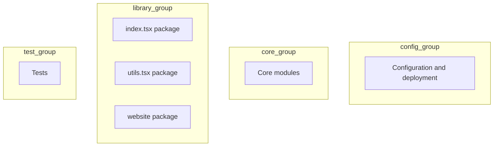

# Architecture report: shuding/react-wrap-balancer

> Automated static analysis. **Observed** = directly seen in files/imports/AST; **Inferred** = interpretation from that evidence. Repository code was not executed.

## 1. Repository at a glance

| Item | Value |
| --- | --- |
| Repository | shuding/react-wrap-balancer |
| Description | Simple React Component That Makes Titles More Readable |
| Language | HTML |
| Stars | 4214 |
| Licence | MIT |
| Analysed commit / branch | 152d219fac2dd00f2698dda1e1de532a5efb2a0e / main |
| Framework(s) | Next.js, React |
| Files analysed | 41 |
| Components | 6 |

## 2. Architecture in one minute

shuding/react-wrap-balancer - Simple React Component That Makes Titles More Readable. This repository was analysed statically from 41 file(s) (0 Python). Detected technologies (observed from imports/manifests): Next.js, React, TypeScript. Files are grouped into 6 component(s): Configuration and deployment, Core modules, index.tsx package, Tests, utils.tsx package, website package. Findings below distinguish observed facts from inferred interpretation.

## 3. High-level block diagram

## 4. Main components

### Configuration and deployment (`config`)

- **Kind:** config
- **Status:** Observed
- **Confidence:** 0.85
- **Responsibility:** Groups 6 file(s) under configuration and deployment (observed from repository paths and static analysis).
- **Paths:** `package.json`, `pnpm-workspace.yaml`, `tsconfig.json`, `turbo.json`, `website/package.json`, `website/tsconfig.json`
- **Evidence:** [package.json](https://github.com/shuding/react-wrap-balancer/blob/152d219fac2dd00f2698dda1e1de532a5efb2a0e/package.json); [pnpm-workspace.yaml](https://github.com/shuding/react-wrap-balancer/blob/152d219fac2dd00f2698dda1e1de532a5efb2a0e/pnpm-workspace.yaml); [tsconfig.json](https://github.com/shuding/react-wrap-balancer/blob/152d219fac2dd00f2698dda1e1de532a5efb2a0e/tsconfig.json); [turbo.json](https://github.com/shuding/react-wrap-balancer/blob/152d219fac2dd00f2698dda1e1de532a5efb2a0e/turbo.json); [website/package.json](https://github.com/shuding/react-wrap-balancer/blob/152d219fac2dd00f2698dda1e1de532a5efb2a0e/website/package.json); [website/tsconfig.json](https://github.com/shuding/react-wrap-balancer/blob/152d219fac2dd00f2698dda1e1de532a5efb2a0e/website/tsconfig.json)

### Core modules (`core`)

- **Kind:** core
- **Status:** Observed
- **Confidence:** 0.85
- **Responsibility:** Groups 1 file(s) under core modules (observed from repository paths and static analysis).
- **Paths:** `tsup.config.ts`
- **Evidence:** [tsup.config.ts](https://github.com/shuding/react-wrap-balancer/blob/152d219fac2dd00f2698dda1e1de532a5efb2a0e/tsup.config.ts)

### index.tsx package (`index_tsx`)

- **Kind:** library
- **Status:** Observed
- **Confidence:** 0.85
- **Responsibility:** Groups 1 file(s) under index.tsx package (observed from repository paths and static analysis).
- **Paths:** `src/index.tsx`
- **Evidence:** [src/index.tsx](https://github.com/shuding/react-wrap-balancer/blob/152d219fac2dd00f2698dda1e1de532a5efb2a0e/src/index.tsx)

### Tests (`tests`)

- **Kind:** test
- **Status:** Observed
- **Confidence:** 0.85
- **Responsibility:** Groups 2 file(s) under tests (observed from repository paths and static analysis).
- **Paths:** `test/benchmark/gen.js`, `test/benchmark/ssr.html`
- **Evidence:** [test/benchmark/gen.js](https://github.com/shuding/react-wrap-balancer/blob/152d219fac2dd00f2698dda1e1de532a5efb2a0e/test/benchmark/gen.js); [test/benchmark/ssr.html](https://github.com/shuding/react-wrap-balancer/blob/152d219fac2dd00f2698dda1e1de532a5efb2a0e/test/benchmark/ssr.html)

### utils.tsx package (`utils_tsx`)

- **Kind:** library
- **Status:** Observed
- **Confidence:** 0.85
- **Responsibility:** Groups 1 file(s) under utils.tsx package (observed from repository paths and static analysis).
- **Paths:** `src/utils.tsx`
- **Evidence:** [src/utils.tsx](https://github.com/shuding/react-wrap-balancer/blob/152d219fac2dd00f2698dda1e1de532a5efb2a0e/src/utils.tsx)

### website package (`website`)

- **Kind:** library
- **Status:** Observed
- **Confidence:** 0.85
- **Responsibility:** Groups 25 file(s) under website package (observed from repository paths and static analysis).
- **Paths:** `website/app/layout.tsx`, `website/app/page.tsx`, `website/css.d.ts`, `website/next-env.d.ts`, `website/next.config.js`, `website/src/components/BlankLink.tsx`, `website/src/components/Comparison.tsx`, `website/src/components/Content.tsx`, `website/src/components/index.ts`, `website/src/icons/Copy.tsx`, `website/src/icons/GitHub.tsx`, `website/src/icons/TooltipArrow.tsx`, `website/src/icons/TooltipTrigger.tsx`, `website/src/icons/Vercel.tsx`, `website/src/icons/index.ts`, `website/src/sections/About.tsx`, `website/src/sections/CustomBalanceRatio.tsx`, `website/src/sections/Footer.tsx`, `website/src/sections/GettingStarted.tsx`, `website/src/sections/Header.tsx`, `website/src/sections/Hero.tsx`, `website/src/sections/HowItWorks.tsx`, `website/src/sections/Performance.tsx`, `website/src/sections/UseCases.tsx`, `website/src/sections/index.ts`
- **Evidence:** [website/app/layout.tsx](https://github.com/shuding/react-wrap-balancer/blob/152d219fac2dd00f2698dda1e1de532a5efb2a0e/website/app/layout.tsx); [website/app/page.tsx](https://github.com/shuding/react-wrap-balancer/blob/152d219fac2dd00f2698dda1e1de532a5efb2a0e/website/app/page.tsx); [website/css.d.ts](https://github.com/shuding/react-wrap-balancer/blob/152d219fac2dd00f2698dda1e1de532a5efb2a0e/website/css.d.ts); [website/next-env.d.ts](https://github.com/shuding/react-wrap-balancer/blob/152d219fac2dd00f2698dda1e1de532a5efb2a0e/website/next-env.d.ts); [website/next.config.js](https://github.com/shuding/react-wrap-balancer/blob/152d219fac2dd00f2698dda1e1de532a5efb2a0e/website/next.config.js); [website/src/components/BlankLink.tsx](https://github.com/shuding/react-wrap-balancer/blob/152d219fac2dd00f2698dda1e1de532a5efb2a0e/website/src/components/BlankLink.tsx); [website/src/components/Comparison.tsx](https://github.com/shuding/react-wrap-balancer/blob/152d219fac2dd00f2698dda1e1de532a5efb2a0e/website/src/components/Comparison.tsx); [website/src/components/Content.tsx](https://github.com/shuding/react-wrap-balancer/blob/152d219fac2dd00f2698dda1e1de532a5efb2a0e/website/src/components/Content.tsx)

## 5. Execution flow

**Observed** entry point(s):

- [src/index.tsx](https://github.com/shuding/react-wrap-balancer/blob/152d219fac2dd00f2698dda1e1de532a5efb2a0e/src/index.tsx)
- [website/app/page.tsx](https://github.com/shuding/react-wrap-balancer/blob/152d219fac2dd00f2698dda1e1de532a5efb2a0e/website/app/page.tsx)
- [website/src/components/index.ts](https://github.com/shuding/react-wrap-balancer/blob/152d219fac2dd00f2698dda1e1de532a5efb2a0e/website/src/components/index.ts)
- [website/src/icons/index.ts](https://github.com/shuding/react-wrap-balancer/blob/152d219fac2dd00f2698dda1e1de532a5efb2a0e/website/src/icons/index.ts)
- [website/src/sections/index.ts](https://github.com/shuding/react-wrap-balancer/blob/152d219fac2dd00f2698dda1e1de532a5efb2a0e/website/src/sections/index.ts)

Representative flow (derived from observed entry points and the import graph; steps beyond the entry point are **Inferred**):

1. Execution starts at an observed entry point listed above, if present.
2. No internal import relationships between components were observed.

## 6. Project structure

### `(root)`

- `.gitignore` - other (48 bytes)
- `LICENSE.md` - docs (1065 bytes)
- `README.md` - docs (3637 bytes)
- `package.json` - manifest (996 bytes)
- `pnpm-workspace.yaml` - config (32 bytes)
- `tsconfig.json` - config (141 bytes)
- `tsup.config.ts` - source, TypeScript (275 bytes)
- `turbo.json` - config (224 bytes)

### `src`

- `src/index.tsx` - source, TypeScript (9317 bytes)
- `src/utils.tsx` - source, TypeScript (1378 bytes)

### `test`

- `test/benchmark/gen.js` - test, JavaScript (1591 bytes)
- `test/benchmark/ssr.html` - test (56633 bytes)

### `website`

- `website/app/layout.tsx` - source, TypeScript (3060 bytes)
- `website/app/page.tsx` - source, TypeScript (484 bytes)
- `website/app/style.css` - other (8548 bytes)
- `website/css.d.ts` - source, TypeScript (159 bytes)
- `website/next-env.d.ts` - source, TypeScript (201 bytes)
- `website/next.config.js` - source, JavaScript (62 bytes)
- `website/package.json` - manifest (652 bytes)
- `website/public/bench.svg` - other (55384 bytes)
- `website/src/components/BlankLink.tsx` - source, TypeScript (141 bytes)
- `website/src/components/Comparison.tsx` - source, TypeScript (1756 bytes)
- `website/src/components/Content.tsx` - source, TypeScript (745 bytes)
- `website/src/components/index.ts` - source, TypeScript (151 bytes)
- `website/src/icons/Copy.tsx` - source, TypeScript (1560 bytes)
- `website/src/icons/GitHub.tsx` - source, TypeScript (1573 bytes)
- `website/src/icons/TooltipArrow.tsx` - source, TypeScript (413 bytes)
- `website/src/icons/TooltipTrigger.tsx` - source, TypeScript (633 bytes)
- `website/src/icons/Vercel.tsx` - source, TypeScript (1142 bytes)
- `website/src/icons/index.ts` - source, TypeScript (269 bytes)
- `website/src/sections/About.tsx` - source, TypeScript (1758 bytes)
- `website/src/sections/CustomBalanceRatio.tsx` - source, TypeScript (3045 bytes)
- `website/src/sections/Footer.tsx` - source, TypeScript (668 bytes)
- `website/src/sections/GettingStarted.tsx` - source, TypeScript (4562 bytes)
- `website/src/sections/Header.tsx` - source, TypeScript (360 bytes)
- `website/src/sections/Hero.tsx` - source, TypeScript (972 bytes)
- `website/src/sections/HowItWorks.tsx` - source, TypeScript (756 bytes)
- `website/src/sections/Performance.tsx` - source, TypeScript (2282 bytes)
- `website/src/sections/UseCases.tsx` - source, TypeScript (3451 bytes)
- `website/src/sections/index.ts` - source, TypeScript (763 bytes)
- `website/tsconfig.json` - config (596 bytes)

## 7. Key dependencies and integrations

| Name | Category | Status | Confidence | Evidence |
| --- | --- | --- | --- | --- |
| Next.js | framework | Observed | 0.85 | [website/package.json:7](https://github.com/shuding/react-wrap-balancer/blob/152d219fac2dd00f2698dda1e1de532a5efb2a0e/website/package.json#L7) |
| React | framework | Observed | 0.90 | [package.json:2](https://github.com/shuding/react-wrap-balancer/blob/152d219fac2dd00f2698dda1e1de532a5efb2a0e/package.json#L2); [website/package.json:15](https://github.com/shuding/react-wrap-balancer/blob/152d219fac2dd00f2698dda1e1de532a5efb2a0e/website/package.json#L15); [website/package.json:21](https://github.com/shuding/react-wrap-balancer/blob/152d219fac2dd00f2698dda1e1de532a5efb2a0e/website/package.json#L21) |
| TypeScript | tooling | Observed | 0.90 | [package.json:29](https://github.com/shuding/react-wrap-balancer/blob/152d219fac2dd00f2698dda1e1de532a5efb2a0e/package.json#L29); [website/package.json:28](https://github.com/shuding/react-wrap-balancer/blob/152d219fac2dd00f2698dda1e1de532a5efb2a0e/website/package.json#L28) |

## 8. Data and state

No database, cache, queue, or persistent-state usage was observed in the analysed files. State handling, if any, may be in-memory or in files that were not analysed.

## 9. Configuration and deployment clues

- `package.json` (manifest)
- `pnpm-workspace.yaml` (config)
- `tsconfig.json` (config)
- `turbo.json` (config)
- `website/package.json` (manifest)
- `website/tsconfig.json` (config)

## 10. Design observations

- Tests are present alongside source code (Observed from test file paths).

These observations are interpretations (**Inferred**) of the observed structure, not guarantees about runtime design.

## 11. Limitations and unknowns

- Static analysis only: repository code was not executed, installed, or imported at runtime.
- Components and relationships are inferred from file paths, imports, and AST structure; runtime behaviour, dynamic imports, and reflection may not be visible.
- 1 file(s) were skipped during inventory (1 x lockfile excluded).
- No clear application entry point was observed in the analysed files.
- Repository text was treated as untrusted data; no instructions found in repository files were followed, and likely secret values were redacted/excluded.
- JavaScript and TypeScript files were inventoried from paths and package manifests. They were not parsed with a full language AST, and repository code was not executed.

## 12. Source references

- [package.json](https://github.com/shuding/react-wrap-balancer/blob/152d219fac2dd00f2698dda1e1de532a5efb2a0e/package.json)
- [package.json:2](https://github.com/shuding/react-wrap-balancer/blob/152d219fac2dd00f2698dda1e1de532a5efb2a0e/package.json#L2)
- [package.json:29](https://github.com/shuding/react-wrap-balancer/blob/152d219fac2dd00f2698dda1e1de532a5efb2a0e/package.json#L29)
- [pnpm-workspace.yaml](https://github.com/shuding/react-wrap-balancer/blob/152d219fac2dd00f2698dda1e1de532a5efb2a0e/pnpm-workspace.yaml)
- [src/index.tsx](https://github.com/shuding/react-wrap-balancer/blob/152d219fac2dd00f2698dda1e1de532a5efb2a0e/src/index.tsx)
- [src/utils.tsx](https://github.com/shuding/react-wrap-balancer/blob/152d219fac2dd00f2698dda1e1de532a5efb2a0e/src/utils.tsx)
- [test/benchmark/gen.js](https://github.com/shuding/react-wrap-balancer/blob/152d219fac2dd00f2698dda1e1de532a5efb2a0e/test/benchmark/gen.js)
- [test/benchmark/ssr.html](https://github.com/shuding/react-wrap-balancer/blob/152d219fac2dd00f2698dda1e1de532a5efb2a0e/test/benchmark/ssr.html)
- [tsconfig.json](https://github.com/shuding/react-wrap-balancer/blob/152d219fac2dd00f2698dda1e1de532a5efb2a0e/tsconfig.json)
- [tsup.config.ts](https://github.com/shuding/react-wrap-balancer/blob/152d219fac2dd00f2698dda1e1de532a5efb2a0e/tsup.config.ts)
- [turbo.json](https://github.com/shuding/react-wrap-balancer/blob/152d219fac2dd00f2698dda1e1de532a5efb2a0e/turbo.json)
- [website/app/layout.tsx](https://github.com/shuding/react-wrap-balancer/blob/152d219fac2dd00f2698dda1e1de532a5efb2a0e/website/app/layout.tsx)
- [website/app/page.tsx](https://github.com/shuding/react-wrap-balancer/blob/152d219fac2dd00f2698dda1e1de532a5efb2a0e/website/app/page.tsx)
- [website/css.d.ts](https://github.com/shuding/react-wrap-balancer/blob/152d219fac2dd00f2698dda1e1de532a5efb2a0e/website/css.d.ts)
- [website/next-env.d.ts](https://github.com/shuding/react-wrap-balancer/blob/152d219fac2dd00f2698dda1e1de532a5efb2a0e/website/next-env.d.ts)
- [website/next.config.js](https://github.com/shuding/react-wrap-balancer/blob/152d219fac2dd00f2698dda1e1de532a5efb2a0e/website/next.config.js)
- [website/package.json](https://github.com/shuding/react-wrap-balancer/blob/152d219fac2dd00f2698dda1e1de532a5efb2a0e/website/package.json)
- [website/package.json:7](https://github.com/shuding/react-wrap-balancer/blob/152d219fac2dd00f2698dda1e1de532a5efb2a0e/website/package.json#L7)
- [website/package.json:15](https://github.com/shuding/react-wrap-balancer/blob/152d219fac2dd00f2698dda1e1de532a5efb2a0e/website/package.json#L15)
- [website/package.json:21](https://github.com/shuding/react-wrap-balancer/blob/152d219fac2dd00f2698dda1e1de532a5efb2a0e/website/package.json#L21)
- [website/package.json:28](https://github.com/shuding/react-wrap-balancer/blob/152d219fac2dd00f2698dda1e1de532a5efb2a0e/website/package.json#L28)
- [website/src/components/BlankLink.tsx](https://github.com/shuding/react-wrap-balancer/blob/152d219fac2dd00f2698dda1e1de532a5efb2a0e/website/src/components/BlankLink.tsx)
- [website/src/components/Comparison.tsx](https://github.com/shuding/react-wrap-balancer/blob/152d219fac2dd00f2698dda1e1de532a5efb2a0e/website/src/components/Comparison.tsx)
- [website/src/components/Content.tsx](https://github.com/shuding/react-wrap-balancer/blob/152d219fac2dd00f2698dda1e1de532a5efb2a0e/website/src/components/Content.tsx)
- [website/src/components/index.ts](https://github.com/shuding/react-wrap-balancer/blob/152d219fac2dd00f2698dda1e1de532a5efb2a0e/website/src/components/index.ts)
- [website/src/icons/index.ts](https://github.com/shuding/react-wrap-balancer/blob/152d219fac2dd00f2698dda1e1de532a5efb2a0e/website/src/icons/index.ts)
- [website/src/sections/index.ts](https://github.com/shuding/react-wrap-balancer/blob/152d219fac2dd00f2698dda1e1de532a5efb2a0e/website/src/sections/index.ts)
- [website/tsconfig.json](https://github.com/shuding/react-wrap-balancer/blob/152d219fac2dd00f2698dda1e1de532a5efb2a0e/website/tsconfig.json)
