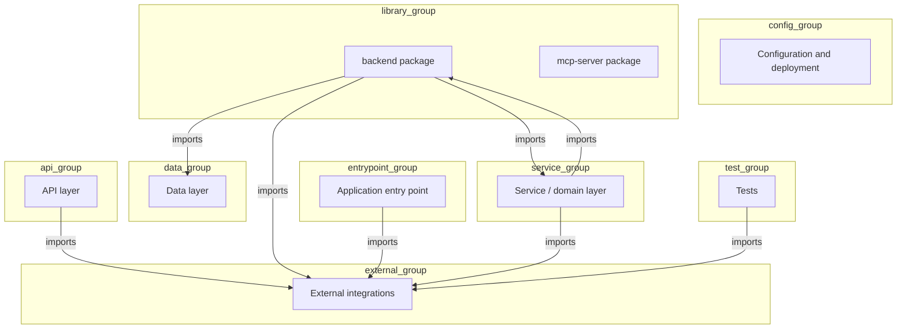

# Architecture report: shy3130/tick-stock-panel

> Automated static analysis. **Observed** = directly seen in files/imports/AST; **Inferred** = interpretation from that evidence. Repository code was not executed.

## 1. Repository at a glance

| Item | Value |
| --- | --- |
| Repository | shy3130/tick-stock-panel |
| Description | TSP自托管、零运维的 A 股「自建策略 + 监控 + 回测」量化工作台  | LLM能力驱使策略定制+个股分析+复盘 | 自由接入第三方数据源与个性化扩展数据 | 个人开源 |
| Language | Python |
| Stars | 7778 |
| Licence | MIT |
| Analysed commit / branch | f9cb383c5918c6a88a412f3ce43d59fe81b94ccc / main |
| Framework(s) | FastAPI, Starlette |
| Files analysed | 724 |
| Components | 9 |

## 2. Architecture in one minute

shy3130/tick-stock-panel - TSP自托管、零运维的 A 股「自建策略 + 监控 + 回测」量化工作台  | LLM能力驱使策略定制+个股分析+复盘 | 自由接入第三方数据源与个性化扩展数据 | 个人开源. This repository was analysed statically from 724 file(s) (677 Python). Detected technologies (observed from imports/manifests): GitHub Actions, SQLite, FastAPI, Starlette, httpx, NumPy. Files are grouped into 9 component(s): API layer, backend package, Configuration and deployment, Data layer, Application entry point, External integrations, mcp-server package, Service / domain layer. Observed entry point(s): backend/app/desktop.py, backend/app/main.py, backend/scripts/bench_factor_materialize.py. Findings below distinguish observed facts from inferred interpretation.

## 3. High-level block diagram

## 4. Main components

### API layer (`api_layer`)

- **Kind:** api
- **Status:** Observed
- **Confidence:** 0.85
- **Responsibility:** Groups 43 file(s) under api layer (observed from repository paths and static analysis). Observed routes: GET /intraday, GET /overview, GET (path not a literal), DELETE (path not a literal), DELETE /{ts}. Observed top-level classes: AIGenerateRequest, AIIterateRequest, AISaveRequest, AccountModel, Action, AddRequest. Observed top-level functions: _acc, _acquire_or_evict_job, _active_run, _added_base_closes, _added_dates_bj, _admit_submission.
- **Paths:** `backend/app/api/__init__.py`, `backend/app/api/abnormal.py`, `backend/app/api/alerts.py`, `backend/app/api/analysis.py`, `backend/app/api/auth.py`, `backend/app/api/backtest.py`, `backend/app/api/config_backup.py`, `backend/app/api/data.py`, `backend/app/api/definitions.py`, `backend/app/api/events.py`, `backend/app/api/ext_data.py`, `backend/app/api/ext_pages.py`, `backend/app/api/factors.py`, `backend/app/api/financials.py`, `backend/app/api/guardian.py`, `backend/app/api/import_center.py`, `backend/app/api/indices.py`, `backend/app/api/intraday.py`, `backend/app/api/kline.py`, `backend/app/api/lab.py`, `backend/app/api/lots.py`, `backend/app/api/market_recap.py`, `backend/app/api/mining.py`, `backend/app/api/monitor_rules.py`, `backend/app/api/overview.py`, `backend/app/api/pages_admin.py`, `backend/app/api/paper.py`, `backend/app/api/pipeline.py`, `backend/app/api/position_policies.py`, `backend/app/api/regime.py`, `backend/app/api/routes.py`, `backend/app/api/rps.py`, `backend/app/api/screener.py`, `backend/app/api/sector_rotation.py`, `backend/app/api/settings.py`, `backend/app/api/signals.py`, `backend/app/api/stock_analysis.py`, `backend/app/api/strategy.py`, `backend/app/api/strategy_pool.py`, `backend/app/api/task_registry.py`, `backend/app/api/upgrade_guard.py`, `backend/app/api/watchlist.py`, `backend/app/custom/source_packages/routes.py`
- **Evidence:** [backend/app/api/__init__.py](https://github.com/shy3130/tick-stock-panel/blob/f9cb383c5918c6a88a412f3ce43d59fe81b94ccc/backend/app/api/__init__.py); [backend/app/api/abnormal.py:16](https://github.com/shy3130/tick-stock-panel/blob/f9cb383c5918c6a88a412f3ce43d59fe81b94ccc/backend/app/api/abnormal.py#L16); [backend/app/api/alerts.py:15](https://github.com/shy3130/tick-stock-panel/blob/f9cb383c5918c6a88a412f3ce43d59fe81b94ccc/backend/app/api/alerts.py#L15); [backend/app/api/analysis.py:20](https://github.com/shy3130/tick-stock-panel/blob/f9cb383c5918c6a88a412f3ce43d59fe81b94ccc/backend/app/api/analysis.py#L20); [backend/app/api/auth.py:43](https://github.com/shy3130/tick-stock-panel/blob/f9cb383c5918c6a88a412f3ce43d59fe81b94ccc/backend/app/api/auth.py#L43); [backend/app/api/backtest.py:43](https://github.com/shy3130/tick-stock-panel/blob/f9cb383c5918c6a88a412f3ce43d59fe81b94ccc/backend/app/api/backtest.py#L43); [backend/app/api/config_backup.py:26](https://github.com/shy3130/tick-stock-panel/blob/f9cb383c5918c6a88a412f3ce43d59fe81b94ccc/backend/app/api/config_backup.py#L26); [backend/app/api/data.py:27](https://github.com/shy3130/tick-stock-panel/blob/f9cb383c5918c6a88a412f3ce43d59fe81b94ccc/backend/app/api/data.py#L27)

### backend package (`backend`)

- **Kind:** library
- **Status:** Observed
- **Confidence:** 0.85
- **Responsibility:** Groups 146 file(s) under backend package (observed from repository paths and static analysis). Observed top-level classes: AIStrategyGenerator, AIStrategyIterator, ActionDecisionRequest, ActiveLimitGeneMatrixStrategy, AssistantContext, AssistantSessionsPayload. Observed top-level functions: _activate_valid_bar_index, _active_registry, _adaptive_sym_batch, _add_to_watchlist, _adj_factors, _aggregate_levels.
- **Paths:** `backend/app/__init__.py`, `backend/app/backtest/__init__.py`, `backend/app/backtest/candidates.py`, `backend/app/backtest/engine.py`, `backend/app/backtest/evidence.py`, `backend/app/backtest/factor.py`, `backend/app/backtest/fundamentals.py`, `backend/app/backtest/guardian.py`, `backend/app/backtest/guardian_runtime.py`, `backend/app/backtest/guards.py`, `backend/app/backtest/matrix.py`, `backend/app/backtest/mining.py`, `backend/app/backtest/mining_runtime.py`, `backend/app/backtest/minute_replay.py`, `backend/app/backtest/minute_trigger.py`, `backend/app/backtest/numba_runtime.py`, `backend/app/backtest/optimizer.py`, `backend/app/backtest/position_policies.py`, `backend/app/backtest/position_sizing.py`, `backend/app/backtest/regime_alignment.py`, `backend/app/backtest/robust_optimizer.py`, `backend/app/backtest/stats_v2.py`, `backend/app/backtest/strategy.py`, `backend/app/backtest/walkforward.py`, `backend/app/backtest/worker.py`, `backend/app/custom/__init__.py`, `backend/app/custom/assistant/__init__.py`, `backend/app/custom/assistant/actions.py`, `backend/app/custom/assistant/codex.py`, `backend/app/custom/assistant/prompt.py`, `backend/app/custom/assistant/routes.py`, `backend/app/custom/assistant/sessions.py`, `backend/app/custom/assistant/streaming.py`, `backend/app/custom/assistant/tools.py`, `backend/app/custom/paper_execution/__init__.py`, `backend/app/custom/paper_execution/routes.py`, `backend/app/custom/paper_execution/snapshot.py`, `backend/app/custom/source_packages/__init__.py`, `backend/app/data_providers/__init__.py`, `backend/app/data_providers/base.py`, `backend/app/data_providers/capabilities.py`, `backend/app/data_providers/custom/__init__.py`, `backend/app/data_providers/custom/loader.py`, `backend/app/data_providers/custom/managed.py`, `backend/app/data_providers/custom/mapper.py`, `backend/app/data_providers/custom/packages.py`, `backend/app/data_providers/custom/provider.py`, `backend/app/data_providers/minute_normalizer.py`, `backend/app/data_providers/minute_stream.py`, `backend/app/data_providers/normalizer.py`, `backend/app/data_providers/registry.py`, `backend/app/data_providers/tickflow_provider.py`, `backend/app/db_safe.py`, `backend/app/definitions.py`, `backend/app/enriched_generation.py`, `backend/app/extensions/__init__.py`, `backend/app/extensions/contracts.py`, `backend/app/extensions/loader.py`, `backend/app/extensions/packages.py`, `backend/app/extensions/registry.py`, `backend/app/factors/__init__.py`, `backend/app/factors/dsl.py`, `backend/app/factors/ext_factors.py`, `backend/app/factors/materialize_cache.py`, `backend/app/factors/py_expr.py`, `backend/app/factors/registry.py`, `backend/app/factors/store.py`, `backend/app/frontend_static.py`, `backend/app/indicators/__init__.py`, `backend/app/indicators/levels.py`, `backend/app/indicators/pipeline.py`, `backend/app/jobs/__init__.py`, `backend/app/jobs/daily_pipeline.py`, `backend/app/logfile.py`, `backend/app/market_time.py`, `backend/app/parquet.py`, `backend/app/plugins/fuyao/__init__.py`, `backend/app/plugins/fuyao/provider.py`, `backend/app/plugins/tdxquant/__init__.py`, `backend/app/plugins/tdxquant/probe.py`, `backend/app/plugins/tdxquant/provider.py`, `backend/app/polars_guard.py`, `backend/app/price_limits.py`, `backend/app/secrets_store.py`, `backend/app/share_capital.py`, `backend/app/startup_diagnostics.py`, `backend/app/strategy/__init__.py`, `backend/app/strategy/ai_generator.py`, `backend/app/strategy/ai_iterator.py`, `backend/app/strategy/builtin/__init__.py`, `backend/app/strategy/builtin/factor_rank_research.py`, `backend/app/strategy/composite.py`, `backend/app/strategy/custom_signals.py`, `backend/app/strategy/custom_signals_ai.py`, `backend/app/strategy/engine.py`, `backend/app/strategy/feature_deps.py`, `backend/app/strategy/intraday_features.py`, `backend/app/strategy/intraday_signals.py`, `backend/app/strategy/legacy_migrate.py`, `backend/app/strategy/lots.py`, `backend/app/strategy/market_data.py`, `backend/app/strategy/monitor.py`, `backend/app/strategy/monitor_rules.py`, `backend/app/strategy/paper.py`, `backend/app/strategy/paper_auto.py`, `backend/app/strategy/paper_watch.py`, `backend/app/strategy/prompt_builder.py`, `backend/app/strategy/research/factor_rank_research.py`, `backend/app/strategy/scoring.py`, `backend/app/strategy/seeds/active_limit_gene.py`, `backend/app/strategy/seeds/boll_breakout.py`, `backend/app/strategy/seeds/breakout_new_high_60d.py`, `backend/app/strategy/seeds/broken_board_recovery.py`, `backend/app/strategy/seeds/bullish_alignment.py`, `backend/app/strategy/seeds/consecutive_limit_ups.py`, `backend/app/strategy/seeds/high_turnover_surge.py`, `backend/app/strategy/seeds/limit_up_momentum.py`, `backend/app/strategy/seeds/long_lower_shadow_reversal.py`, `backend/app/strategy/seeds/low_volatility_leader.py`, `backend/app/strategy/seeds/ma_convergence_breakout.py`, `backend/app/strategy/seeds/ma_golden_cross.py`, `backend/app/strategy/seeds/macd_below_zero_revival.py`, `backend/app/strategy/seeds/macd_golden.py`, `backend/app/strategy/seeds/n_day_low_reversal.py`, `backend/app/strategy/seeds/near_limit_up.py`, `backend/app/strategy/seeds/oversold_bounce.py`, `backend/app/strategy/seeds/oversold_reversal.py`, `backend/app/strategy/seeds/platform_consolidation_breakout.py`, `backend/app/strategy/seeds/pullback_ma20_bounce.py`, `backend/app/strategy/seeds/pullback_to_support.py`, `backend/app/strategy/seeds/rsi_midline_pullback.py`, `backend/app/strategy/seeds/strong_open.py`, `backend/app/strategy/seeds/trend_breakout.py`, `backend/app/strategy/seeds/volume_price_surge.py`, `backend/app/strategy/signal_seeds.py`, `backend/app/strategy/strategy_seeds.py`, `backend/app/tickflow/__init__.py`, `backend/app/tickflow/capabilities.py`, `backend/app/tickflow/policy.py`, `backend/app/tickflow/pools.py`, `backend/app/tickflow/rate_limits.py`, `backend/app/tickflow/repository.py`, `backend/app/tickflow/request_guard.py`, `backend/app/tickflow/scheduler.py`, `backend/app/watchdog.py`, `backend/scripts/__init__.py`
- **Evidence:** [backend/app/__init__.py:17](https://github.com/shy3130/tick-stock-panel/blob/f9cb383c5918c6a88a412f3ce43d59fe81b94ccc/backend/app/__init__.py#L17); [backend/app/backtest/__init__.py](https://github.com/shy3130/tick-stock-panel/blob/f9cb383c5918c6a88a412f3ce43d59fe81b94ccc/backend/app/backtest/__init__.py); [backend/app/backtest/candidates.py:130](https://github.com/shy3130/tick-stock-panel/blob/f9cb383c5918c6a88a412f3ce43d59fe81b94ccc/backend/app/backtest/candidates.py#L130); [backend/app/backtest/engine.py:36](https://github.com/shy3130/tick-stock-panel/blob/f9cb383c5918c6a88a412f3ce43d59fe81b94ccc/backend/app/backtest/engine.py#L36); [backend/app/backtest/evidence.py:31](https://github.com/shy3130/tick-stock-panel/blob/f9cb383c5918c6a88a412f3ce43d59fe81b94ccc/backend/app/backtest/evidence.py#L31); [backend/app/backtest/factor.py:48](https://github.com/shy3130/tick-stock-panel/blob/f9cb383c5918c6a88a412f3ce43d59fe81b94ccc/backend/app/backtest/factor.py#L48); [backend/app/backtest/fundamentals.py:44](https://github.com/shy3130/tick-stock-panel/blob/f9cb383c5918c6a88a412f3ce43d59fe81b94ccc/backend/app/backtest/fundamentals.py#L44); [backend/app/backtest/guardian.py:38](https://github.com/shy3130/tick-stock-panel/blob/f9cb383c5918c6a88a412f3ce43d59fe81b94ccc/backend/app/backtest/guardian.py#L38)

### Configuration and deployment (`config`)

- **Kind:** config
- **Status:** Observed
- **Confidence:** 0.85
- **Responsibility:** Groups 7 file(s) under configuration and deployment (observed from repository paths and static analysis). Observed top-level classes: AuthConfig, CustomSourceConfig, DatasetConfig, Settings. Observed top-level functions: _auth_from_dict, _dataset_from_dict, _docker_data_mounts, _docker_root, _invalidate_override_cache, _overrides_dir.
- **Paths:** `Dockerfile`, `backend/app/config.py`, `backend/app/data_providers/custom/config.py`, `backend/app/plugins/fuyao/plugin.yaml`, `backend/app/plugins/tdxquant/plugin.yaml`, `backend/app/strategy/config.py`, `backend/pyproject.toml`
- **Evidence:** [Dockerfile](https://github.com/shy3130/tick-stock-panel/blob/f9cb383c5918c6a88a412f3ce43d59fe81b94ccc/Dockerfile); [backend/app/config.py:24](https://github.com/shy3130/tick-stock-panel/blob/f9cb383c5918c6a88a412f3ce43d59fe81b94ccc/backend/app/config.py#L24); [backend/app/data_providers/custom/config.py:16](https://github.com/shy3130/tick-stock-panel/blob/f9cb383c5918c6a88a412f3ce43d59fe81b94ccc/backend/app/data_providers/custom/config.py#L16); [backend/app/plugins/fuyao/plugin.yaml](https://github.com/shy3130/tick-stock-panel/blob/f9cb383c5918c6a88a412f3ce43d59fe81b94ccc/backend/app/plugins/fuyao/plugin.yaml); [backend/app/plugins/tdxquant/plugin.yaml](https://github.com/shy3130/tick-stock-panel/blob/f9cb383c5918c6a88a412f3ce43d59fe81b94ccc/backend/app/plugins/tdxquant/plugin.yaml); [backend/app/strategy/config.py:25](https://github.com/shy3130/tick-stock-panel/blob/f9cb383c5918c6a88a412f3ce43d59fe81b94ccc/backend/app/strategy/config.py#L25); [backend/pyproject.toml](https://github.com/shy3130/tick-stock-panel/blob/f9cb383c5918c6a88a412f3ce43d59fe81b94ccc/backend/pyproject.toml)

### Data layer (`data_layer`)

- **Kind:** data
- **Status:** Observed
- **Confidence:** 0.85
- **Responsibility:** Groups 1 file(s) under data layer (observed from repository paths and static analysis).
- **Paths:** `backend/app/data_providers/schemas.py`
- **Evidence:** [backend/app/data_providers/schemas.py](https://github.com/shy3130/tick-stock-panel/blob/f9cb383c5918c6a88a412f3ce43d59fe81b94ccc/backend/app/data_providers/schemas.py)

### Application entry point (`entrypoint`)

- **Kind:** entrypoint
- **Status:** Observed
- **Confidence:** 0.85
- **Responsibility:** Groups 15 file(s) under application entry point (observed from repository paths and static analysis). Observed application object created via FastAPI. Observed routes: GET /api/openapi.json. Observed top-level classes: ProbeGate, TickFlowLike, _KlinesNS, _QuotesNS. Observed top-level functions: _acquire_single_instance, _application_lifespan, _build, _build_dataset, _build_engine, _clean_table.
- **Paths:** `backend/app/desktop.py`, `backend/app/main.py`, `backend/scripts/bench_factor_materialize.py`, `backend/scripts/bench_feature_resolution.py`, `backend/scripts/bench_optimizer_prepare.py`, `backend/scripts/benchmark_cache_async.py`, `backend/scripts/benchmark_daily_sync_staging.py`, `backend/scripts/benchmark_ext_pull_client.py`, `backend/scripts/benchmark_matrix_axes.py`, `backend/scripts/benchmark_remaining_hotpaths.py`, `backend/scripts/cleanup_halt_days.py`, `backend/scripts/demo_ai_strategy_gate.py`, `backend/scripts/demo_recap_push_mode.py`, `backend/scripts/probe_tickflow_pro.py`, `backend/scripts/stress_polars_concurrency.py`
- **Evidence:** [backend/app/desktop.py:37](https://github.com/shy3130/tick-stock-panel/blob/f9cb383c5918c6a88a412f3ce43d59fe81b94ccc/backend/app/desktop.py#L37); [backend/app/main.py:564](https://github.com/shy3130/tick-stock-panel/blob/f9cb383c5918c6a88a412f3ce43d59fe81b94ccc/backend/app/main.py#L564); [backend/scripts/bench_factor_materialize.py:33](https://github.com/shy3130/tick-stock-panel/blob/f9cb383c5918c6a88a412f3ce43d59fe81b94ccc/backend/scripts/bench_factor_materialize.py#L33); [backend/scripts/bench_feature_resolution.py:34](https://github.com/shy3130/tick-stock-panel/blob/f9cb383c5918c6a88a412f3ce43d59fe81b94ccc/backend/scripts/bench_feature_resolution.py#L34); [backend/scripts/bench_optimizer_prepare.py:41](https://github.com/shy3130/tick-stock-panel/blob/f9cb383c5918c6a88a412f3ce43d59fe81b94ccc/backend/scripts/bench_optimizer_prepare.py#L41); [backend/scripts/benchmark_cache_async.py:24](https://github.com/shy3130/tick-stock-panel/blob/f9cb383c5918c6a88a412f3ce43d59fe81b94ccc/backend/scripts/benchmark_cache_async.py#L24); [backend/scripts/benchmark_daily_sync_staging.py:19](https://github.com/shy3130/tick-stock-panel/blob/f9cb383c5918c6a88a412f3ce43d59fe81b94ccc/backend/scripts/benchmark_daily_sync_staging.py#L19); [backend/scripts/benchmark_ext_pull_client.py:22](https://github.com/shy3130/tick-stock-panel/blob/f9cb383c5918c6a88a412f3ce43d59fe81b94ccc/backend/scripts/benchmark_ext_pull_client.py#L22)

### External integrations (`external_integrations`)

- **Kind:** external
- **Status:** Observed
- **Confidence:** 0.85
- **Responsibility:** Groups 3 file(s) under external integrations (observed from repository paths and static analysis). Observed top-level classes: FuyaoClient, FuyaoError, FuyaoUnknownSymbolError, TdxQuantAuthError, TdxQuantClient, TdxQuantError. Observed top-level functions: _base_url, _raise_response_error, _should_use_free_server, current_endpoint, current_mode, get_async_client.
- **Paths:** `backend/app/plugins/fuyao/client.py`, `backend/app/plugins/tdxquant/client.py`, `backend/app/tickflow/client.py`
- **Evidence:** [backend/app/plugins/fuyao/client.py:30](https://github.com/shy3130/tick-stock-panel/blob/f9cb383c5918c6a88a412f3ce43d59fe81b94ccc/backend/app/plugins/fuyao/client.py#L30); [backend/app/plugins/tdxquant/client.py:46](https://github.com/shy3130/tick-stock-panel/blob/f9cb383c5918c6a88a412f3ce43d59fe81b94ccc/backend/app/plugins/tdxquant/client.py#L46); [backend/app/tickflow/client.py:38](https://github.com/shy3130/tick-stock-panel/blob/f9cb383c5918c6a88a412f3ce43d59fe81b94ccc/backend/app/tickflow/client.py#L38)

### mcp-server package (`mcp_server`)

- **Kind:** library
- **Status:** Observed
- **Confidence:** 0.85
- **Responsibility:** Groups 1 file(s) under mcp-server package (observed from repository paths and static analysis).
- **Paths:** `mcp-server/src/tsp_mcp_server/__init__.py`
- **Evidence:** [mcp-server/src/tsp_mcp_server/__init__.py](https://github.com/shy3130/tick-stock-panel/blob/f9cb383c5918c6a88a412f3ce43d59fe81b94ccc/mcp-server/src/tsp_mcp_server/__init__.py)

### Service / domain layer (`service_layer`)

- **Kind:** service
- **Status:** Observed
- **Confidence:** 0.85
- **Responsibility:** Groups 106 file(s) under service / domain layer (observed from repository paths and static analysis). Observed top-level classes: AIToolProtocolError, AbnormalRule, BacktestConfig, BacktestResult, BacktestService, BundleSummary. Observed top-level functions: _active_codex_provider, _aggregate_daily, _align_adj_factor_frame, _allow, _allowed_data_providers, _analyze.
- **Paths:** `backend/app/custom/assistant/chat_service.py`, `backend/app/custom/paper_execution/service.py`, `backend/app/services/__init__.py`, `backend/app/services/abnormal_moves.py`, `backend/app/services/ai_codex_tools.py`, `backend/app/services/ai_provider.py`, `backend/app/services/ai_reports.py`, `backend/app/services/ai_responses.py`, `backend/app/services/alert_store.py`, `backend/app/services/api_gateway.py`, `backend/app/services/api_tokens.py`, `backend/app/services/auction_benchmark.py`, `backend/app/services/auth.py`, `backend/app/services/auto_mining.py`, `backend/app/services/backtest.py`, `backend/app/services/concept_rotation_analyzer.py`, `backend/app/services/config_backup.py`, `backend/app/services/daily_bootstrap.py`, `backend/app/services/daily_health.py`, `backend/app/services/data_dir_upgrade.py`, `backend/app/services/data_integrity.py`, `backend/app/services/data_status_cache.py`, `backend/app/services/depth_service.py`, `backend/app/services/dragon_tiger.py`, `backend/app/services/email_adapter.py`, `backend/app/services/emotion_score.py`, `backend/app/services/event_tickets.py`, `backend/app/services/events.py`, `backend/app/services/ext_config_transfer.py`, `backend/app/services/ext_data.py`, `backend/app/services/ext_data_schema.py`, `backend/app/services/ext_fanout.py`, `backend/app/services/ext_pages.py`, `backend/app/services/ext_presets.py`, `backend/app/services/ext_pull.py`, `backend/app/services/ext_source_import.py`, `backend/app/services/extend_history.py`, `backend/app/services/financial_analyzer.py`, `backend/app/services/financial_sync.py`, `backend/app/services/fs_utils.py`, `backend/app/services/guardian_combinations.py`, `backend/app/services/guardian_schedule.py`, `backend/app/services/guardian_store.py`, `backend/app/services/heavy_job_limiter.py`, `backend/app/services/import_center.py`, `backend/app/services/index_const.py`, `backend/app/services/index_sync.py`, `backend/app/services/instrument_sync.py`, `backend/app/services/integrity_check.py`, `backend/app/services/json_report_store.py`, `backend/app/services/kline_sync.py`, `backend/app/services/lab_schedule.py`, `backend/app/services/market_mainline.py`, `backend/app/services/market_overview_builder.py`, `backend/app/services/market_phase.py`, `backend/app/services/market_recap.py`, `backend/app/services/market_recap_reports.py`, `backend/app/services/matrix_prewarm_owner.py`, `backend/app/services/memory_budget.py`, `backend/app/services/mining_candidates.py`, `backend/app/services/mining_jobs.py`, `backend/app/services/mining_lock_admin.py`, `backend/app/services/mining_manager.py`, `backend/app/services/mining_preflight.py`, `backend/app/services/mining_process_lock.py`, `backend/app/services/mining_schedule.py`, `backend/app/services/minute_adjust.py`, `backend/app/services/minute_gaps.py`, `backend/app/services/minute_refresh.py`, `backend/app/services/minute_shared_pull.py`, `backend/app/services/nav_layout.py`, `backend/app/services/ndjson_heartbeat.py`, `backend/app/services/notify_adapter.py`, `backend/app/services/package_archive.py`, `backend/app/services/pipeline_jobs.py`, `backend/app/services/preferences.py`, `backend/app/services/quote_demand.py`, `backend/app/services/quote_freshness.py`, `backend/app/services/quote_service.py`, `backend/app/services/regime_builder.py`, `backend/app/services/repair_daily.py`, `backend/app/services/resource_bundle.py`, `backend/app/services/rps_rotation.py`, `backend/app/services/screener.py`, `backend/app/services/screener_work.py`, `backend/app/services/sector_monitor.py`, `backend/app/services/sector_rotation.py`, `backend/app/services/shared_work.py`, `backend/app/services/stock_analyzer.py`, `backend/app/services/stock_reports.py`, `backend/app/services/strategy_bundle.py`, `backend/app/services/strategy_cache.py`, `backend/app/services/strategy_pool.py`, `backend/app/services/strategy_run_queue.py`, `backend/app/services/task_registry.py`, `backend/app/services/tool_catalog.py`, `backend/app/services/trading_day.py`, `backend/app/services/upgrade_guard.py`, `backend/app/services/watchlist.py`, `backend/app/services/watchlist_csv.py`, `backend/app/services/watchlist_ocr/__init__.py`, `backend/app/services/watchlist_ocr/pipeline.py`, `backend/app/services/watchlist_ocr/provider.py`, `backend/app/services/webhook_adapter.py`, `backend/app/services/wecom_bot_service.py`, `backend/app/services/workload.py`
- **Evidence:** [backend/app/custom/assistant/chat_service.py:44](https://github.com/shy3130/tick-stock-panel/blob/f9cb383c5918c6a88a412f3ce43d59fe81b94ccc/backend/app/custom/assistant/chat_service.py#L44); [backend/app/custom/paper_execution/service.py:23](https://github.com/shy3130/tick-stock-panel/blob/f9cb383c5918c6a88a412f3ce43d59fe81b94ccc/backend/app/custom/paper_execution/service.py#L23); [backend/app/services/__init__.py](https://github.com/shy3130/tick-stock-panel/blob/f9cb383c5918c6a88a412f3ce43d59fe81b94ccc/backend/app/services/__init__.py); [backend/app/services/abnormal_moves.py:34](https://github.com/shy3130/tick-stock-panel/blob/f9cb383c5918c6a88a412f3ce43d59fe81b94ccc/backend/app/services/abnormal_moves.py#L34); [backend/app/services/ai_codex_tools.py:13](https://github.com/shy3130/tick-stock-panel/blob/f9cb383c5918c6a88a412f3ce43d59fe81b94ccc/backend/app/services/ai_codex_tools.py#L13); [backend/app/services/ai_provider.py:82](https://github.com/shy3130/tick-stock-panel/blob/f9cb383c5918c6a88a412f3ce43d59fe81b94ccc/backend/app/services/ai_provider.py#L82); [backend/app/services/ai_reports.py:30](https://github.com/shy3130/tick-stock-panel/blob/f9cb383c5918c6a88a412f3ce43d59fe81b94ccc/backend/app/services/ai_reports.py#L30); [backend/app/services/ai_responses.py:36](https://github.com/shy3130/tick-stock-panel/blob/f9cb383c5918c6a88a412f3ce43d59fe81b94ccc/backend/app/services/ai_responses.py#L36)

### Tests (`tests`)

- **Kind:** test
- **Status:** Observed
- **Confidence:** 0.85
- **Responsibility:** Groups 379 file(s) under tests (observed from repository paths and static analysis). Observed application object created via FastAPI. Observed top-level classes: ActiveLimitGeneMatrixStrategy, BollBreakoutMatrixStrategy, BreakoutNewHigh60dMatrixStrategy, BrokenBoardRecoveryMatrixStrategy, BrokenFormatter, BullishAlignmentMatrixStrategy. Observed top-level functions: _ab_rule, _acquire_in_spawned_process, _adj_dump, _adj_provider, _api_client, _app_state.
- **Paths:** `backend/tests/backtest/test_composite_backtest_e2e.py`, `backend/tests/backtest/test_cost_model.py`, `backend/tests/backtest/test_custom_factor_mining.py`, `backend/tests/backtest/test_dependencies.py`, `backend/tests/backtest/test_engine_portfolio.py`, `backend/tests/backtest/test_engine_position_policy.py`, `backend/tests/backtest/test_evidence.py`, `backend/tests/backtest/test_factor_batch.py`, `backend/tests/backtest/test_factor_default_range.py`, `backend/tests/backtest/test_factor_metrics.py`, `backend/tests/backtest/test_factor_rank_research.py`, `backend/tests/backtest/test_full_simulation_tail.py`, `backend/tests/backtest/test_guardian.py`, `backend/tests/backtest/test_limit_down_close_exit.py`, `backend/tests/backtest/test_limit_up_close_fill.py`, `backend/tests/backtest/test_market_matrix.py`, `backend/tests/backtest/test_matrix_compute_cache.py`, `backend/tests/backtest/test_matrix_ext_fields.py`, `backend/tests/backtest/test_matrix_strategy.py`, `backend/tests/backtest/test_max_hold_exits.py`, `backend/tests/backtest/test_mining.py`, `backend/tests/backtest/test_mining_runtime.py`, `backend/tests/backtest/test_minute_backtest.py`, `backend/tests/backtest/test_minute_fill.py`, `backend/tests/backtest/test_minute_fill_asset_routing.py`, `backend/tests/backtest/test_numba_runtime.py`, `backend/tests/backtest/test_optimizer_api.py`, `backend/tests/backtest/test_optimizer_grid.py`, `backend/tests/backtest/test_optimizer_grid_step_bounds.py`, `backend/tests/backtest/test_optimizer_run.py`, `backend/tests/backtest/test_position_sizing.py`, `backend/tests/backtest/test_prepare_panel.py`, `backend/tests/backtest/test_research_api.py`, `backend/tests/backtest/test_research_candidates.py`, `backend/tests/backtest/test_robust_optimizer.py`, `backend/tests/backtest/test_robustness_metrics.py`, `backend/tests/backtest/test_strategy_backtest_correctness.py`, `backend/tests/backtest/test_trailing_drawdown_validation.py`, `backend/tests/backtest/test_trailing_peak_close_t_entry.py`, `backend/tests/backtest/test_walkforward.py`, `backend/tests/backtest/test_worker_process.py`, `backend/tests/fixtures/custom_signals/boll_breakdown_lower.json`, `backend/tests/fixtures/custom_signals/boll_breakout_upper.json`, `backend/tests/fixtures/custom_signals/broken_limit_up.json`, `backend/tests/fixtures/custom_signals/limit_down.json`, `backend/tests/fixtures/custom_signals/limit_down_recovery.json`, `backend/tests/fixtures/custom_signals/limit_up.json`, `backend/tests/fixtures/custom_signals/ma10_breakdown.json`, `backend/tests/fixtures/custom_signals/ma10_breakout.json`, `backend/tests/fixtures/custom_signals/ma20_breakdown.json`, `backend/tests/fixtures/custom_signals/ma20_breakout.json`, `backend/tests/fixtures/custom_signals/ma5_breakdown.json`, `backend/tests/fixtures/custom_signals/ma5_breakout.json`, `backend/tests/fixtures/custom_signals/ma_dead_5_20.json`, `backend/tests/fixtures/custom_signals/ma_golden_20_60.json`, `backend/tests/fixtures/custom_signals/ma_golden_5_20.json`, `backend/tests/fixtures/custom_signals/macd_dead.json`, `backend/tests/fixtures/custom_signals/macd_golden.json`, `backend/tests/fixtures/custom_signals/n_day_high.json`, `backend/tests/fixtures/custom_signals/n_day_low.json`, `backend/tests/fixtures/custom_signals/volume_surge.json`, `backend/tests/fixtures/strategies/active_limit_gene.py`, `backend/tests/fixtures/strategies/boll_breakout.py`, `backend/tests/fixtures/strategies/breakout_new_high_60d.py`, `backend/tests/fixtures/strategies/broken_board_recovery.py`, `backend/tests/fixtures/strategies/bullish_alignment.py`, `backend/tests/fixtures/strategies/consecutive_limit_ups.py`, `backend/tests/fixtures/strategies/high_turnover_surge.py`, `backend/tests/fixtures/strategies/limit_up_momentum.py`, `backend/tests/fixtures/strategies/long_lower_shadow_reversal.py`, `backend/tests/fixtures/strategies/low_volatility_leader.py`, `backend/tests/fixtures/strategies/ma_convergence_breakout.py`, `backend/tests/fixtures/strategies/ma_golden_cross.py`, `backend/tests/fixtures/strategies/macd_below_zero_revival.py`, `backend/tests/fixtures/strategies/macd_golden.py`, `backend/tests/fixtures/strategies/n_day_low_reversal.py`, `backend/tests/fixtures/strategies/near_limit_up.py`, `backend/tests/fixtures/strategies/oversold_bounce.py`, `backend/tests/fixtures/strategies/oversold_reversal.py`, `backend/tests/fixtures/strategies/platform_consolidation_breakout.py`, `backend/tests/fixtures/strategies/pullback_ma20_bounce.py`, `backend/tests/fixtures/strategies/pullback_to_support.py`, `backend/tests/fixtures/strategies/rsi_midline_pullback.py`, `backend/tests/fixtures/strategies/strong_open.py`, `backend/tests/fixtures/strategies/trend_breakout.py`, `backend/tests/fixtures/strategies/volume_price_surge.py`, `backend/tests/fixtures/strategies_minute/custom_minute_price_volume.py`, `backend/tests/fixtures/strategies_minute/minute_red_streak.py`, `backend/tests/signal_seeds.py`, `backend/tests/test_abnormal_intraday.py`, `backend/tests/test_abnormal_moves.py`, `backend/tests/test_adj_factor_event_columns.py`, `backend/tests/test_adj_factor_standalone_sync.py`, `backend/tests/test_ai_analysis_focus.py`, `backend/tests/test_ai_generator_prompt.py`, `backend/tests/test_ai_iterate.py`, `backend/tests/test_ai_minute_integration.py`, `backend/tests/test_ai_probe.py`, `backend/tests/test_ai_provider.py`, `backend/tests/test_ai_responses.py`, `backend/tests/test_ai_strategy_meta_normalize.py`, `backend/tests/test_ai_tool_calling.py`, `backend/tests/test_alerts_query_bounds.py`, `backend/tests/test_analysis_menu_url_template.py`, `backend/tests/test_api_gateway.py`, `backend/tests/test_api_position_policies.py`, `backend/tests/test_api_strategy_bundle.py`, `backend/tests/test_ashare_date_defaults_beijing_today.py`, `backend/tests/test_assistant_actions.py`, `backend/tests/test_assistant_asset_quotes.py`, `backend/tests/test_assistant_auto_approve.py`, `backend/tests/test_assistant_backtest_beijing_today.py`, `backend/tests/test_assistant_beijing_today.py`, `backend/tests/test_assistant_codex.py`, `backend/tests/test_assistant_ext_tables.py`, `backend/tests/test_assistant_financials_order.py`, `backend/tests/test_assistant_gemini_thought_signature.py`, `backend/tests/test_assistant_intraday_chart_date.py`, `backend/tests/test_assistant_intraday_chart_finite.py`, `backend/tests/test_assistant_mask.py`, `backend/tests/test_assistant_prompt_units.py`, `backend/tests/test_assistant_reasoning_content.py`, `backend/tests/test_assistant_strategy_hint.py`, `backend/tests/test_assistant_tool_call_id.py`, `backend/tests/test_atomic_parquet_writes.py`, `backend/tests/test_atomic_write_retry.py`, `backend/tests/test_auction_benchmark.py`, `backend/tests/test_auth_env_bootstrap.py`, `backend/tests/test_auto_mining.py`, `backend/tests/test_backtest_etf.py`, `backend/tests/test_backtest_job_admission.py`, `backend/tests/test_backtest_stats_json_safe.py`, `backend/tests/test_backtest_stream_date_guard.py`, `backend/tests/test_backtest_stream_force.py`, `backend/tests/test_backtest_warmup.py`, `backend/tests/test_capability_augment.py`, `backend/tests/test_capability_matrix.py`, `backend/tests/test_composite_override.py`, `backend/tests/test_composite_strategy.py`, `backend/tests/test_composite_strategy_api.py`, `backend/tests/test_concept_rotation_signals.py`, `backend/tests/test_config_backup.py`, `backend/tests/test_config_env.py`, `backend/tests/test_config_store_atomic_write.py`, `backend/tests/test_custom_assistant.py`, `backend/tests/test_custom_assistant_sessions.py`, `backend/tests/test_custom_batch_isolation.py`, `backend/tests/test_custom_depth_provider.py`, `backend/tests/test_custom_financial_provider.py`, `backend/tests/test_custom_intraday_batch_window.py`, `backend/tests/test_custom_loader_install.py`, `backend/tests/test_custom_minute_config.py`, `backend/tests/test_custom_pct_units.py`, `backend/tests/test_custom_provider_indices.py`, `backend/tests/test_custom_signals_ai.py`, `backend/tests/test_custom_signals_archive.py`, `backend/tests/test_custom_signals_factor_conditions.py`, `backend/tests/test_daily_batch_asset.py`, `backend/tests/test_daily_pipeline_minute_gate.py`, `backend/tests/test_daily_repair_history_discovery.py`, `backend/tests/test_dashboard_layout_prefs.py`, `backend/tests/test_data_clear_generation.py`, `backend/tests/test_data_dir_upgrade.py`, `backend/tests/test_data_integrity.py`, `backend/tests/test_data_integrity_api.py`, `backend/tests/test_data_status_busy.py`, `backend/tests/test_data_status_cache.py`, `backend/tests/test_data_status_refresh.py`, `backend/tests/test_data_status_storage.py`, `backend/tests/test_date_rule.py`, `backend/tests/test_definition_contract.py`, `backend/tests/test_definition_import_smoke.py`, `backend/tests/test_depth_continuous_trading.py`, `backend/tests/test_desktop_startup.py`, `backend/tests/test_dimension_intraday.py`, `backend/tests/test_docker_data_dir.py`, `backend/tests/test_dragon_tiger.py`, `backend/tests/test_duckdb_read_concurrency.py`, `backend/tests/test_emotion_score.py`, `backend/tests/test_endpoint_latency_cold_cache.py`, `backend/tests/test_engine_board_filter.py`, `backend/tests/test_enriched_full_rebuild.py`, `backend/tests/test_enriched_generation.py`, `backend/tests/test_enriched_history_past_target.py`, `backend/tests/test_enriched_history_span.py`, `backend/tests/test_enriched_incremental_memory.py`, `backend/tests/test_enriched_partial_partition.py`, `backend/tests/test_enriched_publication_commit_reuse.py`, `backend/tests/test_enriched_range_invalidation.py`, `backend/tests/test_enriched_range_warming_guard.py`, `backend/tests/test_enriched_refresh_memory.py`, `backend/tests/test_enriched_stale_price_partition.py`, `backend/tests/test_enriched_warmup_retry.py`, `backend/tests/test_etf_adj_factor.py`, `backend/tests/test_etf_minute_persistence.py`, `backend/tests/test_etf_monitor_stale_snapshot.py`, `backend/tests/test_events.py`, `backend/tests/test_ext_async_responsiveness.py`, `backend/tests/test_ext_backfill.py`, `backend/tests/test_ext_columns.py`, `backend/tests/test_ext_config_load_all_cache.py`, `backend/tests/test_ext_config_store_safety.py`, `backend/tests/test_ext_config_transfer.py`, `backend/tests/test_ext_config_transfer_api.py`, `backend/tests/test_ext_csv_transcode_memory.py`, `backend/tests/test_ext_csv_transcode_newline.py`, `backend/tests/test_ext_data_dimension_members.py`, `backend/tests/test_ext_data_latest_sync_timezone.py`, `backend/tests/test_ext_data_rows_date_guard.py`, `backend/tests/test_ext_factors.py`, `backend/tests/test_ext_fanout.py`, `backend/tests/test_ext_granularity.py`, `backend/tests/test_ext_market_level.py`, `backend/tests/test_ext_pages.py`, `backend/tests/test_ext_pages_import_source.py`, `backend/tests/test_ext_preset_dimension_values.py`, `backend/tests/test_ext_presets_startup.py`, `backend/tests/test_ext_pull_auth.py`, `backend/tests/test_ext_pull_pagination.py`, `backend/tests/test_ext_pull_refresh.py`, `backend/tests/test_ext_pull_schedule_seconds.py`, `backend/tests/test_ext_pull_schedule_time.py`, `backend/tests/test_ext_pull_since.py`, `backend/tests/test_ext_pull_time_window.py`, `backend/tests/test_ext_pull_timeout_config.py`, `backend/tests/test_ext_rows_projection.py`, `backend/tests/test_ext_rows_query.py`, `backend/tests/test_ext_schema_endpoints.py`, `backend/tests/test_ext_snapshot_at.py`, `backend/tests/test_ext_sparse_fields.py`, `backend/tests/test_ext_sql_safety.py`, `backend/tests/test_ext_time_field.py`, `backend/tests/test_ext_time_field_latest_session.py`, `backend/tests/test_ext_upload_size_limit.py`, `backend/tests/test_ext_write_date_beijing.py`, `backend/tests/test_extension_packages.py`, `backend/tests/test_extensions.py`, `backend/tests/test_factor_api.py`, `backend/tests/test_factor_archive.py`, `backend/tests/test_factor_attribution.py`, `backend/tests/test_factor_delete_fail_closed.py`, `backend/tests/test_factor_dsl.py`, `backend/tests/test_factor_expansion.py`, `backend/tests/test_factor_library_v2.py`, `backend/tests/test_factor_materialize_cache.py`, `backend/tests/test_factor_py_expr.py`, `backend/tests/test_factor_registry.py`, `backend/tests/test_factor_snapshot_retry.py`, `backend/tests/test_factor_store.py`, `backend/tests/test_feature_deps_inference.py`, `backend/tests/test_final_sync_confirmation.py`, `backend/tests/test_financial_shares.py`, `backend/tests/test_full_minute_capability.py`, `backend/tests/test_fundamental_factors.py`, `backend/tests/test_fuyao_daily_streaming_sync.py`, `backend/tests/test_fuyao_financial.py`, `backend/tests/test_fuyao_historical_batch.py`, `backend/tests/test_fuyao_provider.py`, `backend/tests/test_gem_pre_registration_limits.py`, `backend/tests/test_get_daily_cache_reuse.py`, `backend/tests/test_guardian_api.py`, `backend/tests/test_guardian_combinations.py`, `backend/tests/test_guardian_runtime.py`, `backend/tests/test_guardian_schedule.py`, `backend/tests/test_guardian_store.py`, `backend/tests/test_heavy_job_limiter.py`, `backend/tests/test_high_turnover_strategy.py`, `backend/tests/test_import_center.py`, `backend/tests/test_index_daily_live.py`, `backend/tests/test_index_minute_api.py`, `backend/tests/test_index_minute_history.py`, `backend/tests/test_index_sync_custom_daily.py`, `backend/tests/test_indicator_needed.py`, `backend/tests/test_instrument_search.py`, `backend/tests/test_instrument_sync_share_fields.py`, `backend/tests/test_integrity_self_check.py`, `backend/tests/test_integrity_symbol_repair.py`, `backend/tests/test_intraday_burst_fault_isolation.py`, `backend/tests/test_intraday_monitor_signals.py`, `backend/tests/test_intraday_signals.py`, `backend/tests/test_job_record_persistence.py`, `backend/tests/test_job_stall_and_cancel.py`, `backend/tests/test_json_report_store_timezone.py`, `backend/tests/test_kdj_flat_range.py`, `backend/tests/test_kline_batch_frames_json.py`, `backend/tests/test_kline_batch_limits_config.py`, `backend/tests/test_kline_batch_symbol_cap.py`, `backend/tests/test_kline_daily_batch_suspension_backfill.py`, `backend/tests/test_kline_daily_latest.py`, `backend/tests/test_kline_daily_provider_route.py`, `backend/tests/test_kline_detail_transport.py`, `backend/tests/test_kline_hot_path_memory.py`, `backend/tests/test_kline_minute_batch_pull_fallback.py`, `backend/tests/test_kline_minute_holiday_fallback.py`, `backend/tests/test_kline_minute_live.py`, `backend/tests/test_kline_minute_lunch_expected.py`, `backend/tests/test_kline_sync_bare_symbols.py`, `backend/tests/test_kline_sync_failed_out.py`, `backend/tests/test_kline_sync_sdk_deadline.py`, `backend/tests/test_kline_sync_timezone.py`, `backend/tests/test_last_fetch_throttle.py`, `backend/tests/test_legacy_upgrade_degrade.py`, `backend/tests/test_limit_ladder_ext_timeseries.py`, `backend/tests/test_limit_ladder_names.py`, `backend/tests/test_limit_ladder_one_word.py`, `backend/tests/test_limit_ladder_prior_trading_day.py`, `backend/tests/test_limit_signals_no_price_limit.py`, `backend/tests/test_live_agg_ewm_warmup.py`, `backend/tests/test_live_agg_window_bars.py`, `backend/tests/test_live_enriched_extremes_parity.py`, `backend/tests/test_live_enriched_metadata.py`, `backend/tests/test_live_enriched_std_parity.py`, `backend/tests/test_live_fallback_window_bars.py`, `backend/tests/test_logging_setup.py`, `backend/tests/test_lots.py`, `backend/tests/test_macos_data_dir.py`, `backend/tests/test_main_mining_lifespan.py`, `backend/tests/test_market_mainline.py`, `backend/tests/test_market_phase.py`, `backend/tests/test_market_recap_prompt.py`, `backend/tests/test_matrix_board_filter.py`, `backend/tests/test_matrix_etf_share_fields.py`, `backend/tests/test_matrix_field_columns_expansion.py`, `backend/tests/test_matrix_prewarm_owner.py`, `backend/tests/test_memory_budget.py`, `backend/tests/test_memory_guards.py`, `backend/tests/test_mining_api.py`, `backend/tests/test_mining_candidates.py`, `backend/tests/test_mining_jobs.py`, `backend/tests/test_mining_lock_admin.py`, `backend/tests/test_mining_lock_http.py`, `backend/tests/test_mining_manager.py`, `backend/tests/test_mining_process_lock.py`, `backend/tests/test_mining_schedule.py`, `backend/tests/test_minute_adjust.py`, `backend/tests/test_minute_custom_streaming_persist.py`, `backend/tests/test_minute_gap_repair.py`, `backend/tests/test_minute_gaps.py`, `backend/tests/test_minute_history_days.py`, `backend/tests/test_minute_history_repair.py`, `backend/tests/test_minute_integrity_fixes.py`, `backend/tests/test_minute_partition_merge.py`, `backend/tests/test_minute_pct_zero_reference.py`, `backend/tests/test_minute_price_volume_strategy.py`, `backend/tests/test_minute_provider_stream.py`, `backend/tests/test_minute_range_api.py`, `backend/tests/test_minute_refresh.py`, `backend/tests/test_minute_routing.py`, `backend/tests/test_minute_shared_pull.py`, `backend/tests/test_minute_source_guard.py`, `backend/tests/test_minute_strategy.py`, `backend/tests/test_minute_timezone_contract.py`, `backend/tests/test_monitor_demo_rules.py`, `backend/tests/test_monitor_etf.py`, `backend/tests/test_monitor_group_scope.py`, `backend/tests/test_monitor_hit_message.py`, `backend/tests/test_monitor_index.py`, `backend/tests/test_multi_client_http.py`, `backend/tests/test_nav_layout.py`, `backend/tests/test_ndjson_heartbeat.py`, `backend/tests/test_notification_adapters.py`, `backend/tests/test_notification_settings.py`, `backend/tests/test_openapi_contract.py`, `backend/tests/test_overlay_filter.py`, `backend/tests/test_override_signature_cache.py`, `backend/tests/test_overview_dimension_leader.py`, `backend/tests/test_overview_singleflight.py`, `backend/tests/test_packaging_spec.py`, `backend/tests/test_pages_admin.py`, `backend/tests/test_paper_account_delete.py`, `backend/tests/test_paper_api.py`, `backend/tests/test_paper_arena.py`, `backend/tests/test_paper_auto_max_positions.py`, `backend/tests/test_paper_auto_sell_cap.py`, `backend/tests/test_paper_daily_scan_schema.py`, `backend/tests/test_paper_settle_price_time.py`, `backend/tests/test_paper_t1_available_at_order.py`, `backend/tests/test_parquet_schema_compat.py`, `backend/tests/test_quote_interval_settings.py`
- **Evidence:** [backend/tests/backtest/test_composite_backtest_e2e.py:25](https://github.com/shy3130/tick-stock-panel/blob/f9cb383c5918c6a88a412f3ce43d59fe81b94ccc/backend/tests/backtest/test_composite_backtest_e2e.py#L25); [backend/tests/backtest/test_cost_model.py:21](https://github.com/shy3130/tick-stock-panel/blob/f9cb383c5918c6a88a412f3ce43d59fe81b94ccc/backend/tests/backtest/test_cost_model.py#L21); [backend/tests/backtest/test_custom_factor_mining.py:18](https://github.com/shy3130/tick-stock-panel/blob/f9cb383c5918c6a88a412f3ce43d59fe81b94ccc/backend/tests/backtest/test_custom_factor_mining.py#L18); [backend/tests/backtest/test_dependencies.py:13](https://github.com/shy3130/tick-stock-panel/blob/f9cb383c5918c6a88a412f3ce43d59fe81b94ccc/backend/tests/backtest/test_dependencies.py#L13); [backend/tests/backtest/test_engine_portfolio.py:10](https://github.com/shy3130/tick-stock-panel/blob/f9cb383c5918c6a88a412f3ce43d59fe81b94ccc/backend/tests/backtest/test_engine_portfolio.py#L10); [backend/tests/backtest/test_engine_position_policy.py:14](https://github.com/shy3130/tick-stock-panel/blob/f9cb383c5918c6a88a412f3ce43d59fe81b94ccc/backend/tests/backtest/test_engine_position_policy.py#L14); [backend/tests/backtest/test_evidence.py:283](https://github.com/shy3130/tick-stock-panel/blob/f9cb383c5918c6a88a412f3ce43d59fe81b94ccc/backend/tests/backtest/test_evidence.py#L283); [backend/tests/backtest/test_factor_batch.py:18](https://github.com/shy3130/tick-stock-panel/blob/f9cb383c5918c6a88a412f3ce43d59fe81b94ccc/backend/tests/backtest/test_factor_batch.py#L18)

## 5. Execution flow

**Observed** entry point(s):

- [backend/app/desktop.py:487](https://github.com/shy3130/tick-stock-panel/blob/f9cb383c5918c6a88a412f3ce43d59fe81b94ccc/backend/app/desktop.py#L487)
- [backend/app/main.py:564](https://github.com/shy3130/tick-stock-panel/blob/f9cb383c5918c6a88a412f3ce43d59fe81b94ccc/backend/app/main.py#L564)
- [backend/scripts/bench_factor_materialize.py:136](https://github.com/shy3130/tick-stock-panel/blob/f9cb383c5918c6a88a412f3ce43d59fe81b94ccc/backend/scripts/bench_factor_materialize.py#L136)
- [backend/scripts/bench_feature_resolution.py:119](https://github.com/shy3130/tick-stock-panel/blob/f9cb383c5918c6a88a412f3ce43d59fe81b94ccc/backend/scripts/bench_feature_resolution.py#L119)
- [backend/scripts/bench_optimizer_prepare.py:121](https://github.com/shy3130/tick-stock-panel/blob/f9cb383c5918c6a88a412f3ce43d59fe81b94ccc/backend/scripts/bench_optimizer_prepare.py#L121)
- [backend/scripts/benchmark_cache_async.py:144](https://github.com/shy3130/tick-stock-panel/blob/f9cb383c5918c6a88a412f3ce43d59fe81b94ccc/backend/scripts/benchmark_cache_async.py#L144)
- [backend/scripts/benchmark_daily_sync_staging.py:63](https://github.com/shy3130/tick-stock-panel/blob/f9cb383c5918c6a88a412f3ce43d59fe81b94ccc/backend/scripts/benchmark_daily_sync_staging.py#L63)
- [backend/scripts/benchmark_ext_pull_client.py:73](https://github.com/shy3130/tick-stock-panel/blob/f9cb383c5918c6a88a412f3ce43d59fe81b94ccc/backend/scripts/benchmark_ext_pull_client.py#L73)
- [backend/scripts/benchmark_matrix_axes.py:64](https://github.com/shy3130/tick-stock-panel/blob/f9cb383c5918c6a88a412f3ce43d59fe81b94ccc/backend/scripts/benchmark_matrix_axes.py#L64)
- [backend/scripts/benchmark_remaining_hotpaths.py:202](https://github.com/shy3130/tick-stock-panel/blob/f9cb383c5918c6a88a412f3ce43d59fe81b94ccc/backend/scripts/benchmark_remaining_hotpaths.py#L202)
- [backend/scripts/cleanup_halt_days.py:95](https://github.com/shy3130/tick-stock-panel/blob/f9cb383c5918c6a88a412f3ce43d59fe81b94ccc/backend/scripts/cleanup_halt_days.py#L95)
- [backend/scripts/demo_ai_strategy_gate.py:87](https://github.com/shy3130/tick-stock-panel/blob/f9cb383c5918c6a88a412f3ce43d59fe81b94ccc/backend/scripts/demo_ai_strategy_gate.py#L87)

**Observed** routes (from decorators):

- `GET /intraday` -> `abnormal_intraday` in `backend/app/api/abnormal.py:16`
- `GET /overview` -> `abnormal_overview` in `backend/app/api/abnormal.py:26`
- `GET ` -> `list_alerts` in `backend/app/api/alerts.py:20`
- `DELETE ` -> `clear_alerts` in `backend/app/api/alerts.py:52`
- `DELETE /{ts}` -> `delete_alert` in `backend/app/api/alerts.py:59`
- `POST /seed` -> `seed_demo_alerts` in `backend/app/api/alerts.py:98`
- `GET ` -> `list_menus` in `backend/app/api/analysis.py:152`
- `GET /{menu_id}` -> `get_menu` in `backend/app/api/analysis.py:160`
- `POST /reorder` -> `reorder_menus` in `backend/app/api/analysis.py:168`
- `POST /{menu_id}` -> `upsert_menu` in `backend/app/api/analysis.py:181`
- `DELETE /{menu_id}` -> `delete_menu` in `backend/app/api/analysis.py:194`
- `GET /status` -> `auth_status` in `backend/app/api/auth.py:114`
- `POST /setup` -> `setup_password` in `backend/app/api/auth.py:124`
- `POST /login` -> `login` in `backend/app/api/auth.py:147`
- `POST /logout` -> `logout` in `backend/app/api/auth.py:175`
- `POST /change-password` -> `change_password` in `backend/app/api/auth.py:185`
- `GET /status` -> `status` in `backend/app/api/backtest.py:76`
- `POST /run` -> `run` in `backend/app/api/backtest.py:100`
- `GET /factor/columns` -> `factor_columns` in `backend/app/api/backtest.py:137`
- `POST /factor/run` -> `factor_run` in `backend/app/api/backtest.py:162`
- `POST /factor/batch` -> `factor_batch` in `backend/app/api/backtest.py:224`
- `GET /candidates` -> `candidates_list` in `backend/app/api/backtest.py:305`
- `POST /candidates` -> `candidate_create` in `backend/app/api/backtest.py:313`
- `PATCH /candidates/{candidate_id}` -> `candidate_update` in `backend/app/api/backtest.py:329`
- `DELETE /candidates/{candidate_id}` -> `candidate_delete` in `backend/app/api/backtest.py:341`
- `POST /strategy/run` -> `strategy_run` in `backend/app/api/backtest.py:408`
- `GET /strategy/runs/{run_id}/evidence` -> `strategy_run_evidence` in `backend/app/api/backtest.py:481`
- `GET /strategy/stream` -> `strategy_stream` in `backend/app/api/backtest.py:645`
- `POST /strategy/cancel` -> `strategy_cancel` in `backend/app/api/backtest.py:860`
- `GET /optimize-robust/preview` -> `optimize_robust_preview` in `backend/app/api/backtest.py:979`
- `GET /walkforward/preview` -> `walkforward_preview` in `backend/app/api/backtest.py:1012`
- `GET /optimize-robust/stream` -> `optimize_robust_stream` in `backend/app/api/backtest.py:1053`
- `GET /walkforward/stream` -> `walkforward_stream` in `backend/app/api/backtest.py:1250`
- `POST /optimize-robust/cancel` -> `optimize_robust_cancel` in `backend/app/api/backtest.py:1439`
- `POST /walkforward/cancel` -> `walkforward_cancel` in `backend/app/api/backtest.py:1451`
- `GET /export` -> `export_backup` in `backend/app/api/config_backup.py:35`
- `POST /inspect` -> `inspect_backup` in `backend/app/api/config_backup.py:59`
- `POST /apply` -> `apply_backup` in `backend/app/api/config_backup.py:69`
- `GET /workload` -> `get_workload` in `backend/app/api/data.py:27`
- `GET /integrity` -> `get_integrity_report` in `backend/app/api/data.py:106`
- `POST /integrity/scan` -> `scan_integrity` in `backend/app/api/data.py:119`
- `POST /integrity/repair` -> `repair_integrity` in `backend/app/api/data.py:129`
- `GET /status` -> `status` in `backend/app/api/data.py:640`
- `POST /clear` -> `clear_data` in `backend/app/api/data.py:675`
- `GET /schema/{table}` -> `table_schema` in `backend/app/api/data.py:905`
- `GET /version` -> `get_version` in `backend/app/api/data.py:936`
- `POST /refresh-cache` -> `refresh_cache` in `backend/app/api/data.py:962`
- `GET ` -> `list_definitions` in `backend/app/api/definitions.py:31`
- `POST /smoke` -> `smoke_definition` in `backend/app/api/definitions.py:36`
- `GET /resources` -> `list_resources` in `backend/app/api/definitions.py:65`
- `POST /resources/export/preview` -> `preview_resource_export` in `backend/app/api/definitions.py:77`
- `POST /resources/export` -> `export_resources` in `backend/app/api/definitions.py:82`
- `POST /resources/inspect` -> `inspect_resources` in `backend/app/api/definitions.py:112`
- `POST /resources/apply` -> `apply_resources` in `backend/app/api/definitions.py:120`
- `POST /ticket` -> `issue_ticket` in `backend/app/api/events.py:29`
- `GET ` -> `event_stream` in `backend/app/api/events.py:49`
- `GET /{config_id}/config/export` -> `export_config` in `backend/app/api/ext_data.py:114`
- `POST /config/inspect` -> `inspect_config_package` in `backend/app/api/ext_data.py:127`
- `POST /config/import` -> `import_config_package` in `backend/app/api/ext_data.py:136`
- `GET ` -> `list_configs` in `backend/app/api/ext_data.py:512`
- `POST ` -> `create_config` in `backend/app/api/ext_data.py:528`
- `PUT /{config_id}` -> `update_config` in `backend/app/api/ext_data.py:552`
- `DELETE /{config_id}` -> `delete_config` in `backend/app/api/ext_data.py:576`
- `GET /{config_id}/rows` -> `list_rows` in `backend/app/api/ext_data.py:626`
- `GET /{config_id}/values` -> `field_values` in `backend/app/api/ext_data.py:693`
- `GET /{config_id}/dimension-members` -> `dimension_members` in `backend/app/api/ext_data.py:733`
- `GET /{config_id}/dimension-intraday` -> `dimension_intraday` in `backend/app/api/ext_data.py:969`
- `POST /{config_id}/upload` -> `upload_data` in `backend/app/api/ext_data.py:1025`
- `POST /{config_id}/ingest` -> `ingest_data` in `backend/app/api/ext_data.py:1099`
- `PUT /{config_id}/pull` -> `configure_pull` in `backend/app/api/ext_data.py:1132`
- `GET /{config_id}/api-key` -> `get_pull_api_key` in `backend/app/api/ext_data.py:1208`
- `PUT /{config_id}/api-key` -> `set_pull_api_key` in `backend/app/api/ext_data.py:1222`
- `POST /{config_id}/pull/test` -> `test_pull` in `backend/app/api/ext_data.py:1245`
- `POST /{config_id}/pull/run` -> `run_pull` in `backend/app/api/ext_data.py:1273`
- `POST /{config_id}/backfill` -> `backfill_history_ep` in `backend/app/api/ext_data.py:1308`
- `POST /{config_id}/fix-symbol` -> `fix_symbol` in `backend/app/api/ext_data.py:1345`
- `GET /{config_id}/series` -> `ext_series` in `backend/app/api/ext_data.py:1429`
- `POST /detect-fields` -> `detect_fields` in `backend/app/api/ext_data.py:1499`
- `POST /detect-url` -> `detect_url` in `backend/app/api/ext_data.py:1570`
- `GET /schema/{config_id}` -> `discover_schema` in `backend/app/api/ext_data.py:1659`
- `GET /schema-all` -> `discover_all_schemas` in `backend/app/api/ext_data.py:1681`
- `POST /upload` -> `upload_page_pack` in `backend/app/api/ext_pages.py:59`
- `GET ` -> `list_page_packs` in `backend/app/api/ext_pages.py:84`
- `GET /import-source/namespaces` -> `list_source_namespaces` in `backend/app/api/ext_pages.py:113`
- `POST /import-source` -> `import_source_pack` in `backend/app/api/ext_pages.py:119`
- `POST /import-source/from-project` -> `import_source_from_project` in `backend/app/api/ext_pages.py:152`
- `GET /{pack_id}/bundle.js` -> `get_page_pack_bundle` in `backend/app/api/ext_pages.py:169`
- `PUT /{pack_id}/manifest` -> `put_page_pack_manifest` in `backend/app/api/ext_pages.py:201`
- `PUT /{pack_id}/enabled` -> `put_page_pack_enabled` in `backend/app/api/ext_pages.py:213`
- `DELETE /{pack_id}` -> `delete_page_pack` in `backend/app/api/ext_pages.py:224`
- `GET ` -> `list_factors` in `backend/app/api/factors.py:28`
- `POST /validate` -> `validate_formula` in `backend/app/api/factors.py:88`
- `POST /trial` -> `trial_formula` in `backend/app/api/factors.py:117`
- `POST /custom` -> `create_custom_factor` in `backend/app/api/factors.py:278`
- `POST /composite` -> `create_composite_factor` in `backend/app/api/factors.py:310`
- `POST /custom/{factor_id}/update` -> `update_custom_factor` in `backend/app/api/factors.py:345`
- `DELETE /custom/{factor_id}` -> `delete_custom_factor` in `backend/app/api/factors.py:431`
- `POST /custom/{factor_id}/status` -> `update_factor_status` in `backend/app/api/factors.py:459`
- `POST /custom/{factor_id}/archive` -> `archive_factor` in `backend/app/api/factors.py:505`
- `POST /custom/{factor_id}/unarchive` -> `unarchive_factor` in `backend/app/api/factors.py:511`
- `POST /custom/{factor_id}/group` -> `update_factor_group` in `backend/app/api/factors.py:517`
- `GET /status` -> `financial_status` in `backend/app/api/financials.py:38`
- `GET /metrics` -> `get_metrics` in `backend/app/api/financials.py:75`
- `GET /income` -> `get_income` in `backend/app/api/financials.py:89`
- `GET /balance-sheet` -> `get_balance_sheet` in `backend/app/api/financials.py:103`
- `GET /cash-flow` -> `get_cash_flow` in `backend/app/api/financials.py:117`
- `GET /shares` -> `get_shares` in `backend/app/api/financials.py:131`
- `POST /sync/{table}` -> `sync_table` in `backend/app/api/financials.py:145`
- `POST /analyze` -> `analyze_financials` in `backend/app/api/financials.py:176`
- `GET /reports` -> `list_reports` in `backend/app/api/financials.py:217`
- `POST /reports` -> `save_report` in `backend/app/api/financials.py:226`
- `DELETE /reports/{report_id}` -> `delete_report` in `backend/app/api/financials.py:242`
- `GET /overview` -> `get_overview` in `backend/app/api/guardian.py:112`
- `POST /{strategy_id}/adopt` -> `adopt_strategy` in `backend/app/api/guardian.py:139`
- `POST /{strategy_id}/drop` -> `drop_strategy` in `backend/app/api/guardian.py:183`
- `POST /{strategy_id}/rerun` -> `rerun_strategy` in `backend/app/api/guardian.py:195`
- `POST /run` -> `run_all` in `backend/app/api/guardian.py:206`
- `GET /runs` -> `list_runs` in `backend/app/api/guardian.py:214`
- `GET /runs/{run_id}` -> `get_run` in `backend/app/api/guardian.py:226`
- `POST /combinations/scan` -> `scan_combinations` in `backend/app/api/guardian.py:238`
- `POST /combinations/create` -> `create_combination` in `backend/app/api/guardian.py:273`
- `GET /config` -> `get_config` in `backend/app/api/guardian.py:292`
- `PATCH /config` -> `update_config` in `backend/app/api/guardian.py:297`
- `POST /import-center/inspect` -> `inspect` in `backend/app/api/import_center.py:30`
- `GET /extension-packages` -> `list_packages` in `backend/app/api/import_center.py:42`
- `POST /extension-packages/install` -> `install` in `backend/app/api/import_center.py:47`
- `POST /extension-packages/frontend` -> `frontend_for_trial` in `backend/app/api/import_center.py:59`
- `POST /extension-packages/{extension_id}/manage` -> `manage` in `backend/app/api/import_center.py:85`
- `POST /import-center/page` -> `install_page` in `backend/app/api/import_center.py:93`
- `POST /import-center/project` -> `import_project_page` in `backend/app/api/import_center.py:126`
- `GET /daily` -> `get_index_daily` in `backend/app/api/indices.py:41`
- `GET /minute` -> `get_index_minute` in `backend/app/api/indices.py:79`
- `POST /sync_instruments` -> `sync_index_instruments` in `backend/app/api/indices.py:132`
- `POST /sync_daily` -> `sync_index_daily` in `backend/app/api/indices.py:140`
- `PUT /subscriptions/{client_id}` -> `subscribe_quotes` in `backend/app/api/intraday.py:28`
- `DELETE /subscriptions/{client_id}` -> `unsubscribe_quotes` in `backend/app/api/intraday.py:47`
- `GET /status` -> `status` in `backend/app/api/intraday.py:123`
- `GET /indices` -> `index_quotes` in `backend/app/api/intraday.py:133`
- `GET /stream` -> `quote_stream` in `backend/app/api/intraday.py:152`
- `GET /data-versions` -> `data_versions` in `backend/app/api/intraday.py:240`
- `POST /refresh` -> `refresh_quotes` in `backend/app/api/intraday.py:247`
- `GET /instruments/search` -> `search_instruments` in `backend/app/api/kline.py:225`
- `POST /instruments/names` -> `instruments_names` in `backend/app/api/kline.py:310`
- `GET /daily` -> `get_daily` in `backend/app/api/kline.py:474`
- `GET /daily/latest` -> `get_daily_latest` in `backend/app/api/kline.py:707`
- `POST /daily-batch` -> `get_daily_batch` in `backend/app/api/kline.py:733`
- `POST /minute-batch` -> `get_minute_batch` in `backend/app/api/kline.py:830`
- `GET /minute-range` -> `get_minute_range` in `backend/app/api/kline.py:1075`
- `GET /minute` -> `get_minute` in `backend/app/api/kline.py:1154`
- `POST /sync` -> `sync_symbol` in `backend/app/api/kline.py:1332`
- `POST /sync_batch` -> `sync_batch` in `backend/app/api/kline.py:1349`
- `POST /refresh_views` -> `refresh_views` in `backend/app/api/kline.py:1367`
- `POST /sync_minute` -> `sync_minute` in `backend/app/api/kline.py:1376`
- `POST /repair_minute_gaps` -> `repair_minute_gaps` in `backend/app/api/kline.py:1397`
- `POST /sync_minute_single` -> `sync_minute_single` in `backend/app/api/kline.py:1567`
- `GET /minute-gaps` -> `get_minute_gaps` in `backend/app/api/kline.py:1614`
- `POST /minute-migrate` -> `minute_migrate` in `backend/app/api/kline.py:1641`
- `POST /clear_minute` -> `clear_minute` in `backend/app/api/kline.py:1668`
- `POST /extend_history` -> `extend_history` in `backend/app/api/kline.py:1708`
- `POST /repair_daily` -> `repair_daily` in `backend/app/api/kline.py:1787`
- `POST /rebuild_enriched` -> `rebuild_enriched` in `backend/app/api/kline.py:1879`
- `GET /report` -> `get_report` in `backend/app/api/lab.py:33`
- `GET ` -> `list_lots` in `backend/app/api/lots.py:100`
- `POST ` -> `upsert_lot` in `backend/app/api/lots.py:105`
- `DELETE /{lot_id}` -> `delete_lot` in `backend/app/api/lots.py:120`
- `GET /dragon-tiger` -> `get_dragon_tiger` in `backend/app/api/market_recap.py:38`
- `GET /auction-benchmark` -> `get_auction_benchmark` in `backend/app/api/market_recap.py:58`
- `POST /analyze` -> `analyze_market` in `backend/app/api/market_recap.py:78`
- `GET /reports` -> `list_reports` in `backend/app/api/market_recap.py:132`
- `POST /reports` -> `save_report` in `backend/app/api/market_recap.py:138`
- `DELETE /reports/{report_id}` -> `delete_report` in `backend/app/api/market_recap.py:160`
- `GET /lock` -> `get_lock_status` in `backend/app/api/mining.py:171`
- `POST /lock/recover` -> `recover_lock` in `backend/app/api/mining.py:182`
- `POST /lock/force-release` -> `force_release_lock` in `backend/app/api/mining.py:196`
- `GET /availability` -> `get_availability` in `backend/app/api/mining.py:214`
- `GET /runs` -> `list_runs` in `backend/app/api/mining.py:236`
- `POST /runs` -> `start_run` in `backend/app/api/mining.py:258`
- `GET /runs/{run_id}` -> `get_run` in `backend/app/api/mining.py:316`
- `POST /runs/{run_id}/cancel` -> `cancel_run` in `backend/app/api/mining.py:322`
- `POST /auto` -> `start_auto_run` in `backend/app/api/mining.py:334`
- `GET /runs/{run_id}/result` -> `get_result` in `backend/app/api/mining.py:422`
- `GET /runs/{run_id}/events` -> `stream_events` in `backend/app/api/mining.py:452`
- `POST /runs/{run_id}/candidates/{signature}/promote` -> `promote_candidate` in `backend/app/api/mining.py:518`
- `POST /runs/{run_id}/candidates/{signature}/publish` -> `publish_candidate` in `backend/app/api/mining.py:531`
- `GET /config` -> `get_config` in `backend/app/api/mining.py:546`
- `PATCH /config` -> `update_config` in `backend/app/api/mining.py:551`
- `GET /options` -> `get_options` in `backend/app/api/monitor_rules.py:133`
- `GET ` -> `list_rules` in `backend/app/api/monitor_rules.py:220`
- `POST ` -> `save_rule` in `backend/app/api/monitor_rules.py:279`
- `DELETE /{rule_id}` -> `delete_rule` in `backend/app/api/monitor_rules.py:368`
- `POST /seed` -> `seed_demo_rules` in `backend/app/api/monitor_rules.py:455`
- `POST /test-ladder` -> `test_ladder` in `backend/app/api/monitor_rules.py:494`
- `POST /trigger-ladder` -> `trigger_ladder` in `backend/app/api/monitor_rules.py:608`
- `GET /market` -> `market_overview` in `backend/app/api/overview.py:367`
- `DELETE /source-extensions/{namespace}` -> `delete_source_extension` in `backend/app/api/pages_admin.py:69`
- `GET /backups/{filename}` -> `download_backup` in `backend/app/api/pages_admin.py:80`
- `GET /accounts` -> `list_accounts` in `backend/app/api/paper.py:94`
- `GET /account` -> `get_account` in `backend/app/api/paper.py:100`
- `POST /account` -> `create_account` in `backend/app/api/paper.py:106`
- `DELETE /account` -> `delete_account` in `backend/app/api/paper.py:124`
- `GET /overview` -> `overview` in `backend/app/api/paper.py:136`
- `POST /orders` -> `create_order` in `backend/app/api/paper.py:167`
- `GET /orders` -> `list_orders` in `backend/app/api/paper.py:186`
- `DELETE /orders/{order_id}` -> `cancel_order` in `backend/app/api/paper.py:195`
- `GET /trades` -> `list_trades` in `backend/app/api/paper.py:203`
- `GET /positions` -> `list_positions` in `backend/app/api/paper.py:210`
- `GET /nav` -> `list_nav` in `backend/app/api/paper.py:217`
- `GET /stats` -> `get_stats` in `backend/app/api/paper.py:222`
- `GET /rounds` -> `list_rounds` in `backend/app/api/paper.py:227`
- `GET /compare` -> `compare_accounts` in `backend/app/api/paper.py:233`
- `POST /rebuild` -> `rebuild` in `backend/app/api/paper.py:324`
- `POST /freeze` -> `freeze` in `backend/app/api/paper.py:331`
- `POST /settings` -> `update_settings` in `backend/app/api/paper.py:344`
- `GET /auto_rules` -> `list_auto_rules` in `backend/app/api/paper.py:368`
- `POST /auto_rules` -> `create_auto_rule` in `backend/app/api/paper.py:374`
- `POST /auto_rules/{rule_id}/enabled` -> `set_auto_rule_enabled` in `backend/app/api/paper.py:385`
- `DELETE /auto_rules/{rule_id}` -> `delete_auto_rule` in `backend/app/api/paper.py:395`
- `POST /arena/batch_create` -> `arena_batch_create` in `backend/app/api/paper.py:427`
- `POST /run` -> `run_now` in `backend/app/api/pipeline.py:29`
- `POST /adj-factor/run` -> `run_adj_factor_now` in `backend/app/api/pipeline.py:111`
- `GET /jobs/{job_id}` -> `get_job` in `backend/app/api/pipeline.py:135`
- `POST /jobs/{job_id}/cancel` -> `cancel_job` in `backend/app/api/pipeline.py:146`
- `GET /jobs` -> `list_jobs` in `backend/app/api/pipeline.py:158`
- `GET ` -> `list_position_policies` in `backend/app/api/position_policies.py:39`
- `GET /templates` -> `list_templates` in `backend/app/api/position_policies.py:45`
- `GET /{policy_id}` -> `get_position_policy` in `backend/app/api/position_policies.py:57`
- `POST /validate` -> `validate_position_policy` in `backend/app/api/position_policies.py:72`
- `POST ` -> `save_position_policy` in `backend/app/api/position_policies.py:91`
- `DELETE /{policy_id}` -> `delete_position_policy` in `backend/app/api/position_policies.py:106`
- `GET /history` -> `regime_history` in `backend/app/api/regime.py:51`
- `GET /latest` -> `regime_latest` in `backend/app/api/regime.py:99`
- `GET /states` -> `regime_states` in `backend/app/api/regime.py:110`
- `GET /coverage` -> `regime_coverage` in `backend/app/api/regime.py:134`
- `POST /recompute` -> `regime_recompute` in `backend/app/api/regime.py:140`
- `GET /phases` -> `regime_phases` in `backend/app/api/regime.py:184`
- `POST /mainline/recompute` -> `mainline_recompute` in `backend/app/api/regime.py:291`
- `GET /mainline` -> `regime_mainline` in `backend/app/api/regime.py:316`
- `GET /health` -> `health` in `backend/app/api/routes.py:70`
- `GET /api/capabilities` -> `capabilities` in `backend/app/api/routes.py:81`
- `POST /api/capabilities/redetect` -> `redetect` in `backend/app/api/routes.py:91`
- `GET /rotation` -> `get_rotation` in `backend/app/api/rps.py:20`
- `POST /rotation-analyze` -> `analyze_rotation` in `backend/app/api/rps.py:45`
- `GET /strategies` -> `strategies` in `backend/app/api/screener.py:452`
- `POST /run` -> `run_custom` in `backend/app/api/screener.py:484`
- `POST /run_preset` -> `run_preset` in `backend/app/api/screener.py:515`
- `GET /cached` -> `get_cached` in `backend/app/api/screener.py:603`
- `GET /cached-summary` -> `get_cached_summary` in `backend/app/api/screener.py:641`
- `GET /cached-result/{strategy_id}` -> `get_cached_result` in `backend/app/api/screener.py:698`
- `GET /market-snapshot` -> `market_snapshot` in `backend/app/api/screener.py:768`
- `POST /run_all` -> `run_all` in `backend/app/api/screener.py:950`
- `GET /limit-ladder` -> `limit_ladder` in `backend/app/api/screener.py:1122`
- `GET ` -> `get_sector_rotation` in `backend/app/api/sector_rotation.py:15`
- `GET ` -> `get_settings` in `backend/app/api/settings.py:56`
- `POST /switch_endpoint` -> `switch_endpoint` in `backend/app/api/settings.py:114`
- `POST /tickflow-key` -> `save_tickflow_key` in `backend/app/api/settings.py:140`
- `DELETE /tickflow-key` -> `clear_tickflow_key` in `backend/app/api/settings.py:224`
- `POST /onboarding/complete` -> `complete_onboarding` in `backend/app/api/settings.py:247`
- `POST /ai/test` -> `test_ai_settings` in `backend/app/api/settings.py:284`
- `POST /ai` -> `save_ai_settings` in `backend/app/api/settings.py:318`
- `DELETE /ai` -> `clear_ai_settings` in `backend/app/api/settings.py:423`
- `GET /ai/sponsor-models` -> `list_sponsor_models` in `backend/app/api/settings.py:456`
- `GET /preferences` -> `get_preferences` in `backend/app/api/settings.py:637`
- `GET /data-sources` -> `list_data_sources` in `backend/app/api/settings.py:719`
- `GET /capability-matrix` -> `get_capability_matrix` in `backend/app/api/settings.py:732`
- `POST /plugin-key` -> `save_plugin_key` in `backend/app/api/settings.py:758`
- `DELETE /plugin-key/{name}` -> `clear_plugin_key` in `backend/app/api/settings.py:801`
- `POST /data-sources/reload` -> `reload_data_sources` in `backend/app/api/settings.py:821`
- `POST /plugins/{name}/install` -> `install_plugin` in `backend/app/api/settings.py:829`
- `DELETE /plugins/{name}/install` -> `uninstall_plugin` in `backend/app/api/settings.py:848`
- `GET /data-sources/{name}` -> `get_data_source` in `backend/app/api/settings.py:875`
- `POST /data-sources` -> `save_data_source` in `backend/app/api/settings.py:885`
- `DELETE /data-sources/{name}` -> `delete_data_source` in `backend/app/api/settings.py:913`
- `POST /data-sources/test` -> `test_data_source` in `backend/app/api/settings.py:943`
- `PUT /preferences/data-providers` -> `update_data_providers` in `backend/app/api/settings.py:968`
- `PUT /preferences/data-source-job-timeouts` -> `update_data_source_job_timeouts` in `backend/app/api/settings.py:993`
- `PUT /preferences/minute-batch-compress` -> `update_minute_batch_compress` in `backend/app/api/settings.py:1001`
- `PUT /preferences/daily-batch-compress` -> `update_daily_batch_compress` in `backend/app/api/settings.py:1009`
- `PUT /preferences/mining-schedule` -> `update_mining_schedule` in `backend/app/api/settings.py:1017`
- `GET /preferences/watchlist-columns` -> `get_watchlist_columns` in `backend/app/api/settings.py:1029`
- `PUT /preferences/nav-layout` -> `update_nav_layout` in `backend/app/api/settings.py:1050`
- `PUT /preferences/nav-order` -> `update_nav_order` in `backend/app/api/settings.py:1062`
- `PUT /preferences/nav-hidden` -> `update_nav_hidden` in `backend/app/api/settings.py:1070`
- `PUT /preferences/dashboard-layout` -> `update_dashboard_layout` in `backend/app/api/settings.py:1083`
- `PUT /preferences/watchlist-columns` -> `update_watchlist_columns` in `backend/app/api/settings.py:1094`
- `GET /preferences/screener-result-columns` -> `get_screener_result_columns` in `backend/app/api/settings.py:1103`
- `PUT /preferences/ui-prefs` -> `update_ui_prefs` in `backend/app/api/settings.py:1117`
- `PUT /preferences/screener-result-columns` -> `update_screener_result_columns` in `backend/app/api/settings.py:1132`
- `PUT /preferences/minute-sync` -> `update_minute_sync` in `backend/app/api/settings.py:1141`
- `GET /minute-refresh/status` -> `minute_refresh_status` in `backend/app/api/settings.py:1164`
- `PUT /preferences/realtime-quotes` -> `update_realtime_quotes` in `backend/app/api/settings.py:1182`
- `PUT /preferences/realtime-quote-scope` -> `update_realtime_quote_scope` in `backend/app/api/settings.py:1275`
- `PUT /preferences/assistant-auto-approve` -> `update_assistant_auto_approve` in `backend/app/api/settings.py:1289`
- `PUT /preferences/assistant-mask` -> `update_assistant_mask` in `backend/app/api/settings.py:1307`
- `PUT /preferences/watchlist-groups-in-nav` -> `update_watchlist_groups_in_nav` in `backend/app/api/settings.py:1323`
- `PUT /preferences/realtime-monitor` -> `update_realtime_monitor_config` in `backend/app/api/settings.py:1344`
- `PUT /preferences/pipeline-pull-types` -> `update_pipeline_pull_types` in `backend/app/api/settings.py:1382`
- `PUT /preferences/pipeline-regime-enabled` -> `update_pipeline_regime_enabled` in `backend/app/api/settings.py:1395`
- `PUT /preferences/regime-batch-params` -> `update_regime_batch_params` in `backend/app/api/settings.py:1409`
- `GET /emotion-score/config` -> `get_emotion_score_config` in `backend/app/api/settings.py:1451`
- `PUT /emotion-score/config` -> `update_emotion_score_config` in `backend/app/api/settings.py:1466`
- `PUT /preferences/mainline-filter` -> `update_mainline_filter` in `backend/app/api/settings.py:1482`
- `PUT /preferences/pipeline-index-symbols` -> `update_pipeline_index_symbols` in `backend/app/api/settings.py:1494`
- `PUT /preferences/system-notify` -> `update_system_notify` in `backend/app/api/settings.py:1510`
- `PUT /preferences/feishu-webhook` -> `update_feishu_webhook` in `backend/app/api/settings.py:1527`
- `PUT /preferences/wecom-webhook` -> `update_wecom_webhook` in `backend/app/api/settings.py:1552`
- `PUT /preferences/custom-webhook` -> `update_custom_webhook` in `backend/app/api/settings.py:1578`
- `PUT /preferences/email-smtp` -> `update_email_smtp` in `backend/app/api/settings.py:1608`
- `POST /preferences/webhook-test` -> `test_webhook` in `backend/app/api/settings.py:1656`
- `PUT /preferences/wecom-bot` -> `update_wecom_bot` in `backend/app/api/settings.py:1724`
- `PUT /preferences/wecom-bot-toggle` -> `toggle_wecom_bot` in `backend/app/api/settings.py:1760`
- `PUT /preferences/webhook-enabled-default` -> `update_webhook_enabled_default` in `backend/app/api/settings.py:1785`
- `PUT /preferences/webhook-default-channels` -> `update_webhook_default_channels` in `backend/app/api/settings.py:1802`
- `PUT /preferences/quote-interval` -> `update_quote_interval` in `backend/app/api/settings.py:1815`
- `GET /preferences/quote-interval` -> `get_quote_interval` in `backend/app/api/settings.py:1829`
- `GET /endpoints` -> `list_endpoints` in `backend/app/api/settings.py:1910`
- `POST /test_endpoint` -> `test_endpoint` in `backend/app/api/settings.py:1986`
- `PUT /preferences/pipeline-schedule` -> `update_pipeline_schedule` in `backend/app/api/settings.py:2045`
- `PUT /preferences/instruments-schedule` -> `update_instruments_schedule` in `backend/app/api/settings.py:2069`
- `PUT /preferences/enriched-batch-size` -> `update_enriched_batch_size` in `backend/app/api/settings.py:2094`
- `PUT /preferences/index-daily-batch-size` -> `update_index_daily_batch_size` in `backend/app/api/settings.py:2106`
- `PUT /preferences/daily-batch-symbols` -> `update_daily_batch_symbols` in `backend/app/api/settings.py:2118`
- `PUT /preferences/minute-batch-symbols` -> `update_minute_batch_symbols` in `backend/app/api/settings.py:2125`
- `PUT /preferences/backtest-worker-rss-limit` -> `update_backtest_worker_rss_limit` in `backend/app/api/settings.py:2136`
- `PUT /preferences/limit-ladder-monitor` -> `update_limit_ladder_monitor` in `backend/app/api/settings.py:2151`
- `POST /preferences/limit-ladder-monitor/run` -> `run_limit_ladder_fix` in `backend/app/api/settings.py:2165`
- `PUT /preferences/depth-polling-interval` -> `update_depth_polling_interval` in `backend/app/api/settings.py:2187`
- `PUT /preferences/depth-finalize-time` -> `update_depth_finalize_time` in `backend/app/api/settings.py:2203`
- `PUT /preferences/review-schedule` -> `update_review_schedule` in `backend/app/api/settings.py:2235`
- `PUT /preferences/review-push` -> `update_review_push` in `backend/app/api/settings.py:2279`
- `GET /preferences/market-recap-prompt` -> `get_market_recap_prompt` in `backend/app/api/settings.py:2302`
- `PUT /preferences/market-recap-prompt` -> `update_market_recap_prompt` in `backend/app/api/settings.py:2315`
- `GET /api-tokens` -> `api_tokens_list` in `backend/app/api/settings.py:2337`
- `POST /api-tokens` -> `api_tokens_create` in `backend/app/api/settings.py:2344`
- `DELETE /api-tokens/{token_id}` -> `api_tokens_revoke` in `backend/app/api/settings.py:2356`
- `GET /sound-packs` -> `sound_packs_list` in `backend/app/api/settings.py:2392`
- `POST /sound-packs` -> `sound_packs_upload` in `backend/app/api/settings.py:2407`
- `DELETE /sound-packs/{name}` -> `sound_packs_delete` in `backend/app/api/settings.py:2439`
- `GET /sound-packs/{name}/file` -> `sound_packs_file` in `backend/app/api/settings.py:2448`
- `GET /options` -> `get_options` in `backend/app/api/signals.py:86`
- `GET ` -> `list_signals` in `backend/app/api/signals.py:175`
- `POST ` -> `save_signal` in `backend/app/api/signals.py:184`
- `POST /ai/generate` -> `ai_generate_signal` in `backend/app/api/signals.py:225`
- `POST /{signal_id}/archive` -> `archive_signal` in `backend/app/api/signals.py:280`
- `POST /{signal_id}/unarchive` -> `unarchive_signal` in `backend/app/api/signals.py:285`
- `DELETE /{signal_id}` -> `delete_signal` in `backend/app/api/signals.py:293`
- `POST /intraday/replay` -> `intraday_replay` in `backend/app/api/signals.py:307`
- `GET /levels` -> `get_levels` in `backend/app/api/stock_analysis.py:108`
- `POST /analyze` -> `analyze_stock` in `backend/app/api/stock_analysis.py:157`
- `GET /reports` -> `list_reports` in `backend/app/api/stock_analysis.py:196`
- `POST /reports` -> `save_report` in `backend/app/api/stock_analysis.py:202`
- `DELETE /reports/{report_id}` -> `delete_report` in `backend/app/api/stock_analysis.py:217`
- `GET ` -> `list_strategies` in `backend/app/api/strategy.py:333`
- `GET /{strategy_id}` -> `get_strategy` in `backend/app/api/strategy.py:367`
- `POST /run` -> `run_strategy` in `backend/app/api/strategy.py:379`
- `POST /run-all` -> `run_all` in `backend/app/api/strategy.py:427`
- `POST /config` -> `save_config` in `backend/app/api/strategy.py:477`
- `PATCH /config` -> `patch_config` in `backend/app/api/strategy.py:497`
- `DELETE /config/{strategy_id}` -> `reset_config` in `backend/app/api/strategy.py:603`
- `GET /ai/status` -> `ai_status` in `backend/app/api/strategy.py:939`
- `GET /{strategy_id}/source` -> `get_strategy_source` in `backend/app/api/strategy.py:962`
- `GET /{strategy_id}/bundle` -> `export_strategy_bundle` in `backend/app/api/strategy.py:988`
- `POST /bundle/inspect` -> `inspect_strategy_bundle` in `backend/app/api/strategy.py:1010`
- `POST /bundle/apply` -> `apply_strategy_bundle` in `backend/app/api/strategy.py:1020`
- `POST /ai/test` -> `ai_test` in `backend/app/api/strategy.py:1043`
- `POST /build` -> `build_strategy` in `backend/app/api/strategy.py:1091`
- `POST /build/stream` -> `build_strategy_stream` in `backend/app/api/strategy.py:1113`
- `POST /ai/generate` -> `ai_generate` in `backend/app/api/strategy.py:1155`
- `POST /ai/iterate` -> `ai_iterate` in `backend/app/api/strategy.py:1167`
- `POST /code/validate` -> `validate_strategy_code` in `backend/app/api/strategy.py:1200`
- `POST /code/save` -> `save_strategy_code` in `backend/app/api/strategy.py:1209`
- `POST /composite/save` -> `save_composite_strategy` in `backend/app/api/strategy.py:1338`
- `POST /ai/save` -> `ai_save` in `backend/app/api/strategy.py:1346`
- `POST /{strategy_id}/publish` -> `publish_ai_strategy` in `backend/app/api/strategy.py:1364`
- `DELETE /{strategy_id}` -> `delete_strategy` in `backend/app/api/strategy.py:1406`
- `POST /reload` -> `reload_strategies` in `backend/app/api/strategy.py:1467`
- `GET ` -> `get_pool` in `backend/app/api/strategy_pool.py:34`
- `PUT /entries` -> `put_entries` in `backend/app/api/strategy_pool.py:48`
- `POST /entries/{strategy_id}` -> `add_entry` in `backend/app/api/strategy_pool.py:58`
- `DELETE /entries/{strategy_id}` -> `remove_entry` in `backend/app/api/strategy_pool.py:66`
- `POST /strategies/{strategy_id}/archive` -> `archive_strategy` in `backend/app/api/strategy_pool.py:77`
- `POST /strategies/{strategy_id}/unarchive` -> `unarchive_strategy` in `backend/app/api/strategy_pool.py:83`
- `DELETE /strategies/{strategy_id}/record` -> `discard_record` in `backend/app/api/strategy_pool.py:92`
- `POST /strategies/{strategy_id}/group` -> `set_strategy_group` in `backend/app/api/strategy_pool.py:105`
- `POST /groups` -> `create_group` in `backend/app/api/strategy_pool.py:124`
- `PUT /groups/reorder` -> `reorder_groups` in `backend/app/api/strategy_pool.py:133`
- `PUT /groups/{group_id}` -> `rename_group` in `backend/app/api/strategy_pool.py:141`
- `DELETE /groups/{group_id}` -> `delete_group` in `backend/app/api/strategy_pool.py:151`
- `GET ` -> `list_tasks` in `backend/app/api/task_registry.py:36`
- `PUT /{task_id}` -> `upsert_task` in `backend/app/api/task_registry.py:43`
- `DELETE /{task_id}` -> `delete_task` in `backend/app/api/task_registry.py:61`
- `GET /status` -> `upgrade_guard_status` in `backend/app/api/upgrade_guard.py:29`
- `POST /scan` -> `upgrade_guard_scan` in `backend/app/api/upgrade_guard.py:43`
- `POST /restore` -> `upgrade_guard_restore` in `backend/app/api/upgrade_guard.py:64`
- `POST /dismiss-report` -> `upgrade_guard_dismiss` in `backend/app/api/upgrade_guard.py:81`
- `GET ` -> `list_all` in `backend/app/api/watchlist.py:124`
- `POST ` -> `add_one` in `backend/app/api/watchlist.py:129`
- `POST /batch` -> `add_batch` in `backend/app/api/watchlist.py:138`
- `GET /groups` -> `list_groups` in `backend/app/api/watchlist.py:152`
- `POST /prepare` -> `prepare_data` in `backend/app/api/watchlist.py:161`
- `POST /groups` -> `create_group` in `backend/app/api/watchlist.py:177`
- `PUT /groups/reorder` -> `reorder_groups` in `backend/app/api/watchlist.py:186`
- `PUT /groups/{group_id}` -> `rename_group` in `backend/app/api/watchlist.py:196`
- `DELETE /groups/{group_id}` -> `delete_group` in `backend/app/api/watchlist.py:207`
- `POST /groups/{group_id}/clear` -> `clear_group` in `backend/app/api/watchlist.py:216`
- `GET /ocr-status` -> `ocr_status` in `backend/app/api/watchlist.py:226`
- `POST /import-image` -> `import_from_image` in `backend/app/api/watchlist.py:233`
- `POST /import-csv` -> `import_from_csv` in `backend/app/api/watchlist.py:284`
- `POST /import-codes` -> `import_from_codes` in `backend/app/api/watchlist.py:316`
- `POST /{symbol}/top` -> `move_one_to_top` in `backend/app/api/watchlist.py:331`
- `PUT /{symbol}/group` -> `assign_group` in `backend/app/api/watchlist.py:337`
- `POST /groups/{group_id}/transfer` -> `transfer_group_members` in `backend/app/api/watchlist.py:349`
- `POST /groups/{group_id}/members/{symbol}` -> `add_member` in `backend/app/api/watchlist.py:358`
- `DELETE /groups/{group_id}/members/{symbol}` -> `remove_member` in `backend/app/api/watchlist.py:370`
- `DELETE /{symbol}` -> `remove_one` in `backend/app/api/watchlist.py:382`
- `DELETE ` -> `clear_all` in `backend/app/api/watchlist.py:388`
- `GET /enriched` -> `watchlist_enriched` in `backend/app/api/watchlist.py:504`
- `POST /inspect` -> `inspect` in `backend/app/custom/source_packages/routes.py:58`
- `POST /install` -> `install` in `backend/app/custom/source_packages/routes.py:69`
- `POST /{name}/manage` -> `manage` in `backend/app/custom/source_packages/routes.py:84`
- `GET /api/openapi.json` -> `openapi_contract_view` in `backend/app/main.py:749`

Representative flow (derived from observed entry points and the import graph; steps beyond the entry point are **Inferred**):

1. Execution starts at an observed entry point listed above, if present.
2. `api_layer` imports `external_integrations` (API layer -> External integrations).
3. `backend` imports `data_layer` (backend package -> Data layer).
4. `backend` imports `external_integrations` (backend package -> External integrations).
5. `backend` imports `service_layer` (backend package -> Service / domain layer).
6. `entrypoint` imports `external_integrations` (Application entry point -> External integrations).
7. `service_layer` imports `backend` (Service / domain layer -> backend package).
8. `service_layer` imports `external_integrations` (Service / domain layer -> External integrations).
9. `tests` imports `external_integrations` (Tests -> External integrations).

## 6. Project structure

### `(root)`

- `.dockerignore` - container (1374 bytes)
- `.env.example` - config (1159 bytes)
- `.gitattributes` - other (27 bytes)
- `.gitignore` - other (2397 bytes)
- `.zcodeignore` - other (2846 bytes)
- `AGENTS.md` - docs (846 bytes)
- `CONTRIBUTING.md` - docs (68061 bytes)
- `Dockerfile` - container (6535 bytes)
- `LICENSE` - docs (1086 bytes)
- `README.md` - docs (56093 bytes)
- `VERSION` - other (8 bytes)

### `.github`

- `.github/workflows/ci.yml` - ci, YAML (2465 bytes)
- `.github/workflows/dco.yml` - ci, YAML (1602 bytes)
- `.github/workflows/docker.yml` - ci, YAML (2172 bytes)
- `.github/workflows/release.yml` - ci, YAML (18000 bytes)

### `assets`

- `assets/architecture.svg` - other (8163 bytes)

### `backend`

- `backend/app/__init__.py` - source, Python (1997 bytes)
- `backend/app/api/__init__.py` - source, Python (30 bytes)
- `backend/app/api/abnormal.py` - source, Python (1260 bytes)
- `backend/app/api/alerts.py` - source, Python (6751 bytes)
- `backend/app/api/analysis.py` - source, Python (6853 bytes)
- `backend/app/api/auth.py` - source, Python (7509 bytes)
- `backend/app/api/backtest.py` - source, Python (57546 bytes)
- `backend/app/api/config_backup.py` - source, Python (3924 bytes)
- `backend/app/api/data.py` - source, Python (36178 bytes)
- `backend/app/api/definitions.py` - source, Python (6052 bytes)
- `backend/app/api/events.py` - source, Python (3159 bytes)
- `backend/app/api/ext_data.py` - source, Python (71231 bytes)
- `backend/app/api/ext_pages.py` - source, Python (8851 bytes)
- `backend/app/api/factors.py` - source, Python (22635 bytes)
- `backend/app/api/financials.py` - source, Python (8198 bytes)
- `backend/app/api/guardian.py` - source, Python (13014 bytes)
- `backend/app/api/import_center.py` - source, Python (5753 bytes)
- `backend/app/api/indices.py` - source, Python (6366 bytes)
- `backend/app/api/intraday.py` - source, Python (9817 bytes)
- `backend/app/api/kline.py` - source, Python (85453 bytes)
- `backend/app/api/lab.py` - source, Python (4379 bytes)
- `backend/app/api/lots.py` - source, Python (5036 bytes)
- `backend/app/api/market_recap.py` - source, Python (5876 bytes)
- `backend/app/api/mining.py` - source, Python (36515 bytes)
- `backend/app/api/monitor_rules.py` - source, Python (32274 bytes)
- `backend/app/api/overview.py` - source, Python (14579 bytes)
- `backend/app/api/pages_admin.py` - source, Python (3667 bytes)
- `backend/app/api/paper.py` - source, Python (20390 bytes)
- `backend/app/api/pipeline.py` - source, Python (6485 bytes)
- `backend/app/api/position_policies.py` - source, Python (4856 bytes)
- `backend/app/api/regime.py` - source, Python (12418 bytes)
- `backend/app/api/routes.py` - source, Python (3346 bytes)
- `backend/app/api/rps.py` - source, Python (2919 bytes)
- `backend/app/api/screener.py` - source, Python (61948 bytes)
- `backend/app/api/sector_rotation.py` - source, Python (3163 bytes)
- `backend/app/api/settings.py` - source, Python (98857 bytes)
- `backend/app/api/signals.py` - source, Python (17618 bytes)
- `backend/app/api/stock_analysis.py` - source, Python (7727 bytes)
- `backend/app/api/strategy.py` - source, Python (57525 bytes)
- `backend/app/api/strategy_pool.py` - source, Python (5351 bytes)
- `backend/app/api/task_registry.py` - source, Python (2183 bytes)
- `backend/app/api/upgrade_guard.py` - source, Python (3699 bytes)
- `backend/app/api/watchlist.py` - source, Python (32843 bytes)
- `backend/app/backtest/__init__.py` - source, Python (155 bytes)
- `backend/app/backtest/candidates.py` - source, Python (13070 bytes)
- `backend/app/backtest/engine.py` - source, Python (168715 bytes)
- `backend/app/backtest/evidence.py` - source, Python (23994 bytes)
- `backend/app/backtest/factor.py` - source, Python (52259 bytes)
- `backend/app/backtest/fundamentals.py` - source, Python (8817 bytes)
- `backend/app/backtest/guardian.py` - source, Python (8951 bytes)
- `backend/app/backtest/guardian_runtime.py` - source, Python (25397 bytes)
- `backend/app/backtest/guards.py` - source, Python (1765 bytes)
- `backend/app/backtest/matrix.py` - source, Python (161288 bytes)
- `backend/app/backtest/mining.py` - source, Python (62883 bytes)
- `backend/app/backtest/mining_runtime.py` - source, Python (67125 bytes)
- `backend/app/backtest/minute_replay.py` - source, Python (14158 bytes)
- `backend/app/backtest/minute_trigger.py` - source, Python (2863 bytes)
- `backend/app/backtest/numba_runtime.py` - source, Python (702 bytes)
- `backend/app/backtest/optimizer.py` - source, Python (19998 bytes)
- `backend/app/backtest/position_policies.py` - source, Python (15278 bytes)
- `backend/app/backtest/position_sizing.py` - source, Python (7134 bytes)
- `backend/app/backtest/regime_alignment.py` - source, Python (6085 bytes)
- `backend/app/backtest/robust_optimizer.py` - source, Python (21514 bytes)
- `backend/app/backtest/stats_v2.py` - source, Python (6151 bytes)
- `backend/app/backtest/strategy.py` - source, Python (135886 bytes)
- `backend/app/backtest/walkforward.py` - source, Python (17335 bytes)
- `backend/app/backtest/worker.py` - source, Python (17864 bytes)
- `backend/app/config.py` - source, Python (13298 bytes)
- `backend/app/custom/README.md` - docs (351 bytes)
- `backend/app/custom/__init__.py` - source, Python (140 bytes)
- `backend/app/custom/_template.py.example` - other (1047 bytes)
- `backend/app/custom/assistant/__init__.py` - source, Python (2274 bytes)
- `backend/app/custom/assistant/actions.py` - source, Python (6006 bytes)
- `backend/app/custom/assistant/chat_service.py` - source, Python (17201 bytes)
- `backend/app/custom/assistant/codex.py` - source, Python (893 bytes)
- `backend/app/custom/assistant/prompt.py` - source, Python (7409 bytes)
- `backend/app/custom/assistant/routes.py` - source, Python (5402 bytes)
- `backend/app/custom/assistant/sessions.py` - source, Python (3518 bytes)
- `backend/app/custom/assistant/streaming.py` - source, Python (8597 bytes)
- `backend/app/custom/assistant/tools.py` - source, Python (80669 bytes)
- `backend/app/custom/paper_execution/README.md` - docs (5694 bytes)
- `backend/app/custom/paper_execution/__init__.py` - source, Python (413 bytes)
- `backend/app/custom/paper_execution/routes.py` - source, Python (5564 bytes)
- `backend/app/custom/paper_execution/service.py` - source, Python (30959 bytes)
- `backend/app/custom/paper_execution/snapshot.py` - source, Python (13961 bytes)
- `backend/app/custom/source_packages/__init__.py` - source, Python (386 bytes)
- `backend/app/custom/source_packages/routes.py` - source, Python (3505 bytes)
- `backend/app/data_providers/__init__.py` - source, Python (346 bytes)
- `backend/app/data_providers/base.py` - source, Python (3279 bytes)
- `backend/app/data_providers/capabilities.py` - source, Python (11799 bytes)
- `backend/app/data_providers/custom/__init__.py` - source, Python (933 bytes)
- `backend/app/data_providers/custom/config.py` - source, Python (4684 bytes)
- `backend/app/data_providers/custom/loader.py` - source, Python (32892 bytes)
- `backend/app/data_providers/custom/managed.py` - source, Python (3033 bytes)
- `backend/app/data_providers/custom/mapper.py` - source, Python (3201 bytes)
- `backend/app/data_providers/custom/packages.py` - source, Python (18478 bytes)
- `backend/app/data_providers/custom/provider.py` - source, Python (26413 bytes)
- `backend/app/data_providers/minute_normalizer.py` - source, Python (8631 bytes)
- `backend/app/data_providers/minute_stream.py` - source, Python (2748 bytes)
- `backend/app/data_providers/normalizer.py` - source, Python (4472 bytes)
- `backend/app/data_providers/registry.py` - source, Python (405 bytes)
- `backend/app/data_providers/schemas.py` - source, Python (560 bytes)
- `backend/app/data_providers/tickflow_provider.py` - source, Python (9217 bytes)
- `backend/app/db_safe.py` - source, Python (1313 bytes)
- `backend/app/definitions.py` - source, Python (13158 bytes)
- `backend/app/desktop.py` - source, Python (19180 bytes)
- `backend/app/enriched_generation.py` - source, Python (27907 bytes)
- `backend/app/extensions/__init__.py` - source, Python (447 bytes)
- `backend/app/extensions/contracts.py` - source, Python (1361 bytes)
- `backend/app/extensions/loader.py` - source, Python (4025 bytes)
- `backend/app/extensions/packages.py` - source, Python (22416 bytes)
- `backend/app/extensions/registry.py` - source, Python (5377 bytes)
- `backend/app/factors/__init__.py` - source, Python (0 bytes)
- `backend/app/factors/dsl.py` - source, Python (31602 bytes)
- `backend/app/factors/ext_factors.py` - source, Python (17381 bytes)
- `backend/app/factors/materialize_cache.py` - source, Python (6960 bytes)
- `backend/app/factors/py_expr.py` - source, Python (10900 bytes)
- `backend/app/factors/registry.py` - source, Python (22616 bytes)
- `backend/app/factors/store.py` - source, Python (9071 bytes)
- `backend/app/frontend_static.py` - source, Python (1431 bytes)
- `backend/app/indicators/__init__.py` - source, Python (55 bytes)
- `backend/app/indicators/levels.py` - source, Python (26609 bytes)
- `backend/app/indicators/pipeline.py` - source, Python (115432 bytes)
- `backend/app/jobs/__init__.py` - source, Python (28 bytes)
- `backend/app/jobs/daily_pipeline.py` - source, Python (73388 bytes)
- `backend/app/logfile.py` - source, Python (4969 bytes)
- `backend/app/main.py` - source, Python (36244 bytes)
- `backend/app/market_time.py` - source, Python (3267 bytes)
- `backend/app/parquet.py` - source, Python (1669 bytes)
- `backend/app/plugins/fuyao/__init__.py` - source, Python (64 bytes)
- `backend/app/plugins/fuyao/client.py` - source, Python (16341 bytes)
- `backend/app/plugins/fuyao/plugin.yaml` - config (865 bytes)
- `backend/app/plugins/fuyao/provider.py` - source, Python (56791 bytes)
- `backend/app/plugins/tdxquant/__init__.py` - source, Python (68 bytes)
- `backend/app/plugins/tdxquant/client.py` - source, Python (14364 bytes)
- `backend/app/plugins/tdxquant/plugin.yaml` - config (2036 bytes)
- `backend/app/plugins/tdxquant/probe.py` - source, Python (8829 bytes)
- `backend/app/plugins/tdxquant/provider.py` - source, Python (43487 bytes)
- `backend/app/polars_guard.py` - source, Python (1964 bytes)
- `backend/app/price_limits.py` - source, Python (10814 bytes)
- `backend/app/secrets_store.py` - source, Python (5266 bytes)
- `backend/app/services/__init__.py` - source, Python (25 bytes)
- `backend/app/services/abnormal_moves.py` - source, Python (13484 bytes)
- `backend/app/services/ai_codex_tools.py` - source, Python (4639 bytes)
- `backend/app/services/ai_provider.py` - source, Python (55407 bytes)
- `backend/app/services/ai_reports.py` - source, Python (1556 bytes)
- `backend/app/services/ai_responses.py` - source, Python (21069 bytes)
- `backend/app/services/alert_store.py` - source, Python (7071 bytes)
- `backend/app/services/api_gateway.py` - source, Python (9194 bytes)
- `backend/app/services/api_tokens.py` - source, Python (5156 bytes)
- `backend/app/services/auction_benchmark.py` - source, Python (11399 bytes)
- `backend/app/services/auth.py` - source, Python (8110 bytes)
- `backend/app/services/auto_mining.py` - source, Python (7415 bytes)
- `backend/app/services/backtest.py` - source, Python (16507 bytes)
- `backend/app/services/concept_rotation_analyzer.py` - source, Python (17376 bytes)
- `backend/app/services/config_backup.py` - source, Python (35774 bytes)
- `backend/app/services/daily_bootstrap.py` - source, Python (5825 bytes)
- `backend/app/services/daily_health.py` - source, Python (8105 bytes)
- `backend/app/services/data_dir_upgrade.py` - source, Python (9510 bytes)
- `backend/app/services/data_integrity.py` - source, Python (33796 bytes)
- `backend/app/services/data_status_cache.py` - source, Python (3500 bytes)
- `backend/app/services/depth_service.py` - source, Python (29351 bytes)
- `backend/app/services/dragon_tiger.py` - source, Python (12488 bytes)
- `backend/app/services/email_adapter.py` - source, Python (3514 bytes)
- `backend/app/services/emotion_score.py` - source, Python (9942 bytes)
- `backend/app/services/event_tickets.py` - source, Python (1868 bytes)
- `backend/app/services/events.py` - source, Python (2797 bytes)
- `backend/app/services/ext_config_transfer.py` - source, Python (11659 bytes)
- `backend/app/services/ext_data.py` - source, Python (46057 bytes)
- `backend/app/services/ext_data_schema.py` - source, Python (5081 bytes)
- `backend/app/services/ext_fanout.py` - source, Python (8858 bytes)
- `backend/app/services/ext_pages.py` - source, Python (4777 bytes)
- `backend/app/services/ext_presets.py` - source, Python (12139 bytes)
- `backend/app/services/ext_pull.py` - source, Python (39368 bytes)
- `backend/app/services/ext_source_import.py` - source, Python (7717 bytes)
- `backend/app/services/extend_history.py` - source, Python (8120 bytes)
- `backend/app/services/financial_analyzer.py` - source, Python (9062 bytes)
- `backend/app/services/financial_sync.py` - source, Python (22098 bytes)
- `backend/app/services/fs_utils.py` - source, Python (1962 bytes)
- `backend/app/services/guardian_combinations.py` - source, Python (6070 bytes)
- `backend/app/services/guardian_schedule.py` - source, Python (3336 bytes)
- `backend/app/services/guardian_store.py` - source, Python (12124 bytes)
- `backend/app/services/heavy_job_limiter.py` - source, Python (7140 bytes)
- `backend/app/services/import_center.py` - source, Python (3363 bytes)
- `backend/app/services/index_const.py` - source, Python (738 bytes)
- `backend/app/services/index_sync.py` - source, Python (18698 bytes)
- `backend/app/services/instrument_sync.py` - source, Python (8271 bytes)
- `backend/app/services/integrity_check.py` - source, Python (8732 bytes)
- `backend/app/services/json_report_store.py` - source, Python (5091 bytes)
- `backend/app/services/kline_sync.py` - source, Python (74234 bytes)
- `backend/app/services/lab_schedule.py` - source, Python (1477 bytes)
- `backend/app/services/market_mainline.py` - source, Python (12623 bytes)
- `backend/app/services/market_overview_builder.py` - source, Python (25789 bytes)
- `backend/app/services/market_phase.py` - source, Python (10776 bytes)
- `backend/app/services/market_recap.py` - source, Python (17079 bytes)
- `backend/app/services/market_recap_reports.py` - source, Python (1747 bytes)
- `backend/app/services/matrix_prewarm_owner.py` - source, Python (1446 bytes)
- `backend/app/services/memory_budget.py` - source, Python (3325 bytes)
- `backend/app/services/mining_candidates.py` - source, Python (36464 bytes)
- `backend/app/services/mining_jobs.py` - source, Python (25264 bytes)
- `backend/app/services/mining_lock_admin.py` - source, Python (13225 bytes)
- `backend/app/services/mining_manager.py` - source, Python (9763 bytes)
- `backend/app/services/mining_preflight.py` - source, Python (4397 bytes)
- `backend/app/services/mining_process_lock.py` - source, Python (9692 bytes)
- `backend/app/services/mining_schedule.py` - source, Python (15167 bytes)
- `backend/app/services/minute_adjust.py` - source, Python (12358 bytes)
- `backend/app/services/minute_gaps.py` - source, Python (9890 bytes)
- `backend/app/services/minute_refresh.py` - source, Python (22172 bytes)
- `backend/app/services/minute_shared_pull.py` - source, Python (4041 bytes)
- `backend/app/services/nav_layout.py` - source, Python (2867 bytes)
- `backend/app/services/ndjson_heartbeat.py` - source, Python (2067 bytes)
- `backend/app/services/notify_adapter.py` - source, Python (4272 bytes)
- `backend/app/services/package_archive.py` - source, Python (4451 bytes)
- `backend/app/services/pipeline_jobs.py` - source, Python (28923 bytes)
- `backend/app/services/preferences.py` - source, Python (57378 bytes)
- `backend/app/services/quote_demand.py` - source, Python (2768 bytes)
- `backend/app/services/quote_freshness.py` - source, Python (4004 bytes)
- `backend/app/services/quote_service.py` - source, Python (114667 bytes)
- `backend/app/services/regime_builder.py` - source, Python (32617 bytes)
- `backend/app/services/repair_daily.py` - source, Python (12604 bytes)
- `backend/app/services/resource_bundle.py` - source, Python (59270 bytes)
- `backend/app/services/rps_rotation.py` - source, Python (11104 bytes)
- `backend/app/services/screener.py` - source, Python (26175 bytes)
- `backend/app/services/screener_work.py` - source, Python (3400 bytes)
- `backend/app/services/sector_monitor.py` - source, Python (15004 bytes)
- `backend/app/services/sector_rotation.py` - source, Python (30700 bytes)
- `backend/app/services/shared_work.py` - source, Python (5730 bytes)
- `backend/app/services/stock_analyzer.py` - source, Python (19295 bytes)
- `backend/app/services/stock_reports.py` - source, Python (1616 bytes)
- `backend/app/services/strategy_bundle.py` - source, Python (661 bytes)
- `backend/app/services/strategy_cache.py` - source, Python (9279 bytes)
- `backend/app/services/strategy_pool.py` - source, Python (19029 bytes)
- `backend/app/services/strategy_run_queue.py` - source, Python (14890 bytes)
- `backend/app/services/task_registry.py` - source, Python (6062 bytes)
- `backend/app/services/tool_catalog.py` - source, Python (13251 bytes)
- `backend/app/services/trading_day.py` - source, Python (6976 bytes)
- `backend/app/services/upgrade_guard.py` - source, Python (22872 bytes)
- `backend/app/services/watchlist.py` - source, Python (17752 bytes)
- `backend/app/services/watchlist_csv.py` - source, Python (7551 bytes)
- `backend/app/services/watchlist_ocr/__init__.py` - source, Python (314 bytes)
- `backend/app/services/watchlist_ocr/pipeline.py` - source, Python (5026 bytes)
- `backend/app/services/watchlist_ocr/provider.py` - source, Python (3739 bytes)
- `backend/app/services/webhook_adapter.py` - source, Python (16731 bytes)
- `backend/app/services/wecom_bot_service.py` - source, Python (13383 bytes)
- `backend/app/services/workload.py` - source, Python (3049 bytes)
- `backend/app/share_capital.py` - source, Python (3565 bytes)
- `backend/app/startup_diagnostics.py` - source, Python (618 bytes)
- `backend/app/strategy/__init__.py` - source, Python (0 bytes)
- `backend/app/strategy/ai_generator.py` - source, Python (31513 bytes)
- `backend/app/strategy/ai_iterator.py` - source, Python (11490 bytes)
- `backend/app/strategy/builtin/__init__.py` - source, Python (449 bytes)
- `backend/app/strategy/builtin/factor_rank_research.py` - source, Python (293 bytes)
- `backend/app/strategy/composite.py` - source, Python (11147 bytes)
- `backend/app/strategy/config.py` - source, Python (3800 bytes)
- `backend/app/strategy/custom_signals.py` - source, Python (34531 bytes)
- `backend/app/strategy/custom_signals_ai.py` - source, Python (10357 bytes)
- `backend/app/strategy/engine.py` - source, Python (87445 bytes)
- `backend/app/strategy/feature_deps.py` - source, Python (9696 bytes)
- `backend/app/strategy/intraday_features.py` - source, Python (7818 bytes)
- `backend/app/strategy/intraday_signals.py` - source, Python (7499 bytes)
- `backend/app/strategy/legacy_migrate.py` - source, Python (2833 bytes)
- `backend/app/strategy/lots.py` - source, Python (6347 bytes)
- `backend/app/strategy/market_data.py` - source, Python (8626 bytes)
- `backend/app/strategy/monitor.py` - source, Python (83087 bytes)
- `backend/app/strategy/monitor_rules.py` - source, Python (22977 bytes)
- `backend/app/strategy/paper.py` - source, Python (53256 bytes)
- `backend/app/strategy/paper_auto.py` - source, Python (13712 bytes)
- `backend/app/strategy/paper_watch.py` - source, Python (4851 bytes)
- `backend/app/strategy/prompt_builder.py` - source, Python (2980 bytes)
- `backend/app/strategy/prompts/strategy-builder-step1.md` - docs (7065 bytes)
- `backend/app/strategy/prompts/strategy-builder-step2.md` - docs (2954 bytes)
- `backend/app/strategy/prompts/strategy-example.md` - docs (5363 bytes)
- `backend/app/strategy/prompts/strategy-guide-compact.md` - docs (7831 bytes)
- `backend/app/strategy/prompts/strategy-guide.md` - docs (18514 bytes)
- `backend/app/strategy/research/factor_rank_research.py` - source, Python (6960 bytes)
- `backend/app/strategy/scoring.py` - source, Python (16276 bytes)
- `backend/app/strategy/seeds/active_limit_gene.py` - source, Python (2928 bytes)
- `backend/app/strategy/seeds/boll_breakout.py` - source, Python (2489 bytes)
- `backend/app/strategy/seeds/breakout_new_high_60d.py` - source, Python (2689 bytes)
- `backend/app/strategy/seeds/broken_board_recovery.py` - source, Python (3007 bytes)
- `backend/app/strategy/seeds/bullish_alignment.py` - source, Python (2747 bytes)
- `backend/app/strategy/seeds/consecutive_limit_ups.py` - source, Python (2090 bytes)
- `backend/app/strategy/seeds/high_turnover_surge.py` - source, Python (2832 bytes)
- `backend/app/strategy/seeds/limit_up_momentum.py` - source, Python (2413 bytes)
- `backend/app/strategy/seeds/long_lower_shadow_reversal.py` - source, Python (3129 bytes)
- `backend/app/strategy/seeds/low_volatility_leader.py` - source, Python (2841 bytes)
- `backend/app/strategy/seeds/ma_convergence_breakout.py` - source, Python (3573 bytes)
- `backend/app/strategy/seeds/ma_golden_cross.py` - source, Python (2827 bytes)
- `backend/app/strategy/seeds/macd_below_zero_revival.py` - source, Python (2868 bytes)
- `backend/app/strategy/seeds/macd_golden.py` - source, Python (3003 bytes)
- `backend/app/strategy/seeds/n_day_low_reversal.py` - source, Python (2706 bytes)
- `backend/app/strategy/seeds/near_limit_up.py` - source, Python (2838 bytes)
- `backend/app/strategy/seeds/oversold_bounce.py` - source, Python (2889 bytes)
- `backend/app/strategy/seeds/oversold_reversal.py` - source, Python (2967 bytes)
- `backend/app/strategy/seeds/platform_consolidation_breakout.py` - source, Python (3235 bytes)
- `backend/app/strategy/seeds/pullback_ma20_bounce.py` - source, Python (3201 bytes)
- `backend/app/strategy/seeds/pullback_to_support.py` - source, Python (3478 bytes)
- `backend/app/strategy/seeds/rsi_midline_pullback.py` - source, Python (3057 bytes)
- `backend/app/strategy/seeds/strong_open.py` - source, Python (2999 bytes)
- `backend/app/strategy/seeds/trend_breakout.py` - source, Python (2994 bytes)
- `backend/app/strategy/seeds/volume_price_surge.py` - source, Python (2760 bytes)
- `backend/app/strategy/signal_seeds.py` - source, Python (9331 bytes)
- `backend/app/strategy/strategy_seeds.py` - source, Python (3471 bytes)
- `backend/app/tickflow/__init__.py` - source, Python (67 bytes)
- `backend/app/tickflow/capabilities.py` - source, Python (2999 bytes)
- `backend/app/tickflow/client.py` - source, Python (5165 bytes)
- `backend/app/tickflow/policy.py` - source, Python (28257 bytes)
- `backend/app/tickflow/pools.py` - source, Python (5980 bytes)
- `backend/app/tickflow/rate_limits.py` - source, Python (4690 bytes)
- `backend/app/tickflow/repository.py` - source, Python (139807 bytes)
- `backend/app/tickflow/request_guard.py` - source, Python (1959 bytes)
- `backend/app/tickflow/scheduler.py` - source, Python (2292 bytes)
- `backend/app/watchdog.py` - source, Python (4759 bytes)
- `backend/pyproject.toml` - manifest (4713 bytes)
- `backend/scripts/__init__.py` - source, Python (0 bytes)
- `backend/scripts/bench_factor_materialize.py` - source, Python (4964 bytes)
- `backend/scripts/bench_feature_resolution.py` - source, Python (4850 bytes)
- `backend/scripts/bench_optimizer_prepare.py` - source, Python (4947 bytes)
- `backend/scripts/benchmark_cache_async.py` - source, Python (5755 bytes)
- `backend/scripts/benchmark_daily_sync_staging.py` - source, Python (1898 bytes)
- `backend/scripts/benchmark_ext_pull_client.py` - source, Python (2491 bytes)
- `backend/scripts/benchmark_matrix_axes.py` - source, Python (2503 bytes)
- `backend/scripts/benchmark_remaining_hotpaths.py` - source, Python (8579 bytes)
- `backend/scripts/cleanup_halt_days.py` - source, Python (3264 bytes)
- `backend/scripts/demo_ai_strategy_gate.py` - source, Python (2865 bytes)
- `backend/scripts/demo_recap_push_mode.py` - source, Python (945 bytes)
- `backend/scripts/probe_tickflow_pro.py` - source, Python (8014 bytes)
- `backend/scripts/stress_polars_concurrency.py` - source, Python (4473 bytes)
- `backend/tests/backtest/test_composite_backtest_e2e.py` - test, Python (7038 bytes)
- `backend/tests/backtest/test_cost_model.py` - test, Python (7199 bytes)
- `backend/tests/backtest/test_custom_factor_mining.py` - test, Python (16897 bytes)
- `backend/tests/backtest/test_dependencies.py` - test, Python (8166 bytes)
- `backend/tests/backtest/test_engine_portfolio.py` - test, Python (16014 bytes)
- `backend/tests/backtest/test_engine_position_policy.py` - test, Python (7570 bytes)
- `backend/tests/backtest/test_evidence.py` - test, Python (19167 bytes)
- `backend/tests/backtest/test_factor_batch.py` - test, Python (6468 bytes)
- `backend/tests/backtest/test_factor_default_range.py` - test, Python (3077 bytes)
- `backend/tests/backtest/test_factor_metrics.py` - test, Python (17972 bytes)
- `backend/tests/backtest/test_factor_rank_research.py` - test, Python (6985 bytes)
- `backend/tests/backtest/test_full_simulation_tail.py` - test, Python (2115 bytes)
- `backend/tests/backtest/test_guardian.py` - test, Python (8714 bytes)
- `backend/tests/backtest/test_limit_down_close_exit.py` - test, Python (8960 bytes)
- `backend/tests/backtest/test_limit_up_close_fill.py` - test, Python (3818 bytes)
- `backend/tests/backtest/test_market_matrix.py` - test, Python (8023 bytes)
- `backend/tests/backtest/test_matrix_compute_cache.py` - test, Python (8065 bytes)
- `backend/tests/backtest/test_matrix_ext_fields.py` - test, Python (19516 bytes)
- `backend/tests/backtest/test_matrix_strategy.py` - test, Python (42728 bytes)
- `backend/tests/backtest/test_max_hold_exits.py` - test, Python (2450 bytes)
- `backend/tests/backtest/test_mining.py` - test, Python (31974 bytes)
- `backend/tests/backtest/test_mining_runtime.py` - test, Python (20425 bytes)
- `backend/tests/backtest/test_minute_backtest.py` - test, Python (19107 bytes)
- `backend/tests/backtest/test_minute_fill.py` - test, Python (12668 bytes)
- `backend/tests/backtest/test_minute_fill_asset_routing.py` - test, Python (4700 bytes)
- `backend/tests/backtest/test_numba_runtime.py` - test, Python (1718 bytes)
- `backend/tests/backtest/test_optimizer_api.py` - test, Python (3155 bytes)
- `backend/tests/backtest/test_optimizer_grid.py` - test, Python (5083 bytes)
- `backend/tests/backtest/test_optimizer_grid_step_bounds.py` - test, Python (2295 bytes)
- `backend/tests/backtest/test_optimizer_run.py` - test, Python (13823 bytes)
- `backend/tests/backtest/test_position_sizing.py` - test, Python (6630 bytes)
- `backend/tests/backtest/test_prepare_panel.py` - test, Python (10657 bytes)
- `backend/tests/backtest/test_research_api.py` - test, Python (1986 bytes)
- `backend/tests/backtest/test_research_candidates.py` - test, Python (7392 bytes)
- `backend/tests/backtest/test_robust_optimizer.py` - test, Python (25828 bytes)
- `backend/tests/backtest/test_robustness_metrics.py` - test, Python (8527 bytes)
- `backend/tests/backtest/test_strategy_backtest_correctness.py` - test, Python (25777 bytes)
- `backend/tests/backtest/test_trailing_drawdown_validation.py` - test, Python (1928 bytes)
- `backend/tests/backtest/test_trailing_peak_close_t_entry.py` - test, Python (7169 bytes)
- `backend/tests/backtest/test_walkforward.py` - test, Python (18670 bytes)
- `backend/tests/backtest/test_worker_process.py` - test, Python (27400 bytes)
- `backend/tests/fixtures/custom_signals/boll_breakdown_lower.json` - test (322 bytes)
- `backend/tests/fixtures/custom_signals/boll_breakout_upper.json` - test (320 bytes)
- `backend/tests/fixtures/custom_signals/broken_limit_up.json` - test (564 bytes)
- `backend/tests/fixtures/custom_signals/limit_down.json` - test (420 bytes)
- `backend/tests/fixtures/custom_signals/limit_down_recovery.json` - test (704 bytes)
- `backend/tests/fixtures/custom_signals/limit_up.json` - test (414 bytes)
- `backend/tests/fixtures/custom_signals/ma10_breakdown.json` - test (421 bytes)
- `backend/tests/fixtures/custom_signals/ma10_breakout.json` - test (419 bytes)
- `backend/tests/fixtures/custom_signals/ma20_breakdown.json` - test (421 bytes)
- `backend/tests/fixtures/custom_signals/ma20_breakout.json` - test (419 bytes)
- `backend/tests/fixtures/custom_signals/ma5_breakdown.json` - test (416 bytes)
- `backend/tests/fixtures/custom_signals/ma5_breakout.json` - test (414 bytes)
- `backend/tests/fixtures/custom_signals/ma_dead_5_20.json` - test (416 bytes)
- `backend/tests/fixtures/custom_signals/ma_golden_20_60.json` - test (425 bytes)
- `backend/tests/fixtures/custom_signals/ma_golden_5_20.json` - test (420 bytes)
- `backend/tests/fixtures/custom_signals/macd_dead.json` - test (425 bytes)
- `backend/tests/fixtures/custom_signals/macd_golden.json` - test (446 bytes)
- `backend/tests/fixtures/custom_signals/n_day_high.json` - test (294 bytes)
- `backend/tests/fixtures/custom_signals/n_day_low.json` - test (291 bytes)
- `backend/tests/fixtures/custom_signals/volume_surge.json` - test (287 bytes)
- `backend/tests/fixtures/strategies/active_limit_gene.py` - test, Python (2928 bytes)
- `backend/tests/fixtures/strategies/boll_breakout.py` - test, Python (2489 bytes)
- `backend/tests/fixtures/strategies/breakout_new_high_60d.py` - test, Python (2689 bytes)
- `backend/tests/fixtures/strategies/broken_board_recovery.py` - test, Python (3007 bytes)
- `backend/tests/fixtures/strategies/bullish_alignment.py` - test, Python (2747 bytes)
- `backend/tests/fixtures/strategies/consecutive_limit_ups.py` - test, Python (2090 bytes)
- `backend/tests/fixtures/strategies/high_turnover_surge.py` - test, Python (2832 bytes)
- `backend/tests/fixtures/strategies/limit_up_momentum.py` - test, Python (2413 bytes)
- `backend/tests/fixtures/strategies/long_lower_shadow_reversal.py` - test, Python (3191 bytes)
- `backend/tests/fixtures/strategies/low_volatility_leader.py` - test, Python (2841 bytes)
- `backend/tests/fixtures/strategies/ma_convergence_breakout.py` - test, Python (3573 bytes)
- `backend/tests/fixtures/strategies/ma_golden_cross.py` - test, Python (2827 bytes)
- `backend/tests/fixtures/strategies/macd_below_zero_revival.py` - test, Python (2868 bytes)
- `backend/tests/fixtures/strategies/macd_golden.py` - test, Python (3003 bytes)
- `backend/tests/fixtures/strategies/n_day_low_reversal.py` - test, Python (2706 bytes)
- `backend/tests/fixtures/strategies/near_limit_up.py` - test, Python (2838 bytes)
- `backend/tests/fixtures/strategies/oversold_bounce.py` - test, Python (2889 bytes)
- `backend/tests/fixtures/strategies/oversold_reversal.py` - test, Python (2967 bytes)
- `backend/tests/fixtures/strategies/platform_consolidation_breakout.py` - test, Python (3235 bytes)
- `backend/tests/fixtures/strategies/pullback_ma20_bounce.py` - test, Python (3201 bytes)
- `backend/tests/fixtures/strategies/pullback_to_support.py` - test, Python (3478 bytes)
- `backend/tests/fixtures/strategies/rsi_midline_pullback.py` - test, Python (3057 bytes)
- `backend/tests/fixtures/strategies/strong_open.py` - test, Python (2999 bytes)
- `backend/tests/fixtures/strategies/trend_breakout.py` - test, Python (2994 bytes)
- `backend/tests/fixtures/strategies/volume_price_surge.py` - test, Python (2760 bytes)
- `backend/tests/fixtures/strategies_minute/custom_minute_price_volume.py` - test, Python (5581 bytes)
- `backend/tests/fixtures/strategies_minute/minute_red_streak.py` - test, Python (6328 bytes)
- `backend/tests/signal_seeds.py` - test, Python (1977 bytes)
- `backend/tests/test_abnormal_intraday.py` - test, Python (2796 bytes)
- `backend/tests/test_abnormal_moves.py` - test, Python (24305 bytes)
- `backend/tests/test_adj_factor_event_columns.py` - test, Python (7417 bytes)
- `backend/tests/test_adj_factor_standalone_sync.py` - test, Python (5812 bytes)
- `backend/tests/test_ai_analysis_focus.py` - test, Python (2406 bytes)
- `backend/tests/test_ai_generator_prompt.py` - test, Python (6131 bytes)
- `backend/tests/test_ai_iterate.py` - test, Python (19477 bytes)
- `backend/tests/test_ai_minute_integration.py` - test, Python (14296 bytes)
- `backend/tests/test_ai_probe.py` - test, Python (8622 bytes)
- `backend/tests/test_ai_provider.py` - test, Python (38993 bytes)
- `backend/tests/test_ai_responses.py` - test, Python (23443 bytes)
- `backend/tests/test_ai_strategy_meta_normalize.py` - test, Python (11239 bytes)
- `backend/tests/test_ai_tool_calling.py` - test, Python (4574 bytes)
- `backend/tests/test_alerts_query_bounds.py` - test, Python (2371 bytes)
- `backend/tests/test_analysis_menu_url_template.py` - test, Python (2315 bytes)
- `backend/tests/test_api_gateway.py` - test, Python (14052 bytes)
- `backend/tests/test_api_position_policies.py` - test, Python (4367 bytes)
- `backend/tests/test_api_strategy_bundle.py` - test, Python (6327 bytes)
- `backend/tests/test_ashare_date_defaults_beijing_today.py` - test, Python (6337 bytes)
- `backend/tests/test_assistant_actions.py` - test, Python (26005 bytes)
- `backend/tests/test_assistant_asset_quotes.py` - test, Python (6458 bytes)
- `backend/tests/test_assistant_auto_approve.py` - test, Python (17678 bytes)
- `backend/tests/test_assistant_backtest_beijing_today.py` - test, Python (3868 bytes)
- `backend/tests/test_assistant_beijing_today.py` - test, Python (3666 bytes)
- `backend/tests/test_assistant_codex.py` - test, Python (10507 bytes)
- `backend/tests/test_assistant_ext_tables.py` - test, Python (6902 bytes)
- `backend/tests/test_assistant_financials_order.py` - test, Python (2404 bytes)
- `backend/tests/test_assistant_gemini_thought_signature.py` - test, Python (8236 bytes)
- `backend/tests/test_assistant_intraday_chart_date.py` - test, Python (3003 bytes)
- `backend/tests/test_assistant_intraday_chart_finite.py` - test, Python (3734 bytes)
- `backend/tests/test_assistant_mask.py` - test, Python (2463 bytes)
- `backend/tests/test_assistant_prompt_units.py` - test, Python (3156 bytes)
- `backend/tests/test_assistant_reasoning_content.py` - test, Python (15014 bytes)
- `backend/tests/test_assistant_strategy_hint.py` - test, Python (2256 bytes)
- `backend/tests/test_assistant_tool_call_id.py` - test, Python (3733 bytes)
- `backend/tests/test_atomic_parquet_writes.py` - test, Python (11645 bytes)
- `backend/tests/test_atomic_write_retry.py` - test, Python (5746 bytes)
- `backend/tests/test_auction_benchmark.py` - test, Python (7142 bytes)
- `backend/tests/test_auth_env_bootstrap.py` - test, Python (2371 bytes)
- `backend/tests/test_auto_mining.py` - test, Python (8657 bytes)
- `backend/tests/test_backtest_etf.py` - test, Python (7849 bytes)
- `backend/tests/test_backtest_job_admission.py` - test, Python (1901 bytes)
- `backend/tests/test_backtest_stats_json_safe.py` - test, Python (2909 bytes)
- `backend/tests/test_backtest_stream_date_guard.py` - test, Python (3005 bytes)
- `backend/tests/test_backtest_stream_force.py` - test, Python (7126 bytes)
- `backend/tests/test_backtest_warmup.py` - test, Python (2785 bytes)
- `backend/tests/test_capability_augment.py` - test, Python (6636 bytes)
- `backend/tests/test_capability_matrix.py` - test, Python (16352 bytes)
- `backend/tests/test_composite_override.py` - test, Python (5015 bytes)
- `backend/tests/test_composite_strategy.py` - test, Python (22973 bytes)
- `backend/tests/test_composite_strategy_api.py` - test, Python (8666 bytes)
- `backend/tests/test_concept_rotation_signals.py` - test, Python (2471 bytes)
- `backend/tests/test_config_backup.py` - test, Python (33510 bytes)
- `backend/tests/test_config_env.py` - test, Python (779 bytes)
- `backend/tests/test_config_store_atomic_write.py` - test, Python (8308 bytes)
- `backend/tests/test_custom_assistant.py` - test, Python (18649 bytes)
- `backend/tests/test_custom_assistant_sessions.py` - test, Python (3498 bytes)
- `backend/tests/test_custom_batch_isolation.py` - test, Python (4882 bytes)
- `backend/tests/test_custom_depth_provider.py` - test, Python (6396 bytes)
- `backend/tests/test_custom_financial_provider.py` - test, Python (5025 bytes)
- `backend/tests/test_custom_intraday_batch_window.py` - test, Python (3515 bytes)
- `backend/tests/test_custom_loader_install.py` - test, Python (3657 bytes)
- `backend/tests/test_custom_minute_config.py` - test, Python (16934 bytes)
- `backend/tests/test_custom_pct_units.py` - test, Python (10757 bytes)
- `backend/tests/test_custom_provider_indices.py` - test, Python (11413 bytes)
- `backend/tests/test_custom_signals_ai.py` - test, Python (10114 bytes)
- `backend/tests/test_custom_signals_archive.py` - test, Python (2607 bytes)
- `backend/tests/test_custom_signals_factor_conditions.py` - test, Python (3682 bytes)
- `backend/tests/test_daily_batch_asset.py` - test, Python (3271 bytes)
- `backend/tests/test_daily_pipeline_minute_gate.py` - test, Python (3507 bytes)
- `backend/tests/test_daily_repair_history_discovery.py` - test, Python (11760 bytes)
- `backend/tests/test_dashboard_layout_prefs.py` - test, Python (3054 bytes)
- `backend/tests/test_data_clear_generation.py` - test, Python (11163 bytes)
- `backend/tests/test_data_dir_upgrade.py` - test, Python (17786 bytes)
- `backend/tests/test_data_integrity.py` - test, Python (31046 bytes)
- `backend/tests/test_data_integrity_api.py` - test, Python (8405 bytes)
- `backend/tests/test_data_status_busy.py` - test, Python (5459 bytes)
- `backend/tests/test_data_status_cache.py` - test, Python (7068 bytes)
- `backend/tests/test_data_status_refresh.py` - test, Python (4536 bytes)
- `backend/tests/test_data_status_storage.py` - test, Python (2355 bytes)
- `backend/tests/test_date_rule.py` - test, Python (6319 bytes)
- `backend/tests/test_definition_contract.py` - test, Python (9851 bytes)
- `backend/tests/test_definition_import_smoke.py` - test, Python (9706 bytes)
- `backend/tests/test_depth_continuous_trading.py` - test, Python (5536 bytes)
- `backend/tests/test_desktop_startup.py` - test, Python (12331 bytes)
- `backend/tests/test_dimension_intraday.py` - test, Python (8476 bytes)
- `backend/tests/test_docker_data_dir.py` - test, Python (6284 bytes)
- `backend/tests/test_dragon_tiger.py` - test, Python (10017 bytes)
- `backend/tests/test_duckdb_read_concurrency.py` - test, Python (5986 bytes)
- `backend/tests/test_emotion_score.py` - test, Python (8661 bytes)
- `backend/tests/test_endpoint_latency_cold_cache.py` - test, Python (1758 bytes)
- `backend/tests/test_engine_board_filter.py` - test, Python (949 bytes)
- `backend/tests/test_enriched_full_rebuild.py` - test, Python (10126 bytes)
- `backend/tests/test_enriched_generation.py` - test, Python (27203 bytes)
- `backend/tests/test_enriched_history_past_target.py` - test, Python (2789 bytes)
- `backend/tests/test_enriched_history_span.py` - test, Python (2807 bytes)
- `backend/tests/test_enriched_incremental_memory.py` - test, Python (4455 bytes)
- `backend/tests/test_enriched_partial_partition.py` - test, Python (9441 bytes)
- `backend/tests/test_enriched_publication_commit_reuse.py` - test, Python (2876 bytes)
- `backend/tests/test_enriched_range_invalidation.py` - test, Python (8244 bytes)
- `backend/tests/test_enriched_range_warming_guard.py` - test, Python (3419 bytes)
- `backend/tests/test_enriched_refresh_memory.py` - test, Python (3727 bytes)
- `backend/tests/test_enriched_stale_price_partition.py` - test, Python (3930 bytes)
- `backend/tests/test_enriched_warmup_retry.py` - test, Python (3605 bytes)
- `backend/tests/test_etf_adj_factor.py` - test, Python (5915 bytes)
- `backend/tests/test_etf_minute_persistence.py` - test, Python (6083 bytes)
- `backend/tests/test_etf_monitor_stale_snapshot.py` - test, Python (3477 bytes)
- `backend/tests/test_events.py` - test, Python (6093 bytes)
- `backend/tests/test_ext_async_responsiveness.py` - test, Python (7099 bytes)
- `backend/tests/test_ext_backfill.py` - test, Python (19478 bytes)
- `backend/tests/test_ext_columns.py` - test, Python (6485 bytes)
- `backend/tests/test_ext_config_load_all_cache.py` - test, Python (3071 bytes)
- `backend/tests/test_ext_config_store_safety.py` - test, Python (1450 bytes)
- `backend/tests/test_ext_config_transfer.py` - test, Python (8878 bytes)
- `backend/tests/test_ext_config_transfer_api.py` - test, Python (2922 bytes)
- `backend/tests/test_ext_csv_transcode_memory.py` - test, Python (2775 bytes)
- `backend/tests/test_ext_csv_transcode_newline.py` - test, Python (3134 bytes)
- `backend/tests/test_ext_data_dimension_members.py` - test, Python (1273 bytes)
- `backend/tests/test_ext_data_latest_sync_timezone.py` - test, Python (2021 bytes)
- `backend/tests/test_ext_data_rows_date_guard.py` - test, Python (2945 bytes)
- `backend/tests/test_ext_factors.py` - test, Python (22995 bytes)
- `backend/tests/test_ext_fanout.py` - test, Python (13747 bytes)
- `backend/tests/test_ext_granularity.py` - test, Python (14735 bytes)
- `backend/tests/test_ext_market_level.py` - test, Python (4600 bytes)
- `backend/tests/test_ext_pages.py` - test, Python (5079 bytes)
- `backend/tests/test_ext_pages_import_source.py` - test, Python (4050 bytes)
- `backend/tests/test_ext_preset_dimension_values.py` - test, Python (453 bytes)
- `backend/tests/test_ext_presets_startup.py` - test, Python (8035 bytes)
- `backend/tests/test_ext_pull_auth.py` - test, Python (14455 bytes)
- `backend/tests/test_ext_pull_pagination.py` - test, Python (8484 bytes)
- `backend/tests/test_ext_pull_refresh.py` - test, Python (2615 bytes)
- `backend/tests/test_ext_pull_schedule_seconds.py` - test, Python (8105 bytes)
- `backend/tests/test_ext_pull_schedule_time.py` - test, Python (17784 bytes)
- `backend/tests/test_ext_pull_since.py` - test, Python (8177 bytes)
- `backend/tests/test_ext_pull_time_window.py` - test, Python (4141 bytes)
- `backend/tests/test_ext_pull_timeout_config.py` - test, Python (3797 bytes)
- `backend/tests/test_ext_rows_projection.py` - test, Python (3966 bytes)
- `backend/tests/test_ext_rows_query.py` - test, Python (6395 bytes)
- `backend/tests/test_ext_schema_endpoints.py` - test, Python (4108 bytes)
- `backend/tests/test_ext_snapshot_at.py` - test, Python (6888 bytes)
- `backend/tests/test_ext_sparse_fields.py` - test, Python (9222 bytes)
- `backend/tests/test_ext_sql_safety.py` - test, Python (6054 bytes)
- `backend/tests/test_ext_time_field.py` - test, Python (7455 bytes)
- `backend/tests/test_ext_time_field_latest_session.py` - test, Python (4769 bytes)
- `backend/tests/test_ext_upload_size_limit.py` - test, Python (1316 bytes)
- `backend/tests/test_ext_write_date_beijing.py` - test, Python (4859 bytes)
- `backend/tests/test_extension_packages.py` - test, Python (13456 bytes)
- `backend/tests/test_extensions.py` - test, Python (5622 bytes)
- `backend/tests/test_factor_api.py` - test, Python (17829 bytes)
- `backend/tests/test_factor_archive.py` - test, Python (3454 bytes)
- `backend/tests/test_factor_attribution.py` - test, Python (2983 bytes)
- `backend/tests/test_factor_delete_fail_closed.py` - test, Python (4837 bytes)
- `backend/tests/test_factor_dsl.py` - test, Python (8686 bytes)
- `backend/tests/test_factor_expansion.py` - test, Python (7514 bytes)
- `backend/tests/test_factor_library_v2.py` - test, Python (6459 bytes)
- `backend/tests/test_factor_materialize_cache.py` - test, Python (5874 bytes)
- `backend/tests/test_factor_py_expr.py` - test, Python (7896 bytes)
- `backend/tests/test_factor_registry.py` - test, Python (20054 bytes)
- `backend/tests/test_factor_snapshot_retry.py` - test, Python (3621 bytes)
- `backend/tests/test_factor_store.py` - test, Python (7003 bytes)
- `backend/tests/test_feature_deps_inference.py` - test, Python (10955 bytes)
- `backend/tests/test_final_sync_confirmation.py` - test, Python (5575 bytes)
- `backend/tests/test_financial_shares.py` - test, Python (6112 bytes)
- `backend/tests/test_full_minute_capability.py` - test, Python (1929 bytes)
- `backend/tests/test_fundamental_factors.py` - test, Python (11516 bytes)
- `backend/tests/test_fuyao_daily_streaming_sync.py` - test, Python (7177 bytes)
- `backend/tests/test_fuyao_financial.py` - test, Python (15073 bytes)
- `backend/tests/test_fuyao_historical_batch.py` - test, Python (18576 bytes)
- `backend/tests/test_fuyao_provider.py` - test, Python (62058 bytes)
- `backend/tests/test_gem_pre_registration_limits.py` - test, Python (4346 bytes)
- `backend/tests/test_get_daily_cache_reuse.py` - test, Python (4036 bytes)
- `backend/tests/test_guardian_api.py` - test, Python (8464 bytes)
- `backend/tests/test_guardian_combinations.py` - test, Python (13904 bytes)
- `backend/tests/test_guardian_runtime.py` - test, Python (10889 bytes)
- `backend/tests/test_guardian_schedule.py` - test, Python (8787 bytes)
- `backend/tests/test_guardian_store.py` - test, Python (6040 bytes)
- `backend/tests/test_heavy_job_limiter.py` - test, Python (5673 bytes)
- `backend/tests/test_high_turnover_strategy.py` - test, Python (1461 bytes)
- `backend/tests/test_import_center.py` - test, Python (4701 bytes)
- `backend/tests/test_index_daily_live.py` - test, Python (6053 bytes)
- `backend/tests/test_index_minute_api.py` - test, Python (2395 bytes)
- `backend/tests/test_index_minute_history.py` - test, Python (9755 bytes)
- `backend/tests/test_index_sync_custom_daily.py` - test, Python (7943 bytes)
- `backend/tests/test_indicator_needed.py` - test, Python (3083 bytes)
- `backend/tests/test_instrument_search.py` - test, Python (5056 bytes)
- `backend/tests/test_instrument_sync_share_fields.py` - test, Python (7031 bytes)
- `backend/tests/test_integrity_self_check.py` - test, Python (9918 bytes)
- `backend/tests/test_integrity_symbol_repair.py` - test, Python (12509 bytes)
- `backend/tests/test_intraday_burst_fault_isolation.py` - test, Python (3731 bytes)
- `backend/tests/test_intraday_monitor_signals.py` - test, Python (7688 bytes)
- `backend/tests/test_intraday_signals.py` - test, Python (17033 bytes)
- `backend/tests/test_job_record_persistence.py` - test, Python (4570 bytes)
- `backend/tests/test_job_stall_and_cancel.py` - test, Python (12740 bytes)
- `backend/tests/test_json_report_store_timezone.py` - test, Python (1711 bytes)
- `backend/tests/test_kdj_flat_range.py` - test, Python (3409 bytes)
- `backend/tests/test_kline_batch_frames_json.py` - test, Python (4442 bytes)
- `backend/tests/test_kline_batch_limits_config.py` - test, Python (5338 bytes)
- `backend/tests/test_kline_batch_symbol_cap.py` - test, Python (4060 bytes)
- `backend/tests/test_kline_daily_batch_suspension_backfill.py` - test, Python (6203 bytes)
- `backend/tests/test_kline_daily_latest.py` - test, Python (11566 bytes)
- `backend/tests/test_kline_daily_provider_route.py` - test, Python (5292 bytes)
- `backend/tests/test_kline_detail_transport.py` - test, Python (13933 bytes)
- `backend/tests/test_kline_hot_path_memory.py` - test, Python (5852 bytes)
- `backend/tests/test_kline_minute_batch_pull_fallback.py` - test, Python (6763 bytes)
- `backend/tests/test_kline_minute_holiday_fallback.py` - test, Python (6860 bytes)
- `backend/tests/test_kline_minute_live.py` - test, Python (4843 bytes)
- `backend/tests/test_kline_minute_lunch_expected.py` - test, Python (7078 bytes)
- `backend/tests/test_kline_sync_bare_symbols.py` - test, Python (5586 bytes)
- `backend/tests/test_kline_sync_failed_out.py` - test, Python (1680 bytes)
- `backend/tests/test_kline_sync_sdk_deadline.py` - test, Python (3777 bytes)
- `backend/tests/test_kline_sync_timezone.py` - test, Python (8413 bytes)
- `backend/tests/test_last_fetch_throttle.py` - test, Python (2082 bytes)
- `backend/tests/test_legacy_upgrade_degrade.py` - test, Python (8078 bytes)
- `backend/tests/test_limit_ladder_ext_timeseries.py` - test, Python (5143 bytes)
- `backend/tests/test_limit_ladder_names.py` - test, Python (2709 bytes)
- `backend/tests/test_limit_ladder_one_word.py` - test, Python (1045 bytes)
- `backend/tests/test_limit_ladder_prior_trading_day.py` - test, Python (3879 bytes)
- `backend/tests/test_limit_signals_no_price_limit.py` - test, Python (10148 bytes)
- `backend/tests/test_live_agg_ewm_warmup.py` - test, Python (2925 bytes)
- `backend/tests/test_live_agg_window_bars.py` - test, Python (6006 bytes)
- `backend/tests/test_live_enriched_extremes_parity.py` - test, Python (4493 bytes)
- `backend/tests/test_live_enriched_metadata.py` - test, Python (3361 bytes)
- `backend/tests/test_live_enriched_std_parity.py` - test, Python (2619 bytes)
- `backend/tests/test_live_fallback_window_bars.py` - test, Python (4028 bytes)
- `backend/tests/test_logging_setup.py` - test, Python (6405 bytes)
- `backend/tests/test_lots.py` - test, Python (7728 bytes)
- `backend/tests/test_macos_data_dir.py` - test, Python (11016 bytes)
- `backend/tests/test_main_mining_lifespan.py` - test, Python (5834 bytes)
- `backend/tests/test_market_mainline.py` - test, Python (11075 bytes)
- `backend/tests/test_market_phase.py` - test, Python (8123 bytes)
- `backend/tests/test_market_recap_prompt.py` - test, Python (5992 bytes)
- `backend/tests/test_matrix_board_filter.py` - test, Python (461 bytes)
- `backend/tests/test_matrix_etf_share_fields.py` - test, Python (11460 bytes)
- `backend/tests/test_matrix_field_columns_expansion.py` - test, Python (2343 bytes)
- `backend/tests/test_matrix_prewarm_owner.py` - test, Python (2184 bytes)
- `backend/tests/test_memory_budget.py` - test, Python (4418 bytes)
- `backend/tests/test_memory_guards.py` - test, Python (8268 bytes)
- `backend/tests/test_mining_api.py` - test, Python (21522 bytes)
- `backend/tests/test_mining_candidates.py` - test, Python (30391 bytes)
- `backend/tests/test_mining_jobs.py` - test, Python (9869 bytes)
- `backend/tests/test_mining_lock_admin.py` - test, Python (27296 bytes)
- `backend/tests/test_mining_lock_http.py` - test, Python (4822 bytes)
- `backend/tests/test_mining_manager.py` - test, Python (12231 bytes)
- `backend/tests/test_mining_process_lock.py` - test, Python (2081 bytes)
- `backend/tests/test_mining_schedule.py` - test, Python (15790 bytes)
- `backend/tests/test_minute_adjust.py` - test, Python (11327 bytes)
- `backend/tests/test_minute_custom_streaming_persist.py` - test, Python (8352 bytes)
- `backend/tests/test_minute_gap_repair.py` - test, Python (10084 bytes)
- `backend/tests/test_minute_gaps.py` - test, Python (11647 bytes)
- `backend/tests/test_minute_history_days.py` - test, Python (2392 bytes)
- `backend/tests/test_minute_history_repair.py` - test, Python (7018 bytes)
- `backend/tests/test_minute_integrity_fixes.py` - test, Python (9041 bytes)
- `backend/tests/test_minute_partition_merge.py` - test, Python (5028 bytes)
- `backend/tests/test_minute_pct_zero_reference.py` - test, Python (7743 bytes)
- `backend/tests/test_minute_price_volume_strategy.py` - test, Python (9396 bytes)
- `backend/tests/test_minute_provider_stream.py` - test, Python (12756 bytes)
- `backend/tests/test_minute_range_api.py` - test, Python (3729 bytes)
- `backend/tests/test_minute_refresh.py` - test, Python (19505 bytes)
- `backend/tests/test_minute_routing.py` - test, Python (56567 bytes)
- `backend/tests/test_minute_shared_pull.py` - test, Python (2325 bytes)
- `backend/tests/test_minute_source_guard.py` - test, Python (6616 bytes)
- `backend/tests/test_minute_strategy.py` - test, Python (22196 bytes)
- `backend/tests/test_minute_timezone_contract.py` - test, Python (8319 bytes)
- `backend/tests/test_monitor_demo_rules.py` - test, Python (2056 bytes)
- `backend/tests/test_monitor_etf.py` - test, Python (5962 bytes)
- `backend/tests/test_monitor_group_scope.py` - test, Python (7366 bytes)
- `backend/tests/test_monitor_hit_message.py` - test, Python (4808 bytes)
- `backend/tests/test_monitor_index.py` - test, Python (7695 bytes)
- `backend/tests/test_multi_client_http.py` - test, Python (7542 bytes)
- `backend/tests/test_nav_layout.py` - test, Python (3723 bytes)
- `backend/tests/test_ndjson_heartbeat.py` - test, Python (3002 bytes)
- `backend/tests/test_notification_adapters.py` - test, Python (4768 bytes)
- `backend/tests/test_notification_settings.py` - test, Python (2740 bytes)
- `backend/tests/test_openapi_contract.py` - test, Python (4352 bytes)
- `backend/tests/test_overlay_filter.py` - test, Python (18299 bytes)
- `backend/tests/test_override_signature_cache.py` - test, Python (6522 bytes)
- `backend/tests/test_overview_dimension_leader.py` - test, Python (3249 bytes)
- `backend/tests/test_overview_singleflight.py` - test, Python (3404 bytes)
- `backend/tests/test_packaging_spec.py` - test, Python (3567 bytes)
- `backend/tests/test_pages_admin.py` - test, Python (3621 bytes)
- `backend/tests/test_paper_account_delete.py` - test, Python (6507 bytes)
- `backend/tests/test_paper_api.py` - test, Python (8252 bytes)
- `backend/tests/test_paper_arena.py` - test, Python (5232 bytes)
- `backend/tests/test_paper_auto_max_positions.py` - test, Python (7900 bytes)
- `backend/tests/test_paper_auto_sell_cap.py` - test, Python (3172 bytes)
- `backend/tests/test_paper_daily_scan_schema.py` - test, Python (2526 bytes)
- `backend/tests/test_paper_settle_price_time.py` - test, Python (9389 bytes)
- `backend/tests/test_paper_t1_available_at_order.py` - test, Python (5020 bytes)
- `backend/tests/test_parquet_schema_compat.py` - test, Python (2617 bytes)
- `backend/tests/test_quote_interval_settings.py` - test, Python (997 bytes)

### `mcp-server`

- `mcp-server/src/tsp_mcp_server/__init__.py` - source, Python (0 bytes)

## 7. Key dependencies and integrations

| Name | Category | Status | Confidence | Evidence |
| --- | --- | --- | --- | --- |
| GitHub Actions | ci | Observed | 0.90 | [.github/workflows/ci.yml](https://github.com/shy3130/tick-stock-panel/blob/f9cb383c5918c6a88a412f3ce43d59fe81b94ccc/.github/workflows/ci.yml); [.github/workflows/dco.yml](https://github.com/shy3130/tick-stock-panel/blob/f9cb383c5918c6a88a412f3ce43d59fe81b94ccc/.github/workflows/dco.yml); [.github/workflows/docker.yml](https://github.com/shy3130/tick-stock-panel/blob/f9cb383c5918c6a88a412f3ce43d59fe81b94ccc/.github/workflows/docker.yml); [.github/workflows/release.yml](https://github.com/shy3130/tick-stock-panel/blob/f9cb383c5918c6a88a412f3ce43d59fe81b94ccc/.github/workflows/release.yml) |
| SQLite | database | Observed | 0.95 | [backend/app/custom/paper_execution/routes.py:7](https://github.com/shy3130/tick-stock-panel/blob/f9cb383c5918c6a88a412f3ce43d59fe81b94ccc/backend/app/custom/paper_execution/routes.py#L7); [backend/app/data_providers/custom/packages.py:13](https://github.com/shy3130/tick-stock-panel/blob/f9cb383c5918c6a88a412f3ce43d59fe81b94ccc/backend/app/data_providers/custom/packages.py#L13); [backend/app/extensions/packages.py:10](https://github.com/shy3130/tick-stock-panel/blob/f9cb383c5918c6a88a412f3ce43d59fe81b94ccc/backend/app/extensions/packages.py#L10) |
| FastAPI | framework | Observed | 0.95 | [backend/app/api/abnormal.py:8](https://github.com/shy3130/tick-stock-panel/blob/f9cb383c5918c6a88a412f3ce43d59fe81b94ccc/backend/app/api/abnormal.py#L8); [backend/app/api/alerts.py:8](https://github.com/shy3130/tick-stock-panel/blob/f9cb383c5918c6a88a412f3ce43d59fe81b94ccc/backend/app/api/alerts.py#L8); [backend/app/api/analysis.py:9](https://github.com/shy3130/tick-stock-panel/blob/f9cb383c5918c6a88a412f3ce43d59fe81b94ccc/backend/app/api/analysis.py#L9); [backend/app/api/auth.py:23](https://github.com/shy3130/tick-stock-panel/blob/f9cb383c5918c6a88a412f3ce43d59fe81b94ccc/backend/app/api/auth.py#L23) |
| Starlette | framework | Observed | 0.95 | [backend/app/api/config_backup.py:12](https://github.com/shy3130/tick-stock-panel/blob/f9cb383c5918c6a88a412f3ce43d59fe81b94ccc/backend/app/api/config_backup.py#L12); [backend/app/api/definitions.py:14](https://github.com/shy3130/tick-stock-panel/blob/f9cb383c5918c6a88a412f3ce43d59fe81b94ccc/backend/app/api/definitions.py#L14); [backend/app/api/import_center.py:11](https://github.com/shy3130/tick-stock-panel/blob/f9cb383c5918c6a88a412f3ce43d59fe81b94ccc/backend/app/api/import_center.py#L11); [backend/app/api/strategy.py:21](https://github.com/shy3130/tick-stock-panel/blob/f9cb383c5918c6a88a412f3ce43d59fe81b94ccc/backend/app/api/strategy.py#L21) |
| httpx | library | Observed | 0.95 | [backend/app/api/ext_data.py:1572](https://github.com/shy3130/tick-stock-panel/blob/f9cb383c5918c6a88a412f3ce43d59fe81b94ccc/backend/app/api/ext_data.py#L1572); [backend/app/api/settings.py:466](https://github.com/shy3130/tick-stock-panel/blob/f9cb383c5918c6a88a412f3ce43d59fe81b94ccc/backend/app/api/settings.py#L466); [backend/app/api/settings.py:1917](https://github.com/shy3130/tick-stock-panel/blob/f9cb383c5918c6a88a412f3ce43d59fe81b94ccc/backend/app/api/settings.py#L1917); [backend/app/api/settings.py:1970](https://github.com/shy3130/tick-stock-panel/blob/f9cb383c5918c6a88a412f3ce43d59fe81b94ccc/backend/app/api/settings.py#L1970) |
| NumPy | library | Observed | 0.95 | [backend/app/backtest/engine.py:17](https://github.com/shy3130/tick-stock-panel/blob/f9cb383c5918c6a88a412f3ce43d59fe81b94ccc/backend/app/backtest/engine.py#L17); [backend/app/backtest/evidence.py:20](https://github.com/shy3130/tick-stock-panel/blob/f9cb383c5918c6a88a412f3ce43d59fe81b94ccc/backend/app/backtest/evidence.py#L20); [backend/app/backtest/factor.py:17](https://github.com/shy3130/tick-stock-panel/blob/f9cb383c5918c6a88a412f3ce43d59fe81b94ccc/backend/app/backtest/factor.py#L17); [backend/app/backtest/fundamentals.py:24](https://github.com/shy3130/tick-stock-panel/blob/f9cb383c5918c6a88a412f3ce43d59fe81b94ccc/backend/app/backtest/fundamentals.py#L24) |
| pandas | library | Observed | 0.95 | [backend/app/services/backtest.py:15](https://github.com/shy3130/tick-stock-panel/blob/f9cb383c5918c6a88a412f3ce43d59fe81b94ccc/backend/app/services/backtest.py#L15); [backend/pyproject.toml:21](https://github.com/shy3130/tick-stock-panel/blob/f9cb383c5918c6a88a412f3ce43d59fe81b94ccc/backend/pyproject.toml#L21); [backend/tests/backtest/test_matrix_compute_cache.py:7](https://github.com/shy3130/tick-stock-panel/blob/f9cb383c5918c6a88a412f3ce43d59fe81b94ccc/backend/tests/backtest/test_matrix_compute_cache.py#L7); [backend/tests/backtest/test_max_hold_exits.py:10](https://github.com/shy3130/tick-stock-panel/blob/f9cb383c5918c6a88a412f3ce43d59fe81b94ccc/backend/tests/backtest/test_max_hold_exits.py#L10) |
| Pydantic | library | Observed | 0.95 | [backend/app/api/analysis.py:10](https://github.com/shy3130/tick-stock-panel/blob/f9cb383c5918c6a88a412f3ce43d59fe81b94ccc/backend/app/api/analysis.py#L10); [backend/app/api/auth.py:24](https://github.com/shy3130/tick-stock-panel/blob/f9cb383c5918c6a88a412f3ce43d59fe81b94ccc/backend/app/api/auth.py#L24); [backend/app/api/backtest.py:15](https://github.com/shy3130/tick-stock-panel/blob/f9cb383c5918c6a88a412f3ce43d59fe81b94ccc/backend/app/api/backtest.py#L15); [backend/app/api/data.py:14](https://github.com/shy3130/tick-stock-panel/blob/f9cb383c5918c6a88a412f3ce43d59fe81b94ccc/backend/app/api/data.py#L14) |
| Uvicorn | library | Observed | 0.90 | [backend/app/desktop.py:282](https://github.com/shy3130/tick-stock-panel/blob/f9cb383c5918c6a88a412f3ce43d59fe81b94ccc/backend/app/desktop.py#L282); [backend/pyproject.toml:10](https://github.com/shy3130/tick-stock-panel/blob/f9cb383c5918c6a88a412f3ce43d59fe81b94ccc/backend/pyproject.toml#L10) |
| Poetry | packaging | Observed | 0.85 | [backend/pyproject.toml](https://github.com/shy3130/tick-stock-panel/blob/f9cb383c5918c6a88a412f3ce43d59fe81b94ccc/backend/pyproject.toml) |
| Docker | tooling | Observed | 0.90 | [.github/workflows/ci.yml:91](https://github.com/shy3130/tick-stock-panel/blob/f9cb383c5918c6a88a412f3ce43d59fe81b94ccc/.github/workflows/ci.yml#L91); [.github/workflows/docker.yml:1](https://github.com/shy3130/tick-stock-panel/blob/f9cb383c5918c6a88a412f3ce43d59fe81b94ccc/.github/workflows/docker.yml#L1); [Dockerfile](https://github.com/shy3130/tick-stock-panel/blob/f9cb383c5918c6a88a412f3ce43d59fe81b94ccc/Dockerfile) |
| pytest | tooling | Observed | 0.95 | [.github/workflows/ci.yml:38](https://github.com/shy3130/tick-stock-panel/blob/f9cb383c5918c6a88a412f3ce43d59fe81b94ccc/.github/workflows/ci.yml#L38); [.github/workflows/release.yml:134](https://github.com/shy3130/tick-stock-panel/blob/f9cb383c5918c6a88a412f3ce43d59fe81b94ccc/.github/workflows/release.yml#L134); [backend/pyproject.toml:70](https://github.com/shy3130/tick-stock-panel/blob/f9cb383c5918c6a88a412f3ce43d59fe81b94ccc/backend/pyproject.toml#L70); [backend/tests/backtest/test_composite_backtest_e2e.py:17](https://github.com/shy3130/tick-stock-panel/blob/f9cb383c5918c6a88a412f3ce43d59fe81b94ccc/backend/tests/backtest/test_composite_backtest_e2e.py#L17) |
| unittest | tooling | Observed | 0.95 | [backend/scripts/benchmark_cache_async.py:21](https://github.com/shy3130/tick-stock-panel/blob/f9cb383c5918c6a88a412f3ce43d59fe81b94ccc/backend/scripts/benchmark_cache_async.py#L21); [backend/scripts/benchmark_remaining_hotpaths.py:22](https://github.com/shy3130/tick-stock-panel/blob/f9cb383c5918c6a88a412f3ce43d59fe81b94ccc/backend/scripts/benchmark_remaining_hotpaths.py#L22); [backend/tests/backtest/test_matrix_strategy.py:9](https://github.com/shy3130/tick-stock-panel/blob/f9cb383c5918c6a88a412f3ce43d59fe81b94ccc/backend/tests/backtest/test_matrix_strategy.py#L9); [backend/tests/test_ai_probe.py:20](https://github.com/shy3130/tick-stock-panel/blob/f9cb383c5918c6a88a412f3ce43d59fe81b94ccc/backend/tests/test_ai_probe.py#L20) |

## 8. Data and state

- **SQLite** (Observed, confidence 0.95) - evidence: [backend/app/custom/paper_execution/routes.py:7](https://github.com/shy3130/tick-stock-panel/blob/f9cb383c5918c6a88a412f3ce43d59fe81b94ccc/backend/app/custom/paper_execution/routes.py#L7); [backend/app/data_providers/custom/packages.py:13](https://github.com/shy3130/tick-stock-panel/blob/f9cb383c5918c6a88a412f3ce43d59fe81b94ccc/backend/app/data_providers/custom/packages.py#L13); [backend/app/extensions/packages.py:10](https://github.com/shy3130/tick-stock-panel/blob/f9cb383c5918c6a88a412f3ce43d59fe81b94ccc/backend/app/extensions/packages.py#L10)
- Data component `data_layer` (Observed): Groups 1 file(s) under data layer (observed from repository paths and static analysis).

## 9. Configuration and deployment clues

- `.dockerignore` (container)
- `.env.example` (config)
- `.github/workflows/ci.yml` (ci)
- `.github/workflows/dco.yml` (ci)
- `.github/workflows/docker.yml` (ci)
- `.github/workflows/release.yml` (ci)
- `Dockerfile` (container)
- `backend/app/plugins/fuyao/plugin.yaml` (config)
- `backend/app/plugins/tdxquant/plugin.yaml` (config)
- `backend/pyproject.toml` (manifest)

Environment variable *names* seen in example env files (values never recorded):

- `.env.example`: `AI_API_KEY`, `AI_BASE_URL`, `AI_DAILY_TOKEN_BUDGET`, `AI_MODEL`, `AI_PROVIDER`, `AUTH_PASSWORD`, `BACKEND_EXTRAS`, `DATA_DIR`, `HOST`, `LOG_LEVEL`, `PORT`, `TICKFLOW_API_KEY`

## 10. Design observations

- An entry/API layer is separated from other code (Inferred from paths and decorators).
- Data-related code is grouped separately, suggesting a data-layer boundary (Inferred).
- Service/domain code is distinct from entry and data code, suggesting layered separation (Inferred).
- Tests are present alongside source code (Observed from test file paths).
- External integrations appear isolated behind a boundary component (Inferred from imports/paths).

These observations are interpretations (**Inferred**) of the observed structure, not guarantees about runtime design.

## 11. Limitations and unknowns

- Static analysis only: repository code was not executed, installed, or imported at runtime.
- Components and relationships are inferred from file paths, imports, and AST structure; runtime behaviour, dynamic imports, and reflection may not be visible.
- Repository text was treated as untrusted data; no instructions found in repository files were followed, and likely secret values were redacted/excluded.

## 12. Source references

- [.github/workflows/ci.yml](https://github.com/shy3130/tick-stock-panel/blob/f9cb383c5918c6a88a412f3ce43d59fe81b94ccc/.github/workflows/ci.yml)
- [.github/workflows/ci.yml:38](https://github.com/shy3130/tick-stock-panel/blob/f9cb383c5918c6a88a412f3ce43d59fe81b94ccc/.github/workflows/ci.yml#L38)
- [.github/workflows/ci.yml:91](https://github.com/shy3130/tick-stock-panel/blob/f9cb383c5918c6a88a412f3ce43d59fe81b94ccc/.github/workflows/ci.yml#L91)
- [.github/workflows/dco.yml](https://github.com/shy3130/tick-stock-panel/blob/f9cb383c5918c6a88a412f3ce43d59fe81b94ccc/.github/workflows/dco.yml)
- [.github/workflows/docker.yml](https://github.com/shy3130/tick-stock-panel/blob/f9cb383c5918c6a88a412f3ce43d59fe81b94ccc/.github/workflows/docker.yml)
- [.github/workflows/docker.yml:1](https://github.com/shy3130/tick-stock-panel/blob/f9cb383c5918c6a88a412f3ce43d59fe81b94ccc/.github/workflows/docker.yml#L1)
- [.github/workflows/release.yml](https://github.com/shy3130/tick-stock-panel/blob/f9cb383c5918c6a88a412f3ce43d59fe81b94ccc/.github/workflows/release.yml)
- [.github/workflows/release.yml:134](https://github.com/shy3130/tick-stock-panel/blob/f9cb383c5918c6a88a412f3ce43d59fe81b94ccc/.github/workflows/release.yml#L134)
- [Dockerfile](https://github.com/shy3130/tick-stock-panel/blob/f9cb383c5918c6a88a412f3ce43d59fe81b94ccc/Dockerfile)
- [backend/app/__init__.py:17](https://github.com/shy3130/tick-stock-panel/blob/f9cb383c5918c6a88a412f3ce43d59fe81b94ccc/backend/app/__init__.py#L17)
- [backend/app/api/__init__.py](https://github.com/shy3130/tick-stock-panel/blob/f9cb383c5918c6a88a412f3ce43d59fe81b94ccc/backend/app/api/__init__.py)
- [backend/app/api/abnormal.py:8](https://github.com/shy3130/tick-stock-panel/blob/f9cb383c5918c6a88a412f3ce43d59fe81b94ccc/backend/app/api/abnormal.py#L8)
- [backend/app/api/abnormal.py:16](https://github.com/shy3130/tick-stock-panel/blob/f9cb383c5918c6a88a412f3ce43d59fe81b94ccc/backend/app/api/abnormal.py#L16)
- [backend/app/api/alerts.py:8](https://github.com/shy3130/tick-stock-panel/blob/f9cb383c5918c6a88a412f3ce43d59fe81b94ccc/backend/app/api/alerts.py#L8)
- [backend/app/api/alerts.py:15](https://github.com/shy3130/tick-stock-panel/blob/f9cb383c5918c6a88a412f3ce43d59fe81b94ccc/backend/app/api/alerts.py#L15)
- [backend/app/api/analysis.py:9](https://github.com/shy3130/tick-stock-panel/blob/f9cb383c5918c6a88a412f3ce43d59fe81b94ccc/backend/app/api/analysis.py#L9)
- [backend/app/api/analysis.py:10](https://github.com/shy3130/tick-stock-panel/blob/f9cb383c5918c6a88a412f3ce43d59fe81b94ccc/backend/app/api/analysis.py#L10)
- [backend/app/api/analysis.py:20](https://github.com/shy3130/tick-stock-panel/blob/f9cb383c5918c6a88a412f3ce43d59fe81b94ccc/backend/app/api/analysis.py#L20)
- [backend/app/api/auth.py:23](https://github.com/shy3130/tick-stock-panel/blob/f9cb383c5918c6a88a412f3ce43d59fe81b94ccc/backend/app/api/auth.py#L23)
- [backend/app/api/auth.py:24](https://github.com/shy3130/tick-stock-panel/blob/f9cb383c5918c6a88a412f3ce43d59fe81b94ccc/backend/app/api/auth.py#L24)
- [backend/app/api/auth.py:43](https://github.com/shy3130/tick-stock-panel/blob/f9cb383c5918c6a88a412f3ce43d59fe81b94ccc/backend/app/api/auth.py#L43)
- [backend/app/api/backtest.py:13](https://github.com/shy3130/tick-stock-panel/blob/f9cb383c5918c6a88a412f3ce43d59fe81b94ccc/backend/app/api/backtest.py#L13)
- [backend/app/api/backtest.py:14](https://github.com/shy3130/tick-stock-panel/blob/f9cb383c5918c6a88a412f3ce43d59fe81b94ccc/backend/app/api/backtest.py#L14)
- [backend/app/api/backtest.py:15](https://github.com/shy3130/tick-stock-panel/blob/f9cb383c5918c6a88a412f3ce43d59fe81b94ccc/backend/app/api/backtest.py#L15)
- [backend/app/api/backtest.py:43](https://github.com/shy3130/tick-stock-panel/blob/f9cb383c5918c6a88a412f3ce43d59fe81b94ccc/backend/app/api/backtest.py#L43)
- [backend/app/api/config_backup.py:10](https://github.com/shy3130/tick-stock-panel/blob/f9cb383c5918c6a88a412f3ce43d59fe81b94ccc/backend/app/api/config_backup.py#L10)
- [backend/app/api/config_backup.py:11](https://github.com/shy3130/tick-stock-panel/blob/f9cb383c5918c6a88a412f3ce43d59fe81b94ccc/backend/app/api/config_backup.py#L11)
- [backend/app/api/config_backup.py:12](https://github.com/shy3130/tick-stock-panel/blob/f9cb383c5918c6a88a412f3ce43d59fe81b94ccc/backend/app/api/config_backup.py#L12)
- [backend/app/api/config_backup.py:26](https://github.com/shy3130/tick-stock-panel/blob/f9cb383c5918c6a88a412f3ce43d59fe81b94ccc/backend/app/api/config_backup.py#L26)
- [backend/app/api/data.py:14](https://github.com/shy3130/tick-stock-panel/blob/f9cb383c5918c6a88a412f3ce43d59fe81b94ccc/backend/app/api/data.py#L14)
- [backend/app/api/data.py:27](https://github.com/shy3130/tick-stock-panel/blob/f9cb383c5918c6a88a412f3ce43d59fe81b94ccc/backend/app/api/data.py#L27)
- [backend/app/api/definitions.py:13](https://github.com/shy3130/tick-stock-panel/blob/f9cb383c5918c6a88a412f3ce43d59fe81b94ccc/backend/app/api/definitions.py#L13)
- [backend/app/api/definitions.py:14](https://github.com/shy3130/tick-stock-panel/blob/f9cb383c5918c6a88a412f3ce43d59fe81b94ccc/backend/app/api/definitions.py#L14)
- [backend/app/api/ext_data.py:18](https://github.com/shy3130/tick-stock-panel/blob/f9cb383c5918c6a88a412f3ce43d59fe81b94ccc/backend/app/api/ext_data.py#L18)
- [backend/app/api/ext_data.py:1572](https://github.com/shy3130/tick-stock-panel/blob/f9cb383c5918c6a88a412f3ce43d59fe81b94ccc/backend/app/api/ext_data.py#L1572)
- [backend/app/api/ext_pages.py:16](https://github.com/shy3130/tick-stock-panel/blob/f9cb383c5918c6a88a412f3ce43d59fe81b94ccc/backend/app/api/ext_pages.py#L16)
- [backend/app/api/factors.py:10](https://github.com/shy3130/tick-stock-panel/blob/f9cb383c5918c6a88a412f3ce43d59fe81b94ccc/backend/app/api/factors.py#L10)
- [backend/app/api/import_center.py:11](https://github.com/shy3130/tick-stock-panel/blob/f9cb383c5918c6a88a412f3ce43d59fe81b94ccc/backend/app/api/import_center.py#L11)
- [backend/app/api/settings.py:466](https://github.com/shy3130/tick-stock-panel/blob/f9cb383c5918c6a88a412f3ce43d59fe81b94ccc/backend/app/api/settings.py#L466)
- [backend/app/api/settings.py:1917](https://github.com/shy3130/tick-stock-panel/blob/f9cb383c5918c6a88a412f3ce43d59fe81b94ccc/backend/app/api/settings.py#L1917)
- [backend/app/api/settings.py:1970](https://github.com/shy3130/tick-stock-panel/blob/f9cb383c5918c6a88a412f3ce43d59fe81b94ccc/backend/app/api/settings.py#L1970)
- [backend/app/api/strategy.py:21](https://github.com/shy3130/tick-stock-panel/blob/f9cb383c5918c6a88a412f3ce43d59fe81b94ccc/backend/app/api/strategy.py#L21)
- [backend/app/backtest/__init__.py](https://github.com/shy3130/tick-stock-panel/blob/f9cb383c5918c6a88a412f3ce43d59fe81b94ccc/backend/app/backtest/__init__.py)
- [backend/app/backtest/candidates.py:130](https://github.com/shy3130/tick-stock-panel/blob/f9cb383c5918c6a88a412f3ce43d59fe81b94ccc/backend/app/backtest/candidates.py#L130)
- [backend/app/backtest/engine.py:17](https://github.com/shy3130/tick-stock-panel/blob/f9cb383c5918c6a88a412f3ce43d59fe81b94ccc/backend/app/backtest/engine.py#L17)
- [backend/app/backtest/engine.py:36](https://github.com/shy3130/tick-stock-panel/blob/f9cb383c5918c6a88a412f3ce43d59fe81b94ccc/backend/app/backtest/engine.py#L36)
- [backend/app/backtest/evidence.py:20](https://github.com/shy3130/tick-stock-panel/blob/f9cb383c5918c6a88a412f3ce43d59fe81b94ccc/backend/app/backtest/evidence.py#L20)
- [backend/app/backtest/evidence.py:31](https://github.com/shy3130/tick-stock-panel/blob/f9cb383c5918c6a88a412f3ce43d59fe81b94ccc/backend/app/backtest/evidence.py#L31)
- [backend/app/backtest/factor.py:17](https://github.com/shy3130/tick-stock-panel/blob/f9cb383c5918c6a88a412f3ce43d59fe81b94ccc/backend/app/backtest/factor.py#L17)
- [backend/app/backtest/factor.py:48](https://github.com/shy3130/tick-stock-panel/blob/f9cb383c5918c6a88a412f3ce43d59fe81b94ccc/backend/app/backtest/factor.py#L48)
- [backend/app/backtest/fundamentals.py:24](https://github.com/shy3130/tick-stock-panel/blob/f9cb383c5918c6a88a412f3ce43d59fe81b94ccc/backend/app/backtest/fundamentals.py#L24)
- [backend/app/backtest/fundamentals.py:44](https://github.com/shy3130/tick-stock-panel/blob/f9cb383c5918c6a88a412f3ce43d59fe81b94ccc/backend/app/backtest/fundamentals.py#L44)
- [backend/app/backtest/guardian.py:38](https://github.com/shy3130/tick-stock-panel/blob/f9cb383c5918c6a88a412f3ce43d59fe81b94ccc/backend/app/backtest/guardian.py#L38)
- [backend/app/backtest/matrix.py:23](https://github.com/shy3130/tick-stock-panel/blob/f9cb383c5918c6a88a412f3ce43d59fe81b94ccc/backend/app/backtest/matrix.py#L23)
- [backend/app/backtest/mining.py:13](https://github.com/shy3130/tick-stock-panel/blob/f9cb383c5918c6a88a412f3ce43d59fe81b94ccc/backend/app/backtest/mining.py#L13)
- [backend/app/backtest/mining_runtime.py:17](https://github.com/shy3130/tick-stock-panel/blob/f9cb383c5918c6a88a412f3ce43d59fe81b94ccc/backend/app/backtest/mining_runtime.py#L17)
- [backend/app/backtest/minute_trigger.py:8](https://github.com/shy3130/tick-stock-panel/blob/f9cb383c5918c6a88a412f3ce43d59fe81b94ccc/backend/app/backtest/minute_trigger.py#L8)
- [backend/app/config.py:24](https://github.com/shy3130/tick-stock-panel/blob/f9cb383c5918c6a88a412f3ce43d59fe81b94ccc/backend/app/config.py#L24)
- [backend/app/custom/assistant/chat_service.py:44](https://github.com/shy3130/tick-stock-panel/blob/f9cb383c5918c6a88a412f3ce43d59fe81b94ccc/backend/app/custom/assistant/chat_service.py#L44)
- [backend/app/custom/paper_execution/routes.py:7](https://github.com/shy3130/tick-stock-panel/blob/f9cb383c5918c6a88a412f3ce43d59fe81b94ccc/backend/app/custom/paper_execution/routes.py#L7)
- [backend/app/custom/paper_execution/service.py:23](https://github.com/shy3130/tick-stock-panel/blob/f9cb383c5918c6a88a412f3ce43d59fe81b94ccc/backend/app/custom/paper_execution/service.py#L23)
- [backend/app/custom/source_packages/routes.py:60](https://github.com/shy3130/tick-stock-panel/blob/f9cb383c5918c6a88a412f3ce43d59fe81b94ccc/backend/app/custom/source_packages/routes.py#L60)
- [backend/app/custom/source_packages/routes.py:70](https://github.com/shy3130/tick-stock-panel/blob/f9cb383c5918c6a88a412f3ce43d59fe81b94ccc/backend/app/custom/source_packages/routes.py#L70)
- [backend/app/data_providers/custom/config.py:16](https://github.com/shy3130/tick-stock-panel/blob/f9cb383c5918c6a88a412f3ce43d59fe81b94ccc/backend/app/data_providers/custom/config.py#L16)
- [backend/app/data_providers/custom/packages.py:13](https://github.com/shy3130/tick-stock-panel/blob/f9cb383c5918c6a88a412f3ce43d59fe81b94ccc/backend/app/data_providers/custom/packages.py#L13)
- [backend/app/data_providers/custom/provider.py:12](https://github.com/shy3130/tick-stock-panel/blob/f9cb383c5918c6a88a412f3ce43d59fe81b94ccc/backend/app/data_providers/custom/provider.py#L12)
- [backend/app/data_providers/schemas.py](https://github.com/shy3130/tick-stock-panel/blob/f9cb383c5918c6a88a412f3ce43d59fe81b94ccc/backend/app/data_providers/schemas.py)
- [backend/app/desktop.py:37](https://github.com/shy3130/tick-stock-panel/blob/f9cb383c5918c6a88a412f3ce43d59fe81b94ccc/backend/app/desktop.py#L37)
- [backend/app/desktop.py:282](https://github.com/shy3130/tick-stock-panel/blob/f9cb383c5918c6a88a412f3ce43d59fe81b94ccc/backend/app/desktop.py#L282)
- [backend/app/desktop.py:487](https://github.com/shy3130/tick-stock-panel/blob/f9cb383c5918c6a88a412f3ce43d59fe81b94ccc/backend/app/desktop.py#L487)
- [backend/app/extensions/packages.py:10](https://github.com/shy3130/tick-stock-panel/blob/f9cb383c5918c6a88a412f3ce43d59fe81b94ccc/backend/app/extensions/packages.py#L10)
- [backend/app/frontend_static.py:7](https://github.com/shy3130/tick-stock-panel/blob/f9cb383c5918c6a88a412f3ce43d59fe81b94ccc/backend/app/frontend_static.py#L7)
- [backend/app/frontend_static.py:8](https://github.com/shy3130/tick-stock-panel/blob/f9cb383c5918c6a88a412f3ce43d59fe81b94ccc/backend/app/frontend_static.py#L8)
- [backend/app/main.py:564](https://github.com/shy3130/tick-stock-panel/blob/f9cb383c5918c6a88a412f3ce43d59fe81b94ccc/backend/app/main.py#L564)
- [backend/app/plugins/fuyao/client.py:16](https://github.com/shy3130/tick-stock-panel/blob/f9cb383c5918c6a88a412f3ce43d59fe81b94ccc/backend/app/plugins/fuyao/client.py#L16)
- [backend/app/plugins/fuyao/client.py:30](https://github.com/shy3130/tick-stock-panel/blob/f9cb383c5918c6a88a412f3ce43d59fe81b94ccc/backend/app/plugins/fuyao/client.py#L30)
- [backend/app/plugins/fuyao/plugin.yaml](https://github.com/shy3130/tick-stock-panel/blob/f9cb383c5918c6a88a412f3ce43d59fe81b94ccc/backend/app/plugins/fuyao/plugin.yaml)
- [backend/app/plugins/tdxquant/client.py:46](https://github.com/shy3130/tick-stock-panel/blob/f9cb383c5918c6a88a412f3ce43d59fe81b94ccc/backend/app/plugins/tdxquant/client.py#L46)
- [backend/app/plugins/tdxquant/plugin.yaml](https://github.com/shy3130/tick-stock-panel/blob/f9cb383c5918c6a88a412f3ce43d59fe81b94ccc/backend/app/plugins/tdxquant/plugin.yaml)
- [backend/app/services/__init__.py](https://github.com/shy3130/tick-stock-panel/blob/f9cb383c5918c6a88a412f3ce43d59fe81b94ccc/backend/app/services/__init__.py)
- [backend/app/services/abnormal_moves.py:34](https://github.com/shy3130/tick-stock-panel/blob/f9cb383c5918c6a88a412f3ce43d59fe81b94ccc/backend/app/services/abnormal_moves.py#L34)
- [backend/app/services/ai_codex_tools.py:13](https://github.com/shy3130/tick-stock-panel/blob/f9cb383c5918c6a88a412f3ce43d59fe81b94ccc/backend/app/services/ai_codex_tools.py#L13)
- [backend/app/services/ai_provider.py:82](https://github.com/shy3130/tick-stock-panel/blob/f9cb383c5918c6a88a412f3ce43d59fe81b94ccc/backend/app/services/ai_provider.py#L82)
- [backend/app/services/ai_provider.py:934](https://github.com/shy3130/tick-stock-panel/blob/f9cb383c5918c6a88a412f3ce43d59fe81b94ccc/backend/app/services/ai_provider.py#L934)
- [backend/app/services/ai_reports.py:30](https://github.com/shy3130/tick-stock-panel/blob/f9cb383c5918c6a88a412f3ce43d59fe81b94ccc/backend/app/services/ai_reports.py#L30)
- [backend/app/services/ai_responses.py:36](https://github.com/shy3130/tick-stock-panel/blob/f9cb383c5918c6a88a412f3ce43d59fe81b94ccc/backend/app/services/ai_responses.py#L36)
- [backend/app/services/backtest.py:15](https://github.com/shy3130/tick-stock-panel/blob/f9cb383c5918c6a88a412f3ce43d59fe81b94ccc/backend/app/services/backtest.py#L15)
- [backend/app/services/ext_pull.py:15](https://github.com/shy3130/tick-stock-panel/blob/f9cb383c5918c6a88a412f3ce43d59fe81b94ccc/backend/app/services/ext_pull.py#L15)
- [backend/app/strategy/config.py:25](https://github.com/shy3130/tick-stock-panel/blob/f9cb383c5918c6a88a412f3ce43d59fe81b94ccc/backend/app/strategy/config.py#L25)
- [backend/app/tickflow/client.py:38](https://github.com/shy3130/tick-stock-panel/blob/f9cb383c5918c6a88a412f3ce43d59fe81b94ccc/backend/app/tickflow/client.py#L38)
- [backend/pyproject.toml](https://github.com/shy3130/tick-stock-panel/blob/f9cb383c5918c6a88a412f3ce43d59fe81b94ccc/backend/pyproject.toml)
- [backend/pyproject.toml:10](https://github.com/shy3130/tick-stock-panel/blob/f9cb383c5918c6a88a412f3ce43d59fe81b94ccc/backend/pyproject.toml#L10)
- [backend/pyproject.toml:21](https://github.com/shy3130/tick-stock-panel/blob/f9cb383c5918c6a88a412f3ce43d59fe81b94ccc/backend/pyproject.toml#L21)
- [backend/pyproject.toml:70](https://github.com/shy3130/tick-stock-panel/blob/f9cb383c5918c6a88a412f3ce43d59fe81b94ccc/backend/pyproject.toml#L70)
- [backend/scripts/bench_factor_materialize.py:33](https://github.com/shy3130/tick-stock-panel/blob/f9cb383c5918c6a88a412f3ce43d59fe81b94ccc/backend/scripts/bench_factor_materialize.py#L33)
- [backend/scripts/bench_factor_materialize.py:136](https://github.com/shy3130/tick-stock-panel/blob/f9cb383c5918c6a88a412f3ce43d59fe81b94ccc/backend/scripts/bench_factor_materialize.py#L136)
- [backend/scripts/bench_feature_resolution.py:34](https://github.com/shy3130/tick-stock-panel/blob/f9cb383c5918c6a88a412f3ce43d59fe81b94ccc/backend/scripts/bench_feature_resolution.py#L34)
- [backend/scripts/bench_feature_resolution.py:119](https://github.com/shy3130/tick-stock-panel/blob/f9cb383c5918c6a88a412f3ce43d59fe81b94ccc/backend/scripts/bench_feature_resolution.py#L119)
- [backend/scripts/bench_optimizer_prepare.py:41](https://github.com/shy3130/tick-stock-panel/blob/f9cb383c5918c6a88a412f3ce43d59fe81b94ccc/backend/scripts/bench_optimizer_prepare.py#L41)
- [backend/scripts/bench_optimizer_prepare.py:121](https://github.com/shy3130/tick-stock-panel/blob/f9cb383c5918c6a88a412f3ce43d59fe81b94ccc/backend/scripts/bench_optimizer_prepare.py#L121)
- [backend/scripts/benchmark_cache_async.py:21](https://github.com/shy3130/tick-stock-panel/blob/f9cb383c5918c6a88a412f3ce43d59fe81b94ccc/backend/scripts/benchmark_cache_async.py#L21)
- [backend/scripts/benchmark_cache_async.py:24](https://github.com/shy3130/tick-stock-panel/blob/f9cb383c5918c6a88a412f3ce43d59fe81b94ccc/backend/scripts/benchmark_cache_async.py#L24)
- [backend/scripts/benchmark_cache_async.py:144](https://github.com/shy3130/tick-stock-panel/blob/f9cb383c5918c6a88a412f3ce43d59fe81b94ccc/backend/scripts/benchmark_cache_async.py#L144)
- [backend/scripts/benchmark_daily_sync_staging.py:19](https://github.com/shy3130/tick-stock-panel/blob/f9cb383c5918c6a88a412f3ce43d59fe81b94ccc/backend/scripts/benchmark_daily_sync_staging.py#L19)
- [backend/scripts/benchmark_daily_sync_staging.py:63](https://github.com/shy3130/tick-stock-panel/blob/f9cb383c5918c6a88a412f3ce43d59fe81b94ccc/backend/scripts/benchmark_daily_sync_staging.py#L63)
- [backend/scripts/benchmark_ext_pull_client.py:22](https://github.com/shy3130/tick-stock-panel/blob/f9cb383c5918c6a88a412f3ce43d59fe81b94ccc/backend/scripts/benchmark_ext_pull_client.py#L22)
- [backend/scripts/benchmark_ext_pull_client.py:73](https://github.com/shy3130/tick-stock-panel/blob/f9cb383c5918c6a88a412f3ce43d59fe81b94ccc/backend/scripts/benchmark_ext_pull_client.py#L73)
- [backend/scripts/benchmark_matrix_axes.py:64](https://github.com/shy3130/tick-stock-panel/blob/f9cb383c5918c6a88a412f3ce43d59fe81b94ccc/backend/scripts/benchmark_matrix_axes.py#L64)
- [backend/scripts/benchmark_remaining_hotpaths.py:22](https://github.com/shy3130/tick-stock-panel/blob/f9cb383c5918c6a88a412f3ce43d59fe81b94ccc/backend/scripts/benchmark_remaining_hotpaths.py#L22)
- [backend/scripts/benchmark_remaining_hotpaths.py:202](https://github.com/shy3130/tick-stock-panel/blob/f9cb383c5918c6a88a412f3ce43d59fe81b94ccc/backend/scripts/benchmark_remaining_hotpaths.py#L202)
- [backend/scripts/cleanup_halt_days.py:95](https://github.com/shy3130/tick-stock-panel/blob/f9cb383c5918c6a88a412f3ce43d59fe81b94ccc/backend/scripts/cleanup_halt_days.py#L95)
- [backend/scripts/demo_ai_strategy_gate.py:87](https://github.com/shy3130/tick-stock-panel/blob/f9cb383c5918c6a88a412f3ce43d59fe81b94ccc/backend/scripts/demo_ai_strategy_gate.py#L87)
- [backend/tests/backtest/test_composite_backtest_e2e.py:17](https://github.com/shy3130/tick-stock-panel/blob/f9cb383c5918c6a88a412f3ce43d59fe81b94ccc/backend/tests/backtest/test_composite_backtest_e2e.py#L17)
- [backend/tests/backtest/test_composite_backtest_e2e.py:25](https://github.com/shy3130/tick-stock-panel/blob/f9cb383c5918c6a88a412f3ce43d59fe81b94ccc/backend/tests/backtest/test_composite_backtest_e2e.py#L25)
- [backend/tests/backtest/test_cost_model.py:21](https://github.com/shy3130/tick-stock-panel/blob/f9cb383c5918c6a88a412f3ce43d59fe81b94ccc/backend/tests/backtest/test_cost_model.py#L21)
- [backend/tests/backtest/test_custom_factor_mining.py:8](https://github.com/shy3130/tick-stock-panel/blob/f9cb383c5918c6a88a412f3ce43d59fe81b94ccc/backend/tests/backtest/test_custom_factor_mining.py#L8)
- [backend/tests/backtest/test_custom_factor_mining.py:18](https://github.com/shy3130/tick-stock-panel/blob/f9cb383c5918c6a88a412f3ce43d59fe81b94ccc/backend/tests/backtest/test_custom_factor_mining.py#L18)
- [backend/tests/backtest/test_dependencies.py:7](https://github.com/shy3130/tick-stock-panel/blob/f9cb383c5918c6a88a412f3ce43d59fe81b94ccc/backend/tests/backtest/test_dependencies.py#L7)
- [backend/tests/backtest/test_dependencies.py:13](https://github.com/shy3130/tick-stock-panel/blob/f9cb383c5918c6a88a412f3ce43d59fe81b94ccc/backend/tests/backtest/test_dependencies.py#L13)
- [backend/tests/backtest/test_engine_portfolio.py:10](https://github.com/shy3130/tick-stock-panel/blob/f9cb383c5918c6a88a412f3ce43d59fe81b94ccc/backend/tests/backtest/test_engine_portfolio.py#L10)
- [backend/tests/backtest/test_engine_position_policy.py:8](https://github.com/shy3130/tick-stock-panel/blob/f9cb383c5918c6a88a412f3ce43d59fe81b94ccc/backend/tests/backtest/test_engine_position_policy.py#L8)
- [backend/tests/backtest/test_engine_position_policy.py:14](https://github.com/shy3130/tick-stock-panel/blob/f9cb383c5918c6a88a412f3ce43d59fe81b94ccc/backend/tests/backtest/test_engine_position_policy.py#L14)
- [backend/tests/backtest/test_evidence.py:7](https://github.com/shy3130/tick-stock-panel/blob/f9cb383c5918c6a88a412f3ce43d59fe81b94ccc/backend/tests/backtest/test_evidence.py#L7)
- [backend/tests/backtest/test_evidence.py:283](https://github.com/shy3130/tick-stock-panel/blob/f9cb383c5918c6a88a412f3ce43d59fe81b94ccc/backend/tests/backtest/test_evidence.py#L283)
- [backend/tests/backtest/test_factor_batch.py:18](https://github.com/shy3130/tick-stock-panel/blob/f9cb383c5918c6a88a412f3ce43d59fe81b94ccc/backend/tests/backtest/test_factor_batch.py#L18)
- [backend/tests/backtest/test_matrix_compute_cache.py:7](https://github.com/shy3130/tick-stock-panel/blob/f9cb383c5918c6a88a412f3ce43d59fe81b94ccc/backend/tests/backtest/test_matrix_compute_cache.py#L7)
- [backend/tests/backtest/test_matrix_strategy.py:9](https://github.com/shy3130/tick-stock-panel/blob/f9cb383c5918c6a88a412f3ce43d59fe81b94ccc/backend/tests/backtest/test_matrix_strategy.py#L9)
- [backend/tests/backtest/test_max_hold_exits.py:10](https://github.com/shy3130/tick-stock-panel/blob/f9cb383c5918c6a88a412f3ce43d59fe81b94ccc/backend/tests/backtest/test_max_hold_exits.py#L10)
- [backend/tests/test_ai_probe.py:20](https://github.com/shy3130/tick-stock-panel/blob/f9cb383c5918c6a88a412f3ce43d59fe81b94ccc/backend/tests/test_ai_probe.py#L20)
- [backend/tests/test_ashare_date_defaults_beijing_today.py:15](https://github.com/shy3130/tick-stock-panel/blob/f9cb383c5918c6a88a412f3ce43d59fe81b94ccc/backend/tests/test_ashare_date_defaults_beijing_today.py#L15)
- [backend/tests/test_backtest_warmup.py:9](https://github.com/shy3130/tick-stock-panel/blob/f9cb383c5918c6a88a412f3ce43d59fe81b94ccc/backend/tests/test_backtest_warmup.py#L9)
- [backend/tests/test_capability_augment.py:10](https://github.com/shy3130/tick-stock-panel/blob/f9cb383c5918c6a88a412f3ce43d59fe81b94ccc/backend/tests/test_capability_augment.py#L10)
- [backend/tests/test_custom_depth_provider.py:5](https://github.com/shy3130/tick-stock-panel/blob/f9cb383c5918c6a88a412f3ce43d59fe81b94ccc/backend/tests/test_custom_depth_provider.py#L5)
- [mcp-server/src/tsp_mcp_server/__init__.py](https://github.com/shy3130/tick-stock-panel/blob/f9cb383c5918c6a88a412f3ce43d59fe81b94ccc/mcp-server/src/tsp_mcp_server/__init__.py)
