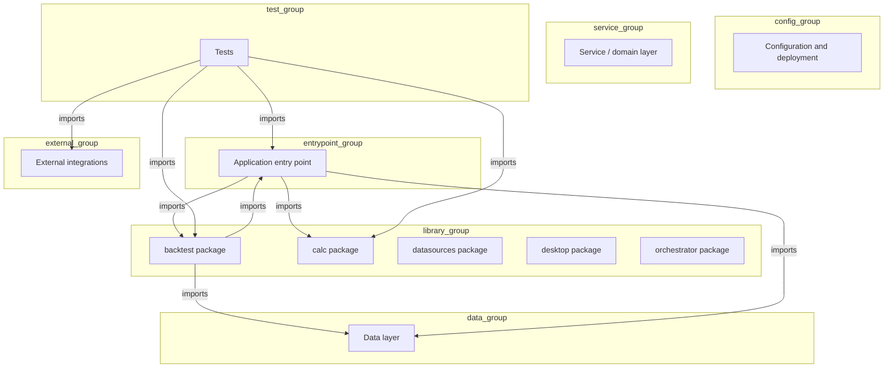

# Architecture report: simonlin1212/Vibe-Research

> Automated static analysis. **Observed** = directly seen in files/imports/AST; **Inferred** = interpretation from that evidence. Repository code was not executed.

## 1. Repository at a glance

| Item | Value |
| --- | --- |
| Repository | simonlin1212/Vibe-Research |
| Description | Vibe-Research：A 股、美股、港股的投研工作台 · 自选与持仓、每日复盘、产业资讯、产业研究、个股深挖、回测、研报库，168 个数据端点。支持 Claude Code、Codex、WorkBuddy 订阅或任意模型 API。 | A research workbench for China A-shares, US and HK stocks. |
| Language | TypeScript |
| Stars | 3710 |
| Licence | MIT |
| Analysed commit / branch | 76bd805f9b8387035b9dbc9110d1484d782d0e3a / main |
| Framework(s) | React |
| Files analysed | 620 |
| Components | 11 |

## 2. Architecture in one minute

simonlin1212/Vibe-Research - Vibe-Research：A 股、美股、港股的投研工作台 · 自选与持仓、每日复盘、产业资讯、产业研究、个股深挖、回测、研报库，168 个数据端点。支持 Claude Code、Codex、WorkBuddy 订阅或任意模型 API。 | A research workbench for China A-shares, US and HK stocks.. This repository was analysed statically from 620 file(s) (171 Python). Detected technologies (observed from imports/manifests): GitHub Actions, React, NumPy, pandas, React Router, requests. Files are grouped into 11 component(s): backtest package, calc package, Configuration and deployment, Data layer, datasources package, desktop package, Application entry point, External integrations. Observed entry point(s): .agents/skills/data-access/scripts/core/retrieval_cli.py, .agents/skills/data-access/scripts/fetch_announcements.py, .agents/skills/data-access/scripts/fetch_endpoint.py. Findings below distinguish observed facts from inferred interpretation.

## 3. High-level block diagram

## 4. Main components

### backtest package (`backtest`)

- **Kind:** library
- **Status:** Observed
- **Confidence:** 0.85
- **Responsibility:** Groups 20 file(s) under backtest package (observed from repository paths and static analysis). Observed top-level classes: BaseEngine, BenchmarkResult, BuyAndHold, ChinaAEngine, GlobalEquityEngine, GroupExposure. Observed top-level functions: _a_lookup, _a_share_exchange, _align, _assert_same_instrument, _assert_yahoo_daily, _auth_env_of.
- **Paths:** `backtest/__init__.py`, `backtest/benchmark.py`, `backtest/constraints.py`, `backtest/cost_compare.py`, `backtest/engines/__init__.py`, `backtest/engines/_market_hooks.py`, `backtest/engines/base.py`, `backtest/engines/china_a.py`, `backtest/engines/global_equity.py`, `backtest/gate.py`, `backtest/gics.py`, `backtest/loader.py`, `backtest/metrics.py`, `backtest/rebalance_notes.py`, `backtest/report_data.py`, `backtest/risk_xray.py`, `backtest/run_card.py`, `backtest/sensitivity.py`, `backtest/stdio_utf8.py`, `backtest/strategies.py`
- **Evidence:** [backtest/__init__.py](https://github.com/simonlin1212/Vibe-Research/blob/76bd805f9b8387035b9dbc9110d1484d782d0e3a/backtest/__init__.py); [backtest/benchmark.py:38](https://github.com/simonlin1212/Vibe-Research/blob/76bd805f9b8387035b9dbc9110d1484d782d0e3a/backtest/benchmark.py#L38); [backtest/constraints.py:38](https://github.com/simonlin1212/Vibe-Research/blob/76bd805f9b8387035b9dbc9110d1484d782d0e3a/backtest/constraints.py#L38); [backtest/cost_compare.py:36](https://github.com/simonlin1212/Vibe-Research/blob/76bd805f9b8387035b9dbc9110d1484d782d0e3a/backtest/cost_compare.py#L36); [backtest/engines/__init__.py](https://github.com/simonlin1212/Vibe-Research/blob/76bd805f9b8387035b9dbc9110d1484d782d0e3a/backtest/engines/__init__.py); [backtest/engines/_market_hooks.py:93](https://github.com/simonlin1212/Vibe-Research/blob/76bd805f9b8387035b9dbc9110d1484d782d0e3a/backtest/engines/_market_hooks.py#L93); [backtest/engines/base.py:42](https://github.com/simonlin1212/Vibe-Research/blob/76bd805f9b8387035b9dbc9110d1484d782d0e3a/backtest/engines/base.py#L42); [backtest/engines/china_a.py:25](https://github.com/simonlin1212/Vibe-Research/blob/76bd805f9b8387035b9dbc9110d1484d782d0e3a/backtest/engines/china_a.py#L25)

### calc package (`calc`)

- **Kind:** library
- **Status:** Observed
- **Confidence:** 0.85
- **Responsibility:** Groups 8 file(s) under calc package (observed from repository paths and static analysis). Observed top-level classes: CalcInputError. Observed top-level functions: _amount_suffix, _check_unit, _convert, _day, _ema, _err.
- **Paths:** `calc/__init__.py`, `calc/contracts.py`, `calc/display.py`, `calc/earnings.py`, `calc/formulas.py`, `calc/indicators.py`, `calc/series.py`, `calc/stdio_utf8.py`
- **Evidence:** [calc/__init__.py](https://github.com/simonlin1212/Vibe-Research/blob/76bd805f9b8387035b9dbc9110d1484d782d0e3a/calc/__init__.py); [calc/contracts.py:36](https://github.com/simonlin1212/Vibe-Research/blob/76bd805f9b8387035b9dbc9110d1484d782d0e3a/calc/contracts.py#L36); [calc/display.py:32](https://github.com/simonlin1212/Vibe-Research/blob/76bd805f9b8387035b9dbc9110d1484d782d0e3a/calc/display.py#L32); [calc/earnings.py:26](https://github.com/simonlin1212/Vibe-Research/blob/76bd805f9b8387035b9dbc9110d1484d782d0e3a/calc/earnings.py#L26); [calc/formulas.py:35](https://github.com/simonlin1212/Vibe-Research/blob/76bd805f9b8387035b9dbc9110d1484d782d0e3a/calc/formulas.py#L35); [calc/indicators.py:18](https://github.com/simonlin1212/Vibe-Research/blob/76bd805f9b8387035b9dbc9110d1484d782d0e3a/calc/indicators.py#L18); [calc/series.py:23](https://github.com/simonlin1212/Vibe-Research/blob/76bd805f9b8387035b9dbc9110d1484d782d0e3a/calc/series.py#L23); [calc/stdio_utf8.py:17](https://github.com/simonlin1212/Vibe-Research/blob/76bd805f9b8387035b9dbc9110d1484d782d0e3a/calc/stdio_utf8.py#L17)

### Configuration and deployment (`config`)

- **Kind:** config
- **Status:** Observed
- **Confidence:** 0.85
- **Responsibility:** Groups 11 file(s) under configuration and deployment (observed from repository paths and static analysis).
- **Paths:** `datasources/chokepoint_keywords.json`, `datasources/industry_tags.json`, `datasources/registry.json`, `datasources/rss_sources.json`, `desktop/package.json`, `desktop/src/verticals/finance/data/sectors.json`, `desktop/tsconfig.json`, `knowledge/manifest.json`, `mypy.ini`, `orchestrator/package.json`, `orchestrator/tsconfig.json`
- **Evidence:** [datasources/chokepoint_keywords.json](https://github.com/simonlin1212/Vibe-Research/blob/76bd805f9b8387035b9dbc9110d1484d782d0e3a/datasources/chokepoint_keywords.json); [datasources/industry_tags.json](https://github.com/simonlin1212/Vibe-Research/blob/76bd805f9b8387035b9dbc9110d1484d782d0e3a/datasources/industry_tags.json); [datasources/registry.json](https://github.com/simonlin1212/Vibe-Research/blob/76bd805f9b8387035b9dbc9110d1484d782d0e3a/datasources/registry.json); [datasources/rss_sources.json](https://github.com/simonlin1212/Vibe-Research/blob/76bd805f9b8387035b9dbc9110d1484d782d0e3a/datasources/rss_sources.json); [desktop/package.json](https://github.com/simonlin1212/Vibe-Research/blob/76bd805f9b8387035b9dbc9110d1484d782d0e3a/desktop/package.json); [desktop/src/verticals/finance/data/sectors.json](https://github.com/simonlin1212/Vibe-Research/blob/76bd805f9b8387035b9dbc9110d1484d782d0e3a/desktop/src/verticals/finance/data/sectors.json); [desktop/tsconfig.json](https://github.com/simonlin1212/Vibe-Research/blob/76bd805f9b8387035b9dbc9110d1484d782d0e3a/desktop/tsconfig.json); [knowledge/manifest.json](https://github.com/simonlin1212/Vibe-Research/blob/76bd805f9b8387035b9dbc9110d1484d782d0e3a/knowledge/manifest.json)

### Data layer (`data_layer`)

- **Kind:** data
- **Status:** Observed
- **Confidence:** 0.85
- **Responsibility:** Groups 2 file(s) under data layer (observed from repository paths and static analysis). Observed top-level classes: EquitySnapshot, FillRecord, Position, TradeRecord.
- **Paths:** `backtest/models.py`, `desktop/src/core/data/useArchiveThenRefresh.ts`
- **Evidence:** [backtest/models.py:14](https://github.com/simonlin1212/Vibe-Research/blob/76bd805f9b8387035b9dbc9110d1484d782d0e3a/backtest/models.py#L14); [desktop/src/core/data/useArchiveThenRefresh.ts](https://github.com/simonlin1212/Vibe-Research/blob/76bd805f9b8387035b9dbc9110d1484d782d0e3a/desktop/src/core/data/useArchiveThenRefresh.ts)

### datasources package (`datasources`)

- **Kind:** library
- **Status:** Observed
- **Confidence:** 0.85
- **Responsibility:** Groups 1 file(s) under datasources package (observed from repository paths and static analysis).
- **Paths:** `datasources/gen_catalog.py`
- **Evidence:** [datasources/gen_catalog.py](https://github.com/simonlin1212/Vibe-Research/blob/76bd805f9b8387035b9dbc9110d1484d782d0e3a/datasources/gen_catalog.py)

### desktop package (`desktop`)

- **Kind:** library
- **Status:** Observed
- **Confidence:** 0.85
- **Responsibility:** Groups 123 file(s) under desktop package (observed from repository paths and static analysis).
- **Paths:** `desktop/postcss.config.js`, `desktop/remote-access.ts`, `desktop/src/main.tsx`, `desktop/src/verticals/finance/components/AbnormalCard.tsx`, `desktop/src/verticals/finance/components/AuditCard.tsx`, `desktop/src/verticals/finance/components/BacktestCharts.tsx`, `desktop/src/verticals/finance/components/EarningsBriefCard.tsx`, `desktop/src/verticals/finance/components/EventStudyCard.tsx`, `desktop/src/verticals/finance/components/HomeDashboard.tsx`, `desktop/src/verticals/finance/components/KlineCard.tsx`, `desktop/src/verticals/finance/components/PortfolioPerf.tsx`, `desktop/src/verticals/finance/components/PortfolioXray.tsx`, `desktop/src/verticals/finance/components/PositionImport.tsx`, `desktop/src/verticals/finance/components/ReportAnswer.tsx`, `desktop/src/verticals/finance/components/ReportCompare.tsx`, `desktop/src/verticals/finance/components/ResearchReport.tsx`, `desktop/src/verticals/finance/components/ResearchRunItem.tsx`, `desktop/src/verticals/finance/components/ReviewTiersCard.tsx`, `desktop/src/verticals/finance/components/RunCompareCard.tsx`, `desktop/src/verticals/finance/components/ScenarioReplay.tsx`, `desktop/src/verticals/finance/components/SecContactCard.tsx`, `desktop/src/verticals/finance/components/ShareCardPanel.tsx`, `desktop/src/verticals/finance/components/SymbolSearch.tsx`, `desktop/src/verticals/finance/components/TradeCsvImport.tsx`, `desktop/src/verticals/finance/components/UpdateSettingsCard.tsx`, `desktop/src/verticals/finance/components/WeeklyCompareButton.tsx`, `desktop/src/verticals/finance/components/layout/Layout.tsx`, `desktop/src/verticals/finance/components/layout/UpdateBanner.tsx`, `desktop/src/verticals/finance/components/ui/Disclaimer.tsx`, `desktop/src/verticals/finance/components/ui/EChart.tsx`, `desktop/src/verticals/finance/components/ui/FinanceAiDock.tsx`, `desktop/src/verticals/finance/components/ui/GlassCard.tsx`, `desktop/src/verticals/finance/components/ui/PageHeader.tsx`, `desktop/src/verticals/finance/components/ui/PageTabs.tsx`, `desktop/src/verticals/finance/components/ui/PhoenixTreeLogo.tsx`, `desktop/src/verticals/finance/components/ui/QuickAiConnect.tsx`, `desktop/src/verticals/finance/components/ui/ReportHistory.tsx`, `desktop/src/verticals/finance/components/ui/SaveNoteButton.tsx`, `desktop/src/verticals/finance/components/ui/SegmentedToggle.tsx`, `desktop/src/verticals/finance/components/ui/SortTh.tsx`, `desktop/src/verticals/finance/components/ui/ThesisPanel.tsx`, `desktop/src/verticals/finance/components/ui/VerdictPanel.tsx`, `desktop/src/verticals/finance/components/ui/chartPalette.ts`, `desktop/src/verticals/finance/hooks/useAiRuntime.ts`, `desktop/src/verticals/finance/hooks/useDarkMode.ts`, `desktop/src/verticals/finance/hooks/useLiveQuotes.ts`, `desktop/src/verticals/finance/hooks/useNotifyUnread.ts`, `desktop/src/verticals/finance/hooks/usePrivacyMode.ts`, `desktop/src/verticals/finance/hooks/useRowOrder.ts`, `desktop/src/verticals/finance/hooks/useTableSort.ts`, `desktop/src/verticals/finance/lib/abnormal.ts`, `desktop/src/verticals/finance/lib/agents.ts`, `desktop/src/verticals/finance/lib/ai-models.ts`, `desktop/src/verticals/finance/lib/aiConnection.ts`, `desktop/src/verticals/finance/lib/analysisSession.ts`, `desktop/src/verticals/finance/lib/api.ts`, `desktop/src/verticals/finance/lib/auditView.ts`, `desktop/src/verticals/finance/lib/backend.ts`, `desktop/src/verticals/finance/lib/backtestView.ts`, `desktop/src/verticals/finance/lib/calendar.ts`, `desktop/src/verticals/finance/lib/candidates.ts`, `desktop/src/verticals/finance/lib/chatSources.ts`, `desktop/src/verticals/finance/lib/download.ts`, `desktop/src/verticals/finance/lib/earningsBrief.ts`, `desktop/src/verticals/finance/lib/eventStudyView.ts`, `desktop/src/verticals/finance/lib/headlineTranslation.ts`, `desktop/src/verticals/finance/lib/holdings.ts`, `desktop/src/verticals/finance/lib/holdingsDrift.ts`, `desktop/src/verticals/finance/lib/homeDashboard.ts`, `desktop/src/verticals/finance/lib/homeFeatures.ts`, `desktop/src/verticals/finance/lib/importPositions.ts`, `desktop/src/verticals/finance/lib/klineView.ts`, `desktop/src/verticals/finance/lib/libraryCitations.ts`, `desktop/src/verticals/finance/lib/llm.ts`, `desktop/src/verticals/finance/lib/llmStore.ts`, `desktop/src/verticals/finance/lib/marketReview.ts`, `desktop/src/verticals/finance/lib/marketSymbol.ts`, `desktop/src/verticals/finance/lib/nav.ts`, `desktop/src/verticals/finance/lib/notes.ts`, `desktop/src/verticals/finance/lib/notify.ts`, `desktop/src/verticals/finance/lib/perfView.ts`, `desktop/src/verticals/finance/lib/pollLoop.ts`, `desktop/src/verticals/finance/lib/privacy.ts`, `desktop/src/verticals/finance/lib/quoteSnapshot.ts`, `desktop/src/verticals/finance/lib/replayView.ts`, `desktop/src/verticals/finance/lib/reportCitations.ts`, `desktop/src/verticals/finance/lib/reportDiff.ts`, `desktop/src/verticals/finance/lib/reviewTiers.ts`, `desktop/src/verticals/finance/lib/runCompareView.ts`, `desktop/src/verticals/finance/lib/sectorPrompts.ts`, `desktop/src/verticals/finance/lib/shareCard.ts`, `desktop/src/verticals/finance/lib/storage.ts`, `desktop/src/verticals/finance/lib/symbolSearch.ts`, `desktop/src/verticals/finance/lib/tableSort.ts`, `desktop/src/verticals/finance/lib/tradeCsv.ts`, `desktop/src/verticals/finance/lib/update.ts`, `desktop/src/verticals/finance/lib/utils.ts`, `desktop/src/verticals/finance/lib/verdicts.ts`, `desktop/src/verticals/finance/lib/watchFeed.ts`, `desktop/src/verticals/finance/lib/watchlist.ts`, `desktop/src/verticals/finance/lib/xrayView.ts`, `desktop/src/verticals/finance/pages/Backtest.tsx`, `desktop/src/verticals/finance/pages/Calendar.tsx`, `desktop/src/verticals/finance/pages/Candidates.tsx`, `desktop/src/verticals/finance/pages/DailyReview.tsx`, `desktop/src/verticals/finance/pages/Debate.tsx`, `desktop/src/verticals/finance/pages/Home.tsx`, `desktop/src/verticals/finance/pages/Inbox.tsx`, `desktop/src/verticals/finance/pages/Intel.tsx`, `desktop/src/verticals/finance/pages/MyReports.tsx`, `desktop/src/verticals/finance/pages/MyStocks.tsx`, `desktop/src/verticals/finance/pages/Notes.tsx`, `desktop/src/verticals/finance/pages/Portfolio.tsx`, `desktop/src/verticals/finance/pages/Research.tsx`, `desktop/src/verticals/finance/pages/SectorDetail.tsx`, `desktop/src/verticals/finance/pages/Sectors.tsx`, `desktop/src/verticals/finance/pages/Settings.tsx`, `desktop/src/verticals/finance/pages/Signals.tsx`, `desktop/src/verticals/finance/pages/Watchlist.tsx`, `desktop/src/verticals/finance/router.tsx`, `desktop/tailwind.config.ts`, `desktop/vite-token.ts`, `desktop/vite.config.ts`
- **Evidence:** [desktop/postcss.config.js](https://github.com/simonlin1212/Vibe-Research/blob/76bd805f9b8387035b9dbc9110d1484d782d0e3a/desktop/postcss.config.js); [desktop/remote-access.ts](https://github.com/simonlin1212/Vibe-Research/blob/76bd805f9b8387035b9dbc9110d1484d782d0e3a/desktop/remote-access.ts); [desktop/src/main.tsx](https://github.com/simonlin1212/Vibe-Research/blob/76bd805f9b8387035b9dbc9110d1484d782d0e3a/desktop/src/main.tsx); [desktop/src/verticals/finance/components/AbnormalCard.tsx](https://github.com/simonlin1212/Vibe-Research/blob/76bd805f9b8387035b9dbc9110d1484d782d0e3a/desktop/src/verticals/finance/components/AbnormalCard.tsx); [desktop/src/verticals/finance/components/AuditCard.tsx](https://github.com/simonlin1212/Vibe-Research/blob/76bd805f9b8387035b9dbc9110d1484d782d0e3a/desktop/src/verticals/finance/components/AuditCard.tsx); [desktop/src/verticals/finance/components/BacktestCharts.tsx](https://github.com/simonlin1212/Vibe-Research/blob/76bd805f9b8387035b9dbc9110d1484d782d0e3a/desktop/src/verticals/finance/components/BacktestCharts.tsx); [desktop/src/verticals/finance/components/EarningsBriefCard.tsx](https://github.com/simonlin1212/Vibe-Research/blob/76bd805f9b8387035b9dbc9110d1484d782d0e3a/desktop/src/verticals/finance/components/EarningsBriefCard.tsx); [desktop/src/verticals/finance/components/EventStudyCard.tsx](https://github.com/simonlin1212/Vibe-Research/blob/76bd805f9b8387035b9dbc9110d1484d782d0e3a/desktop/src/verticals/finance/components/EventStudyCard.tsx)

### Application entry point (`entrypoint`)

- **Kind:** entrypoint
- **Status:** Observed
- **Confidence:** 0.85
- **Responsibility:** Groups 13 file(s) under application entry point (observed from repository paths and static analysis). Observed top-level classes: BacktestNotValid, EventError, KlineError, PerfError, ReplayError, Result. Observed top-level functions: _a_share, _aligned, _anchor, _apply, _available, _benchmark.
- **Paths:** `backtest/cli.py`, `backtest/event_study.py`, `backtest/kline.py`, `backtest/portfolio_perf.py`, `backtest/portfolio_xray.py`, `backtest/run.py`, `backtest/scenario_replay.py`, `backtest/symbol_search.py`, `backtest/validation.py`, `calc/cli.py`, `calc/tool.py`, `datasources/health.py`, `datasources/port_astock.py`
- **Evidence:** [backtest/cli.py:40](https://github.com/simonlin1212/Vibe-Research/blob/76bd805f9b8387035b9dbc9110d1484d782d0e3a/backtest/cli.py#L40); [backtest/event_study.py:107](https://github.com/simonlin1212/Vibe-Research/blob/76bd805f9b8387035b9dbc9110d1484d782d0e3a/backtest/event_study.py#L107); [backtest/kline.py:53](https://github.com/simonlin1212/Vibe-Research/blob/76bd805f9b8387035b9dbc9110d1484d782d0e3a/backtest/kline.py#L53); [backtest/portfolio_perf.py:77](https://github.com/simonlin1212/Vibe-Research/blob/76bd805f9b8387035b9dbc9110d1484d782d0e3a/backtest/portfolio_perf.py#L77); [backtest/portfolio_xray.py:60](https://github.com/simonlin1212/Vibe-Research/blob/76bd805f9b8387035b9dbc9110d1484d782d0e3a/backtest/portfolio_xray.py#L60); [backtest/run.py:38](https://github.com/simonlin1212/Vibe-Research/blob/76bd805f9b8387035b9dbc9110d1484d782d0e3a/backtest/run.py#L38); [backtest/scenario_replay.py:41](https://github.com/simonlin1212/Vibe-Research/blob/76bd805f9b8387035b9dbc9110d1484d782d0e3a/backtest/scenario_replay.py#L41); [backtest/symbol_search.py:48](https://github.com/simonlin1212/Vibe-Research/blob/76bd805f9b8387035b9dbc9110d1484d782d0e3a/backtest/symbol_search.py#L48)

### External integrations (`external_integrations`)

- **Kind:** external
- **Status:** Inferred
- **Confidence:** 0.70
- **Responsibility:** Groups 0 file(s) under external integrations (observed from repository paths and static analysis).
- **Evidence:** [.agents/skills/data-access/scripts/common.py:121](https://github.com/simonlin1212/Vibe-Research/blob/76bd805f9b8387035b9dbc9110d1484d782d0e3a/.agents/skills/data-access/scripts/common.py#L121); [.agents/skills/data-access/scripts/common.py:190](https://github.com/simonlin1212/Vibe-Research/blob/76bd805f9b8387035b9dbc9110d1484d782d0e3a/.agents/skills/data-access/scripts/common.py#L190); [.agents/skills/data-access/scripts/core/cdp.py:53](https://github.com/simonlin1212/Vibe-Research/blob/76bd805f9b8387035b9dbc9110d1484d782d0e3a/.agents/skills/data-access/scripts/core/cdp.py#L53); [.agents/skills/data-access/scripts/fetch_estimates.py:32](https://github.com/simonlin1212/Vibe-Research/blob/76bd805f9b8387035b9dbc9110d1484d782d0e3a/.agents/skills/data-access/scripts/fetch_estimates.py#L32); [.agents/skills/data-access/scripts/sources/_http.py:109](https://github.com/simonlin1212/Vibe-Research/blob/76bd805f9b8387035b9dbc9110d1484d782d0e3a/.agents/skills/data-access/scripts/sources/_http.py#L109); [.agents/skills/data-access/scripts/sources/_http.py:245](https://github.com/simonlin1212/Vibe-Research/blob/76bd805f9b8387035b9dbc9110d1484d782d0e3a/.agents/skills/data-access/scripts/sources/_http.py#L245)

### orchestrator package (`orchestrator`)

- **Kind:** library
- **Status:** Observed
- **Confidence:** 0.85
- **Responsibility:** Groups 118 file(s) under orchestrator package (observed from repository paths and static analysis).
- **Paths:** `orchestrator/src/access_token.ts`, `orchestrator/src/agent_runner.ts`, `orchestrator/src/alerts.ts`, `orchestrator/src/api.ts`, `orchestrator/src/arithmetic.ts`, `orchestrator/src/assistant_bridge.ts`, `orchestrator/src/assistant_tools_mcp.ts`, `orchestrator/src/assistant_turn.ts`, `orchestrator/src/audit_chain.ts`, `orchestrator/src/batch.ts`, `orchestrator/src/calc_projection.ts`, `orchestrator/src/chat.ts`, `orchestrator/src/config.ts`, `orchestrator/src/data_root.ts`, `orchestrator/src/debate.ts`, `orchestrator/src/deep_target_registry.ts`, `orchestrator/src/doctor.ts`, `orchestrator/src/engine.ts`, `orchestrator/src/engines/deep_engine.ts`, `orchestrator/src/engines/deterministic_engine.ts`, `orchestrator/src/engines/direct_stage_agent.ts`, `orchestrator/src/engines/direct_transport.ts`, `orchestrator/src/engines/local_agent_stage_agent.ts`, `orchestrator/src/engines/quick_engine.ts`, `orchestrator/src/fetchrun.ts`, `orchestrator/src/finance/abnormal.ts`, `orchestrator/src/finance/caliber_hints.ts`, `orchestrator/src/finance/candidates.ts`, `orchestrator/src/finance/chokepoint.ts`, `orchestrator/src/finance/deep_target.ts`, `orchestrator/src/finance/earnings_brief.ts`, `orchestrator/src/finance/events.ts`, `orchestrator/src/finance/fiscal_year.ts`, `orchestrator/src/finance/gate_rules.ts`, `orchestrator/src/finance/hardtest.ts`, `orchestrator/src/finance/holdings.ts`, `orchestrator/src/finance/holdings_view.ts`, `orchestrator/src/finance/identity.ts`, `orchestrator/src/finance/industry.ts`, `orchestrator/src/finance/inference_tiers.ts`, `orchestrator/src/finance/ledger_kinds.ts`, `orchestrator/src/finance/lexicon.ts`, `orchestrator/src/finance/methodology.ts`, `orchestrator/src/finance/page_queries.ts`, `orchestrator/src/finance/pe_disclosure.ts`, `orchestrator/src/finance/plugin.ts`, `orchestrator/src/finance/provider_matrix.ts`, `orchestrator/src/finance/quote_freshness.ts`, `orchestrator/src/finance/register.ts`, `orchestrator/src/finance/register_tasks.ts`, `orchestrator/src/finance/report_prelude.ts`, `orchestrator/src/finance/report_symbols.ts`, `orchestrator/src/finance/review_tiers.ts`, `orchestrator/src/finance/run_tools_mcp.ts`, `orchestrator/src/finance/schedule.ts`, `orchestrator/src/finance/sec_contact.ts`, `orchestrator/src/finance/semantic_slots.ts`, `orchestrator/src/finance/session.ts`, `orchestrator/src/finance/share_card.ts`, `orchestrator/src/finance/stage_validators.ts`, `orchestrator/src/finance/stages.ts`, `orchestrator/src/finance/stages_global.ts`, `orchestrator/src/finance/thermo_history.ts`, `orchestrator/src/finance/verdicts.ts`, `orchestrator/src/fixture.ts`, `orchestrator/src/formats.ts`, `orchestrator/src/fsutil.ts`, `orchestrator/src/gate.ts`, `orchestrator/src/guided_tool.ts`, `orchestrator/src/ingest.ts`, `orchestrator/src/ingest_tools.ts`, `orchestrator/src/ingest_tools_mcp.ts`, `orchestrator/src/init.ts`, `orchestrator/src/knowledge.ts`, `orchestrator/src/ledger.ts`, `orchestrator/src/light_chat.ts`, `orchestrator/src/local_agent_runtime.ts`, `orchestrator/src/mcp.ts`, `orchestrator/src/merge.ts`, `orchestrator/src/net_guard.ts`, `orchestrator/src/notify.ts`, `orchestrator/src/number_fidelity.ts`, `orchestrator/src/number_gate.ts`, `orchestrator/src/orchestrate.ts`, `orchestrator/src/page_context.ts`, `orchestrator/src/plugin.ts`, `orchestrator/src/productConfig.ts`, `orchestrator/src/progress.ts`, `orchestrator/src/providers.ts`, `orchestrator/src/registry.ts`, `orchestrator/src/report_library.ts`, `orchestrator/src/report_sections.ts`, `orchestrator/src/repository_version.ts`, `orchestrator/src/research_control.ts`, `orchestrator/src/research_failure.ts`, `orchestrator/src/research_process.ts`, `orchestrator/src/run.ts`, `orchestrator/src/run_compare.ts`, `orchestrator/src/run_tools.ts`, `orchestrator/src/runtime_provider.ts`, `orchestrator/src/saved_credentials.ts`, `orchestrator/src/schemas.ts`, `orchestrator/src/service.ts`, `orchestrator/src/service_redact.ts`, `orchestrator/src/snapshot.ts`, `orchestrator/src/startup.ts`, `orchestrator/src/startup_health.ts`, `orchestrator/src/startup_ports.ts`, `orchestrator/src/stop_guard.ts`, `orchestrator/src/task_adapters.ts`, `orchestrator/src/task_router.ts`, `orchestrator/src/task_service.ts`, `orchestrator/src/turn_context.ts`, `orchestrator/src/update_check.ts`, `orchestrator/src/validator.ts`, `orchestrator/src/version.ts`, `orchestrator/src/viewer.ts`, `orchestrator/src/views.ts`
- **Evidence:** [orchestrator/src/access_token.ts](https://github.com/simonlin1212/Vibe-Research/blob/76bd805f9b8387035b9dbc9110d1484d782d0e3a/orchestrator/src/access_token.ts); [orchestrator/src/agent_runner.ts](https://github.com/simonlin1212/Vibe-Research/blob/76bd805f9b8387035b9dbc9110d1484d782d0e3a/orchestrator/src/agent_runner.ts); [orchestrator/src/alerts.ts](https://github.com/simonlin1212/Vibe-Research/blob/76bd805f9b8387035b9dbc9110d1484d782d0e3a/orchestrator/src/alerts.ts); [orchestrator/src/api.ts](https://github.com/simonlin1212/Vibe-Research/blob/76bd805f9b8387035b9dbc9110d1484d782d0e3a/orchestrator/src/api.ts); [orchestrator/src/arithmetic.ts](https://github.com/simonlin1212/Vibe-Research/blob/76bd805f9b8387035b9dbc9110d1484d782d0e3a/orchestrator/src/arithmetic.ts); [orchestrator/src/assistant_bridge.ts](https://github.com/simonlin1212/Vibe-Research/blob/76bd805f9b8387035b9dbc9110d1484d782d0e3a/orchestrator/src/assistant_bridge.ts); [orchestrator/src/assistant_tools_mcp.ts](https://github.com/simonlin1212/Vibe-Research/blob/76bd805f9b8387035b9dbc9110d1484d782d0e3a/orchestrator/src/assistant_tools_mcp.ts); [orchestrator/src/assistant_turn.ts](https://github.com/simonlin1212/Vibe-Research/blob/76bd805f9b8387035b9dbc9110d1484d782d0e3a/orchestrator/src/assistant_turn.ts)

### Service / domain layer (`service_layer`)

- **Kind:** service
- **Status:** Observed
- **Confidence:** 0.85
- **Responsibility:** Groups 10 file(s) under service / domain layer (observed from repository paths and static analysis).
- **Paths:** `desktop/src/core/ai/AiConsole.tsx`, `desktop/src/core/ai/AiDock.tsx`, `desktop/src/core/ai/AiMessages.tsx`, `desktop/src/core/ai/cleanAutoLinks.ts`, `desktop/src/core/ai/noRemoteImages.tsx`, `desktop/src/core/ai/pageContext.tsx`, `desktop/src/core/ai/threads.ts`, `desktop/src/core/ai/useAiChat.ts`, `desktop/src/core/components/RouteErrorPage.tsx`, `desktop/src/core/lib/cn.ts`
- **Evidence:** [desktop/src/core/ai/AiConsole.tsx](https://github.com/simonlin1212/Vibe-Research/blob/76bd805f9b8387035b9dbc9110d1484d782d0e3a/desktop/src/core/ai/AiConsole.tsx); [desktop/src/core/ai/AiDock.tsx](https://github.com/simonlin1212/Vibe-Research/blob/76bd805f9b8387035b9dbc9110d1484d782d0e3a/desktop/src/core/ai/AiDock.tsx); [desktop/src/core/ai/AiMessages.tsx](https://github.com/simonlin1212/Vibe-Research/blob/76bd805f9b8387035b9dbc9110d1484d782d0e3a/desktop/src/core/ai/AiMessages.tsx); [desktop/src/core/ai/cleanAutoLinks.ts](https://github.com/simonlin1212/Vibe-Research/blob/76bd805f9b8387035b9dbc9110d1484d782d0e3a/desktop/src/core/ai/cleanAutoLinks.ts); [desktop/src/core/ai/noRemoteImages.tsx](https://github.com/simonlin1212/Vibe-Research/blob/76bd805f9b8387035b9dbc9110d1484d782d0e3a/desktop/src/core/ai/noRemoteImages.tsx); [desktop/src/core/ai/pageContext.tsx](https://github.com/simonlin1212/Vibe-Research/blob/76bd805f9b8387035b9dbc9110d1484d782d0e3a/desktop/src/core/ai/pageContext.tsx); [desktop/src/core/ai/threads.ts](https://github.com/simonlin1212/Vibe-Research/blob/76bd805f9b8387035b9dbc9110d1484d782d0e3a/desktop/src/core/ai/threads.ts); [desktop/src/core/ai/useAiChat.ts](https://github.com/simonlin1212/Vibe-Research/blob/76bd805f9b8387035b9dbc9110d1484d782d0e3a/desktop/src/core/ai/useAiChat.ts)

### Tests (`tests`)

- **Kind:** test
- **Status:** Observed
- **Confidence:** 0.85
- **Responsibility:** Groups 179 file(s) under tests (observed from repository paths and static analysis). Observed top-level classes: FakeTdx, FrameLoader, PagedRS, R, Signals, _Fake. Observed top-level functions: _ann, _artifacts, _bar, _body, _boom, _bs_payload.
- **Paths:** `.agents/skills/data-access/scripts/tests/test_astock_ported.py`, `.agents/skills/data-access/scripts/tests/test_audit_round3_sources.py`, `.agents/skills/data-access/scripts/tests/test_baostock_paging.py`, `.agents/skills/data-access/scripts/tests/test_commodity.py`, `.agents/skills/data-access/scripts/tests/test_core_retrieval.py`, `.agents/skills/data-access/scripts/tests/test_datacal.py`, `.agents/skills/data-access/scripts/tests/test_eastmoney.py`, `.agents/skills/data-access/scripts/tests/test_eastmoney_pools.py`, `.agents/skills/data-access/scripts/tests/test_em_events.py`, `.agents/skills/data-access/scripts/tests/test_global_industry.py`, `.agents/skills/data-access/scripts/tests/test_global_research.py`, `.agents/skills/data-access/scripts/tests/test_headlines.py`, `.agents/skills/data-access/scripts/tests/test_hiring.py`, `.agents/skills/data-access/scripts/tests/test_industry.py`, `.agents/skills/data-access/scripts/tests/test_kline_freshness.py`, `.agents/skills/data-access/scripts/tests/test_legacy_stdio.py`, `.agents/skills/data-access/scripts/tests/test_m31_global_gaps.py`, `.agents/skills/data-access/scripts/tests/test_m36_probability_budget.py`, `.agents/skills/data-access/scripts/tests/test_market_review.py`, `.agents/skills/data-access/scripts/tests/test_market_voice.py`, `.agents/skills/data-access/scripts/tests/test_official_http.py`, `.agents/skills/data-access/scripts/tests/test_policy.py`, `.agents/skills/data-access/scripts/tests/test_probability.py`, `.agents/skills/data-access/scripts/tests/test_raw_ref_posix.py`, `.agents/skills/data-access/scripts/tests/test_redaction.py`, `.agents/skills/data-access/scripts/tests/test_registry_sources.py`, `.agents/skills/data-access/scripts/tests/test_results_dates.py`, `.agents/skills/data-access/scripts/tests/test_retrieval_cli.py`, `.agents/skills/data-access/scripts/tests/test_rss_feed.py`, `.agents/skills/data-access/scripts/tests/test_source_partial_results.py`, `.agents/skills/data-access/scripts/tests/test_stock_news_fallback.py`, `.agents/skills/data-access/scripts/tests/test_us_share_class.py`, `backtest/tests/__init__.py`, `backtest/tests/fixtures/trade_replay_parity.json`, `backtest/tests/test_audit_round3.py`, `backtest/tests/test_cli_errors.py`, `backtest/tests/test_constraints.py`, `backtest/tests/test_cost_compare.py`, `backtest/tests/test_datasource_health.py`, `backtest/tests/test_downside_metrics.py`, `backtest/tests/test_engine_rules.py`, `backtest/tests/test_event_study.py`, `backtest/tests/test_gate.py`, `backtest/tests/test_index_benchmark.py`, `backtest/tests/test_kline.py`, `backtest/tests/test_loader.py`, `backtest/tests/test_m31_audit.py`, `backtest/tests/test_portfolio_perf.py`, `backtest/tests/test_portfolio_xray.py`, `backtest/tests/test_report_data.py`, `backtest/tests/test_rsrs.py`, `backtest/tests/test_run.py`, `backtest/tests/test_scenario_replay.py`, `backtest/tests/test_sensitivity.py`, `backtest/tests/test_symbol_search.py`, `calc/tests/fixtures/formulas_cases.json`, `calc/tests/test_cli.py`, `calc/tests/test_contracts.py`, `calc/tests/test_currency_ttm.py`, `calc/tests/test_display.py`, `calc/tests/test_earnings.py`, `calc/tests/test_formulas.py`, `calc/tests/test_indicators.py`, `calc/tests/test_series.py`, `calc/tests/test_stdio_utf8.py`, `calc/tests/test_tool.py`, `desktop/test/abnormal.test.ts`, `desktop/test/agent_error.test.ts`, `desktop/test/ai_connection.test.ts`, `desktop/test/ai_draft.test.ts`, `desktop/test/ai_runtime.test.ts`, `desktop/test/ai_settings_persistence.test.ts`, `desktop/test/ai_surface.test.ts`, `desktop/test/ai_threads.test.ts`, `desktop/test/analysis_session.test.ts`, `desktop/test/audit_round3.test.ts`, `desktop/test/audit_view.test.ts`, `desktop/test/backtest_agent.test.ts`, `desktop/test/backtest_charts.test.ts`, `desktop/test/calendar.test.ts`, `desktop/test/candidates.test.ts`, `desktop/test/chat_controls.test.ts`, `desktop/test/chat_sources.test.ts`, `desktop/test/chat_storage.test.ts`, `desktop/test/daily_review_context.test.ts`, `desktop/test/debate_cancel.test.ts`, `desktop/test/download.test.ts`, `desktop/test/earnings_brief.test.ts`, `desktop/test/event_study_view.test.ts`, `desktop/test/global_indices.test.ts`, `desktop/test/headline_translation.test.ts`, `desktop/test/helpers/render.ts`, `desktop/test/holdings_drift.test.ts`, `desktop/test/home_agent.test.ts`, `desktop/test/home_dashboard.test.ts`, `desktop/test/import_positions.test.ts`, `desktop/test/kline_view.test.ts`, `desktop/test/lan_proxy.test.ts`, `desktop/test/lazy_routes.test.ts`, `desktop/test/library_citations.test.ts`, `desktop/test/local_agent_preflight_cancel.test.ts`, `desktop/test/markdown_images.test.ts`, `desktop/test/market_review.test.ts`, `desktop/test/market_symbol.test.ts`, `desktop/test/nav.test.ts`, `desktop/test/notify_inbox.test.ts`, `desktop/test/null_semantics.test.ts`, `desktop/test/poll_loop.test.ts`, `desktop/test/portfolio_perf.test.ts`, `desktop/test/portfolio_trades.test.ts`, `desktop/test/portfolio_xray.test.ts`, `desktop/test/privacy_mode.test.ts`, `desktop/test/quote_snapshot.test.ts`, `desktop/test/remote_access.test.ts`, `desktop/test/replay_view.test.ts`, `desktop/test/report_citations.test.ts`, `desktop/test/report_diff.test.ts`, `desktop/test/research_archive.test.ts`, `desktop/test/research_cancel.test.ts`, `desktop/test/research_delete.test.ts`, `desktop/test/research_report.test.ts`, `desktop/test/review_tiers.test.ts`, `desktop/test/route_error.test.ts`, `desktop/test/run_compare_view.test.ts`, `desktop/test/sec_contact_card.test.ts`, `desktop/test/sector_prompts.test.ts`, `desktop/test/share_card.test.ts`, `desktop/test/symbol_search.test.ts`, `desktop/test/table_sort.test.ts`, `desktop/test/task_mode.test.ts`, `desktop/test/trade_csv.test.ts`, `desktop/test/update_notice.test.ts`, `desktop/test/verdicts.test.ts`, `desktop/test/watch_feed.test.ts`, `desktop/test/watchlist_queue.test.ts`, `desktop/test/workspace_visual.test.ts`, `orchestrator/test/abnormal.test.ts`, `orchestrator/test/api_entry.test.ts`, `orchestrator/test/arithmetic.test.ts`, `orchestrator/test/assistant_tools.test.ts`, `orchestrator/test/audit_chain.test.ts`, `orchestrator/test/batch_alerts.test.ts`, `orchestrator/test/browser_ui.test.ts`, `orchestrator/test/caliber_hints.test.ts`, `orchestrator/test/candidates.test.ts`, `orchestrator/test/chat.test.ts`, `orchestrator/test/chokepoint.test.ts`, `orchestrator/test/core_purity.test.ts`, `orchestrator/test/debate.test.ts`, `orchestrator/test/deep_engine.test.ts`, `orchestrator/test/delete_run.test.ts`, `orchestrator/test/direct_stage_agent.test.ts`, `orchestrator/test/direct_transport.test.ts`, `orchestrator/test/earnings_brief.test.ts`, `orchestrator/test/engine_boundary.test.ts`, `orchestrator/test/events.test.ts`, `orchestrator/test/fixture.test.ts`, `orchestrator/test/gate.test.ts`, `orchestrator/test/global_contract.test.ts`, `orchestrator/test/guided_tool.test.ts`, `orchestrator/test/hardtest.test.ts`, `orchestrator/test/hardtest_global.test.ts`, `orchestrator/test/helpers/endpoint_signatures.py`, `orchestrator/test/holdings.test.ts`, `orchestrator/test/holdings_parity.test.ts`, `orchestrator/test/industry.test.ts`, `orchestrator/test/inference_tiers.test.ts`, `orchestrator/test/ingest.test.ts`, `orchestrator/test/ingest_tools.test.ts`, `orchestrator/test/init_doctor.test.ts`, `orchestrator/test/knowledge_viewer.test.ts`, `orchestrator/test/ledger.test.ts`, `orchestrator/test/light_chat.test.ts`, `orchestrator/test/llm_wiring.test.ts`, `orchestrator/test/local_agent_runtime.test.ts`, `orchestrator/test/local_agent_stage_agent.test.ts`, `orchestrator/test/market_voice.test.ts`, `orchestrator/test/release_version.test.ts`, `orchestrator/test/report_symbols_plugin.test.ts`
- **Evidence:** [.agents/skills/data-access/scripts/tests/test_astock_ported.py:26](https://github.com/simonlin1212/Vibe-Research/blob/76bd805f9b8387035b9dbc9110d1484d782d0e3a/.agents/skills/data-access/scripts/tests/test_astock_ported.py#L26); [.agents/skills/data-access/scripts/tests/test_audit_round3_sources.py:16](https://github.com/simonlin1212/Vibe-Research/blob/76bd805f9b8387035b9dbc9110d1484d782d0e3a/.agents/skills/data-access/scripts/tests/test_audit_round3_sources.py#L16); [.agents/skills/data-access/scripts/tests/test_baostock_paging.py:22](https://github.com/simonlin1212/Vibe-Research/blob/76bd805f9b8387035b9dbc9110d1484d782d0e3a/.agents/skills/data-access/scripts/tests/test_baostock_paging.py#L22); [.agents/skills/data-access/scripts/tests/test_commodity.py:20](https://github.com/simonlin1212/Vibe-Research/blob/76bd805f9b8387035b9dbc9110d1484d782d0e3a/.agents/skills/data-access/scripts/tests/test_commodity.py#L20); [.agents/skills/data-access/scripts/tests/test_core_retrieval.py:14](https://github.com/simonlin1212/Vibe-Research/blob/76bd805f9b8387035b9dbc9110d1484d782d0e3a/.agents/skills/data-access/scripts/tests/test_core_retrieval.py#L14); [.agents/skills/data-access/scripts/tests/test_datacal.py:19](https://github.com/simonlin1212/Vibe-Research/blob/76bd805f9b8387035b9dbc9110d1484d782d0e3a/.agents/skills/data-access/scripts/tests/test_datacal.py#L19); [.agents/skills/data-access/scripts/tests/test_eastmoney.py:16](https://github.com/simonlin1212/Vibe-Research/blob/76bd805f9b8387035b9dbc9110d1484d782d0e3a/.agents/skills/data-access/scripts/tests/test_eastmoney.py#L16); [.agents/skills/data-access/scripts/tests/test_eastmoney_pools.py:19](https://github.com/simonlin1212/Vibe-Research/blob/76bd805f9b8387035b9dbc9110d1484d782d0e3a/.agents/skills/data-access/scripts/tests/test_eastmoney_pools.py#L19)

## 5. Execution flow

**Observed** entry point(s):

- [.agents/skills/data-access/scripts/core/retrieval_cli.py:40](https://github.com/simonlin1212/Vibe-Research/blob/76bd805f9b8387035b9dbc9110d1484d782d0e3a/.agents/skills/data-access/scripts/core/retrieval_cli.py#L40)
- [.agents/skills/data-access/scripts/fetch_announcements.py:82](https://github.com/simonlin1212/Vibe-Research/blob/76bd805f9b8387035b9dbc9110d1484d782d0e3a/.agents/skills/data-access/scripts/fetch_announcements.py#L82)
- [.agents/skills/data-access/scripts/fetch_endpoint.py:169](https://github.com/simonlin1212/Vibe-Research/blob/76bd805f9b8387035b9dbc9110d1484d782d0e3a/.agents/skills/data-access/scripts/fetch_endpoint.py#L169)
- [.agents/skills/data-access/scripts/fetch_estimates.py:143](https://github.com/simonlin1212/Vibe-Research/blob/76bd805f9b8387035b9dbc9110d1484d782d0e3a/.agents/skills/data-access/scripts/fetch_estimates.py#L143)
- [.agents/skills/data-access/scripts/fetch_financials.py:181](https://github.com/simonlin1212/Vibe-Research/blob/76bd805f9b8387035b9dbc9110d1484d782d0e3a/.agents/skills/data-access/scripts/fetch_financials.py#L181)
- [.agents/skills/data-access/scripts/fetch_kline.py:109](https://github.com/simonlin1212/Vibe-Research/blob/76bd805f9b8387035b9dbc9110d1484d782d0e3a/.agents/skills/data-access/scripts/fetch_kline.py#L109)
- [.agents/skills/data-access/scripts/fetch_pe_history.py:89](https://github.com/simonlin1212/Vibe-Research/blob/76bd805f9b8387035b9dbc9110d1484d782d0e3a/.agents/skills/data-access/scripts/fetch_pe_history.py#L89)
- [.agents/skills/data-access/scripts/fetch_profile.py:148](https://github.com/simonlin1212/Vibe-Research/blob/76bd805f9b8387035b9dbc9110d1484d782d0e3a/.agents/skills/data-access/scripts/fetch_profile.py#L148)
- [.agents/skills/data-access/scripts/fetch_quote.py:140](https://github.com/simonlin1212/Vibe-Research/blob/76bd805f9b8387035b9dbc9110d1484d782d0e3a/.agents/skills/data-access/scripts/fetch_quote.py#L140)
- [.agents/skills/data-access/scripts/fetch_trade_calendar.py:97](https://github.com/simonlin1212/Vibe-Research/blob/76bd805f9b8387035b9dbc9110d1484d782d0e3a/.agents/skills/data-access/scripts/fetch_trade_calendar.py#L97)
- [backtest/cli.py:324](https://github.com/simonlin1212/Vibe-Research/blob/76bd805f9b8387035b9dbc9110d1484d782d0e3a/backtest/cli.py#L324)
- [backtest/event_study.py:701](https://github.com/simonlin1212/Vibe-Research/blob/76bd805f9b8387035b9dbc9110d1484d782d0e3a/backtest/event_study.py#L701)

Representative flow (derived from observed entry points and the import graph; steps beyond the entry point are **Inferred**):

1. Execution starts at an observed entry point listed above, if present.
2. `backtest` imports `data_layer` (backtest package -> Data layer).
3. `backtest` imports `entrypoint` (backtest package -> Application entry point).
4. `entrypoint` imports `backtest` (Application entry point -> backtest package).
5. `entrypoint` imports `calc` (Application entry point -> calc package).
6. `entrypoint` imports `data_layer` (Application entry point -> Data layer).
7. `tests` imports `backtest` (Tests -> backtest package).
8. `tests` imports `calc` (Tests -> calc package).
9. `tests` imports `entrypoint` (Tests -> Application entry point).

## 6. Project structure

### `(root)`

- `.gitattributes` - other (473 bytes)
- `.gitignore` - other (288 bytes)
- `AGENTS.md` - docs (15736 bytes)
- `CLAUDE.md` - docs (11 bytes)
- `LICENSE` - docs (1069 bytes)
- `README.md` - docs (71242 bytes)
- `README_en.md` - docs (86032 bytes)
- `mypy.ini` - config (461 bytes)

### `.agents`

- `.agents/skills/README.md` - docs (2527 bytes)
- `.agents/skills/catalyst-risk/SKILL.md` - docs (15455 bytes)
- `.agents/skills/company-research/SKILL.md` - docs (21659 bytes)
- `.agents/skills/data-access/SKILL.md` - docs (14272 bytes)
- `.agents/skills/data-access/scripts/common.py` - source, Python (18053 bytes)
- `.agents/skills/data-access/scripts/core/__init__.py` - source, Python (0 bytes)
- `.agents/skills/data-access/scripts/core/cdp.py` - source, Python (32682 bytes)
- `.agents/skills/data-access/scripts/core/exa_client.py` - source, Python (8536 bytes)
- `.agents/skills/data-access/scripts/core/retrieval.py` - source, Python (25172 bytes)
- `.agents/skills/data-access/scripts/core/retrieval_cli.py` - source, Python (2257 bytes)
- `.agents/skills/data-access/scripts/core/stdio_utf8.py` - source, Python (3345 bytes)
- `.agents/skills/data-access/scripts/fetch_announcements.py` - source, Python (4828 bytes)
- `.agents/skills/data-access/scripts/fetch_endpoint.py` - source, Python (8792 bytes)
- `.agents/skills/data-access/scripts/fetch_estimates.py` - source, Python (7251 bytes)
- `.agents/skills/data-access/scripts/fetch_financials.py` - source, Python (9760 bytes)
- `.agents/skills/data-access/scripts/fetch_kline.py` - source, Python (6178 bytes)
- `.agents/skills/data-access/scripts/fetch_pe_history.py` - source, Python (5132 bytes)
- `.agents/skills/data-access/scripts/fetch_profile.py` - source, Python (7757 bytes)
- `.agents/skills/data-access/scripts/fetch_quote.py` - source, Python (8205 bytes)
- `.agents/skills/data-access/scripts/fetch_trade_calendar.py` - source, Python (5391 bytes)
- `.agents/skills/data-access/scripts/requirements.lock.txt` - manifest (504 bytes)
- `.agents/skills/data-access/scripts/requirements.txt` - manifest (213 bytes)
- `.agents/skills/data-access/scripts/sources/__init__.py` - source, Python (380 bytes)
- `.agents/skills/data-access/scripts/sources/_http.py` - source, Python (15407 bytes)
- `.agents/skills/data-access/scripts/sources/astock_defaults.py` - source, Python (7316 bytes)
- `.agents/skills/data-access/scripts/sources/astock_ported.py` - source, Python (180440 bytes)
- `.agents/skills/data-access/scripts/sources/baidu.py` - source, Python (3332 bytes)
- `.agents/skills/data-access/scripts/sources/baostock_src.py` - source, Python (7807 bytes)
- `.agents/skills/data-access/scripts/sources/cboe.py` - source, Python (5462 bytes)
- `.agents/skills/data-access/scripts/sources/cls.py` - source, Python (1325 bytes)
- `.agents/skills/data-access/scripts/sources/cninfo.py` - source, Python (3726 bytes)
- `.agents/skills/data-access/scripts/sources/commodity.py` - source, Python (12446 bytes)
- `.agents/skills/data-access/scripts/sources/datacal.py` - source, Python (7322 bytes)
- `.agents/skills/data-access/scripts/sources/eastmoney.py` - source, Python (76141 bytes)
- `.agents/skills/data-access/scripts/sources/em_events.py` - source, Python (5969 bytes)
- `.agents/skills/data-access/scripts/sources/exa.py` - source, Python (8134 bytes)
- `.agents/skills/data-access/scripts/sources/exchange.py` - source, Python (4706 bytes)
- `.agents/skills/data-access/scripts/sources/finra.py` - source, Python (5847 bytes)
- `.agents/skills/data-access/scripts/sources/global_research.py` - source, Python (12491 bytes)
- `.agents/skills/data-access/scripts/sources/headlines.py` - source, Python (15240 bytes)
- `.agents/skills/data-access/scripts/sources/hiring.py` - source, Python (11375 bytes)
- `.agents/skills/data-access/scripts/sources/hkex.py` - source, Python (5247 bytes)
- `.agents/skills/data-access/scripts/sources/indicators.py` - source, Python (6252 bytes)
- `.agents/skills/data-access/scripts/sources/industry.py` - source, Python (19849 bytes)
- `.agents/skills/data-access/scripts/sources/iwencai.py` - source, Python (2296 bytes)
- `.agents/skills/data-access/scripts/sources/macro.py` - source, Python (6535 bytes)
- `.agents/skills/data-access/scripts/sources/macro_us.py` - source, Python (5579 bytes)
- `.agents/skills/data-access/scripts/sources/mappers.py` - source, Python (56252 bytes)
- `.agents/skills/data-access/scripts/sources/mappers_astock.py` - source, Python (41701 bytes)
- `.agents/skills/data-access/scripts/sources/mappers_cn.py` - source, Python (33149 bytes)
- `.agents/skills/data-access/scripts/sources/mappers_commodity.py` - source, Python (5252 bytes)
- `.agents/skills/data-access/scripts/sources/mappers_datacal.py` - source, Python (3758 bytes)
- `.agents/skills/data-access/scripts/sources/mappers_global.py` - source, Python (64696 bytes)
- `.agents/skills/data-access/scripts/sources/mappers_headlines.py` - source, Python (6817 bytes)
- `.agents/skills/data-access/scripts/sources/mappers_hiring.py` - source, Python (4479 bytes)
- `.agents/skills/data-access/scripts/sources/mappers_industry.py` - source, Python (9933 bytes)
- `.agents/skills/data-access/scripts/sources/mappers_policy.py` - source, Python (6020 bytes)
- `.agents/skills/data-access/scripts/sources/mappers_probability.py` - source, Python (9103 bytes)
- `.agents/skills/data-access/scripts/sources/mootdx_src.py` - source, Python (5457 bytes)
- `.agents/skills/data-access/scripts/sources/policy.py` - source, Python (21486 bytes)
- `.agents/skills/data-access/scripts/sources/probability.py` - source, Python (37261 bytes)
- `.agents/skills/data-access/scripts/sources/rss.py` - source, Python (6357 bytes)
- `.agents/skills/data-access/scripts/sources/sec.py` - source, Python (13066 bytes)
- `.agents/skills/data-access/scripts/sources/sina.py` - source, Python (14549 bytes)
- `.agents/skills/data-access/scripts/sources/sw.py` - source, Python (5364 bytes)
- `.agents/skills/data-access/scripts/sources/tencent.py` - source, Python (7777 bytes)
- `.agents/skills/data-access/scripts/sources/textsafe.py` - source, Python (6747 bytes)
- `.agents/skills/data-access/scripts/sources/ths.py` - source, Python (3581 bytes)
- `.agents/skills/data-access/scripts/sources/yahoo.py` - source, Python (13008 bytes)
- `.agents/skills/data-access/scripts/tests/test_astock_ported.py` - test, Python (27949 bytes)
- `.agents/skills/data-access/scripts/tests/test_audit_round3_sources.py` - test, Python (5617 bytes)
- `.agents/skills/data-access/scripts/tests/test_baostock_paging.py` - test, Python (5776 bytes)
- `.agents/skills/data-access/scripts/tests/test_commodity.py` - test, Python (11705 bytes)
- `.agents/skills/data-access/scripts/tests/test_core_retrieval.py` - test, Python (45748 bytes)
- `.agents/skills/data-access/scripts/tests/test_datacal.py` - test, Python (8575 bytes)
- `.agents/skills/data-access/scripts/tests/test_eastmoney.py` - test, Python (6326 bytes)
- `.agents/skills/data-access/scripts/tests/test_eastmoney_pools.py` - test, Python (4627 bytes)
- `.agents/skills/data-access/scripts/tests/test_em_events.py` - test, Python (5710 bytes)
- `.agents/skills/data-access/scripts/tests/test_global_industry.py` - test, Python (1905 bytes)
- `.agents/skills/data-access/scripts/tests/test_global_research.py` - test, Python (17263 bytes)
- `.agents/skills/data-access/scripts/tests/test_headlines.py` - test, Python (17954 bytes)
- `.agents/skills/data-access/scripts/tests/test_hiring.py` - test, Python (11901 bytes)
- `.agents/skills/data-access/scripts/tests/test_industry.py` - test, Python (22387 bytes)
- `.agents/skills/data-access/scripts/tests/test_kline_freshness.py` - test, Python (927 bytes)
- `.agents/skills/data-access/scripts/tests/test_legacy_stdio.py` - test, Python (1073 bytes)
- `.agents/skills/data-access/scripts/tests/test_m31_global_gaps.py` - test, Python (4052 bytes)
- `.agents/skills/data-access/scripts/tests/test_m36_probability_budget.py` - test, Python (4339 bytes)
- `.agents/skills/data-access/scripts/tests/test_market_review.py` - test, Python (21333 bytes)
- `.agents/skills/data-access/scripts/tests/test_market_voice.py` - test, Python (19410 bytes)
- `.agents/skills/data-access/scripts/tests/test_official_http.py` - test, Python (10374 bytes)
- `.agents/skills/data-access/scripts/tests/test_policy.py` - test, Python (16483 bytes)
- `.agents/skills/data-access/scripts/tests/test_probability.py` - test, Python (27131 bytes)
- `.agents/skills/data-access/scripts/tests/test_raw_ref_posix.py` - test, Python (1731 bytes)
- `.agents/skills/data-access/scripts/tests/test_redaction.py` - test, Python (3350 bytes)
- `.agents/skills/data-access/scripts/tests/test_registry_sources.py` - test, Python (36538 bytes)
- `.agents/skills/data-access/scripts/tests/test_results_dates.py` - test, Python (15064 bytes)
- `.agents/skills/data-access/scripts/tests/test_retrieval_cli.py` - test, Python (2355 bytes)
- `.agents/skills/data-access/scripts/tests/test_rss_feed.py` - test, Python (1607 bytes)
- `.agents/skills/data-access/scripts/tests/test_source_partial_results.py` - test, Python (7446 bytes)
- `.agents/skills/data-access/scripts/tests/test_stock_news_fallback.py` - test, Python (5261 bytes)
- `.agents/skills/data-access/scripts/tests/test_us_share_class.py` - test, Python (2146 bytes)
- `.agents/skills/earnings-analysis/SKILL.md` - docs (8265 bytes)
- `.agents/skills/industry-chain/SKILL.md` - docs (6158 bytes)
- `.agents/skills/valuation/SKILL.md` - docs (8142 bytes)

### `.github`

- `.github/workflows/cross-platform.yml` - ci, YAML (3656 bytes)
- `.github/workflows/portable.yml` - ci, YAML (3201 bytes)

### `assets`

- `assets/README.md` - docs (754 bytes)
- `assets/screenshots/2026-10-10/README.md` - docs (4056 bytes)

### `backtest`

- `backtest/LICENSE.upstream` - other (1082 bytes)
- `backtest/NOTICE.md` - docs (3813 bytes)
- `backtest/README.md` - docs (6311 bytes)
- `backtest/__init__.py` - source, Python (0 bytes)
- `backtest/benchmark.py` - source, Python (9243 bytes)
- `backtest/cli.py` - source, Python (20612 bytes)
- `backtest/constraints.py` - source, Python (9184 bytes)
- `backtest/cost_compare.py` - source, Python (3593 bytes)
- `backtest/engines/__init__.py` - source, Python (1087 bytes)
- `backtest/engines/_market_hooks.py` - source, Python (13255 bytes)
- `backtest/engines/base.py` - source, Python (87650 bytes)
- `backtest/engines/china_a.py` - source, Python (12959 bytes)
- `backtest/engines/global_equity.py` - source, Python (5038 bytes)
- `backtest/event_study.py` - source, Python (41762 bytes)
- `backtest/gate.py` - source, Python (12881 bytes)
- `backtest/gics.py` - source, Python (5763 bytes)
- `backtest/kline.py` - source, Python (14635 bytes)
- `backtest/loader.py` - source, Python (36956 bytes)
- `backtest/metrics.py` - source, Python (29568 bytes)
- `backtest/models.py` - source, Python (3230 bytes)
- `backtest/portfolio_perf.py` - source, Python (36709 bytes)
- `backtest/portfolio_xray.py` - source, Python (19429 bytes)
- `backtest/rebalance_notes.py` - source, Python (5952 bytes)
- `backtest/report_data.py` - source, Python (10306 bytes)
- `backtest/risk_xray.py` - source, Python (15558 bytes)
- `backtest/run.py` - source, Python (15355 bytes)
- `backtest/run_card.py` - source, Python (8276 bytes)
- `backtest/scenario_replay.py` - source, Python (20855 bytes)
- `backtest/sensitivity.py` - source, Python (6195 bytes)
- `backtest/stdio_utf8.py` - source, Python (2559 bytes)
- `backtest/strategies.py` - source, Python (11557 bytes)
- `backtest/symbol_search.py` - source, Python (10421 bytes)
- `backtest/tests/__init__.py` - test, Python (0 bytes)
- `backtest/tests/fixtures/trade_replay_parity.json` - test (5507 bytes)
- `backtest/tests/test_audit_round3.py` - test, Python (8954 bytes)
- `backtest/tests/test_cli_errors.py` - test, Python (4839 bytes)
- `backtest/tests/test_constraints.py` - test, Python (3396 bytes)
- `backtest/tests/test_cost_compare.py` - test, Python (5990 bytes)
- `backtest/tests/test_datasource_health.py` - test, Python (1812 bytes)
- `backtest/tests/test_downside_metrics.py` - test, Python (1967 bytes)
- `backtest/tests/test_engine_rules.py` - test, Python (26586 bytes)
- `backtest/tests/test_event_study.py` - test, Python (45115 bytes)
- `backtest/tests/test_gate.py` - test, Python (5625 bytes)
- `backtest/tests/test_index_benchmark.py` - test, Python (6669 bytes)
- `backtest/tests/test_kline.py` - test, Python (11158 bytes)
- `backtest/tests/test_loader.py` - test, Python (26255 bytes)
- `backtest/tests/test_m31_audit.py` - test, Python (3662 bytes)
- `backtest/tests/test_portfolio_perf.py` - test, Python (32725 bytes)
- `backtest/tests/test_portfolio_xray.py` - test, Python (17194 bytes)
- `backtest/tests/test_report_data.py` - test, Python (9742 bytes)
- `backtest/tests/test_rsrs.py` - test, Python (12538 bytes)
- `backtest/tests/test_run.py` - test, Python (15875 bytes)
- `backtest/tests/test_scenario_replay.py` - test, Python (15275 bytes)
- `backtest/tests/test_sensitivity.py` - test, Python (10612 bytes)
- `backtest/tests/test_symbol_search.py` - test, Python (10872 bytes)
- `backtest/validation.py` - source, Python (24615 bytes)

### `calc`

- `calc/README.md` - docs (3655 bytes)
- `calc/SPEC.md` - docs (16125 bytes)
- `calc/__init__.py` - source, Python (174 bytes)
- `calc/cli.py` - source, Python (19748 bytes)
- `calc/contracts.py` - source, Python (4355 bytes)
- `calc/display.py` - source, Python (5580 bytes)
- `calc/earnings.py` - source, Python (8975 bytes)
- `calc/formulas.py` - source, Python (22309 bytes)
- `calc/indicators.py` - source, Python (12186 bytes)
- `calc/series.py` - source, Python (14756 bytes)
- `calc/stdio_utf8.py` - source, Python (2559 bytes)
- `calc/tests/fixtures/formulas_cases.json` - test (15200 bytes)
- `calc/tests/test_cli.py` - test, Python (11811 bytes)
- `calc/tests/test_contracts.py` - test, Python (1006 bytes)
- `calc/tests/test_currency_ttm.py` - test, Python (12895 bytes)
- `calc/tests/test_display.py` - test, Python (5998 bytes)
- `calc/tests/test_earnings.py` - test, Python (11781 bytes)
- `calc/tests/test_formulas.py` - test, Python (5317 bytes)
- `calc/tests/test_indicators.py` - test, Python (17127 bytes)
- `calc/tests/test_series.py` - test, Python (7516 bytes)
- `calc/tests/test_stdio_utf8.py` - test, Python (7473 bytes)
- `calc/tests/test_tool.py` - test, Python (2701 bytes)
- `calc/tool.py` - source, Python (4683 bytes)

### `datasources`

- `datasources/CATALOG.md` - docs (45279 bytes)
- `datasources/README.md` - docs (452 bytes)
- `datasources/UPSTREAM.md` - docs (13713 bytes)
- `datasources/chokepoint_keywords.json` - config (3960 bytes)
- `datasources/gen_catalog.py` - source, Python (2245 bytes)
- `datasources/health.py` - source, Python (8140 bytes)
- `datasources/industry_tags.json` - config (6287 bytes)
- `datasources/port_astock.py` - source, Python (9327 bytes)
- `datasources/registry.json` - config (128300 bytes)
- `datasources/rss_sources.json` - config (15126 bytes)

### `desktop`

- `desktop/index.html` - other (883 bytes)
- `desktop/package.json` - manifest (1157 bytes)
- `desktop/postcss.config.js` - source, JavaScript (81 bytes)
- `desktop/remote-access.ts` - source, TypeScript (8734 bytes)
- `desktop/src/core/ai/AiConsole.tsx` - source, TypeScript (12528 bytes)
- `desktop/src/core/ai/AiDock.tsx` - source, TypeScript (9716 bytes)
- `desktop/src/core/ai/AiMessages.tsx` - source, TypeScript (8369 bytes)
- `desktop/src/core/ai/cleanAutoLinks.ts` - source, TypeScript (1460 bytes)
- `desktop/src/core/ai/noRemoteImages.tsx` - source, TypeScript (613 bytes)
- `desktop/src/core/ai/pageContext.tsx` - source, TypeScript (6256 bytes)
- `desktop/src/core/ai/threads.ts` - source, TypeScript (5947 bytes)
- `desktop/src/core/ai/useAiChat.ts` - source, TypeScript (17007 bytes)
- `desktop/src/core/components/RouteErrorPage.tsx` - source, TypeScript (2323 bytes)
- `desktop/src/core/data/useArchiveThenRefresh.ts` - source, TypeScript (4827 bytes)
- `desktop/src/core/lib/cn.ts` - source, TypeScript (406 bytes)
- `desktop/src/index.css` - other (15496 bytes)
- `desktop/src/main.tsx` - source, TypeScript (3070 bytes)
- `desktop/src/verticals/finance/components/AbnormalCard.tsx` - source, TypeScript (8431 bytes)
- `desktop/src/verticals/finance/components/AuditCard.tsx` - source, TypeScript (10172 bytes)
- `desktop/src/verticals/finance/components/BacktestCharts.tsx` - source, TypeScript (9444 bytes)
- `desktop/src/verticals/finance/components/EarningsBriefCard.tsx` - source, TypeScript (7382 bytes)
- `desktop/src/verticals/finance/components/EventStudyCard.tsx` - source, TypeScript (13667 bytes)
- `desktop/src/verticals/finance/components/HomeDashboard.tsx` - source, TypeScript (22858 bytes)
- `desktop/src/verticals/finance/components/KlineCard.tsx` - source, TypeScript (6185 bytes)
- `desktop/src/verticals/finance/components/PortfolioPerf.tsx` - source, TypeScript (10182 bytes)
- `desktop/src/verticals/finance/components/PortfolioXray.tsx` - source, TypeScript (17919 bytes)
- `desktop/src/verticals/finance/components/PositionImport.tsx` - source, TypeScript (6382 bytes)
- `desktop/src/verticals/finance/components/ReportAnswer.tsx` - source, TypeScript (1525 bytes)
- `desktop/src/verticals/finance/components/ReportCompare.tsx` - source, TypeScript (12966 bytes)
- `desktop/src/verticals/finance/components/ResearchReport.tsx` - source, TypeScript (3252 bytes)
- `desktop/src/verticals/finance/components/ResearchRunItem.tsx` - source, TypeScript (3450 bytes)
- `desktop/src/verticals/finance/components/ReviewTiersCard.tsx` - source, TypeScript (6298 bytes)
- `desktop/src/verticals/finance/components/RunCompareCard.tsx` - source, TypeScript (9595 bytes)
- `desktop/src/verticals/finance/components/ScenarioReplay.tsx` - source, TypeScript (15961 bytes)
- `desktop/src/verticals/finance/components/SecContactCard.tsx` - source, TypeScript (3923 bytes)
- `desktop/src/verticals/finance/components/ShareCardPanel.tsx` - source, TypeScript (4605 bytes)
- `desktop/src/verticals/finance/components/SymbolSearch.tsx` - source, TypeScript (8909 bytes)
- `desktop/src/verticals/finance/components/TradeCsvImport.tsx` - source, TypeScript (17363 bytes)
- `desktop/src/verticals/finance/components/UpdateSettingsCard.tsx` - source, TypeScript (3261 bytes)
- `desktop/src/verticals/finance/components/WeeklyCompareButton.tsx` - source, TypeScript (3662 bytes)
- `desktop/src/verticals/finance/components/layout/Layout.tsx` - source, TypeScript (20592 bytes)
- `desktop/src/verticals/finance/components/layout/UpdateBanner.tsx` - source, TypeScript (3070 bytes)
- `desktop/src/verticals/finance/components/ui/Disclaimer.tsx` - source, TypeScript (1177 bytes)
- `desktop/src/verticals/finance/components/ui/EChart.tsx` - source, TypeScript (2633 bytes)
- `desktop/src/verticals/finance/components/ui/FinanceAiDock.tsx` - source, TypeScript (8693 bytes)
- `desktop/src/verticals/finance/components/ui/GlassCard.tsx` - source, TypeScript (637 bytes)
- `desktop/src/verticals/finance/components/ui/PageHeader.tsx` - source, TypeScript (589 bytes)
- `desktop/src/verticals/finance/components/ui/PageTabs.tsx` - source, TypeScript (1168 bytes)
- `desktop/src/verticals/finance/components/ui/PhoenixTreeLogo.tsx` - source, TypeScript (1220 bytes)
- `desktop/src/verticals/finance/components/ui/QuickAiConnect.tsx` - source, TypeScript (6339 bytes)
- `desktop/src/verticals/finance/components/ui/ReportHistory.tsx` - source, TypeScript (4487 bytes)
- `desktop/src/verticals/finance/components/ui/SaveNoteButton.tsx` - source, TypeScript (2390 bytes)
- `desktop/src/verticals/finance/components/ui/SegmentedToggle.tsx` - source, TypeScript (810 bytes)
- `desktop/src/verticals/finance/components/ui/SortTh.tsx` - source, TypeScript (3480 bytes)
- `desktop/src/verticals/finance/components/ui/ThesisPanel.tsx` - source, TypeScript (13719 bytes)
- `desktop/src/verticals/finance/components/ui/VerdictPanel.tsx` - source, TypeScript (9328 bytes)
- `desktop/src/verticals/finance/components/ui/chartPalette.ts` - source, TypeScript (1846 bytes)
- `desktop/src/verticals/finance/data/sectors.json` - config (4404 bytes)
- `desktop/src/verticals/finance/hooks/useAiRuntime.ts` - source, TypeScript (681 bytes)
- `desktop/src/verticals/finance/hooks/useDarkMode.ts` - source, TypeScript (716 bytes)
- `desktop/src/verticals/finance/hooks/useLiveQuotes.ts` - source, TypeScript (6513 bytes)
- `desktop/src/verticals/finance/hooks/useNotifyUnread.ts` - source, TypeScript (1223 bytes)
- `desktop/src/verticals/finance/hooks/usePrivacyMode.ts` - source, TypeScript (772 bytes)
- `desktop/src/verticals/finance/hooks/useRowOrder.ts` - source, TypeScript (1293 bytes)
- `desktop/src/verticals/finance/hooks/useTableSort.ts` - source, TypeScript (792 bytes)
- `desktop/src/verticals/finance/lib/abnormal.ts` - source, TypeScript (5513 bytes)
- `desktop/src/verticals/finance/lib/agents.ts` - source, TypeScript (6670 bytes)
- `desktop/src/verticals/finance/lib/ai-models.ts` - source, TypeScript (6800 bytes)
- `desktop/src/verticals/finance/lib/aiConnection.ts` - source, TypeScript (1947 bytes)
- `desktop/src/verticals/finance/lib/analysisSession.ts` - source, TypeScript (380 bytes)
- `desktop/src/verticals/finance/lib/api.ts` - source, TypeScript (40778 bytes)
- `desktop/src/verticals/finance/lib/auditView.ts` - source, TypeScript (5742 bytes)
- `desktop/src/verticals/finance/lib/backend.ts` - source, TypeScript (50410 bytes)
- `desktop/src/verticals/finance/lib/backtestView.ts` - source, TypeScript (26247 bytes)
- `desktop/src/verticals/finance/lib/calendar.ts` - source, TypeScript (3083 bytes)
- `desktop/src/verticals/finance/lib/candidates.ts` - source, TypeScript (5607 bytes)
- `desktop/src/verticals/finance/lib/chatSources.ts` - source, TypeScript (5639 bytes)
- `desktop/src/verticals/finance/lib/download.ts` - source, TypeScript (723 bytes)
- `desktop/src/verticals/finance/lib/earningsBrief.ts` - source, TypeScript (7266 bytes)
- `desktop/src/verticals/finance/lib/eventStudyView.ts` - source, TypeScript (12325 bytes)
- `desktop/src/verticals/finance/lib/headlineTranslation.ts` - source, TypeScript (4327 bytes)
- `desktop/src/verticals/finance/lib/holdings.ts` - source, TypeScript (8800 bytes)
- `desktop/src/verticals/finance/lib/holdingsDrift.ts` - source, TypeScript (2770 bytes)
- `desktop/src/verticals/finance/lib/homeDashboard.ts` - source, TypeScript (8154 bytes)
- `desktop/src/verticals/finance/lib/homeFeatures.ts` - source, TypeScript (2095 bytes)
- `desktop/src/verticals/finance/lib/importPositions.ts` - source, TypeScript (2022 bytes)
- `desktop/src/verticals/finance/lib/klineView.ts` - source, TypeScript (9465 bytes)
- `desktop/src/verticals/finance/lib/libraryCitations.ts` - source, TypeScript (1833 bytes)
- `desktop/src/verticals/finance/lib/llm.ts` - source, TypeScript (5150 bytes)
- `desktop/src/verticals/finance/lib/llmStore.ts` - source, TypeScript (6800 bytes)
- `desktop/src/verticals/finance/lib/marketReview.ts` - source, TypeScript (34183 bytes)
- `desktop/src/verticals/finance/lib/marketSymbol.ts` - source, TypeScript (5696 bytes)
- `desktop/src/verticals/finance/lib/nav.ts` - source, TypeScript (6276 bytes)
- `desktop/src/verticals/finance/lib/notes.ts` - source, TypeScript (4397 bytes)
- `desktop/src/verticals/finance/lib/notify.ts` - source, TypeScript (3461 bytes)
- `desktop/src/verticals/finance/lib/perfView.ts` - source, TypeScript (6681 bytes)
- `desktop/src/verticals/finance/lib/pollLoop.ts` - source, TypeScript (1995 bytes)
- `desktop/src/verticals/finance/lib/privacy.ts` - source, TypeScript (3321 bytes)
- `desktop/src/verticals/finance/lib/quoteSnapshot.ts` - source, TypeScript (2043 bytes)
- `desktop/src/verticals/finance/lib/replayView.ts` - source, TypeScript (8666 bytes)
- `desktop/src/verticals/finance/lib/reportCitations.ts` - source, TypeScript (2644 bytes)
- `desktop/src/verticals/finance/lib/reportDiff.ts` - source, TypeScript (8103 bytes)
- `desktop/src/verticals/finance/lib/reviewTiers.ts` - source, TypeScript (5382 bytes)
- `desktop/src/verticals/finance/lib/runCompareView.ts` - source, TypeScript (12716 bytes)
- `desktop/src/verticals/finance/lib/sectorPrompts.ts` - source, TypeScript (25583 bytes)
- `desktop/src/verticals/finance/lib/shareCard.ts` - source, TypeScript (19564 bytes)
- `desktop/src/verticals/finance/lib/storage.ts` - source, TypeScript (1273 bytes)
- `desktop/src/verticals/finance/lib/symbolSearch.ts` - source, TypeScript (7365 bytes)
- `desktop/src/verticals/finance/lib/tableSort.ts` - source, TypeScript (5394 bytes)
- `desktop/src/verticals/finance/lib/tradeCsv.ts` - source, TypeScript (9641 bytes)
- `desktop/src/verticals/finance/lib/update.ts` - source, TypeScript (2578 bytes)
- `desktop/src/verticals/finance/lib/utils.ts` - source, TypeScript (169 bytes)
- `desktop/src/verticals/finance/lib/verdicts.ts` - source, TypeScript (3073 bytes)
- `desktop/src/verticals/finance/lib/watchFeed.ts` - source, TypeScript (1434 bytes)
- `desktop/src/verticals/finance/lib/watchlist.ts` - source, TypeScript (5293 bytes)
- `desktop/src/verticals/finance/lib/xrayView.ts` - source, TypeScript (17029 bytes)
- `desktop/src/verticals/finance/pages/Backtest.tsx` - source, TypeScript (9151 bytes)
- `desktop/src/verticals/finance/pages/Calendar.tsx` - source, TypeScript (12049 bytes)
- `desktop/src/verticals/finance/pages/Candidates.tsx` - source, TypeScript (13022 bytes)
- `desktop/src/verticals/finance/pages/DailyReview.tsx` - source, TypeScript (52051 bytes)
- `desktop/src/verticals/finance/pages/Debate.tsx` - source, TypeScript (19291 bytes)
- `desktop/src/verticals/finance/pages/Home.tsx` - source, TypeScript (2508 bytes)
- `desktop/src/verticals/finance/pages/Inbox.tsx` - source, TypeScript (17466 bytes)
- `desktop/src/verticals/finance/pages/Intel.tsx` - source, TypeScript (33649 bytes)
- `desktop/src/verticals/finance/pages/MyReports.tsx` - source, TypeScript (25014 bytes)
- `desktop/src/verticals/finance/pages/MyStocks.tsx` - source, TypeScript (1387 bytes)
- `desktop/src/verticals/finance/pages/Notes.tsx` - source, TypeScript (8640 bytes)
- `desktop/src/verticals/finance/pages/Portfolio.tsx` - source, TypeScript (46163 bytes)
- `desktop/src/verticals/finance/pages/Research.tsx` - source, TypeScript (36527 bytes)
- `desktop/src/verticals/finance/pages/SectorDetail.tsx` - source, TypeScript (5735 bytes)
- `desktop/src/verticals/finance/pages/Sectors.tsx` - source, TypeScript (3598 bytes)
- `desktop/src/verticals/finance/pages/Settings.tsx` - source, TypeScript (38664 bytes)
- `desktop/src/verticals/finance/pages/Signals.tsx` - source, TypeScript (21774 bytes)
- `desktop/src/verticals/finance/pages/Watchlist.tsx` - source, TypeScript (21277 bytes)
- `desktop/src/verticals/finance/router.tsx` - source, TypeScript (3187 bytes)
- `desktop/tailwind.config.ts` - source, TypeScript (1472 bytes)
- `desktop/test/abnormal.test.ts` - test, TypeScript (6946 bytes)
- `desktop/test/agent_error.test.ts` - test, TypeScript (11903 bytes)
- `desktop/test/ai_connection.test.ts` - test, TypeScript (4038 bytes)
- `desktop/test/ai_draft.test.ts` - test, TypeScript (3189 bytes)
- `desktop/test/ai_runtime.test.ts` - test, TypeScript (2954 bytes)
- `desktop/test/ai_settings_persistence.test.ts` - test, TypeScript (3179 bytes)
- `desktop/test/ai_surface.test.ts` - test, TypeScript (2525 bytes)
- `desktop/test/ai_threads.test.ts` - test, TypeScript (1737 bytes)
- `desktop/test/analysis_session.test.ts` - test, TypeScript (3724 bytes)
- `desktop/test/audit_round3.test.ts` - test, TypeScript (8254 bytes)
- `desktop/test/audit_view.test.ts` - test, TypeScript (7870 bytes)
- `desktop/test/backtest_agent.test.ts` - test, TypeScript (2873 bytes)
- `desktop/test/backtest_charts.test.ts` - test, TypeScript (13867 bytes)
- `desktop/test/calendar.test.ts` - test, TypeScript (3299 bytes)
- `desktop/test/candidates.test.ts` - test, TypeScript (6195 bytes)
- `desktop/test/chat_controls.test.ts` - test, TypeScript (2056 bytes)
- `desktop/test/chat_sources.test.ts` - test, TypeScript (3488 bytes)
- `desktop/test/chat_storage.test.ts` - test, TypeScript (11538 bytes)
- `desktop/test/daily_review_context.test.ts` - test, TypeScript (9723 bytes)
- `desktop/test/debate_cancel.test.ts` - test, TypeScript (4471 bytes)
- `desktop/test/download.test.ts` - test, TypeScript (1728 bytes)
- `desktop/test/earnings_brief.test.ts` - test, TypeScript (10379 bytes)
- `desktop/test/event_study_view.test.ts` - test, TypeScript (14915 bytes)
- `desktop/test/global_indices.test.ts` - test, TypeScript (3464 bytes)
- `desktop/test/headline_translation.test.ts` - test, TypeScript (3685 bytes)
- `desktop/test/helpers/render.ts` - test, TypeScript (1996 bytes)
- `desktop/test/holdings_drift.test.ts` - test, TypeScript (4292 bytes)
- `desktop/test/home_agent.test.ts` - test, TypeScript (4186 bytes)
- `desktop/test/home_dashboard.test.ts` - test, TypeScript (13971 bytes)
- `desktop/test/import_positions.test.ts` - test, TypeScript (2778 bytes)
- `desktop/test/kline_view.test.ts` - test, TypeScript (7039 bytes)
- `desktop/test/lan_proxy.test.ts` - test, TypeScript (3332 bytes)
- `desktop/test/lazy_routes.test.ts` - test, TypeScript (1653 bytes)
- `desktop/test/library_citations.test.ts` - test, TypeScript (1223 bytes)
- `desktop/test/local_agent_preflight_cancel.test.ts` - test, TypeScript (1716 bytes)
- `desktop/test/markdown_images.test.ts` - test, TypeScript (2973 bytes)
- `desktop/test/market_review.test.ts` - test, TypeScript (19874 bytes)
- `desktop/test/market_symbol.test.ts` - test, TypeScript (3912 bytes)
- `desktop/test/nav.test.ts` - test, TypeScript (5353 bytes)
- `desktop/test/notify_inbox.test.ts` - test, TypeScript (4530 bytes)
- `desktop/test/null_semantics.test.ts` - test, TypeScript (1071 bytes)
- `desktop/test/poll_loop.test.ts` - test, TypeScript (3772 bytes)
- `desktop/test/portfolio_perf.test.ts` - test, TypeScript (7748 bytes)
- `desktop/test/portfolio_trades.test.ts` - test, TypeScript (19102 bytes)
- `desktop/test/portfolio_xray.test.ts` - test, TypeScript (17084 bytes)
- `desktop/test/privacy_mode.test.ts` - test, TypeScript (6305 bytes)
- `desktop/test/quote_snapshot.test.ts` - test, TypeScript (4419 bytes)
- `desktop/test/remote_access.test.ts` - test, TypeScript (19638 bytes)
- `desktop/test/replay_view.test.ts` - test, TypeScript (11803 bytes)
- `desktop/test/report_citations.test.ts` - test, TypeScript (1265 bytes)
- `desktop/test/report_diff.test.ts` - test, TypeScript (6790 bytes)
- `desktop/test/research_archive.test.ts` - test, TypeScript (1931 bytes)
- `desktop/test/research_cancel.test.ts` - test, TypeScript (4870 bytes)
- `desktop/test/research_delete.test.ts` - test, TypeScript (2467 bytes)
- `desktop/test/research_report.test.ts` - test, TypeScript (4176 bytes)
- `desktop/test/review_tiers.test.ts` - test, TypeScript (5576 bytes)
- `desktop/test/route_error.test.ts` - test, TypeScript (2411 bytes)
- `desktop/test/run_compare_view.test.ts` - test, TypeScript (19592 bytes)
- `desktop/test/sec_contact_card.test.ts` - test, TypeScript (2274 bytes)
- `desktop/test/sector_prompts.test.ts` - test, TypeScript (6385 bytes)
- `desktop/test/share_card.test.ts` - test, TypeScript (19354 bytes)
- `desktop/test/symbol_search.test.ts` - test, TypeScript (14451 bytes)
- `desktop/test/table_sort.test.ts` - test, TypeScript (13620 bytes)
- `desktop/test/task_mode.test.ts` - test, TypeScript (5398 bytes)
- `desktop/test/trade_csv.test.ts` - test, TypeScript (12439 bytes)
- `desktop/test/update_notice.test.ts` - test, TypeScript (5542 bytes)
- `desktop/test/verdicts.test.ts` - test, TypeScript (2956 bytes)
- `desktop/test/watch_feed.test.ts` - test, TypeScript (4711 bytes)
- `desktop/test/watchlist_queue.test.ts` - test, TypeScript (3550 bytes)
- `desktop/test/workspace_visual.test.ts` - test, TypeScript (8521 bytes)
- `desktop/tsconfig.json` - config (799 bytes)
- `desktop/vite-token.ts` - source, TypeScript (535 bytes)
- `desktop/vite.config.ts` - source, TypeScript (6290 bytes)

### `docs`

- `docs/AI接入与执行模式_v1_2026-09-04.md` - docs (7606 bytes)
- `docs/Agent开关与普通对话_M24_2026-09-06.md` - docs (4898 bytes)
- `docs/Mac安装包本地验收_M32_2026-09-06.md` - docs (6831 bytes)
- `docs/Mac正式签名与公证_M38_2026-09-07.md` - docs (7071 bytes)
- `docs/Mac独立窗口与引擎升级_M34_2026-09-06.md` - docs (9914 bytes)
- `docs/README.md` - docs (2171 bytes)
- `docs/README更新验收_M39_2026-09-07.md` - docs (3622 bytes)
- `docs/Windows云端验收_M19_2026-09-06.md` - docs (11482 bytes)
- `docs/ci-workflows-v2.2.3.md` - docs (1212 bytes)
- `docs/development-validation.md` - docs (6501 bytes)
- `docs/issue-pr-triage-2026-09-12.md` - docs (4040 bytes)
- `docs/issue-pr-triage-v1.2.0.md` - docs (6136 bytes)
- `docs/model-access.md` - docs (20117 bytes)
- `docs/release-checklist.md` - docs (3326 bytes)
- `docs/source-delivery.md` - docs (5175 bytes)
- `docs/workbuddy-cli-2.161.0-compatibility-2026-10-23.md` - docs (5085 bytes)
- `docs/上游Issue同步验收_2026-09-05.md` - docs (6464 bytes)
- `docs/公开版视觉与品牌Logo恢复_M21_2026-09-06.md` - docs (4052 bytes)
- `docs/剩余审计整改_M13_2026-09-05.md` - docs (4292 bytes)
- `docs/双引擎任务架构_v3_2026-09-04.md` - docs (20069 bytes)
- `docs/发布候选与Mac验收_M37_2026-09-07.md` - docs (17743 bytes)
- `docs/发布候选与隐私验收_M40_2026-09-07.md` - docs (14141 bytes)
- `docs/安装版AI接入修复_M35_2026-09-06.md` - docs (8648 bytes)
- `docs/完整版本机验收_M14_2026-09-05.md` - docs (10797 bytes)
- `docs/开发快速验证_M16_2026-09-06.md` - docs (4941 bytes)
- `docs/投资者体验与图标验收_M33_2026-09-06.md` - docs (8429 bytes)
- `docs/故障收尾与完整范围验收_M18_2026-09-06.md` - docs (10943 bytes)
- `docs/数据可用性与安装版验收_M36_2026-09-06.md` - docs (14565 bytes)
- `docs/检索与计算展示验收_2026-09-05.md` - docs (4562 bytes)
- `docs/深度研究取消验收_2026-09-05.md` - docs (3614 bytes)
- `docs/界面V2迁移验收_2026-09-05.md` - docs (5217 bytes)
- `docs/界面与Claude验收_M15_2026-09-06.md` - docs (10107 bytes)
- `docs/聊天工具开放验收_M22_2026-09-06.md` - docs (6680 bytes)
- `docs/自动归档交付验收_M17_2026-09-06.md` - docs (6604 bytes)
- `docs/赛博风界面改造_M20_2026-09-06.md` - docs (4552 bytes)
- `docs/跨来源业务验收_M12_2026-09-05.md` - docs (3356 bytes)
- `docs/运行隔离与辩论中止验收_2026-09-05.md` - docs (3806 bytes)
- `docs/首页快捷接入与功能导航_M23_2026-09-06.md` - docs (7243 bytes)

### `knowledge`

- `knowledge/companies/_TEMPLATE/profile.md` - docs (1620 bytes)
- `knowledge/manifest.json` - config (392 bytes)

### `methodology`

- `methodology/constitution.md` - docs (10770 bytes)

### `orchestrator`

- `orchestrator/README.md` - docs (18267 bytes)
- `orchestrator/package.json` - manifest (877 bytes)
- `orchestrator/src/access_token.ts` - source, TypeScript (3895 bytes)
- `orchestrator/src/agent_runner.ts` - source, TypeScript (6169 bytes)
- `orchestrator/src/alerts.ts` - source, TypeScript (12812 bytes)
- `orchestrator/src/api.ts` - source, TypeScript (38284 bytes)
- `orchestrator/src/arithmetic.ts` - source, TypeScript (19257 bytes)
- `orchestrator/src/assistant_bridge.ts` - source, TypeScript (13221 bytes)
- `orchestrator/src/assistant_tools_mcp.ts` - source, TypeScript (1890 bytes)
- `orchestrator/src/assistant_turn.ts` - source, TypeScript (4485 bytes)
- `orchestrator/src/audit_chain.ts` - source, TypeScript (20024 bytes)
- `orchestrator/src/batch.ts` - source, TypeScript (10602 bytes)
- `orchestrator/src/calc_projection.ts` - source, TypeScript (1962 bytes)
- `orchestrator/src/chat.ts` - source, TypeScript (36831 bytes)
- `orchestrator/src/config.ts` - source, TypeScript (20016 bytes)
- `orchestrator/src/data_root.ts` - source, TypeScript (1656 bytes)
- `orchestrator/src/debate.ts` - source, TypeScript (20581 bytes)
- `orchestrator/src/deep_target_registry.ts` - source, TypeScript (674 bytes)
- `orchestrator/src/doctor.ts` - source, TypeScript (38243 bytes)
- `orchestrator/src/engine.ts` - source, TypeScript (2903 bytes)
- `orchestrator/src/engines/deep_engine.ts` - source, TypeScript (11749 bytes)
- `orchestrator/src/engines/deterministic_engine.ts` - source, TypeScript (2422 bytes)
- `orchestrator/src/engines/direct_stage_agent.ts` - source, TypeScript (17147 bytes)
- `orchestrator/src/engines/direct_transport.ts` - source, TypeScript (17337 bytes)
- `orchestrator/src/engines/local_agent_stage_agent.ts` - source, TypeScript (9314 bytes)
- `orchestrator/src/engines/quick_engine.ts` - source, TypeScript (17936 bytes)
- `orchestrator/src/fetchrun.ts` - source, TypeScript (17442 bytes)
- `orchestrator/src/finance/abnormal.ts` - source, TypeScript (22170 bytes)
- `orchestrator/src/finance/caliber_hints.ts` - source, TypeScript (10153 bytes)
- `orchestrator/src/finance/candidates.ts` - source, TypeScript (19200 bytes)
- `orchestrator/src/finance/chokepoint.ts` - source, TypeScript (11157 bytes)
- `orchestrator/src/finance/deep_target.ts` - source, TypeScript (4255 bytes)
- `orchestrator/src/finance/earnings_brief.ts` - source, TypeScript (25688 bytes)
- `orchestrator/src/finance/events.ts` - source, TypeScript (19040 bytes)
- `orchestrator/src/finance/fiscal_year.ts` - source, TypeScript (1109 bytes)
- `orchestrator/src/finance/gate_rules.ts` - source, TypeScript (14103 bytes)
- `orchestrator/src/finance/hardtest.ts` - source, TypeScript (140271 bytes)
- `orchestrator/src/finance/holdings.ts` - source, TypeScript (11798 bytes)
- `orchestrator/src/finance/holdings_view.ts` - source, TypeScript (26779 bytes)
- `orchestrator/src/finance/identity.ts` - source, TypeScript (2630 bytes)
- `orchestrator/src/finance/industry.ts` - source, TypeScript (12339 bytes)
- `orchestrator/src/finance/inference_tiers.ts` - source, TypeScript (2087 bytes)
- `orchestrator/src/finance/ledger_kinds.ts` - source, TypeScript (10294 bytes)
- `orchestrator/src/finance/lexicon.ts` - source, TypeScript (5425 bytes)
- `orchestrator/src/finance/methodology.ts` - source, TypeScript (5201 bytes)
- `orchestrator/src/finance/page_queries.ts` - source, TypeScript (12471 bytes)
- `orchestrator/src/finance/pe_disclosure.ts` - source, TypeScript (2140 bytes)
- `orchestrator/src/finance/plugin.ts` - source, TypeScript (26770 bytes)
- `orchestrator/src/finance/provider_matrix.ts` - source, TypeScript (24675 bytes)
- `orchestrator/src/finance/quote_freshness.ts` - source, TypeScript (2997 bytes)
- `orchestrator/src/finance/register.ts` - source, TypeScript (1091 bytes)
- `orchestrator/src/finance/register_tasks.ts` - source, TypeScript (2064 bytes)
- `orchestrator/src/finance/report_prelude.ts` - source, TypeScript (2162 bytes)
- `orchestrator/src/finance/report_symbols.ts` - source, TypeScript (3226 bytes)
- `orchestrator/src/finance/review_tiers.ts` - source, TypeScript (12290 bytes)
- `orchestrator/src/finance/run_tools_mcp.ts` - source, TypeScript (3405 bytes)
- `orchestrator/src/finance/schedule.ts` - source, TypeScript (19898 bytes)
- `orchestrator/src/finance/sec_contact.ts` - source, TypeScript (7239 bytes)
- `orchestrator/src/finance/semantic_slots.ts` - source, TypeScript (8107 bytes)
- `orchestrator/src/finance/session.ts` - source, TypeScript (5949 bytes)
- `orchestrator/src/finance/share_card.ts` - source, TypeScript (12786 bytes)
- `orchestrator/src/finance/stage_validators.ts` - source, TypeScript (4329 bytes)
- `orchestrator/src/finance/stages.ts` - source, TypeScript (36850 bytes)
- `orchestrator/src/finance/stages_global.ts` - source, TypeScript (13937 bytes)
- `orchestrator/src/finance/thermo_history.ts` - source, TypeScript (39699 bytes)
- `orchestrator/src/finance/verdicts.ts` - source, TypeScript (15701 bytes)
- `orchestrator/src/fixture.ts` - source, TypeScript (15780 bytes)
- `orchestrator/src/formats.ts` - source, TypeScript (2844 bytes)
- `orchestrator/src/fsutil.ts` - source, TypeScript (13279 bytes)
- `orchestrator/src/gate.ts` - source, TypeScript (12320 bytes)
- `orchestrator/src/guided_tool.ts` - source, TypeScript (13335 bytes)
- `orchestrator/src/ingest.ts` - source, TypeScript (33519 bytes)
- `orchestrator/src/ingest_tools.ts` - source, TypeScript (6259 bytes)
- `orchestrator/src/ingest_tools_mcp.ts` - source, TypeScript (1641 bytes)
- `orchestrator/src/init.ts` - source, TypeScript (9669 bytes)
- `orchestrator/src/knowledge.ts` - source, TypeScript (22239 bytes)
- `orchestrator/src/ledger.ts` - source, TypeScript (23942 bytes)
- `orchestrator/src/light_chat.ts` - source, TypeScript (1310 bytes)
- `orchestrator/src/local_agent_runtime.ts` - source, TypeScript (101215 bytes)
- `orchestrator/src/mcp.ts` - source, TypeScript (14640 bytes)
- `orchestrator/src/merge.ts` - source, TypeScript (12495 bytes)
- `orchestrator/src/net_guard.ts` - source, TypeScript (7276 bytes)
- `orchestrator/src/notify.ts` - source, TypeScript (47645 bytes)
- `orchestrator/src/number_fidelity.ts` - source, TypeScript (56095 bytes)
- `orchestrator/src/number_gate.ts` - source, TypeScript (16506 bytes)
- `orchestrator/src/orchestrate.ts` - source, TypeScript (42892 bytes)
- `orchestrator/src/page_context.ts` - source, TypeScript (2218 bytes)
- `orchestrator/src/plugin.ts` - source, TypeScript (98968 bytes)
- `orchestrator/src/productConfig.ts` - source, TypeScript (8450 bytes)
- `orchestrator/src/progress.ts` - source, TypeScript (14280 bytes)
- `orchestrator/src/providers.ts` - source, TypeScript (16186 bytes)
- `orchestrator/src/registry.ts` - source, TypeScript (9236 bytes)
- `orchestrator/src/report_library.ts` - source, TypeScript (55859 bytes)
- `orchestrator/src/report_sections.ts` - source, TypeScript (14823 bytes)
- `orchestrator/src/repository_version.ts` - source, TypeScript (896 bytes)
- `orchestrator/src/research_control.ts` - source, TypeScript (6981 bytes)
- `orchestrator/src/research_failure.ts` - source, TypeScript (2735 bytes)
- `orchestrator/src/research_process.ts` - source, TypeScript (4686 bytes)
- `orchestrator/src/run.ts` - source, TypeScript (18778 bytes)
- `orchestrator/src/run_compare.ts` - source, TypeScript (13156 bytes)
- `orchestrator/src/run_tools.ts` - source, TypeScript (18124 bytes)
- `orchestrator/src/runtime_provider.ts` - source, TypeScript (20182 bytes)
- `orchestrator/src/saved_credentials.ts` - source, TypeScript (1494 bytes)
- `orchestrator/src/schemas.ts` - source, TypeScript (18121 bytes)
- `orchestrator/src/service.ts` - source, TypeScript (128244 bytes)
- `orchestrator/src/service_redact.ts` - source, TypeScript (459 bytes)
- `orchestrator/src/snapshot.ts` - source, TypeScript (8272 bytes)
- `orchestrator/src/startup.ts` - source, TypeScript (20046 bytes)
- `orchestrator/src/startup_health.ts` - source, TypeScript (1455 bytes)
- `orchestrator/src/startup_ports.ts` - source, TypeScript (13435 bytes)
- `orchestrator/src/stop_guard.ts` - source, TypeScript (7482 bytes)
- `orchestrator/src/task_adapters.ts` - source, TypeScript (13960 bytes)
- `orchestrator/src/task_router.ts` - source, TypeScript (28087 bytes)
- `orchestrator/src/task_service.ts` - source, TypeScript (14035 bytes)
- `orchestrator/src/turn_context.ts` - source, TypeScript (1689 bytes)
- `orchestrator/src/update_check.ts` - source, TypeScript (9927 bytes)
- `orchestrator/src/validator.ts` - source, TypeScript (68230 bytes)
- `orchestrator/src/version.ts` - source, TypeScript (1458 bytes)
- `orchestrator/src/viewer.ts` - source, TypeScript (19445 bytes)
- `orchestrator/src/views.ts` - source, TypeScript (2343 bytes)
- `orchestrator/test/abnormal.test.ts` - test, TypeScript (27585 bytes)
- `orchestrator/test/api_entry.test.ts` - test, TypeScript (1391 bytes)
- `orchestrator/test/arithmetic.test.ts` - test, TypeScript (15362 bytes)
- `orchestrator/test/assistant_tools.test.ts` - test, TypeScript (11101 bytes)
- `orchestrator/test/audit_chain.test.ts` - test, TypeScript (22717 bytes)
- `orchestrator/test/batch_alerts.test.ts` - test, TypeScript (21121 bytes)
- `orchestrator/test/browser_ui.test.ts` - test, TypeScript (901 bytes)
- `orchestrator/test/caliber_hints.test.ts` - test, TypeScript (10541 bytes)
- `orchestrator/test/candidates.test.ts` - test, TypeScript (27042 bytes)
- `orchestrator/test/chat.test.ts` - test, TypeScript (51859 bytes)
- `orchestrator/test/chokepoint.test.ts` - test, TypeScript (21461 bytes)
- `orchestrator/test/core_purity.test.ts` - test, TypeScript (15266 bytes)
- `orchestrator/test/debate.test.ts` - test, TypeScript (18717 bytes)
- `orchestrator/test/deep_engine.test.ts` - test, TypeScript (19693 bytes)
- `orchestrator/test/delete_run.test.ts` - test, TypeScript (9695 bytes)
- `orchestrator/test/direct_stage_agent.test.ts` - test, TypeScript (23349 bytes)
- `orchestrator/test/direct_transport.test.ts` - test, TypeScript (23656 bytes)
- `orchestrator/test/earnings_brief.test.ts` - test, TypeScript (28439 bytes)
- `orchestrator/test/engine_boundary.test.ts` - test, TypeScript (6685 bytes)
- `orchestrator/test/events.test.ts` - test, TypeScript (13536 bytes)
- `orchestrator/test/fixture.test.ts` - test, TypeScript (12442 bytes)
- `orchestrator/test/gate.test.ts` - test, TypeScript (20665 bytes)
- `orchestrator/test/global_contract.test.ts` - test, TypeScript (28081 bytes)
- `orchestrator/test/guided_tool.test.ts` - test, TypeScript (14299 bytes)
- `orchestrator/test/hardtest.test.ts` - test, TypeScript (25171 bytes)
- `orchestrator/test/hardtest_global.test.ts` - test, TypeScript (17123 bytes)
- `orchestrator/test/helpers/endpoint_signatures.py` - test, Python (1878 bytes)
- `orchestrator/test/holdings.test.ts` - test, TypeScript (44537 bytes)
- `orchestrator/test/holdings_parity.test.ts` - test, TypeScript (1469 bytes)
- `orchestrator/test/industry.test.ts` - test, TypeScript (48783 bytes)
- `orchestrator/test/inference_tiers.test.ts` - test, TypeScript (4682 bytes)
- `orchestrator/test/ingest.test.ts` - test, TypeScript (40668 bytes)
- `orchestrator/test/ingest_tools.test.ts` - test, TypeScript (4800 bytes)
- `orchestrator/test/init_doctor.test.ts` - test, TypeScript (26365 bytes)
- `orchestrator/test/knowledge_viewer.test.ts` - test, TypeScript (32561 bytes)
- `orchestrator/test/ledger.test.ts` - test, TypeScript (23190 bytes)
- `orchestrator/test/light_chat.test.ts` - test, TypeScript (1948 bytes)
- `orchestrator/test/llm_wiring.test.ts` - test, TypeScript (11253 bytes)
- `orchestrator/test/local_agent_runtime.test.ts` - test, TypeScript (113995 bytes)
- `orchestrator/test/local_agent_stage_agent.test.ts` - test, TypeScript (5947 bytes)
- `orchestrator/test/market_voice.test.ts` - test, TypeScript (22978 bytes)
- `orchestrator/test/release_version.test.ts` - test, TypeScript (1343 bytes)
- `orchestrator/test/report_symbols_plugin.test.ts` - test, TypeScript (2179 bytes)
- `orchestrator/tsconfig.json` - config (474 bytes)

### `scripts`

- `scripts/doctor` - other (502 bytes)

## 7. Key dependencies and integrations

| Name | Category | Status | Confidence | Evidence |
| --- | --- | --- | --- | --- |
| GitHub Actions | ci | Observed | 0.90 | [.github/workflows/cross-platform.yml](https://github.com/simonlin1212/Vibe-Research/blob/76bd805f9b8387035b9dbc9110d1484d782d0e3a/.github/workflows/cross-platform.yml); [.github/workflows/portable.yml](https://github.com/simonlin1212/Vibe-Research/blob/76bd805f9b8387035b9dbc9110d1484d782d0e3a/.github/workflows/portable.yml) |
| React | framework | Observed | 0.90 | [desktop/package.json:21](https://github.com/simonlin1212/Vibe-Research/blob/76bd805f9b8387035b9dbc9110d1484d782d0e3a/desktop/package.json#L21); [desktop/package.json:23](https://github.com/simonlin1212/Vibe-Research/blob/76bd805f9b8387035b9dbc9110d1484d782d0e3a/desktop/package.json#L23) |
| NumPy | library | Observed | 0.95 | [.agents/skills/data-access/scripts/requirements.lock.txt:7](https://github.com/simonlin1212/Vibe-Research/blob/76bd805f9b8387035b9dbc9110d1484d782d0e3a/.agents/skills/data-access/scripts/requirements.lock.txt#L7); [.agents/skills/data-access/scripts/sources/baostock_src.py:90](https://github.com/simonlin1212/Vibe-Research/blob/76bd805f9b8387035b9dbc9110d1484d782d0e3a/.agents/skills/data-access/scripts/sources/baostock_src.py#L90); [.agents/skills/data-access/scripts/sources/baostock_src.py:111](https://github.com/simonlin1212/Vibe-Research/blob/76bd805f9b8387035b9dbc9110d1484d782d0e3a/.agents/skills/data-access/scripts/sources/baostock_src.py#L111); [backtest/constraints.py:30](https://github.com/simonlin1212/Vibe-Research/blob/76bd805f9b8387035b9dbc9110d1484d782d0e3a/backtest/constraints.py#L30) |
| pandas | library | Observed | 0.95 | [.agents/skills/data-access/scripts/fetch_estimates.py:31](https://github.com/simonlin1212/Vibe-Research/blob/76bd805f9b8387035b9dbc9110d1484d782d0e3a/.agents/skills/data-access/scripts/fetch_estimates.py#L31); [.agents/skills/data-access/scripts/requirements.lock.txt:3](https://github.com/simonlin1212/Vibe-Research/blob/76bd805f9b8387035b9dbc9110d1484d782d0e3a/.agents/skills/data-access/scripts/requirements.lock.txt#L3); [.agents/skills/data-access/scripts/requirements.txt:3](https://github.com/simonlin1212/Vibe-Research/blob/76bd805f9b8387035b9dbc9110d1484d782d0e3a/.agents/skills/data-access/scripts/requirements.txt#L3); [.agents/skills/data-access/scripts/sources/astock_ported.py:54](https://github.com/simonlin1212/Vibe-Research/blob/76bd805f9b8387035b9dbc9110d1484d782d0e3a/.agents/skills/data-access/scripts/sources/astock_ported.py#L54) |
| React Router | library | Observed | 0.85 | [desktop/package.json:25](https://github.com/simonlin1212/Vibe-Research/blob/76bd805f9b8387035b9dbc9110d1484d782d0e3a/desktop/package.json#L25) |
| requests | library | Observed | 0.95 | [.agents/skills/data-access/scripts/common.py:121](https://github.com/simonlin1212/Vibe-Research/blob/76bd805f9b8387035b9dbc9110d1484d782d0e3a/.agents/skills/data-access/scripts/common.py#L121); [.agents/skills/data-access/scripts/common.py:190](https://github.com/simonlin1212/Vibe-Research/blob/76bd805f9b8387035b9dbc9110d1484d782d0e3a/.agents/skills/data-access/scripts/common.py#L190); [.agents/skills/data-access/scripts/fetch_estimates.py:32](https://github.com/simonlin1212/Vibe-Research/blob/76bd805f9b8387035b9dbc9110d1484d782d0e3a/.agents/skills/data-access/scripts/fetch_estimates.py#L32); [.agents/skills/data-access/scripts/requirements.lock.txt:2](https://github.com/simonlin1212/Vibe-Research/blob/76bd805f9b8387035b9dbc9110d1484d782d0e3a/.agents/skills/data-access/scripts/requirements.lock.txt#L2) |
| Tailwind CSS | library | Observed | 0.85 | [desktop/package.json:32](https://github.com/simonlin1212/Vibe-Research/blob/76bd805f9b8387035b9dbc9110d1484d782d0e3a/desktop/package.json#L32) |
| pytest | tooling | Observed | 0.95 | [.agents/skills/data-access/scripts/tests/test_astock_ported.py:14](https://github.com/simonlin1212/Vibe-Research/blob/76bd805f9b8387035b9dbc9110d1484d782d0e3a/.agents/skills/data-access/scripts/tests/test_astock_ported.py#L14); [.agents/skills/data-access/scripts/tests/test_baostock_paging.py:13](https://github.com/simonlin1212/Vibe-Research/blob/76bd805f9b8387035b9dbc9110d1484d782d0e3a/.agents/skills/data-access/scripts/tests/test_baostock_paging.py#L13); [.agents/skills/data-access/scripts/tests/test_commodity.py:9](https://github.com/simonlin1212/Vibe-Research/blob/76bd805f9b8387035b9dbc9110d1484d782d0e3a/.agents/skills/data-access/scripts/tests/test_commodity.py#L9); [.agents/skills/data-access/scripts/tests/test_core_retrieval.py:7](https://github.com/simonlin1212/Vibe-Research/blob/76bd805f9b8387035b9dbc9110d1484d782d0e3a/.agents/skills/data-access/scripts/tests/test_core_retrieval.py#L7) |
| TypeScript | tooling | Observed | 0.90 | [desktop/package.json:40](https://github.com/simonlin1212/Vibe-Research/blob/76bd805f9b8387035b9dbc9110d1484d782d0e3a/desktop/package.json#L40); [orchestrator/package.json:26](https://github.com/simonlin1212/Vibe-Research/blob/76bd805f9b8387035b9dbc9110d1484d782d0e3a/orchestrator/package.json#L26) |
| Vite | tooling | Observed | 0.85 | [desktop/package.json:11](https://github.com/simonlin1212/Vibe-Research/blob/76bd805f9b8387035b9dbc9110d1484d782d0e3a/desktop/package.json#L11) |

## 8. Data and state

- Data component `data_layer` (Observed): Groups 2 file(s) under data layer (observed from repository paths and static analysis). Observed top-level classes: EquitySnapshot, FillRecord, Position, TradeRecord.

## 9. Configuration and deployment clues

- `.agents/skills/data-access/scripts/requirements.lock.txt` (manifest)
- `.agents/skills/data-access/scripts/requirements.txt` (manifest)
- `.github/workflows/cross-platform.yml` (ci)
- `.github/workflows/portable.yml` (ci)
- `datasources/chokepoint_keywords.json` (config)
- `datasources/industry_tags.json` (config)
- `datasources/registry.json` (config)
- `datasources/rss_sources.json` (config)
- `desktop/package.json` (manifest)
- `desktop/src/verticals/finance/data/sectors.json` (config)
- `desktop/tsconfig.json` (config)
- `knowledge/manifest.json` (config)
- `mypy.ini` (config)
- `orchestrator/package.json` (manifest)
- `orchestrator/tsconfig.json` (config)

## 10. Design observations

- An entry/API layer is separated from other code (Inferred from paths and decorators).
- Data-related code is grouped separately, suggesting a data-layer boundary (Inferred).
- Service/domain code is distinct from entry and data code, suggesting layered separation (Inferred).
- Tests are present alongside source code (Observed from test file paths).
- External integrations appear isolated behind a boundary component (Inferred from imports/paths).

These observations are interpretations (**Inferred**) of the observed structure, not guarantees about runtime design.

## 11. Limitations and unknowns

- Static analysis only: repository code was not executed, installed, or imported at runtime.
- Components and relationships are inferred from file paths, imports, and AST structure; runtime behaviour, dynamic imports, and reflection may not be visible.
- 2 file(s) were skipped during inventory (2 x lockfile excluded).
- Repository text was treated as untrusted data; no instructions found in repository files were followed, and likely secret values were redacted/excluded.

## 12. Source references

- [.agents/skills/data-access/scripts/common.py:121](https://github.com/simonlin1212/Vibe-Research/blob/76bd805f9b8387035b9dbc9110d1484d782d0e3a/.agents/skills/data-access/scripts/common.py#L121)
- [.agents/skills/data-access/scripts/common.py:190](https://github.com/simonlin1212/Vibe-Research/blob/76bd805f9b8387035b9dbc9110d1484d782d0e3a/.agents/skills/data-access/scripts/common.py#L190)
- [.agents/skills/data-access/scripts/core/cdp.py:53](https://github.com/simonlin1212/Vibe-Research/blob/76bd805f9b8387035b9dbc9110d1484d782d0e3a/.agents/skills/data-access/scripts/core/cdp.py#L53)
- [.agents/skills/data-access/scripts/core/retrieval_cli.py:40](https://github.com/simonlin1212/Vibe-Research/blob/76bd805f9b8387035b9dbc9110d1484d782d0e3a/.agents/skills/data-access/scripts/core/retrieval_cli.py#L40)
- [.agents/skills/data-access/scripts/fetch_announcements.py:82](https://github.com/simonlin1212/Vibe-Research/blob/76bd805f9b8387035b9dbc9110d1484d782d0e3a/.agents/skills/data-access/scripts/fetch_announcements.py#L82)
- [.agents/skills/data-access/scripts/fetch_endpoint.py:169](https://github.com/simonlin1212/Vibe-Research/blob/76bd805f9b8387035b9dbc9110d1484d782d0e3a/.agents/skills/data-access/scripts/fetch_endpoint.py#L169)
- [.agents/skills/data-access/scripts/fetch_estimates.py:31](https://github.com/simonlin1212/Vibe-Research/blob/76bd805f9b8387035b9dbc9110d1484d782d0e3a/.agents/skills/data-access/scripts/fetch_estimates.py#L31)
- [.agents/skills/data-access/scripts/fetch_estimates.py:32](https://github.com/simonlin1212/Vibe-Research/blob/76bd805f9b8387035b9dbc9110d1484d782d0e3a/.agents/skills/data-access/scripts/fetch_estimates.py#L32)
- [.agents/skills/data-access/scripts/fetch_estimates.py:143](https://github.com/simonlin1212/Vibe-Research/blob/76bd805f9b8387035b9dbc9110d1484d782d0e3a/.agents/skills/data-access/scripts/fetch_estimates.py#L143)
- [.agents/skills/data-access/scripts/fetch_financials.py:181](https://github.com/simonlin1212/Vibe-Research/blob/76bd805f9b8387035b9dbc9110d1484d782d0e3a/.agents/skills/data-access/scripts/fetch_financials.py#L181)
- [.agents/skills/data-access/scripts/fetch_kline.py:109](https://github.com/simonlin1212/Vibe-Research/blob/76bd805f9b8387035b9dbc9110d1484d782d0e3a/.agents/skills/data-access/scripts/fetch_kline.py#L109)
- [.agents/skills/data-access/scripts/fetch_pe_history.py:89](https://github.com/simonlin1212/Vibe-Research/blob/76bd805f9b8387035b9dbc9110d1484d782d0e3a/.agents/skills/data-access/scripts/fetch_pe_history.py#L89)
- [.agents/skills/data-access/scripts/fetch_profile.py:148](https://github.com/simonlin1212/Vibe-Research/blob/76bd805f9b8387035b9dbc9110d1484d782d0e3a/.agents/skills/data-access/scripts/fetch_profile.py#L148)
- [.agents/skills/data-access/scripts/fetch_quote.py:140](https://github.com/simonlin1212/Vibe-Research/blob/76bd805f9b8387035b9dbc9110d1484d782d0e3a/.agents/skills/data-access/scripts/fetch_quote.py#L140)
- [.agents/skills/data-access/scripts/fetch_trade_calendar.py:97](https://github.com/simonlin1212/Vibe-Research/blob/76bd805f9b8387035b9dbc9110d1484d782d0e3a/.agents/skills/data-access/scripts/fetch_trade_calendar.py#L97)
- [.agents/skills/data-access/scripts/requirements.lock.txt:2](https://github.com/simonlin1212/Vibe-Research/blob/76bd805f9b8387035b9dbc9110d1484d782d0e3a/.agents/skills/data-access/scripts/requirements.lock.txt#L2)
- [.agents/skills/data-access/scripts/requirements.lock.txt:3](https://github.com/simonlin1212/Vibe-Research/blob/76bd805f9b8387035b9dbc9110d1484d782d0e3a/.agents/skills/data-access/scripts/requirements.lock.txt#L3)
- [.agents/skills/data-access/scripts/requirements.lock.txt:7](https://github.com/simonlin1212/Vibe-Research/blob/76bd805f9b8387035b9dbc9110d1484d782d0e3a/.agents/skills/data-access/scripts/requirements.lock.txt#L7)
- [.agents/skills/data-access/scripts/requirements.txt:2](https://github.com/simonlin1212/Vibe-Research/blob/76bd805f9b8387035b9dbc9110d1484d782d0e3a/.agents/skills/data-access/scripts/requirements.txt#L2)
- [.agents/skills/data-access/scripts/requirements.txt:3](https://github.com/simonlin1212/Vibe-Research/blob/76bd805f9b8387035b9dbc9110d1484d782d0e3a/.agents/skills/data-access/scripts/requirements.txt#L3)
- [.agents/skills/data-access/scripts/sources/_http.py:109](https://github.com/simonlin1212/Vibe-Research/blob/76bd805f9b8387035b9dbc9110d1484d782d0e3a/.agents/skills/data-access/scripts/sources/_http.py#L109)
- [.agents/skills/data-access/scripts/sources/_http.py:245](https://github.com/simonlin1212/Vibe-Research/blob/76bd805f9b8387035b9dbc9110d1484d782d0e3a/.agents/skills/data-access/scripts/sources/_http.py#L245)
- [.agents/skills/data-access/scripts/sources/_http.py:289](https://github.com/simonlin1212/Vibe-Research/blob/76bd805f9b8387035b9dbc9110d1484d782d0e3a/.agents/skills/data-access/scripts/sources/_http.py#L289)
- [.agents/skills/data-access/scripts/sources/astock_ported.py:54](https://github.com/simonlin1212/Vibe-Research/blob/76bd805f9b8387035b9dbc9110d1484d782d0e3a/.agents/skills/data-access/scripts/sources/astock_ported.py#L54)
- [.agents/skills/data-access/scripts/sources/astock_ported.py:195](https://github.com/simonlin1212/Vibe-Research/blob/76bd805f9b8387035b9dbc9110d1484d782d0e3a/.agents/skills/data-access/scripts/sources/astock_ported.py#L195)
- [.agents/skills/data-access/scripts/sources/astock_ported.py:1616](https://github.com/simonlin1212/Vibe-Research/blob/76bd805f9b8387035b9dbc9110d1484d782d0e3a/.agents/skills/data-access/scripts/sources/astock_ported.py#L1616)
- [.agents/skills/data-access/scripts/sources/baostock_src.py:90](https://github.com/simonlin1212/Vibe-Research/blob/76bd805f9b8387035b9dbc9110d1484d782d0e3a/.agents/skills/data-access/scripts/sources/baostock_src.py#L90)
- [.agents/skills/data-access/scripts/sources/baostock_src.py:111](https://github.com/simonlin1212/Vibe-Research/blob/76bd805f9b8387035b9dbc9110d1484d782d0e3a/.agents/skills/data-access/scripts/sources/baostock_src.py#L111)
- [.agents/skills/data-access/scripts/sources/macro.py:32](https://github.com/simonlin1212/Vibe-Research/blob/76bd805f9b8387035b9dbc9110d1484d782d0e3a/.agents/skills/data-access/scripts/sources/macro.py#L32)
- [.agents/skills/data-access/scripts/sources/mappers_astock.py:38](https://github.com/simonlin1212/Vibe-Research/blob/76bd805f9b8387035b9dbc9110d1484d782d0e3a/.agents/skills/data-access/scripts/sources/mappers_astock.py#L38)
- [.agents/skills/data-access/scripts/tests/test_astock_ported.py:14](https://github.com/simonlin1212/Vibe-Research/blob/76bd805f9b8387035b9dbc9110d1484d782d0e3a/.agents/skills/data-access/scripts/tests/test_astock_ported.py#L14)
- [.agents/skills/data-access/scripts/tests/test_astock_ported.py:26](https://github.com/simonlin1212/Vibe-Research/blob/76bd805f9b8387035b9dbc9110d1484d782d0e3a/.agents/skills/data-access/scripts/tests/test_astock_ported.py#L26)
- [.agents/skills/data-access/scripts/tests/test_audit_round3_sources.py:16](https://github.com/simonlin1212/Vibe-Research/blob/76bd805f9b8387035b9dbc9110d1484d782d0e3a/.agents/skills/data-access/scripts/tests/test_audit_round3_sources.py#L16)
- [.agents/skills/data-access/scripts/tests/test_baostock_paging.py:13](https://github.com/simonlin1212/Vibe-Research/blob/76bd805f9b8387035b9dbc9110d1484d782d0e3a/.agents/skills/data-access/scripts/tests/test_baostock_paging.py#L13)
- [.agents/skills/data-access/scripts/tests/test_baostock_paging.py:22](https://github.com/simonlin1212/Vibe-Research/blob/76bd805f9b8387035b9dbc9110d1484d782d0e3a/.agents/skills/data-access/scripts/tests/test_baostock_paging.py#L22)
- [.agents/skills/data-access/scripts/tests/test_commodity.py:9](https://github.com/simonlin1212/Vibe-Research/blob/76bd805f9b8387035b9dbc9110d1484d782d0e3a/.agents/skills/data-access/scripts/tests/test_commodity.py#L9)
- [.agents/skills/data-access/scripts/tests/test_commodity.py:20](https://github.com/simonlin1212/Vibe-Research/blob/76bd805f9b8387035b9dbc9110d1484d782d0e3a/.agents/skills/data-access/scripts/tests/test_commodity.py#L20)
- [.agents/skills/data-access/scripts/tests/test_core_retrieval.py:7](https://github.com/simonlin1212/Vibe-Research/blob/76bd805f9b8387035b9dbc9110d1484d782d0e3a/.agents/skills/data-access/scripts/tests/test_core_retrieval.py#L7)
- [.agents/skills/data-access/scripts/tests/test_core_retrieval.py:14](https://github.com/simonlin1212/Vibe-Research/blob/76bd805f9b8387035b9dbc9110d1484d782d0e3a/.agents/skills/data-access/scripts/tests/test_core_retrieval.py#L14)
- [.agents/skills/data-access/scripts/tests/test_datacal.py:8](https://github.com/simonlin1212/Vibe-Research/blob/76bd805f9b8387035b9dbc9110d1484d782d0e3a/.agents/skills/data-access/scripts/tests/test_datacal.py#L8)
- [.agents/skills/data-access/scripts/tests/test_datacal.py:19](https://github.com/simonlin1212/Vibe-Research/blob/76bd805f9b8387035b9dbc9110d1484d782d0e3a/.agents/skills/data-access/scripts/tests/test_datacal.py#L19)
- [.agents/skills/data-access/scripts/tests/test_eastmoney.py:16](https://github.com/simonlin1212/Vibe-Research/blob/76bd805f9b8387035b9dbc9110d1484d782d0e3a/.agents/skills/data-access/scripts/tests/test_eastmoney.py#L16)
- [.agents/skills/data-access/scripts/tests/test_eastmoney_pools.py:10](https://github.com/simonlin1212/Vibe-Research/blob/76bd805f9b8387035b9dbc9110d1484d782d0e3a/.agents/skills/data-access/scripts/tests/test_eastmoney_pools.py#L10)
- [.agents/skills/data-access/scripts/tests/test_eastmoney_pools.py:19](https://github.com/simonlin1212/Vibe-Research/blob/76bd805f9b8387035b9dbc9110d1484d782d0e3a/.agents/skills/data-access/scripts/tests/test_eastmoney_pools.py#L19)
- [.agents/skills/data-access/scripts/tests/test_em_events.py:7](https://github.com/simonlin1212/Vibe-Research/blob/76bd805f9b8387035b9dbc9110d1484d782d0e3a/.agents/skills/data-access/scripts/tests/test_em_events.py#L7)
- [.agents/skills/data-access/scripts/tests/test_global_industry.py:4](https://github.com/simonlin1212/Vibe-Research/blob/76bd805f9b8387035b9dbc9110d1484d782d0e3a/.agents/skills/data-access/scripts/tests/test_global_industry.py#L4)
- [.github/workflows/cross-platform.yml](https://github.com/simonlin1212/Vibe-Research/blob/76bd805f9b8387035b9dbc9110d1484d782d0e3a/.github/workflows/cross-platform.yml)
- [.github/workflows/portable.yml](https://github.com/simonlin1212/Vibe-Research/blob/76bd805f9b8387035b9dbc9110d1484d782d0e3a/.github/workflows/portable.yml)
- [backtest/__init__.py](https://github.com/simonlin1212/Vibe-Research/blob/76bd805f9b8387035b9dbc9110d1484d782d0e3a/backtest/__init__.py)
- [backtest/benchmark.py:38](https://github.com/simonlin1212/Vibe-Research/blob/76bd805f9b8387035b9dbc9110d1484d782d0e3a/backtest/benchmark.py#L38)
- [backtest/cli.py:40](https://github.com/simonlin1212/Vibe-Research/blob/76bd805f9b8387035b9dbc9110d1484d782d0e3a/backtest/cli.py#L40)
- [backtest/cli.py:324](https://github.com/simonlin1212/Vibe-Research/blob/76bd805f9b8387035b9dbc9110d1484d782d0e3a/backtest/cli.py#L324)
- [backtest/constraints.py:30](https://github.com/simonlin1212/Vibe-Research/blob/76bd805f9b8387035b9dbc9110d1484d782d0e3a/backtest/constraints.py#L30)
- [backtest/constraints.py:38](https://github.com/simonlin1212/Vibe-Research/blob/76bd805f9b8387035b9dbc9110d1484d782d0e3a/backtest/constraints.py#L38)
- [backtest/cost_compare.py:36](https://github.com/simonlin1212/Vibe-Research/blob/76bd805f9b8387035b9dbc9110d1484d782d0e3a/backtest/cost_compare.py#L36)
- [backtest/engines/__init__.py](https://github.com/simonlin1212/Vibe-Research/blob/76bd805f9b8387035b9dbc9110d1484d782d0e3a/backtest/engines/__init__.py)
- [backtest/engines/_market_hooks.py:93](https://github.com/simonlin1212/Vibe-Research/blob/76bd805f9b8387035b9dbc9110d1484d782d0e3a/backtest/engines/_market_hooks.py#L93)
- [backtest/engines/base.py:22](https://github.com/simonlin1212/Vibe-Research/blob/76bd805f9b8387035b9dbc9110d1484d782d0e3a/backtest/engines/base.py#L22)
- [backtest/engines/base.py:42](https://github.com/simonlin1212/Vibe-Research/blob/76bd805f9b8387035b9dbc9110d1484d782d0e3a/backtest/engines/base.py#L42)
- [backtest/engines/china_a.py:25](https://github.com/simonlin1212/Vibe-Research/blob/76bd805f9b8387035b9dbc9110d1484d782d0e3a/backtest/engines/china_a.py#L25)
- [backtest/event_study.py:107](https://github.com/simonlin1212/Vibe-Research/blob/76bd805f9b8387035b9dbc9110d1484d782d0e3a/backtest/event_study.py#L107)
- [backtest/event_study.py:701](https://github.com/simonlin1212/Vibe-Research/blob/76bd805f9b8387035b9dbc9110d1484d782d0e3a/backtest/event_study.py#L701)
- [backtest/kline.py:53](https://github.com/simonlin1212/Vibe-Research/blob/76bd805f9b8387035b9dbc9110d1484d782d0e3a/backtest/kline.py#L53)
- [backtest/metrics.py:11](https://github.com/simonlin1212/Vibe-Research/blob/76bd805f9b8387035b9dbc9110d1484d782d0e3a/backtest/metrics.py#L11)
- [backtest/models.py:14](https://github.com/simonlin1212/Vibe-Research/blob/76bd805f9b8387035b9dbc9110d1484d782d0e3a/backtest/models.py#L14)
- [backtest/portfolio_perf.py:77](https://github.com/simonlin1212/Vibe-Research/blob/76bd805f9b8387035b9dbc9110d1484d782d0e3a/backtest/portfolio_perf.py#L77)
- [backtest/portfolio_xray.py:60](https://github.com/simonlin1212/Vibe-Research/blob/76bd805f9b8387035b9dbc9110d1484d782d0e3a/backtest/portfolio_xray.py#L60)
- [backtest/rebalance_notes.py:19](https://github.com/simonlin1212/Vibe-Research/blob/76bd805f9b8387035b9dbc9110d1484d782d0e3a/backtest/rebalance_notes.py#L19)
- [backtest/report_data.py:17](https://github.com/simonlin1212/Vibe-Research/blob/76bd805f9b8387035b9dbc9110d1484d782d0e3a/backtest/report_data.py#L17)
- [backtest/run.py:38](https://github.com/simonlin1212/Vibe-Research/blob/76bd805f9b8387035b9dbc9110d1484d782d0e3a/backtest/run.py#L38)
- [backtest/scenario_replay.py:41](https://github.com/simonlin1212/Vibe-Research/blob/76bd805f9b8387035b9dbc9110d1484d782d0e3a/backtest/scenario_replay.py#L41)
- [backtest/symbol_search.py:48](https://github.com/simonlin1212/Vibe-Research/blob/76bd805f9b8387035b9dbc9110d1484d782d0e3a/backtest/symbol_search.py#L48)
- [calc/__init__.py](https://github.com/simonlin1212/Vibe-Research/blob/76bd805f9b8387035b9dbc9110d1484d782d0e3a/calc/__init__.py)
- [calc/contracts.py:36](https://github.com/simonlin1212/Vibe-Research/blob/76bd805f9b8387035b9dbc9110d1484d782d0e3a/calc/contracts.py#L36)
- [calc/display.py:32](https://github.com/simonlin1212/Vibe-Research/blob/76bd805f9b8387035b9dbc9110d1484d782d0e3a/calc/display.py#L32)
- [calc/earnings.py:26](https://github.com/simonlin1212/Vibe-Research/blob/76bd805f9b8387035b9dbc9110d1484d782d0e3a/calc/earnings.py#L26)
- [calc/formulas.py:35](https://github.com/simonlin1212/Vibe-Research/blob/76bd805f9b8387035b9dbc9110d1484d782d0e3a/calc/formulas.py#L35)
- [calc/indicators.py:18](https://github.com/simonlin1212/Vibe-Research/blob/76bd805f9b8387035b9dbc9110d1484d782d0e3a/calc/indicators.py#L18)
- [calc/series.py:23](https://github.com/simonlin1212/Vibe-Research/blob/76bd805f9b8387035b9dbc9110d1484d782d0e3a/calc/series.py#L23)
- [calc/stdio_utf8.py:17](https://github.com/simonlin1212/Vibe-Research/blob/76bd805f9b8387035b9dbc9110d1484d782d0e3a/calc/stdio_utf8.py#L17)
- [datasources/chokepoint_keywords.json](https://github.com/simonlin1212/Vibe-Research/blob/76bd805f9b8387035b9dbc9110d1484d782d0e3a/datasources/chokepoint_keywords.json)
- [datasources/gen_catalog.py](https://github.com/simonlin1212/Vibe-Research/blob/76bd805f9b8387035b9dbc9110d1484d782d0e3a/datasources/gen_catalog.py)
- [datasources/industry_tags.json](https://github.com/simonlin1212/Vibe-Research/blob/76bd805f9b8387035b9dbc9110d1484d782d0e3a/datasources/industry_tags.json)
- [datasources/registry.json](https://github.com/simonlin1212/Vibe-Research/blob/76bd805f9b8387035b9dbc9110d1484d782d0e3a/datasources/registry.json)
- [datasources/rss_sources.json](https://github.com/simonlin1212/Vibe-Research/blob/76bd805f9b8387035b9dbc9110d1484d782d0e3a/datasources/rss_sources.json)
- [desktop/package.json](https://github.com/simonlin1212/Vibe-Research/blob/76bd805f9b8387035b9dbc9110d1484d782d0e3a/desktop/package.json)
- [desktop/package.json:11](https://github.com/simonlin1212/Vibe-Research/blob/76bd805f9b8387035b9dbc9110d1484d782d0e3a/desktop/package.json#L11)
- [desktop/package.json:21](https://github.com/simonlin1212/Vibe-Research/blob/76bd805f9b8387035b9dbc9110d1484d782d0e3a/desktop/package.json#L21)
- [desktop/package.json:23](https://github.com/simonlin1212/Vibe-Research/blob/76bd805f9b8387035b9dbc9110d1484d782d0e3a/desktop/package.json#L23)
- [desktop/package.json:25](https://github.com/simonlin1212/Vibe-Research/blob/76bd805f9b8387035b9dbc9110d1484d782d0e3a/desktop/package.json#L25)
- [desktop/package.json:32](https://github.com/simonlin1212/Vibe-Research/blob/76bd805f9b8387035b9dbc9110d1484d782d0e3a/desktop/package.json#L32)
- [desktop/package.json:40](https://github.com/simonlin1212/Vibe-Research/blob/76bd805f9b8387035b9dbc9110d1484d782d0e3a/desktop/package.json#L40)
- [desktop/postcss.config.js](https://github.com/simonlin1212/Vibe-Research/blob/76bd805f9b8387035b9dbc9110d1484d782d0e3a/desktop/postcss.config.js)
- [desktop/remote-access.ts](https://github.com/simonlin1212/Vibe-Research/blob/76bd805f9b8387035b9dbc9110d1484d782d0e3a/desktop/remote-access.ts)
- [desktop/src/core/ai/AiConsole.tsx](https://github.com/simonlin1212/Vibe-Research/blob/76bd805f9b8387035b9dbc9110d1484d782d0e3a/desktop/src/core/ai/AiConsole.tsx)
- [desktop/src/core/ai/AiDock.tsx](https://github.com/simonlin1212/Vibe-Research/blob/76bd805f9b8387035b9dbc9110d1484d782d0e3a/desktop/src/core/ai/AiDock.tsx)
- [desktop/src/core/ai/AiMessages.tsx](https://github.com/simonlin1212/Vibe-Research/blob/76bd805f9b8387035b9dbc9110d1484d782d0e3a/desktop/src/core/ai/AiMessages.tsx)
- [desktop/src/core/ai/cleanAutoLinks.ts](https://github.com/simonlin1212/Vibe-Research/blob/76bd805f9b8387035b9dbc9110d1484d782d0e3a/desktop/src/core/ai/cleanAutoLinks.ts)
- [desktop/src/core/ai/noRemoteImages.tsx](https://github.com/simonlin1212/Vibe-Research/blob/76bd805f9b8387035b9dbc9110d1484d782d0e3a/desktop/src/core/ai/noRemoteImages.tsx)
- [desktop/src/core/ai/pageContext.tsx](https://github.com/simonlin1212/Vibe-Research/blob/76bd805f9b8387035b9dbc9110d1484d782d0e3a/desktop/src/core/ai/pageContext.tsx)
- [desktop/src/core/ai/threads.ts](https://github.com/simonlin1212/Vibe-Research/blob/76bd805f9b8387035b9dbc9110d1484d782d0e3a/desktop/src/core/ai/threads.ts)
- [desktop/src/core/ai/useAiChat.ts](https://github.com/simonlin1212/Vibe-Research/blob/76bd805f9b8387035b9dbc9110d1484d782d0e3a/desktop/src/core/ai/useAiChat.ts)
- [desktop/src/core/data/useArchiveThenRefresh.ts](https://github.com/simonlin1212/Vibe-Research/blob/76bd805f9b8387035b9dbc9110d1484d782d0e3a/desktop/src/core/data/useArchiveThenRefresh.ts)
- [desktop/src/main.tsx](https://github.com/simonlin1212/Vibe-Research/blob/76bd805f9b8387035b9dbc9110d1484d782d0e3a/desktop/src/main.tsx)
- [desktop/src/verticals/finance/components/AbnormalCard.tsx](https://github.com/simonlin1212/Vibe-Research/blob/76bd805f9b8387035b9dbc9110d1484d782d0e3a/desktop/src/verticals/finance/components/AbnormalCard.tsx)
- [desktop/src/verticals/finance/components/AuditCard.tsx](https://github.com/simonlin1212/Vibe-Research/blob/76bd805f9b8387035b9dbc9110d1484d782d0e3a/desktop/src/verticals/finance/components/AuditCard.tsx)
- [desktop/src/verticals/finance/components/BacktestCharts.tsx](https://github.com/simonlin1212/Vibe-Research/blob/76bd805f9b8387035b9dbc9110d1484d782d0e3a/desktop/src/verticals/finance/components/BacktestCharts.tsx)
- [desktop/src/verticals/finance/components/EarningsBriefCard.tsx](https://github.com/simonlin1212/Vibe-Research/blob/76bd805f9b8387035b9dbc9110d1484d782d0e3a/desktop/src/verticals/finance/components/EarningsBriefCard.tsx)
- [desktop/src/verticals/finance/components/EventStudyCard.tsx](https://github.com/simonlin1212/Vibe-Research/blob/76bd805f9b8387035b9dbc9110d1484d782d0e3a/desktop/src/verticals/finance/components/EventStudyCard.tsx)
- [desktop/src/verticals/finance/data/sectors.json](https://github.com/simonlin1212/Vibe-Research/blob/76bd805f9b8387035b9dbc9110d1484d782d0e3a/desktop/src/verticals/finance/data/sectors.json)
- [desktop/tsconfig.json](https://github.com/simonlin1212/Vibe-Research/blob/76bd805f9b8387035b9dbc9110d1484d782d0e3a/desktop/tsconfig.json)
- [knowledge/manifest.json](https://github.com/simonlin1212/Vibe-Research/blob/76bd805f9b8387035b9dbc9110d1484d782d0e3a/knowledge/manifest.json)
- [orchestrator/package.json:26](https://github.com/simonlin1212/Vibe-Research/blob/76bd805f9b8387035b9dbc9110d1484d782d0e3a/orchestrator/package.json#L26)
- [orchestrator/src/access_token.ts](https://github.com/simonlin1212/Vibe-Research/blob/76bd805f9b8387035b9dbc9110d1484d782d0e3a/orchestrator/src/access_token.ts)
- [orchestrator/src/agent_runner.ts](https://github.com/simonlin1212/Vibe-Research/blob/76bd805f9b8387035b9dbc9110d1484d782d0e3a/orchestrator/src/agent_runner.ts)
- [orchestrator/src/alerts.ts](https://github.com/simonlin1212/Vibe-Research/blob/76bd805f9b8387035b9dbc9110d1484d782d0e3a/orchestrator/src/alerts.ts)
- [orchestrator/src/api.ts](https://github.com/simonlin1212/Vibe-Research/blob/76bd805f9b8387035b9dbc9110d1484d782d0e3a/orchestrator/src/api.ts)
- [orchestrator/src/arithmetic.ts](https://github.com/simonlin1212/Vibe-Research/blob/76bd805f9b8387035b9dbc9110d1484d782d0e3a/orchestrator/src/arithmetic.ts)
- [orchestrator/src/assistant_bridge.ts](https://github.com/simonlin1212/Vibe-Research/blob/76bd805f9b8387035b9dbc9110d1484d782d0e3a/orchestrator/src/assistant_bridge.ts)
- [orchestrator/src/assistant_tools_mcp.ts](https://github.com/simonlin1212/Vibe-Research/blob/76bd805f9b8387035b9dbc9110d1484d782d0e3a/orchestrator/src/assistant_tools_mcp.ts)
- [orchestrator/src/assistant_turn.ts](https://github.com/simonlin1212/Vibe-Research/blob/76bd805f9b8387035b9dbc9110d1484d782d0e3a/orchestrator/src/assistant_turn.ts)
