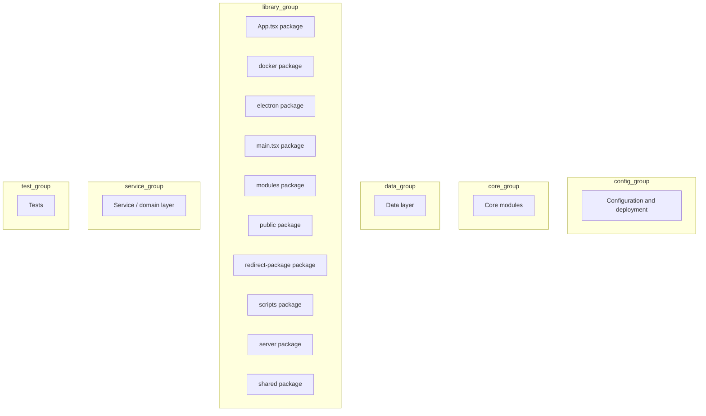

# Architecture report: siteboon/claudecodeui

> Automated static analysis. **Observed** = directly seen in files/imports/AST; **Inferred** = interpretation from that evidence. Repository code was not executed.

## 1. Repository at a glance

| Item | Value |
| --- | --- |
| Repository | siteboon/claudecodeui |
| Description | Use Claude Code, OpenCode, Cursor CLI, and Codex on mobile and web with CloudCLI (aka Claude Code UI). CloudCLI is a free open source webui/GUI that helps you manage your Claude Code session and projects remotely. |
| Language | TypeScript |
| Stars | 14611 |
| Licence | AGPL-3.0 |
| Analysed commit / branch | 7943e285fc814a54d5549a34b90fac0805135a24 / main |
| Framework(s) | Electron, Express, React |
| Files analysed | 800 |
| Components | 15 |

## 2. Architecture in one minute

siteboon/claudecodeui - Use Claude Code, OpenCode, Cursor CLI, and Codex on mobile and web with CloudCLI (aka Claude Code UI). CloudCLI is a free open source webui/GUI that helps you manage your Claude Code session and proj…. This repository was analysed statically from 800 file(s) (0 Python). Detected technologies (observed from imports/manifests): GitHub Actions, Electron, Express, React, React Router, Tailwind CSS. Files are grouped into 15 component(s): App.tsx package, Configuration and deployment, Core modules, Data layer, docker package, electron package, main.tsx package, modules package. Findings below distinguish observed facts from inferred interpretation.

## 3. High-level block diagram

## 4. Main components

### App.tsx package (`app_tsx`)

- **Kind:** library
- **Status:** Observed
- **Confidence:** 0.85
- **Responsibility:** Groups 1 file(s) under app.tsx package (observed from repository paths and static analysis).
- **Paths:** `src/App.tsx`
- **Evidence:** [src/App.tsx](https://github.com/siteboon/claudecodeui/blob/7943e285fc814a54d5549a34b90fac0805135a24/src/App.tsx)

### Configuration and deployment (`config`)

- **Kind:** config
- **Status:** Observed
- **Confidence:** 0.85
- **Responsibility:** Groups 74 file(s) under configuration and deployment (observed from repository paths and static analysis).
- **Paths:** `docker/claude-code/Dockerfile`, `docker/codex/Dockerfile`, `package.json`, `public/manifest.json`, `redirect-package/package.json`, `server/modules/settings/index.ts`, `server/modules/settings/settings.module.ts`, `server/modules/settings/settings.routes.ts`, `server/modules/settings/settings.service.ts`, `server/tsconfig.json`, `src/modules/chat/tools/configs/permissionPanelRegistry.ts`, `src/modules/chat/tools/configs/toolConfigs.ts`, `src/modules/i18n/locales/cs/auth.json`, `src/modules/i18n/locales/cs/chat.json`, `src/modules/i18n/locales/cs/codeEditor.json`, `src/modules/i18n/locales/cs/common.json`, `src/modules/i18n/locales/cs/git.json`, `src/modules/i18n/locales/cs/settings.json`, `src/modules/i18n/locales/cs/sidebar.json`, `src/modules/i18n/locales/cs/tasks.json`, `src/modules/i18n/locales/de/auth.json`, `src/modules/i18n/locales/de/chat.json`, `src/modules/i18n/locales/de/codeEditor.json`, `src/modules/i18n/locales/de/common.json`, `src/modules/i18n/locales/de/settings.json`, `src/modules/i18n/locales/de/sidebar.json`, `src/modules/i18n/locales/de/tasks.json`, `src/modules/i18n/locales/en/auth.json`, `src/modules/i18n/locales/en/chat.json`, `src/modules/i18n/locales/en/codeEditor.json`, `src/modules/i18n/locales/en/common.json`, `src/modules/i18n/locales/en/git.json`, `src/modules/i18n/locales/en/settings.json`, `src/modules/i18n/locales/en/sidebar.json`, `src/modules/i18n/locales/en/tasks.json`, `src/modules/i18n/locales/es/auth.json`, `src/modules/i18n/locales/es/chat.json`, `src/modules/i18n/locales/es/codeEditor.json`, `src/modules/i18n/locales/es/common.json`, `src/modules/i18n/locales/es/git.json`, `src/modules/i18n/locales/es/settings.json`, `src/modules/i18n/locales/es/sidebar.json`, `src/modules/i18n/locales/es/tasks.json`, `src/modules/i18n/locales/fr/auth.json`, `src/modules/i18n/locales/fr/chat.json`, `src/modules/i18n/locales/fr/codeEditor.json`, `src/modules/i18n/locales/fr/common.json`, `src/modules/i18n/locales/fr/settings.json`, `src/modules/i18n/locales/fr/sidebar.json`, `src/modules/i18n/locales/fr/tasks.json`, `src/modules/i18n/locales/he/auth.json`, `src/modules/i18n/locales/he/chat.json`, `src/modules/i18n/locales/he/codeEditor.json`, `src/modules/i18n/locales/he/common.json`, `src/modules/i18n/locales/he/git.json`, `src/modules/i18n/locales/he/settings.json`, `src/modules/i18n/locales/he/sidebar.json`, `src/modules/i18n/locales/he/tasks.json`, `src/modules/i18n/locales/id/auth.json`, `src/modules/i18n/locales/id/chat.json`, `src/modules/i18n/locales/id/codeEditor.json`, `src/modules/i18n/locales/id/common.json`, `src/modules/i18n/locales/id/git.json`, `src/modules/i18n/locales/id/settings.json`, `src/modules/i18n/locales/id/sidebar.json`, `src/modules/i18n/locales/id/tasks.json`, `src/modules/i18n/locales/it/auth.json`, `src/modules/i18n/locales/it/chat.json`, `src/modules/i18n/locales/it/codeEditor.json`, `src/modules/i18n/locales/it/common.json`, `src/modules/i18n/locales/it/settings.json`, `src/modules/i18n/locales/it/sidebar.json`, `src/modules/i18n/locales/it/tasks.json`, `src/modules/i18n/locales/ja/auth.json`
- **Evidence:** [docker/claude-code/Dockerfile](https://github.com/siteboon/claudecodeui/blob/7943e285fc814a54d5549a34b90fac0805135a24/docker/claude-code/Dockerfile); [docker/codex/Dockerfile](https://github.com/siteboon/claudecodeui/blob/7943e285fc814a54d5549a34b90fac0805135a24/docker/codex/Dockerfile); [package.json](https://github.com/siteboon/claudecodeui/blob/7943e285fc814a54d5549a34b90fac0805135a24/package.json); [public/manifest.json](https://github.com/siteboon/claudecodeui/blob/7943e285fc814a54d5549a34b90fac0805135a24/public/manifest.json); [redirect-package/package.json](https://github.com/siteboon/claudecodeui/blob/7943e285fc814a54d5549a34b90fac0805135a24/redirect-package/package.json); [server/modules/settings/index.ts](https://github.com/siteboon/claudecodeui/blob/7943e285fc814a54d5549a34b90fac0805135a24/server/modules/settings/index.ts); [server/modules/settings/settings.module.ts](https://github.com/siteboon/claudecodeui/blob/7943e285fc814a54d5549a34b90fac0805135a24/server/modules/settings/settings.module.ts); [server/modules/settings/settings.routes.ts](https://github.com/siteboon/claudecodeui/blob/7943e285fc814a54d5549a34b90fac0805135a24/server/modules/settings/settings.routes.ts)

### Core modules (`core`)

- **Kind:** core
- **Status:** Observed
- **Confidence:** 0.85
- **Responsibility:** Groups 3 file(s) under core modules (observed from repository paths and static analysis).
- **Paths:** `commitlint.config.js`, `postcss.config.js`, `release.sh`
- **Evidence:** [commitlint.config.js](https://github.com/siteboon/claudecodeui/blob/7943e285fc814a54d5549a34b90fac0805135a24/commitlint.config.js); [postcss.config.js](https://github.com/siteboon/claudecodeui/blob/7943e285fc814a54d5549a34b90fac0805135a24/postcss.config.js); [release.sh](https://github.com/siteboon/claudecodeui/blob/7943e285fc814a54d5549a34b90fac0805135a24/release.sh)

### Data layer (`data_layer`)

- **Kind:** data
- **Status:** Observed
- **Confidence:** 0.85
- **Responsibility:** Groups 21 file(s) under data layer (observed from repository paths and static analysis).
- **Paths:** `server/modules/database/connection.ts`, `server/modules/database/index.ts`, `server/modules/database/init-db.ts`, `server/modules/database/migrations.ts`, `server/modules/database/repositories/api-keys.ts`, `server/modules/database/repositories/app-config.ts`, `server/modules/database/repositories/credentials.ts`, `server/modules/database/repositories/github-tokens.ts`, `server/modules/database/repositories/notification-channel-endpoints.ts`, `server/modules/database/repositories/notification-preferences.ts`, `server/modules/database/repositories/projects.db.ts`, `server/modules/database/repositories/provider-models.ts`, `server/modules/database/repositories/push-subscriptions.ts`, `server/modules/database/repositories/scan-state.db.ts`, `server/modules/database/repositories/scheduled-messages.db.ts`, `server/modules/database/repositories/session-drafts.db.ts`, `server/modules/database/repositories/sessions.db.ts`, `server/modules/database/repositories/user-preferences.db.ts`, `server/modules/database/repositories/users.ts`, `server/modules/database/repositories/vapid-keys.ts`, `server/modules/database/schema.ts`
- **Evidence:** [server/modules/database/connection.ts](https://github.com/siteboon/claudecodeui/blob/7943e285fc814a54d5549a34b90fac0805135a24/server/modules/database/connection.ts); [server/modules/database/index.ts](https://github.com/siteboon/claudecodeui/blob/7943e285fc814a54d5549a34b90fac0805135a24/server/modules/database/index.ts); [server/modules/database/init-db.ts](https://github.com/siteboon/claudecodeui/blob/7943e285fc814a54d5549a34b90fac0805135a24/server/modules/database/init-db.ts); [server/modules/database/migrations.ts](https://github.com/siteboon/claudecodeui/blob/7943e285fc814a54d5549a34b90fac0805135a24/server/modules/database/migrations.ts); [server/modules/database/repositories/api-keys.ts](https://github.com/siteboon/claudecodeui/blob/7943e285fc814a54d5549a34b90fac0805135a24/server/modules/database/repositories/api-keys.ts); [server/modules/database/repositories/app-config.ts](https://github.com/siteboon/claudecodeui/blob/7943e285fc814a54d5549a34b90fac0805135a24/server/modules/database/repositories/app-config.ts); [server/modules/database/repositories/credentials.ts](https://github.com/siteboon/claudecodeui/blob/7943e285fc814a54d5549a34b90fac0805135a24/server/modules/database/repositories/credentials.ts); [server/modules/database/repositories/github-tokens.ts](https://github.com/siteboon/claudecodeui/blob/7943e285fc814a54d5549a34b90fac0805135a24/server/modules/database/repositories/github-tokens.ts)

### docker package (`docker`)

- **Kind:** library
- **Status:** Observed
- **Confidence:** 0.85
- **Responsibility:** Groups 2 file(s) under docker package (observed from repository paths and static analysis).
- **Paths:** `docker/shared/install-cloudcli.sh`, `docker/shared/start-cloudcli.sh`
- **Evidence:** [docker/shared/install-cloudcli.sh](https://github.com/siteboon/claudecodeui/blob/7943e285fc814a54d5549a34b90fac0805135a24/docker/shared/install-cloudcli.sh); [docker/shared/start-cloudcli.sh](https://github.com/siteboon/claudecodeui/blob/7943e285fc814a54d5549a34b90fac0805135a24/docker/shared/start-cloudcli.sh)

### electron package (`electron`)

- **Kind:** library
- **Status:** Observed
- **Confidence:** 0.85
- **Responsibility:** Groups 13 file(s) under electron package (observed from repository paths and static analysis).
- **Paths:** `electron/cloud.js`, `electron/desktopNotifications.js`, `electron/desktopWindow.js`, `electron/launcher/launcher.js`, `electron/localServer.js`, `electron/main.js`, `electron/preload.cjs`, `electron/scripts/generate-linux-icons.js`, `electron/scripts/generate-macos-icon.js`, `electron/scripts/logo-svg.js`, `electron/serverInstaller.js`, `electron/tabs.js`, `electron/viewHost.js`
- **Evidence:** [electron/cloud.js](https://github.com/siteboon/claudecodeui/blob/7943e285fc814a54d5549a34b90fac0805135a24/electron/cloud.js); [electron/desktopNotifications.js](https://github.com/siteboon/claudecodeui/blob/7943e285fc814a54d5549a34b90fac0805135a24/electron/desktopNotifications.js); [electron/desktopWindow.js](https://github.com/siteboon/claudecodeui/blob/7943e285fc814a54d5549a34b90fac0805135a24/electron/desktopWindow.js); [electron/launcher/launcher.js](https://github.com/siteboon/claudecodeui/blob/7943e285fc814a54d5549a34b90fac0805135a24/electron/launcher/launcher.js); [electron/localServer.js](https://github.com/siteboon/claudecodeui/blob/7943e285fc814a54d5549a34b90fac0805135a24/electron/localServer.js); [electron/main.js](https://github.com/siteboon/claudecodeui/blob/7943e285fc814a54d5549a34b90fac0805135a24/electron/main.js); [electron/preload.cjs](https://github.com/siteboon/claudecodeui/blob/7943e285fc814a54d5549a34b90fac0805135a24/electron/preload.cjs); [electron/scripts/generate-linux-icons.js](https://github.com/siteboon/claudecodeui/blob/7943e285fc814a54d5549a34b90fac0805135a24/electron/scripts/generate-linux-icons.js)

### main.tsx package (`main_tsx`)

- **Kind:** library
- **Status:** Observed
- **Confidence:** 0.85
- **Responsibility:** Groups 1 file(s) under main.tsx package (observed from repository paths and static analysis).
- **Paths:** `src/main.tsx`
- **Evidence:** [src/main.tsx](https://github.com/siteboon/claudecodeui/blob/7943e285fc814a54d5549a34b90fac0805135a24/src/main.tsx)

### modules package (`modules`)

- **Kind:** library
- **Status:** Observed
- **Confidence:** 0.85
- **Responsibility:** Groups 207 file(s) under modules package (observed from repository paths and static analysis).
- **Paths:** `src/modules/auth/AuthErrorAlert.tsx`, `src/modules/auth/AuthInputField.tsx`, `src/modules/auth/AuthLoadingScreen.tsx`, `src/modules/auth/AuthScreenLayout.tsx`, `src/modules/auth/LoginForm.tsx`, `src/modules/auth/ProtectedRoute.tsx`, `src/modules/auth/SetupForm.tsx`, `src/modules/auth/context/AuthContext.tsx`, `src/modules/auth/index.ts`, `src/modules/browser-use/BrowserUsePanel.tsx`, `src/modules/browser-use/hooks/useBrowserUseEnabled.ts`, `src/modules/browser-use/index.ts`, `src/modules/chat/ChatInterface.tsx`, `src/modules/chat/composer/ActivityIndicator.tsx`, `src/modules/chat/composer/BackgroundSendDialog.tsx`, `src/modules/chat/composer/ChatComposer.tsx`, `src/modules/chat/composer/CommandMenu.tsx`, `src/modules/chat/composer/ComposerAttachment.tsx`, `src/modules/chat/composer/ComposerMenuPrimitives.tsx`, `src/modules/chat/composer/ComposerModelMenu.tsx`, `src/modules/chat/composer/ComposerPermissionMenu.tsx`, `src/modules/chat/composer/ComposerSendMenu.tsx`, `src/modules/chat/composer/Confirmation.tsx`, `src/modules/chat/composer/ModelGroupList.tsx`, `src/modules/chat/composer/PermissionRequestsBanner.tsx`, `src/modules/chat/composer/PromptInput.tsx`, `src/modules/chat/composer/QueuedMessageCard.tsx`, `src/modules/chat/composer/ScheduleMessagePopover.tsx`, `src/modules/chat/composer/ScheduledMessageList.tsx`, `src/modules/chat/composer/SteeredMessageCard.tsx`, `src/modules/chat/composer/TokenUsageSummary.tsx`, `src/modules/chat/composer/VoiceInputButton.tsx`, `src/modules/chat/composer/useScheduledMessages.ts`, `src/modules/chat/context/MarkdownWorkspaceContext.ts`, `src/modules/chat/context/PermissionContext.tsx`, `src/modules/chat/context/TranscriptRenderContext.ts`, `src/modules/chat/context/TranscriptSessionContext.ts`, `src/modules/chat/export/TranscriptExportDocument.tsx`, `src/modules/chat/export/buildTranscriptHtml.tsx`, `src/modules/chat/export/buildTranscriptMarkdown.ts`, `src/modules/chat/hooks/useChatComposerState.ts`, `src/modules/chat/hooks/useChatMessages.ts`, `src/modules/chat/hooks/useChatProviderState.ts`, `src/modules/chat/hooks/useChatRealtimeHandlers.ts`, `src/modules/chat/hooks/useChatSessionState.ts`, `src/modules/chat/hooks/useComposerMenuAnchor.ts`, `src/modules/chat/hooks/useFileMentions.tsx`, `src/modules/chat/hooks/useInputHistory.ts`, `src/modules/chat/hooks/useLazyRowObserver.ts`, `src/modules/chat/hooks/usePermissionNameFit.ts`, `src/modules/chat/hooks/useSessionStore.ts`, `src/modules/chat/hooks/useSideQuestions.ts`, `src/modules/chat/hooks/useSlashCommands.ts`, `src/modules/chat/hooks/useTts.ts`, `src/modules/chat/hooks/useVoiceAvailable.ts`, `src/modules/chat/hooks/useVoiceInput.ts`, `src/modules/chat/index.ts`, `src/modules/chat/modals/CommandResultModal.tsx`, `src/modules/chat/modals/ModelLibraryPanel.tsx`, `src/modules/chat/tools/BashCommandDisplay.tsx`, `src/modules/chat/tools/BashEditDiff.tsx`, `src/modules/chat/tools/CollapsibleDisplay.tsx`, `src/modules/chat/tools/CollapsibleSection.tsx`, `src/modules/chat/tools/ContentRenderers/FileListContent.tsx`, `src/modules/chat/tools/ContentRenderers/MarkdownContent.tsx`, `src/modules/chat/tools/ContentRenderers/QuestionAnswerContent.tsx`, `src/modules/chat/tools/ContentRenderers/TaskListContent.tsx`, `src/modules/chat/tools/ContentRenderers/TextContent.tsx`, `src/modules/chat/tools/ContentRenderers/TodoList.tsx`, `src/modules/chat/tools/ContentRenderers/TodoListContent.tsx`, `src/modules/chat/tools/DiffStatsBadge.tsx`, `src/modules/chat/tools/InteractiveRenderers/AskUserQuestionPanel.tsx`, `src/modules/chat/tools/InteractiveRenderers/McpElicitationPanel.tsx`, `src/modules/chat/tools/OneLineDisplay.tsx`, `src/modules/chat/tools/PlanDisplay.tsx`, `src/modules/chat/tools/Queue.tsx`, `src/modules/chat/tools/SubagentPanel.tsx`, `src/modules/chat/tools/SubagentTimeline.tsx`, `src/modules/chat/tools/ToolDiffViewer.tsx`, `src/modules/chat/tools/ToolErrorDisplay.tsx`, `src/modules/chat/tools/ToolRenderer.tsx`, `src/modules/chat/tools/ToolStatusBadge.tsx`, `src/modules/chat/tools/WorkflowPanel.tsx`, `src/modules/chat/tools/index.ts`, `src/modules/chat/transcript/BackgroundTasksStrip.tsx`, `src/modules/chat/transcript/ChatExportMenu.tsx`, `src/modules/chat/transcript/ChatMessageFiles.tsx`, `src/modules/chat/transcript/ChatMessageImages.tsx`, `src/modules/chat/transcript/ChatMessagesPane.tsx`, `src/modules/chat/transcript/LazyMessageRow.tsx`, `src/modules/chat/transcript/LoadAllMessagesOverlay.tsx`, `src/modules/chat/transcript/Markdown.tsx`, `src/modules/chat/transcript/MarkdownImage.tsx`, `src/modules/chat/transcript/MemoryCitations.tsx`, `src/modules/chat/transcript/MessageComponent.tsx`, `src/modules/chat/transcript/MessageCopyControl.tsx`, `src/modules/chat/transcript/MessageModelLabel.tsx`, `src/modules/chat/transcript/MessageSpeakControl.tsx`, `src/modules/chat/transcript/ProviderSelectionEmptyState.tsx`, `src/modules/chat/transcript/Reasoning.tsx`, `src/modules/chat/transcript/StreamingMarkdown.tsx`, `src/modules/chat/transcript/ToolGroupContainer.tsx`, `src/modules/chat/utils/backgroundTasks.ts`, `src/modules/chat/utils/chatExport.ts`, `src/modules/chat/utils/chatFormatting.ts`, `src/modules/chat/utils/chatPermissions.ts`, `src/modules/chat/utils/chatStorage.ts`, `src/modules/chat/utils/latexDelimiters.ts`, `src/modules/chat/utils/messageHistoryRefreshCoordinator.ts`, `src/modules/chat/utils/messageKeys.ts`, `src/modules/chat/utils/messageTransforms.ts`, `src/modules/chat/utils/modelLabel.ts`, `src/modules/chat/utils/pageTitleNotification.ts`, `src/modules/chat/utils/searchTargetLocator.ts`, `src/modules/chat/utils/sessionMessagePagination.ts`, `src/modules/chat/utils/sessionMessageReconciliation.ts`, `src/modules/chat/utils/sideQuestions.ts`, `src/modules/chat/utils/streamingMarkdown.ts`, `src/modules/chat/utils/syntaxHighlightTheme.ts`, `src/modules/chat/utils/toolGrouping.ts`, `src/modules/chat/utils/voicePlayer.ts`, `src/modules/chat/utils/workflowScriptMeta.ts`, `src/modules/code-editor/CodeEditor.tsx`, `src/modules/code-editor/CodeEditorBinaryFile.tsx`, `src/modules/code-editor/CodeEditorFooter.tsx`, `src/modules/code-editor/CodeEditorHeader.tsx`, `src/modules/code-editor/CodeEditorLoadingState.tsx`, `src/modules/code-editor/CodeEditorMediaPreview.tsx`, `src/modules/code-editor/CodeEditorSurface.tsx`, `src/modules/code-editor/EditorSidebar.tsx`, `src/modules/code-editor/hooks/useCodeEditorDocument.ts`, `src/modules/code-editor/hooks/useCodeEditorSettings.ts`, `src/modules/code-editor/hooks/useEditorKeyboardShortcuts.ts`, `src/modules/code-editor/hooks/useEditorSidebar.ts`, `src/modules/code-editor/index.ts`, `src/modules/code-editor/markdown/MarkdownCodeBlock.tsx`, `src/modules/code-editor/markdown/MarkdownPreview.tsx`, `src/modules/code-editor/markdown/MermaidDiagram.tsx`, `src/modules/code-editor/utils/binaryFile.ts`, `src/modules/code-editor/utils/editorExtensions.ts`, `src/modules/code-editor/utils/editorStyles.ts`, `src/modules/code-editor/utils/editorToolbarPanel.ts`, `src/modules/code-editor/utils/previewableFile.ts`, `src/modules/command-palette/CommandPalette.tsx`, `src/modules/command-palette/context/PaletteOpsContext.tsx`, `src/modules/command-palette/hooks/useApiSource.ts`, `src/modules/command-palette/hooks/useBranchesSource.ts`, `src/modules/command-palette/hooks/useCommitsSource.ts`, `src/modules/command-palette/hooks/useFilesSource.ts`, `src/modules/command-palette/hooks/useGitActions.ts`, `src/modules/command-palette/hooks/useSessionMessageSearch.ts`, `src/modules/command-palette/hooks/useSessionsSource.ts`, `src/modules/command-palette/index.ts`, `src/modules/file-tree/FileContextMenu.tsx`, `src/modules/file-tree/FileTree.tsx`, `src/modules/file-tree/FileTreeBody.tsx`, `src/modules/file-tree/FileTreeDetailedColumns.tsx`, `src/modules/file-tree/FileTreeEmptyState.tsx`, `src/modules/file-tree/FileTreeHeader.tsx`, `src/modules/file-tree/FileTreeList.tsx`, `src/modules/file-tree/FileTreeLoadingState.tsx`, `src/modules/file-tree/FileTreeNode.tsx`, `src/modules/file-tree/FileTreeUploadProgress.tsx`, `src/modules/file-tree/ImageViewer.tsx`, `src/modules/file-tree/hooks/useExpandedDirectories.ts`, `src/modules/file-tree/hooks/useFileTreeData.ts`, `src/modules/file-tree/hooks/useFileTreeOperations.ts`, `src/modules/file-tree/hooks/useFileTreeSearch.ts`, `src/modules/file-tree/hooks/useFileTreeUpload.ts`, `src/modules/file-tree/hooks/useFileTreeViewMode.ts`, `src/modules/file-tree/index.ts`, `src/modules/file-tree/utils/fileIcons.ts`, `src/modules/file-tree/utils/fileTreeUtils.ts`, `src/modules/file-tree/utils/revealDirectory.ts`, `src/modules/git-panel/GitDiffViewer.tsx`, `src/modules/git-panel/GitPanel.tsx`, `src/modules/git-panel/GitPanelHeader.tsx`, `src/modules/git-panel/GitRepositoryErrorState.tsx`, `src/modules/git-panel/GitViewTabs.tsx`, `src/modules/git-panel/branches/BranchesView.tsx`, `src/modules/git-panel/changes/ChangesView.tsx`, `src/modules/git-panel/changes/CommitComposer.tsx`, `src/modules/git-panel/changes/FileChangeItem.tsx`, `src/modules/git-panel/changes/FileChangeList.tsx`, `src/modules/git-panel/changes/FileStatusLegend.tsx`, `src/modules/git-panel/compare/CompareFileItem.tsx`, `src/modules/git-panel/compare/CompareView.tsx`, `src/modules/git-panel/history/CommitGraphStrip.tsx`, `src/modules/git-panel/history/CommitHistoryItem.tsx`, `src/modules/git-panel/history/HistoryView.tsx`, `src/modules/git-panel/hooks/useBranchCompare.ts`, `src/modules/git-panel/hooks/useGitPanelController.ts`, `src/modules/git-panel/hooks/useRevertLocalCommit.ts`, `src/modules/git-panel/hooks/useWorktreesController.ts`, `src/modules/git-panel/index.ts`, `src/modules/git-panel/modals/ConfirmActionModal.tsx`, `src/modules/git-panel/modals/MergeWorktreeModal.tsx`, `src/modules/git-panel/modals/NewBranchModal.tsx`, `src/modules/git-panel/modals/NewWorktreeModal.tsx`, `src/modules/git-panel/modals/RemoveWorktreeModal.tsx`, `src/modules/git-panel/utils/commitGraph.ts`, `src/modules/git-panel/utils/gitPanelUtils.ts`, `src/modules/git-panel/worktrees/WorktreesView.tsx`, `src/modules/i18n/LanguageSelector.tsx`, `src/modules/i18n/config.ts`, `src/modules/i18n/index.ts`, `src/modules/i18n/languages.ts`
- **Evidence:** [src/modules/auth/AuthErrorAlert.tsx](https://github.com/siteboon/claudecodeui/blob/7943e285fc814a54d5549a34b90fac0805135a24/src/modules/auth/AuthErrorAlert.tsx); [src/modules/auth/AuthInputField.tsx](https://github.com/siteboon/claudecodeui/blob/7943e285fc814a54d5549a34b90fac0805135a24/src/modules/auth/AuthInputField.tsx); [src/modules/auth/AuthLoadingScreen.tsx](https://github.com/siteboon/claudecodeui/blob/7943e285fc814a54d5549a34b90fac0805135a24/src/modules/auth/AuthLoadingScreen.tsx); [src/modules/auth/AuthScreenLayout.tsx](https://github.com/siteboon/claudecodeui/blob/7943e285fc814a54d5549a34b90fac0805135a24/src/modules/auth/AuthScreenLayout.tsx); [src/modules/auth/LoginForm.tsx](https://github.com/siteboon/claudecodeui/blob/7943e285fc814a54d5549a34b90fac0805135a24/src/modules/auth/LoginForm.tsx); [src/modules/auth/ProtectedRoute.tsx](https://github.com/siteboon/claudecodeui/blob/7943e285fc814a54d5549a34b90fac0805135a24/src/modules/auth/ProtectedRoute.tsx); [src/modules/auth/SetupForm.tsx](https://github.com/siteboon/claudecodeui/blob/7943e285fc814a54d5549a34b90fac0805135a24/src/modules/auth/SetupForm.tsx); [src/modules/auth/context/AuthContext.tsx](https://github.com/siteboon/claudecodeui/blob/7943e285fc814a54d5549a34b90fac0805135a24/src/modules/auth/context/AuthContext.tsx)

### public package (`public`)

- **Kind:** library
- **Status:** Observed
- **Confidence:** 0.85
- **Responsibility:** Groups 2 file(s) under public package (observed from repository paths and static analysis).
- **Paths:** `public/generate-icons.js`, `public/sw.js`
- **Evidence:** [public/generate-icons.js](https://github.com/siteboon/claudecodeui/blob/7943e285fc814a54d5549a34b90fac0805135a24/public/generate-icons.js); [public/sw.js](https://github.com/siteboon/claudecodeui/blob/7943e285fc814a54d5549a34b90fac0805135a24/public/sw.js)

### redirect-package package (`redirect_package`)

- **Kind:** library
- **Status:** Observed
- **Confidence:** 0.85
- **Responsibility:** Groups 2 file(s) under redirect-package package (observed from repository paths and static analysis).
- **Paths:** `redirect-package/bin.js`, `redirect-package/index.js`
- **Evidence:** [redirect-package/bin.js](https://github.com/siteboon/claudecodeui/blob/7943e285fc814a54d5549a34b90fac0805135a24/redirect-package/bin.js); [redirect-package/index.js](https://github.com/siteboon/claudecodeui/blob/7943e285fc814a54d5549a34b90fac0805135a24/redirect-package/index.js)

### scripts package (`scripts`)

- **Kind:** library
- **Status:** Observed
- **Confidence:** 0.85
- **Responsibility:** Groups 4 file(s) under scripts package (observed from repository paths and static analysis).
- **Paths:** `scripts/fix-node-pty.js`, `scripts/promote-dist-server.mjs`, `scripts/release/build-server-bundle.js`, `scripts/release/prepare-desktop-app.js`
- **Evidence:** [scripts/fix-node-pty.js](https://github.com/siteboon/claudecodeui/blob/7943e285fc814a54d5549a34b90fac0805135a24/scripts/fix-node-pty.js); [scripts/promote-dist-server.mjs](https://github.com/siteboon/claudecodeui/blob/7943e285fc814a54d5549a34b90fac0805135a24/scripts/promote-dist-server.mjs); [scripts/release/build-server-bundle.js](https://github.com/siteboon/claudecodeui/blob/7943e285fc814a54d5549a34b90fac0805135a24/scripts/release/build-server-bundle.js); [scripts/release/prepare-desktop-app.js](https://github.com/siteboon/claudecodeui/blob/7943e285fc814a54d5549a34b90fac0805135a24/scripts/release/prepare-desktop-app.js)

### server package (`server`)

- **Kind:** library
- **Status:** Observed
- **Confidence:** 0.85
- **Responsibility:** Groups 124 file(s) under server package (observed from repository paths and static analysis).
- **Paths:** `server/index.ts`, `server/load-env.ts`, `server/modules/agent/agent.module.ts`, `server/modules/agent/agent.routes.ts`, `server/modules/agent/index.ts`, `server/modules/assets/assets.routes.ts`, `server/modules/assets/index.ts`, `server/modules/auth/auth.middleware.ts`, `server/modules/auth/auth.module.ts`, `server/modules/auth/auth.routes.ts`, `server/modules/auth/auth.service.ts`, `server/modules/auth/index.ts`, `server/modules/browser-use/browser-use-mcp.routes.ts`, `server/modules/browser-use/browser-use-mcp.ts`, `server/modules/browser-use/browser-use-runtime.ts`, `server/modules/browser-use/browser-use.routes.ts`, `server/modules/browser-use/browser-use.service.ts`, `server/modules/browser-use/index.ts`, `server/modules/cli/cli.module.ts`, `server/modules/cli/cli.service.ts`, `server/modules/cli/cli.ts`, `server/modules/cli/index.ts`, `server/modules/cli/sandbox.service.ts`, `server/modules/commands/commands.module.ts`, `server/modules/commands/commands.routes.ts`, `server/modules/commands/index.ts`, `server/modules/file-tree/file-tree.module.ts`, `server/modules/file-tree/file-tree.routes.ts`, `server/modules/file-tree/file-tree.service.ts`, `server/modules/file-tree/index.ts`, `server/modules/git/git-branch-diff.service.ts`, `server/modules/git/git-branch.service.ts`, `server/modules/git/git-parsing.service.ts`, `server/modules/git/git.module.ts`, `server/modules/git/git.routes.ts`, `server/modules/git/index.ts`, `server/modules/notifications/index.ts`, `server/modules/notifications/notifications.routes.ts`, `server/modules/notifications/vapid-keys.service.ts`, `server/modules/notifications/websocket/desktop-notifications-websocket.service.ts`, `server/modules/plugins/index.ts`, `server/modules/plugins/plugin-git.service.ts`, `server/modules/plugins/plugin-process.service.ts`, `server/modules/plugins/plugin-registry.service.ts`, `server/modules/plugins/plugins.module.ts`, `server/modules/plugins/plugins.routes.ts`, `server/modules/plugins/plugins.service.ts`, `server/modules/projects/index.ts`, `server/modules/projects/project-clone.routes.ts`, `server/modules/projects/projects.routes.ts`, `server/modules/providers/index.ts`, `server/modules/providers/list/claude/claude-auth.provider.ts`, `server/modules/providers/list/claude/claude-fork.provider.ts`, `server/modules/providers/list/claude/claude-mcp.provider.ts`, `server/modules/providers/list/claude/claude-models.provider.ts`, `server/modules/providers/list/claude/claude-runtime.provider.ts`, `server/modules/providers/list/claude/claude-session-synchronizer.provider.ts`, `server/modules/providers/list/claude/claude-sessions.provider.ts`, `server/modules/providers/list/claude/claude-side-question.provider.ts`, `server/modules/providers/list/claude/claude-skills.provider.ts`, `server/modules/providers/list/claude/claude.provider.ts`, `server/modules/providers/list/codex/codex-app-server.client.ts`, `server/modules/providers/list/codex/codex-auth.provider.ts`, `server/modules/providers/list/codex/codex-fork.provider.ts`, `server/modules/providers/list/codex/codex-mcp.provider.ts`, `server/modules/providers/list/codex/codex-models.provider.ts`, `server/modules/providers/list/codex/codex-runtime.provider.ts`, `server/modules/providers/list/codex/codex-session-synchronizer.provider.ts`, `server/modules/providers/list/codex/codex-sessions.provider.ts`, `server/modules/providers/list/codex/codex-skills.provider.ts`, `server/modules/providers/list/codex/codex.provider.ts`, `server/modules/providers/list/cursor/cursor-auth.provider.ts`, `server/modules/providers/list/cursor/cursor-mcp.provider.ts`, `server/modules/providers/list/cursor/cursor-models.provider.ts`, `server/modules/providers/list/cursor/cursor-runtime.provider.js`, `server/modules/providers/list/cursor/cursor-session-synchronizer.provider.ts`, `server/modules/providers/list/cursor/cursor-sessions.provider.ts`, `server/modules/providers/list/cursor/cursor-skills.provider.ts`, `server/modules/providers/list/cursor/cursor.provider.ts`, `server/modules/providers/list/opencode/opencode-auth.provider.ts`, `server/modules/providers/list/opencode/opencode-config.ts`, `server/modules/providers/list/opencode/opencode-mcp.provider.ts`, `server/modules/providers/list/opencode/opencode-models.provider.ts`, `server/modules/providers/list/opencode/opencode-runtime.provider.ts`, `server/modules/providers/list/opencode/opencode-session-synchronizer.provider.ts`, `server/modules/providers/list/opencode/opencode-sessions.provider.ts`, `server/modules/providers/list/opencode/opencode-side-question-forks.ts`, `server/modules/providers/list/opencode/opencode-skills.provider.ts`, `server/modules/providers/list/opencode/opencode.provider.ts`, `server/modules/providers/provider.registry.ts`, `server/modules/providers/provider.routes.ts`, `server/modules/providers/shared/base/abstract.provider.ts`, `server/modules/providers/shared/mcp/mcp.provider.ts`, `server/modules/providers/shared/skills/skills.provider.ts`, `server/modules/scheduled-messages/index.ts`, `server/modules/scheduled-messages/scheduled-messages.routes.ts`, `server/modules/system/index.ts`, `server/modules/system/system.module.ts`, `server/modules/system/system.routes.ts`, `server/modules/system/system.service.ts`, `server/modules/taskmaster/index.ts`, `server/modules/taskmaster/taskmaster.module.ts`, `server/modules/taskmaster/taskmaster.routes.ts`, `server/modules/taskmaster/taskmaster.service.ts`, `server/modules/user/index.ts`, `server/modules/user/user.module.ts`, `server/modules/user/user.routes.ts`, `server/modules/user/user.service.ts`, `server/modules/voice/index.ts`, `server/modules/voice/voice.module.ts`, `server/modules/voice/voice.routes.ts`, `server/modules/voice/voice.service.ts`, `server/modules/websocket/index.ts`, `server/modules/worktrees/index.ts`, `server/modules/worktrees/worktrees.module.ts`, `server/modules/worktrees/worktrees.routes.ts`, `server/shared/claude-cli-path.ts`, `server/shared/frontmatter.ts`, `server/shared/image-attachments.ts`, `server/shared/index.ts`, `server/shared/interfaces.ts`, `server/shared/message-unification.ts`, `server/shared/types.ts`, `server/shared/utils.ts`
- **Evidence:** [server/index.ts](https://github.com/siteboon/claudecodeui/blob/7943e285fc814a54d5549a34b90fac0805135a24/server/index.ts); [server/load-env.ts](https://github.com/siteboon/claudecodeui/blob/7943e285fc814a54d5549a34b90fac0805135a24/server/load-env.ts); [server/modules/agent/agent.module.ts](https://github.com/siteboon/claudecodeui/blob/7943e285fc814a54d5549a34b90fac0805135a24/server/modules/agent/agent.module.ts); [server/modules/agent/agent.routes.ts](https://github.com/siteboon/claudecodeui/blob/7943e285fc814a54d5549a34b90fac0805135a24/server/modules/agent/agent.routes.ts); [server/modules/agent/index.ts](https://github.com/siteboon/claudecodeui/blob/7943e285fc814a54d5549a34b90fac0805135a24/server/modules/agent/index.ts); [server/modules/assets/assets.routes.ts](https://github.com/siteboon/claudecodeui/blob/7943e285fc814a54d5549a34b90fac0805135a24/server/modules/assets/assets.routes.ts); [server/modules/assets/index.ts](https://github.com/siteboon/claudecodeui/blob/7943e285fc814a54d5549a34b90fac0805135a24/server/modules/assets/index.ts); [server/modules/auth/auth.middleware.ts](https://github.com/siteboon/claudecodeui/blob/7943e285fc814a54d5549a34b90fac0805135a24/server/modules/auth/auth.middleware.ts)

### Service / domain layer (`service_layer`)

- **Kind:** service
- **Status:** Observed
- **Confidence:** 0.85
- **Responsibility:** Groups 47 file(s) under service / domain layer (observed from repository paths and static analysis).
- **Paths:** `server/modules/assets/services/image-assets.service.ts`, `server/modules/notifications/services/desktop-notification-clients.service.ts`, `server/modules/notifications/services/notification-orchestrator.service.js`, `server/modules/notifications/services/webhook-notifications.service.ts`, `server/modules/projects/services/project-clone-request.service.ts`, `server/modules/projects/services/project-clone.service.ts`, `server/modules/projects/services/project-delete.service.ts`, `server/modules/projects/services/project-management.service.ts`, `server/modules/projects/services/project-star.service.ts`, `server/modules/projects/services/projects-has-taskmaster.service.ts`, `server/modules/projects/services/projects-with-sessions-fetch.service.ts`, `server/modules/providers/services/claude-cli-liveness.service.ts`, `server/modules/providers/services/claude-settings-permissions.service.ts`, `server/modules/providers/services/mcp.service.ts`, `server/modules/providers/services/provider-auth.service.ts`, `server/modules/providers/services/provider-capabilities.service.ts`, `server/modules/providers/services/provider-cli.service.ts`, `server/modules/providers/services/provider-models.service.ts`, `server/modules/providers/services/provider-runtime.service.ts`, `server/modules/providers/services/provider-token-usage.service.ts`, `server/modules/providers/services/session-conversations-search.service.ts`, `server/modules/providers/services/session-history-cache.service.ts`, `server/modules/providers/services/session-synchronizer.service.ts`, `server/modules/providers/services/sessions-watcher.service.ts`, `server/modules/providers/services/sessions.service.ts`, `server/modules/providers/services/side-questions.service.ts`, `server/modules/providers/services/side-questions.store.ts`, `server/modules/providers/services/skills.service.ts`, `server/modules/scheduled-messages/services/scheduled-message-dispatcher.service.ts`, `server/modules/scheduled-messages/services/scheduled-messages.service.ts`, `server/modules/websocket/services/chat-run-registry.service.ts`, `server/modules/websocket/services/chat-session-writer.service.ts`, `server/modules/websocket/services/chat-websocket.service.ts`, `server/modules/websocket/services/plugin-websocket-proxy.service.ts`, `server/modules/websocket/services/session-upsert-broadcast.service.ts`, `server/modules/websocket/services/shell-websocket.service.ts`, `server/modules/websocket/services/websocket-auth.service.ts`, `server/modules/websocket/services/websocket-server.service.ts`, `server/modules/websocket/services/websocket-state.service.ts`, `server/modules/websocket/services/websocket-writer.service.ts`, `server/modules/worktrees/services/worktree-create-and-open.service.ts`, `server/modules/worktrees/services/worktree-create.service.ts`, `server/modules/worktrees/services/worktree-git.service.ts`, `server/modules/worktrees/services/worktree-list.service.ts`, `server/modules/worktrees/services/worktree-merge.service.ts`, `server/modules/worktrees/services/worktree-open.service.ts`, `server/modules/worktrees/services/worktree-remove.service.ts`
- **Evidence:** [server/modules/assets/services/image-assets.service.ts](https://github.com/siteboon/claudecodeui/blob/7943e285fc814a54d5549a34b90fac0805135a24/server/modules/assets/services/image-assets.service.ts); [server/modules/notifications/services/desktop-notification-clients.service.ts](https://github.com/siteboon/claudecodeui/blob/7943e285fc814a54d5549a34b90fac0805135a24/server/modules/notifications/services/desktop-notification-clients.service.ts); [server/modules/notifications/services/notification-orchestrator.service.js](https://github.com/siteboon/claudecodeui/blob/7943e285fc814a54d5549a34b90fac0805135a24/server/modules/notifications/services/notification-orchestrator.service.js); [server/modules/notifications/services/webhook-notifications.service.ts](https://github.com/siteboon/claudecodeui/blob/7943e285fc814a54d5549a34b90fac0805135a24/server/modules/notifications/services/webhook-notifications.service.ts); [server/modules/projects/services/project-clone-request.service.ts](https://github.com/siteboon/claudecodeui/blob/7943e285fc814a54d5549a34b90fac0805135a24/server/modules/projects/services/project-clone-request.service.ts); [server/modules/projects/services/project-clone.service.ts](https://github.com/siteboon/claudecodeui/blob/7943e285fc814a54d5549a34b90fac0805135a24/server/modules/projects/services/project-clone.service.ts); [server/modules/projects/services/project-delete.service.ts](https://github.com/siteboon/claudecodeui/blob/7943e285fc814a54d5549a34b90fac0805135a24/server/modules/projects/services/project-delete.service.ts); [server/modules/projects/services/project-management.service.ts](https://github.com/siteboon/claudecodeui/blob/7943e285fc814a54d5549a34b90fac0805135a24/server/modules/projects/services/project-management.service.ts)

### shared package (`shared`)

- **Kind:** library
- **Status:** Observed
- **Confidence:** 0.85
- **Responsibility:** Groups 1 file(s) under shared package (observed from repository paths and static analysis).
- **Paths:** `shared/networkHosts.js`
- **Evidence:** [shared/networkHosts.js](https://github.com/siteboon/claudecodeui/blob/7943e285fc814a54d5549a34b90fac0805135a24/shared/networkHosts.js)

### Tests (`tests`)

- **Kind:** test
- **Status:** Observed
- **Confidence:** 0.85
- **Responsibility:** Groups 226 file(s) under tests (observed from repository paths and static analysis).
- **Paths:** `server/modules/agent/tests/agent-run-registration.test.ts`, `server/modules/agent/tests/agent.routes.test.ts`, `server/modules/assets/tests/image-assets.service.test.ts`, `server/modules/auth/tests/auth.service.test.ts`, `server/modules/browser-use/tests/browser-use.service.test.ts`, `server/modules/browser-use/tests/browser-use.upload.test.ts`, `server/modules/cli/tests/cli-environment-bootstrap.test.ts`, `server/modules/cli/tests/cli.service.test.ts`, `server/modules/cli/tests/sandbox.service.test.ts`, `server/modules/commands/tests/commands.test.ts`, `server/modules/commands/tests/customCommandArguments.test.ts`, `server/modules/database/tests/projects.db.integration.test.ts`, `server/modules/database/tests/provider-models.db.integration.test.ts`, `server/modules/database/tests/sessions-provider-mapping.test.ts`, `server/modules/database/tests/sessions.db.integration.test.ts`, `server/modules/database/tests/user-preferences.db.integration.test.ts`, `server/modules/file-tree/tests/file-tree.routes.test.ts`, `server/modules/file-tree/tests/file-tree.service.test.ts`, `server/modules/git/tests/git-branch-diff.service.test.ts`, `server/modules/git/tests/git-branch.service.test.ts`, `server/modules/git/tests/git-init.routes.test.ts`, `server/modules/git/tests/git.test.ts`, `server/modules/notifications/tests/notification-orchestrator.integration.test.ts`, `server/modules/notifications/tests/webhook-notifications.routes.test.ts`, `server/modules/notifications/tests/webhook-notifications.service.test.ts`, `server/modules/plugins/tests/plugin-git-failures.test.ts`, `server/modules/plugins/tests/plugins.service.test.ts`, `server/modules/projects/tests/project-clone.routes.test.ts`, `server/modules/projects/tests/project-clone.service.test.ts`, `server/modules/projects/tests/project-management.service.test.ts`, `server/modules/projects/tests/project-session-forks.test.ts`, `server/modules/projects/tests/project-star.service.test.ts`, `server/modules/projects/tests/projects-has-taskmaster.service.test.ts`, `server/modules/providers/tests/claude-api-request-log.test.ts`, `server/modules/providers/tests/claude-auth.test.ts`, `server/modules/providers/tests/claude-background-work.test.ts`, `server/modules/providers/tests/claude-compaction.test.ts`, `server/modules/providers/tests/claude-context-window.test.ts`, `server/modules/providers/tests/claude-elicitation.test.ts`, `server/modules/providers/tests/claude-message-model.test.ts`, `server/modules/providers/tests/claude-models.test.ts`, `server/modules/providers/tests/claude-native-side-question.test.ts`, `server/modules/providers/tests/claude-pasted-content.test.ts`, `server/modules/providers/tests/claude-runtime-hold.test.ts`, `server/modules/providers/tests/claude-sdk-env.test.ts`, `server/modules/providers/tests/claude-sessions.test.ts`, `server/modules/providers/tests/claude-settings-permissions.test.ts`, `server/modules/providers/tests/claude-side-question-hold.test.ts`, `server/modules/providers/tests/claude-side-question.test.ts`, `server/modules/providers/tests/claude-steer.test.ts`, `server/modules/providers/tests/claude-subagent-echo.test.ts`, `server/modules/providers/tests/claude-token-budget.test.ts`, `server/modules/providers/tests/codex-fork-history.test.ts`, `server/modules/providers/tests/codex-message-editing.test.ts`, `server/modules/providers/tests/codex-models.test.ts`, `server/modules/providers/tests/codex-runtime.test.ts`, `server/modules/providers/tests/codex-session-fork.test.ts`, `server/modules/providers/tests/codex-sessions.test.ts`, `server/modules/providers/tests/codex-side-question.test.ts`, `server/modules/providers/tests/cursor-auth.test.ts`, `server/modules/providers/tests/fixtures/fake-opencode-serve.ts`, `server/modules/providers/tests/mcp.test.ts`, `server/modules/providers/tests/opencode-auth-config.test.ts`, `server/modules/providers/tests/opencode-history-pages.test.ts`, `server/modules/providers/tests/opencode-models.test.ts`, `server/modules/providers/tests/opencode-runtime.test.ts`, `server/modules/providers/tests/opencode-sessions.test.ts`, `server/modules/providers/tests/opencode-side-question.test.ts`, `server/modules/providers/tests/opencode-subagents.test.ts`, `server/modules/providers/tests/provider-abort-notifications.test.ts`, `server/modules/providers/tests/provider-attachment-history.test.ts`, `server/modules/providers/tests/provider-capabilities.service.test.ts`, `server/modules/providers/tests/provider-cli.service.test.ts`, `server/modules/providers/tests/provider-models.service.test.ts`, `server/modules/providers/tests/provider-runtime-side-question.test.ts`, `server/modules/providers/tests/provider-runtime.service.test.ts`, `server/modules/providers/tests/provider-token-usage.service.test.ts`, `server/modules/providers/tests/provider.routes.test.ts`, `server/modules/providers/tests/session-context-clear.test.ts`, `server/modules/providers/tests/session-fork.test.ts`, `server/modules/providers/tests/session-history-cache.service.test.ts`, `server/modules/providers/tests/session-orphan-prune.test.ts`, `server/modules/providers/tests/session-synchronizer-coalescing.test.ts`, `server/modules/providers/tests/sessions-details.test.ts`, `server/modules/providers/tests/sessions-watcher.test.ts`, `server/modules/providers/tests/sessions.service.test.ts`, `server/modules/providers/tests/side-conversation-instructions.test.ts`, `server/modules/providers/tests/side-questions-dismiss-regression.test.ts`, `server/modules/providers/tests/side-questions.routes.test.ts`, `server/modules/providers/tests/side-questions.service.test.ts`, `server/modules/providers/tests/skills.test.ts`, `server/modules/scheduled-messages/tests/scheduled-messages.test.ts`, `server/modules/settings/tests/settings.service.test.ts`, `server/modules/system/tests/system.service.test.ts`, `server/modules/taskmaster/tests/taskmaster.routes.test.ts`, `server/modules/taskmaster/tests/taskmaster.service.test.ts`, `server/modules/user/tests/user.routes.test.ts`, `server/modules/user/tests/user.service.test.ts`, `server/modules/voice/tests/voice.service.test.ts`, `server/modules/websocket/tests/chat-abort-opencode.test.ts`, `server/modules/websocket/tests/chat-attachment-filter.test.ts`, `server/modules/websocket/tests/chat-background-subscribe.test.ts`, `server/modules/websocket/tests/chat-edit-send.test.ts`, `server/modules/websocket/tests/chat-run-registry.test.ts`, `server/modules/websocket/tests/chat-side-question-foreign-session.test.ts`, `server/modules/websocket/tests/chat-side-question.test.ts`, `server/modules/websocket/tests/chat-steer.test.ts`, `server/modules/websocket/tests/chat-stop-task.test.ts`, `server/modules/websocket/tests/session-upsert-broadcast.test.ts`, `server/modules/websocket/tests/shell-websocket.service.test.ts`, `server/modules/websocket/tests/websocket-heartbeat.service.test.ts`, `server/modules/worktrees/tests/worktree-create-and-open.service.test.ts`, `server/modules/worktrees/tests/worktree-create.service.test.ts`, `server/modules/worktrees/tests/worktree-git.service.test.ts`, `server/modules/worktrees/tests/worktree-list.service.test.ts`, `server/modules/worktrees/tests/worktree-merge.service.test.ts`, `server/modules/worktrees/tests/worktree-open.service.test.ts`, `server/modules/worktrees/tests/worktree-remove.service.test.ts`, `server/modules/worktrees/tests/worktrees.routes.test.ts`, `server/shared/tests/claude-cli-path.test.ts`, `server/shared/tests/image-attachments.test.ts`, `server/shared/tests/message-unification.test.ts`, `server/shared/tests/read-only-roots.test.ts`, `server/shared/tests/read-queued-chat-message.test.ts`, `server/shared/tests/slice-tail-page.test.ts`, `server/shared/tests/strip-ansi-sequences.test.ts`, `src/modules/auth/tests/authErrorMessages.test.tsx`, `src/modules/auth/tests/authTokenRefreshRemount.test.tsx`, `src/modules/chat/tests/QuestionAnswerContent.test.tsx`, `src/modules/chat/tests/activityIndicatorBackground.test.tsx`, `src/modules/chat/tests/backgroundSendDialog.test.tsx`, `src/modules/chat/tests/backgroundSendDialogReviewFixes.test.tsx`, `src/modules/chat/tests/backgroundSendDialogSideQuestion.test.tsx`, `src/modules/chat/tests/backgroundTasksStrip.test.tsx`, `src/modules/chat/tests/backgroundWorkAfterComplete.test.tsx`, `src/modules/chat/tests/bashEditDiff.test.tsx`, `src/modules/chat/tests/chatComposerSendMenu.test.tsx`, `src/modules/chat/tests/chatExportMenuSideQuestions.test.tsx`, `src/modules/chat/tests/chatFormatting.test.ts`, `src/modules/chat/tests/chatInterfaceScheduledMessagesSubscribe.test.tsx`, `src/modules/chat/tests/chatPermissions.test.ts`, `src/modules/chat/tests/chatProviderModels.test.ts`, `src/modules/chat/tests/chatProviderStateSideQuestions.test.ts`, `src/modules/chat/tests/codexDefaultModel.test.ts`, `src/modules/chat/tests/compactionRows.test.ts`, `src/modules/chat/tests/composerBtwNoSessionReviewFixes.test.ts`, `src/modules/chat/tests/composerDraftScoping.test.tsx`, `src/modules/chat/tests/composerEditModeSideQuestionClear.test.ts`, `src/modules/chat/tests/composerNewChatSingleSession.test.ts`, `src/modules/chat/tests/composerPermissionMenu.test.tsx`, `src/modules/chat/tests/composerQueuedFollowUps.test.ts`, `src/modules/chat/tests/composerSendCleanupScope.test.ts`, `src/modules/chat/tests/composerSendMenu.test.tsx`, `src/modules/chat/tests/composerSendMenuReviewFixes.test.tsx`, `src/modules/chat/tests/composerSendMenuSteer.test.tsx`, `src/modules/chat/tests/composerSendOverBackgroundWork.test.ts`, `src/modules/chat/tests/composerSideQuestionClearReviewFixes.test.ts`, `src/modules/chat/tests/composerSideQuestionRouting.test.ts`, `src/modules/chat/tests/composerSoftKeyboardEnter.test.tsx`, `src/modules/chat/tests/composerSteering.test.ts`, `src/modules/chat/tests/composerToolsSettingsResolution.test.ts`, `src/modules/chat/tests/contextClearedRow.test.ts`, `src/modules/chat/tests/customModelEffort.test.tsx`, `src/modules/chat/tests/customModelsOnly.test.tsx`, `src/modules/chat/tests/diffStats.test.ts`, `src/modules/chat/tests/diffStatsBadgeRender.test.tsx`, `src/modules/chat/tests/fileMentionsRefresh.test.tsx`, `src/modules/chat/tests/fileReferenceLinks.test.tsx`, `src/modules/chat/tests/latexDelimiters.test.tsx`, `src/modules/chat/tests/lazyMessageRow.test.tsx`, `src/modules/chat/tests/leaveSessionWithBackgroundWork.test.tsx`, `src/modules/chat/tests/liveSubagentGrouping.test.ts`, `src/modules/chat/tests/markdownFileLinks.test.tsx`, `src/modules/chat/tests/markdownImage.test.tsx`, `src/modules/chat/tests/markdownSyntaxThemeInjection.test.tsx`, `src/modules/chat/tests/mcpElicitationPanel.test.tsx`, `src/modules/chat/tests/mergeSideQuestions.test.ts`, `src/modules/chat/tests/messageComponentDismissReviewFixes.test.tsx`, `src/modules/chat/tests/messageHistoryRefreshCoordinator.test.ts`, `src/modules/chat/tests/messageModelLabel.test.tsx`, `src/modules/chat/tests/messageStreamEnd.test.tsx`, `src/modules/chat/tests/opencodePermissionPrompts.test.tsx`, `src/modules/chat/tests/permissionPromptReplay.test.tsx`, `src/modules/chat/tests/promptInputSubmit.test.tsx`, `src/modules/chat/tests/questionPanelTokenUsage.test.tsx`, `src/modules/chat/tests/revealMessageRetries.test.tsx`, `src/modules/chat/tests/scheduledMessagesLiveUpdates.test.tsx`, `src/modules/chat/tests/searchTargetLocator.test.ts`, `src/modules/chat/tests/sessionMessagePagination.test.ts`, `src/modules/chat/tests/sessionMessageReconciliation.test.ts`, `src/modules/chat/tests/sessionStoreTruncate.test.tsx`, `src/modules/chat/tests/sideQuestionMessage.test.tsx`, `src/modules/chat/tests/sideQuestionRealtime.test.tsx`, `src/modules/chat/tests/sideQuestionStore.test.ts`, `src/modules/chat/tests/sideQuestionTranscriptWiring.test.tsx`, `src/modules/chat/tests/sideQuestionsReviewFixes.test.ts`, `src/modules/chat/tests/slashCommandArguments.test.ts`, `src/modules/chat/tests/slashCommandTabCompletion.test.ts`, `src/modules/chat/tests/streamingMarkdown.test.ts`, `src/modules/chat/tests/streamingMarkdownComponent.test.tsx`, `src/modules/chat/tests/streamingMarkdownRenderEquivalence.test.tsx`, `src/modules/chat/tests/subagentLaunchStatus.test.tsx`, `src/modules/chat/tests/syntaxHighlightTheme.test.ts`, `src/modules/chat/tests/tokenBudgetSessionScope.test.tsx`, `src/modules/chat/tests/tokenUsageFreshness.test.tsx`, `src/modules/chat/tests/tokenUsageSummaryFormat.test.tsx`, `src/modules/chat/tests/toolGrouping.test.ts`, `src/modules/chat/tests/transcriptExport.test.tsx`, `src/modules/chat/tests/transcriptExportSideQuestions.test.ts`, `src/modules/chat/tests/transcriptScrollOwnership.test.tsx`, `src/modules/chat/tests/transcriptStreamingRerenders.test.tsx`, `src/modules/chat/tests/useChatMessages.test.ts`, `src/modules/chat/tests/useInputHistory.test.ts`, `src/modules/chat/tests/useScheduledMessagesSessionSwitch.test.tsx`, `src/modules/chat/tests/workflowPanel.test.tsx`, `src/modules/code-editor/tests/binaryFileDownload.test.tsx`, `src/modules/code-editor/tests/codeEditorSettingsSync.test.ts`, `src/modules/code-editor/tests/editorLayoutSwitch.test.tsx`, `src/modules/code-editor/tests/editorLineNavigation.test.tsx`, `src/modules/code-editor/tests/unsavedChangesGuard.test.tsx`, `src/modules/file-tree/tests/copyPathToast.test.ts`, `src/modules/file-tree/tests/revealDirectory.test.ts`, `src/modules/file-tree/tests/revealDirectoryWiring.test.tsx`, `src/modules/git-panel/tests/commitGraph.test.ts`, `src/modules/git-panel/tests/pickDefaultCompareBase.test.ts`, `src/modules/git-panel/tests/useBranchCompare.test.ts`
- **Evidence:** [server/modules/agent/tests/agent-run-registration.test.ts](https://github.com/siteboon/claudecodeui/blob/7943e285fc814a54d5549a34b90fac0805135a24/server/modules/agent/tests/agent-run-registration.test.ts); [server/modules/agent/tests/agent.routes.test.ts](https://github.com/siteboon/claudecodeui/blob/7943e285fc814a54d5549a34b90fac0805135a24/server/modules/agent/tests/agent.routes.test.ts); [server/modules/assets/tests/image-assets.service.test.ts](https://github.com/siteboon/claudecodeui/blob/7943e285fc814a54d5549a34b90fac0805135a24/server/modules/assets/tests/image-assets.service.test.ts); [server/modules/auth/tests/auth.service.test.ts](https://github.com/siteboon/claudecodeui/blob/7943e285fc814a54d5549a34b90fac0805135a24/server/modules/auth/tests/auth.service.test.ts); [server/modules/browser-use/tests/browser-use.service.test.ts](https://github.com/siteboon/claudecodeui/blob/7943e285fc814a54d5549a34b90fac0805135a24/server/modules/browser-use/tests/browser-use.service.test.ts); [server/modules/browser-use/tests/browser-use.upload.test.ts](https://github.com/siteboon/claudecodeui/blob/7943e285fc814a54d5549a34b90fac0805135a24/server/modules/browser-use/tests/browser-use.upload.test.ts); [server/modules/cli/tests/cli-environment-bootstrap.test.ts](https://github.com/siteboon/claudecodeui/blob/7943e285fc814a54d5549a34b90fac0805135a24/server/modules/cli/tests/cli-environment-bootstrap.test.ts); [server/modules/cli/tests/cli.service.test.ts](https://github.com/siteboon/claudecodeui/blob/7943e285fc814a54d5549a34b90fac0805135a24/server/modules/cli/tests/cli.service.test.ts)

## 5. Execution flow

**Observed** entry point(s):

- [electron/main.js](https://github.com/siteboon/claudecodeui/blob/7943e285fc814a54d5549a34b90fac0805135a24/electron/main.js)
- [redirect-package/bin.js](https://github.com/siteboon/claudecodeui/blob/7943e285fc814a54d5549a34b90fac0805135a24/redirect-package/bin.js)
- [redirect-package/index.js](https://github.com/siteboon/claudecodeui/blob/7943e285fc814a54d5549a34b90fac0805135a24/redirect-package/index.js)
- [server/index.ts](https://github.com/siteboon/claudecodeui/blob/7943e285fc814a54d5549a34b90fac0805135a24/server/index.ts)
- [server/modules/agent/index.ts](https://github.com/siteboon/claudecodeui/blob/7943e285fc814a54d5549a34b90fac0805135a24/server/modules/agent/index.ts)
- [server/modules/assets/index.ts](https://github.com/siteboon/claudecodeui/blob/7943e285fc814a54d5549a34b90fac0805135a24/server/modules/assets/index.ts)
- [server/modules/auth/index.ts](https://github.com/siteboon/claudecodeui/blob/7943e285fc814a54d5549a34b90fac0805135a24/server/modules/auth/index.ts)
- [server/modules/browser-use/index.ts](https://github.com/siteboon/claudecodeui/blob/7943e285fc814a54d5549a34b90fac0805135a24/server/modules/browser-use/index.ts)
- [server/modules/cli/index.ts](https://github.com/siteboon/claudecodeui/blob/7943e285fc814a54d5549a34b90fac0805135a24/server/modules/cli/index.ts)
- [server/modules/commands/index.ts](https://github.com/siteboon/claudecodeui/blob/7943e285fc814a54d5549a34b90fac0805135a24/server/modules/commands/index.ts)
- [server/modules/database/index.ts](https://github.com/siteboon/claudecodeui/blob/7943e285fc814a54d5549a34b90fac0805135a24/server/modules/database/index.ts)
- [server/modules/file-tree/index.ts](https://github.com/siteboon/claudecodeui/blob/7943e285fc814a54d5549a34b90fac0805135a24/server/modules/file-tree/index.ts)

Representative flow (derived from observed entry points and the import graph; steps beyond the entry point are **Inferred**):

1. Execution starts at an observed entry point listed above, if present.
2. No internal import relationships between components were observed.

## 6. Project structure

### `(root)`

- `.env.example` - config (1641 bytes)
- `.gitignore` - other (1915 bytes)
- `.gitmodules` - other (120 bytes)
- `.npmignore` - other (556 bytes)
- `.nvmrc` - other (3 bytes)
- `.oxlintrc.json` - config (11324 bytes)
- `.release-it.json` - config (1326 bytes)
- `AGENTS.md` - docs (617 bytes)
- `CHANGELOG.md` - docs (76182 bytes)
- `CONTRIBUTING.md` - docs (5116 bytes)
- `LICENSE` - docs (36874 bytes)
- `NOTICE` - docs (643 bytes)
- `README.md` - docs (15578 bytes)
- `commitlint.config.js` - source, JavaScript (68 bytes)
- `index.html` - other (2212 bytes)
- `package.json` - manifest (9192 bytes)
- `postcss.config.js` - source, JavaScript (79 bytes)
- `release.sh` - source, Shell (136 bytes)

### `.agents`

- `.agents/skills/backend-module-standards/SKILL.md` - docs (4677 bytes)
- `.agents/skills/backend-module-standards/agents/openai.yaml` - config (233 bytes)
- `.agents/skills/frontend-module-standards/SKILL.md` - docs (10202 bytes)
- `.agents/skills/frontend-module-standards/agents/openai.yaml` - config (237 bytes)

### `.github`

- `.github/ISSUE_TEMPLATE/bug_report.md` - docs (917 bytes)
- `.github/ISSUE_TEMPLATE/feature_request.md` - docs (482 bytes)
- `.github/workflows/desktop-linux-branch-build.yml` - ci, YAML (3496 bytes)
- `.github/workflows/desktop-macos-branch-build.yml` - ci, YAML (4107 bytes)
- `.github/workflows/desktop-release.yml` - ci, YAML (13587 bytes)
- `.github/workflows/desktop-windows-branch-build.yml` - ci, YAML (3410 bytes)
- `.github/workflows/discord-release.yml` - ci, YAML (663 bytes)
- `.github/workflows/docker.yml` - ci, YAML (1578 bytes)
- `.github/workflows/release.yml` - ci, YAML (2706 bytes)

### `.husky`

- `.husky/commit-msg` - other (25 bytes)
- `.husky/pre-commit` - other (16 bytes)

### `docker`

- `docker/README.md` - docs (4918 bytes)
- `docker/claude-code/Dockerfile` - container (672 bytes)
- `docker/codex/Dockerfile` - container (666 bytes)
- `docker/shared/install-cloudcli.sh` - source, Shell (385 bytes)
- `docker/shared/start-cloudcli.sh` - source, Shell (518 bytes)

### `docs`

- `docs/README.de.md` - docs (14177 bytes)
- `docs/README.id.md` - docs (15498 bytes)
- `docs/README.ja.md` - docs (15961 bytes)
- `docs/README.ko.md` - docs (13387 bytes)
- `docs/README.ru.md` - docs (20010 bytes)
- `docs/README.tr.md` - docs (14453 bytes)
- `docs/README.zh-CN.md` - docs (11782 bytes)
- `docs/README.zh-TW.md` - docs (12010 bytes)
- `docs/architecture/01-websocket-transport.md` - docs (44457 bytes)
- `docs/architecture/02-realtime-stream.md` - docs (34108 bytes)
- `docs/architecture/03-conversation-handoff.md` - docs (37056 bytes)
- `docs/architecture/04-message-store-and-lazy-loading.md` - docs (46045 bytes)
- `docs/architecture/05-scrolling.md` - docs (36351 bytes)
- `docs/architecture/06-tool-view.md` - docs (40632 bytes)
- `docs/architecture/README.md` - docs (10240 bytes)
- `docs/nginx-subpath-template.conf` - docs (8888 bytes)

### `electron`

- `electron/cloud.js` - source, JavaScript (7479 bytes)
- `electron/desktopNotifications.js` - source, JavaScript (11106 bytes)
- `electron/desktopWindow.js` - source, JavaScript (27042 bytes)
- `electron/launcher/index.html` - other (442 bytes)
- `electron/launcher/launcher.css` - other (12360 bytes)
- `electron/launcher/launcher.js` - source, JavaScript (33804 bytes)
- `electron/localServer.js` - source, JavaScript (16319 bytes)
- `electron/main.js` - source, JavaScript (30561 bytes)
- `electron/preload.cjs` - source, JavaScript (3350 bytes)
- `electron/scripts/generate-linux-icons.js` - source, JavaScript (522 bytes)
- `electron/scripts/generate-macos-icon.js` - source, JavaScript (1103 bytes)
- `electron/scripts/logo-svg.js` - source, JavaScript (1127 bytes)
- `electron/serverInstaller.js` - source, JavaScript (9286 bytes)
- `electron/tabs.js` - source, JavaScript (2105 bytes)
- `electron/viewHost.js` - source, JavaScript (11219 bytes)

### `public`

- `public/api-docs.html` - other (33720 bytes)
- `public/clear-cache.html` - other (2931 bytes)
- `public/convert-icons.md` - docs (1642 bytes)
- `public/favicon.svg` - other (504 bytes)
- `public/generate-icons.js` - source, JavaScript (2073 bytes)
- `public/icons/claude-ai-icon.svg` - other (2457 bytes)
- `public/icons/codex-white.svg` - other (2571 bytes)
- `public/icons/codex.svg` - other (2585 bytes)
- `public/icons/cursor-white.svg` - other (793 bytes)
- `public/icons/cursor.svg` - other (1376 bytes)
- `public/icons/icon-128x128.svg` - other (578 bytes)
- `public/icons/icon-144x144.svg` - other (578 bytes)
- `public/icons/icon-152x152.svg` - other (578 bytes)
- `public/icons/icon-192x192.svg` - other (578 bytes)
- `public/icons/icon-384x384.svg` - other (578 bytes)
- `public/icons/icon-512x512.svg` - other (578 bytes)
- `public/icons/icon-72x72.svg` - other (578 bytes)
- `public/icons/icon-96x96.svg` - other (578 bytes)
- `public/icons/icon-template.svg` - other (578 bytes)
- `public/logo.svg` - other (413 bytes)
- `public/manifest.json` - config (1380 bytes)
- `public/sw.js` - source, JavaScript (3461 bytes)

### `redirect-package`

- `redirect-package/README.md` - docs (11959 bytes)
- `redirect-package/bin.js` - source, JavaScript (91 bytes)
- `redirect-package/index.js` - source, JavaScript (88 bytes)
- `redirect-package/package.json` - manifest (970 bytes)

### `scripts`

- `scripts/fix-node-pty.js` - source, JavaScript (2060 bytes)
- `scripts/promote-dist-server.mjs` - source, JavaScript (1755 bytes)
- `scripts/release/build-server-bundle.js` - source, JavaScript (5995 bytes)
- `scripts/release/prepare-desktop-app.js` - source, JavaScript (4964 bytes)

### `server`

- `server/index.ts` - source, TypeScript (16298 bytes)
- `server/load-env.ts` - source, TypeScript (1949 bytes)
- `server/modules/agent/agent.module.ts` - source, TypeScript (2043 bytes)
- `server/modules/agent/agent.routes.ts` - source, TypeScript (58440 bytes)
- `server/modules/agent/index.ts` - source, TypeScript (156 bytes)
- `server/modules/agent/tests/agent-run-registration.test.ts` - test, TypeScript (18544 bytes)
- `server/modules/agent/tests/agent.routes.test.ts` - test, TypeScript (18361 bytes)
- `server/modules/assets/assets.routes.ts` - source, TypeScript (4948 bytes)
- `server/modules/assets/index.ts` - source, TypeScript (216 bytes)
- `server/modules/assets/services/image-assets.service.ts` - source, TypeScript (4131 bytes)
- `server/modules/assets/tests/image-assets.service.test.ts` - test, TypeScript (2702 bytes)
- `server/modules/auth/auth.middleware.ts` - source, TypeScript (4471 bytes)
- `server/modules/auth/auth.module.ts` - source, TypeScript (1579 bytes)
- `server/modules/auth/auth.routes.ts` - source, TypeScript (1609 bytes)
- `server/modules/auth/auth.service.ts` - source, TypeScript (4715 bytes)
- `server/modules/auth/index.ts` - source, TypeScript (566 bytes)
- `server/modules/auth/tests/auth.service.test.ts` - test, TypeScript (3135 bytes)
- `server/modules/browser-use/browser-use-mcp.routes.ts` - source, TypeScript (4907 bytes)
- `server/modules/browser-use/browser-use-mcp.ts` - source, TypeScript (13140 bytes)
- `server/modules/browser-use/browser-use-runtime.ts` - source, TypeScript (404 bytes)
- `server/modules/browser-use/browser-use.routes.ts` - source, TypeScript (5711 bytes)
- `server/modules/browser-use/browser-use.service.ts` - source, TypeScript (32261 bytes)
- `server/modules/browser-use/index.ts` - source, TypeScript (446 bytes)
- `server/modules/browser-use/tests/browser-use.service.test.ts` - test, TypeScript (332 bytes)
- `server/modules/browser-use/tests/browser-use.upload.test.ts` - test, TypeScript (1754 bytes)
- `server/modules/cli/cli.module.ts` - source, TypeScript (3529 bytes)
- `server/modules/cli/cli.service.ts` - source, TypeScript (11889 bytes)
- `server/modules/cli/cli.ts` - source, TypeScript (663 bytes)
- `server/modules/cli/index.ts` - source, TypeScript (155 bytes)
- `server/modules/cli/sandbox.service.ts` - source, TypeScript (16425 bytes)
- `server/modules/cli/tests/cli-environment-bootstrap.test.ts` - test, TypeScript (6274 bytes)
- `server/modules/cli/tests/cli.service.test.ts` - test, TypeScript (2563 bytes)
- `server/modules/cli/tests/sandbox.service.test.ts` - test, TypeScript (1867 bytes)
- `server/modules/commands/commands.module.ts` - source, TypeScript (720 bytes)
- `server/modules/commands/commands.routes.ts` - source, TypeScript (18663 bytes)
- `server/modules/commands/index.ts` - source, TypeScript (148 bytes)
- `server/modules/commands/tests/commands.test.ts` - test, TypeScript (4431 bytes)
- `server/modules/commands/tests/customCommandArguments.test.ts` - test, TypeScript (4512 bytes)
- `server/modules/database/connection.ts` - source, TypeScript (4772 bytes)
- `server/modules/database/index.ts` - source, TypeScript (2174 bytes)
- `server/modules/database/init-db.ts` - source, TypeScript (632 bytes)
- `server/modules/database/migrations.ts` - source, TypeScript (20538 bytes)
- `server/modules/database/repositories/api-keys.ts` - source, TypeScript (3454 bytes)
- `server/modules/database/repositories/app-config.ts` - source, TypeScript (1700 bytes)
- `server/modules/database/repositories/credentials.ts` - source, TypeScript (3449 bytes)
- `server/modules/database/repositories/github-tokens.ts` - source, TypeScript (2753 bytes)
- `server/modules/database/repositories/notification-channel-endpoints.ts` - source, TypeScript (5449 bytes)
- `server/modules/database/repositories/notification-preferences.ts` - source, TypeScript (3668 bytes)
- `server/modules/database/repositories/projects.db.ts` - source, TypeScript (7470 bytes)
- `server/modules/database/repositories/provider-models.ts` - source, TypeScript (7312 bytes)
- `server/modules/database/repositories/push-subscriptions.ts` - source, TypeScript (2313 bytes)
- `server/modules/database/repositories/scan-state.db.ts` - source, TypeScript (1317 bytes)
- `server/modules/database/repositories/scheduled-messages.db.ts` - source, TypeScript (5353 bytes)
- `server/modules/database/repositories/session-drafts.db.ts` - source, TypeScript (11115 bytes)
- `server/modules/database/repositories/sessions.db.ts` - source, TypeScript (30062 bytes)
- `server/modules/database/repositories/user-preferences.db.ts` - source, TypeScript (2538 bytes)
- `server/modules/database/repositories/users.ts` - source, TypeScript (4277 bytes)
- `server/modules/database/repositories/vapid-keys.ts` - source, TypeScript (1473 bytes)
- `server/modules/database/schema.ts` - source, TypeScript (12580 bytes)
- `server/modules/database/tests/projects.db.integration.test.ts` - test, TypeScript (2807 bytes)
- `server/modules/database/tests/provider-models.db.integration.test.ts` - test, TypeScript (8820 bytes)
- `server/modules/database/tests/sessions-provider-mapping.test.ts` - test, TypeScript (4109 bytes)
- `server/modules/database/tests/sessions.db.integration.test.ts` - test, TypeScript (8244 bytes)
- `server/modules/database/tests/user-preferences.db.integration.test.ts` - test, TypeScript (12300 bytes)
- `server/modules/file-tree/file-tree.module.ts` - source, TypeScript (4494 bytes)
- `server/modules/file-tree/file-tree.routes.ts` - source, TypeScript (8867 bytes)
- `server/modules/file-tree/file-tree.service.ts` - source, TypeScript (25941 bytes)
- `server/modules/file-tree/index.ts` - source, TypeScript (194 bytes)
- `server/modules/file-tree/tests/file-tree.routes.test.ts` - test, TypeScript (4918 bytes)
- `server/modules/file-tree/tests/file-tree.service.test.ts` - test, TypeScript (23737 bytes)
- `server/modules/git/git-branch-diff.service.ts` - source, TypeScript (7091 bytes)
- `server/modules/git/git-branch.service.ts` - source, TypeScript (955 bytes)
- `server/modules/git/git-parsing.service.ts` - source, TypeScript (2554 bytes)
- `server/modules/git/git.module.ts` - source, TypeScript (667 bytes)
- `server/modules/git/git.routes.ts` - source, TypeScript (58752 bytes)
- `server/modules/git/index.ts` - source, TypeScript (148 bytes)
- `server/modules/git/tests/git-branch-diff.service.test.ts` - test, TypeScript (7716 bytes)
- `server/modules/git/tests/git-branch.service.test.ts` - test, TypeScript (1852 bytes)
- `server/modules/git/tests/git-init.routes.test.ts` - test, TypeScript (5714 bytes)
- `server/modules/git/tests/git.test.ts` - test, TypeScript (4129 bytes)
- `server/modules/notifications/index.ts` - source, TypeScript (1322 bytes)
- `server/modules/notifications/notifications.routes.ts` - source, TypeScript (7974 bytes)
- `server/modules/notifications/services/desktop-notification-clients.service.ts` - source, TypeScript (3677 bytes)
- `server/modules/notifications/services/notification-orchestrator.service.js` - source, JavaScript (9627 bytes)
- `server/modules/notifications/services/webhook-notifications.service.ts` - source, TypeScript (23709 bytes)
- `server/modules/notifications/tests/notification-orchestrator.integration.test.ts` - test, TypeScript (1705 bytes)
- `server/modules/notifications/tests/webhook-notifications.routes.test.ts` - test, TypeScript (9239 bytes)
- `server/modules/notifications/tests/webhook-notifications.service.test.ts` - test, TypeScript (37783 bytes)
- `server/modules/notifications/vapid-keys.service.ts` - source, TypeScript (1071 bytes)
- `server/modules/notifications/websocket/desktop-notifications-websocket.service.ts` - source, TypeScript (2917 bytes)
- `server/modules/plugins/index.ts` - source, TypeScript (634 bytes)
- `server/modules/plugins/plugin-git.service.ts` - source, TypeScript (11675 bytes)
- `server/modules/plugins/plugin-process.service.ts` - source, TypeScript (6123 bytes)
- `server/modules/plugins/plugin-registry.service.ts` - source, TypeScript (16061 bytes)
- `server/modules/plugins/plugins.module.ts` - source, TypeScript (1519 bytes)
- `server/modules/plugins/plugins.routes.ts` - source, TypeScript (3091 bytes)
- `server/modules/plugins/plugins.service.ts` - source, TypeScript (6998 bytes)
- `server/modules/plugins/tests/plugin-git-failures.test.ts` - test, TypeScript (34769 bytes)
- `server/modules/plugins/tests/plugins.service.test.ts` - test, TypeScript (2817 bytes)
- `server/modules/projects/index.ts` - source, TypeScript (817 bytes)
- `server/modules/projects/project-clone.routes.ts` - source, TypeScript (4884 bytes)
- `server/modules/projects/projects.routes.ts` - source, TypeScript (7302 bytes)
- `server/modules/projects/services/project-clone-request.service.ts` - source, TypeScript (1783 bytes)
- `server/modules/projects/services/project-clone.service.ts` - source, TypeScript (12259 bytes)
- `server/modules/projects/services/project-delete.service.ts` - source, TypeScript (3209 bytes)
- `server/modules/projects/services/project-management.service.ts` - source, TypeScript (4904 bytes)
- `server/modules/projects/services/project-star.service.ts` - source, TypeScript (2083 bytes)
- `server/modules/projects/services/projects-has-taskmaster.service.ts` - source, TypeScript (7490 bytes)
- `server/modules/projects/services/projects-with-sessions-fetch.service.ts` - source, TypeScript (9175 bytes)
- `server/modules/projects/tests/project-clone.routes.test.ts` - test, TypeScript (9799 bytes)
- `server/modules/projects/tests/project-clone.service.test.ts` - test, TypeScript (20359 bytes)
- `server/modules/projects/tests/project-management.service.test.ts` - test, TypeScript (3813 bytes)
- `server/modules/projects/tests/project-session-forks.test.ts` - test, TypeScript (5042 bytes)
- `server/modules/projects/tests/project-star.service.test.ts` - test, TypeScript (3623 bytes)
- `server/modules/projects/tests/projects-has-taskmaster.service.test.ts` - test, TypeScript (3329 bytes)
- `server/modules/providers/README.md` - docs (16415 bytes)
- `server/modules/providers/index.ts` - source, TypeScript (1612 bytes)
- `server/modules/providers/list/claude/claude-auth.provider.ts` - source, TypeScript (8545 bytes)
- `server/modules/providers/list/claude/claude-fork.provider.ts` - source, TypeScript (2089 bytes)
- `server/modules/providers/list/claude/claude-mcp.provider.ts` - source, TypeScript (3878 bytes)
- `server/modules/providers/list/claude/claude-models.provider.ts` - source, TypeScript (9825 bytes)
- `server/modules/providers/list/claude/claude-runtime.provider.ts` - source, TypeScript (93596 bytes)
- `server/modules/providers/list/claude/claude-session-synchronizer.provider.ts` - source, TypeScript (7882 bytes)
- `server/modules/providers/list/claude/claude-sessions.provider.ts` - source, TypeScript (71053 bytes)
- `server/modules/providers/list/claude/claude-side-question.provider.ts` - source, TypeScript (8827 bytes)
- `server/modules/providers/list/claude/claude-skills.provider.ts` - source, TypeScript (8454 bytes)
- `server/modules/providers/list/claude/claude.provider.ts` - source, TypeScript (1681 bytes)
- `server/modules/providers/list/codex/codex-app-server.client.ts` - source, TypeScript (27836 bytes)
- `server/modules/providers/list/codex/codex-auth.provider.ts` - source, TypeScript (3630 bytes)
- `server/modules/providers/list/codex/codex-fork.provider.ts` - source, TypeScript (1853 bytes)
- `server/modules/providers/list/codex/codex-mcp.provider.ts` - source, TypeScript (4008 bytes)
- `server/modules/providers/list/codex/codex-models.provider.ts` - source, TypeScript (5245 bytes)
- `server/modules/providers/list/codex/codex-runtime.provider.ts` - source, TypeScript (20579 bytes)
- `server/modules/providers/list/codex/codex-session-synchronizer.provider.ts` - source, TypeScript (7119 bytes)
- `server/modules/providers/list/codex/codex-sessions.provider.ts` - source, TypeScript (84197 bytes)
- `server/modules/providers/list/codex/codex-skills.provider.ts` - source, TypeScript (2319 bytes)
- `server/modules/providers/list/codex/codex.provider.ts` - source, TypeScript (1647 bytes)
- `server/modules/providers/list/cursor/cursor-auth.provider.ts` - source, TypeScript (4365 bytes)
- `server/modules/providers/list/cursor/cursor-mcp.provider.ts` - source, TypeScript (2930 bytes)
- `server/modules/providers/list/cursor/cursor-models.provider.ts` - source, TypeScript (4195 bytes)
- `server/modules/providers/list/cursor/cursor-runtime.provider.js` - source, JavaScript (14825 bytes)
- `server/modules/providers/list/cursor/cursor-session-synchronizer.provider.ts` - source, TypeScript (4504 bytes)
- `server/modules/providers/list/cursor/cursor-sessions.provider.ts` - source, TypeScript (21418 bytes)
- `server/modules/providers/list/cursor/cursor-skills.provider.ts` - source, TypeScript (1034 bytes)
- `server/modules/providers/list/cursor/cursor.provider.ts` - source, TypeScript (1511 bytes)
- `server/modules/providers/list/opencode/opencode-auth.provider.ts` - source, TypeScript (4263 bytes)
- `server/modules/providers/list/opencode/opencode-config.ts` - source, TypeScript (7437 bytes)
- `server/modules/providers/list/opencode/opencode-mcp.provider.ts` - source, TypeScript (4745 bytes)
- `server/modules/providers/list/opencode/opencode-models.provider.ts` - source, TypeScript (29055 bytes)
- `server/modules/providers/list/opencode/opencode-runtime.provider.ts` - source, TypeScript (63632 bytes)
- `server/modules/providers/list/opencode/opencode-session-synchronizer.provider.ts` - source, TypeScript (11239 bytes)
- `server/modules/providers/list/opencode/opencode-sessions.provider.ts` - source, TypeScript (33709 bytes)
- `server/modules/providers/list/opencode/opencode-side-question-forks.ts` - source, TypeScript (2577 bytes)
- `server/modules/providers/list/opencode/opencode-skills.provider.ts` - source, TypeScript (2300 bytes)
- `server/modules/providers/list/opencode/opencode.provider.ts` - source, TypeScript (1571 bytes)
- `server/modules/providers/provider.registry.ts` - source, TypeScript (1227 bytes)
- `server/modules/providers/provider.routes.ts` - source, TypeScript (37506 bytes)
- `server/modules/providers/services/claude-cli-liveness.service.ts` - source, TypeScript (4439 bytes)
- `server/modules/providers/services/claude-settings-permissions.service.ts` - source, TypeScript (4635 bytes)
- `server/modules/providers/services/mcp.service.ts` - source, TypeScript (3832 bytes)
- `server/modules/providers/services/provider-auth.service.ts` - source, TypeScript (936 bytes)
- `server/modules/providers/services/provider-capabilities.service.ts` - source, TypeScript (7118 bytes)
- `server/modules/providers/services/provider-cli.service.ts` - source, TypeScript (20721 bytes)
- `server/modules/providers/services/provider-models.service.ts` - source, TypeScript (19416 bytes)
- `server/modules/providers/services/provider-runtime.service.ts` - source, TypeScript (6157 bytes)
- `server/modules/providers/services/provider-token-usage.service.ts` - source, TypeScript (20199 bytes)
- `server/modules/providers/services/session-conversations-search.service.ts` - source, TypeScript (39550 bytes)
- `server/modules/providers/services/session-history-cache.service.ts` - source, TypeScript (5191 bytes)
- `server/modules/providers/services/session-synchronizer.service.ts` - source, TypeScript (5192 bytes)
- `server/modules/providers/services/sessions-watcher.service.ts` - source, TypeScript (9854 bytes)
- `server/modules/providers/services/sessions.service.ts` - source, TypeScript (33158 bytes)
- `server/modules/providers/services/side-questions.service.ts` - source, TypeScript (11125 bytes)
- `server/modules/providers/services/side-questions.store.ts` - source, TypeScript (2216 bytes)
- `server/modules/providers/services/skills.service.ts` - source, TypeScript (1179 bytes)
- `server/modules/providers/shared/base/abstract.provider.ts` - source, TypeScript (941 bytes)
- `server/modules/providers/shared/mcp/mcp.provider.ts` - source, TypeScript (5027 bytes)
- `server/modules/providers/shared/skills/skills.provider.ts` - source, TypeScript (9998 bytes)
- `server/modules/providers/tests/claude-api-request-log.test.ts` - test, TypeScript (4211 bytes)
- `server/modules/providers/tests/claude-auth.test.ts` - test, TypeScript (13955 bytes)
- `server/modules/providers/tests/claude-background-work.test.ts` - test, TypeScript (9060 bytes)
- `server/modules/providers/tests/claude-compaction.test.ts` - test, TypeScript (3339 bytes)
- `server/modules/providers/tests/claude-context-window.test.ts` - test, TypeScript (9756 bytes)
- `server/modules/providers/tests/claude-elicitation.test.ts` - test, TypeScript (9241 bytes)
- `server/modules/providers/tests/claude-message-model.test.ts` - test, TypeScript (6103 bytes)
- `server/modules/providers/tests/claude-models.test.ts` - test, TypeScript (2841 bytes)
- `server/modules/providers/tests/claude-native-side-question.test.ts` - test, TypeScript (14105 bytes)
- `server/modules/providers/tests/claude-pasted-content.test.ts` - test, TypeScript (2545 bytes)
- `server/modules/providers/tests/claude-runtime-hold.test.ts` - test, TypeScript (16886 bytes)
- `server/modules/providers/tests/claude-sdk-env.test.ts` - test, TypeScript (1053 bytes)
- `server/modules/providers/tests/claude-sessions.test.ts` - test, TypeScript (95960 bytes)
- `server/modules/providers/tests/claude-settings-permissions.test.ts` - test, TypeScript (11722 bytes)
- `server/modules/providers/tests/claude-side-question-hold.test.ts` - test, TypeScript (24123 bytes)
- `server/modules/providers/tests/claude-side-question.test.ts` - test, TypeScript (18513 bytes)
- `server/modules/providers/tests/claude-steer.test.ts` - test, TypeScript (10409 bytes)
- `server/modules/providers/tests/claude-subagent-echo.test.ts` - test, TypeScript (890 bytes)
- `server/modules/providers/tests/claude-token-budget.test.ts` - test, TypeScript (3153 bytes)
- `server/modules/providers/tests/codex-fork-history.test.ts` - test, TypeScript (7569 bytes)
- `server/modules/providers/tests/codex-message-editing.test.ts` - test, TypeScript (16969 bytes)
- `server/modules/providers/tests/codex-models.test.ts` - test, TypeScript (5247 bytes)
- `server/modules/providers/tests/codex-runtime.test.ts` - test, TypeScript (3992 bytes)
- `server/modules/providers/tests/codex-session-fork.test.ts` - test, TypeScript (2284 bytes)
- `server/modules/providers/tests/codex-sessions.test.ts` - test, TypeScript (25185 bytes)
- `server/modules/providers/tests/codex-side-question.test.ts` - test, TypeScript (28792 bytes)
- `server/modules/providers/tests/cursor-auth.test.ts` - test, TypeScript (7487 bytes)
- `server/modules/providers/tests/fixtures/fake-opencode-serve.ts` - test, TypeScript (25663 bytes)
- `server/modules/providers/tests/mcp.test.ts` - test, TypeScript (13106 bytes)
- `server/modules/providers/tests/opencode-auth-config.test.ts` - test, TypeScript (9482 bytes)
- `server/modules/providers/tests/opencode-history-pages.test.ts` - test, TypeScript (28751 bytes)
- `server/modules/providers/tests/opencode-models.test.ts` - test, TypeScript (36466 bytes)
- `server/modules/providers/tests/opencode-runtime.test.ts` - test, TypeScript (33451 bytes)
- `server/modules/providers/tests/opencode-sessions.test.ts` - test, TypeScript (29031 bytes)
- `server/modules/providers/tests/opencode-side-question.test.ts` - test, TypeScript (34053 bytes)
- `server/modules/providers/tests/opencode-subagents.test.ts` - test, TypeScript (9515 bytes)
- `server/modules/providers/tests/provider-abort-notifications.test.ts` - test, TypeScript (17645 bytes)
- `server/modules/providers/tests/provider-attachment-history.test.ts` - test, TypeScript (8207 bytes)
- `server/modules/providers/tests/provider-capabilities.service.test.ts` - test, TypeScript (2739 bytes)
- `server/modules/providers/tests/provider-cli.service.test.ts` - test, TypeScript (40172 bytes)
- `server/modules/providers/tests/provider-models.service.test.ts` - test, TypeScript (24922 bytes)
- `server/modules/providers/tests/provider-runtime-side-question.test.ts` - test, TypeScript (15055 bytes)
- `server/modules/providers/tests/provider-runtime.service.test.ts` - test, TypeScript (4652 bytes)
- `server/modules/providers/tests/provider-token-usage.service.test.ts` - test, TypeScript (12615 bytes)
- `server/modules/providers/tests/provider.routes.test.ts` - test, TypeScript (27046 bytes)
- `server/modules/providers/tests/session-context-clear.test.ts` - test, TypeScript (9863 bytes)
- `server/modules/providers/tests/session-fork.test.ts` - test, TypeScript (6169 bytes)
- `server/modules/providers/tests/session-history-cache.service.test.ts` - test, TypeScript (6250 bytes)
- `server/modules/providers/tests/session-orphan-prune.test.ts` - test, TypeScript (4421 bytes)
- `server/modules/providers/tests/session-synchronizer-coalescing.test.ts` - test, TypeScript (4418 bytes)
- `server/modules/providers/tests/sessions-details.test.ts` - test, TypeScript (3017 bytes)
- `server/modules/providers/tests/sessions-watcher.test.ts` - test, TypeScript (3237 bytes)
- `server/modules/providers/tests/sessions.service.test.ts` - test, TypeScript (17101 bytes)
- `server/modules/providers/tests/side-conversation-instructions.test.ts` - test, TypeScript (4891 bytes)
- `server/modules/providers/tests/side-questions-dismiss-regression.test.ts` - test, TypeScript (4613 bytes)
- `server/modules/providers/tests/side-questions.routes.test.ts` - test, TypeScript (9650 bytes)
- `server/modules/providers/tests/side-questions.service.test.ts` - test, TypeScript (21689 bytes)
- `server/modules/providers/tests/skills.test.ts` - test, TypeScript (24493 bytes)
- `server/modules/scheduled-messages/index.ts` - source, TypeScript (377 bytes)
- `server/modules/scheduled-messages/scheduled-messages.routes.ts` - source, TypeScript (2109 bytes)
- `server/modules/scheduled-messages/services/scheduled-message-dispatcher.service.ts` - source, TypeScript (10936 bytes)
- `server/modules/scheduled-messages/services/scheduled-messages.service.ts` - source, TypeScript (5437 bytes)
- `server/modules/scheduled-messages/tests/scheduled-messages.test.ts` - test, TypeScript (31972 bytes)
- `server/modules/settings/index.ts` - source, TypeScript (155 bytes)
- `server/modules/settings/settings.module.ts` - source, TypeScript (2076 bytes)
- `server/modules/settings/settings.routes.ts` - source, TypeScript (2485 bytes)
- `server/modules/settings/settings.service.ts` - source, TypeScript (6934 bytes)
- `server/modules/settings/tests/settings.service.test.ts` - test, TypeScript (1987 bytes)
- `server/modules/system/index.ts` - source, TypeScript (151 bytes)
- `server/modules/system/system.module.ts` - source, TypeScript (1859 bytes)
- `server/modules/system/system.routes.ts` - source, TypeScript (618 bytes)
- `server/modules/system/system.service.ts` - source, TypeScript (2547 bytes)
- `server/modules/system/tests/system.service.test.ts` - test, TypeScript (3680 bytes)
- `server/modules/taskmaster/index.ts` - source, TypeScript (151 bytes)
- `server/modules/taskmaster/taskmaster.module.ts` - source, TypeScript (807 bytes)
- `server/modules/taskmaster/taskmaster.routes.ts` - source, TypeScript (51903 bytes)
- `server/modules/taskmaster/taskmaster.service.ts` - source, TypeScript (5785 bytes)
- `server/modules/taskmaster/tests/taskmaster.routes.test.ts` - test, TypeScript (7038 bytes)
- `server/modules/taskmaster/tests/taskmaster.service.test.ts` - test, TypeScript (2911 bytes)
- `server/modules/user/index.ts` - source, TypeScript (135 bytes)
- `server/modules/user/tests/user.routes.test.ts` - test, TypeScript (5332 bytes)
- `server/modules/user/tests/user.service.test.ts` - test, TypeScript (8124 bytes)
- `server/modules/user/user.module.ts` - source, TypeScript (2739 bytes)
- `server/modules/user/user.routes.ts` - source, TypeScript (3274 bytes)
- `server/modules/user/user.service.ts` - source, TypeScript (9404 bytes)
- `server/modules/voice/index.ts` - source, TypeScript (137 bytes)
- `server/modules/voice/tests/voice.service.test.ts` - test, TypeScript (3052 bytes)
- `server/modules/voice/voice.module.ts` - source, TypeScript (1575 bytes)
- `server/modules/voice/voice.routes.ts` - source, TypeScript (3648 bytes)
- `server/modules/voice/voice.service.ts` - source, TypeScript (5959 bytes)
- `server/modules/websocket/README.md` - docs (11452 bytes)
- `server/modules/websocket/index.ts` - source, TypeScript (926 bytes)
- `server/modules/websocket/services/chat-run-registry.service.ts` - source, TypeScript (13146 bytes)
- `server/modules/websocket/services/chat-session-writer.service.ts` - source, TypeScript (6754 bytes)
- `server/modules/websocket/services/chat-websocket.service.ts` - source, TypeScript (35980 bytes)
- `server/modules/websocket/services/plugin-websocket-proxy.service.ts` - source, TypeScript (1653 bytes)
- `server/modules/websocket/services/session-upsert-broadcast.service.ts` - source, TypeScript (3964 bytes)
- `server/modules/websocket/services/shell-websocket.service.ts` - source, TypeScript (30208 bytes)
- `server/modules/websocket/services/websocket-auth.service.ts` - source, TypeScript (1867 bytes)
- `server/modules/websocket/services/websocket-server.service.ts` - source, TypeScript (3605 bytes)
- `server/modules/websocket/services/websocket-state.service.ts` - source, TypeScript (1658 bytes)
- `server/modules/websocket/services/websocket-writer.service.ts` - source, TypeScript (1042 bytes)
- `server/modules/websocket/tests/chat-abort-opencode.test.ts` - test, TypeScript (8765 bytes)
- `server/modules/websocket/tests/chat-attachment-filter.test.ts` - test, TypeScript (1957 bytes)
- `server/modules/websocket/tests/chat-background-subscribe.test.ts` - test, TypeScript (6965 bytes)
- `server/modules/websocket/tests/chat-edit-send.test.ts` - test, TypeScript (11378 bytes)
- `server/modules/websocket/tests/chat-run-registry.test.ts` - test, TypeScript (11900 bytes)
- `server/modules/websocket/tests/chat-side-question-foreign-session.test.ts` - test, TypeScript (5372 bytes)
- `server/modules/websocket/tests/chat-side-question.test.ts` - test, TypeScript (21380 bytes)
- `server/modules/websocket/tests/chat-steer.test.ts` - test, TypeScript (6252 bytes)
- `server/modules/websocket/tests/chat-stop-task.test.ts` - test, TypeScript (5318 bytes)
- `server/modules/websocket/tests/session-upsert-broadcast.test.ts` - test, TypeScript (5824 bytes)
- `server/modules/websocket/tests/shell-websocket.service.test.ts` - test, TypeScript (30123 bytes)
- `server/modules/websocket/tests/websocket-heartbeat.service.test.ts` - test, TypeScript (1954 bytes)
- `server/modules/worktrees/index.ts` - source, TypeScript (169 bytes)
- `server/modules/worktrees/services/worktree-create-and-open.service.ts` - source, TypeScript (1771 bytes)
- `server/modules/worktrees/services/worktree-create.service.ts` - source, TypeScript (3171 bytes)
- `server/modules/worktrees/services/worktree-git.service.ts` - source, TypeScript (6211 bytes)
- `server/modules/worktrees/services/worktree-list.service.ts` - source, TypeScript (4736 bytes)
- `server/modules/worktrees/services/worktree-merge.service.ts` - source, TypeScript (5246 bytes)
- `server/modules/worktrees/services/worktree-open.service.ts` - source, TypeScript (2901 bytes)
- `server/modules/worktrees/services/worktree-remove.service.ts` - source, TypeScript (2672 bytes)
- `server/modules/worktrees/tests/worktree-create-and-open.service.test.ts` - test, TypeScript (2079 bytes)
- `server/modules/worktrees/tests/worktree-create.service.test.ts` - test, TypeScript (4801 bytes)
- `server/modules/worktrees/tests/worktree-git.service.test.ts` - test, TypeScript (3017 bytes)
- `server/modules/worktrees/tests/worktree-list.service.test.ts` - test, TypeScript (1622 bytes)
- `server/modules/worktrees/tests/worktree-merge.service.test.ts` - test, TypeScript (6872 bytes)
- `server/modules/worktrees/tests/worktree-open.service.test.ts` - test, TypeScript (3809 bytes)
- `server/modules/worktrees/tests/worktree-remove.service.test.ts` - test, TypeScript (7227 bytes)
- `server/modules/worktrees/tests/worktrees.routes.test.ts` - test, TypeScript (6066 bytes)
- `server/modules/worktrees/worktrees.module.ts` - source, TypeScript (3909 bytes)
- `server/modules/worktrees/worktrees.routes.ts` - source, TypeScript (3905 bytes)
- `server/shared/claude-cli-path.ts` - source, TypeScript (5101 bytes)
- `server/shared/frontmatter.ts` - source, TypeScript (496 bytes)
- `server/shared/image-attachments.ts` - source, TypeScript (16130 bytes)
- `server/shared/index.ts` - source, TypeScript (280 bytes)
- `server/shared/interfaces.ts` - source, TypeScript (11881 bytes)
- `server/shared/message-unification.ts` - source, TypeScript (15083 bytes)
- `server/shared/tests/claude-cli-path.test.ts` - test, TypeScript (4869 bytes)
- `server/shared/tests/image-attachments.test.ts` - test, TypeScript (13433 bytes)
- `server/shared/tests/message-unification.test.ts` - test, TypeScript (8803 bytes)
- `server/shared/tests/read-only-roots.test.ts` - test, TypeScript (6218 bytes)
- `server/shared/tests/read-queued-chat-message.test.ts` - test, TypeScript (1109 bytes)
- `server/shared/tests/slice-tail-page.test.ts` - test, TypeScript (1274 bytes)
- `server/shared/tests/strip-ansi-sequences.test.ts` - test, TypeScript (1645 bytes)
- `server/shared/types.ts` - source, TypeScript (63436 bytes)
- `server/shared/utils.ts` - source, TypeScript (58661 bytes)
- `server/tsconfig.json` - config (1884 bytes)

### `shared`

- `shared/networkHosts.js` - source, JavaScript (613 bytes)

### `src`

- `src/App.tsx` - source, TypeScript (5772 bytes)
- `src/index.css` - other (27336 bytes)
- `src/main.tsx` - source, TypeScript (1166 bytes)
- `src/modules/auth/AuthErrorAlert.tsx` - source, TypeScript (638 bytes)
- `src/modules/auth/AuthInputField.tsx` - source, TypeScript (3086 bytes)
- `src/modules/auth/AuthLoadingScreen.tsx` - source, TypeScript (1749 bytes)
- `src/modules/auth/AuthScreenLayout.tsx` - source, TypeScript (3941 bytes)
- `src/modules/auth/LoginForm.tsx` - source, TypeScript (3766 bytes)
- `src/modules/auth/ProtectedRoute.tsx` - source, TypeScript (1135 bytes)
- `src/modules/auth/SetupForm.tsx` - source, TypeScript (5169 bytes)
- `src/modules/auth/context/AuthContext.tsx` - source, TypeScript (12651 bytes)
- `src/modules/auth/index.ts` - source, TypeScript (151 bytes)
- `src/modules/auth/tests/authErrorMessages.test.tsx` - test, TypeScript (4982 bytes)
- `src/modules/auth/tests/authTokenRefreshRemount.test.tsx` - test, TypeScript (8308 bytes)
- `src/modules/browser-use/BrowserUsePanel.tsx` - source, TypeScript (30245 bytes)
- `src/modules/browser-use/hooks/useBrowserUseEnabled.ts` - source, TypeScript (960 bytes)
- `src/modules/browser-use/index.ts` - source, TypeScript (173 bytes)
- `src/modules/chat/ChatInterface.tsx` - source, TypeScript (26014 bytes)
- `src/modules/chat/composer/ActivityIndicator.tsx` - source, TypeScript (6081 bytes)
- `src/modules/chat/composer/BackgroundSendDialog.tsx` - source, TypeScript (3746 bytes)
- `src/modules/chat/composer/ChatComposer.tsx` - source, TypeScript (25776 bytes)
- `src/modules/chat/composer/CommandMenu.tsx` - source, TypeScript (12521 bytes)
- `src/modules/chat/composer/ComposerAttachment.tsx` - source, TypeScript (3294 bytes)
- `src/modules/chat/composer/ComposerMenuPrimitives.tsx` - source, TypeScript (3696 bytes)
- `src/modules/chat/composer/ComposerModelMenu.tsx` - source, TypeScript (6455 bytes)
- `src/modules/chat/composer/ComposerPermissionMenu.tsx` - source, TypeScript (6712 bytes)
- `src/modules/chat/composer/ComposerSendMenu.tsx` - source, TypeScript (8291 bytes)
- `src/modules/chat/composer/Confirmation.tsx` - source, TypeScript (5307 bytes)
- `src/modules/chat/composer/ModelGroupList.tsx` - source, TypeScript (5797 bytes)
- `src/modules/chat/composer/PermissionRequestsBanner.tsx` - source, TypeScript (8490 bytes)
- `src/modules/chat/composer/PromptInput.tsx` - source, TypeScript (7777 bytes)
- `src/modules/chat/composer/QueuedMessageCard.tsx` - source, TypeScript (3177 bytes)
- `src/modules/chat/composer/ScheduleMessagePopover.tsx` - source, TypeScript (4887 bytes)
- `src/modules/chat/composer/ScheduledMessageList.tsx` - source, TypeScript (2650 bytes)
- `src/modules/chat/composer/SteeredMessageCard.tsx` - source, TypeScript (2147 bytes)
- `src/modules/chat/composer/TokenUsageSummary.tsx` - source, TypeScript (2583 bytes)
- `src/modules/chat/composer/VoiceInputButton.tsx` - source, TypeScript (1573 bytes)
- `src/modules/chat/composer/useScheduledMessages.ts` - source, TypeScript (4160 bytes)
- `src/modules/chat/context/MarkdownWorkspaceContext.ts` - source, TypeScript (827 bytes)
- `src/modules/chat/context/PermissionContext.tsx` - source, TypeScript (624 bytes)
- `src/modules/chat/context/TranscriptRenderContext.ts` - source, TypeScript (849 bytes)
- `src/modules/chat/context/TranscriptSessionContext.ts` - source, TypeScript (844 bytes)
- `src/modules/chat/export/TranscriptExportDocument.tsx` - source, TypeScript (3333 bytes)
- `src/modules/chat/export/buildTranscriptHtml.tsx` - source, TypeScript (4806 bytes)
- `src/modules/chat/export/buildTranscriptMarkdown.ts` - source, TypeScript (4708 bytes)
- `src/modules/chat/hooks/useChatComposerState.ts` - source, TypeScript (74592 bytes)
- `src/modules/chat/hooks/useChatMessages.ts` - source, TypeScript (22983 bytes)
- `src/modules/chat/hooks/useChatProviderState.ts` - source, TypeScript (31424 bytes)
- `src/modules/chat/hooks/useChatRealtimeHandlers.ts` - source, TypeScript (20859 bytes)
- `src/modules/chat/hooks/useChatSessionState.ts` - source, TypeScript (46291 bytes)
- `src/modules/chat/hooks/useComposerMenuAnchor.ts` - source, TypeScript (2571 bytes)
- `src/modules/chat/hooks/useFileMentions.tsx` - source, TypeScript (10148 bytes)
- `src/modules/chat/hooks/useInputHistory.ts` - source, TypeScript (6900 bytes)
- `src/modules/chat/hooks/useLazyRowObserver.ts` - source, TypeScript (2459 bytes)
- `src/modules/chat/hooks/usePermissionNameFit.ts` - source, TypeScript (5643 bytes)
- `src/modules/chat/hooks/useSessionStore.ts` - source, TypeScript (30793 bytes)
- `src/modules/chat/hooks/useSideQuestions.ts` - source, TypeScript (7942 bytes)
- `src/modules/chat/hooks/useSlashCommands.ts` - source, TypeScript (12153 bytes)
- `src/modules/chat/hooks/useTts.ts` - source, TypeScript (1204 bytes)
- `src/modules/chat/hooks/useVoiceAvailable.ts` - source, TypeScript (1975 bytes)
- `src/modules/chat/hooks/useVoiceInput.ts` - source, TypeScript (5161 bytes)
- `src/modules/chat/index.ts` - source, TypeScript (143 bytes)
- `src/modules/chat/modals/CommandResultModal.tsx` - source, TypeScript (26515 bytes)
- `src/modules/chat/modals/ModelLibraryPanel.tsx` - source, TypeScript (22841 bytes)
- `src/modules/chat/tests/QuestionAnswerContent.test.tsx` - test, TypeScript (3873 bytes)
- `src/modules/chat/tests/activityIndicatorBackground.test.tsx` - test, TypeScript (3825 bytes)
- `src/modules/chat/tests/backgroundSendDialog.test.tsx` - test, TypeScript (1935 bytes)
- `src/modules/chat/tests/backgroundSendDialogReviewFixes.test.tsx` - test, TypeScript (2085 bytes)
- `src/modules/chat/tests/backgroundSendDialogSideQuestion.test.tsx` - test, TypeScript (2739 bytes)
- `src/modules/chat/tests/backgroundTasksStrip.test.tsx` - test, TypeScript (17972 bytes)
- `src/modules/chat/tests/backgroundWorkAfterComplete.test.tsx` - test, TypeScript (13888 bytes)
- `src/modules/chat/tests/bashEditDiff.test.tsx` - test, TypeScript (18369 bytes)
- `src/modules/chat/tests/chatComposerSendMenu.test.tsx` - test, TypeScript (14887 bytes)
- `src/modules/chat/tests/chatExportMenuSideQuestions.test.tsx` - test, TypeScript (3805 bytes)
- `src/modules/chat/tests/chatFormatting.test.ts` - test, TypeScript (1057 bytes)
- `src/modules/chat/tests/chatInterfaceScheduledMessagesSubscribe.test.tsx` - test, TypeScript (3899 bytes)
- `src/modules/chat/tests/chatPermissions.test.ts` - test, TypeScript (943 bytes)
- `src/modules/chat/tests/chatProviderModels.test.ts` - test, TypeScript (5105 bytes)
- `src/modules/chat/tests/chatProviderStateSideQuestions.test.ts` - test, TypeScript (3900 bytes)
- `src/modules/chat/tests/codexDefaultModel.test.ts` - test, TypeScript (3299 bytes)
- `src/modules/chat/tests/compactionRows.test.ts` - test, TypeScript (5992 bytes)
- `src/modules/chat/tests/composerBtwNoSessionReviewFixes.test.ts` - test, TypeScript (7283 bytes)
- `src/modules/chat/tests/composerDraftScoping.test.tsx` - test, TypeScript (5442 bytes)
- `src/modules/chat/tests/composerEditModeSideQuestionClear.test.ts` - test, TypeScript (4195 bytes)
- `src/modules/chat/tests/composerNewChatSingleSession.test.ts` - test, TypeScript (8243 bytes)
- `src/modules/chat/tests/composerPermissionMenu.test.tsx` - test, TypeScript (9582 bytes)
- `src/modules/chat/tests/composerQueuedFollowUps.test.ts` - test, TypeScript (29205 bytes)
- `src/modules/chat/tests/composerSendCleanupScope.test.ts` - test, TypeScript (13173 bytes)
- `src/modules/chat/tests/composerSendMenu.test.tsx` - test, TypeScript (12105 bytes)
- `src/modules/chat/tests/composerSendMenuReviewFixes.test.tsx` - test, TypeScript (3147 bytes)
- `src/modules/chat/tests/composerSendMenuSteer.test.tsx` - test, TypeScript (2896 bytes)
- `src/modules/chat/tests/composerSendOverBackgroundWork.test.ts` - test, TypeScript (9243 bytes)
- `src/modules/chat/tests/composerSideQuestionClearReviewFixes.test.ts` - test, TypeScript (3707 bytes)
- `src/modules/chat/tests/composerSideQuestionRouting.test.ts` - test, TypeScript (22390 bytes)
- `src/modules/chat/tests/composerSoftKeyboardEnter.test.tsx` - test, TypeScript (6044 bytes)
- `src/modules/chat/tests/composerSteering.test.ts` - test, TypeScript (10071 bytes)
- `src/modules/chat/tests/composerToolsSettingsResolution.test.ts` - test, TypeScript (4963 bytes)
- `src/modules/chat/tests/contextClearedRow.test.ts` - test, TypeScript (1405 bytes)
- `src/modules/chat/tests/customModelEffort.test.tsx` - test, TypeScript (8356 bytes)
- `src/modules/chat/tests/customModelsOnly.test.tsx` - test, TypeScript (13359 bytes)
- `src/modules/chat/tests/diffStats.test.ts` - test, TypeScript (2403 bytes)
- `src/modules/chat/tests/diffStatsBadgeRender.test.tsx` - test, TypeScript (4747 bytes)
- `src/modules/chat/tests/fileMentionsRefresh.test.tsx` - test, TypeScript (7938 bytes)
- `src/modules/chat/tests/fileReferenceLinks.test.tsx` - test, TypeScript (1889 bytes)
- `src/modules/chat/tests/latexDelimiters.test.tsx` - test, TypeScript (5889 bytes)
- `src/modules/chat/tests/lazyMessageRow.test.tsx` - test, TypeScript (8828 bytes)
- `src/modules/chat/tests/leaveSessionWithBackgroundWork.test.tsx` - test, TypeScript (3495 bytes)
- `src/modules/chat/tests/liveSubagentGrouping.test.ts` - test, TypeScript (3851 bytes)
- `src/modules/chat/tests/markdownFileLinks.test.tsx` - test, TypeScript (3841 bytes)
- `src/modules/chat/tests/markdownImage.test.tsx` - test, TypeScript (3675 bytes)
- `src/modules/chat/tests/markdownSyntaxThemeInjection.test.tsx` - test, TypeScript (4150 bytes)
- `src/modules/chat/tests/mcpElicitationPanel.test.tsx` - test, TypeScript (14792 bytes)
- `src/modules/chat/tests/mergeSideQuestions.test.ts` - test, TypeScript (9556 bytes)
- `src/modules/chat/tests/messageComponentDismissReviewFixes.test.tsx` - test, TypeScript (3120 bytes)
- `src/modules/chat/tests/messageHistoryRefreshCoordinator.test.ts` - test, TypeScript (4597 bytes)
- `src/modules/chat/tests/messageModelLabel.test.tsx` - test, TypeScript (4314 bytes)
- `src/modules/chat/tests/messageStreamEnd.test.tsx` - test, TypeScript (2472 bytes)
- `src/modules/chat/tests/opencodePermissionPrompts.test.tsx` - test, TypeScript (6347 bytes)
- `src/modules/chat/tests/permissionPromptReplay.test.tsx` - test, TypeScript (4327 bytes)
- `src/modules/chat/tests/promptInputSubmit.test.tsx` - test, TypeScript (1733 bytes)
- `src/modules/chat/tests/questionPanelTokenUsage.test.tsx` - test, TypeScript (4958 bytes)
- `src/modules/chat/tests/revealMessageRetries.test.tsx` - test, TypeScript (4878 bytes)
- `src/modules/chat/tests/scheduledMessagesLiveUpdates.test.tsx` - test, TypeScript (9873 bytes)
- `src/modules/chat/tests/searchTargetLocator.test.ts` - test, TypeScript (5740 bytes)
- `src/modules/chat/tests/sessionMessagePagination.test.ts` - test, TypeScript (6033 bytes)
- `src/modules/chat/tests/sessionMessageReconciliation.test.ts` - test, TypeScript (3697 bytes)
- `src/modules/chat/tests/sessionStoreTruncate.test.tsx` - test, TypeScript (6850 bytes)
- `src/modules/chat/tests/sideQuestionMessage.test.tsx` - test, TypeScript (7914 bytes)
- `src/modules/chat/tests/sideQuestionRealtime.test.tsx` - test, TypeScript (6286 bytes)
- `src/modules/chat/tests/sideQuestionStore.test.ts` - test, TypeScript (17362 bytes)
- `src/modules/chat/tests/sideQuestionTranscriptWiring.test.tsx` - test, TypeScript (5703 bytes)
- `src/modules/chat/tests/sideQuestionsReviewFixes.test.ts` - test, TypeScript (3795 bytes)
- `src/modules/chat/tests/slashCommandArguments.test.ts` - test, TypeScript (9645 bytes)
- `src/modules/chat/tests/slashCommandTabCompletion.test.ts` - test, TypeScript (5060 bytes)
- `src/modules/chat/tests/streamingMarkdown.test.ts` - test, TypeScript (5985 bytes)
- `src/modules/chat/tests/streamingMarkdownComponent.test.tsx` - test, TypeScript (6333 bytes)
- `src/modules/chat/tests/streamingMarkdownRenderEquivalence.test.tsx` - test, TypeScript (4368 bytes)
- `src/modules/chat/tests/subagentLaunchStatus.test.tsx` - test, TypeScript (4142 bytes)
- `src/modules/chat/tests/syntaxHighlightTheme.test.ts` - test, TypeScript (3714 bytes)
- `src/modules/chat/tests/tokenBudgetSessionScope.test.tsx` - test, TypeScript (2299 bytes)
- `src/modules/chat/tests/tokenUsageFreshness.test.tsx` - test, TypeScript (2728 bytes)
- `src/modules/chat/tests/tokenUsageSummaryFormat.test.tsx` - test, TypeScript (942 bytes)
- `src/modules/chat/tests/toolGrouping.test.ts` - test, TypeScript (10225 bytes)
- `src/modules/chat/tests/transcriptExport.test.tsx` - test, TypeScript (6655 bytes)
- `src/modules/chat/tests/transcriptExportSideQuestions.test.ts` - test, TypeScript (3091 bytes)
- `src/modules/chat/tests/transcriptScrollOwnership.test.tsx` - test, TypeScript (8703 bytes)
- `src/modules/chat/tests/transcriptStreamingRerenders.test.tsx` - test, TypeScript (4642 bytes)
- `src/modules/chat/tests/useChatMessages.test.ts` - test, TypeScript (10102 bytes)
- `src/modules/chat/tests/useInputHistory.test.ts` - test, TypeScript (8506 bytes)
- `src/modules/chat/tests/useScheduledMessagesSessionSwitch.test.tsx` - test, TypeScript (3078 bytes)
- `src/modules/chat/tests/workflowPanel.test.tsx` - test, TypeScript (23644 bytes)
- `src/modules/chat/tools/BashCommandDisplay.tsx` - source, TypeScript (6535 bytes)
- `src/modules/chat/tools/BashEditDiff.tsx` - source, TypeScript (15407 bytes)
- `src/modules/chat/tools/CollapsibleDisplay.tsx` - source, TypeScript (3133 bytes)
- `src/modules/chat/tools/CollapsibleSection.tsx` - source, TypeScript (4370 bytes)
- `src/modules/chat/tools/ContentRenderers/FileListContent.tsx` - source, TypeScript (1697 bytes)
- `src/modules/chat/tools/ContentRenderers/MarkdownContent.tsx` - source, TypeScript (609 bytes)
- `src/modules/chat/tools/ContentRenderers/QuestionAnswerContent.tsx` - source, TypeScript (10003 bytes)
- `src/modules/chat/tools/ContentRenderers/TaskListContent.tsx` - source, TypeScript (4548 bytes)
- `src/modules/chat/tools/ContentRenderers/TextContent.tsx` - source, TypeScript (1425 bytes)
- `src/modules/chat/tools/ContentRenderers/TodoList.tsx` - source, TypeScript (2254 bytes)
- `src/modules/chat/tools/ContentRenderers/TodoListContent.tsx` - source, TypeScript (1079 bytes)
- `src/modules/chat/tools/DiffStatsBadge.tsx` - source, TypeScript (1399 bytes)
- `src/modules/chat/tools/InteractiveRenderers/AskUserQuestionPanel.tsx` - source, TypeScript (19804 bytes)
- `src/modules/chat/tools/InteractiveRenderers/McpElicitationPanel.tsx` - source, TypeScript (26747 bytes)
- `src/modules/chat/tools/OneLineDisplay.tsx` - source, TypeScript (7067 bytes)
- `src/modules/chat/tools/PlanDisplay.tsx` - source, TypeScript (4895 bytes)
- `src/modules/chat/tools/Queue.tsx` - source, TypeScript (4499 bytes)
- `src/modules/chat/tools/README.md` - docs (8157 bytes)
- `src/modules/chat/tools/SubagentPanel.tsx` - source, TypeScript (8246 bytes)
- `src/modules/chat/tools/SubagentTimeline.tsx` - source, TypeScript (4687 bytes)
- `src/modules/chat/tools/ToolDiffViewer.tsx` - source, TypeScript (3027 bytes)
- `src/modules/chat/tools/ToolErrorDisplay.tsx` - source, TypeScript (3225 bytes)
- `src/modules/chat/tools/ToolRenderer.tsx` - source, TypeScript (12493 bytes)
- `src/modules/chat/tools/ToolStatusBadge.tsx` - source, TypeScript (1238 bytes)
- `src/modules/chat/tools/WorkflowPanel.tsx` - source, TypeScript (24175 bytes)
- `src/modules/chat/tools/configs/permissionPanelRegistry.ts` - source, TypeScript (483 bytes)
- `src/modules/chat/tools/configs/toolConfigs.ts` - source, TypeScript (24845 bytes)
- `src/modules/chat/tools/index.ts` - source, TypeScript (928 bytes)
- `src/modules/chat/transcript/BackgroundTasksStrip.tsx` - source, TypeScript (10191 bytes)
- `src/modules/chat/transcript/ChatExportMenu.tsx` - source, TypeScript (4457 bytes)
- `src/modules/chat/transcript/ChatMessageFiles.tsx` - source, TypeScript (3489 bytes)
- `src/modules/chat/transcript/ChatMessageImages.tsx` - source, TypeScript (5803 bytes)
- `src/modules/chat/transcript/ChatMessagesPane.tsx` - source, TypeScript (15342 bytes)
- `src/modules/chat/transcript/LazyMessageRow.tsx` - source, TypeScript (3687 bytes)
- `src/modules/chat/transcript/LoadAllMessagesOverlay.tsx` - source, TypeScript (2580 bytes)
- `src/modules/chat/transcript/Markdown.tsx` - source, TypeScript (16140 bytes)
- `src/modules/chat/transcript/MarkdownImage.tsx` - source, TypeScript (5158 bytes)
- `src/modules/chat/transcript/MemoryCitations.tsx` - source, TypeScript (2073 bytes)
- `src/modules/chat/transcript/MessageComponent.tsx` - source, TypeScript (25986 bytes)
- `src/modules/chat/transcript/MessageCopyControl.tsx` - source, TypeScript (9422 bytes)
- `src/modules/chat/transcript/MessageModelLabel.tsx` - source, TypeScript (1204 bytes)
- `src/modules/chat/transcript/MessageSpeakControl.tsx` - source, TypeScript (1770 bytes)
- `src/modules/chat/transcript/ProviderSelectionEmptyState.tsx` - source, TypeScript (14166 bytes)
- `src/modules/chat/transcript/Reasoning.tsx` - source, TypeScript (6439 bytes)
- `src/modules/chat/transcript/StreamingMarkdown.tsx` - source, TypeScript (2856 bytes)
- `src/modules/chat/transcript/ToolGroupContainer.tsx` - source, TypeScript (7026 bytes)
- `src/modules/chat/utils/backgroundTasks.ts` - source, TypeScript (7099 bytes)
- `src/modules/chat/utils/chatExport.ts` - source, TypeScript (4104 bytes)
- `src/modules/chat/utils/chatFormatting.ts` - source, TypeScript (2446 bytes)
- `src/modules/chat/utils/chatPermissions.ts` - source, TypeScript (2503 bytes)
- `src/modules/chat/utils/chatStorage.ts` - source, TypeScript (2394 bytes)
- `src/modules/chat/utils/latexDelimiters.ts` - source, TypeScript (10173 bytes)
- `src/modules/chat/utils/messageHistoryRefreshCoordinator.ts` - source, TypeScript (2406 bytes)
- `src/modules/chat/utils/messageKeys.ts` - source, TypeScript (1102 bytes)
- `src/modules/chat/utils/messageTransforms.ts` - source, TypeScript (4439 bytes)
- `src/modules/chat/utils/modelLabel.ts` - source, TypeScript (1335 bytes)
- `src/modules/chat/utils/pageTitleNotification.ts` - source, TypeScript (3073 bytes)
- `src/modules/chat/utils/searchTargetLocator.ts` - source, TypeScript (3342 bytes)
- `src/modules/chat/utils/sessionMessagePagination.ts` - source, TypeScript (7220 bytes)
- `src/modules/chat/utils/sessionMessageReconciliation.ts` - source, TypeScript (3831 bytes)
- `src/modules/chat/utils/sideQuestions.ts` - source, TypeScript (4399 bytes)
- `src/modules/chat/utils/streamingMarkdown.ts` - source, TypeScript (6619 bytes)
- `src/modules/chat/utils/syntaxHighlightTheme.ts` - source, TypeScript (2650 bytes)
- `src/modules/chat/utils/toolGrouping.ts` - source, TypeScript (6006 bytes)
- `src/modules/chat/utils/voicePlayer.ts` - source, TypeScript (6438 bytes)
- `src/modules/chat/utils/workflowScriptMeta.ts` - source, TypeScript (2153 bytes)
- `src/modules/code-editor/CodeEditor.tsx` - source, TypeScript (13259 bytes)
- `src/modules/code-editor/CodeEditorBinaryFile.tsx` - source, TypeScript (7839 bytes)
- `src/modules/code-editor/CodeEditorFooter.tsx` - source, TypeScript (888 bytes)
- `src/modules/code-editor/CodeEditorHeader.tsx` - source, TypeScript (8009 bytes)
- `src/modules/code-editor/CodeEditorLoadingState.tsx` - source, TypeScript (1427 bytes)
- `src/modules/code-editor/CodeEditorMediaPreview.tsx` - source, TypeScript (11375 bytes)
- `src/modules/code-editor/CodeEditorSurface.tsx` - source, TypeScript (3286 bytes)
- `src/modules/code-editor/EditorSidebar.tsx` - source, TypeScript (5641 bytes)
- `src/modules/code-editor/hooks/useCodeEditorDocument.ts` - source, TypeScript (8820 bytes)
- `src/modules/code-editor/hooks/useCodeEditorSettings.ts` - source, TypeScript (1155 bytes)
- `src/modules/code-editor/hooks/useEditorKeyboardShortcuts.ts` - source, TypeScript (1254 bytes)
- `src/modules/code-editor/hooks/useEditorSidebar.ts` - source, TypeScript (6474 bytes)
- `src/modules/code-editor/index.ts` - source, TypeScript (345 bytes)
- `src/modules/code-editor/markdown/MarkdownCodeBlock.tsx` - source, TypeScript (2948 bytes)
- `src/modules/code-editor/markdown/MarkdownPreview.tsx` - source, TypeScript (2195 bytes)
- `src/modules/code-editor/markdown/MermaidDiagram.tsx` - source, TypeScript (2708 bytes)
- `src/modules/code-editor/tests/binaryFileDownload.test.tsx` - test, TypeScript (3812 bytes)
- `src/modules/code-editor/tests/codeEditorSettingsSync.test.ts` - test, TypeScript (5597 bytes)
- `src/modules/code-editor/tests/editorLayoutSwitch.test.tsx` - test, TypeScript (7485 bytes)
- `src/modules/code-editor/tests/editorLineNavigation.test.tsx` - test, TypeScript (3852 bytes)
- `src/modules/code-editor/tests/unsavedChangesGuard.test.tsx` - test, TypeScript (18939 bytes)
- `src/modules/code-editor/utils/binaryFile.ts` - source, TypeScript (754 bytes)
- `src/modules/code-editor/utils/editorExtensions.ts` - source, TypeScript (3972 bytes)
- `src/modules/code-editor/utils/editorStyles.ts` - source, TypeScript (2435 bytes)
- `src/modules/code-editor/utils/editorToolbarPanel.ts` - source, TypeScript (7880 bytes)
- `src/modules/code-editor/utils/previewableFile.ts` - source, TypeScript (2162 bytes)
- `src/modules/command-palette/CommandPalette.tsx` - source, TypeScript (16005 bytes)
- `src/modules/command-palette/context/PaletteOpsContext.tsx` - source, TypeScript (4155 bytes)
- `src/modules/command-palette/hooks/useApiSource.ts` - source, TypeScript (999 bytes)
- `src/modules/command-palette/hooks/useBranchesSource.ts` - source, TypeScript (569 bytes)
- `src/modules/command-palette/hooks/useCommitsSource.ts` - source, TypeScript (922 bytes)
- `src/modules/command-palette/hooks/useFilesSource.ts` - source, TypeScript (1089 bytes)
- `src/modules/command-palette/hooks/useGitActions.ts` - source, TypeScript (936 bytes)
- `src/modules/command-palette/hooks/useSessionMessageSearch.ts` - source, TypeScript (2525 bytes)
- `src/modules/command-palette/hooks/useSessionsSource.ts` - source, TypeScript (962 bytes)
- `src/modules/command-palette/index.ts` - source, TypeScript (221 bytes)
- `src/modules/file-tree/FileContextMenu.tsx` - source, TypeScript (10514 bytes)
- `src/modules/file-tree/FileTree.tsx` - source, TypeScript (14984 bytes)
- `src/modules/file-tree/FileTreeBody.tsx` - source, TypeScript (3705 bytes)
- `src/modules/file-tree/FileTreeDetailedColumns.tsx` - source, TypeScript (736 bytes)
- `src/modules/file-tree/FileTreeEmptyState.tsx` - source, TypeScript (726 bytes)
- `src/modules/file-tree/FileTreeHeader.tsx` - source, TypeScript (7709 bytes)
- `src/modules/file-tree/FileTreeList.tsx` - source, TypeScript (2889 bytes)
- `src/modules/file-tree/FileTreeLoadingState.tsx` - source, TypeScript (383 bytes)
- `src/modules/file-tree/FileTreeNode.tsx` - source, TypeScript (10261 bytes)
- `src/modules/file-tree/FileTreeUploadProgress.tsx` - source, TypeScript (3423 bytes)
- `src/modules/file-tree/ImageViewer.tsx` - source, TypeScript (3241 bytes)
- `src/modules/file-tree/hooks/useExpandedDirectories.ts` - source, TypeScript (1123 bytes)
- `src/modules/file-tree/hooks/useFileTreeData.ts` - source, TypeScript (3384 bytes)
- `src/modules/file-tree/hooks/useFileTreeOperations.ts` - source, TypeScript (11217 bytes)
- `src/modules/file-tree/hooks/useFileTreeSearch.ts` - source, TypeScript (1370 bytes)
- `src/modules/file-tree/hooks/useFileTreeUpload.ts` - source, TypeScript (13253 bytes)
- `src/modules/file-tree/hooks/useFileTreeViewMode.ts` - source, TypeScript (1432 bytes)
- `src/modules/file-tree/index.ts` - source, TypeScript (68 bytes)
- `src/modules/file-tree/tests/copyPathToast.test.ts` - test, TypeScript (5373 bytes)
- `src/modules/file-tree/tests/revealDirectory.test.ts` - test, TypeScript (2959 bytes)
- `src/modules/file-tree/tests/revealDirectoryWiring.test.tsx` - test, TypeScript (1679 bytes)
- `src/modules/file-tree/utils/fileIcons.ts` - source, TypeScript (9919 bytes)
- `src/modules/file-tree/utils/fileTreeUtils.ts` - source, TypeScript (2447 bytes)
- `src/modules/file-tree/utils/revealDirectory.ts` - source, TypeScript (1956 bytes)
- `src/modules/git-panel/GitDiffViewer.tsx` - source, TypeScript (2543 bytes)
- `src/modules/git-panel/GitPanel.tsx` - source, TypeScript (9078 bytes)
- `src/modules/git-panel/GitPanelHeader.tsx` - source, TypeScript (13904 bytes)
- `src/modules/git-panel/GitRepositoryErrorState.tsx` - source, TypeScript (2652 bytes)
- `src/modules/git-panel/GitViewTabs.tsx` - source, TypeScript (2455 bytes)
- `src/modules/git-panel/branches/BranchesView.tsx` - source, TypeScript (11104 bytes)
- `src/modules/git-panel/changes/ChangesView.tsx` - source, TypeScript (11606 bytes)
- `src/modules/git-panel/changes/CommitComposer.tsx` - source, TypeScript (5000 bytes)
- `src/modules/git-panel/changes/FileChangeItem.tsx` - source, TypeScript (5111 bytes)
- `src/modules/git-panel/changes/FileChangeList.tsx` - source, TypeScript (1885 bytes)
- `src/modules/git-panel/changes/FileStatusLegend.tsx` - source, TypeScript (1972 bytes)
- `src/modules/git-panel/compare/CompareFileItem.tsx` - source, TypeScript (5593 bytes)
- `src/modules/git-panel/compare/CompareView.tsx` - source, TypeScript (7951 bytes)
- `src/modules/git-panel/history/CommitGraphStrip.tsx` - source, TypeScript (3267 bytes)
- `src/modules/git-panel/history/CommitHistoryItem.tsx` - source, TypeScript (8025 bytes)
- `src/modules/git-panel/history/HistoryView.tsx` - source, TypeScript (3111 bytes)
- `src/modules/git-panel/hooks/useBranchCompare.ts` - source, TypeScript (11617 bytes)
- `src/modules/git-panel/hooks/useGitPanelController.ts` - source, TypeScript (24795 bytes)
- `src/modules/git-panel/hooks/useRevertLocalCommit.ts` - source, TypeScript (1324 bytes)
- `src/modules/git-panel/hooks/useWorktreesController.ts` - source, TypeScript (9813 bytes)
- `src/modules/git-panel/index.ts` - source, TypeScript (68 bytes)
- `src/modules/git-panel/modals/ConfirmActionModal.tsx` - source, TypeScript (7193 bytes)
- `src/modules/git-panel/modals/MergeWorktreeModal.tsx` - source, TypeScript (7372 bytes)
- `src/modules/git-panel/modals/NewBranchModal.tsx` - source, TypeScript (4265 bytes)
- `src/modules/git-panel/modals/NewWorktreeModal.tsx` - source, TypeScript (7334 bytes)
- `src/modules/git-panel/modals/RemoveWorktreeModal.tsx` - source, TypeScript (4653 bytes)
- `src/modules/git-panel/tests/commitGraph.test.ts` - test, TypeScript (3042 bytes)
- `src/modules/git-panel/tests/pickDefaultCompareBase.test.ts` - test, TypeScript (1696 bytes)
- `src/modules/git-panel/tests/useBranchCompare.test.ts` - test, TypeScript (9526 bytes)
- `src/modules/git-panel/utils/commitGraph.ts` - source, TypeScript (3409 bytes)
- `src/modules/git-panel/utils/gitPanelUtils.ts` - source, TypeScript (5138 bytes)
- `src/modules/git-panel/worktrees/WorktreesView.tsx` - source, TypeScript (11994 bytes)
- `src/modules/i18n/LanguageSelector.tsx` - source, TypeScript (2659 bytes)
- `src/modules/i18n/config.ts` - source, TypeScript (14213 bytes)
- `src/modules/i18n/index.ts` - source, TypeScript (136 bytes)
- `src/modules/i18n/languages.ts` - source, TypeScript (2151 bytes)
- `src/modules/i18n/locales/cs/auth.json` - config (3742 bytes)
- `src/modules/i18n/locales/cs/chat.json` - config (19379 bytes)
- `src/modules/i18n/locales/cs/codeEditor.json` - config (1415 bytes)
- `src/modules/i18n/locales/cs/common.json` - config (19444 bytes)
- `src/modules/i18n/locales/cs/git.json` - config (11148 bytes)
- `src/modules/i18n/locales/cs/settings.json` - config (41039 bytes)
- `src/modules/i18n/locales/cs/sidebar.json` - config (9001 bytes)
- `src/modules/i18n/locales/cs/tasks.json` - config (7088 bytes)
- `src/modules/i18n/locales/de/auth.json` - config (1115 bytes)
- `src/modules/i18n/locales/de/chat.json` - config (14887 bytes)
- `src/modules/i18n/locales/de/codeEditor.json` - config (1388 bytes)
- `src/modules/i18n/locales/de/common.json` - config (9686 bytes)
- `src/modules/i18n/locales/de/settings.json` - config (26481 bytes)
- `src/modules/i18n/locales/de/sidebar.json` - config (7955 bytes)
- `src/modules/i18n/locales/de/tasks.json` - config (6406 bytes)
- `src/modules/i18n/locales/en/auth.json` - config (3422 bytes)
- `src/modules/i18n/locales/en/chat.json` - config (18996 bytes)
- `src/modules/i18n/locales/en/codeEditor.json` - config (1523 bytes)
- `src/modules/i18n/locales/en/common.json` - config (14273 bytes)
- `src/modules/i18n/locales/en/git.json` - config (9875 bytes)
- `src/modules/i18n/locales/en/settings.json` - config (39382 bytes)
- `src/modules/i18n/locales/en/sidebar.json` - config (7852 bytes)
- `src/modules/i18n/locales/en/tasks.json` - config (6313 bytes)
- `src/modules/i18n/locales/es/auth.json` - config (3764 bytes)
- `src/modules/i18n/locales/es/chat.json` - config (19135 bytes)
- `src/modules/i18n/locales/es/codeEditor.json` - config (1584 bytes)
- `src/modules/i18n/locales/es/common.json` - config (17977 bytes)
- `src/modules/i18n/locales/es/git.json` - config (11443 bytes)
- `src/modules/i18n/locales/es/settings.json` - config (42995 bytes)
- `src/modules/i18n/locales/es/sidebar.json` - config (10398 bytes)
- `src/modules/i18n/locales/es/tasks.json` - config (7080 bytes)
- `src/modules/i18n/locales/fr/auth.json` - config (1216 bytes)
- `src/modules/i18n/locales/fr/chat.json` - config (13402 bytes)
- `src/modules/i18n/locales/fr/codeEditor.json` - config (1489 bytes)
- `src/modules/i18n/locales/fr/common.json` - config (10359 bytes)
- `src/modules/i18n/locales/fr/settings.json` - config (29865 bytes)
- `src/modules/i18n/locales/fr/sidebar.json` - config (8071 bytes)
- `src/modules/i18n/locales/fr/tasks.json` - config (6346 bytes)
- `src/modules/i18n/locales/he/auth.json` - config (3918 bytes)
- `src/modules/i18n/locales/he/chat.json` - config (18411 bytes)
- `src/modules/i18n/locales/he/codeEditor.json` - config (1776 bytes)
- `src/modules/i18n/locales/he/common.json` - config (20362 bytes)
- `src/modules/i18n/locales/he/git.json` - config (12437 bytes)
- `src/modules/i18n/locales/he/settings.json` - config (45125 bytes)
- `src/modules/i18n/locales/he/sidebar.json` - config (11207 bytes)
- `src/modules/i18n/locales/he/tasks.json` - config (7993 bytes)
- `src/modules/i18n/locales/id/auth.json` - config (3503 bytes)
- `src/modules/i18n/locales/id/chat.json` - config (15821 bytes)
- `src/modules/i18n/locales/id/codeEditor.json` - config (1459 bytes)
- `src/modules/i18n/locales/id/common.json` - config (12785 bytes)
- `src/modules/i18n/locales/id/git.json` - config (10269 bytes)
- `src/modules/i18n/locales/id/settings.json` - config (38350 bytes)
- `src/modules/i18n/locales/id/sidebar.json` - config (7448 bytes)
- `src/modules/i18n/locales/id/tasks.json` - config (6640 bytes)
- `src/modules/i18n/locales/it/auth.json` - config (1080 bytes)
- `src/modules/i18n/locales/it/chat.json` - config (12627 bytes)
- `src/modules/i18n/locales/it/codeEditor.json` - config (1363 bytes)
- `src/modules/i18n/locales/it/common.json` - config (10010 bytes)
- `src/modules/i18n/locales/it/settings.json` - config (25956 bytes)
- `src/modules/i18n/locales/it/sidebar.json` - config (7686 bytes)
- `src/modules/i18n/locales/it/tasks.json` - config (6141 bytes)
- `src/modules/i18n/locales/ja/auth.json` - config (1327 bytes)

## 7. Key dependencies and integrations

| Name | Category | Status | Confidence | Evidence |
| --- | --- | --- | --- | --- |
| GitHub Actions | ci | Observed | 0.90 | [.github/workflows/desktop-linux-branch-build.yml](https://github.com/siteboon/claudecodeui/blob/7943e285fc814a54d5549a34b90fac0805135a24/.github/workflows/desktop-linux-branch-build.yml); [.github/workflows/desktop-macos-branch-build.yml](https://github.com/siteboon/claudecodeui/blob/7943e285fc814a54d5549a34b90fac0805135a24/.github/workflows/desktop-macos-branch-build.yml); [.github/workflows/desktop-release.yml](https://github.com/siteboon/claudecodeui/blob/7943e285fc814a54d5549a34b90fac0805135a24/.github/workflows/desktop-release.yml); [.github/workflows/desktop-windows-branch-build.yml](https://github.com/siteboon/claudecodeui/blob/7943e285fc814a54d5549a34b90fac0805135a24/.github/workflows/desktop-windows-branch-build.yml) |
| Electron | framework | Observed | 0.85 | [package.json:13](https://github.com/siteboon/claudecodeui/blob/7943e285fc814a54d5549a34b90fac0805135a24/package.json#L13) |
| Express | framework | Observed | 0.85 | [package.json:205](https://github.com/siteboon/claudecodeui/blob/7943e285fc814a54d5549a34b90fac0805135a24/package.json#L205) |
| React | framework | Observed | 0.90 | [package.json:188](https://github.com/siteboon/claudecodeui/blob/7943e285fc814a54d5549a34b90fac0805135a24/package.json#L188); [package.json:220](https://github.com/siteboon/claudecodeui/blob/7943e285fc814a54d5549a34b90fac0805135a24/package.json#L220) |
| React Router | library | Observed | 0.85 | [package.json:225](https://github.com/siteboon/claudecodeui/blob/7943e285fc814a54d5549a34b90fac0805135a24/package.json#L225) |
| Tailwind CSS | library | Observed | 0.85 | [package.json:187](https://github.com/siteboon/claudecodeui/blob/7943e285fc814a54d5549a34b90fac0805135a24/package.json#L187) |
| Docker | tooling | Observed | 0.90 | [.github/workflows/docker.yml:1](https://github.com/siteboon/claudecodeui/blob/7943e285fc814a54d5549a34b90fac0805135a24/.github/workflows/docker.yml#L1); [docker/claude-code/Dockerfile](https://github.com/siteboon/claudecodeui/blob/7943e285fc814a54d5549a34b90fac0805135a24/docker/claude-code/Dockerfile); [docker/codex/Dockerfile](https://github.com/siteboon/claudecodeui/blob/7943e285fc814a54d5549a34b90fac0805135a24/docker/codex/Dockerfile) |
| TypeScript | tooling | Observed | 0.85 | [package.json:262](https://github.com/siteboon/claudecodeui/blob/7943e285fc814a54d5549a34b90fac0805135a24/package.json#L262) |
| Vite | tooling | Observed | 0.85 | [package.json:36](https://github.com/siteboon/claudecodeui/blob/7943e285fc814a54d5549a34b90fac0805135a24/package.json#L36) |
| Vitest | tooling | Observed | 0.85 | [package.json:55](https://github.com/siteboon/claudecodeui/blob/7943e285fc814a54d5549a34b90fac0805135a24/package.json#L55) |

## 8. Data and state

- Data component `data_layer` (Observed): Groups 21 file(s) under data layer (observed from repository paths and static analysis).

## 9. Configuration and deployment clues

- `.agents/skills/backend-module-standards/agents/openai.yaml` (config)
- `.agents/skills/frontend-module-standards/agents/openai.yaml` (config)
- `.env.example` (config)
- `.github/workflows/desktop-linux-branch-build.yml` (ci)
- `.github/workflows/desktop-macos-branch-build.yml` (ci)
- `.github/workflows/desktop-release.yml` (ci)
- `.github/workflows/desktop-windows-branch-build.yml` (ci)
- `.github/workflows/discord-release.yml` (ci)
- `.github/workflows/docker.yml` (ci)
- `.github/workflows/release.yml` (ci)
- `.oxlintrc.json` (config)
- `.release-it.json` (config)
- `docker/claude-code/Dockerfile` (container)
- `docker/codex/Dockerfile` (container)
- `package.json` (manifest)
- `public/manifest.json` (config)
- `redirect-package/package.json` (manifest)
- `server/tsconfig.json` (config)
- `src/modules/i18n/locales/cs/auth.json` (config)
- `src/modules/i18n/locales/cs/chat.json` (config)
- `src/modules/i18n/locales/cs/codeEditor.json` (config)
- `src/modules/i18n/locales/cs/common.json` (config)
- `src/modules/i18n/locales/cs/git.json` (config)
- `src/modules/i18n/locales/cs/settings.json` (config)
- `src/modules/i18n/locales/cs/sidebar.json` (config)
- `src/modules/i18n/locales/cs/tasks.json` (config)
- `src/modules/i18n/locales/de/auth.json` (config)
- `src/modules/i18n/locales/de/chat.json` (config)
- `src/modules/i18n/locales/de/codeEditor.json` (config)
- `src/modules/i18n/locales/de/common.json` (config)
- `src/modules/i18n/locales/de/settings.json` (config)
- `src/modules/i18n/locales/de/sidebar.json` (config)
- `src/modules/i18n/locales/de/tasks.json` (config)
- `src/modules/i18n/locales/en/auth.json` (config)
- `src/modules/i18n/locales/en/chat.json` (config)
- `src/modules/i18n/locales/en/codeEditor.json` (config)
- `src/modules/i18n/locales/en/common.json` (config)
- `src/modules/i18n/locales/en/git.json` (config)
- `src/modules/i18n/locales/en/settings.json` (config)
- `src/modules/i18n/locales/en/sidebar.json` (config)
- `src/modules/i18n/locales/en/tasks.json` (config)
- `src/modules/i18n/locales/es/auth.json` (config)
- `src/modules/i18n/locales/es/chat.json` (config)
- `src/modules/i18n/locales/es/codeEditor.json` (config)
- `src/modules/i18n/locales/es/common.json` (config)
- `src/modules/i18n/locales/es/git.json` (config)
- `src/modules/i18n/locales/es/settings.json` (config)
- `src/modules/i18n/locales/es/sidebar.json` (config)
- `src/modules/i18n/locales/es/tasks.json` (config)
- `src/modules/i18n/locales/fr/auth.json` (config)
- `src/modules/i18n/locales/fr/chat.json` (config)
- `src/modules/i18n/locales/fr/codeEditor.json` (config)
- `src/modules/i18n/locales/fr/common.json` (config)
- `src/modules/i18n/locales/fr/settings.json` (config)
- `src/modules/i18n/locales/fr/sidebar.json` (config)
- `src/modules/i18n/locales/fr/tasks.json` (config)
- `src/modules/i18n/locales/he/auth.json` (config)
- `src/modules/i18n/locales/he/chat.json` (config)
- `src/modules/i18n/locales/he/codeEditor.json` (config)
- `src/modules/i18n/locales/he/common.json` (config)
- `src/modules/i18n/locales/he/git.json` (config)
- `src/modules/i18n/locales/he/settings.json` (config)
- `src/modules/i18n/locales/he/sidebar.json` (config)
- `src/modules/i18n/locales/he/tasks.json` (config)
- `src/modules/i18n/locales/id/auth.json` (config)
- `src/modules/i18n/locales/id/chat.json` (config)
- `src/modules/i18n/locales/id/codeEditor.json` (config)
- `src/modules/i18n/locales/id/common.json` (config)
- `src/modules/i18n/locales/id/git.json` (config)
- `src/modules/i18n/locales/id/settings.json` (config)
- `src/modules/i18n/locales/id/sidebar.json` (config)
- `src/modules/i18n/locales/id/tasks.json` (config)
- `src/modules/i18n/locales/it/auth.json` (config)
- `src/modules/i18n/locales/it/chat.json` (config)
- `src/modules/i18n/locales/it/codeEditor.json` (config)
- `src/modules/i18n/locales/it/common.json` (config)
- `src/modules/i18n/locales/it/settings.json` (config)
- `src/modules/i18n/locales/it/sidebar.json` (config)
- `src/modules/i18n/locales/it/tasks.json` (config)
- `src/modules/i18n/locales/ja/auth.json` (config)

Environment variable *names* seen in example env files (values never recorded):

- `.env.example`: `CONTEXT_WINDOW`, `HOST`, `SERVER_PORT`, `VITE_CONTEXT_WINDOW`, `VITE_PORT`

## 10. Design observations

- Data-related code is grouped separately, suggesting a data-layer boundary (Inferred).
- Service/domain code is distinct from entry and data code, suggesting layered separation (Inferred).
- Tests are present alongside source code (Observed from test file paths).

These observations are interpretations (**Inferred**) of the observed structure, not guarantees about runtime design.

## 11. Limitations and unknowns

- Static analysis only: repository code was not executed, installed, or imported at runtime.
- Components and relationships are inferred from file paths, imports, and AST structure; runtime behaviour, dynamic imports, and reflection may not be visible.
- No clear application entry point was observed in the analysed files.
- Repository text was treated as untrusted data; no instructions found in repository files were followed, and likely secret values were redacted/excluded.
- JavaScript and TypeScript files were inventoried from paths and package manifests. They were not parsed with a full language AST, and repository code was not executed.

## 12. Source references

- [.github/workflows/desktop-linux-branch-build.yml](https://github.com/siteboon/claudecodeui/blob/7943e285fc814a54d5549a34b90fac0805135a24/.github/workflows/desktop-linux-branch-build.yml)
- [.github/workflows/desktop-macos-branch-build.yml](https://github.com/siteboon/claudecodeui/blob/7943e285fc814a54d5549a34b90fac0805135a24/.github/workflows/desktop-macos-branch-build.yml)
- [.github/workflows/desktop-release.yml](https://github.com/siteboon/claudecodeui/blob/7943e285fc814a54d5549a34b90fac0805135a24/.github/workflows/desktop-release.yml)
- [.github/workflows/desktop-windows-branch-build.yml](https://github.com/siteboon/claudecodeui/blob/7943e285fc814a54d5549a34b90fac0805135a24/.github/workflows/desktop-windows-branch-build.yml)
- [.github/workflows/discord-release.yml](https://github.com/siteboon/claudecodeui/blob/7943e285fc814a54d5549a34b90fac0805135a24/.github/workflows/discord-release.yml)
- [.github/workflows/docker.yml](https://github.com/siteboon/claudecodeui/blob/7943e285fc814a54d5549a34b90fac0805135a24/.github/workflows/docker.yml)
- [.github/workflows/docker.yml:1](https://github.com/siteboon/claudecodeui/blob/7943e285fc814a54d5549a34b90fac0805135a24/.github/workflows/docker.yml#L1)
- [.github/workflows/release.yml](https://github.com/siteboon/claudecodeui/blob/7943e285fc814a54d5549a34b90fac0805135a24/.github/workflows/release.yml)
- [commitlint.config.js](https://github.com/siteboon/claudecodeui/blob/7943e285fc814a54d5549a34b90fac0805135a24/commitlint.config.js)
- [docker/claude-code/Dockerfile](https://github.com/siteboon/claudecodeui/blob/7943e285fc814a54d5549a34b90fac0805135a24/docker/claude-code/Dockerfile)
- [docker/codex/Dockerfile](https://github.com/siteboon/claudecodeui/blob/7943e285fc814a54d5549a34b90fac0805135a24/docker/codex/Dockerfile)
- [docker/shared/install-cloudcli.sh](https://github.com/siteboon/claudecodeui/blob/7943e285fc814a54d5549a34b90fac0805135a24/docker/shared/install-cloudcli.sh)
- [docker/shared/start-cloudcli.sh](https://github.com/siteboon/claudecodeui/blob/7943e285fc814a54d5549a34b90fac0805135a24/docker/shared/start-cloudcli.sh)
- [electron/cloud.js](https://github.com/siteboon/claudecodeui/blob/7943e285fc814a54d5549a34b90fac0805135a24/electron/cloud.js)
- [electron/desktopNotifications.js](https://github.com/siteboon/claudecodeui/blob/7943e285fc814a54d5549a34b90fac0805135a24/electron/desktopNotifications.js)
- [electron/desktopWindow.js](https://github.com/siteboon/claudecodeui/blob/7943e285fc814a54d5549a34b90fac0805135a24/electron/desktopWindow.js)
- [electron/launcher/launcher.js](https://github.com/siteboon/claudecodeui/blob/7943e285fc814a54d5549a34b90fac0805135a24/electron/launcher/launcher.js)
- [electron/localServer.js](https://github.com/siteboon/claudecodeui/blob/7943e285fc814a54d5549a34b90fac0805135a24/electron/localServer.js)
- [electron/main.js](https://github.com/siteboon/claudecodeui/blob/7943e285fc814a54d5549a34b90fac0805135a24/electron/main.js)
- [electron/preload.cjs](https://github.com/siteboon/claudecodeui/blob/7943e285fc814a54d5549a34b90fac0805135a24/electron/preload.cjs)
- [electron/scripts/generate-linux-icons.js](https://github.com/siteboon/claudecodeui/blob/7943e285fc814a54d5549a34b90fac0805135a24/electron/scripts/generate-linux-icons.js)
- [package.json](https://github.com/siteboon/claudecodeui/blob/7943e285fc814a54d5549a34b90fac0805135a24/package.json)
- [package.json:13](https://github.com/siteboon/claudecodeui/blob/7943e285fc814a54d5549a34b90fac0805135a24/package.json#L13)
- [package.json:36](https://github.com/siteboon/claudecodeui/blob/7943e285fc814a54d5549a34b90fac0805135a24/package.json#L36)
- [package.json:55](https://github.com/siteboon/claudecodeui/blob/7943e285fc814a54d5549a34b90fac0805135a24/package.json#L55)
- [package.json:187](https://github.com/siteboon/claudecodeui/blob/7943e285fc814a54d5549a34b90fac0805135a24/package.json#L187)
- [package.json:188](https://github.com/siteboon/claudecodeui/blob/7943e285fc814a54d5549a34b90fac0805135a24/package.json#L188)
- [package.json:205](https://github.com/siteboon/claudecodeui/blob/7943e285fc814a54d5549a34b90fac0805135a24/package.json#L205)
- [package.json:220](https://github.com/siteboon/claudecodeui/blob/7943e285fc814a54d5549a34b90fac0805135a24/package.json#L220)
- [package.json:225](https://github.com/siteboon/claudecodeui/blob/7943e285fc814a54d5549a34b90fac0805135a24/package.json#L225)
- [package.json:262](https://github.com/siteboon/claudecodeui/blob/7943e285fc814a54d5549a34b90fac0805135a24/package.json#L262)
- [postcss.config.js](https://github.com/siteboon/claudecodeui/blob/7943e285fc814a54d5549a34b90fac0805135a24/postcss.config.js)
- [public/generate-icons.js](https://github.com/siteboon/claudecodeui/blob/7943e285fc814a54d5549a34b90fac0805135a24/public/generate-icons.js)
- [public/manifest.json](https://github.com/siteboon/claudecodeui/blob/7943e285fc814a54d5549a34b90fac0805135a24/public/manifest.json)
- [public/sw.js](https://github.com/siteboon/claudecodeui/blob/7943e285fc814a54d5549a34b90fac0805135a24/public/sw.js)
- [redirect-package/bin.js](https://github.com/siteboon/claudecodeui/blob/7943e285fc814a54d5549a34b90fac0805135a24/redirect-package/bin.js)
- [redirect-package/index.js](https://github.com/siteboon/claudecodeui/blob/7943e285fc814a54d5549a34b90fac0805135a24/redirect-package/index.js)
- [redirect-package/package.json](https://github.com/siteboon/claudecodeui/blob/7943e285fc814a54d5549a34b90fac0805135a24/redirect-package/package.json)
- [release.sh](https://github.com/siteboon/claudecodeui/blob/7943e285fc814a54d5549a34b90fac0805135a24/release.sh)
- [scripts/fix-node-pty.js](https://github.com/siteboon/claudecodeui/blob/7943e285fc814a54d5549a34b90fac0805135a24/scripts/fix-node-pty.js)
- [scripts/promote-dist-server.mjs](https://github.com/siteboon/claudecodeui/blob/7943e285fc814a54d5549a34b90fac0805135a24/scripts/promote-dist-server.mjs)
- [scripts/release/build-server-bundle.js](https://github.com/siteboon/claudecodeui/blob/7943e285fc814a54d5549a34b90fac0805135a24/scripts/release/build-server-bundle.js)
- [scripts/release/prepare-desktop-app.js](https://github.com/siteboon/claudecodeui/blob/7943e285fc814a54d5549a34b90fac0805135a24/scripts/release/prepare-desktop-app.js)
- [server/index.ts](https://github.com/siteboon/claudecodeui/blob/7943e285fc814a54d5549a34b90fac0805135a24/server/index.ts)
- [server/load-env.ts](https://github.com/siteboon/claudecodeui/blob/7943e285fc814a54d5549a34b90fac0805135a24/server/load-env.ts)
- [server/modules/agent/agent.module.ts](https://github.com/siteboon/claudecodeui/blob/7943e285fc814a54d5549a34b90fac0805135a24/server/modules/agent/agent.module.ts)
- [server/modules/agent/agent.routes.ts](https://github.com/siteboon/claudecodeui/blob/7943e285fc814a54d5549a34b90fac0805135a24/server/modules/agent/agent.routes.ts)
- [server/modules/agent/index.ts](https://github.com/siteboon/claudecodeui/blob/7943e285fc814a54d5549a34b90fac0805135a24/server/modules/agent/index.ts)
- [server/modules/agent/tests/agent-run-registration.test.ts](https://github.com/siteboon/claudecodeui/blob/7943e285fc814a54d5549a34b90fac0805135a24/server/modules/agent/tests/agent-run-registration.test.ts)
- [server/modules/agent/tests/agent.routes.test.ts](https://github.com/siteboon/claudecodeui/blob/7943e285fc814a54d5549a34b90fac0805135a24/server/modules/agent/tests/agent.routes.test.ts)
- [server/modules/assets/assets.routes.ts](https://github.com/siteboon/claudecodeui/blob/7943e285fc814a54d5549a34b90fac0805135a24/server/modules/assets/assets.routes.ts)
- [server/modules/assets/index.ts](https://github.com/siteboon/claudecodeui/blob/7943e285fc814a54d5549a34b90fac0805135a24/server/modules/assets/index.ts)
- [server/modules/assets/services/image-assets.service.ts](https://github.com/siteboon/claudecodeui/blob/7943e285fc814a54d5549a34b90fac0805135a24/server/modules/assets/services/image-assets.service.ts)
- [server/modules/assets/tests/image-assets.service.test.ts](https://github.com/siteboon/claudecodeui/blob/7943e285fc814a54d5549a34b90fac0805135a24/server/modules/assets/tests/image-assets.service.test.ts)
- [server/modules/auth/auth.middleware.ts](https://github.com/siteboon/claudecodeui/blob/7943e285fc814a54d5549a34b90fac0805135a24/server/modules/auth/auth.middleware.ts)
- [server/modules/auth/index.ts](https://github.com/siteboon/claudecodeui/blob/7943e285fc814a54d5549a34b90fac0805135a24/server/modules/auth/index.ts)
- [server/modules/auth/tests/auth.service.test.ts](https://github.com/siteboon/claudecodeui/blob/7943e285fc814a54d5549a34b90fac0805135a24/server/modules/auth/tests/auth.service.test.ts)
- [server/modules/browser-use/index.ts](https://github.com/siteboon/claudecodeui/blob/7943e285fc814a54d5549a34b90fac0805135a24/server/modules/browser-use/index.ts)
- [server/modules/browser-use/tests/browser-use.service.test.ts](https://github.com/siteboon/claudecodeui/blob/7943e285fc814a54d5549a34b90fac0805135a24/server/modules/browser-use/tests/browser-use.service.test.ts)
- [server/modules/browser-use/tests/browser-use.upload.test.ts](https://github.com/siteboon/claudecodeui/blob/7943e285fc814a54d5549a34b90fac0805135a24/server/modules/browser-use/tests/browser-use.upload.test.ts)
- [server/modules/cli/index.ts](https://github.com/siteboon/claudecodeui/blob/7943e285fc814a54d5549a34b90fac0805135a24/server/modules/cli/index.ts)
- [server/modules/cli/tests/cli-environment-bootstrap.test.ts](https://github.com/siteboon/claudecodeui/blob/7943e285fc814a54d5549a34b90fac0805135a24/server/modules/cli/tests/cli-environment-bootstrap.test.ts)
- [server/modules/cli/tests/cli.service.test.ts](https://github.com/siteboon/claudecodeui/blob/7943e285fc814a54d5549a34b90fac0805135a24/server/modules/cli/tests/cli.service.test.ts)
- [server/modules/commands/index.ts](https://github.com/siteboon/claudecodeui/blob/7943e285fc814a54d5549a34b90fac0805135a24/server/modules/commands/index.ts)
- [server/modules/database/connection.ts](https://github.com/siteboon/claudecodeui/blob/7943e285fc814a54d5549a34b90fac0805135a24/server/modules/database/connection.ts)
- [server/modules/database/index.ts](https://github.com/siteboon/claudecodeui/blob/7943e285fc814a54d5549a34b90fac0805135a24/server/modules/database/index.ts)
- [server/modules/database/init-db.ts](https://github.com/siteboon/claudecodeui/blob/7943e285fc814a54d5549a34b90fac0805135a24/server/modules/database/init-db.ts)
- [server/modules/database/migrations.ts](https://github.com/siteboon/claudecodeui/blob/7943e285fc814a54d5549a34b90fac0805135a24/server/modules/database/migrations.ts)
- [server/modules/database/repositories/api-keys.ts](https://github.com/siteboon/claudecodeui/blob/7943e285fc814a54d5549a34b90fac0805135a24/server/modules/database/repositories/api-keys.ts)
- [server/modules/database/repositories/app-config.ts](https://github.com/siteboon/claudecodeui/blob/7943e285fc814a54d5549a34b90fac0805135a24/server/modules/database/repositories/app-config.ts)
- [server/modules/database/repositories/credentials.ts](https://github.com/siteboon/claudecodeui/blob/7943e285fc814a54d5549a34b90fac0805135a24/server/modules/database/repositories/credentials.ts)
- [server/modules/database/repositories/github-tokens.ts](https://github.com/siteboon/claudecodeui/blob/7943e285fc814a54d5549a34b90fac0805135a24/server/modules/database/repositories/github-tokens.ts)
- [server/modules/file-tree/index.ts](https://github.com/siteboon/claudecodeui/blob/7943e285fc814a54d5549a34b90fac0805135a24/server/modules/file-tree/index.ts)
- [server/modules/notifications/services/desktop-notification-clients.service.ts](https://github.com/siteboon/claudecodeui/blob/7943e285fc814a54d5549a34b90fac0805135a24/server/modules/notifications/services/desktop-notification-clients.service.ts)
- [server/modules/notifications/services/notification-orchestrator.service.js](https://github.com/siteboon/claudecodeui/blob/7943e285fc814a54d5549a34b90fac0805135a24/server/modules/notifications/services/notification-orchestrator.service.js)
- [server/modules/notifications/services/webhook-notifications.service.ts](https://github.com/siteboon/claudecodeui/blob/7943e285fc814a54d5549a34b90fac0805135a24/server/modules/notifications/services/webhook-notifications.service.ts)
- [server/modules/projects/services/project-clone-request.service.ts](https://github.com/siteboon/claudecodeui/blob/7943e285fc814a54d5549a34b90fac0805135a24/server/modules/projects/services/project-clone-request.service.ts)
- [server/modules/projects/services/project-clone.service.ts](https://github.com/siteboon/claudecodeui/blob/7943e285fc814a54d5549a34b90fac0805135a24/server/modules/projects/services/project-clone.service.ts)
- [server/modules/projects/services/project-delete.service.ts](https://github.com/siteboon/claudecodeui/blob/7943e285fc814a54d5549a34b90fac0805135a24/server/modules/projects/services/project-delete.service.ts)
- [server/modules/projects/services/project-management.service.ts](https://github.com/siteboon/claudecodeui/blob/7943e285fc814a54d5549a34b90fac0805135a24/server/modules/projects/services/project-management.service.ts)
- [server/modules/settings/index.ts](https://github.com/siteboon/claudecodeui/blob/7943e285fc814a54d5549a34b90fac0805135a24/server/modules/settings/index.ts)
- [server/modules/settings/settings.module.ts](https://github.com/siteboon/claudecodeui/blob/7943e285fc814a54d5549a34b90fac0805135a24/server/modules/settings/settings.module.ts)
- [server/modules/settings/settings.routes.ts](https://github.com/siteboon/claudecodeui/blob/7943e285fc814a54d5549a34b90fac0805135a24/server/modules/settings/settings.routes.ts)
- [shared/networkHosts.js](https://github.com/siteboon/claudecodeui/blob/7943e285fc814a54d5549a34b90fac0805135a24/shared/networkHosts.js)
- [src/App.tsx](https://github.com/siteboon/claudecodeui/blob/7943e285fc814a54d5549a34b90fac0805135a24/src/App.tsx)
- [src/main.tsx](https://github.com/siteboon/claudecodeui/blob/7943e285fc814a54d5549a34b90fac0805135a24/src/main.tsx)
- [src/modules/auth/AuthErrorAlert.tsx](https://github.com/siteboon/claudecodeui/blob/7943e285fc814a54d5549a34b90fac0805135a24/src/modules/auth/AuthErrorAlert.tsx)
- [src/modules/auth/AuthInputField.tsx](https://github.com/siteboon/claudecodeui/blob/7943e285fc814a54d5549a34b90fac0805135a24/src/modules/auth/AuthInputField.tsx)
- [src/modules/auth/AuthLoadingScreen.tsx](https://github.com/siteboon/claudecodeui/blob/7943e285fc814a54d5549a34b90fac0805135a24/src/modules/auth/AuthLoadingScreen.tsx)
- [src/modules/auth/AuthScreenLayout.tsx](https://github.com/siteboon/claudecodeui/blob/7943e285fc814a54d5549a34b90fac0805135a24/src/modules/auth/AuthScreenLayout.tsx)
- [src/modules/auth/LoginForm.tsx](https://github.com/siteboon/claudecodeui/blob/7943e285fc814a54d5549a34b90fac0805135a24/src/modules/auth/LoginForm.tsx)
- [src/modules/auth/ProtectedRoute.tsx](https://github.com/siteboon/claudecodeui/blob/7943e285fc814a54d5549a34b90fac0805135a24/src/modules/auth/ProtectedRoute.tsx)
- [src/modules/auth/SetupForm.tsx](https://github.com/siteboon/claudecodeui/blob/7943e285fc814a54d5549a34b90fac0805135a24/src/modules/auth/SetupForm.tsx)
- [src/modules/auth/context/AuthContext.tsx](https://github.com/siteboon/claudecodeui/blob/7943e285fc814a54d5549a34b90fac0805135a24/src/modules/auth/context/AuthContext.tsx)
