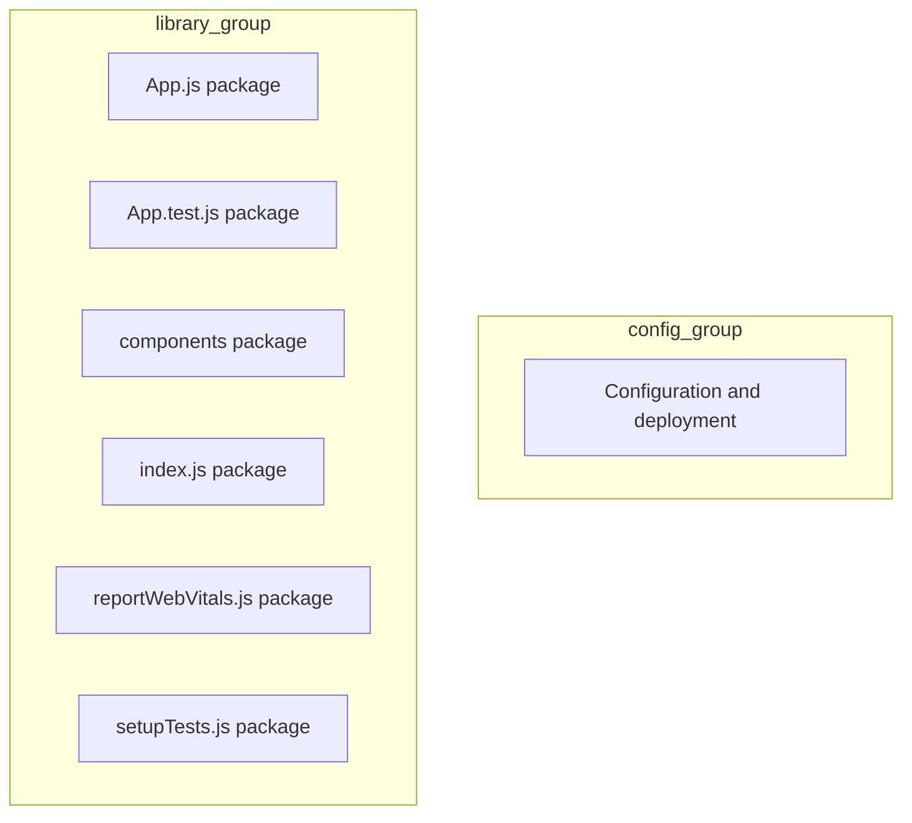

# Architecture report: soumyajit4419/Portfolio

> Automated static analysis. **Observed** = directly seen in files/imports/AST; **Inferred** = interpretation from that evidence. Repository code was not executed.

## 1. Repository at a glance

| Item | Value |
| --- | --- |
| Repository | soumyajit4419/Portfolio |
| Description | My self coded personal website build with React.js |
| Language | JavaScript |
| Stars | 6519 |
| Licence | Not detected |
| Analysed commit / branch | 60c3c08f5f5c25ca4a3a85d795a6d1450a947f40 / master |
| Framework(s) | React |
| Files analysed | 60 |
| Components | 7 |

## 2. Architecture in one minute

soumyajit4419/Portfolio - My self coded personal website build with React.js. This repository was analysed statically from 60 file(s) (0 Python). Detected technologies (observed from imports/manifests): React, axios, React Router. Files are grouped into 7 component(s): App.js package, App.test.js package, components package, Configuration and deployment, index.js package, reportWebVitals.js package, setupTests.js package. Findings below distinguish observed facts from inferred interpretation.

## 3. High-level block diagram

## 4. Main components

### App.js package (`app_js`)

- **Kind:** library
- **Status:** Observed
- **Confidence:** 0.85
- **Responsibility:** Groups 1 file(s) under app.js package (observed from repository paths and static analysis).
- **Paths:** `src/App.js`
- **Evidence:** [src/App.js](https://github.com/soumyajit4419/Portfolio/blob/60c3c08f5f5c25ca4a3a85d795a6d1450a947f40/src/App.js)

### App.test.js package (`app_test_js`)

- **Kind:** library
- **Status:** Observed
- **Confidence:** 0.85
- **Responsibility:** Groups 1 file(s) under app.test.js package (observed from repository paths and static analysis).
- **Paths:** `src/App.test.js`
- **Evidence:** [src/App.test.js](https://github.com/soumyajit4419/Portfolio/blob/60c3c08f5f5c25ca4a3a85d795a6d1450a947f40/src/App.test.js)

### components package (`components`)

- **Kind:** library
- **Status:** Observed
- **Confidence:** 0.85
- **Responsibility:** Groups 16 file(s) under components package (observed from repository paths and static analysis).
- **Paths:** `src/components/About/About.js`, `src/components/About/AboutCard.js`, `src/components/About/Github.js`, `src/components/About/Techstack.js`, `src/components/About/Toolstack.js`, `src/components/Footer.js`, `src/components/Home/Home.js`, `src/components/Home/Home2.js`, `src/components/Home/Type.js`, `src/components/Navbar.js`, `src/components/Particle.js`, `src/components/Pre.js`, `src/components/Projects/ProjectCards.js`, `src/components/Projects/Projects.js`, `src/components/Resume/ResumeNew.js`, `src/components/ScrollToTop.js`
- **Evidence:** [src/components/About/About.js](https://github.com/soumyajit4419/Portfolio/blob/60c3c08f5f5c25ca4a3a85d795a6d1450a947f40/src/components/About/About.js); [src/components/About/AboutCard.js](https://github.com/soumyajit4419/Portfolio/blob/60c3c08f5f5c25ca4a3a85d795a6d1450a947f40/src/components/About/AboutCard.js); [src/components/About/Github.js](https://github.com/soumyajit4419/Portfolio/blob/60c3c08f5f5c25ca4a3a85d795a6d1450a947f40/src/components/About/Github.js); [src/components/About/Techstack.js](https://github.com/soumyajit4419/Portfolio/blob/60c3c08f5f5c25ca4a3a85d795a6d1450a947f40/src/components/About/Techstack.js); [src/components/About/Toolstack.js](https://github.com/soumyajit4419/Portfolio/blob/60c3c08f5f5c25ca4a3a85d795a6d1450a947f40/src/components/About/Toolstack.js); [src/components/Footer.js](https://github.com/soumyajit4419/Portfolio/blob/60c3c08f5f5c25ca4a3a85d795a6d1450a947f40/src/components/Footer.js); [src/components/Home/Home.js](https://github.com/soumyajit4419/Portfolio/blob/60c3c08f5f5c25ca4a3a85d795a6d1450a947f40/src/components/Home/Home.js); [src/components/Home/Home2.js](https://github.com/soumyajit4419/Portfolio/blob/60c3c08f5f5c25ca4a3a85d795a6d1450a947f40/src/components/Home/Home2.js)

### Configuration and deployment (`config`)

- **Kind:** config
- **Status:** Observed
- **Confidence:** 0.85
- **Responsibility:** Groups 2 file(s) under configuration and deployment (observed from repository paths and static analysis).
- **Paths:** `package.json`, `public/manifest.json`
- **Evidence:** [package.json](https://github.com/soumyajit4419/Portfolio/blob/60c3c08f5f5c25ca4a3a85d795a6d1450a947f40/package.json); [public/manifest.json](https://github.com/soumyajit4419/Portfolio/blob/60c3c08f5f5c25ca4a3a85d795a6d1450a947f40/public/manifest.json)

### index.js package (`index_js`)

- **Kind:** library
- **Status:** Observed
- **Confidence:** 0.85
- **Responsibility:** Groups 1 file(s) under index.js package (observed from repository paths and static analysis).
- **Paths:** `src/index.js`
- **Evidence:** [src/index.js](https://github.com/soumyajit4419/Portfolio/blob/60c3c08f5f5c25ca4a3a85d795a6d1450a947f40/src/index.js)

### reportWebVitals.js package (`reportwebvitals_js`)

- **Kind:** library
- **Status:** Observed
- **Confidence:** 0.85
- **Responsibility:** Groups 1 file(s) under reportwebvitals.js package (observed from repository paths and static analysis).
- **Paths:** `src/reportWebVitals.js`
- **Evidence:** [src/reportWebVitals.js](https://github.com/soumyajit4419/Portfolio/blob/60c3c08f5f5c25ca4a3a85d795a6d1450a947f40/src/reportWebVitals.js)

### setupTests.js package (`setuptests_js`)

- **Kind:** library
- **Status:** Observed
- **Confidence:** 0.85
- **Responsibility:** Groups 1 file(s) under setuptests.js package (observed from repository paths and static analysis).
- **Paths:** `src/setupTests.js`
- **Evidence:** [src/setupTests.js](https://github.com/soumyajit4419/Portfolio/blob/60c3c08f5f5c25ca4a3a85d795a6d1450a947f40/src/setupTests.js)

## 5. Execution flow

**Observed** entry point(s):

- [src/App.js](https://github.com/soumyajit4419/Portfolio/blob/60c3c08f5f5c25ca4a3a85d795a6d1450a947f40/src/App.js)
- [src/index.js](https://github.com/soumyajit4419/Portfolio/blob/60c3c08f5f5c25ca4a3a85d795a6d1450a947f40/src/index.js)

Representative flow (derived from observed entry points and the import graph; steps beyond the entry point are **Inferred**):

1. Execution starts at an observed entry point listed above, if present.
2. No internal import relationships between components were observed.

## 6. Project structure

### `(root)`

- `.gitignore` - other (366 bytes)
- `README.md` - docs (2533 bytes)
- `package.json` - manifest (1202 bytes)

### `public`

- `public/index.html` - other (1875 bytes)
- `public/manifest.json` - config (306 bytes)
- `public/robots.txt` - docs (67 bytes)

### `src`

- `src/App.css` - other (564 bytes)
- `src/App.js` - source, JavaScript (1371 bytes)
- `src/App.test.js` - source, JavaScript (246 bytes)
- `src/Assets/TechIcons/AWS.svg` - other (5654 bytes)
- `src/Assets/TechIcons/Apple MacOSX.svg` - other (674 bytes)
- `src/Assets/TechIcons/C++.svg` - other (1261 bytes)
- `src/Assets/TechIcons/Docker.svg` - other (4691 bytes)
- `src/Assets/TechIcons/Firebase.svg` - other (382 bytes)
- `src/Assets/TechIcons/Git.svg` - other (807 bytes)
- `src/Assets/TechIcons/Google Chrome.svg` - other (2689 bytes)
- `src/Assets/TechIcons/Haskell.svg` - other (386 bytes)
- `src/Assets/TechIcons/Java.svg` - other (1625 bytes)
- `src/Assets/TechIcons/Javascript.svg` - other (1204 bytes)
- `src/Assets/TechIcons/Kafka.svg` - other (2441 bytes)
- `src/Assets/TechIcons/Kubernates.svg` - other (3978 bytes)
- `src/Assets/TechIcons/MUI.svg` - other (447 bytes)
- `src/Assets/TechIcons/Mongo.svg` - other (5850 bytes)
- `src/Assets/TechIcons/Next.svg` - other (296 bytes)
- `src/Assets/TechIcons/Node.svg` - other (1559 bytes)
- `src/Assets/TechIcons/Postman.svg` - other (3769 bytes)
- `src/Assets/TechIcons/Python.svg` - other (2486 bytes)
- `src/Assets/TechIcons/React.svg` - other (2444 bytes)
- `src/Assets/TechIcons/Redis.svg` - other (1859 bytes)
- `src/Assets/TechIcons/Redux.svg` - other (1241 bytes)
- `src/Assets/TechIcons/SQL.svg` - other (9249 bytes)
- `src/Assets/TechIcons/Tailwind.svg` - other (725 bytes)
- `src/Assets/TechIcons/Typescript.svg` - other (978 bytes)
- `src/Assets/TechIcons/go.svg` - other (9709 bytes)
- `src/Assets/TechIcons/intellij-idea.svg` - other (3270 bytes)
- `src/Assets/TechIcons/vscode.svg` - other (3145 bytes)
- `src/Assets/avatar.svg` - other (12945 bytes)
- `src/Assets/home-main.svg` - other (110091 bytes)
- `src/Assets/pre.svg` - other (1930 bytes)
- `src/components/About/About.js` - source, JavaScript (1594 bytes)
- `src/components/About/AboutCard.js` - source, JavaScript (1686 bytes)
- `src/components/About/Github.js` - source, JavaScript (624 bytes)
- `src/components/About/Techstack.js` - source, JavaScript (5563 bytes)
- `src/components/About/Toolstack.js` - source, JavaScript (1224 bytes)
- `src/components/Footer.js` - source, JavaScript (2075 bytes)
- `src/components/Home/Home.js` - source, JavaScript (3391 bytes)
- `src/components/Home/Home2.js` - source, JavaScript (2136 bytes)
- `src/components/Home/Type.js` - source, JavaScript (406 bytes)
- `src/components/Navbar.js` - source, JavaScript (3551 bytes)
- `src/components/Particle.js` - source, JavaScript (1071 bytes)
- `src/components/Pre.js` - source, JavaScript (143 bytes)
- `src/components/Projects/ProjectCards.js` - source, JavaScript (1197 bytes)
- `src/components/Projects/Projects.js` - source, JavaScript (4919 bytes)
- `src/components/Resume/ResumeNew.js` - source, JavaScript (1673 bytes)
- `src/components/ScrollToTop.js` - source, JavaScript (258 bytes)
- `src/index.css` - other (400 bytes)
- `src/index.js` - source, JavaScript (500 bytes)
- `src/reportWebVitals.js` - source, JavaScript (362 bytes)
- `src/setupTests.js` - source, JavaScript (241 bytes)
- `src/style.css` - other (15179 bytes)

## 7. Key dependencies and integrations

| Name | Category | Status | Confidence | Evidence |
| --- | --- | --- | --- | --- |
| React | framework | Observed | 0.90 | [package.json:6](https://github.com/soumyajit4419/Portfolio/blob/60c3c08f5f5c25ca4a3a85d795a6d1450a947f40/package.json#L6); [package.json:14](https://github.com/soumyajit4419/Portfolio/blob/60c3c08f5f5c25ca4a3a85d795a6d1450a947f40/package.json#L14) |
| axios | library | Observed | 0.85 | [package.json:10](https://github.com/soumyajit4419/Portfolio/blob/60c3c08f5f5c25ca4a3a85d795a6d1450a947f40/package.json#L10) |
| React Router | library | Observed | 0.85 | [package.json:19](https://github.com/soumyajit4419/Portfolio/blob/60c3c08f5f5c25ca4a3a85d795a6d1450a947f40/package.json#L19) |

## 8. Data and state

No database, cache, queue, or persistent-state usage was observed in the analysed files. State handling, if any, may be in-memory or in files that were not analysed.

## 9. Configuration and deployment clues

- `package.json` (manifest)
- `public/manifest.json` (config)

## 10. Design observations

- No strong design patterns could be established from the available evidence.

These observations are interpretations (**Inferred**) of the observed structure, not guarantees about runtime design.

## 11. Limitations and unknowns

- Static analysis only: repository code was not executed, installed, or imported at runtime.
- Components and relationships are inferred from file paths, imports, and AST structure; runtime behaviour, dynamic imports, and reflection may not be visible.
- No clear application entry point was observed in the analysed files.
- Repository text was treated as untrusted data; no instructions found in repository files were followed, and likely secret values were redacted/excluded.
- JavaScript and TypeScript files were inventoried from paths and package manifests. They were not parsed with a full language AST, and repository code was not executed.

## 12. Source references

- [package.json](https://github.com/soumyajit4419/Portfolio/blob/60c3c08f5f5c25ca4a3a85d795a6d1450a947f40/package.json)
- [package.json:6](https://github.com/soumyajit4419/Portfolio/blob/60c3c08f5f5c25ca4a3a85d795a6d1450a947f40/package.json#L6)
- [package.json:10](https://github.com/soumyajit4419/Portfolio/blob/60c3c08f5f5c25ca4a3a85d795a6d1450a947f40/package.json#L10)
- [package.json:14](https://github.com/soumyajit4419/Portfolio/blob/60c3c08f5f5c25ca4a3a85d795a6d1450a947f40/package.json#L14)
- [package.json:19](https://github.com/soumyajit4419/Portfolio/blob/60c3c08f5f5c25ca4a3a85d795a6d1450a947f40/package.json#L19)
- [public/manifest.json](https://github.com/soumyajit4419/Portfolio/blob/60c3c08f5f5c25ca4a3a85d795a6d1450a947f40/public/manifest.json)
- [src/App.js](https://github.com/soumyajit4419/Portfolio/blob/60c3c08f5f5c25ca4a3a85d795a6d1450a947f40/src/App.js)
- [src/App.test.js](https://github.com/soumyajit4419/Portfolio/blob/60c3c08f5f5c25ca4a3a85d795a6d1450a947f40/src/App.test.js)
- [src/components/About/About.js](https://github.com/soumyajit4419/Portfolio/blob/60c3c08f5f5c25ca4a3a85d795a6d1450a947f40/src/components/About/About.js)
- [src/components/About/AboutCard.js](https://github.com/soumyajit4419/Portfolio/blob/60c3c08f5f5c25ca4a3a85d795a6d1450a947f40/src/components/About/AboutCard.js)
- [src/components/About/Github.js](https://github.com/soumyajit4419/Portfolio/blob/60c3c08f5f5c25ca4a3a85d795a6d1450a947f40/src/components/About/Github.js)
- [src/components/About/Techstack.js](https://github.com/soumyajit4419/Portfolio/blob/60c3c08f5f5c25ca4a3a85d795a6d1450a947f40/src/components/About/Techstack.js)
- [src/components/About/Toolstack.js](https://github.com/soumyajit4419/Portfolio/blob/60c3c08f5f5c25ca4a3a85d795a6d1450a947f40/src/components/About/Toolstack.js)
- [src/components/Footer.js](https://github.com/soumyajit4419/Portfolio/blob/60c3c08f5f5c25ca4a3a85d795a6d1450a947f40/src/components/Footer.js)
- [src/components/Home/Home.js](https://github.com/soumyajit4419/Portfolio/blob/60c3c08f5f5c25ca4a3a85d795a6d1450a947f40/src/components/Home/Home.js)
- [src/components/Home/Home2.js](https://github.com/soumyajit4419/Portfolio/blob/60c3c08f5f5c25ca4a3a85d795a6d1450a947f40/src/components/Home/Home2.js)
- [src/index.js](https://github.com/soumyajit4419/Portfolio/blob/60c3c08f5f5c25ca4a3a85d795a6d1450a947f40/src/index.js)
- [src/reportWebVitals.js](https://github.com/soumyajit4419/Portfolio/blob/60c3c08f5f5c25ca4a3a85d795a6d1450a947f40/src/reportWebVitals.js)
- [src/setupTests.js](https://github.com/soumyajit4419/Portfolio/blob/60c3c08f5f5c25ca4a3a85d795a6d1450a947f40/src/setupTests.js)
