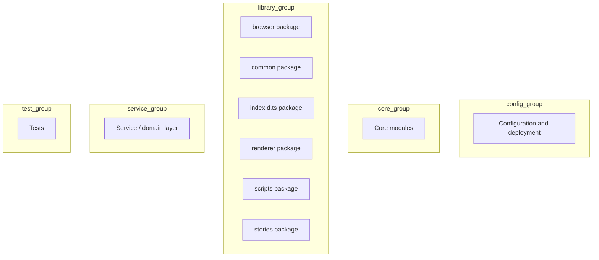

# Architecture report: sqlectron/sqlectron

> Automated static analysis. **Observed** = directly seen in files/imports/AST; **Inferred** = interpretation from that evidence. Repository code was not executed.

## 1. Repository at a glance

| Item | Value |
| --- | --- |
| Repository | sqlectron/sqlectron |
| Description | A simple and lightweight SQL client desktop with cross database and platform support. |
| Language | TypeScript |
| Stars | 4757 |
| Licence | MIT |
| Analysed commit / branch | b0f5e24015bca7974fbce6ab5e4ada69d51b48b3 / main |
| Framework(s) | Electron, React |
| Files analysed | 187 |
| Components | 10 |

## 2. Architecture in one minute

sqlectron/sqlectron - A simple and lightweight SQL client desktop with cross database and platform support.. This repository was analysed statically from 187 file(s) (0 Python). Detected technologies (observed from imports/manifests): GitHub Actions, Electron, React, React Router, Redux Toolkit, Tailwind CSS. Files are grouped into 10 component(s): browser package, common package, Configuration and deployment, Core modules, index.d.ts package, renderer package, scripts package, Service / domain layer. Findings below distinguish observed facts from inferred interpretation.

## 3. High-level block diagram

## 4. Main components

### browser package (`browser`)

- **Kind:** library
- **Status:** Observed
- **Confidence:** 0.85
- **Responsibility:** Groups 13 file(s) under browser package (observed from repository paths and static analysis).
- **Paths:** `src/browser/app.ts`, `src/browser/browser.ts`, `src/browser/config.ts`, `src/browser/ipcMain.ts`, `src/browser/logger.ts`, `src/browser/main.ts`, `src/browser/menu/darwin.ts`, `src/browser/menu/index.ts`, `src/browser/menu/linux.ts`, `src/browser/menu/win32.ts`, `src/browser/preload.ts`, `src/browser/update-checker.ts`, `src/browser/window.ts`
- **Evidence:** [src/browser/app.ts](https://github.com/sqlectron/sqlectron/blob/b0f5e24015bca7974fbce6ab5e4ada69d51b48b3/src/browser/app.ts); [src/browser/browser.ts](https://github.com/sqlectron/sqlectron/blob/b0f5e24015bca7974fbce6ab5e4ada69d51b48b3/src/browser/browser.ts); [src/browser/config.ts](https://github.com/sqlectron/sqlectron/blob/b0f5e24015bca7974fbce6ab5e4ada69d51b48b3/src/browser/config.ts); [src/browser/ipcMain.ts](https://github.com/sqlectron/sqlectron/blob/b0f5e24015bca7974fbce6ab5e4ada69d51b48b3/src/browser/ipcMain.ts); [src/browser/logger.ts](https://github.com/sqlectron/sqlectron/blob/b0f5e24015bca7974fbce6ab5e4ada69d51b48b3/src/browser/logger.ts); [src/browser/main.ts](https://github.com/sqlectron/sqlectron/blob/b0f5e24015bca7974fbce6ab5e4ada69d51b48b3/src/browser/main.ts); [src/browser/menu/darwin.ts](https://github.com/sqlectron/sqlectron/blob/b0f5e24015bca7974fbce6ab5e4ada69d51b48b3/src/browser/menu/darwin.ts); [src/browser/menu/index.ts](https://github.com/sqlectron/sqlectron/blob/b0f5e24015bca7974fbce6ab5e4ada69d51b48b3/src/browser/menu/index.ts)

### common package (`common`)

- **Kind:** library
- **Status:** Observed
- **Confidence:** 0.85
- **Responsibility:** Groups 8 file(s) under common package (observed from repository paths and static analysis).
- **Paths:** `src/common/event.ts`, `src/common/types/api.ts`, `src/common/types/config.ts`, `src/common/types/database.ts`, `src/common/types/menu.ts`, `src/common/types/server.ts`, `src/common/utils/convert.ts`, `src/common/utils/string.ts`
- **Evidence:** [src/common/event.ts](https://github.com/sqlectron/sqlectron/blob/b0f5e24015bca7974fbce6ab5e4ada69d51b48b3/src/common/event.ts); [src/common/types/api.ts](https://github.com/sqlectron/sqlectron/blob/b0f5e24015bca7974fbce6ab5e4ada69d51b48b3/src/common/types/api.ts); [src/common/types/config.ts](https://github.com/sqlectron/sqlectron/blob/b0f5e24015bca7974fbce6ab5e4ada69d51b48b3/src/common/types/config.ts); [src/common/types/database.ts](https://github.com/sqlectron/sqlectron/blob/b0f5e24015bca7974fbce6ab5e4ada69d51b48b3/src/common/types/database.ts); [src/common/types/menu.ts](https://github.com/sqlectron/sqlectron/blob/b0f5e24015bca7974fbce6ab5e4ada69d51b48b3/src/common/types/menu.ts); [src/common/types/server.ts](https://github.com/sqlectron/sqlectron/blob/b0f5e24015bca7974fbce6ab5e4ada69d51b48b3/src/common/types/server.ts); [src/common/utils/convert.ts](https://github.com/sqlectron/sqlectron/blob/b0f5e24015bca7974fbce6ab5e4ada69d51b48b3/src/common/utils/convert.ts); [src/common/utils/string.ts](https://github.com/sqlectron/sqlectron/blob/b0f5e24015bca7974fbce6ab5e4ada69d51b48b3/src/common/utils/string.ts)

### Configuration and deployment (`config`)

- **Kind:** config
- **Status:** Observed
- **Confidence:** 0.85
- **Responsibility:** Groups 5 file(s) under configuration and deployment (observed from repository paths and static analysis).
- **Paths:** `Dockerfile`, `docker-compose.yml`, `package.json`, `tsconfig.build.json`, `tsconfig.json`
- **Evidence:** [Dockerfile](https://github.com/sqlectron/sqlectron/blob/b0f5e24015bca7974fbce6ab5e4ada69d51b48b3/Dockerfile); [docker-compose.yml](https://github.com/sqlectron/sqlectron/blob/b0f5e24015bca7974fbce6ab5e4ada69d51b48b3/docker-compose.yml); [package.json](https://github.com/sqlectron/sqlectron/blob/b0f5e24015bca7974fbce6ab5e4ada69d51b48b3/package.json); [tsconfig.build.json](https://github.com/sqlectron/sqlectron/blob/b0f5e24015bca7974fbce6ab5e4ada69d51b48b3/tsconfig.build.json); [tsconfig.json](https://github.com/sqlectron/sqlectron/blob/b0f5e24015bca7974fbce6ab5e4ada69d51b48b3/tsconfig.json)

### Core modules (`core`)

- **Kind:** core
- **Status:** Observed
- **Confidence:** 0.85
- **Responsibility:** Groups 6 file(s) under core modules (observed from repository paths and static analysis).
- **Paths:** `babel.config.js`, `empty-shim.js`, `eslint.config.js`, `postcss.config.js`, `tailwind.config.js`, `webpack.config.js`
- **Evidence:** [babel.config.js](https://github.com/sqlectron/sqlectron/blob/b0f5e24015bca7974fbce6ab5e4ada69d51b48b3/babel.config.js); [empty-shim.js](https://github.com/sqlectron/sqlectron/blob/b0f5e24015bca7974fbce6ab5e4ada69d51b48b3/empty-shim.js); [eslint.config.js](https://github.com/sqlectron/sqlectron/blob/b0f5e24015bca7974fbce6ab5e4ada69d51b48b3/eslint.config.js); [postcss.config.js](https://github.com/sqlectron/sqlectron/blob/b0f5e24015bca7974fbce6ab5e4ada69d51b48b3/postcss.config.js); [tailwind.config.js](https://github.com/sqlectron/sqlectron/blob/b0f5e24015bca7974fbce6ab5e4ada69d51b48b3/tailwind.config.js); [webpack.config.js](https://github.com/sqlectron/sqlectron/blob/b0f5e24015bca7974fbce6ab5e4ada69d51b48b3/webpack.config.js)

### index.d.ts package (`index_d_ts`)

- **Kind:** library
- **Status:** Observed
- **Confidence:** 0.85
- **Responsibility:** Groups 1 file(s) under index.d.ts package (observed from repository paths and static analysis).
- **Paths:** `src/index.d.ts`
- **Evidence:** [src/index.d.ts](https://github.com/sqlectron/sqlectron/blob/b0f5e24015bca7974fbce6ab5e4ada69d51b48b3/src/index.d.ts)

### renderer package (`renderer`)

- **Kind:** library
- **Status:** Observed
- **Confidence:** 0.85
- **Responsibility:** Groups 82 file(s) under renderer package (observed from repository paths and static analysis).
- **Paths:** `src/renderer/actions/columns.ts`, `src/renderer/actions/config.ts`, `src/renderer/actions/connections.ts`, `src/renderer/actions/databases.ts`, `src/renderer/actions/indexes.ts`, `src/renderer/actions/queries.ts`, `src/renderer/actions/routines.ts`, `src/renderer/actions/schemas.ts`, `src/renderer/actions/servers.ts`, `src/renderer/actions/sqlscripts.ts`, `src/renderer/actions/tables.ts`, `src/renderer/actions/triggers.ts`, `src/renderer/actions/views.ts`, `src/renderer/api.ts`, `src/renderer/components/checkbox.tsx`, `src/renderer/components/collapse-icon.tsx`, `src/renderer/components/confim-modal.tsx`, `src/renderer/components/database-filter.tsx`, `src/renderer/components/database-item.tsx`, `src/renderer/components/database-list-item-metadata.tsx`, `src/renderer/components/database-list-item.tsx`, `src/renderer/components/database-list.tsx`, `src/renderer/components/footer.tsx`, `src/renderer/components/header.tsx`, `src/renderer/components/loader.tsx`, `src/renderer/components/log-status.tsx`, `src/renderer/components/message.tsx`, `src/renderer/components/preview-modal.tsx`, `src/renderer/components/prompt-modal.tsx`, `src/renderer/components/query-result-table-cell.tsx`, `src/renderer/components/query-result-table.tsx`, `src/renderer/components/query-result.tsx`, `src/renderer/components/query-results.tsx`, `src/renderer/components/query-tab.tsx`, `src/renderer/components/query-tabs.tsx`, `src/renderer/components/query.tsx`, `src/renderer/components/require-context.ts`, `src/renderer/components/server-db-client-info-modal.tsx`, `src/renderer/components/server-filter.tsx`, `src/renderer/components/server-list-card.tsx`, `src/renderer/components/server-list-item.tsx`, `src/renderer/components/server-list.tsx`, `src/renderer/components/server-modal-form.tsx`, `src/renderer/components/settings-modal-form.tsx`, `src/renderer/components/tab-list.tsx`, `src/renderer/components/table-submenu.tsx`, `src/renderer/components/ui/button.tsx`, `src/renderer/components/ui/dialog.tsx`, `src/renderer/components/ui/input.tsx`, `src/renderer/components/update-checker.tsx`, `src/renderer/containers/app.tsx`, `src/renderer/containers/query-browser.tsx`, `src/renderer/containers/root.tsx`, `src/renderer/containers/server-management.tsx`, `src/renderer/entry.tsx`, `src/renderer/hooks/index.ts`, `src/renderer/hooks/redux.ts`, `src/renderer/hooks/useEffectDebugger.ts`, `src/renderer/hooks/usePrevious.ts`, `src/renderer/lib/utils.ts`, `src/renderer/reducers/columns.ts`, `src/renderer/reducers/config.ts`, `src/renderer/reducers/connections.ts`, `src/renderer/reducers/databases.ts`, `src/renderer/reducers/index.ts`, `src/renderer/reducers/indexes.ts`, `src/renderer/reducers/queries.ts`, `src/renderer/reducers/routines.ts`, `src/renderer/reducers/schemas.ts`, `src/renderer/reducers/servers.ts`, `src/renderer/reducers/sqlscripts.ts`, `src/renderer/reducers/status.ts`, `src/renderer/reducers/tables.ts`, `src/renderer/reducers/triggers.ts`, `src/renderer/reducers/views.ts`, `src/renderer/store/configure.ts`, `src/renderer/utils/config.ts`, `src/renderer/utils/context-menu.ts`, `src/renderer/utils/file.ts`, `src/renderer/utils/menu.ts`, `src/renderer/utils/regexp.ts`, `src/renderer/utils/wait.ts`
- **Evidence:** [src/renderer/actions/columns.ts](https://github.com/sqlectron/sqlectron/blob/b0f5e24015bca7974fbce6ab5e4ada69d51b48b3/src/renderer/actions/columns.ts); [src/renderer/actions/config.ts](https://github.com/sqlectron/sqlectron/blob/b0f5e24015bca7974fbce6ab5e4ada69d51b48b3/src/renderer/actions/config.ts); [src/renderer/actions/connections.ts](https://github.com/sqlectron/sqlectron/blob/b0f5e24015bca7974fbce6ab5e4ada69d51b48b3/src/renderer/actions/connections.ts); [src/renderer/actions/databases.ts](https://github.com/sqlectron/sqlectron/blob/b0f5e24015bca7974fbce6ab5e4ada69d51b48b3/src/renderer/actions/databases.ts); [src/renderer/actions/indexes.ts](https://github.com/sqlectron/sqlectron/blob/b0f5e24015bca7974fbce6ab5e4ada69d51b48b3/src/renderer/actions/indexes.ts); [src/renderer/actions/queries.ts](https://github.com/sqlectron/sqlectron/blob/b0f5e24015bca7974fbce6ab5e4ada69d51b48b3/src/renderer/actions/queries.ts); [src/renderer/actions/routines.ts](https://github.com/sqlectron/sqlectron/blob/b0f5e24015bca7974fbce6ab5e4ada69d51b48b3/src/renderer/actions/routines.ts); [src/renderer/actions/schemas.ts](https://github.com/sqlectron/sqlectron/blob/b0f5e24015bca7974fbce6ab5e4ada69d51b48b3/src/renderer/actions/schemas.ts)

### scripts package (`scripts`)

- **Kind:** library
- **Status:** Observed
- **Confidence:** 0.85
- **Responsibility:** Groups 3 file(s) under scripts package (observed from repository paths and static analysis).
- **Paths:** `scripts/dev-auto-restart.js`, `scripts/link-sqlectron-db-core.sh`, `scripts/start-test-integration-deps.sh`
- **Evidence:** [scripts/dev-auto-restart.js](https://github.com/sqlectron/sqlectron/blob/b0f5e24015bca7974fbce6ab5e4ada69d51b48b3/scripts/dev-auto-restart.js); [scripts/link-sqlectron-db-core.sh](https://github.com/sqlectron/sqlectron/blob/b0f5e24015bca7974fbce6ab5e4ada69d51b48b3/scripts/link-sqlectron-db-core.sh); [scripts/start-test-integration-deps.sh](https://github.com/sqlectron/sqlectron/blob/b0f5e24015bca7974fbce6ab5e4ada69d51b48b3/scripts/start-test-integration-deps.sh)

### Service / domain layer (`service_layer`)

- **Kind:** service
- **Status:** Observed
- **Confidence:** 0.85
- **Responsibility:** Groups 9 file(s) under service / domain layer (observed from repository paths and static analysis).
- **Paths:** `src/browser/core/config.ts`, `src/browser/core/crypto.ts`, `src/browser/core/db.ts`, `src/browser/core/index.ts`, `src/browser/core/limit.ts`, `src/browser/core/servers.ts`, `src/browser/core/utils/index.ts`, `src/browser/core/utils/wait.ts`, `src/browser/core/validators/server.ts`
- **Evidence:** [src/browser/core/config.ts](https://github.com/sqlectron/sqlectron/blob/b0f5e24015bca7974fbce6ab5e4ada69d51b48b3/src/browser/core/config.ts); [src/browser/core/crypto.ts](https://github.com/sqlectron/sqlectron/blob/b0f5e24015bca7974fbce6ab5e4ada69d51b48b3/src/browser/core/crypto.ts); [src/browser/core/db.ts](https://github.com/sqlectron/sqlectron/blob/b0f5e24015bca7974fbce6ab5e4ada69d51b48b3/src/browser/core/db.ts); [src/browser/core/index.ts](https://github.com/sqlectron/sqlectron/blob/b0f5e24015bca7974fbce6ab5e4ada69d51b48b3/src/browser/core/index.ts); [src/browser/core/limit.ts](https://github.com/sqlectron/sqlectron/blob/b0f5e24015bca7974fbce6ab5e4ada69d51b48b3/src/browser/core/limit.ts); [src/browser/core/servers.ts](https://github.com/sqlectron/sqlectron/blob/b0f5e24015bca7974fbce6ab5e4ada69d51b48b3/src/browser/core/servers.ts); [src/browser/core/utils/index.ts](https://github.com/sqlectron/sqlectron/blob/b0f5e24015bca7974fbce6ab5e4ada69d51b48b3/src/browser/core/utils/index.ts); [src/browser/core/utils/wait.ts](https://github.com/sqlectron/sqlectron/blob/b0f5e24015bca7974fbce6ab5e4ada69d51b48b3/src/browser/core/utils/wait.ts)

### stories package (`stories`)

- **Kind:** library
- **Status:** Observed
- **Confidence:** 0.85
- **Responsibility:** Groups 1 file(s) under stories package (observed from repository paths and static analysis).
- **Paths:** `stories/components/checkbox.stories.tsx`
- **Evidence:** [stories/components/checkbox.stories.tsx](https://github.com/sqlectron/sqlectron/blob/b0f5e24015bca7974fbce6ab5e4ada69d51b48b3/stories/components/checkbox.stories.tsx)

### Tests (`tests`)

- **Kind:** test
- **Status:** Observed
- **Confidence:** 0.85
- **Responsibility:** Groups 18 file(s) under tests (observed from repository paths and static analysis).
- **Paths:** `test/browser/config.test.ts`, `test/browser/servers.test.ts`, `test/browser/utils-stub.ts`, `test/browser/utils.test.ts`, `test/browser/validators/server.test.ts`, `test/common/utils/string.test.ts`, `test/e2e/helper.ts`, `test/e2e/mainWindow.test.ts`, `test/e2e/sqlite.test.ts`, `test/e2e/ssh-mysql.test.ts`, `test/fixtures/browser/sqlectron.json`, `test/fixtures/browser/sqlectron.prepared.json`, `test/fixtures/simple/sqlectron-sample.json`, `test/fixtures/sqlite/sample-sqlectron.json`, `test/fixtures/ssh-mysql/sample-sqlectron.json`, `test/renderer/components/checkbox.test.tsx`, `test/renderer/utils/regexp.test.ts`, `test/vitest.setup.ts`
- **Evidence:** [test/browser/config.test.ts](https://github.com/sqlectron/sqlectron/blob/b0f5e24015bca7974fbce6ab5e4ada69d51b48b3/test/browser/config.test.ts); [test/browser/servers.test.ts](https://github.com/sqlectron/sqlectron/blob/b0f5e24015bca7974fbce6ab5e4ada69d51b48b3/test/browser/servers.test.ts); [test/browser/utils-stub.ts](https://github.com/sqlectron/sqlectron/blob/b0f5e24015bca7974fbce6ab5e4ada69d51b48b3/test/browser/utils-stub.ts); [test/browser/utils.test.ts](https://github.com/sqlectron/sqlectron/blob/b0f5e24015bca7974fbce6ab5e4ada69d51b48b3/test/browser/utils.test.ts); [test/browser/validators/server.test.ts](https://github.com/sqlectron/sqlectron/blob/b0f5e24015bca7974fbce6ab5e4ada69d51b48b3/test/browser/validators/server.test.ts); [test/common/utils/string.test.ts](https://github.com/sqlectron/sqlectron/blob/b0f5e24015bca7974fbce6ab5e4ada69d51b48b3/test/common/utils/string.test.ts); [test/e2e/helper.ts](https://github.com/sqlectron/sqlectron/blob/b0f5e24015bca7974fbce6ab5e4ada69d51b48b3/test/e2e/helper.ts); [test/e2e/mainWindow.test.ts](https://github.com/sqlectron/sqlectron/blob/b0f5e24015bca7974fbce6ab5e4ada69d51b48b3/test/e2e/mainWindow.test.ts)

## 5. Execution flow

**Observed** entry point(s):

- [.storybook/main.js](https://github.com/sqlectron/sqlectron/blob/b0f5e24015bca7974fbce6ab5e4ada69d51b48b3/.storybook/main.js)
- [src/browser/app.ts](https://github.com/sqlectron/sqlectron/blob/b0f5e24015bca7974fbce6ab5e4ada69d51b48b3/src/browser/app.ts)
- [src/browser/core/index.ts](https://github.com/sqlectron/sqlectron/blob/b0f5e24015bca7974fbce6ab5e4ada69d51b48b3/src/browser/core/index.ts)
- [src/browser/main.ts](https://github.com/sqlectron/sqlectron/blob/b0f5e24015bca7974fbce6ab5e4ada69d51b48b3/src/browser/main.ts)
- [src/browser/menu/index.ts](https://github.com/sqlectron/sqlectron/blob/b0f5e24015bca7974fbce6ab5e4ada69d51b48b3/src/browser/menu/index.ts)
- [src/common/types/server.ts](https://github.com/sqlectron/sqlectron/blob/b0f5e24015bca7974fbce6ab5e4ada69d51b48b3/src/common/types/server.ts)
- [src/renderer/containers/app.tsx](https://github.com/sqlectron/sqlectron/blob/b0f5e24015bca7974fbce6ab5e4ada69d51b48b3/src/renderer/containers/app.tsx)
- [src/renderer/hooks/index.ts](https://github.com/sqlectron/sqlectron/blob/b0f5e24015bca7974fbce6ab5e4ada69d51b48b3/src/renderer/hooks/index.ts)
- [src/renderer/reducers/index.ts](https://github.com/sqlectron/sqlectron/blob/b0f5e24015bca7974fbce6ab5e4ada69d51b48b3/src/renderer/reducers/index.ts)

Representative flow (derived from observed entry points and the import graph; steps beyond the entry point are **Inferred**):

1. Execution starts at an observed entry point listed above, if present.
2. No internal import relationships between components were observed.

## 6. Project structure

### `(root)`

- `.dockerignore` - container (99 bytes)
- `.editorconfig` - config (145 bytes)
- `.gitattributes` - other (217 bytes)
- `.gitignore` - other (361 bytes)
- `.lintstagedrc.json` - config (101 bytes)
- `.prettierignore` - other (26 bytes)
- `.prettierrc.json` - config (116 bytes)
- `CONTRIBUTING.md` - docs (553 bytes)
- `Dockerfile` - container (414 bytes)
- `LICENSE` - docs (1081 bytes)
- `README.md` - docs (1204 bytes)
- `babel.config.js` - source, JavaScript (400 bytes)
- `docker-compose.yml` - container (604 bytes)
- `empty-shim.js` - source, JavaScript (23 bytes)
- `eslint.config.js` - source, JavaScript (4139 bytes)
- `package.json` - manifest (7989 bytes)
- `postcss.config.js` - source, JavaScript (166 bytes)
- `tailwind.config.js` - source, JavaScript (195 bytes)
- `tsconfig.build.json` - config (106 bytes)
- `tsconfig.json` - config (361 bytes)
- `vitest.config.mts` - other (507 bytes)
- `vitest.e2e.config.mts` - other (311 bytes)
- `webpack.config.js` - source, JavaScript (5324 bytes)

### `.github`

- `.github/workflows/publish.yml` - ci, YAML (2360 bytes)
- `.github/workflows/test.yml` - ci, YAML (1374 bytes)

### `.husky`

- `.husky/.gitignore` - other (2 bytes)
- `.husky/pre-commit` - other (106 bytes)

### `.storybook`

- `.storybook/main.js` - source, JavaScript (219 bytes)
- `.storybook/preview.js` - source, JavaScript (175 bytes)

### `docs`

- `docs/app/configuration-file.md` - docs (2551 bytes)
- `docs/app/keyboard-shortcuts.md` - docs (3964 bytes)
- `docs/app/logging.md` - docs (1320 bytes)
- `docs/development/README.md` - docs (2407 bytes)
- `docs/development/build-instructions.md` - docs (94 bytes)
- `docs/development/docker-databases.md` - docs (190 bytes)
- `docs/development/release.md` - docs (1356 bytes)
- `docs/development/run-from-source.md` - docs (651 bytes)
- `docs/development/test-core-changes.md` - docs (478 bytes)

### `scripts`

- `scripts/dev-auto-restart.js` - source, JavaScript (556 bytes)
- `scripts/link-sqlectron-db-core.sh` - source, Shell (88 bytes)
- `scripts/start-test-integration-deps.sh` - source, Shell (538 bytes)

### `src`

- `src/browser/app.ts` - source, TypeScript (1791 bytes)
- `src/browser/browser.ts` - source, TypeScript (4507 bytes)
- `src/browser/config.ts` - source, TypeScript (1792 bytes)
- `src/browser/core/config.ts` - source, TypeScript (3461 bytes)
- `src/browser/core/crypto.ts` - source, TypeScript (2072 bytes)
- `src/browser/core/db.ts` - source, TypeScript (10403 bytes)
- `src/browser/core/index.ts` - source, TypeScript (261 bytes)
- `src/browser/core/limit.ts` - source, TypeScript (467 bytes)
- `src/browser/core/servers.ts` - source, TypeScript (4745 bytes)
- `src/browser/core/utils/index.ts` - source, TypeScript (2820 bytes)
- `src/browser/core/utils/wait.ts` - source, TypeScript (124 bytes)
- `src/browser/core/validators/server.ts` - source, TypeScript (4251 bytes)
- `src/browser/ipcMain.ts` - source, TypeScript (10377 bytes)
- `src/browser/logger.ts` - source, TypeScript (1049 bytes)
- `src/browser/main.ts` - source, TypeScript (439 bytes)
- `src/browser/menu/darwin.ts` - source, TypeScript (7225 bytes)
- `src/browser/menu/index.ts` - source, TypeScript (793 bytes)
- `src/browser/menu/linux.ts` - source, TypeScript (5556 bytes)
- `src/browser/menu/win32.ts` - source, TypeScript (5556 bytes)
- `src/browser/preload.ts` - source, TypeScript (9360 bytes)
- `src/browser/update-checker.ts` - source, TypeScript (1057 bytes)
- `src/browser/window.ts` - source, TypeScript (2325 bytes)
- `src/common/event.ts` - source, TypeScript (5419 bytes)
- `src/common/types/api.ts` - source, TypeScript (6104 bytes)
- `src/common/types/config.ts` - source, TypeScript (1889 bytes)
- `src/common/types/database.ts` - source, TypeScript (387 bytes)
- `src/common/types/menu.ts` - source, TypeScript (79 bytes)
- `src/common/types/server.ts` - source, TypeScript (996 bytes)
- `src/common/utils/convert.ts` - source, TypeScript (1301 bytes)
- `src/common/utils/string.ts` - source, TypeScript (117 bytes)
- `src/index.d.ts` - source, TypeScript (97 bytes)
- `src/renderer/actions/columns.ts` - source, TypeScript (1484 bytes)
- `src/renderer/actions/config.ts` - source, TypeScript (1875 bytes)
- `src/renderer/actions/connections.ts` - source, TypeScript (4681 bytes)
- `src/renderer/actions/databases.ts` - source, TypeScript (1661 bytes)
- `src/renderer/actions/indexes.ts` - source, TypeScript (1435 bytes)
- `src/renderer/actions/queries.ts` - source, TypeScript (8241 bytes)
- `src/renderer/actions/routines.ts` - source, TypeScript (1368 bytes)
- `src/renderer/actions/schemas.ts` - source, TypeScript (1202 bytes)
- `src/renderer/actions/servers.ts` - source, TypeScript (4081 bytes)
- `src/renderer/actions/sqlscripts.ts` - source, TypeScript (3567 bytes)
- `src/renderer/actions/tables.ts` - source, TypeScript (1257 bytes)
- `src/renderer/actions/triggers.ts` - source, TypeScript (1461 bytes)
- `src/renderer/actions/views.ts` - source, TypeScript (1234 bytes)
- `src/renderer/api.ts` - source, TypeScript (429 bytes)
- `src/renderer/assets/server-db-client/cassandra.svg` - other (4413 bytes)
- `src/renderer/assets/server-db-client/mariadb.svg` - other (1917 bytes)
- `src/renderer/assets/server-db-client/mysql.svg` - other (925 bytes)
- `src/renderer/assets/server-db-client/postgresql.svg` - other (3944 bytes)
- `src/renderer/assets/server-db-client/redshift.svg` - other (3483 bytes)
- `src/renderer/assets/server-db-client/sqlite.svg` - other (6224 bytes)
- `src/renderer/assets/server-db-client/sqlserver.svg` - other (4384 bytes)
- `src/renderer/components/checkbox.tsx` - source, TypeScript (1528 bytes)
- `src/renderer/components/collapse-icon.tsx` - source, TypeScript (470 bytes)
- `src/renderer/components/confim-modal.tsx` - source, TypeScript (1008 bytes)
- `src/renderer/components/database-filter.tsx` - source, TypeScript (1345 bytes)
- `src/renderer/components/database-item.tsx` - source, TypeScript (6641 bytes)
- `src/renderer/components/database-list-item-metadata.tsx` - source, TypeScript (4911 bytes)
- `src/renderer/components/database-list-item.tsx` - source, TypeScript (8124 bytes)
- `src/renderer/components/database-list.tsx` - source, TypeScript (1988 bytes)
- `src/renderer/components/footer.tsx` - source, TypeScript (1371 bytes)
- `src/renderer/components/header.tsx` - source, TypeScript (2446 bytes)
- `src/renderer/components/loader.tsx` - source, TypeScript (721 bytes)
- `src/renderer/components/log-status.tsx` - source, TypeScript (593 bytes)
- `src/renderer/components/message.tsx` - source, TypeScript (1499 bytes)
- `src/renderer/components/preview-modal.tsx` - source, TypeScript (2066 bytes)
- `src/renderer/components/prompt-modal.tsx` - source, TypeScript (1717 bytes)
- `src/renderer/components/query-result-table-cell.tsx` - source, TypeScript (2360 bytes)
- `src/renderer/components/query-result-table.scss` - other (2077 bytes)
- `src/renderer/components/query-result-table.tsx` - source, TypeScript (11601 bytes)
- `src/renderer/components/query-result.tsx` - source, TypeScript (3430 bytes)
- `src/renderer/components/query-results.tsx` - source, TypeScript (2479 bytes)
- `src/renderer/components/query-tab.tsx` - source, TypeScript (3019 bytes)
- `src/renderer/components/query-tabs.tsx` - source, TypeScript (6506 bytes)
- `src/renderer/components/query.tsx` - source, TypeScript (15035 bytes)
- `src/renderer/components/react-resizable.css` - other (2330 bytes)
- `src/renderer/components/react-tabs.scss` - other (239 bytes)
- `src/renderer/components/require-context.ts` - source, TypeScript (144 bytes)
- `src/renderer/components/server-db-client-info-modal.tsx` - source, TypeScript (1148 bytes)
- `src/renderer/components/server-filter.tsx` - source, TypeScript (1334 bytes)
- `src/renderer/components/server-list-card.tsx` - source, TypeScript (1938 bytes)
- `src/renderer/components/server-list-item.tsx` - source, TypeScript (1599 bytes)
- `src/renderer/components/server-list.tsx` - source, TypeScript (1503 bytes)
- `src/renderer/components/server-modal-form.tsx` - source, TypeScript (29956 bytes)
- `src/renderer/components/settings-modal-form.tsx` - source, TypeScript (14231 bytes)
- `src/renderer/components/tab-list.tsx` - source, TypeScript (752 bytes)
- `src/renderer/components/table-submenu.tsx` - source, TypeScript (2034 bytes)
- `src/renderer/components/ui/button.tsx` - source, TypeScript (1514 bytes)
- `src/renderer/components/ui/dialog.tsx` - source, TypeScript (3630 bytes)
- `src/renderer/components/ui/input.tsx` - source, TypeScript (715 bytes)
- `src/renderer/components/update-checker.tsx` - source, TypeScript (1495 bytes)
- `src/renderer/containers/app.css` - other (3312 bytes)
- `src/renderer/containers/app.tsx` - source, TypeScript (4872 bytes)
- `src/renderer/containers/query-browser.css` - other (432 bytes)
- `src/renderer/containers/query-browser.tsx` - source, TypeScript (13992 bytes)
- `src/renderer/containers/root.tsx` - source, TypeScript (734 bytes)
- `src/renderer/containers/server-management.tsx` - source, TypeScript (4739 bytes)
- `src/renderer/entry.tsx` - source, TypeScript (662 bytes)
- `src/renderer/hooks/index.ts` - source, TypeScript (102 bytes)
- `src/renderer/hooks/redux.ts` - source, TypeScript (321 bytes)
- `src/renderer/hooks/useEffectDebugger.ts` - source, TypeScript (850 bytes)
- `src/renderer/hooks/usePrevious.ts` - source, TypeScript (255 bytes)
- `src/renderer/index.html` - other (1961 bytes)
- `src/renderer/lib/utils.ts` - source, TypeScript (164 bytes)
- `src/renderer/reducers/columns.ts` - source, TypeScript (2708 bytes)
- `src/renderer/reducers/config.ts` - source, TypeScript (1823 bytes)
- `src/renderer/reducers/connections.ts` - source, TypeScript (3364 bytes)
- `src/renderer/reducers/databases.ts` - source, TypeScript (1934 bytes)
- `src/renderer/reducers/index.ts` - source, TypeScript (1521 bytes)
- `src/renderer/reducers/indexes.ts` - source, TypeScript (1996 bytes)
- `src/renderer/reducers/queries.ts` - source, TypeScript (8934 bytes)
- `src/renderer/reducers/routines.ts` - source, TypeScript (2732 bytes)
- `src/renderer/reducers/schemas.ts` - source, TypeScript (2196 bytes)
- `src/renderer/reducers/servers.ts` - source, TypeScript (2582 bytes)
- `src/renderer/reducers/sqlscripts.ts` - source, TypeScript (2346 bytes)
- `src/renderer/reducers/status.ts` - source, TypeScript (1098 bytes)
- `src/renderer/reducers/tables.ts` - source, TypeScript (2167 bytes)
- `src/renderer/reducers/triggers.ts` - source, TypeScript (2031 bytes)
- `src/renderer/reducers/views.ts` - source, TypeScript (1782 bytes)
- `src/renderer/store/configure.ts` - source, TypeScript (1972 bytes)
- `src/renderer/tailwind.css` - other (59 bytes)
- `src/renderer/utils/config.ts` - source, TypeScript (862 bytes)
- `src/renderer/utils/context-menu.ts` - source, TypeScript (2652 bytes)
- `src/renderer/utils/file.ts` - source, TypeScript (701 bytes)
- `src/renderer/utils/menu.ts` - source, TypeScript (573 bytes)
- `src/renderer/utils/regexp.ts` - source, TypeScript (111 bytes)
- `src/renderer/utils/wait.ts` - source, TypeScript (124 bytes)

### `stories`

- `stories/components/checkbox.stories.tsx` - source, TypeScript (784 bytes)

### `test`

- `test/browser/config.test.ts` - test, TypeScript (2440 bytes)
- `test/browser/servers.test.ts` - test, TypeScript (11053 bytes)
- `test/browser/utils-stub.ts` - test, TypeScript (804 bytes)
- `test/browser/utils.test.ts` - test, TypeScript (708 bytes)
- `test/browser/validators/server.test.ts` - test, TypeScript (4457 bytes)
- `test/common/utils/string.test.ts` - test, TypeScript (364 bytes)
- `test/e2e/helper.ts` - test, TypeScript (3074 bytes)
- `test/e2e/mainWindow.test.ts` - test, TypeScript (1961 bytes)
- `test/e2e/sqlite.test.ts` - test, TypeScript (4022 bytes)
- `test/e2e/ssh-mysql.test.ts` - test, TypeScript (5420 bytes)
- `test/fixtures/browser/sqlectron.json` - test (4915 bytes)
- `test/fixtures/browser/sqlectron.prepared.json` - test (7266 bytes)
- `test/fixtures/simple/sqlectron-sample.json` - test (859 bytes)
- `test/fixtures/sqlite/sample-sqlectron.json` - test (729 bytes)
- `test/fixtures/ssh-mysql/sample-sqlectron.json` - test (1108 bytes)
- `test/renderer/components/checkbox.test.tsx` - test, TypeScript (2355 bytes)
- `test/renderer/utils/regexp.test.ts` - test, TypeScript (423 bytes)
- `test/vitest.setup.ts` - test, TypeScript (166 bytes)

## 7. Key dependencies and integrations

| Name | Category | Status | Confidence | Evidence |
| --- | --- | --- | --- | --- |
| GitHub Actions | ci | Observed | 0.90 | [.github/workflows/publish.yml](https://github.com/sqlectron/sqlectron/blob/b0f5e24015bca7974fbce6ab5e4ada69d51b48b3/.github/workflows/publish.yml); [.github/workflows/test.yml](https://github.com/sqlectron/sqlectron/blob/b0f5e24015bca7974fbce6ab5e4ada69d51b48b3/.github/workflows/test.yml) |
| Electron | framework | Observed | 0.85 | [package.json:96](https://github.com/sqlectron/sqlectron/blob/b0f5e24015bca7974fbce6ab5e4ada69d51b48b3/package.json#L96) |
| React | framework | Observed | 0.90 | [package.json:127](https://github.com/sqlectron/sqlectron/blob/b0f5e24015bca7974fbce6ab5e4ada69d51b48b3/package.json#L127); [package.json:166](https://github.com/sqlectron/sqlectron/blob/b0f5e24015bca7974fbce6ab5e4ada69d51b48b3/package.json#L166) |
| React Router | library | Observed | 0.90 | [package.json:168](https://github.com/sqlectron/sqlectron/blob/b0f5e24015bca7974fbce6ab5e4ada69d51b48b3/package.json#L168); [package.json:216](https://github.com/sqlectron/sqlectron/blob/b0f5e24015bca7974fbce6ab5e4ada69d51b48b3/package.json#L216) |
| Redux Toolkit | library | Observed | 0.85 | [package.json:152](https://github.com/sqlectron/sqlectron/blob/b0f5e24015bca7974fbce6ab5e4ada69d51b48b3/package.json#L152) |
| Tailwind CSS | library | Observed | 0.85 | [package.json:228](https://github.com/sqlectron/sqlectron/blob/b0f5e24015bca7974fbce6ab5e4ada69d51b48b3/package.json#L228) |
| Docker | tooling | Observed | 0.85 | [Dockerfile](https://github.com/sqlectron/sqlectron/blob/b0f5e24015bca7974fbce6ab5e4ada69d51b48b3/Dockerfile) |
| Docker Compose | tooling | Observed | 0.85 | [docker-compose.yml](https://github.com/sqlectron/sqlectron/blob/b0f5e24015bca7974fbce6ab5e4ada69d51b48b3/docker-compose.yml) |
| TypeScript | tooling | Observed | 0.85 | [package.json:143](https://github.com/sqlectron/sqlectron/blob/b0f5e24015bca7974fbce6ab5e4ada69d51b48b3/package.json#L143) |
| Vitest | tooling | Observed | 0.85 | [package.json:107](https://github.com/sqlectron/sqlectron/blob/b0f5e24015bca7974fbce6ab5e4ada69d51b48b3/package.json#L107) |
| webpack | tooling | Observed | 0.85 | [package.json:97](https://github.com/sqlectron/sqlectron/blob/b0f5e24015bca7974fbce6ab5e4ada69d51b48b3/package.json#L97) |

## 8. Data and state

No database, cache, queue, or persistent-state usage was observed in the analysed files. State handling, if any, may be in-memory or in files that were not analysed.

## 9. Configuration and deployment clues

- `.dockerignore` (container)
- `.editorconfig` (config)
- `.github/workflows/publish.yml` (ci)
- `.github/workflows/test.yml` (ci)
- `.lintstagedrc.json` (config)
- `.prettierrc.json` (config)
- `Dockerfile` (container)
- `docker-compose.yml` (container)
- `package.json` (manifest)
- `tsconfig.build.json` (config)
- `tsconfig.json` (config)

## 10. Design observations

- Service/domain code is distinct from entry and data code, suggesting layered separation (Inferred).
- Tests are present alongside source code (Observed from test file paths).

These observations are interpretations (**Inferred**) of the observed structure, not guarantees about runtime design.

## 11. Limitations and unknowns

- Static analysis only: repository code was not executed, installed, or imported at runtime.
- Components and relationships are inferred from file paths, imports, and AST structure; runtime behaviour, dynamic imports, and reflection may not be visible.
- 4 file(s) were skipped during inventory (4 x vendored/generated directory excluded).
- No clear application entry point was observed in the analysed files.
- Repository text was treated as untrusted data; no instructions found in repository files were followed, and likely secret values were redacted/excluded.
- JavaScript and TypeScript files were inventoried from paths and package manifests. They were not parsed with a full language AST, and repository code was not executed.

## 12. Source references

- [.github/workflows/publish.yml](https://github.com/sqlectron/sqlectron/blob/b0f5e24015bca7974fbce6ab5e4ada69d51b48b3/.github/workflows/publish.yml)
- [.github/workflows/test.yml](https://github.com/sqlectron/sqlectron/blob/b0f5e24015bca7974fbce6ab5e4ada69d51b48b3/.github/workflows/test.yml)
- [.storybook/main.js](https://github.com/sqlectron/sqlectron/blob/b0f5e24015bca7974fbce6ab5e4ada69d51b48b3/.storybook/main.js)
- [Dockerfile](https://github.com/sqlectron/sqlectron/blob/b0f5e24015bca7974fbce6ab5e4ada69d51b48b3/Dockerfile)
- [babel.config.js](https://github.com/sqlectron/sqlectron/blob/b0f5e24015bca7974fbce6ab5e4ada69d51b48b3/babel.config.js)
- [docker-compose.yml](https://github.com/sqlectron/sqlectron/blob/b0f5e24015bca7974fbce6ab5e4ada69d51b48b3/docker-compose.yml)
- [empty-shim.js](https://github.com/sqlectron/sqlectron/blob/b0f5e24015bca7974fbce6ab5e4ada69d51b48b3/empty-shim.js)
- [eslint.config.js](https://github.com/sqlectron/sqlectron/blob/b0f5e24015bca7974fbce6ab5e4ada69d51b48b3/eslint.config.js)
- [package.json](https://github.com/sqlectron/sqlectron/blob/b0f5e24015bca7974fbce6ab5e4ada69d51b48b3/package.json)
- [package.json:96](https://github.com/sqlectron/sqlectron/blob/b0f5e24015bca7974fbce6ab5e4ada69d51b48b3/package.json#L96)
- [package.json:97](https://github.com/sqlectron/sqlectron/blob/b0f5e24015bca7974fbce6ab5e4ada69d51b48b3/package.json#L97)
- [package.json:107](https://github.com/sqlectron/sqlectron/blob/b0f5e24015bca7974fbce6ab5e4ada69d51b48b3/package.json#L107)
- [package.json:127](https://github.com/sqlectron/sqlectron/blob/b0f5e24015bca7974fbce6ab5e4ada69d51b48b3/package.json#L127)
- [package.json:143](https://github.com/sqlectron/sqlectron/blob/b0f5e24015bca7974fbce6ab5e4ada69d51b48b3/package.json#L143)
- [package.json:152](https://github.com/sqlectron/sqlectron/blob/b0f5e24015bca7974fbce6ab5e4ada69d51b48b3/package.json#L152)
- [package.json:166](https://github.com/sqlectron/sqlectron/blob/b0f5e24015bca7974fbce6ab5e4ada69d51b48b3/package.json#L166)
- [package.json:168](https://github.com/sqlectron/sqlectron/blob/b0f5e24015bca7974fbce6ab5e4ada69d51b48b3/package.json#L168)
- [package.json:216](https://github.com/sqlectron/sqlectron/blob/b0f5e24015bca7974fbce6ab5e4ada69d51b48b3/package.json#L216)
- [package.json:228](https://github.com/sqlectron/sqlectron/blob/b0f5e24015bca7974fbce6ab5e4ada69d51b48b3/package.json#L228)
- [postcss.config.js](https://github.com/sqlectron/sqlectron/blob/b0f5e24015bca7974fbce6ab5e4ada69d51b48b3/postcss.config.js)
- [scripts/dev-auto-restart.js](https://github.com/sqlectron/sqlectron/blob/b0f5e24015bca7974fbce6ab5e4ada69d51b48b3/scripts/dev-auto-restart.js)
- [scripts/link-sqlectron-db-core.sh](https://github.com/sqlectron/sqlectron/blob/b0f5e24015bca7974fbce6ab5e4ada69d51b48b3/scripts/link-sqlectron-db-core.sh)
- [scripts/start-test-integration-deps.sh](https://github.com/sqlectron/sqlectron/blob/b0f5e24015bca7974fbce6ab5e4ada69d51b48b3/scripts/start-test-integration-deps.sh)
- [src/browser/app.ts](https://github.com/sqlectron/sqlectron/blob/b0f5e24015bca7974fbce6ab5e4ada69d51b48b3/src/browser/app.ts)
- [src/browser/browser.ts](https://github.com/sqlectron/sqlectron/blob/b0f5e24015bca7974fbce6ab5e4ada69d51b48b3/src/browser/browser.ts)
- [src/browser/config.ts](https://github.com/sqlectron/sqlectron/blob/b0f5e24015bca7974fbce6ab5e4ada69d51b48b3/src/browser/config.ts)
- [src/browser/core/config.ts](https://github.com/sqlectron/sqlectron/blob/b0f5e24015bca7974fbce6ab5e4ada69d51b48b3/src/browser/core/config.ts)
- [src/browser/core/crypto.ts](https://github.com/sqlectron/sqlectron/blob/b0f5e24015bca7974fbce6ab5e4ada69d51b48b3/src/browser/core/crypto.ts)
- [src/browser/core/db.ts](https://github.com/sqlectron/sqlectron/blob/b0f5e24015bca7974fbce6ab5e4ada69d51b48b3/src/browser/core/db.ts)
- [src/browser/core/index.ts](https://github.com/sqlectron/sqlectron/blob/b0f5e24015bca7974fbce6ab5e4ada69d51b48b3/src/browser/core/index.ts)
- [src/browser/core/limit.ts](https://github.com/sqlectron/sqlectron/blob/b0f5e24015bca7974fbce6ab5e4ada69d51b48b3/src/browser/core/limit.ts)
- [src/browser/core/servers.ts](https://github.com/sqlectron/sqlectron/blob/b0f5e24015bca7974fbce6ab5e4ada69d51b48b3/src/browser/core/servers.ts)
- [src/browser/core/utils/index.ts](https://github.com/sqlectron/sqlectron/blob/b0f5e24015bca7974fbce6ab5e4ada69d51b48b3/src/browser/core/utils/index.ts)
- [src/browser/core/utils/wait.ts](https://github.com/sqlectron/sqlectron/blob/b0f5e24015bca7974fbce6ab5e4ada69d51b48b3/src/browser/core/utils/wait.ts)
- [src/browser/ipcMain.ts](https://github.com/sqlectron/sqlectron/blob/b0f5e24015bca7974fbce6ab5e4ada69d51b48b3/src/browser/ipcMain.ts)
- [src/browser/logger.ts](https://github.com/sqlectron/sqlectron/blob/b0f5e24015bca7974fbce6ab5e4ada69d51b48b3/src/browser/logger.ts)
- [src/browser/main.ts](https://github.com/sqlectron/sqlectron/blob/b0f5e24015bca7974fbce6ab5e4ada69d51b48b3/src/browser/main.ts)
- [src/browser/menu/darwin.ts](https://github.com/sqlectron/sqlectron/blob/b0f5e24015bca7974fbce6ab5e4ada69d51b48b3/src/browser/menu/darwin.ts)
- [src/browser/menu/index.ts](https://github.com/sqlectron/sqlectron/blob/b0f5e24015bca7974fbce6ab5e4ada69d51b48b3/src/browser/menu/index.ts)
- [src/common/event.ts](https://github.com/sqlectron/sqlectron/blob/b0f5e24015bca7974fbce6ab5e4ada69d51b48b3/src/common/event.ts)
- [src/common/types/api.ts](https://github.com/sqlectron/sqlectron/blob/b0f5e24015bca7974fbce6ab5e4ada69d51b48b3/src/common/types/api.ts)
- [src/common/types/config.ts](https://github.com/sqlectron/sqlectron/blob/b0f5e24015bca7974fbce6ab5e4ada69d51b48b3/src/common/types/config.ts)
- [src/common/types/database.ts](https://github.com/sqlectron/sqlectron/blob/b0f5e24015bca7974fbce6ab5e4ada69d51b48b3/src/common/types/database.ts)
- [src/common/types/menu.ts](https://github.com/sqlectron/sqlectron/blob/b0f5e24015bca7974fbce6ab5e4ada69d51b48b3/src/common/types/menu.ts)
- [src/common/types/server.ts](https://github.com/sqlectron/sqlectron/blob/b0f5e24015bca7974fbce6ab5e4ada69d51b48b3/src/common/types/server.ts)
- [src/common/utils/convert.ts](https://github.com/sqlectron/sqlectron/blob/b0f5e24015bca7974fbce6ab5e4ada69d51b48b3/src/common/utils/convert.ts)
- [src/common/utils/string.ts](https://github.com/sqlectron/sqlectron/blob/b0f5e24015bca7974fbce6ab5e4ada69d51b48b3/src/common/utils/string.ts)
- [src/index.d.ts](https://github.com/sqlectron/sqlectron/blob/b0f5e24015bca7974fbce6ab5e4ada69d51b48b3/src/index.d.ts)
- [src/renderer/actions/columns.ts](https://github.com/sqlectron/sqlectron/blob/b0f5e24015bca7974fbce6ab5e4ada69d51b48b3/src/renderer/actions/columns.ts)
- [src/renderer/actions/config.ts](https://github.com/sqlectron/sqlectron/blob/b0f5e24015bca7974fbce6ab5e4ada69d51b48b3/src/renderer/actions/config.ts)
- [src/renderer/actions/connections.ts](https://github.com/sqlectron/sqlectron/blob/b0f5e24015bca7974fbce6ab5e4ada69d51b48b3/src/renderer/actions/connections.ts)
- [src/renderer/actions/databases.ts](https://github.com/sqlectron/sqlectron/blob/b0f5e24015bca7974fbce6ab5e4ada69d51b48b3/src/renderer/actions/databases.ts)
- [src/renderer/actions/indexes.ts](https://github.com/sqlectron/sqlectron/blob/b0f5e24015bca7974fbce6ab5e4ada69d51b48b3/src/renderer/actions/indexes.ts)
- [src/renderer/actions/queries.ts](https://github.com/sqlectron/sqlectron/blob/b0f5e24015bca7974fbce6ab5e4ada69d51b48b3/src/renderer/actions/queries.ts)
- [src/renderer/actions/routines.ts](https://github.com/sqlectron/sqlectron/blob/b0f5e24015bca7974fbce6ab5e4ada69d51b48b3/src/renderer/actions/routines.ts)
- [src/renderer/actions/schemas.ts](https://github.com/sqlectron/sqlectron/blob/b0f5e24015bca7974fbce6ab5e4ada69d51b48b3/src/renderer/actions/schemas.ts)
- [src/renderer/containers/app.tsx](https://github.com/sqlectron/sqlectron/blob/b0f5e24015bca7974fbce6ab5e4ada69d51b48b3/src/renderer/containers/app.tsx)
- [src/renderer/hooks/index.ts](https://github.com/sqlectron/sqlectron/blob/b0f5e24015bca7974fbce6ab5e4ada69d51b48b3/src/renderer/hooks/index.ts)
- [src/renderer/reducers/index.ts](https://github.com/sqlectron/sqlectron/blob/b0f5e24015bca7974fbce6ab5e4ada69d51b48b3/src/renderer/reducers/index.ts)
- [stories/components/checkbox.stories.tsx](https://github.com/sqlectron/sqlectron/blob/b0f5e24015bca7974fbce6ab5e4ada69d51b48b3/stories/components/checkbox.stories.tsx)
- [tailwind.config.js](https://github.com/sqlectron/sqlectron/blob/b0f5e24015bca7974fbce6ab5e4ada69d51b48b3/tailwind.config.js)
- [test/browser/config.test.ts](https://github.com/sqlectron/sqlectron/blob/b0f5e24015bca7974fbce6ab5e4ada69d51b48b3/test/browser/config.test.ts)
- [test/browser/servers.test.ts](https://github.com/sqlectron/sqlectron/blob/b0f5e24015bca7974fbce6ab5e4ada69d51b48b3/test/browser/servers.test.ts)
- [test/browser/utils-stub.ts](https://github.com/sqlectron/sqlectron/blob/b0f5e24015bca7974fbce6ab5e4ada69d51b48b3/test/browser/utils-stub.ts)
- [test/browser/utils.test.ts](https://github.com/sqlectron/sqlectron/blob/b0f5e24015bca7974fbce6ab5e4ada69d51b48b3/test/browser/utils.test.ts)
- [test/browser/validators/server.test.ts](https://github.com/sqlectron/sqlectron/blob/b0f5e24015bca7974fbce6ab5e4ada69d51b48b3/test/browser/validators/server.test.ts)
- [test/common/utils/string.test.ts](https://github.com/sqlectron/sqlectron/blob/b0f5e24015bca7974fbce6ab5e4ada69d51b48b3/test/common/utils/string.test.ts)
- [test/e2e/helper.ts](https://github.com/sqlectron/sqlectron/blob/b0f5e24015bca7974fbce6ab5e4ada69d51b48b3/test/e2e/helper.ts)
- [test/e2e/mainWindow.test.ts](https://github.com/sqlectron/sqlectron/blob/b0f5e24015bca7974fbce6ab5e4ada69d51b48b3/test/e2e/mainWindow.test.ts)
- [tsconfig.build.json](https://github.com/sqlectron/sqlectron/blob/b0f5e24015bca7974fbce6ab5e4ada69d51b48b3/tsconfig.build.json)
- [tsconfig.json](https://github.com/sqlectron/sqlectron/blob/b0f5e24015bca7974fbce6ab5e4ada69d51b48b3/tsconfig.json)
- [webpack.config.js](https://github.com/sqlectron/sqlectron/blob/b0f5e24015bca7974fbce6ab5e4ada69d51b48b3/webpack.config.js)
