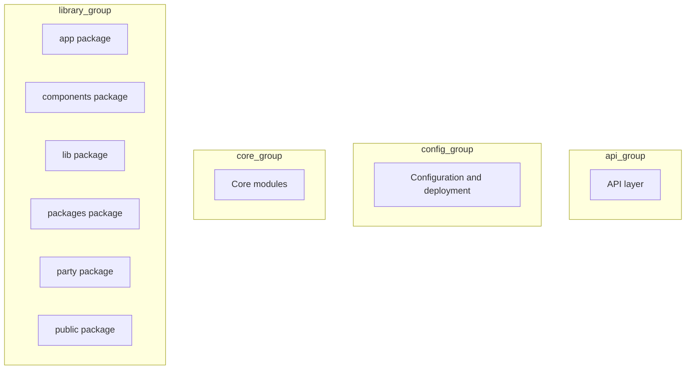

# Architecture report: srizzon/git-city

> Automated static analysis. **Observed** = directly seen in files/imports/AST; **Inferred** = interpretation from that evidence. Repository code was not executed.

## 1. Repository at a glance

| Item | Value |
| --- | --- |
| Repository | srizzon/git-city |
| Description | Your GitHub profile as a 3D pixel art building in an interactive city |
| Language | TypeScript |
| Stars | 5994 |
| Licence | AGPL-3.0 |
| Analysed commit / branch | 85601619a7cc3f5c742f88dc817e0fe2b21d7d04 / main |
| Framework(s) | Next.js, React |
| Files analysed | 800 |
| Components | 9 |

## 2. Architecture in one minute

srizzon/git-city - Your GitHub profile as a 3D pixel art building in an interactive city. This repository was analysed statically from 800 file(s) (0 Python). Detected technologies (observed from imports/manifests): Next.js, React, Tailwind CSS, TypeScript, Vitest. Files are grouped into 9 component(s): API layer, app package, components package, Configuration and deployment, Core modules, lib package, packages package, party package. Findings below distinguish observed facts from inferred interpretation.

## 3. High-level block diagram

## 4. Main components

### API layer (`api_layer`)

- **Kind:** api
- **Status:** Observed
- **Confidence:** 0.85
- **Responsibility:** Groups 182 file(s) under api layer (observed from repository paths and static analysis).
- **Paths:** `packages/vscode-extension/src/api/client.ts`, `packages/vscode-extension/src/api/queue.ts`, `src/app/api/account/delete/route.ts`, `src/app/api/achievements/[developerId]/route.ts`, `src/app/api/achievements/mark-seen/route.ts`, `src/app/api/admin/accounts/route.ts`, `src/app/api/admin/brasil/route.ts`, `src/app/api/admin/campaigns/route.ts`, `src/app/api/admin/cosmetics/[id]/route.ts`, `src/app/api/admin/cosmetics/[id]/thumbnail/route.ts`, `src/app/api/admin/cosmetics/route.ts`, `src/app/api/admin/dev/add/route.ts`, `src/app/api/admin/drift/route.ts`, `src/app/api/admin/drops/[id]/route.ts`, `src/app/api/admin/drops/route.ts`, `src/app/api/admin/email-preview/route.ts`, `src/app/api/admin/emails/route.ts`, `src/app/api/admin/emblems/[id]/route.ts`, `src/app/api/admin/emblems/grant/route.ts`, `src/app/api/admin/emblems/route.ts`, `src/app/api/admin/events/[id]/metrics/route.ts`, `src/app/api/admin/events/[id]/route.ts`, `src/app/api/admin/events/route.ts`, `src/app/api/admin/landmarks/[id]/route.ts`, `src/app/api/admin/landmarks/[id]/send-welcome-email/route.ts`, `src/app/api/admin/landmarks/route.ts`, `src/app/api/admin/league-reports/route.ts`, `src/app/api/admin/projects/route.ts`, `src/app/api/admin/reels/route.ts`, `src/app/api/admin/send-update-email/route.ts`, `src/app/api/arcade/avatar/route.ts`, `src/app/api/arcade/discoveries/route.ts`, `src/app/api/arcade/favorites/route.ts`, `src/app/api/arcade/leaderboard/route.ts`, `src/app/api/arcade/rooms/[slug]/route.ts`, `src/app/api/arcade/rooms/route.ts`, `src/app/api/arcade/shop/route.ts`, `src/app/api/auth/github/route.ts`, `src/app/api/auth/provision/route.ts`, `src/app/api/auth/signout/route.ts`, `src/app/api/checkin/route.ts`, `src/app/api/city/ensure-snapshot/route.ts`, `src/app/api/city/my-lot/route.ts`, `src/app/api/city/route.ts`, `src/app/api/claim-free-item/route.ts`, `src/app/api/claim/route.ts`, `src/app/api/compare-card/[userA]/[userB]/route.tsx`, `src/app/api/cosmetics/route.ts`, `src/app/api/cron/brasil-dm/route.ts`, `src/app/api/cron/brasil-heist/route.ts`, `src/app/api/cron/brasil-instagram/route.ts`, `src/app/api/cron/brasil-projects-close/route.ts`, `src/app/api/cron/brasil-projects-recheck/route.ts`, `src/app/api/cron/campaign-runner/route.ts`, `src/app/api/cron/city-snapshot/route.ts`, `src/app/api/cron/cleanup-sessions/route.ts`, `src/app/api/cron/daily-snapshot/route.ts`, `src/app/api/cron/event-lifecycle/route.ts`, `src/app/api/cron/flush-batches/route.ts`, `src/app/api/cron/gitc-cleanup/route.ts`, `src/app/api/cron/league-close/route.ts`, `src/app/api/cron/league-hourly/route.ts`, `src/app/api/cron/league-verify/route.ts`, `src/app/api/cron/re-engagement/route.ts`, `src/app/api/cron/reel-insights/route.ts`, `src/app/api/cron/reel-publish/route.ts`, `src/app/api/cron/refresh-ad-stats/route.ts`, `src/app/api/cron/refresh-buildings/route.ts`, `src/app/api/cron/streak-reminder/route.ts`, `src/app/api/cron/weekly-digest/route.ts`, `src/app/api/customizations/route.ts`, `src/app/api/customizations/upload/route.ts`, `src/app/api/dailies/claim/route.ts`, `src/app/api/dailies/leaderboard/route.ts`, `src/app/api/dailies/progress/route.ts`, `src/app/api/dailies/route.ts`, `src/app/api/dev/[username]/refresh/route.ts`, `src/app/api/dev/[username]/route.ts`, `src/app/api/dev/login/route.ts`, `src/app/api/dev/staging-login/route.ts`, `src/app/api/district/change/route.ts`, `src/app/api/drift/[spot]/board/route.ts`, `src/app/api/drift/[spot]/ghost/route.ts`, `src/app/api/drift/[spot]/run/route.ts`, `src/app/api/drift/country/route.ts`, `src/app/api/drops/active/route.ts`, `src/app/api/drops/leaderboard/route.ts`, `src/app/api/drops/my-pulls/route.ts`, `src/app/api/drops/pull/route.ts`, `src/app/api/email-notice/route.ts`, `src/app/api/email-preferences/confirm/route.ts`, `src/app/api/email-preferences/route.ts`, `src/app/api/events/active/route.ts`, `src/app/api/events/credit-damage/route.ts`, `src/app/api/feed/route.ts`, `src/app/api/fly-scores/route.ts`, `src/app/api/gitc/price/route.ts`, `src/app/api/gitc/swap/price/route.ts`, `src/app/api/gitc/swap/quote/route.ts`, `src/app/api/github/[username]/route.ts`, `src/app/api/health/route.ts`, `src/app/api/heartbeats/route.ts`, `src/app/api/instagram/webhook/route.ts`, `src/app/api/interactions/kudos/route.ts`, `src/app/api/interactions/visit/route.ts`, `src/app/api/items/route.ts`, `src/app/api/leaderboard-position/route.ts`, `src/app/api/leagues/[slug]/city/ops/route.ts`, `src/app/api/leagues/[slug]/city/route.ts`, `src/app/api/leagues/[slug]/cover/route.ts`, `src/app/api/leagues/[slug]/identity/route.ts`, `src/app/api/leagues/[slug]/invite/route.ts`, `src/app/api/leagues/[slug]/join/route.ts`, `src/app/api/leagues/[slug]/leave/route.ts`, `src/app/api/leagues/[slug]/logo/route.ts`, `src/app/api/leagues/[slug]/members/[login]/route.ts`, `src/app/api/leagues/[slug]/report/route.ts`, `src/app/api/leagues/[slug]/requests/[login]/route.ts`, `src/app/api/leagues/[slug]/requests/route.ts`, `src/app/api/leagues/[slug]/route.ts`, `src/app/api/leagues/route.ts`, `src/app/api/leagues/verify/check/route.ts`, `src/app/api/leagues/verify/join/route.ts`, `src/app/api/leagues/verify/route.ts`, `src/app/api/loadout/presets/route.ts`, `src/app/api/loadout/route.ts`, `src/app/api/milestone-celebration/route.ts`, `src/app/api/notification-preferences/route.ts`, `src/app/api/online/route.ts`, `src/app/api/partners/contact/route.ts`, `src/app/api/pixels/balance/route.ts`, `src/app/api/pixels/checkout/gitc-confirm/route.ts`, `src/app/api/pixels/checkout/gitc-quote/route.ts`, `src/app/api/pixels/history/route.ts`, `src/app/api/pixels/packages/route.ts`, `src/app/api/pixels/spend/route.ts`, `src/app/api/preferences/theme/route.ts`, `src/app/api/presence/route.ts`, `src/app/api/profile/showcase/route.ts`, `src/app/api/pvp/credit-kill/route.ts`, `src/app/api/rabbit/route.ts`, `src/app/api/raid/execute/route.ts`, `src/app/api/raid/history/route.ts`, `src/app/api/raid/loadout/route.ts`, `src/app/api/raid/preview/route.ts`, `src/app/api/reels/readout/route.ts`, `src/app/api/share-card/[username]/route.tsx`, `src/app/api/sky-ads/analytics/route.ts`, `src/app/api/sky-ads/manage/route.ts`, `src/app/api/sky-ads/route.ts`, `src/app/api/sky-ads/track/route.ts`, `src/app/api/social-links/route.ts`, `src/app/api/survey/route.ts`, `src/app/api/towns/[slug]/brasil/ad-request/route.ts`, `src/app/api/towns/[slug]/brasil/count/route.ts`, `src/app/api/towns/[slug]/brasil/election/route.ts`, `src/app/api/towns/[slug]/brasil/go/route.ts`, `src/app/api/towns/[slug]/brasil/heist/route.ts`, `src/app/api/towns/[slug]/brasil/place/route.ts`, `src/app/api/towns/[slug]/brasil/projects/[id]/route.ts`, `src/app/api/towns/[slug]/brasil/projects/prefill/route.ts`, `src/app/api/towns/[slug]/brasil/projects/route.ts`, `src/app/api/towns/[slug]/brasil/projects/shared.ts`, `src/app/api/towns/[slug]/brasil/race/route.ts`, `src/app/api/towns/[slug]/race/challenge/route.ts`, `src/app/api/towns/[slug]/race/ghost/route.ts`, `src/app/api/towns/[slug]/race/lap/route.ts`, `src/app/api/towns/[slug]/smash/me/route.ts`, `src/app/api/towns/[slug]/smash/route.ts`, `src/app/api/towns/[slug]/visit/route.ts`, `src/app/api/towns/away/route.ts`, `src/app/api/towns/live/route.ts`, `src/app/api/towns/play/close/route.ts`, `src/app/api/towns/play/me/route.ts`, `src/app/api/towns/play/publish/route.ts`, `src/app/api/towns/search/route.ts`, `src/app/api/towns/surprise/route.ts`, `src/app/api/track/route.ts`, `src/app/api/unsubscribe/route.ts`, `src/app/api/verify-github-star/route.ts`, `src/app/api/vscode-key/route.ts`, `src/app/api/webhooks/resend/route.ts`
- **Evidence:** [packages/vscode-extension/src/api/client.ts](https://github.com/srizzon/git-city/blob/85601619a7cc3f5c742f88dc817e0fe2b21d7d04/packages/vscode-extension/src/api/client.ts); [packages/vscode-extension/src/api/queue.ts](https://github.com/srizzon/git-city/blob/85601619a7cc3f5c742f88dc817e0fe2b21d7d04/packages/vscode-extension/src/api/queue.ts); [src/app/api/account/delete/route.ts](https://github.com/srizzon/git-city/blob/85601619a7cc3f5c742f88dc817e0fe2b21d7d04/src/app/api/account/delete/route.ts); [src/app/api/achievements/[developerId]/route.ts](https://github.com/srizzon/git-city/blob/85601619a7cc3f5c742f88dc817e0fe2b21d7d04/src/app/api/achievements/%5BdeveloperId%5D/route.ts); [src/app/api/achievements/mark-seen/route.ts](https://github.com/srizzon/git-city/blob/85601619a7cc3f5c742f88dc817e0fe2b21d7d04/src/app/api/achievements/mark-seen/route.ts); [src/app/api/admin/accounts/route.ts](https://github.com/srizzon/git-city/blob/85601619a7cc3f5c742f88dc817e0fe2b21d7d04/src/app/api/admin/accounts/route.ts); [src/app/api/admin/brasil/route.ts](https://github.com/srizzon/git-city/blob/85601619a7cc3f5c742f88dc817e0fe2b21d7d04/src/app/api/admin/brasil/route.ts); [src/app/api/admin/campaigns/route.ts](https://github.com/srizzon/git-city/blob/85601619a7cc3f5c742f88dc817e0fe2b21d7d04/src/app/api/admin/campaigns/route.ts)

### app package (`app`)

- **Kind:** library
- **Status:** Observed
- **Confidence:** 0.85
- **Responsibility:** Groups 177 file(s) under app package (observed from repository paths and static analysis).
- **Paths:** `src/app/admin/accounts/layout.tsx`, `src/app/admin/accounts/page.tsx`, `src/app/admin/ads/_components/ad-filters.tsx`, `src/app/admin/ads/_components/ad-form-fields.tsx`, `src/app/admin/ads/_components/ad-modal.tsx`, `src/app/admin/ads/_components/ad-row.tsx`, `src/app/admin/ads/_components/ad-table.tsx`, `src/app/admin/ads/_components/ads-dashboard.tsx`, `src/app/admin/ads/_components/batch-toolbar.tsx`, `src/app/admin/ads/_components/confirm-dialog.tsx`, `src/app/admin/ads/_components/sort-button.tsx`, `src/app/admin/ads/_components/status-badge.tsx`, `src/app/admin/ads/_components/summary-cards.tsx`, `src/app/admin/ads/_components/toast.tsx`, `src/app/admin/ads/_lib/constants.ts`, `src/app/admin/ads/_lib/helpers.ts`, `src/app/admin/ads/_lib/types.ts`, `src/app/admin/ads/_lib/use-ads-data.ts`, `src/app/admin/ads/_lib/use-ads-url-state.ts`, `src/app/admin/ads/_lib/use-toast.ts`, `src/app/admin/ads/layout.tsx`, `src/app/admin/ads/page.tsx`, `src/app/admin/brasil/ElectionDesk.tsx`, `src/app/admin/brasil/layout.tsx`, `src/app/admin/brasil/page.tsx`, `src/app/admin/cosmetics/page.tsx`, `src/app/admin/drops/layout.tsx`, `src/app/admin/drops/page.tsx`, `src/app/admin/email-monitoring/layout.tsx`, `src/app/admin/email-monitoring/page.tsx`, `src/app/admin/emails/_components/campaigns-tab.tsx`, `src/app/admin/emails/_components/catalog-tab.tsx`, `src/app/admin/emails/_components/emails-dashboard.tsx`, `src/app/admin/emails/_components/overview-tab.tsx`, `src/app/admin/emails/_components/todos-tab.tsx`, `src/app/admin/emails/_components/ui.tsx`, `src/app/admin/emails/layout.tsx`, `src/app/admin/emails/page.tsx`, `src/app/admin/emblems/page.tsx`, `src/app/admin/events/[id]/page.tsx`, `src/app/admin/events/page.tsx`, `src/app/admin/landmarks/[id]/page.tsx`, `src/app/admin/landmarks/_components/dashboard.tsx`, `src/app/admin/landmarks/_components/form.tsx`, `src/app/admin/landmarks/_components/live-preview.tsx`, `src/app/admin/landmarks/_components/toast.tsx`, `src/app/admin/landmarks/layout.tsx`, `src/app/admin/landmarks/new/page.tsx`, `src/app/admin/landmarks/page.tsx`, `src/app/admin/league-reports/layout.tsx`, `src/app/admin/league-reports/page.tsx`, `src/app/admin/page.tsx`, `src/app/admin/projects/layout.tsx`, `src/app/admin/projects/page.tsx`, `src/app/admin/reels/layout.tsx`, `src/app/admin/reels/page.tsx`, `src/app/arcade/[slug]/layout.tsx`, `src/app/arcade/[slug]/page.tsx`, `src/app/arcade/layout.tsx`, `src/app/arcade/page.tsx`, `src/app/auth/callback/route.ts`, `src/app/auth/setup/page.tsx`, `src/app/auth/setup/setup-terminal.tsx`, `src/app/battle/[raidId]/battle-redirect.tsx`, `src/app/battle/[raidId]/defender-image/route.tsx`, `src/app/battle/[raidId]/opengraph-image.tsx`, `src/app/battle/[raidId]/page.tsx`, `src/app/battle/boss/[username]/opengraph-image.tsx`, `src/app/battle/boss/[username]/page.tsx`, `src/app/brasil-preview/brasil-preview.tsx`, `src/app/brasil-preview/loader.tsx`, `src/app/brasil-preview/page.tsx`, `src/app/brasil/page.tsx`, `src/app/brasil/projects/page.tsx`, `src/app/communities/copy.ts`, `src/app/communities/example.ts`, `src/app/communities/opengraph-image.tsx`, `src/app/communities/page.tsx`, `src/app/compare/[userA]/[userB]/compare-redirect.tsx`, `src/app/compare/[userA]/[userB]/opengraph-image.tsx`, `src/app/compare/[userA]/[userB]/page.tsx`, `src/app/dev/[username]/not-found.tsx`, `src/app/dev/[username]/opengraph-image.tsx`, `src/app/dev/[username]/page.tsx`, `src/app/drift/[spot]/og/route.tsx`, `src/app/drift/[spot]/page.tsx`, `src/app/drift/[spot]/spot-client.tsx`, `src/app/drift/drift-client.tsx`, `src/app/drift/layout.tsx`, `src/app/drift/page.tsx`, `src/app/drift/r/[code]/page.tsx`, `src/app/drift/r/[code]/room-client.tsx`, `src/app/email-preferences/EmailPreferencesForm.tsx`, `src/app/email-preferences/confirm/ConfirmKeepPosted.tsx`, `src/app/email-preferences/confirm/page.tsx`, `src/app/email-preferences/page.tsx`, `src/app/error.tsx`, `src/app/global-error.tsx`, `src/app/layout.tsx`, `src/app/leaderboard/page.tsx`, `src/app/levels/page.tsx`, `src/app/live/page.tsx`, `src/app/manifest.ts`, `src/app/media-kit/page.tsx`, `src/app/opengraph-image.tsx`, `src/app/page.tsx`, `src/app/partners/BrandPreview.tsx`, `src/app/partners/CityBrandPreview.tsx`, `src/app/partners/ContactForm.tsx`, `src/app/partners/GithubCarousel.tsx`, `src/app/partners/PlayCarousel.tsx`, `src/app/partners/PlayVideo.tsx`, `src/app/partners/TownBrandPreview.tsx`, `src/app/partners/copy.ts`, `src/app/partners/opengraph-image.tsx`, `src/app/partners/page.tsx`, `src/app/partners/rate-card/copy.ts`, `src/app/partners/rate-card/opengraph-image.tsx`, `src/app/partners/rate-card/page.tsx`, `src/app/pixels/PixelsStoreClient.tsx`, `src/app/pixels/layout.tsx`, `src/app/pixels/page.tsx`, `src/app/poc/boss/page.tsx`, `src/app/poc/effects/page.tsx`, `src/app/poc/page.tsx`, `src/app/privacy/page.tsx`, `src/app/rabbit/opengraph-image.tsx`, `src/app/rabbit/page.tsx`, `src/app/roadmap/RoadmapClient.tsx`, `src/app/roadmap/actions.ts`, `src/app/roadmap/page.tsx`, `src/app/robots.ts`, `src/app/shop/[username]/customize/error.tsx`, `src/app/shop/[username]/customize/loading.tsx`, `src/app/shop/[username]/customize/page.tsx`, `src/app/shop/[username]/page.tsx`, `src/app/shop/error.tsx`, `src/app/shop/loading.tsx`, `src/app/shop/page.tsx`, `src/app/sitemap.ts`, `src/app/terms/page.tsx`, `src/app/token/page.tsx`, `src/app/town/[slug]/apuracao/page.tsx`, `src/app/town/[slug]/brasil-cover/route.tsx`, `src/app/town/[slug]/brasil-og/route.tsx`, `src/app/town/[slug]/brasil/brasil-town.tsx`, `src/app/town/[slug]/brasil/loader.tsx`, `src/app/town/[slug]/demolished-image/route.tsx`, `src/app/town/[slug]/league-client.tsx`, `src/app/town/[slug]/og/route.tsx`, `src/app/town/[slug]/page.tsx`, `src/app/town/[slug]/projects/page.tsx`, `src/app/town/[slug]/race/page.tsx`, `src/app/town/[slug]/race/race-client.tsx`, `src/app/towns/battle-image/route.tsx`, `src/app/towns/hero-drive.tsx`, `src/app/towns/new/page.tsx`, `src/app/towns/new/wizard/CreateWizard.tsx`, `src/app/towns/new/wizard/company.tsx`, `src/app/towns/new/wizard/copy.ts`, `src/app/towns/new/wizard/parts.tsx`, `src/app/towns/opengraph-image.tsx`, `src/app/towns/page.tsx`, `src/app/towns/rules/Countdown.tsx`, `src/app/towns/rules/copy.test.ts`, `src/app/towns/rules/copy.ts`, `src/app/towns/rules/page.tsx`, `src/app/trailer/demo/demo-film.tsx`, `src/app/trailer/demo/page.tsx`, `src/app/trailer/kit-page.tsx`, `src/app/trailer/layout.tsx`, `src/app/trailer/minimal/page.tsx`, `src/app/trailer/page.tsx`, `src/app/trailer/towns/page.tsx`, `src/app/trailer/towns/towns-film.tsx`, `src/app/unsubscribe/page.tsx`, `src/app/wallpaper/page.tsx`
- **Evidence:** [src/app/admin/accounts/layout.tsx](https://github.com/srizzon/git-city/blob/85601619a7cc3f5c742f88dc817e0fe2b21d7d04/src/app/admin/accounts/layout.tsx); [src/app/admin/accounts/page.tsx](https://github.com/srizzon/git-city/blob/85601619a7cc3f5c742f88dc817e0fe2b21d7d04/src/app/admin/accounts/page.tsx); [src/app/admin/ads/_components/ad-filters.tsx](https://github.com/srizzon/git-city/blob/85601619a7cc3f5c742f88dc817e0fe2b21d7d04/src/app/admin/ads/_components/ad-filters.tsx); [src/app/admin/ads/_components/ad-form-fields.tsx](https://github.com/srizzon/git-city/blob/85601619a7cc3f5c742f88dc817e0fe2b21d7d04/src/app/admin/ads/_components/ad-form-fields.tsx); [src/app/admin/ads/_components/ad-modal.tsx](https://github.com/srizzon/git-city/blob/85601619a7cc3f5c742f88dc817e0fe2b21d7d04/src/app/admin/ads/_components/ad-modal.tsx); [src/app/admin/ads/_components/ad-row.tsx](https://github.com/srizzon/git-city/blob/85601619a7cc3f5c742f88dc817e0fe2b21d7d04/src/app/admin/ads/_components/ad-row.tsx); [src/app/admin/ads/_components/ad-table.tsx](https://github.com/srizzon/git-city/blob/85601619a7cc3f5c742f88dc817e0fe2b21d7d04/src/app/admin/ads/_components/ad-table.tsx); [src/app/admin/ads/_components/ads-dashboard.tsx](https://github.com/srizzon/git-city/blob/85601619a7cc3f5c742f88dc817e0fe2b21d7d04/src/app/admin/ads/_components/ads-dashboard.tsx)

### components package (`components`)

- **Kind:** library
- **Status:** Observed
- **Confidence:** 0.85
- **Responsibility:** Groups 273 file(s) under components package (observed from repository paths and static analysis).
- **Paths:** `src/components/BankPanel.tsx`, `src/components/BankSwapTab.tsx`, `src/components/BayBridge.tsx`, `src/components/BossEvent.tsx`, `src/components/BossEventHUD.tsx`, `src/components/BossFlyStrip.tsx`, `src/components/BossInvasionCard.tsx`, `src/components/BossMinions.tsx`, `src/components/BossPOC.tsx`, `src/components/BossPreview.tsx`, `src/components/BossShareCard.tsx`, `src/components/BossVictoryScreen.tsx`, `src/components/Building3D.tsx`, `src/components/BuildingAds.tsx`, `src/components/BuildingEffects.tsx`, `src/components/CaptureMode.tsx`, `src/components/CelebrationEffect.tsx`, `src/components/CityBench.tsx`, `src/components/CityCanvas.tsx`, `src/components/CityPOC.tsx`, `src/components/CityScene.tsx`, `src/components/ClaimButton.tsx`, `src/components/CommitsInfo.tsx`, `src/components/CompareChallenge.tsx`, `src/components/CompareCinematic.tsx`, `src/components/ComparePath.tsx`, `src/components/CompareSplitScreen.tsx`, `src/components/CosmeticsGallery.tsx`, `src/components/CurrencyIcon.tsx`, `src/components/DailiesLeaderboard.tsx`, `src/components/DailiesWidget.tsx`, `src/components/DeleteAccountButton.tsx`, `src/components/DistrictChooser.tsx`, `src/components/DropBeacon.tsx`, `src/components/DropsLeaderboard.tsx`, `src/components/EArcadeCard.tsx`, `src/components/EffectsLayer.tsx`, `src/components/EffectsPOC.tsx`, `src/components/EmailNotice.tsx`, `src/components/EmblemsAdmin.tsx`, `src/components/FlyLeaderboard.tsx`, `src/components/FlyTune.tsx`, `src/components/ForcePushFlyBadge.tsx`, `src/components/FounderMessage.tsx`, `src/components/GitcPayButton.tsx`, `src/components/GitcPayPanel.tsx`, `src/components/InstancedBuildings.tsx`, `src/components/InstancedEffects.tsx`, `src/components/InstancedLabels.tsx`, `src/components/IntroColdOpen.tsx`, `src/components/IntroColdOpenOverlay.tsx`, `src/components/InviteCard.tsx`, `src/components/LeaderboardTracker.tsx`, `src/components/LeaderboardUserPosition.tsx`, `src/components/LeaderboardYouBadge.tsx`, `src/components/LeaderboardYouVsNext.tsx`, `src/components/LeagueCrown3D.tsx`, `src/components/LevelUpToast.tsx`, `src/components/LiveDots.tsx`, `src/components/LoadingScreen.tsx`, `src/components/LocalizedFireworks.tsx`, `src/components/LoginSetupLines.tsx`, `src/components/MapNavControls.tsx`, `src/components/MergedStatic.tsx`, `src/components/MiniMap.tsx`, `src/components/PillModal.tsx`, `src/components/PixelHeart.tsx`, `src/components/PostHogIdentify.tsx`, `src/components/ProfileDistrict.tsx`, `src/components/ProfileTracker.tsx`, `src/components/ProjectileSwarm.tsx`, `src/components/PvPHud.tsx`, `src/components/RabbitCompletion.tsx`, `src/components/RadarMap.tsx`, `src/components/RaidOverlay.tsx`, `src/components/RaidPreviewModal.tsx`, `src/components/RaidSequence3D.tsx`, `src/components/RaidTag3D.tsx`, `src/components/RaidVehiclePreview.tsx`, `src/components/ReferralCTA.tsx`, `src/components/RemotePilots.tsx`, `src/components/ReturnModal.tsx`, `src/components/SFLandmarks.tsx`, `src/components/SFMapLayers.tsx`, `src/components/ShareButtons.tsx`, `src/components/ShopPreview.tsx`, `src/components/SkyAds.tsx`, `src/components/SocialIcons.tsx`, `src/components/Terminal.tsx`, `src/components/ThemeSkyFX.tsx`, `src/components/WallpaperParallax.tsx`, `src/components/Web3Provider.tsx`, `src/components/WhiteRabbit.tsx`, `src/components/activity/ActivityCard.tsx`, `src/components/activity/ActivityHub.tsx`, `src/components/activity/CityPulse.tsx`, `src/components/activity/feed.test.ts`, `src/components/activity/feed.ts`, `src/components/arcade/ArcadeGameOverlay.tsx`, `src/components/arcade/AvatarEditor.tsx`, `src/components/arcade/EditorMode.tsx`, `src/components/city/decorations.tsx`, `src/components/city/mapMaterials.ts`, `src/components/city/theme.tsx`, `src/components/cosmetics/AssetCosmetic.tsx`, `src/components/cosmetics/CosmeticStage.tsx`, `src/components/cosmetics/LockerClient.tsx`, `src/components/cosmetics/ShopExperience.tsx`, `src/components/cosmetics/StoreClient.tsx`, `src/components/cosmetics/ThumbnailFactory.tsx`, `src/components/cosmetics/itemRenderers.tsx`, `src/components/cosmetics/previewScene.tsx`, `src/components/cosmetics/templates.tsx`, `src/components/drift/DriftCamera.tsx`, `src/components/drift/DriftHud.tsx`, `src/components/drift/DriftResults.tsx`, `src/components/drift/DriftTitle.tsx`, `src/components/drift/DriftWorld.tsx`, `src/components/drift/HarborGround.tsx`, `src/components/drift/KenneyProps.tsx`, `src/components/drift/LiveDrivers.tsx`, `src/components/drift/RoomScreens.tsx`, `src/components/email/TopicToggles.tsx`, `src/components/games/kit.tsx`, `src/components/games/ui.tsx`, `src/components/league/LeagueRoads.tsx`, `src/components/league/LeagueScene.tsx`, `src/components/league/LeagueToys.tsx`, `src/components/league/LeagueTrees.tsx`, `src/components/league/RubbleFlags.tsx`, `src/components/league/drive/Battle.tsx`, `src/components/league/drive/Car.tsx`, `src/components/league/drive/CarModel.tsx`, `src/components/league/drive/CrownMode.tsx`, `src/components/league/drive/DriveCamera.tsx`, `src/components/league/drive/DriveWorld.tsx`, `src/components/league/drive/EmoteBubbles.tsx`, `src/components/league/drive/HeistMode.tsx`, `src/components/league/drive/HonkFlash.tsx`, `src/components/league/drive/Lights.tsx`, `src/components/league/drive/Particles.tsx`, `src/components/league/drive/RallyMode.tsx`, `src/components/league/drive/RemoteCars.tsx`, `src/components/league/drive/RouteArrow.tsx`, `src/components/league/drive/SkidMarks.tsx`, `src/components/league/drive/Smash.tsx`, `src/components/league/drive/TreeBubble.tsx`, `src/components/league/drive/Voxels.tsx`, `src/components/league/drive/WatchedCars.tsx`, `src/components/league/drive/carFx.tsx`, `src/components/league/drive/fx.ts`, `src/components/league/drive/useDriveAudio.ts`, `src/components/league/drive/useDriveInput.ts`, `src/components/league/drive/useDrivePresence.ts`, `src/components/league/drive/useDriveWatch.ts`, `src/components/league/drive/useTownBots.ts`, `src/components/league/editor/EditCamera.tsx`, `src/components/league/editor/EditorOverlay.tsx`, `src/components/league/editor/useCityAutosave.ts`, `src/components/league/editor/useEditorController.ts`, `src/components/league/hud/ActionBar.tsx`, `src/components/league/hud/BuildingCard.tsx`, `src/components/league/hud/FindPanel.tsx`, `src/components/league/hud/HallOfFamePanel.tsx`, `src/components/league/hud/IntroOverlay.tsx`, `src/components/league/hud/InvitePanel.tsx`, `src/components/league/hud/JoinPanel.tsx`, `src/components/league/hud/LeagueTitle.tsx`, `src/components/league/hud/MobileTownHud.tsx`, `src/components/league/hud/Panel.tsx`, `src/components/league/hud/RaceWidget.tsx`, `src/components/league/hud/ReportPanel.tsx`, `src/components/league/hud/StandingsPanel.tsx`, `src/components/league/hud/TownQuest.tsx`, `src/components/league/hud/TransitScreen.tsx`, `src/components/league/hud/drive/ArrivalChoice.tsx`, `src/components/league/hud/drive/CopyLink.tsx`, `src/components/league/hud/drive/CrownPanel.tsx`, `src/components/league/hud/drive/Dash.tsx`, `src/components/league/hud/drive/DriveHud.tsx`, `src/components/league/hud/drive/DrivePrompt.tsx`, `src/components/league/hud/drive/GuestGate.tsx`, `src/components/league/hud/drive/Minimap.tsx`, `src/components/league/hud/drive/PauseMenu.tsx`, `src/components/league/hud/drive/Reactions.tsx`, `src/components/league/hud/drive/SmashNotice.tsx`, `src/components/league/hud/drive/StartScreen.tsx`, `src/components/league/hud/drive/TouchControls.tsx`, `src/components/league/hud/editor/EditorTips.tsx`, `src/components/league/hud/editor/EditorToasts.tsx`, `src/components/league/hud/editor/EditorTopBar.tsx`, `src/components/league/hud/editor/Hotbar.tsx`, `src/components/league/hud/editor/IdentityPanel.tsx`, `src/components/league/hud/editor/icons.tsx`, `src/components/league/hud/race.tsx`, `src/components/league/hud/shared.tsx`, `src/components/league/hud/useSheet.ts`, `src/components/league/identity/IdentityLayer.tsx`, `src/components/league/identity/IdentityPieces.tsx`, `src/components/league/identity/RivalryPieces.tsx`, `src/components/league/identity/TownIntro.tsx`, `src/components/league/identity/logoTexture.ts`, `src/components/league/townTheme.ts`, `src/components/leagues/PixelSpinner.tsx`, `src/components/pixels/usePixelCheckout.ts`, `src/components/profile/EmblemBadge.tsx`, `src/components/profile/PixelEmblem.tsx`, `src/components/profile/ProfileActions.tsx`, `src/components/profile/ProfileHero.tsx`, `src/components/profile/ProfileStats.tsx`, `src/components/profile/SocialLinksRow.tsx`, `src/components/profile/TitlePicker.tsx`, `src/components/profile/TrophyCase.tsx`, `src/components/profile/emblem-glyphs.ts`, `src/components/race/Ghost.tsx`, `src/components/race/Minimap.tsx`, `src/components/race/RaceCamera.tsx`, `src/components/race/RaceHud.tsx`, `src/components/race/RaceLobby.tsx`, `src/components/race/RaceMenu.tsx`, `src/components/race/RaceWorld.tsx`, `src/components/race/TrackScene.tsx`, `src/components/towns/AwayCard.tsx`, `src/components/towns/DiscoverHeader.tsx`, `src/components/towns/PresentedBy.tsx`, `src/components/towns/RivalryPoster.tsx`, `src/components/towns/ScoreCard.tsx`, `src/components/towns/ThisWeek.tsx`, `src/components/towns/TownCard.tsx`, `src/components/towns/TownGrid.tsx`, `src/components/towns/TownHero.tsx`, `src/components/towns/TownMonument.tsx`, `src/components/towns/TrophyIcon.tsx`, `src/components/towns/WeekRanking.tsx`, `src/components/towns/brasil/AdRequestSheet.tsx`, `src/components/towns/brasil/ApuracaoLive.tsx`, `src/components/towns/brasil/ApuracaoWidget.tsx`, `src/components/towns/brasil/BrasilDrift.tsx`, `src/components/towns/brasil/BrasilMinimap.tsx`, `src/components/towns/brasil/BrasilPanels.tsx`, `src/components/towns/brasil/BrasilScene.tsx`, `src/components/towns/brasil/CityCard.tsx`, `src/components/towns/brasil/DriftCards.tsx`, `src/components/towns/brasil/ElectionPanel.tsx`, `src/components/towns/brasil/MyProjects.tsx`, `src/components/towns/brasil/ProjectBoard.tsx`, `src/components/towns/brasil/ProjectSheet.tsx`, `src/components/towns/brasil/ProjectsBoard.tsx`, `src/components/towns/brasil/ProjectsCard.tsx`, `src/components/towns/brasil/RaceBoard.tsx`, `src/components/towns/brasil/RacePanel.tsx`, `src/components/towns/brasil/ShareProjectSheet.tsx`, `src/components/towns/brasil/StateCard.tsx`, `src/components/towns/brasil/heist/HeistHud.tsx`, `src/components/towns/brasil/heist/HeistMap.tsx`, `src/components/towns/brasil/heist/HeistPreview.tsx`, `src/components/towns/brasil/heist/kit.tsx`, `src/components/towns/brasil/heist/useHeist.ts`, `src/components/towns/brasil/projects-ui.tsx`, `src/components/towns/brasil/stats.test.ts`, `src/components/towns/brasil/stats.ts`, `src/components/towns/brasil/useBrCities.ts`, `src/components/towns/live.tsx`, `src/components/towns/useActiveTime.ts`, `src/components/towns/useDesktop.ts`, `src/components/towns/useTownVisit.ts`, `src/components/trailer/CarBump.tsx`, `src/components/trailer/demo/DemoRig.tsx`, `src/components/trailer/demo/DemoWorld.tsx`, `src/components/trailer/towns/EndCard.tsx`, `src/components/trailer/towns/TownsRig.tsx`, `src/components/ui/PixelSelect.tsx`, `src/components/ui/form.tsx`
- **Evidence:** [src/components/BankPanel.tsx](https://github.com/srizzon/git-city/blob/85601619a7cc3f5c742f88dc817e0fe2b21d7d04/src/components/BankPanel.tsx); [src/components/BankSwapTab.tsx](https://github.com/srizzon/git-city/blob/85601619a7cc3f5c742f88dc817e0fe2b21d7d04/src/components/BankSwapTab.tsx); [src/components/BayBridge.tsx](https://github.com/srizzon/git-city/blob/85601619a7cc3f5c742f88dc817e0fe2b21d7d04/src/components/BayBridge.tsx); [src/components/BossEvent.tsx](https://github.com/srizzon/git-city/blob/85601619a7cc3f5c742f88dc817e0fe2b21d7d04/src/components/BossEvent.tsx); [src/components/BossEventHUD.tsx](https://github.com/srizzon/git-city/blob/85601619a7cc3f5c742f88dc817e0fe2b21d7d04/src/components/BossEventHUD.tsx); [src/components/BossFlyStrip.tsx](https://github.com/srizzon/git-city/blob/85601619a7cc3f5c742f88dc817e0fe2b21d7d04/src/components/BossFlyStrip.tsx); [src/components/BossInvasionCard.tsx](https://github.com/srizzon/git-city/blob/85601619a7cc3f5c742f88dc817e0fe2b21d7d04/src/components/BossInvasionCard.tsx); [src/components/BossMinions.tsx](https://github.com/srizzon/git-city/blob/85601619a7cc3f5c742f88dc817e0fe2b21d7d04/src/components/BossMinions.tsx)

### Configuration and deployment (`config`)

- **Kind:** config
- **Status:** Observed
- **Confidence:** 0.85
- **Responsibility:** Groups 25 file(s) under configuration and deployment (observed from repository paths and static analysis).
- **Paths:** `package.json`, `packages/vscode-extension/package.json`, `packages/vscode-extension/tsconfig.json`, `party/tsconfig.json`, `public/gpu-benchmarks/d-adreno.json`, `public/gpu-benchmarks/d-amd.json`, `public/gpu-benchmarks/d-apple.json`, `public/gpu-benchmarks/d-geforce.json`, `public/gpu-benchmarks/d-intel.json`, `public/gpu-benchmarks/d-nvidia.json`, `public/gpu-benchmarks/d-radeon.json`, `public/gpu-benchmarks/m-adreno.json`, `public/gpu-benchmarks/m-apple-ipad.json`, `public/gpu-benchmarks/m-apple.json`, `public/gpu-benchmarks/m-intel.json`, `public/gpu-benchmarks/m-mali-t.json`, `public/gpu-benchmarks/m-mali.json`, `public/gpu-benchmarks/m-nvidia.json`, `public/gpu-benchmarks/m-powervr.json`, `public/gpu-benchmarks/m-samsung.json`, `public/maps/lobby.json`, `src/app/settings/NotificationSettings.tsx`, `src/app/settings/page.tsx`, `src/app/town/[slug]/settings/page.tsx`, `src/app/town/[slug]/settings/settings-client.tsx`
- **Evidence:** [package.json](https://github.com/srizzon/git-city/blob/85601619a7cc3f5c742f88dc817e0fe2b21d7d04/package.json); [packages/vscode-extension/package.json](https://github.com/srizzon/git-city/blob/85601619a7cc3f5c742f88dc817e0fe2b21d7d04/packages/vscode-extension/package.json); [packages/vscode-extension/tsconfig.json](https://github.com/srizzon/git-city/blob/85601619a7cc3f5c742f88dc817e0fe2b21d7d04/packages/vscode-extension/tsconfig.json); [party/tsconfig.json](https://github.com/srizzon/git-city/blob/85601619a7cc3f5c742f88dc817e0fe2b21d7d04/party/tsconfig.json); [public/gpu-benchmarks/d-adreno.json](https://github.com/srizzon/git-city/blob/85601619a7cc3f5c742f88dc817e0fe2b21d7d04/public/gpu-benchmarks/d-adreno.json); [public/gpu-benchmarks/d-amd.json](https://github.com/srizzon/git-city/blob/85601619a7cc3f5c742f88dc817e0fe2b21d7d04/public/gpu-benchmarks/d-amd.json); [public/gpu-benchmarks/d-apple.json](https://github.com/srizzon/git-city/blob/85601619a7cc3f5c742f88dc817e0fe2b21d7d04/public/gpu-benchmarks/d-apple.json); [public/gpu-benchmarks/d-geforce.json](https://github.com/srizzon/git-city/blob/85601619a7cc3f5c742f88dc817e0fe2b21d7d04/public/gpu-benchmarks/d-geforce.json)

### Core modules (`core`)

- **Kind:** core
- **Status:** Observed
- **Confidence:** 0.85
- **Responsibility:** Groups 4 file(s) under core modules (observed from repository paths and static analysis).
- **Paths:** `eslint.config.mjs`, `instrumentation-client.ts`, `next.config.ts`, `postcss.config.mjs`
- **Evidence:** [eslint.config.mjs](https://github.com/srizzon/git-city/blob/85601619a7cc3f5c742f88dc817e0fe2b21d7d04/eslint.config.mjs); [instrumentation-client.ts](https://github.com/srizzon/git-city/blob/85601619a7cc3f5c742f88dc817e0fe2b21d7d04/instrumentation-client.ts); [next.config.ts](https://github.com/srizzon/git-city/blob/85601619a7cc3f5c742f88dc817e0fe2b21d7d04/next.config.ts); [postcss.config.mjs](https://github.com/srizzon/git-city/blob/85601619a7cc3f5c742f88dc817e0fe2b21d7d04/postcss.config.mjs)

### lib package (`lib`)

- **Kind:** library
- **Status:** Observed
- **Confidence:** 0.85
- **Responsibility:** Groups 54 file(s) under lib package (observed from repository paths and static analysis).
- **Paths:** `src/lib/account-delete.ts`, `src/lib/achievement-tiers.ts`, `src/lib/achievements.ts`, `src/lib/admin-emails.ts`, `src/lib/admin.ts`, `src/lib/arcade/assetBase.ts`, `src/lib/arcade/engine/gameLoop.ts`, `src/lib/arcade/engine/input.ts`, `src/lib/arcade/engine/renderer.ts`, `src/lib/arcade/engine/roomThemes.ts`, `src/lib/arcade/engine/sprites.ts`, `src/lib/arcade/engine/tileMap.ts`, `src/lib/arcade/engine/touchInput.ts`, `src/lib/arcade/network/client.ts`, `src/lib/arcade/terminal.ts`, `src/lib/arcade/types.ts`, `src/lib/auth-identity.ts`, `src/lib/auth-provision.ts`, `src/lib/bossEventStore.ts`, `src/lib/bossEventToken.ts`, `src/lib/campaigns/index.ts`, `src/lib/campaigns/towns-launch.test.ts`, `src/lib/campaigns/towns-launch.ts`, `src/lib/campaigns/types.ts`, `src/lib/chat-filter.test.ts`, `src/lib/chat-filter.ts`, `src/lib/city-extras.ts`, `src/lib/city-first-frame.ts`, `src/lib/city-layout-core.ts`, `src/lib/city-load.worker.ts`, `src/lib/city-lots.ts`, `src/lib/city-sf-layout.ts`, `src/lib/city-snapshot-client.ts`, `src/lib/city-snapshot-format.ts`, `src/lib/cityCache.ts`, `src/lib/concurrency.ts`, `src/lib/consent.ts`, `src/lib/contribution-refresh.ts`, `src/lib/cosmetics/catalog.ts`, `src/lib/cosmetics/look.ts`, `src/lib/cosmetics/modelBase.ts`, `src/lib/cosmetics/types.ts`, `src/lib/cosmetics/viewer.ts`, `src/lib/create-developer.ts`, `src/lib/cron-monitor.ts`, `src/lib/dailies.ts`, `src/lib/developer-columns.ts`, `src/lib/districts.ts`, `src/lib/drift/board.ts`, `src/lib/drift/frames.ts`, `src/lib/drift/local.ts`, `src/lib/drift/props.ts`, `src/lib/drift/scenery.ts`, `src/lib/drift/score.test.ts`
- **Evidence:** [src/lib/account-delete.ts](https://github.com/srizzon/git-city/blob/85601619a7cc3f5c742f88dc817e0fe2b21d7d04/src/lib/account-delete.ts); [src/lib/achievement-tiers.ts](https://github.com/srizzon/git-city/blob/85601619a7cc3f5c742f88dc817e0fe2b21d7d04/src/lib/achievement-tiers.ts); [src/lib/achievements.ts](https://github.com/srizzon/git-city/blob/85601619a7cc3f5c742f88dc817e0fe2b21d7d04/src/lib/achievements.ts); [src/lib/admin-emails.ts](https://github.com/srizzon/git-city/blob/85601619a7cc3f5c742f88dc817e0fe2b21d7d04/src/lib/admin-emails.ts); [src/lib/admin.ts](https://github.com/srizzon/git-city/blob/85601619a7cc3f5c742f88dc817e0fe2b21d7d04/src/lib/admin.ts); [src/lib/arcade/assetBase.ts](https://github.com/srizzon/git-city/blob/85601619a7cc3f5c742f88dc817e0fe2b21d7d04/src/lib/arcade/assetBase.ts); [src/lib/arcade/engine/gameLoop.ts](https://github.com/srizzon/git-city/blob/85601619a7cc3f5c742f88dc817e0fe2b21d7d04/src/lib/arcade/engine/gameLoop.ts); [src/lib/arcade/engine/input.ts](https://github.com/srizzon/git-city/blob/85601619a7cc3f5c742f88dc817e0fe2b21d7d04/src/lib/arcade/engine/input.ts)

### packages package (`packages`)

- **Kind:** library
- **Status:** Observed
- **Confidence:** 0.85
- **Responsibility:** Groups 8 file(s) under packages package (observed from repository paths and static analysis).
- **Paths:** `packages/vscode-extension/esbuild.mjs`, `packages/vscode-extension/src/activity/tracker.ts`, `packages/vscode-extension/src/auth/keystore.ts`, `packages/vscode-extension/src/config.ts`, `packages/vscode-extension/src/constants.ts`, `packages/vscode-extension/src/extension.ts`, `packages/vscode-extension/src/privacy/sanitizer.ts`, `packages/vscode-extension/src/statusbar/item.ts`
- **Evidence:** [packages/vscode-extension/esbuild.mjs](https://github.com/srizzon/git-city/blob/85601619a7cc3f5c742f88dc817e0fe2b21d7d04/packages/vscode-extension/esbuild.mjs); [packages/vscode-extension/src/activity/tracker.ts](https://github.com/srizzon/git-city/blob/85601619a7cc3f5c742f88dc817e0fe2b21d7d04/packages/vscode-extension/src/activity/tracker.ts); [packages/vscode-extension/src/auth/keystore.ts](https://github.com/srizzon/git-city/blob/85601619a7cc3f5c742f88dc817e0fe2b21d7d04/packages/vscode-extension/src/auth/keystore.ts); [packages/vscode-extension/src/config.ts](https://github.com/srizzon/git-city/blob/85601619a7cc3f5c742f88dc817e0fe2b21d7d04/packages/vscode-extension/src/config.ts); [packages/vscode-extension/src/constants.ts](https://github.com/srizzon/git-city/blob/85601619a7cc3f5c742f88dc817e0fe2b21d7d04/packages/vscode-extension/src/constants.ts); [packages/vscode-extension/src/extension.ts](https://github.com/srizzon/git-city/blob/85601619a7cc3f5c742f88dc817e0fe2b21d7d04/packages/vscode-extension/src/extension.ts); [packages/vscode-extension/src/privacy/sanitizer.ts](https://github.com/srizzon/git-city/blob/85601619a7cc3f5c742f88dc817e0fe2b21d7d04/packages/vscode-extension/src/privacy/sanitizer.ts); [packages/vscode-extension/src/statusbar/item.ts](https://github.com/srizzon/git-city/blob/85601619a7cc3f5c742f88dc817e0fe2b21d7d04/packages/vscode-extension/src/statusbar/item.ts)

### party package (`party`)

- **Kind:** library
- **Status:** Observed
- **Confidence:** 0.85
- **Responsibility:** Groups 16 file(s) under party package (observed from repository paths and static analysis).
- **Paths:** `party/arcade.ts`, `party/bossToken.ts`, `party/drift.ts`, `party/drive.ts`, `party/fly.ts`, `party/heist.ts`, `party/heistToken.ts`, `party/killToken.ts`, `party/lapToken.ts`, `party/lobby.ts`, `party/race.ts`, `party/rallyToken.ts`, `party/room.ts`, `party/server.ts`, `party/smash.ts`, `party/townlive.ts`
- **Evidence:** [party/arcade.ts](https://github.com/srizzon/git-city/blob/85601619a7cc3f5c742f88dc817e0fe2b21d7d04/party/arcade.ts); [party/bossToken.ts](https://github.com/srizzon/git-city/blob/85601619a7cc3f5c742f88dc817e0fe2b21d7d04/party/bossToken.ts); [party/drift.ts](https://github.com/srizzon/git-city/blob/85601619a7cc3f5c742f88dc817e0fe2b21d7d04/party/drift.ts); [party/drive.ts](https://github.com/srizzon/git-city/blob/85601619a7cc3f5c742f88dc817e0fe2b21d7d04/party/drive.ts); [party/fly.ts](https://github.com/srizzon/git-city/blob/85601619a7cc3f5c742f88dc817e0fe2b21d7d04/party/fly.ts); [party/heist.ts](https://github.com/srizzon/git-city/blob/85601619a7cc3f5c742f88dc817e0fe2b21d7d04/party/heist.ts); [party/heistToken.ts](https://github.com/srizzon/git-city/blob/85601619a7cc3f5c742f88dc817e0fe2b21d7d04/party/heistToken.ts); [party/killToken.ts](https://github.com/srizzon/git-city/blob/85601619a7cc3f5c742f88dc817e0fe2b21d7d04/party/killToken.ts)

### public package (`public`)

- **Kind:** library
- **Status:** Observed
- **Confidence:** 0.85
- **Responsibility:** Groups 1 file(s) under public package (observed from repository paths and static analysis).
- **Paths:** `public/gc-pixel.js`
- **Evidence:** [public/gc-pixel.js](https://github.com/srizzon/git-city/blob/85601619a7cc3f5c742f88dc817e0fe2b21d7d04/public/gc-pixel.js)

## 5. Execution flow

**Observed** entry point(s):

- [party/server.ts](https://github.com/srizzon/git-city/blob/85601619a7cc3f5c742f88dc817e0fe2b21d7d04/party/server.ts)
- [src/app/admin/page.tsx](https://github.com/srizzon/git-city/blob/85601619a7cc3f5c742f88dc817e0fe2b21d7d04/src/app/admin/page.tsx)
- [src/app/arcade/page.tsx](https://github.com/srizzon/git-city/blob/85601619a7cc3f5c742f88dc817e0fe2b21d7d04/src/app/arcade/page.tsx)
- [src/app/brasil-preview/page.tsx](https://github.com/srizzon/git-city/blob/85601619a7cc3f5c742f88dc817e0fe2b21d7d04/src/app/brasil-preview/page.tsx)
- [src/app/brasil/page.tsx](https://github.com/srizzon/git-city/blob/85601619a7cc3f5c742f88dc817e0fe2b21d7d04/src/app/brasil/page.tsx)
- [src/app/communities/page.tsx](https://github.com/srizzon/git-city/blob/85601619a7cc3f5c742f88dc817e0fe2b21d7d04/src/app/communities/page.tsx)
- [src/app/drift/page.tsx](https://github.com/srizzon/git-city/blob/85601619a7cc3f5c742f88dc817e0fe2b21d7d04/src/app/drift/page.tsx)
- [src/app/email-preferences/page.tsx](https://github.com/srizzon/git-city/blob/85601619a7cc3f5c742f88dc817e0fe2b21d7d04/src/app/email-preferences/page.tsx)
- [src/app/leaderboard/page.tsx](https://github.com/srizzon/git-city/blob/85601619a7cc3f5c742f88dc817e0fe2b21d7d04/src/app/leaderboard/page.tsx)
- [src/app/levels/page.tsx](https://github.com/srizzon/git-city/blob/85601619a7cc3f5c742f88dc817e0fe2b21d7d04/src/app/levels/page.tsx)
- [src/app/live/page.tsx](https://github.com/srizzon/git-city/blob/85601619a7cc3f5c742f88dc817e0fe2b21d7d04/src/app/live/page.tsx)
- [src/app/media-kit/page.tsx](https://github.com/srizzon/git-city/blob/85601619a7cc3f5c742f88dc817e0fe2b21d7d04/src/app/media-kit/page.tsx)

Representative flow (derived from observed entry points and the import graph; steps beyond the entry point are **Inferred**):

1. Execution starts at an observed entry point listed above, if present.
2. No internal import relationships between components were observed.

## 6. Project structure

### `(root)`

- `.editorconfig` - config (188 bytes)
- `.env.example` - config (2764 bytes)
- `.gitignore` - other (2082 bytes)
- `.mcp.json` - config (115 bytes)
- `.prettierignore` - other (190 bytes)
- `.prettierrc` - other (218 bytes)
- `.vercelignore` - other (80 bytes)
- `CLAUDE.md` - docs (7109 bytes)
- `CODE_OF_CONDUCT.md` - docs (1385 bytes)
- `CONTRIBUTING.md` - docs (4393 bytes)
- `EMAILS.md` - docs (2912 bytes)
- `ENVIRONMENTS.md` - docs (6296 bytes)
- `LICENSE` - docs (34523 bytes)
- `README.md` - docs (7282 bytes)
- `SECURITY.md` - docs (2206 bytes)
- `eslint.config.mjs` - source, JavaScript (548 bytes)
- `instrumentation-client.ts` - source, TypeScript (265 bytes)
- `next.config.ts` - source, TypeScript (3858 bytes)
- `package.json` - manifest (3216 bytes)
- `podcast.md` - docs (103023 bytes)
- `postcss.config.mjs` - source, JavaScript (94 bytes)

### `.claude`

- `.claude/skills/gg/SKILL.md` - docs (16180 bytes)
- `.claude/skills/gg/kit/LICENSE` - docs (1070 bytes)
- `.claude/skills/gg/kit/README.md` - docs (15765 bytes)
- `.claude/skills/gg/kit/src/Studio.tsx` - source, TypeScript (28999 bytes)
- `.claude/skills/gg/kit/src/clock.ts` - source, TypeScript (1550 bytes)
- `.claude/skills/gg/kit/src/examples/MinimalFilm.tsx` - source, TypeScript (4944 bytes)
- `.claude/skills/gg/kit/src/examples/gitcity/EndCard.tsx` - source, TypeScript (8163 bytes)
- `.claude/skills/gg/kit/src/examples/gitcity/Titles.tsx` - source, TypeScript (4821 bytes)
- `.claude/skills/gg/kit/src/film.test.ts` - source, TypeScript (3056 bytes)
- `.claude/skills/gg/kit/src/film.ts` - source, TypeScript (5239 bytes)
- `.claude/skills/gg/kit/src/narration.test.ts` - source, TypeScript (2993 bytes)
- `.claude/skills/gg/kit/src/narration.ts` - source, TypeScript (4893 bytes)
- `.claude/skills/gg/kit/tools/arrangements/README.md` - docs (3699 bytes)
- `.claude/skills/gg/kit/tools/arrangements/brief.mjs` - source, JavaScript (8022 bytes)
- `.claude/skills/gg/kit/tools/arrangements/gitcity.mjs` - source, JavaScript (6867 bytes)
- `.claude/skills/gg/kit/tools/capture.sh` - source, Shell (1918 bytes)
- `.claude/skills/gg/kit/tools/export.mjs` - source, JavaScript (13512 bytes)
- `.claude/skills/gg/kit/tools/music.mjs` - source, JavaScript (10049 bytes)
- `.claude/skills/gg/kit/tools/sfx.mjs` - source, JavaScript (4254 bytes)

### `.conductor`

- `.conductor/settings.toml` - config (1420 bytes)

### `.github`

- `.github/FUNDING.yml` - config (51 bytes)
- `.github/ISSUE_TEMPLATE/bug_report.md` - docs (375 bytes)
- `.github/ISSUE_TEMPLATE/feature_request.md` - docs (407 bytes)
- `.github/PULL_REQUEST_TEMPLATE.md` - docs (281 bytes)

### `docs`

- `docs/plans/2026-03-16-pro-plan-design.md` - docs (10105 bytes)

### `packages`

- `packages/vscode-extension/.vscodeignore` - other (74 bytes)
- `packages/vscode-extension/CHANGELOG.md` - docs (685 bytes)
- `packages/vscode-extension/LICENSE` - docs (34523 bytes)
- `packages/vscode-extension/README.md` - docs (2478 bytes)
- `packages/vscode-extension/esbuild.mjs` - source, JavaScript (556 bytes)
- `packages/vscode-extension/gen-icon.html` - other (5772 bytes)
- `packages/vscode-extension/package.json` - manifest (2708 bytes)
- `packages/vscode-extension/src/activity/tracker.ts` - source, TypeScript (9157 bytes)
- `packages/vscode-extension/src/api/client.ts` - source, TypeScript (2215 bytes)
- `packages/vscode-extension/src/api/queue.ts` - source, TypeScript (1484 bytes)
- `packages/vscode-extension/src/auth/keystore.ts` - source, TypeScript (877 bytes)
- `packages/vscode-extension/src/config.ts` - source, TypeScript (560 bytes)
- `packages/vscode-extension/src/constants.ts` - source, TypeScript (474 bytes)
- `packages/vscode-extension/src/extension.ts` - source, TypeScript (2880 bytes)
- `packages/vscode-extension/src/privacy/sanitizer.ts` - source, TypeScript (848 bytes)
- `packages/vscode-extension/src/statusbar/item.ts` - source, TypeScript (2270 bytes)
- `packages/vscode-extension/tsconfig.json` - config (414 bytes)

### `party`

- `party/arcade.ts` - source, TypeScript (40620 bytes)
- `party/bossToken.ts` - source, TypeScript (2094 bytes)
- `party/drift.ts` - source, TypeScript (8120 bytes)
- `party/drive.ts` - source, TypeScript (22666 bytes)
- `party/fly.ts` - source, TypeScript (30028 bytes)
- `party/heist.ts` - source, TypeScript (10323 bytes)
- `party/heistToken.ts` - source, TypeScript (1762 bytes)
- `party/killToken.ts` - source, TypeScript (1634 bytes)
- `party/lapToken.ts` - source, TypeScript (1371 bytes)
- `party/lobby.ts` - source, TypeScript (2379 bytes)
- `party/race.ts` - source, TypeScript (10752 bytes)
- `party/rallyToken.ts` - source, TypeScript (1394 bytes)
- `party/room.ts` - source, TypeScript (2197 bytes)
- `party/server.ts` - source, TypeScript (1507 bytes)
- `party/smash.ts` - source, TypeScript (19189 bytes)
- `party/townlive.ts` - source, TypeScript (2187 bytes)
- `party/tsconfig.json` - config (303 bytes)

### `public`

- `public/audio/.gitkeep` - other (0 bytes)
- `public/currencies/gitc.svg` - other (7887 bytes)
- `public/currencies/pixels.svg` - other (6315 bytes)
- `public/gc-pixel.js` - source, JavaScript (1330 bytes)
- `public/gpu-benchmarks/d-adreno.json` - config (3195 bytes)
- `public/gpu-benchmarks/d-amd.json` - config (155443 bytes)
- `public/gpu-benchmarks/d-apple.json` - config (2385 bytes)
- `public/gpu-benchmarks/d-geforce.json` - config (94646 bytes)
- `public/gpu-benchmarks/d-intel.json` - config (46527 bytes)
- `public/gpu-benchmarks/d-nvidia.json` - config (148509 bytes)
- `public/gpu-benchmarks/d-radeon.json` - config (139990 bytes)
- `public/gpu-benchmarks/m-adreno.json` - config (36794 bytes)
- `public/gpu-benchmarks/m-apple-ipad.json` - config (5426 bytes)
- `public/gpu-benchmarks/m-apple.json` - config (4690 bytes)
- `public/gpu-benchmarks/m-intel.json` - config (7758 bytes)
- `public/gpu-benchmarks/m-mali-t.json` - config (18169 bytes)
- `public/gpu-benchmarks/m-mali.json` - config (28183 bytes)
- `public/gpu-benchmarks/m-nvidia.json` - config (1074 bytes)
- `public/gpu-benchmarks/m-powervr.json` - config (7251 bytes)
- `public/gpu-benchmarks/m-samsung.json` - config (580 bytes)
- `public/maps/lobby.json` - config (10461 bytes)
- `public/partners/sponsors/abacatepay.svg` - other (6122 bytes)
- `public/partners/sponsors/contextdev.svg` - other (13884 bytes)
- `public/partners/sponsors/firecrawl.svg` - other (4902 bytes)
- `public/partners/sponsors/himetrica.svg` - other (6595 bytes)
- `public/partners/sponsors/nodeops.svg` - other (8369 bytes)
- `public/partners/sponsors/ultracontext.svg` - other (2799 bytes)
- `public/partners/videos/.gitkeep` - other (0 bytes)
- `public/robots.txt` - docs (226 bytes)
- `public/sponsors/firecrawl-wordmark.svg` - other (4470 bytes)
- `public/sprites/arcade/CREDITS.md` - docs (542 bytes)

### `src`

- `src/app/admin/accounts/layout.tsx` - source, TypeScript (469 bytes)
- `src/app/admin/accounts/page.tsx` - source, TypeScript (6118 bytes)
- `src/app/admin/ads/_components/ad-filters.tsx` - source, TypeScript (3962 bytes)
- `src/app/admin/ads/_components/ad-form-fields.tsx` - source, TypeScript (9011 bytes)
- `src/app/admin/ads/_components/ad-modal.tsx` - source, TypeScript (3560 bytes)
- `src/app/admin/ads/_components/ad-row.tsx` - source, TypeScript (12628 bytes)
- `src/app/admin/ads/_components/ad-table.tsx` - source, TypeScript (4269 bytes)
- `src/app/admin/ads/_components/ads-dashboard.tsx` - source, TypeScript (9519 bytes)
- `src/app/admin/ads/_components/batch-toolbar.tsx` - source, TypeScript (1344 bytes)
- `src/app/admin/ads/_components/confirm-dialog.tsx` - source, TypeScript (1197 bytes)
- `src/app/admin/ads/_components/sort-button.tsx` - source, TypeScript (754 bytes)
- `src/app/admin/ads/_components/status-badge.tsx` - source, TypeScript (594 bytes)
- `src/app/admin/ads/_components/summary-cards.tsx` - source, TypeScript (1691 bytes)
- `src/app/admin/ads/_components/toast.tsx` - source, TypeScript (1014 bytes)
- `src/app/admin/ads/_lib/constants.ts` - source, TypeScript (627 bytes)
- `src/app/admin/ads/_lib/helpers.ts` - source, TypeScript (1619 bytes)
- `src/app/admin/ads/_lib/types.ts` - source, TypeScript (1784 bytes)
- `src/app/admin/ads/_lib/use-ads-data.ts` - source, TypeScript (8628 bytes)
- `src/app/admin/ads/_lib/use-ads-url-state.ts` - source, TypeScript (4833 bytes)
- `src/app/admin/ads/_lib/use-toast.ts` - source, TypeScript (732 bytes)
- `src/app/admin/ads/layout.tsx` - source, TypeScript (459 bytes)
- `src/app/admin/ads/page.tsx` - source, TypeScript (1025 bytes)
- `src/app/admin/brasil/ElectionDesk.tsx` - source, TypeScript (8372 bytes)
- `src/app/admin/brasil/layout.tsx` - source, TypeScript (467 bytes)
- `src/app/admin/brasil/page.tsx` - source, TypeScript (19235 bytes)
- `src/app/admin/cosmetics/page.tsx` - source, TypeScript (233 bytes)
- `src/app/admin/drops/layout.tsx` - source, TypeScript (461 bytes)
- `src/app/admin/drops/page.tsx` - source, TypeScript (10545 bytes)
- `src/app/admin/email-monitoring/layout.tsx` - source, TypeScript (471 bytes)
- `src/app/admin/email-monitoring/page.tsx` - source, TypeScript (195 bytes)
- `src/app/admin/emails/_components/campaigns-tab.tsx` - source, TypeScript (11064 bytes)
- `src/app/admin/emails/_components/catalog-tab.tsx` - source, TypeScript (8245 bytes)
- `src/app/admin/emails/_components/emails-dashboard.tsx` - source, TypeScript (5014 bytes)
- `src/app/admin/emails/_components/overview-tab.tsx` - source, TypeScript (11547 bytes)
- `src/app/admin/emails/_components/todos-tab.tsx` - source, TypeScript (2167 bytes)
- `src/app/admin/emails/_components/ui.tsx` - source, TypeScript (4578 bytes)
- `src/app/admin/emails/layout.tsx` - source, TypeScript (506 bytes)
- `src/app/admin/emails/page.tsx` - source, TypeScript (285 bytes)
- `src/app/admin/emblems/page.tsx` - source, TypeScript (479 bytes)
- `src/app/admin/events/[id]/page.tsx` - source, TypeScript (15482 bytes)
- `src/app/admin/events/page.tsx` - source, TypeScript (28022 bytes)
- `src/app/admin/landmarks/[id]/page.tsx` - source, TypeScript (818 bytes)
- `src/app/admin/landmarks/_components/dashboard.tsx` - source, TypeScript (7897 bytes)
- `src/app/admin/landmarks/_components/form.tsx` - source, TypeScript (23281 bytes)
- `src/app/admin/landmarks/_components/live-preview.tsx` - source, TypeScript (10377 bytes)
- `src/app/admin/landmarks/_components/toast.tsx` - source, TypeScript (744 bytes)
- `src/app/admin/landmarks/layout.tsx` - source, TypeScript (470 bytes)
- `src/app/admin/landmarks/new/page.tsx` - source, TypeScript (497 bytes)
- `src/app/admin/landmarks/page.tsx` - source, TypeScript (145 bytes)
- `src/app/admin/league-reports/layout.tsx` - source, TypeScript (474 bytes)
- `src/app/admin/league-reports/page.tsx` - source, TypeScript (4215 bytes)
- `src/app/admin/page.tsx` - source, TypeScript (4081 bytes)
- `src/app/admin/projects/layout.tsx` - source, TypeScript (469 bytes)
- `src/app/admin/projects/page.tsx` - source, TypeScript (19117 bytes)
- `src/app/admin/reels/layout.tsx` - source, TypeScript (466 bytes)
- `src/app/admin/reels/page.tsx` - source, TypeScript (9586 bytes)
- `src/app/api/account/delete/route.ts` - source, TypeScript (971 bytes)
- `src/app/api/achievements/[developerId]/route.ts` - source, TypeScript (1685 bytes)
- `src/app/api/achievements/mark-seen/route.ts` - source, TypeScript (1050 bytes)
- `src/app/api/admin/accounts/route.ts` - source, TypeScript (2715 bytes)
- `src/app/api/admin/brasil/route.ts` - source, TypeScript (12439 bytes)
- `src/app/api/admin/campaigns/route.ts` - source, TypeScript (5619 bytes)
- `src/app/api/admin/cosmetics/[id]/route.ts` - source, TypeScript (5878 bytes)
- `src/app/api/admin/cosmetics/[id]/thumbnail/route.ts` - source, TypeScript (2661 bytes)
- `src/app/api/admin/cosmetics/route.ts` - source, TypeScript (4317 bytes)
- `src/app/api/admin/dev/add/route.ts` - source, TypeScript (2226 bytes)
- `src/app/api/admin/drift/route.ts` - source, TypeScript (1027 bytes)
- `src/app/api/admin/drops/[id]/route.ts` - source, TypeScript (902 bytes)
- `src/app/api/admin/drops/route.ts` - source, TypeScript (3400 bytes)
- `src/app/api/admin/email-preview/route.ts` - source, TypeScript (4632 bytes)
- `src/app/api/admin/emails/route.ts` - source, TypeScript (4236 bytes)
- `src/app/api/admin/emblems/[id]/route.ts` - source, TypeScript (3722 bytes)
- `src/app/api/admin/emblems/grant/route.ts` - source, TypeScript (2964 bytes)
- `src/app/api/admin/emblems/route.ts` - source, TypeScript (3347 bytes)
- `src/app/api/admin/events/[id]/metrics/route.ts` - source, TypeScript (2947 bytes)
- `src/app/api/admin/events/[id]/route.ts` - source, TypeScript (7707 bytes)
- `src/app/api/admin/events/route.ts` - source, TypeScript (4893 bytes)
- `src/app/api/admin/landmarks/[id]/route.ts` - source, TypeScript (2476 bytes)
- `src/app/api/admin/landmarks/[id]/send-welcome-email/route.ts` - source, TypeScript (2689 bytes)
- `src/app/api/admin/landmarks/route.ts` - source, TypeScript (2254 bytes)
- `src/app/api/admin/league-reports/route.ts` - source, TypeScript (2931 bytes)
- `src/app/api/admin/projects/route.ts` - source, TypeScript (3871 bytes)
- `src/app/api/admin/reels/route.ts` - source, TypeScript (5077 bytes)
- `src/app/api/admin/send-update-email/route.ts` - source, TypeScript (3125 bytes)
- `src/app/api/arcade/avatar/route.ts` - source, TypeScript (9284 bytes)
- `src/app/api/arcade/discoveries/route.ts` - source, TypeScript (2174 bytes)
- `src/app/api/arcade/favorites/route.ts` - source, TypeScript (1356 bytes)
- `src/app/api/arcade/leaderboard/route.ts` - source, TypeScript (1413 bytes)
- `src/app/api/arcade/rooms/[slug]/route.ts` - source, TypeScript (3668 bytes)
- `src/app/api/arcade/rooms/route.ts` - source, TypeScript (2565 bytes)
- `src/app/api/arcade/shop/route.ts` - source, TypeScript (4031 bytes)
- `src/app/api/auth/github/route.ts` - source, TypeScript (1234 bytes)
- `src/app/api/auth/provision/route.ts` - source, TypeScript (1828 bytes)
- `src/app/api/auth/signout/route.ts` - source, TypeScript (339 bytes)
- `src/app/api/checkin/route.ts` - source, TypeScript (12929 bytes)
- `src/app/api/city/ensure-snapshot/route.ts` - source, TypeScript (2360 bytes)
- `src/app/api/city/my-lot/route.ts` - source, TypeScript (801 bytes)
- `src/app/api/city/route.ts` - source, TypeScript (2148 bytes)
- `src/app/api/claim-free-item/route.ts` - source, TypeScript (1516 bytes)
- `src/app/api/claim/route.ts` - source, TypeScript (2539 bytes)
- `src/app/api/compare-card/[userA]/[userB]/route.tsx` - source, TypeScript (19788 bytes)
- `src/app/api/cosmetics/route.ts` - source, TypeScript (1267 bytes)
- `src/app/api/cron/brasil-dm/route.ts` - source, TypeScript (1006 bytes)
- `src/app/api/cron/brasil-heist/route.ts` - source, TypeScript (1759 bytes)
- `src/app/api/cron/brasil-instagram/route.ts` - source, TypeScript (1710 bytes)
- `src/app/api/cron/brasil-projects-close/route.ts` - source, TypeScript (1638 bytes)
- `src/app/api/cron/brasil-projects-recheck/route.ts` - source, TypeScript (1287 bytes)
- `src/app/api/cron/campaign-runner/route.ts` - source, TypeScript (1116 bytes)
- `src/app/api/cron/city-snapshot/route.ts` - source, TypeScript (10408 bytes)
- `src/app/api/cron/cleanup-sessions/route.ts` - source, TypeScript (1942 bytes)
- `src/app/api/cron/daily-snapshot/route.ts` - source, TypeScript (1243 bytes)
- `src/app/api/cron/event-lifecycle/route.ts` - source, TypeScript (3509 bytes)
- `src/app/api/cron/flush-batches/route.ts` - source, TypeScript (918 bytes)
- `src/app/api/cron/gitc-cleanup/route.ts` - source, TypeScript (4817 bytes)
- `src/app/api/cron/league-close/route.ts` - source, TypeScript (4917 bytes)
- `src/app/api/cron/league-hourly/route.ts` - source, TypeScript (7548 bytes)
- `src/app/api/cron/league-verify/route.ts` - source, TypeScript (4354 bytes)
- `src/app/api/cron/re-engagement/route.ts` - source, TypeScript (4677 bytes)
- `src/app/api/cron/reel-insights/route.ts` - source, TypeScript (892 bytes)
- `src/app/api/cron/reel-publish/route.ts` - source, TypeScript (868 bytes)
- `src/app/api/cron/refresh-ad-stats/route.ts` - source, TypeScript (704 bytes)
- `src/app/api/cron/refresh-buildings/route.ts` - source, TypeScript (13952 bytes)
- `src/app/api/cron/streak-reminder/route.ts` - source, TypeScript (5822 bytes)
- `src/app/api/cron/weekly-digest/route.ts` - source, TypeScript (3390 bytes)
- `src/app/api/customizations/route.ts` - source, TypeScript (4428 bytes)
- `src/app/api/customizations/upload/route.ts` - source, TypeScript (5085 bytes)
- `src/app/api/dailies/claim/route.ts` - source, TypeScript (4985 bytes)
- `src/app/api/dailies/leaderboard/route.ts` - source, TypeScript (1079 bytes)
- `src/app/api/dailies/progress/route.ts` - source, TypeScript (2131 bytes)
- `src/app/api/dailies/route.ts` - source, TypeScript (2681 bytes)
- `src/app/api/dev/[username]/refresh/route.ts` - source, TypeScript (1974 bytes)
- `src/app/api/dev/[username]/route.ts` - source, TypeScript (16008 bytes)
- `src/app/api/dev/login/route.ts` - source, TypeScript (6435 bytes)
- `src/app/api/dev/staging-login/route.ts` - source, TypeScript (974 bytes)
- `src/app/api/district/change/route.ts` - source, TypeScript (4557 bytes)
- `src/app/api/drift/[spot]/board/route.ts` - source, TypeScript (1398 bytes)
- `src/app/api/drift/[spot]/ghost/route.ts` - source, TypeScript (1151 bytes)
- `src/app/api/drift/[spot]/run/route.ts` - source, TypeScript (4053 bytes)
- `src/app/api/drift/country/route.ts` - source, TypeScript (1082 bytes)
- `src/app/api/drops/active/route.ts` - source, TypeScript (1120 bytes)
- `src/app/api/drops/leaderboard/route.ts` - source, TypeScript (3921 bytes)
- `src/app/api/drops/my-pulls/route.ts` - source, TypeScript (1521 bytes)
- `src/app/api/drops/pull/route.ts` - source, TypeScript (5039 bytes)
- `src/app/api/email-notice/route.ts` - source, TypeScript (2301 bytes)
- `src/app/api/email-preferences/confirm/route.ts` - source, TypeScript (1387 bytes)
- `src/app/api/email-preferences/route.ts` - source, TypeScript (1203 bytes)
- `src/app/api/events/active/route.ts` - source, TypeScript (2757 bytes)
- `src/app/api/events/credit-damage/route.ts` - source, TypeScript (4254 bytes)
- `src/app/api/feed/route.ts` - source, TypeScript (13694 bytes)
- `src/app/api/fly-scores/route.ts` - source, TypeScript (8129 bytes)
- `src/app/api/gitc/price/route.ts` - source, TypeScript (682 bytes)
- `src/app/api/gitc/swap/price/route.ts` - source, TypeScript (1188 bytes)
- `src/app/api/gitc/swap/quote/route.ts` - source, TypeScript (1125 bytes)
- `src/app/api/github/[username]/route.ts` - source, TypeScript (432 bytes)
- `src/app/api/health/route.ts` - source, TypeScript (766 bytes)
- `src/app/api/heartbeats/route.ts` - source, TypeScript (6021 bytes)
- `src/app/api/instagram/webhook/route.ts` - source, TypeScript (4185 bytes)
- `src/app/api/interactions/kudos/route.ts` - source, TypeScript (5505 bytes)
- `src/app/api/interactions/visit/route.ts` - source, TypeScript (3822 bytes)
- `src/app/api/items/route.ts` - source, TypeScript (595 bytes)
- `src/app/api/leaderboard-position/route.ts` - source, TypeScript (2723 bytes)
- `src/app/api/leagues/[slug]/city/ops/route.ts` - source, TypeScript (4094 bytes)
- `src/app/api/leagues/[slug]/city/route.ts` - source, TypeScript (1624 bytes)
- `src/app/api/leagues/[slug]/cover/route.ts` - source, TypeScript (2870 bytes)
- `src/app/api/leagues/[slug]/identity/route.ts` - source, TypeScript (2461 bytes)
- `src/app/api/leagues/[slug]/invite/route.ts` - source, TypeScript (1296 bytes)
- `src/app/api/leagues/[slug]/join/route.ts` - source, TypeScript (1724 bytes)
- `src/app/api/leagues/[slug]/leave/route.ts` - source, TypeScript (1212 bytes)
- `src/app/api/leagues/[slug]/logo/route.ts` - source, TypeScript (3357 bytes)
- `src/app/api/leagues/[slug]/members/[login]/route.ts` - source, TypeScript (1023 bytes)
- `src/app/api/leagues/[slug]/report/route.ts` - source, TypeScript (1921 bytes)
- `src/app/api/leagues/[slug]/requests/[login]/route.ts` - source, TypeScript (1150 bytes)
- `src/app/api/leagues/[slug]/requests/route.ts` - source, TypeScript (1819 bytes)
- `src/app/api/leagues/[slug]/route.ts` - source, TypeScript (3083 bytes)
- `src/app/api/leagues/route.ts` - source, TypeScript (1586 bytes)
- `src/app/api/leagues/verify/check/route.ts` - source, TypeScript (1138 bytes)
- `src/app/api/leagues/verify/join/route.ts` - source, TypeScript (2802 bytes)
- `src/app/api/leagues/verify/route.ts` - source, TypeScript (2074 bytes)
- `src/app/api/loadout/presets/route.ts` - source, TypeScript (2902 bytes)
- `src/app/api/loadout/route.ts` - source, TypeScript (4359 bytes)
- `src/app/api/milestone-celebration/route.ts` - source, TypeScript (1758 bytes)
- `src/app/api/notification-preferences/route.ts` - source, TypeScript (2709 bytes)
- `src/app/api/online/route.ts` - source, TypeScript (1247 bytes)
- `src/app/api/partners/contact/route.ts` - source, TypeScript (3517 bytes)
- `src/app/api/pixels/balance/route.ts` - source, TypeScript (949 bytes)
- `src/app/api/pixels/checkout/gitc-confirm/route.ts` - source, TypeScript (6405 bytes)
- `src/app/api/pixels/checkout/gitc-quote/route.ts` - source, TypeScript (5564 bytes)
- `src/app/api/pixels/history/route.ts` - source, TypeScript (1630 bytes)
- `src/app/api/pixels/packages/route.ts` - source, TypeScript (749 bytes)
- `src/app/api/pixels/spend/route.ts` - source, TypeScript (8948 bytes)
- `src/app/api/preferences/theme/route.ts` - source, TypeScript (1970 bytes)
- `src/app/api/presence/route.ts` - source, TypeScript (1549 bytes)
- `src/app/api/profile/showcase/route.ts` - source, TypeScript (4701 bytes)
- `src/app/api/pvp/credit-kill/route.ts` - source, TypeScript (4781 bytes)
- `src/app/api/rabbit/route.ts` - source, TypeScript (5148 bytes)
- `src/app/api/raid/execute/route.ts` - source, TypeScript (14752 bytes)
- `src/app/api/raid/history/route.ts` - source, TypeScript (2814 bytes)
- `src/app/api/raid/loadout/route.ts` - source, TypeScript (4874 bytes)
- `src/app/api/raid/preview/route.ts` - source, TypeScript (7546 bytes)
- `src/app/api/reels/readout/route.ts` - source, TypeScript (4485 bytes)
- `src/app/api/share-card/[username]/route.tsx` - source, TypeScript (13723 bytes)
- `src/app/api/sky-ads/analytics/route.ts` - source, TypeScript (5887 bytes)
- `src/app/api/sky-ads/manage/route.ts` - source, TypeScript (5885 bytes)
- `src/app/api/sky-ads/route.ts` - source, TypeScript (3386 bytes)
- `src/app/api/sky-ads/track/route.ts` - source, TypeScript (7890 bytes)
- `src/app/api/social-links/route.ts` - source, TypeScript (4661 bytes)
- `src/app/api/survey/route.ts` - source, TypeScript (3522 bytes)
- `src/app/api/towns/[slug]/brasil/ad-request/route.ts` - source, TypeScript (4720 bytes)
- `src/app/api/towns/[slug]/brasil/count/route.ts` - source, TypeScript (809 bytes)
- `src/app/api/towns/[slug]/brasil/election/route.ts` - source, TypeScript (2324 bytes)
- `src/app/api/towns/[slug]/brasil/go/route.ts` - source, TypeScript (938 bytes)
- `src/app/api/towns/[slug]/brasil/heist/route.ts` - source, TypeScript (3413 bytes)
- `src/app/api/towns/[slug]/brasil/place/route.ts` - source, TypeScript (3167 bytes)
- `src/app/api/towns/[slug]/brasil/projects/[id]/route.ts` - source, TypeScript (4580 bytes)
- `src/app/api/towns/[slug]/brasil/projects/prefill/route.ts` - source, TypeScript (2788 bytes)
- `src/app/api/towns/[slug]/brasil/projects/route.ts` - source, TypeScript (3145 bytes)
- `src/app/api/towns/[slug]/brasil/projects/shared.ts` - source, TypeScript (272 bytes)
- `src/app/api/towns/[slug]/brasil/race/route.ts` - source, TypeScript (5636 bytes)
- `src/app/api/towns/[slug]/race/challenge/route.ts` - source, TypeScript (3062 bytes)
- `src/app/api/towns/[slug]/race/ghost/route.ts` - source, TypeScript (1262 bytes)
- `src/app/api/towns/[slug]/race/lap/route.ts` - source, TypeScript (4835 bytes)
- `src/app/api/towns/[slug]/smash/me/route.ts` - source, TypeScript (1632 bytes)
- `src/app/api/towns/[slug]/smash/route.ts` - source, TypeScript (5262 bytes)
- `src/app/api/towns/[slug]/visit/route.ts` - source, TypeScript (2214 bytes)
- `src/app/api/towns/away/route.ts` - source, TypeScript (2157 bytes)
- `src/app/api/towns/live/route.ts` - source, TypeScript (1061 bytes)
- `src/app/api/towns/play/close/route.ts` - source, TypeScript (1991 bytes)
- `src/app/api/towns/play/me/route.ts` - source, TypeScript (1018 bytes)
- `src/app/api/towns/play/publish/route.ts` - source, TypeScript (2282 bytes)
- `src/app/api/towns/search/route.ts` - source, TypeScript (938 bytes)
- `src/app/api/towns/surprise/route.ts` - source, TypeScript (455 bytes)
- `src/app/api/track/route.ts` - source, TypeScript (2601 bytes)
- `src/app/api/unsubscribe/route.ts` - source, TypeScript (5203 bytes)
- `src/app/api/verify-github-star/route.ts` - source, TypeScript (3050 bytes)
- `src/app/api/vscode-key/route.ts` - source, TypeScript (2408 bytes)
- `src/app/api/webhooks/resend/route.ts` - source, TypeScript (6191 bytes)
- `src/app/arcade/[slug]/layout.tsx` - source, TypeScript (122 bytes)
- `src/app/arcade/[slug]/page.tsx` - source, TypeScript (63275 bytes)
- `src/app/arcade/layout.tsx` - source, TypeScript (433 bytes)
- `src/app/arcade/page.tsx` - source, TypeScript (17020 bytes)
- `src/app/auth/callback/route.ts` - source, TypeScript (3375 bytes)
- `src/app/auth/setup/page.tsx` - source, TypeScript (435 bytes)
- `src/app/auth/setup/setup-terminal.tsx` - source, TypeScript (1858 bytes)
- `src/app/battle/[raidId]/battle-redirect.tsx` - source, TypeScript (241 bytes)
- `src/app/battle/[raidId]/defender-image/route.tsx` - source, TypeScript (426 bytes)
- `src/app/battle/[raidId]/opengraph-image.tsx` - source, TypeScript (387 bytes)
- `src/app/battle/[raidId]/page.tsx` - source, TypeScript (1546 bytes)
- `src/app/battle/boss/[username]/opengraph-image.tsx` - source, TypeScript (5839 bytes)
- `src/app/battle/boss/[username]/page.tsx` - source, TypeScript (4990 bytes)
- `src/app/brasil-preview/brasil-preview.tsx` - source, TypeScript (8368 bytes)
- `src/app/brasil-preview/loader.tsx` - source, TypeScript (314 bytes)
- `src/app/brasil-preview/page.tsx` - source, TypeScript (487 bytes)
- `src/app/brasil/page.tsx` - source, TypeScript (698 bytes)
- `src/app/brasil/projects/page.tsx` - source, TypeScript (249 bytes)
- `src/app/communities/copy.ts` - source, TypeScript (2582 bytes)
- `src/app/communities/example.ts` - source, TypeScript (2261 bytes)
- `src/app/communities/opengraph-image.tsx` - source, TypeScript (1856 bytes)
- `src/app/communities/page.tsx` - source, TypeScript (9698 bytes)
- `src/app/compare/[userA]/[userB]/compare-redirect.tsx` - source, TypeScript (372 bytes)
- `src/app/compare/[userA]/[userB]/opengraph-image.tsx` - source, TypeScript (12559 bytes)
- `src/app/compare/[userA]/[userB]/page.tsx` - source, TypeScript (1859 bytes)
- `src/app/dev/[username]/not-found.tsx` - source, TypeScript (755 bytes)
- `src/app/dev/[username]/opengraph-image.tsx` - source, TypeScript (1594 bytes)
- `src/app/dev/[username]/page.tsx` - source, TypeScript (13912 bytes)
- `src/app/drift/[spot]/og/route.tsx` - source, TypeScript (5093 bytes)
- `src/app/drift/[spot]/page.tsx` - source, TypeScript (2879 bytes)
- `src/app/drift/[spot]/spot-client.tsx` - source, TypeScript (24343 bytes)
- `src/app/drift/drift-client.tsx` - source, TypeScript (16955 bytes)
- `src/app/drift/layout.tsx` - source, TypeScript (324 bytes)
- `src/app/drift/page.tsx` - source, TypeScript (1734 bytes)
- `src/app/drift/r/[code]/page.tsx` - source, TypeScript (2342 bytes)
- `src/app/drift/r/[code]/room-client.tsx` - source, TypeScript (1070 bytes)
- `src/app/email-preferences/EmailPreferencesForm.tsx` - source, TypeScript (2733 bytes)
- `src/app/email-preferences/confirm/ConfirmKeepPosted.tsx` - source, TypeScript (1810 bytes)
- `src/app/email-preferences/confirm/page.tsx` - source, TypeScript (720 bytes)
- `src/app/email-preferences/page.tsx` - source, TypeScript (1835 bytes)
- `src/app/error.tsx` - source, TypeScript (1384 bytes)
- `src/app/global-error.tsx` - source, TypeScript (1161 bytes)
- `src/app/globals.css` - other (10063 bytes)
- `src/app/layout.tsx` - source, TypeScript (3675 bytes)
- `src/app/leaderboard/page.tsx` - source, TypeScript (17286 bytes)
- `src/app/levels/page.tsx` - source, TypeScript (12561 bytes)
- `src/app/live/page.tsx` - source, TypeScript (6112 bytes)
- `src/app/manifest.ts` - source, TypeScript (631 bytes)
- `src/app/media-kit/page.tsx` - source, TypeScript (177 bytes)
- `src/app/opengraph-image.tsx` - source, TypeScript (2127 bytes)
- `src/app/page.tsx` - source, TypeScript (1082 bytes)
- `src/app/partners/BrandPreview.tsx` - source, TypeScript (5853 bytes)
- `src/app/partners/CityBrandPreview.tsx` - source, TypeScript (8674 bytes)
- `src/app/partners/ContactForm.tsx` - source, TypeScript (7261 bytes)
- `src/app/partners/GithubCarousel.tsx` - source, TypeScript (4045 bytes)
- `src/app/partners/PlayCarousel.tsx` - source, TypeScript (2828 bytes)
- `src/app/partners/PlayVideo.tsx` - source, TypeScript (1306 bytes)
- `src/app/partners/TownBrandPreview.tsx` - source, TypeScript (8279 bytes)
- `src/app/partners/copy.ts` - source, TypeScript (18273 bytes)
- `src/app/partners/opengraph-image.tsx` - source, TypeScript (5398 bytes)
- `src/app/partners/page.tsx` - source, TypeScript (10232 bytes)
- `src/app/partners/rate-card/copy.ts` - source, TypeScript (3788 bytes)
- `src/app/partners/rate-card/opengraph-image.tsx` - source, TypeScript (4135 bytes)
- `src/app/partners/rate-card/page.tsx` - source, TypeScript (4386 bytes)
- `src/app/pixels/PixelsStoreClient.tsx` - source, TypeScript (8507 bytes)
- `src/app/pixels/layout.tsx` - source, TypeScript (460 bytes)
- `src/app/pixels/page.tsx` - source, TypeScript (7391 bytes)
- `src/app/poc/boss/page.tsx` - source, TypeScript (199 bytes)
- `src/app/poc/effects/page.tsx` - source, TypeScript (211 bytes)
- `src/app/poc/page.tsx` - source, TypeScript (192 bytes)
- `src/app/privacy/page.tsx` - source, TypeScript (21103 bytes)
- `src/app/rabbit/opengraph-image.tsx` - source, TypeScript (5677 bytes)
- `src/app/rabbit/page.tsx` - source, TypeScript (15107 bytes)
- `src/app/roadmap/RoadmapClient.tsx` - source, TypeScript (10615 bytes)
- `src/app/roadmap/actions.ts` - source, TypeScript (1585 bytes)
- `src/app/roadmap/page.tsx` - source, TypeScript (2357 bytes)
- `src/app/robots.ts` - source, TypeScript (396 bytes)
- `src/app/settings/NotificationSettings.tsx` - source, TypeScript (7183 bytes)
- `src/app/settings/page.tsx` - source, TypeScript (620 bytes)
- `src/app/shop/[username]/customize/error.tsx` - source, TypeScript (1386 bytes)
- `src/app/shop/[username]/customize/loading.tsx` - source, TypeScript (1367 bytes)
- `src/app/shop/[username]/customize/page.tsx` - source, TypeScript (4022 bytes)
- `src/app/shop/[username]/page.tsx` - source, TypeScript (482 bytes)
- `src/app/shop/error.tsx` - source, TypeScript (1368 bytes)
- `src/app/shop/loading.tsx` - source, TypeScript (1357 bytes)
- `src/app/shop/page.tsx` - source, TypeScript (1824 bytes)
- `src/app/sitemap.ts` - source, TypeScript (1252 bytes)
- `src/app/terms/page.tsx` - source, TypeScript (19616 bytes)
- `src/app/token/page.tsx` - source, TypeScript (4822 bytes)
- `src/app/town/[slug]/apuracao/page.tsx` - source, TypeScript (1882 bytes)
- `src/app/town/[slug]/brasil-cover/route.tsx` - source, TypeScript (1117 bytes)
- `src/app/town/[slug]/brasil-og/route.tsx` - source, TypeScript (10114 bytes)
- `src/app/town/[slug]/brasil/brasil-town.tsx` - source, TypeScript (89683 bytes)
- `src/app/town/[slug]/brasil/loader.tsx` - source, TypeScript (896 bytes)
- `src/app/town/[slug]/demolished-image/route.tsx` - source, TypeScript (910 bytes)
- `src/app/town/[slug]/league-client.tsx` - source, TypeScript (60207 bytes)
- `src/app/town/[slug]/og/route.tsx` - source, TypeScript (7266 bytes)
- `src/app/town/[slug]/page.tsx` - source, TypeScript (12594 bytes)
- `src/app/town/[slug]/projects/page.tsx` - source, TypeScript (330 bytes)
- `src/app/town/[slug]/race/page.tsx` - source, TypeScript (2108 bytes)
- `src/app/town/[slug]/race/race-client.tsx` - source, TypeScript (15814 bytes)
- `src/app/town/[slug]/settings/page.tsx` - source, TypeScript (2293 bytes)
- `src/app/town/[slug]/settings/settings-client.tsx` - source, TypeScript (30648 bytes)
- `src/app/towns/battle-image/route.tsx` - source, TypeScript (1612 bytes)
- `src/app/towns/hero-drive.tsx` - source, TypeScript (406 bytes)
- `src/app/towns/new/page.tsx` - source, TypeScript (3041 bytes)
- `src/app/towns/new/wizard/CreateWizard.tsx` - source, TypeScript (30089 bytes)
- `src/app/towns/new/wizard/company.tsx` - source, TypeScript (11535 bytes)
- `src/app/towns/new/wizard/copy.ts` - source, TypeScript (16435 bytes)
- `src/app/towns/new/wizard/parts.tsx` - source, TypeScript (8368 bytes)
- `src/app/towns/opengraph-image.tsx` - source, TypeScript (7644 bytes)
- `src/app/towns/page.tsx` - source, TypeScript (4679 bytes)
- `src/app/towns/rules/Countdown.tsx` - source, TypeScript (610 bytes)
- `src/app/towns/rules/copy.test.ts` - source, TypeScript (4424 bytes)
- `src/app/towns/rules/copy.ts` - source, TypeScript (3551 bytes)
- `src/app/towns/rules/page.tsx` - source, TypeScript (5629 bytes)
- `src/app/trailer/demo/demo-film.tsx` - source, TypeScript (3274 bytes)
- `src/app/trailer/demo/page.tsx` - source, TypeScript (439 bytes)
- `src/app/trailer/kit-page.tsx` - source, TypeScript (8763 bytes)
- `src/app/trailer/layout.tsx` - source, TypeScript (324 bytes)
- `src/app/trailer/minimal/page.tsx` - source, TypeScript (428 bytes)
- `src/app/trailer/page.tsx` - source, TypeScript (868 bytes)
- `src/app/trailer/towns/page.tsx` - source, TypeScript (2271 bytes)
- `src/app/trailer/towns/towns-film.tsx` - source, TypeScript (5881 bytes)
- `src/app/unsubscribe/page.tsx` - source, TypeScript (2922 bytes)
- `src/app/wallpaper/page.tsx` - source, TypeScript (3477 bytes)
- `src/components/BankPanel.tsx` - source, TypeScript (23761 bytes)
- `src/components/BankSwapTab.tsx` - source, TypeScript (24683 bytes)
- `src/components/BayBridge.tsx` - source, TypeScript (11191 bytes)
- `src/components/BossEvent.tsx` - source, TypeScript (23450 bytes)
- `src/components/BossEventHUD.tsx` - source, TypeScript (4267 bytes)
- `src/components/BossFlyStrip.tsx` - source, TypeScript (6326 bytes)
- `src/components/BossInvasionCard.tsx` - source, TypeScript (3607 bytes)
- `src/components/BossMinions.tsx` - source, TypeScript (10597 bytes)
- `src/components/BossPOC.tsx` - source, TypeScript (11620 bytes)
- `src/components/BossPreview.tsx` - source, TypeScript (25236 bytes)
- `src/components/BossShareCard.tsx` - source, TypeScript (10354 bytes)
- `src/components/BossVictoryScreen.tsx` - source, TypeScript (12822 bytes)
- `src/components/Building3D.tsx` - source, TypeScript (26066 bytes)
- `src/components/BuildingAds.tsx` - source, TypeScript (15381 bytes)
- `src/components/BuildingEffects.tsx` - source, TypeScript (68945 bytes)
- `src/components/CaptureMode.tsx` - source, TypeScript (393 bytes)
- `src/components/CelebrationEffect.tsx` - source, TypeScript (9385 bytes)
- `src/components/CityBench.tsx` - source, TypeScript (2534 bytes)
- `src/components/CityCanvas.tsx` - source, TypeScript (104498 bytes)
- `src/components/CityPOC.tsx` - source, TypeScript (18007 bytes)
- `src/components/CityScene.tsx` - source, TypeScript (10232 bytes)
- `src/components/ClaimButton.tsx` - source, TypeScript (1875 bytes)
- `src/components/CommitsInfo.tsx` - source, TypeScript (14534 bytes)
- `src/components/CompareChallenge.tsx` - source, TypeScript (1310 bytes)
- `src/components/CompareCinematic.tsx` - source, TypeScript (3898 bytes)
- `src/components/ComparePath.tsx` - source, TypeScript (3069 bytes)
- `src/components/CompareSplitScreen.tsx` - source, TypeScript (4928 bytes)
- `src/components/CosmeticsGallery.tsx` - source, TypeScript (41268 bytes)
- `src/components/CurrencyIcon.tsx` - source, TypeScript (974 bytes)
- `src/components/DailiesLeaderboard.tsx` - source, TypeScript (6095 bytes)
- `src/components/DailiesWidget.tsx` - source, TypeScript (10145 bytes)
- `src/components/DeleteAccountButton.tsx` - source, TypeScript (2833 bytes)
- `src/components/DistrictChooser.tsx` - source, TypeScript (4611 bytes)
- `src/components/DropBeacon.tsx` - source, TypeScript (4406 bytes)
- `src/components/DropsLeaderboard.tsx` - source, TypeScript (6923 bytes)
- `src/components/EArcadeCard.tsx` - source, TypeScript (12371 bytes)
- `src/components/EffectsLayer.tsx` - source, TypeScript (18313 bytes)
- `src/components/EffectsPOC.tsx` - source, TypeScript (39380 bytes)
- `src/components/EmailNotice.tsx` - source, TypeScript (2808 bytes)
- `src/components/EmblemsAdmin.tsx` - source, TypeScript (29664 bytes)
- `src/components/FlyLeaderboard.tsx` - source, TypeScript (16956 bytes)
- `src/components/FlyTune.tsx` - source, TypeScript (2604 bytes)
- `src/components/ForcePushFlyBadge.tsx` - source, TypeScript (1459 bytes)
- `src/components/FounderMessage.tsx` - source, TypeScript (15824 bytes)
- `src/components/GitcPayButton.tsx` - source, TypeScript (19884 bytes)
- `src/components/GitcPayPanel.tsx` - source, TypeScript (1546 bytes)
- `src/components/InstancedBuildings.tsx` - source, TypeScript (33550 bytes)
- `src/components/InstancedEffects.tsx` - source, TypeScript (12284 bytes)
- `src/components/InstancedLabels.tsx` - source, TypeScript (12858 bytes)
- `src/components/IntroColdOpen.tsx` - source, TypeScript (7262 bytes)
- `src/components/IntroColdOpenOverlay.tsx` - source, TypeScript (4404 bytes)
- `src/components/InviteCard.tsx` - source, TypeScript (4644 bytes)
- `src/components/LeaderboardTracker.tsx` - source, TypeScript (512 bytes)
- `src/components/LeaderboardUserPosition.tsx` - source, TypeScript (2311 bytes)
- `src/components/LeaderboardYouBadge.tsx` - source, TypeScript (1303 bytes)
- `src/components/LeaderboardYouVsNext.tsx` - source, TypeScript (2503 bytes)
- `src/components/LeagueCrown3D.tsx` - source, TypeScript (2314 bytes)
- `src/components/LevelUpToast.tsx` - source, TypeScript (1622 bytes)
- `src/components/LiveDots.tsx` - source, TypeScript (4115 bytes)
- `src/components/LoadingScreen.tsx` - source, TypeScript (14460 bytes)
- `src/components/LocalizedFireworks.tsx` - source, TypeScript (5971 bytes)
- `src/components/LoginSetupLines.tsx` - source, TypeScript (1634 bytes)
- `src/components/MapNavControls.tsx` - source, TypeScript (2824 bytes)
- `src/components/MergedStatic.tsx` - source, TypeScript (3229 bytes)
- `src/components/MiniMap.tsx` - source, TypeScript (7679 bytes)
- `src/components/PillModal.tsx` - source, TypeScript (6175 bytes)
- `src/components/PixelHeart.tsx` - source, TypeScript (1245 bytes)
- `src/components/PostHogIdentify.tsx` - source, TypeScript (1200 bytes)
- `src/components/ProfileDistrict.tsx` - source, TypeScript (3394 bytes)
- `src/components/ProfileTracker.tsx` - source, TypeScript (259 bytes)
- `src/components/ProjectileSwarm.tsx` - source, TypeScript (8441 bytes)
- `src/components/PvPHud.tsx` - source, TypeScript (17274 bytes)
- `src/components/RabbitCompletion.tsx` - source, TypeScript (5135 bytes)
- `src/components/RadarMap.tsx` - source, TypeScript (13869 bytes)
- `src/components/RaidOverlay.tsx` - source, TypeScript (13618 bytes)
- `src/components/RaidPreviewModal.tsx` - source, TypeScript (12934 bytes)
- `src/components/RaidSequence3D.tsx` - source, TypeScript (57843 bytes)
- `src/components/RaidTag3D.tsx` - source, TypeScript (3973 bytes)
- `src/components/RaidVehiclePreview.tsx` - source, TypeScript (856 bytes)
- `src/components/ReferralCTA.tsx` - source, TypeScript (2280 bytes)
- `src/components/RemotePilots.tsx` - source, TypeScript (7385 bytes)
- `src/components/ReturnModal.tsx` - source, TypeScript (3100 bytes)
- `src/components/SFLandmarks.tsx` - source, TypeScript (16821 bytes)
- `src/components/SFMapLayers.tsx` - source, TypeScript (22804 bytes)
- `src/components/ShareButtons.tsx` - source, TypeScript (5023 bytes)
- `src/components/ShopPreview.tsx` - source, TypeScript (10165 bytes)
- `src/components/SkyAds.tsx` - source, TypeScript (21086 bytes)
- `src/components/SocialIcons.tsx` - source, TypeScript (5521 bytes)
- `src/components/Terminal.tsx` - source, TypeScript (1555 bytes)
- `src/components/ThemeSkyFX.tsx` - source, TypeScript (49518 bytes)
- `src/components/WallpaperParallax.tsx` - source, TypeScript (1195 bytes)
- `src/components/Web3Provider.tsx` - source, TypeScript (2949 bytes)
- `src/components/WhiteRabbit.tsx` - source, TypeScript (10371 bytes)
- `src/components/activity/ActivityCard.tsx` - source, TypeScript (4675 bytes)
- `src/components/activity/ActivityHub.tsx` - source, TypeScript (10357 bytes)
- `src/components/activity/CityPulse.tsx` - source, TypeScript (7742 bytes)
- `src/components/activity/feed.test.ts` - source, TypeScript (8407 bytes)
- `src/components/activity/feed.ts` - source, TypeScript (11591 bytes)
- `src/components/arcade/ArcadeGameOverlay.tsx` - source, TypeScript (14562 bytes)
- `src/components/arcade/AvatarEditor.tsx` - source, TypeScript (36244 bytes)
- `src/components/arcade/EditorMode.tsx` - source, TypeScript (41155 bytes)
- `src/components/city/decorations.tsx` - source, TypeScript (18412 bytes)
- `src/components/city/mapMaterials.ts` - source, TypeScript (5724 bytes)
- `src/components/city/theme.tsx` - source, TypeScript (7925 bytes)
- `src/components/cosmetics/AssetCosmetic.tsx` - source, TypeScript (3515 bytes)
- `src/components/cosmetics/CosmeticStage.tsx` - source, TypeScript (8541 bytes)
- `src/components/cosmetics/LockerClient.tsx` - source, TypeScript (27838 bytes)
- `src/components/cosmetics/ShopExperience.tsx` - source, TypeScript (3429 bytes)
- `src/components/cosmetics/StoreClient.tsx` - source, TypeScript (24675 bytes)
- `src/components/cosmetics/ThumbnailFactory.tsx` - source, TypeScript (3999 bytes)
- `src/components/cosmetics/itemRenderers.tsx` - source, TypeScript (7643 bytes)
- `src/components/cosmetics/previewScene.tsx` - source, TypeScript (8951 bytes)
- `src/components/cosmetics/templates.tsx` - source, TypeScript (2290 bytes)
- `src/components/drift/DriftCamera.tsx` - source, TypeScript (4879 bytes)
- `src/components/drift/DriftHud.tsx` - source, TypeScript (24798 bytes)
- `src/components/drift/DriftResults.tsx` - source, TypeScript (13814 bytes)
- `src/components/drift/DriftTitle.tsx` - source, TypeScript (8637 bytes)
- `src/components/drift/DriftWorld.tsx` - source, TypeScript (19155 bytes)
- `src/components/drift/HarborGround.tsx` - source, TypeScript (1389 bytes)
- `src/components/drift/KenneyProps.tsx` - source, TypeScript (5535 bytes)
- `src/components/drift/LiveDrivers.tsx` - source, TypeScript (3749 bytes)
- `src/components/drift/RoomScreens.tsx` - source, TypeScript (14102 bytes)
- `src/components/email/TopicToggles.tsx` - source, TypeScript (2651 bytes)
- `src/components/games/kit.tsx` - source, TypeScript (17497 bytes)
- `src/components/games/ui.tsx` - source, TypeScript (2436 bytes)
- `src/components/league/LeagueRoads.tsx` - source, TypeScript (6907 bytes)
- `src/components/league/LeagueScene.tsx` - source, TypeScript (30875 bytes)
- `src/components/league/LeagueToys.tsx` - source, TypeScript (6305 bytes)
- `src/components/league/LeagueTrees.tsx` - source, TypeScript (7297 bytes)
- `src/components/league/RubbleFlags.tsx` - source, TypeScript (2393 bytes)
- `src/components/league/drive/Battle.tsx` - source, TypeScript (14499 bytes)
- `src/components/league/drive/Car.tsx` - source, TypeScript (12080 bytes)
- `src/components/league/drive/CarModel.tsx` - source, TypeScript (3978 bytes)
- `src/components/league/drive/CrownMode.tsx` - source, TypeScript (8977 bytes)
- `src/components/league/drive/DriveCamera.tsx` - source, TypeScript (5160 bytes)
- `src/components/league/drive/DriveWorld.tsx` - source, TypeScript (31582 bytes)
- `src/components/league/drive/EmoteBubbles.tsx` - source, TypeScript (5863 bytes)
- `src/components/league/drive/HeistMode.tsx` - source, TypeScript (40590 bytes)
- `src/components/league/drive/HonkFlash.tsx` - source, TypeScript (1164 bytes)
- `src/components/league/drive/Lights.tsx` - source, TypeScript (3153 bytes)
- `src/components/league/drive/Particles.tsx` - source, TypeScript (7132 bytes)
- `src/components/league/drive/RallyMode.tsx` - source, TypeScript (25192 bytes)
- `src/components/league/drive/RemoteCars.tsx` - source, TypeScript (15654 bytes)
- `src/components/league/drive/RouteArrow.tsx` - source, TypeScript (4397 bytes)
- `src/components/league/drive/SkidMarks.tsx` - source, TypeScript (3044 bytes)
- `src/components/league/drive/Smash.tsx` - source, TypeScript (10233 bytes)
- `src/components/league/drive/TreeBubble.tsx` - source, TypeScript (5634 bytes)
- `src/components/league/drive/Voxels.tsx` - source, TypeScript (8312 bytes)
- `src/components/league/drive/WatchedCars.tsx` - source, TypeScript (2545 bytes)
- `src/components/league/drive/carFx.tsx` - source, TypeScript (1440 bytes)
- `src/components/league/drive/fx.ts` - source, TypeScript (546 bytes)
- `src/components/league/drive/useDriveAudio.ts` - source, TypeScript (3450 bytes)
- `src/components/league/drive/useDriveInput.ts` - source, TypeScript (3893 bytes)
- `src/components/league/drive/useDrivePresence.ts` - source, TypeScript (9313 bytes)
- `src/components/league/drive/useDriveWatch.ts` - source, TypeScript (3204 bytes)
- `src/components/league/drive/useTownBots.ts` - source, TypeScript (1611 bytes)
- `src/components/league/editor/EditCamera.tsx` - source, TypeScript (11387 bytes)
- `src/components/league/editor/EditorOverlay.tsx` - source, TypeScript (12726 bytes)
- `src/components/league/editor/useCityAutosave.ts` - source, TypeScript (5559 bytes)
- `src/components/league/editor/useEditorController.ts` - source, TypeScript (11580 bytes)
- `src/components/league/hud/ActionBar.tsx` - source, TypeScript (11936 bytes)
- `src/components/league/hud/BuildingCard.tsx` - source, TypeScript (14205 bytes)
- `src/components/league/hud/FindPanel.tsx` - source, TypeScript (2785 bytes)
- `src/components/league/hud/HallOfFamePanel.tsx` - source, TypeScript (5436 bytes)
- `src/components/league/hud/IntroOverlay.tsx` - source, TypeScript (6352 bytes)
- `src/components/league/hud/InvitePanel.tsx` - source, TypeScript (13549 bytes)
- `src/components/league/hud/JoinPanel.tsx` - source, TypeScript (5651 bytes)
- `src/components/league/hud/LeagueTitle.tsx` - source, TypeScript (4856 bytes)
- `src/components/league/hud/MobileTownHud.tsx` - source, TypeScript (10693 bytes)
- `src/components/league/hud/Panel.tsx` - source, TypeScript (2454 bytes)
- `src/components/league/hud/RaceWidget.tsx` - source, TypeScript (3515 bytes)
- `src/components/league/hud/ReportPanel.tsx` - source, TypeScript (3132 bytes)
- `src/components/league/hud/StandingsPanel.tsx` - source, TypeScript (6131 bytes)
- `src/components/league/hud/TownQuest.tsx` - source, TypeScript (2499 bytes)
- `src/components/league/hud/TransitScreen.tsx` - source, TypeScript (1398 bytes)
- `src/components/league/hud/drive/ArrivalChoice.tsx` - source, TypeScript (4657 bytes)
- `src/components/league/hud/drive/CopyLink.tsx` - source, TypeScript (1345 bytes)
- `src/components/league/hud/drive/CrownPanel.tsx` - source, TypeScript (7756 bytes)
- `src/components/league/hud/drive/Dash.tsx` - source, TypeScript (6249 bytes)
- `src/components/league/hud/drive/DriveHud.tsx` - source, TypeScript (17618 bytes)
- `src/components/league/hud/drive/DrivePrompt.tsx` - source, TypeScript (13791 bytes)
- `src/components/league/hud/drive/GuestGate.tsx` - source, TypeScript (3996 bytes)
- `src/components/league/hud/drive/Minimap.tsx` - source, TypeScript (9741 bytes)
- `src/components/league/hud/drive/PauseMenu.tsx` - source, TypeScript (8083 bytes)
- `src/components/league/hud/drive/Reactions.tsx` - source, TypeScript (10068 bytes)
- `src/components/league/hud/drive/SmashNotice.tsx` - source, TypeScript (5144 bytes)
- `src/components/league/hud/drive/StartScreen.tsx` - source, TypeScript (3624 bytes)
- `src/components/league/hud/drive/TouchControls.tsx` - source, TypeScript (14910 bytes)
- `src/components/league/hud/editor/EditorTips.tsx` - source, TypeScript (2210 bytes)
- `src/components/league/hud/editor/EditorToasts.tsx` - source, TypeScript (1296 bytes)
- `src/components/league/hud/editor/EditorTopBar.tsx` - source, TypeScript (4650 bytes)
- `src/components/league/hud/editor/Hotbar.tsx` - source, TypeScript (8440 bytes)
- `src/components/league/hud/editor/IdentityPanel.tsx` - source, TypeScript (6797 bytes)
- `src/components/league/hud/editor/icons.tsx` - source, TypeScript (11838 bytes)
- `src/components/league/hud/race.tsx` - source, TypeScript (10829 bytes)
- `src/components/league/hud/shared.tsx` - source, TypeScript (1978 bytes)
- `src/components/league/hud/useSheet.ts` - source, TypeScript (848 bytes)
- `src/components/league/identity/IdentityLayer.tsx` - source, TypeScript (7704 bytes)
- `src/components/league/identity/IdentityPieces.tsx` - source, TypeScript (9611 bytes)
- `src/components/league/identity/RivalryPieces.tsx` - source, TypeScript (12287 bytes)
- `src/components/league/identity/TownIntro.tsx` - source, TypeScript (9695 bytes)
- `src/components/league/identity/logoTexture.ts` - source, TypeScript (8208 bytes)
- `src/components/league/townTheme.ts` - source, TypeScript (2418 bytes)
- `src/components/leagues/PixelSpinner.tsx` - source, TypeScript (853 bytes)
- `src/components/pixels/usePixelCheckout.ts` - source, TypeScript (2232 bytes)
- `src/components/profile/EmblemBadge.tsx` - source, TypeScript (3473 bytes)
- `src/components/profile/PixelEmblem.tsx` - source, TypeScript (2214 bytes)
- `src/components/profile/ProfileActions.tsx` - source, TypeScript (5916 bytes)
- `src/components/profile/ProfileHero.tsx` - source, TypeScript (7156 bytes)
- `src/components/profile/ProfileStats.tsx` - source, TypeScript (1284 bytes)
- `src/components/profile/SocialLinksRow.tsx` - source, TypeScript (7932 bytes)
- `src/components/profile/TitlePicker.tsx` - source, TypeScript (3345 bytes)
- `src/components/profile/TrophyCase.tsx` - source, TypeScript (10409 bytes)
- `src/components/profile/emblem-glyphs.ts` - source, TypeScript (5672 bytes)
- `src/components/race/Ghost.tsx` - source, TypeScript (5593 bytes)
- `src/components/race/Minimap.tsx` - source, TypeScript (4229 bytes)
- `src/components/race/RaceCamera.tsx` - source, TypeScript (8606 bytes)
- `src/components/race/RaceHud.tsx` - source, TypeScript (32569 bytes)
- `src/components/race/RaceLobby.tsx` - source, TypeScript (8430 bytes)
- `src/components/race/RaceMenu.tsx` - source, TypeScript (16592 bytes)
- `src/components/race/RaceWorld.tsx` - source, TypeScript (29551 bytes)
- `src/components/race/TrackScene.tsx` - source, TypeScript (23007 bytes)
- `src/components/towns/AwayCard.tsx` - source, TypeScript (4187 bytes)
- `src/components/towns/DiscoverHeader.tsx` - source, TypeScript (3550 bytes)
- `src/components/towns/PresentedBy.tsx` - source, TypeScript (772 bytes)
- `src/components/towns/RivalryPoster.tsx` - source, TypeScript (17750 bytes)
- `src/components/towns/ScoreCard.tsx` - source, TypeScript (1753 bytes)
- `src/components/towns/ThisWeek.tsx` - source, TypeScript (3293 bytes)
- `src/components/towns/TownCard.tsx` - source, TypeScript (4437 bytes)
- `src/components/towns/TownGrid.tsx` - source, TypeScript (2809 bytes)
- `src/components/towns/TownHero.tsx` - source, TypeScript (1449 bytes)
- `src/components/towns/TownMonument.tsx` - source, TypeScript (21364 bytes)
- `src/components/towns/TrophyIcon.tsx` - source, TypeScript (1310 bytes)
- `src/components/towns/WeekRanking.tsx` - source, TypeScript (2679 bytes)
- `src/components/towns/brasil/AdRequestSheet.tsx` - source, TypeScript (8911 bytes)
- `src/components/towns/brasil/ApuracaoLive.tsx` - source, TypeScript (10628 bytes)
- `src/components/towns/brasil/ApuracaoWidget.tsx` - source, TypeScript (12930 bytes)
- `src/components/towns/brasil/BrasilDrift.tsx` - source, TypeScript (16095 bytes)
- `src/components/towns/brasil/BrasilMinimap.tsx` - source, TypeScript (3328 bytes)
- `src/components/towns/brasil/BrasilPanels.tsx` - source, TypeScript (31331 bytes)
- `src/components/towns/brasil/BrasilScene.tsx` - source, TypeScript (46199 bytes)
- `src/components/towns/brasil/CityCard.tsx` - source, TypeScript (7840 bytes)
- `src/components/towns/brasil/DriftCards.tsx` - source, TypeScript (7713 bytes)
- `src/components/towns/brasil/ElectionPanel.tsx` - source, TypeScript (22141 bytes)
- `src/components/towns/brasil/MyProjects.tsx` - source, TypeScript (3608 bytes)
- `src/components/towns/brasil/ProjectBoard.tsx` - source, TypeScript (10884 bytes)
- `src/components/towns/brasil/ProjectSheet.tsx` - source, TypeScript (15707 bytes)
- `src/components/towns/brasil/ProjectsBoard.tsx` - source, TypeScript (10949 bytes)
- `src/components/towns/brasil/ProjectsCard.tsx` - source, TypeScript (10713 bytes)
- `src/components/towns/brasil/RaceBoard.tsx` - source, TypeScript (4280 bytes)
- `src/components/towns/brasil/RacePanel.tsx` - source, TypeScript (21602 bytes)
- `src/components/towns/brasil/ShareProjectSheet.tsx` - source, TypeScript (17199 bytes)
- `src/components/towns/brasil/StateCard.tsx` - source, TypeScript (8243 bytes)
- `src/components/towns/brasil/heist/HeistHud.tsx` - source, TypeScript (12924 bytes)
- `src/components/towns/brasil/heist/HeistMap.tsx` - source, TypeScript (8717 bytes)
- `src/components/towns/brasil/heist/HeistPreview.tsx` - source, TypeScript (4932 bytes)
- `src/components/towns/brasil/heist/kit.tsx` - source, TypeScript (3636 bytes)
- `src/components/towns/brasil/heist/useHeist.ts` - source, TypeScript (2870 bytes)
- `src/components/towns/brasil/projects-ui.tsx` - source, TypeScript (6575 bytes)
- `src/components/towns/brasil/stats.test.ts` - source, TypeScript (2019 bytes)
- `src/components/towns/brasil/stats.ts` - source, TypeScript (4925 bytes)
- `src/components/towns/brasil/useBrCities.ts` - source, TypeScript (782 bytes)
- `src/components/towns/live.tsx` - source, TypeScript (2018 bytes)
- `src/components/towns/useActiveTime.ts` - source, TypeScript (1570 bytes)
- `src/components/towns/useDesktop.ts` - source, TypeScript (1275 bytes)
- `src/components/towns/useTownVisit.ts` - source, TypeScript (1327 bytes)
- `src/components/trailer/CarBump.tsx` - source, TypeScript (4289 bytes)
- `src/components/trailer/demo/DemoRig.tsx` - source, TypeScript (9608 bytes)
- `src/components/trailer/demo/DemoWorld.tsx` - source, TypeScript (8621 bytes)
- `src/components/trailer/towns/EndCard.tsx` - source, TypeScript (983 bytes)
- `src/components/trailer/towns/TownsRig.tsx` - source, TypeScript (27774 bytes)
- `src/components/ui/PixelSelect.tsx` - source, TypeScript (5564 bytes)
- `src/components/ui/form.tsx` - source, TypeScript (1699 bytes)
- `src/lib/account-delete.ts` - source, TypeScript (2529 bytes)
- `src/lib/achievement-tiers.ts` - source, TypeScript (738 bytes)
- `src/lib/achievements.ts` - source, TypeScript (6575 bytes)
- `src/lib/admin-emails.ts` - source, TypeScript (1382 bytes)
- `src/lib/admin.ts` - source, TypeScript (795 bytes)
- `src/lib/arcade/assetBase.ts` - source, TypeScript (1068 bytes)
- `src/lib/arcade/engine/gameLoop.ts` - source, TypeScript (916 bytes)
- `src/lib/arcade/engine/input.ts` - source, TypeScript (3062 bytes)
- `src/lib/arcade/engine/renderer.ts` - source, TypeScript (18089 bytes)
- `src/lib/arcade/engine/roomThemes.ts` - source, TypeScript (11933 bytes)
- `src/lib/arcade/engine/sprites.ts` - source, TypeScript (15119 bytes)
- `src/lib/arcade/engine/tileMap.ts` - source, TypeScript (6860 bytes)
- `src/lib/arcade/engine/touchInput.ts` - source, TypeScript (9332 bytes)
- `src/lib/arcade/network/client.ts` - source, TypeScript (5441 bytes)
- `src/lib/arcade/terminal.ts` - source, TypeScript (29168 bytes)
- `src/lib/arcade/types.ts` - source, TypeScript (3977 bytes)
- `src/lib/auth-identity.ts` - source, TypeScript (4694 bytes)
- `src/lib/auth-provision.ts` - source, TypeScript (11013 bytes)
- `src/lib/bossEventStore.ts` - source, TypeScript (3201 bytes)
- `src/lib/bossEventToken.ts` - source, TypeScript (3506 bytes)
- `src/lib/campaigns/index.ts` - source, TypeScript (13344 bytes)
- `src/lib/campaigns/towns-launch.test.ts` - source, TypeScript (2243 bytes)
- `src/lib/campaigns/towns-launch.ts` - source, TypeScript (7151 bytes)
- `src/lib/campaigns/types.ts` - source, TypeScript (1171 bytes)
- `src/lib/chat-filter.test.ts` - source, TypeScript (1675 bytes)
- `src/lib/chat-filter.ts` - source, TypeScript (5019 bytes)
- `src/lib/city-extras.ts` - source, TypeScript (8935 bytes)
- `src/lib/city-first-frame.ts` - source, TypeScript (754 bytes)
- `src/lib/city-layout-core.ts` - source, TypeScript (10824 bytes)
- `src/lib/city-load.worker.ts` - source, TypeScript (2305 bytes)
- `src/lib/city-lots.ts` - source, TypeScript (1454 bytes)
- `src/lib/city-sf-layout.ts` - source, TypeScript (21475 bytes)
- `src/lib/city-snapshot-client.ts` - source, TypeScript (9295 bytes)
- `src/lib/city-snapshot-format.ts` - source, TypeScript (9939 bytes)
- `src/lib/cityCache.ts` - source, TypeScript (1312 bytes)
- `src/lib/concurrency.ts` - source, TypeScript (749 bytes)
- `src/lib/consent.ts` - source, TypeScript (1025 bytes)
- `src/lib/contribution-refresh.ts` - source, TypeScript (4118 bytes)
- `src/lib/cosmetics/catalog.ts` - source, TypeScript (7976 bytes)
- `src/lib/cosmetics/look.ts` - source, TypeScript (2220 bytes)
- `src/lib/cosmetics/modelBase.ts` - source, TypeScript (1083 bytes)
- `src/lib/cosmetics/types.ts` - source, TypeScript (6007 bytes)
- `src/lib/cosmetics/viewer.ts` - source, TypeScript (3776 bytes)
- `src/lib/create-developer.ts` - source, TypeScript (1764 bytes)
- `src/lib/cron-monitor.ts` - source, TypeScript (2502 bytes)
- `src/lib/dailies.ts` - source, TypeScript (5099 bytes)
- `src/lib/developer-columns.ts` - source, TypeScript (1454 bytes)
- `src/lib/districts.ts` - source, TypeScript (832 bytes)
- `src/lib/drift/board.ts` - source, TypeScript (8485 bytes)
- `src/lib/drift/frames.ts` - source, TypeScript (4108 bytes)
- `src/lib/drift/local.ts` - source, TypeScript (1592 bytes)
- `src/lib/drift/props.ts` - source, TypeScript (4654 bytes)
- `src/lib/drift/scenery.ts` - source, TypeScript (9088 bytes)
- `src/lib/drift/score.test.ts` - source, TypeScript (11482 bytes)

## 7. Key dependencies and integrations

| Name | Category | Status | Confidence | Evidence |
| --- | --- | --- | --- | --- |
| Next.js | framework | Observed | 0.85 | [package.json:20](https://github.com/srizzon/git-city/blob/85601619a7cc3f5c742f88dc817e0fe2b21d7d04/package.json#L20) |
| React | framework | Observed | 0.90 | [package.json:19](https://github.com/srizzon/git-city/blob/85601619a7cc3f5c742f88dc817e0fe2b21d7d04/package.json#L19); [package.json:66](https://github.com/srizzon/git-city/blob/85601619a7cc3f5c742f88dc817e0fe2b21d7d04/package.json#L66) |
| Tailwind CSS | library | Observed | 0.85 | [package.json:82](https://github.com/srizzon/git-city/blob/85601619a7cc3f5c742f88dc817e0fe2b21d7d04/package.json#L82) |
| TypeScript | tooling | Observed | 0.90 | [package.json:96](https://github.com/srizzon/git-city/blob/85601619a7cc3f5c742f88dc817e0fe2b21d7d04/package.json#L96); [packages/vscode-extension/package.json:90](https://github.com/srizzon/git-city/blob/85601619a7cc3f5c742f88dc817e0fe2b21d7d04/packages/vscode-extension/package.json#L90) |
| Vitest | tooling | Observed | 0.85 | [package.json:33](https://github.com/srizzon/git-city/blob/85601619a7cc3f5c742f88dc817e0fe2b21d7d04/package.json#L33) |

## 8. Data and state

No database, cache, queue, or persistent-state usage was observed in the analysed files. State handling, if any, may be in-memory or in files that were not analysed.

## 9. Configuration and deployment clues

- `.conductor/settings.toml` (config)
- `.editorconfig` (config)
- `.env.example` (config)
- `.github/FUNDING.yml` (config)
- `.mcp.json` (config)
- `package.json` (manifest)
- `packages/vscode-extension/package.json` (manifest)
- `packages/vscode-extension/tsconfig.json` (config)
- `party/tsconfig.json` (config)
- `public/gpu-benchmarks/d-adreno.json` (config)
- `public/gpu-benchmarks/d-amd.json` (config)
- `public/gpu-benchmarks/d-apple.json` (config)
- `public/gpu-benchmarks/d-geforce.json` (config)
- `public/gpu-benchmarks/d-intel.json` (config)
- `public/gpu-benchmarks/d-nvidia.json` (config)
- `public/gpu-benchmarks/d-radeon.json` (config)
- `public/gpu-benchmarks/m-adreno.json` (config)
- `public/gpu-benchmarks/m-apple-ipad.json` (config)
- `public/gpu-benchmarks/m-apple.json` (config)
- `public/gpu-benchmarks/m-intel.json` (config)
- `public/gpu-benchmarks/m-mali-t.json` (config)
- `public/gpu-benchmarks/m-mali.json` (config)
- `public/gpu-benchmarks/m-nvidia.json` (config)
- `public/gpu-benchmarks/m-powervr.json` (config)
- `public/gpu-benchmarks/m-samsung.json` (config)
- `public/maps/lobby.json` (config)

Environment variable *names* seen in example env files (values never recorded):

- `.env.example`: `ADMIN_GITHUB_LOGINS`, `ADMIN_NOTIFICATION_EMAIL`, `ALCHEMY_API_KEY`, `ARCADE_ADMIN_KEY`, `CRON_SECRET`, `GITHUB_TOKEN`, `NEXT_PUBLIC_ALCHEMY_API_KEY`, `NEXT_PUBLIC_BASE_URL`, `NEXT_PUBLIC_COZY_BASE_URL`, `NEXT_PUBLIC_HIMETRICA_API_KEY`, `NEXT_PUBLIC_MODELS_BASE_URL`, `NEXT_PUBLIC_PARTYKIT_HOST`, `NEXT_PUBLIC_REOWN_PROJECT_ID`, `NEXT_PUBLIC_SUPABASE_ANON_KEY`, `NEXT_PUBLIC_SUPABASE_URL`, `PRIZE_CODES`, `PRIZE_REPLY_TO`, `RESEND_API_KEY`, `RESEND_WEBHOOK_SECRET`, `SUPABASE_SERVICE_ROLE_KEY`, `UNSUBSCRIBE_HMAC_SECRET`, `ZEROX_API_KEY`

## 10. Design observations

- An entry/API layer is separated from other code (Inferred from paths and decorators).

These observations are interpretations (**Inferred**) of the observed structure, not guarantees about runtime design.

## 11. Limitations and unknowns

- Static analysis only: repository code was not executed, installed, or imported at runtime.
- Components and relationships are inferred from file paths, imports, and AST structure; runtime behaviour, dynamic imports, and reflection may not be visible.
- No clear application entry point was observed in the analysed files.
- Repository text was treated as untrusted data; no instructions found in repository files were followed, and likely secret values were redacted/excluded.
- JavaScript and TypeScript files were inventoried from paths and package manifests. They were not parsed with a full language AST, and repository code was not executed.

## 12. Source references

- [eslint.config.mjs](https://github.com/srizzon/git-city/blob/85601619a7cc3f5c742f88dc817e0fe2b21d7d04/eslint.config.mjs)
- [instrumentation-client.ts](https://github.com/srizzon/git-city/blob/85601619a7cc3f5c742f88dc817e0fe2b21d7d04/instrumentation-client.ts)
- [next.config.ts](https://github.com/srizzon/git-city/blob/85601619a7cc3f5c742f88dc817e0fe2b21d7d04/next.config.ts)
- [package.json](https://github.com/srizzon/git-city/blob/85601619a7cc3f5c742f88dc817e0fe2b21d7d04/package.json)
- [package.json:19](https://github.com/srizzon/git-city/blob/85601619a7cc3f5c742f88dc817e0fe2b21d7d04/package.json#L19)
- [package.json:20](https://github.com/srizzon/git-city/blob/85601619a7cc3f5c742f88dc817e0fe2b21d7d04/package.json#L20)
- [package.json:33](https://github.com/srizzon/git-city/blob/85601619a7cc3f5c742f88dc817e0fe2b21d7d04/package.json#L33)
- [package.json:66](https://github.com/srizzon/git-city/blob/85601619a7cc3f5c742f88dc817e0fe2b21d7d04/package.json#L66)
- [package.json:82](https://github.com/srizzon/git-city/blob/85601619a7cc3f5c742f88dc817e0fe2b21d7d04/package.json#L82)
- [package.json:96](https://github.com/srizzon/git-city/blob/85601619a7cc3f5c742f88dc817e0fe2b21d7d04/package.json#L96)
- [packages/vscode-extension/esbuild.mjs](https://github.com/srizzon/git-city/blob/85601619a7cc3f5c742f88dc817e0fe2b21d7d04/packages/vscode-extension/esbuild.mjs)
- [packages/vscode-extension/package.json](https://github.com/srizzon/git-city/blob/85601619a7cc3f5c742f88dc817e0fe2b21d7d04/packages/vscode-extension/package.json)
- [packages/vscode-extension/package.json:90](https://github.com/srizzon/git-city/blob/85601619a7cc3f5c742f88dc817e0fe2b21d7d04/packages/vscode-extension/package.json#L90)
- [packages/vscode-extension/src/activity/tracker.ts](https://github.com/srizzon/git-city/blob/85601619a7cc3f5c742f88dc817e0fe2b21d7d04/packages/vscode-extension/src/activity/tracker.ts)
- [packages/vscode-extension/src/api/client.ts](https://github.com/srizzon/git-city/blob/85601619a7cc3f5c742f88dc817e0fe2b21d7d04/packages/vscode-extension/src/api/client.ts)
- [packages/vscode-extension/src/api/queue.ts](https://github.com/srizzon/git-city/blob/85601619a7cc3f5c742f88dc817e0fe2b21d7d04/packages/vscode-extension/src/api/queue.ts)
- [packages/vscode-extension/src/auth/keystore.ts](https://github.com/srizzon/git-city/blob/85601619a7cc3f5c742f88dc817e0fe2b21d7d04/packages/vscode-extension/src/auth/keystore.ts)
- [packages/vscode-extension/src/config.ts](https://github.com/srizzon/git-city/blob/85601619a7cc3f5c742f88dc817e0fe2b21d7d04/packages/vscode-extension/src/config.ts)
- [packages/vscode-extension/src/constants.ts](https://github.com/srizzon/git-city/blob/85601619a7cc3f5c742f88dc817e0fe2b21d7d04/packages/vscode-extension/src/constants.ts)
- [packages/vscode-extension/src/extension.ts](https://github.com/srizzon/git-city/blob/85601619a7cc3f5c742f88dc817e0fe2b21d7d04/packages/vscode-extension/src/extension.ts)
- [packages/vscode-extension/src/privacy/sanitizer.ts](https://github.com/srizzon/git-city/blob/85601619a7cc3f5c742f88dc817e0fe2b21d7d04/packages/vscode-extension/src/privacy/sanitizer.ts)
- [packages/vscode-extension/src/statusbar/item.ts](https://github.com/srizzon/git-city/blob/85601619a7cc3f5c742f88dc817e0fe2b21d7d04/packages/vscode-extension/src/statusbar/item.ts)
- [packages/vscode-extension/tsconfig.json](https://github.com/srizzon/git-city/blob/85601619a7cc3f5c742f88dc817e0fe2b21d7d04/packages/vscode-extension/tsconfig.json)
- [party/arcade.ts](https://github.com/srizzon/git-city/blob/85601619a7cc3f5c742f88dc817e0fe2b21d7d04/party/arcade.ts)
- [party/bossToken.ts](https://github.com/srizzon/git-city/blob/85601619a7cc3f5c742f88dc817e0fe2b21d7d04/party/bossToken.ts)
- [party/drift.ts](https://github.com/srizzon/git-city/blob/85601619a7cc3f5c742f88dc817e0fe2b21d7d04/party/drift.ts)
- [party/drive.ts](https://github.com/srizzon/git-city/blob/85601619a7cc3f5c742f88dc817e0fe2b21d7d04/party/drive.ts)
- [party/fly.ts](https://github.com/srizzon/git-city/blob/85601619a7cc3f5c742f88dc817e0fe2b21d7d04/party/fly.ts)
- [party/heist.ts](https://github.com/srizzon/git-city/blob/85601619a7cc3f5c742f88dc817e0fe2b21d7d04/party/heist.ts)
- [party/heistToken.ts](https://github.com/srizzon/git-city/blob/85601619a7cc3f5c742f88dc817e0fe2b21d7d04/party/heistToken.ts)
- [party/killToken.ts](https://github.com/srizzon/git-city/blob/85601619a7cc3f5c742f88dc817e0fe2b21d7d04/party/killToken.ts)
- [party/server.ts](https://github.com/srizzon/git-city/blob/85601619a7cc3f5c742f88dc817e0fe2b21d7d04/party/server.ts)
- [party/tsconfig.json](https://github.com/srizzon/git-city/blob/85601619a7cc3f5c742f88dc817e0fe2b21d7d04/party/tsconfig.json)
- [postcss.config.mjs](https://github.com/srizzon/git-city/blob/85601619a7cc3f5c742f88dc817e0fe2b21d7d04/postcss.config.mjs)
- [public/gc-pixel.js](https://github.com/srizzon/git-city/blob/85601619a7cc3f5c742f88dc817e0fe2b21d7d04/public/gc-pixel.js)
- [public/gpu-benchmarks/d-adreno.json](https://github.com/srizzon/git-city/blob/85601619a7cc3f5c742f88dc817e0fe2b21d7d04/public/gpu-benchmarks/d-adreno.json)
- [public/gpu-benchmarks/d-amd.json](https://github.com/srizzon/git-city/blob/85601619a7cc3f5c742f88dc817e0fe2b21d7d04/public/gpu-benchmarks/d-amd.json)
- [public/gpu-benchmarks/d-apple.json](https://github.com/srizzon/git-city/blob/85601619a7cc3f5c742f88dc817e0fe2b21d7d04/public/gpu-benchmarks/d-apple.json)
- [public/gpu-benchmarks/d-geforce.json](https://github.com/srizzon/git-city/blob/85601619a7cc3f5c742f88dc817e0fe2b21d7d04/public/gpu-benchmarks/d-geforce.json)
- [src/app/admin/accounts/layout.tsx](https://github.com/srizzon/git-city/blob/85601619a7cc3f5c742f88dc817e0fe2b21d7d04/src/app/admin/accounts/layout.tsx)
- [src/app/admin/accounts/page.tsx](https://github.com/srizzon/git-city/blob/85601619a7cc3f5c742f88dc817e0fe2b21d7d04/src/app/admin/accounts/page.tsx)
- [src/app/admin/ads/_components/ad-filters.tsx](https://github.com/srizzon/git-city/blob/85601619a7cc3f5c742f88dc817e0fe2b21d7d04/src/app/admin/ads/_components/ad-filters.tsx)
- [src/app/admin/ads/_components/ad-form-fields.tsx](https://github.com/srizzon/git-city/blob/85601619a7cc3f5c742f88dc817e0fe2b21d7d04/src/app/admin/ads/_components/ad-form-fields.tsx)
- [src/app/admin/ads/_components/ad-modal.tsx](https://github.com/srizzon/git-city/blob/85601619a7cc3f5c742f88dc817e0fe2b21d7d04/src/app/admin/ads/_components/ad-modal.tsx)
- [src/app/admin/ads/_components/ad-row.tsx](https://github.com/srizzon/git-city/blob/85601619a7cc3f5c742f88dc817e0fe2b21d7d04/src/app/admin/ads/_components/ad-row.tsx)
- [src/app/admin/ads/_components/ad-table.tsx](https://github.com/srizzon/git-city/blob/85601619a7cc3f5c742f88dc817e0fe2b21d7d04/src/app/admin/ads/_components/ad-table.tsx)
- [src/app/admin/ads/_components/ads-dashboard.tsx](https://github.com/srizzon/git-city/blob/85601619a7cc3f5c742f88dc817e0fe2b21d7d04/src/app/admin/ads/_components/ads-dashboard.tsx)
- [src/app/admin/page.tsx](https://github.com/srizzon/git-city/blob/85601619a7cc3f5c742f88dc817e0fe2b21d7d04/src/app/admin/page.tsx)
- [src/app/api/account/delete/route.ts](https://github.com/srizzon/git-city/blob/85601619a7cc3f5c742f88dc817e0fe2b21d7d04/src/app/api/account/delete/route.ts)
- [src/app/api/achievements/[developerId]/route.ts](https://github.com/srizzon/git-city/blob/85601619a7cc3f5c742f88dc817e0fe2b21d7d04/src/app/api/achievements/%5BdeveloperId%5D/route.ts)
- [src/app/api/achievements/mark-seen/route.ts](https://github.com/srizzon/git-city/blob/85601619a7cc3f5c742f88dc817e0fe2b21d7d04/src/app/api/achievements/mark-seen/route.ts)
- [src/app/api/admin/accounts/route.ts](https://github.com/srizzon/git-city/blob/85601619a7cc3f5c742f88dc817e0fe2b21d7d04/src/app/api/admin/accounts/route.ts)
- [src/app/api/admin/brasil/route.ts](https://github.com/srizzon/git-city/blob/85601619a7cc3f5c742f88dc817e0fe2b21d7d04/src/app/api/admin/brasil/route.ts)
- [src/app/api/admin/campaigns/route.ts](https://github.com/srizzon/git-city/blob/85601619a7cc3f5c742f88dc817e0fe2b21d7d04/src/app/api/admin/campaigns/route.ts)
- [src/app/arcade/page.tsx](https://github.com/srizzon/git-city/blob/85601619a7cc3f5c742f88dc817e0fe2b21d7d04/src/app/arcade/page.tsx)
- [src/app/brasil-preview/page.tsx](https://github.com/srizzon/git-city/blob/85601619a7cc3f5c742f88dc817e0fe2b21d7d04/src/app/brasil-preview/page.tsx)
- [src/app/brasil/page.tsx](https://github.com/srizzon/git-city/blob/85601619a7cc3f5c742f88dc817e0fe2b21d7d04/src/app/brasil/page.tsx)
- [src/app/communities/page.tsx](https://github.com/srizzon/git-city/blob/85601619a7cc3f5c742f88dc817e0fe2b21d7d04/src/app/communities/page.tsx)
- [src/app/drift/page.tsx](https://github.com/srizzon/git-city/blob/85601619a7cc3f5c742f88dc817e0fe2b21d7d04/src/app/drift/page.tsx)
- [src/app/email-preferences/page.tsx](https://github.com/srizzon/git-city/blob/85601619a7cc3f5c742f88dc817e0fe2b21d7d04/src/app/email-preferences/page.tsx)
- [src/app/leaderboard/page.tsx](https://github.com/srizzon/git-city/blob/85601619a7cc3f5c742f88dc817e0fe2b21d7d04/src/app/leaderboard/page.tsx)
- [src/app/levels/page.tsx](https://github.com/srizzon/git-city/blob/85601619a7cc3f5c742f88dc817e0fe2b21d7d04/src/app/levels/page.tsx)
- [src/app/live/page.tsx](https://github.com/srizzon/git-city/blob/85601619a7cc3f5c742f88dc817e0fe2b21d7d04/src/app/live/page.tsx)
- [src/app/media-kit/page.tsx](https://github.com/srizzon/git-city/blob/85601619a7cc3f5c742f88dc817e0fe2b21d7d04/src/app/media-kit/page.tsx)
- [src/components/BankPanel.tsx](https://github.com/srizzon/git-city/blob/85601619a7cc3f5c742f88dc817e0fe2b21d7d04/src/components/BankPanel.tsx)
- [src/components/BankSwapTab.tsx](https://github.com/srizzon/git-city/blob/85601619a7cc3f5c742f88dc817e0fe2b21d7d04/src/components/BankSwapTab.tsx)
- [src/components/BayBridge.tsx](https://github.com/srizzon/git-city/blob/85601619a7cc3f5c742f88dc817e0fe2b21d7d04/src/components/BayBridge.tsx)
- [src/components/BossEvent.tsx](https://github.com/srizzon/git-city/blob/85601619a7cc3f5c742f88dc817e0fe2b21d7d04/src/components/BossEvent.tsx)
- [src/components/BossEventHUD.tsx](https://github.com/srizzon/git-city/blob/85601619a7cc3f5c742f88dc817e0fe2b21d7d04/src/components/BossEventHUD.tsx)
- [src/components/BossFlyStrip.tsx](https://github.com/srizzon/git-city/blob/85601619a7cc3f5c742f88dc817e0fe2b21d7d04/src/components/BossFlyStrip.tsx)
- [src/components/BossInvasionCard.tsx](https://github.com/srizzon/git-city/blob/85601619a7cc3f5c742f88dc817e0fe2b21d7d04/src/components/BossInvasionCard.tsx)
- [src/components/BossMinions.tsx](https://github.com/srizzon/git-city/blob/85601619a7cc3f5c742f88dc817e0fe2b21d7d04/src/components/BossMinions.tsx)
- [src/lib/account-delete.ts](https://github.com/srizzon/git-city/blob/85601619a7cc3f5c742f88dc817e0fe2b21d7d04/src/lib/account-delete.ts)
- [src/lib/achievement-tiers.ts](https://github.com/srizzon/git-city/blob/85601619a7cc3f5c742f88dc817e0fe2b21d7d04/src/lib/achievement-tiers.ts)
- [src/lib/achievements.ts](https://github.com/srizzon/git-city/blob/85601619a7cc3f5c742f88dc817e0fe2b21d7d04/src/lib/achievements.ts)
- [src/lib/admin-emails.ts](https://github.com/srizzon/git-city/blob/85601619a7cc3f5c742f88dc817e0fe2b21d7d04/src/lib/admin-emails.ts)
- [src/lib/admin.ts](https://github.com/srizzon/git-city/blob/85601619a7cc3f5c742f88dc817e0fe2b21d7d04/src/lib/admin.ts)
- [src/lib/arcade/assetBase.ts](https://github.com/srizzon/git-city/blob/85601619a7cc3f5c742f88dc817e0fe2b21d7d04/src/lib/arcade/assetBase.ts)
- [src/lib/arcade/engine/gameLoop.ts](https://github.com/srizzon/git-city/blob/85601619a7cc3f5c742f88dc817e0fe2b21d7d04/src/lib/arcade/engine/gameLoop.ts)
- [src/lib/arcade/engine/input.ts](https://github.com/srizzon/git-city/blob/85601619a7cc3f5c742f88dc817e0fe2b21d7d04/src/lib/arcade/engine/input.ts)
