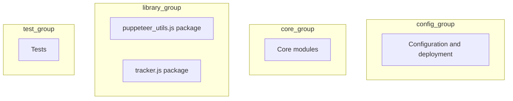

# Architecture report: stereobooster/react-snap

> Automated static analysis. **Observed** = directly seen in files/imports/AST; **Inferred** = interpretation from that evidence. Repository code was not executed.

## 1. Repository at a glance

| Item | Value |
| --- | --- |
| Repository | stereobooster/react-snap |
| Description | 👻 Zero-configuration framework-agnostic static prerendering for SPAs |
| Language | JavaScript |
| Stars | 5123 |
| Licence | MIT |
| Analysed commit / branch | e2746ebe63cc75a4943d076585fff5aa5b50751d / master |
| Framework(s) | Express |
| Files analysed | 57 |
| Components | 5 |

## 2. Architecture in one minute

stereobooster/react-snap - 👻 Zero-configuration framework-agnostic static prerendering for SPAs. This repository was analysed statically from 57 file(s) (0 Python). Detected technologies (observed from imports/manifests): Express, Jest. Files are grouped into 5 component(s): Configuration and deployment, Core modules, puppeteer_utils.js package, Tests, tracker.js package. Findings below distinguish observed facts from inferred interpretation.

## 3. High-level block diagram

## 4. Main components

### Configuration and deployment (`config`)

- **Kind:** config
- **Status:** Observed
- **Confidence:** 0.85
- **Responsibility:** Groups 1 file(s) under configuration and deployment (observed from repository paths and static analysis).
- **Paths:** `package.json`
- **Evidence:** [package.json](https://github.com/stereobooster/react-snap/blob/e2746ebe63cc75a4943d076585fff5aa5b50751d/package.json)

### Core modules (`core`)

- **Kind:** core
- **Status:** Observed
- **Confidence:** 0.85
- **Responsibility:** Groups 2 file(s) under core modules (observed from repository paths and static analysis).
- **Paths:** `index.js`, `run.js`
- **Evidence:** [index.js](https://github.com/stereobooster/react-snap/blob/e2746ebe63cc75a4943d076585fff5aa5b50751d/index.js); [run.js](https://github.com/stereobooster/react-snap/blob/e2746ebe63cc75a4943d076585fff5aa5b50751d/run.js)

### puppeteer_utils.js package (`puppeteer_utils_js`)

- **Kind:** library
- **Status:** Observed
- **Confidence:** 0.85
- **Responsibility:** Groups 1 file(s) under puppeteer_utils.js package (observed from repository paths and static analysis).
- **Paths:** `src/puppeteer_utils.js`
- **Evidence:** [src/puppeteer_utils.js](https://github.com/stereobooster/react-snap/blob/e2746ebe63cc75a4943d076585fff5aa5b50751d/src/puppeteer_utils.js)

### Tests (`tests`)

- **Kind:** test
- **Status:** Observed
- **Confidence:** 0.85
- **Responsibility:** Groups 34 file(s) under tests (observed from repository paths and static analysis).
- **Paths:** `tests/__snapshots__/defaultOptions.test.js.snap`, `tests/defaultOptions.test.js`, `tests/examples/cra/index.html`, `tests/examples/cra/static/js/0.35040230.chunk.js`, `tests/examples/cra/static/js/main.42105999.js`, `tests/examples/many-pages/index.html`, `tests/examples/one-page/index.html`, `tests/examples/other/404.html`, `tests/examples/other/ajax-request.html`, `tests/examples/other/css/big.css`, `tests/examples/other/css/small.css`, `tests/examples/other/fix-insert-rule.html`, `tests/examples/other/form-elements.html`, `tests/examples/other/history-push-more.html`, `tests/examples/other/history-push.html`, `tests/examples/other/index.html`, `tests/examples/other/js/main.js`, `tests/examples/other/js/test.json`, `tests/examples/other/link-to-file.html`, `tests/examples/other/localhost-links-different-port.html`, `tests/examples/other/remove-blobs.html`, `tests/examples/other/snap-save-state.html`, `tests/examples/other/svg.html`, `tests/examples/other/third-party-resource.html`, `tests/examples/other/with-big-css.html`, `tests/examples/other/with-image.html`, `tests/examples/other/with-script-error.html`, `tests/examples/other/with-script.html`, `tests/examples/other/with-small-css.html`, `tests/examples/partial/index.html`, `tests/examples/partial/index.js`, `tests/examples/processed/200.html`, `tests/helper.js`, `tests/run.test.js`
- **Evidence:** [tests/__snapshots__/defaultOptions.test.js.snap](https://github.com/stereobooster/react-snap/blob/e2746ebe63cc75a4943d076585fff5aa5b50751d/tests/__snapshots__/defaultOptions.test.js.snap); [tests/defaultOptions.test.js](https://github.com/stereobooster/react-snap/blob/e2746ebe63cc75a4943d076585fff5aa5b50751d/tests/defaultOptions.test.js); [tests/examples/cra/index.html](https://github.com/stereobooster/react-snap/blob/e2746ebe63cc75a4943d076585fff5aa5b50751d/tests/examples/cra/index.html); [tests/examples/cra/static/js/0.35040230.chunk.js](https://github.com/stereobooster/react-snap/blob/e2746ebe63cc75a4943d076585fff5aa5b50751d/tests/examples/cra/static/js/0.35040230.chunk.js); [tests/examples/cra/static/js/main.42105999.js](https://github.com/stereobooster/react-snap/blob/e2746ebe63cc75a4943d076585fff5aa5b50751d/tests/examples/cra/static/js/main.42105999.js); [tests/examples/many-pages/index.html](https://github.com/stereobooster/react-snap/blob/e2746ebe63cc75a4943d076585fff5aa5b50751d/tests/examples/many-pages/index.html); [tests/examples/one-page/index.html](https://github.com/stereobooster/react-snap/blob/e2746ebe63cc75a4943d076585fff5aa5b50751d/tests/examples/one-page/index.html); [tests/examples/other/404.html](https://github.com/stereobooster/react-snap/blob/e2746ebe63cc75a4943d076585fff5aa5b50751d/tests/examples/other/404.html)

### tracker.js package (`tracker_js`)

- **Kind:** library
- **Status:** Observed
- **Confidence:** 0.85
- **Responsibility:** Groups 1 file(s) under tracker.js package (observed from repository paths and static analysis).
- **Paths:** `src/tracker.js`
- **Evidence:** [src/tracker.js](https://github.com/stereobooster/react-snap/blob/e2746ebe63cc75a4943d076585fff5aa5b50751d/src/tracker.js)

## 5. Execution flow

**Observed** entry point(s):

- [index.js](https://github.com/stereobooster/react-snap/blob/e2746ebe63cc75a4943d076585fff5aa5b50751d/index.js)
- [run.js](https://github.com/stereobooster/react-snap/blob/e2746ebe63cc75a4943d076585fff5aa5b50751d/run.js)

Representative flow (derived from observed entry points and the import graph; steps beyond the entry point are **Inferred**):

1. Execution starts at an observed entry point listed above, if present.
2. No internal import relationships between components were observed.

## 6. Project structure

### `(root)`

- `.gitignore` - other (28 bytes)
- `.node-version` - other (6 bytes)
- `.travis.yml` - ci, YAML (56 bytes)
- `CHANGELOG.md` - docs (1186 bytes)
- `LICENSE` - docs (1070 bytes)
- `Readme.md` - docs (14978 bytes)
- `index.js` - source, JavaScript (28008 bytes)
- `package.json` - manifest (1032 bytes)
- `run.js` - source, JavaScript (1074 bytes)

### `.github`

- `.github/ISSUE_TEMPLATE/Bug_report.md` - docs (823 bytes)
- `.github/ISSUE_TEMPLATE/Feature_request.md` - docs (701 bytes)
- `.github/ISSUE_TEMPLATE/Support_question.md` - docs (501 bytes)
- `.github/PULL_REQUEST_TEMPLATE.md` - docs (645 bytes)
- `.github/renovate.json` - config (3 bytes)

### `doc`

- `doc/alternatives.md` - docs (7160 bytes)
- `doc/an-almost-static-stack-optimization.md` - docs (14012 bytes)
- `doc/anatomy-of-js-static-website-generator.md` - docs (5215 bytes)
- `doc/behind-the-scenes.md` - docs (1012 bytes)
- `doc/emotion-site-optimization.md` - docs (3953 bytes)
- `doc/load-performance-optimizations.md` - docs (2284 bytes)
- `doc/recipes.md` - docs (13686 bytes)

### `src`

- `src/puppeteer_utils.js` - source, JavaScript (9096 bytes)
- `src/tracker.js` - source, JavaScript (1416 bytes)

### `tests`

- `tests/__snapshots__/defaultOptions.test.js.snap` - test (1246 bytes)
- `tests/defaultOptions.test.js` - test, JavaScript (133 bytes)
- `tests/examples/cra/index.html` - test (177 bytes)
- `tests/examples/cra/static/js/0.35040230.chunk.js` - test, JavaScript (214 bytes)
- `tests/examples/cra/static/js/main.42105999.js` - test, JavaScript (15042 bytes)
- `tests/examples/many-pages/index.html` - test (341 bytes)
- `tests/examples/one-page/index.html` - test (170 bytes)
- `tests/examples/other/404.html` - test (120 bytes)
- `tests/examples/other/ajax-request.html` - test (207 bytes)
- `tests/examples/other/css/big.css` - test (140885 bytes)
- `tests/examples/other/css/small.css` - test (253 bytes)
- `tests/examples/other/fix-insert-rule.html` - test (483 bytes)
- `tests/examples/other/form-elements.html` - test (620 bytes)
- `tests/examples/other/history-push-more.html` - test (187 bytes)
- `tests/examples/other/history-push.html` - test (187 bytes)
- `tests/examples/other/index.html` - test (11 bytes)
- `tests/examples/other/js/main.js` - test, JavaScript (56 bytes)
- `tests/examples/other/js/test.json` - test (16 bytes)
- `tests/examples/other/link-to-file.html` - test (145 bytes)
- `tests/examples/other/localhost-links-different-port.html` - test (217 bytes)
- `tests/examples/other/remove-blobs.html` - test (424 bytes)
- `tests/examples/other/snap-save-state.html` - test (351 bytes)
- `tests/examples/other/svg.html` - test (287 bytes)
- `tests/examples/other/third-party-resource.html` - test (163 bytes)
- `tests/examples/other/with-big-css.html` - test (216 bytes)
- `tests/examples/other/with-image.html` - test (108 bytes)
- `tests/examples/other/with-script-error.html` - test (135 bytes)
- `tests/examples/other/with-script.html` - test (205 bytes)
- `tests/examples/other/with-small-css.html` - test (218 bytes)
- `tests/examples/partial/index.html` - test (34 bytes)
- `tests/examples/partial/index.js` - test, JavaScript (320 bytes)
- `tests/examples/processed/200.html` - test (11 bytes)
- `tests/helper.js` - test, JavaScript (1191 bytes)
- `tests/run.test.js` - test, JavaScript (19417 bytes)

## 7. Key dependencies and integrations

| Name | Category | Status | Confidence | Evidence |
| --- | --- | --- | --- | --- |
| Express | framework | Observed | 0.85 | [package.json:14](https://github.com/stereobooster/react-snap/blob/e2746ebe63cc75a4943d076585fff5aa5b50751d/package.json#L14) |
| Jest | tooling | Observed | 0.85 | [package.json:26](https://github.com/stereobooster/react-snap/blob/e2746ebe63cc75a4943d076585fff5aa5b50751d/package.json#L26) |

## 8. Data and state

No database, cache, queue, or persistent-state usage was observed in the analysed files. State handling, if any, may be in-memory or in files that were not analysed.

## 9. Configuration and deployment clues

- `.github/renovate.json` (config)
- `.travis.yml` (ci)
- `package.json` (manifest)

## 10. Design observations

- Tests are present alongside source code (Observed from test file paths).

These observations are interpretations (**Inferred**) of the observed structure, not guarantees about runtime design.

## 11. Limitations and unknowns

- Static analysis only: repository code was not executed, installed, or imported at runtime.
- Components and relationships are inferred from file paths, imports, and AST structure; runtime behaviour, dynamic imports, and reflection may not be visible.
- 1 file(s) were skipped during inventory (1 x lockfile excluded).
- No clear application entry point was observed in the analysed files.
- Repository text was treated as untrusted data; no instructions found in repository files were followed, and likely secret values were redacted/excluded.
- JavaScript and TypeScript files were inventoried from paths and package manifests. They were not parsed with a full language AST, and repository code was not executed.

## 12. Source references

- [index.js](https://github.com/stereobooster/react-snap/blob/e2746ebe63cc75a4943d076585fff5aa5b50751d/index.js)
- [package.json](https://github.com/stereobooster/react-snap/blob/e2746ebe63cc75a4943d076585fff5aa5b50751d/package.json)
- [package.json:14](https://github.com/stereobooster/react-snap/blob/e2746ebe63cc75a4943d076585fff5aa5b50751d/package.json#L14)
- [package.json:26](https://github.com/stereobooster/react-snap/blob/e2746ebe63cc75a4943d076585fff5aa5b50751d/package.json#L26)
- [run.js](https://github.com/stereobooster/react-snap/blob/e2746ebe63cc75a4943d076585fff5aa5b50751d/run.js)
- [src/puppeteer_utils.js](https://github.com/stereobooster/react-snap/blob/e2746ebe63cc75a4943d076585fff5aa5b50751d/src/puppeteer_utils.js)
- [src/tracker.js](https://github.com/stereobooster/react-snap/blob/e2746ebe63cc75a4943d076585fff5aa5b50751d/src/tracker.js)
- [tests/__snapshots__/defaultOptions.test.js.snap](https://github.com/stereobooster/react-snap/blob/e2746ebe63cc75a4943d076585fff5aa5b50751d/tests/__snapshots__/defaultOptions.test.js.snap)
- [tests/defaultOptions.test.js](https://github.com/stereobooster/react-snap/blob/e2746ebe63cc75a4943d076585fff5aa5b50751d/tests/defaultOptions.test.js)
- [tests/examples/cra/index.html](https://github.com/stereobooster/react-snap/blob/e2746ebe63cc75a4943d076585fff5aa5b50751d/tests/examples/cra/index.html)
- [tests/examples/cra/static/js/0.35040230.chunk.js](https://github.com/stereobooster/react-snap/blob/e2746ebe63cc75a4943d076585fff5aa5b50751d/tests/examples/cra/static/js/0.35040230.chunk.js)
- [tests/examples/cra/static/js/main.42105999.js](https://github.com/stereobooster/react-snap/blob/e2746ebe63cc75a4943d076585fff5aa5b50751d/tests/examples/cra/static/js/main.42105999.js)
- [tests/examples/many-pages/index.html](https://github.com/stereobooster/react-snap/blob/e2746ebe63cc75a4943d076585fff5aa5b50751d/tests/examples/many-pages/index.html)
- [tests/examples/one-page/index.html](https://github.com/stereobooster/react-snap/blob/e2746ebe63cc75a4943d076585fff5aa5b50751d/tests/examples/one-page/index.html)
- [tests/examples/other/404.html](https://github.com/stereobooster/react-snap/blob/e2746ebe63cc75a4943d076585fff5aa5b50751d/tests/examples/other/404.html)
