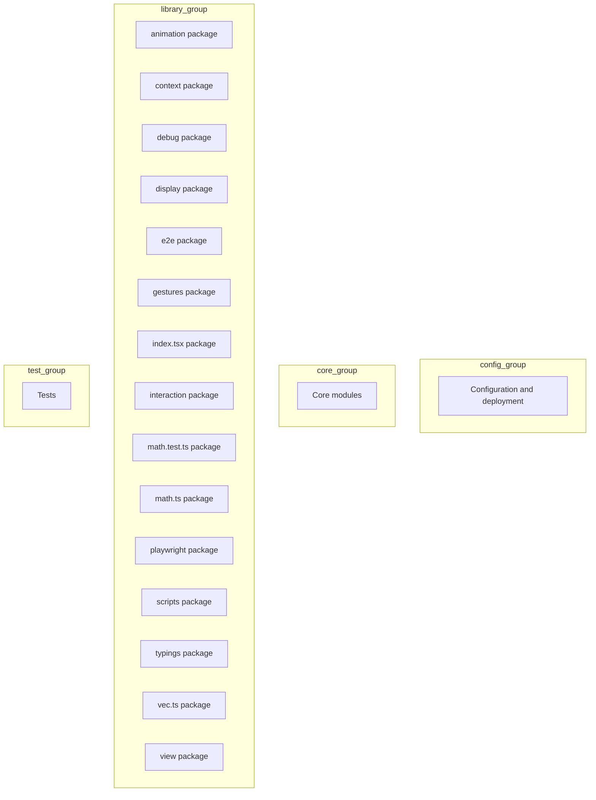

# Architecture report: stevenpetryk/mafs

> Automated static analysis. **Observed** = directly seen in files/imports/AST; **Inferred** = interpretation from that evidence. Repository code was not executed.

## 1. Repository at a glance

| Item | Value |
| --- | --- |
| Repository | stevenpetryk/mafs |
| Description | React components for interactive math |
| Language | TypeScript |
| Stars | 3450 |
| Licence | MIT |
| Analysed commit / branch | e74a3ef465f4ddc98704814d2ae18b73a6cd9dae / main |
| Framework(s) | Next.js, React |
| Files analysed | 217 |
| Components | 18 |

## 2. Architecture in one minute

stevenpetryk/mafs - React components for interactive math. This repository was analysed statically from 217 file(s) (0 Python). Detected technologies (observed from imports/manifests): GitHub Actions, Next.js, React, Tailwind CSS, TypeScript, Vite. Files are grouped into 18 component(s): animation package, Configuration and deployment, context package, Core modules, debug package, display package, e2e package, gestures package. Findings below distinguish observed facts from inferred interpretation.

## 3. High-level block diagram

## 4. Main components

### animation package (`animation`)

- **Kind:** library
- **Status:** Observed
- **Confidence:** 0.85
- **Responsibility:** Groups 1 file(s) under animation package (observed from repository paths and static analysis).
- **Paths:** `src/animation/useStopwatch.ts`
- **Evidence:** [src/animation/useStopwatch.ts](https://github.com/stevenpetryk/mafs/blob/e74a3ef465f4ddc98704814d2ae18b73a6cd9dae/src/animation/useStopwatch.ts)

### Configuration and deployment (`config`)

- **Kind:** config
- **Status:** Observed
- **Confidence:** 0.85
- **Responsibility:** Groups 5 file(s) under configuration and deployment (observed from repository paths and static analysis).
- **Paths:** `api-extractor.json`, `package.json`, `pnpm-workspace.yaml`, `tsconfig.json`, `vercel.json`
- **Evidence:** [api-extractor.json](https://github.com/stevenpetryk/mafs/blob/e74a3ef465f4ddc98704814d2ae18b73a6cd9dae/api-extractor.json); [package.json](https://github.com/stevenpetryk/mafs/blob/e74a3ef465f4ddc98704814d2ae18b73a6cd9dae/package.json); [pnpm-workspace.yaml](https://github.com/stevenpetryk/mafs/blob/e74a3ef465f4ddc98704814d2ae18b73a6cd9dae/pnpm-workspace.yaml); [tsconfig.json](https://github.com/stevenpetryk/mafs/blob/e74a3ef465f4ddc98704814d2ae18b73a6cd9dae/tsconfig.json); [vercel.json](https://github.com/stevenpetryk/mafs/blob/e74a3ef465f4ddc98704814d2ae18b73a6cd9dae/vercel.json)

### context package (`context`)

- **Kind:** library
- **Status:** Observed
- **Confidence:** 0.85
- **Responsibility:** Groups 5 file(s) under context package (observed from repository paths and static analysis).
- **Paths:** `src/context/CoordinateContext.tsx`, `src/context/PaneContext.tsx`, `src/context/SpanContext.tsx`, `src/context/TestContext.tsx`, `src/context/TransformContext.tsx`
- **Evidence:** [src/context/CoordinateContext.tsx](https://github.com/stevenpetryk/mafs/blob/e74a3ef465f4ddc98704814d2ae18b73a6cd9dae/src/context/CoordinateContext.tsx); [src/context/PaneContext.tsx](https://github.com/stevenpetryk/mafs/blob/e74a3ef465f4ddc98704814d2ae18b73a6cd9dae/src/context/PaneContext.tsx); [src/context/SpanContext.tsx](https://github.com/stevenpetryk/mafs/blob/e74a3ef465f4ddc98704814d2ae18b73a6cd9dae/src/context/SpanContext.tsx); [src/context/TestContext.tsx](https://github.com/stevenpetryk/mafs/blob/e74a3ef465f4ddc98704814d2ae18b73a6cd9dae/src/context/TestContext.tsx); [src/context/TransformContext.tsx](https://github.com/stevenpetryk/mafs/blob/e74a3ef465f4ddc98704814d2ae18b73a6cd9dae/src/context/TransformContext.tsx)

### Core modules (`core`)

- **Kind:** core
- **Status:** Observed
- **Confidence:** 0.85
- **Responsibility:** Groups 2 file(s) under core modules (observed from repository paths and static analysis).
- **Paths:** `playwright.config.ts`, `vitest.config.ts`
- **Evidence:** [playwright.config.ts](https://github.com/stevenpetryk/mafs/blob/e74a3ef465f4ddc98704814d2ae18b73a6cd9dae/playwright.config.ts); [vitest.config.ts](https://github.com/stevenpetryk/mafs/blob/e74a3ef465f4ddc98704814d2ae18b73a6cd9dae/vitest.config.ts)

### debug package (`debug`)

- **Kind:** library
- **Status:** Observed
- **Confidence:** 0.85
- **Responsibility:** Groups 3 file(s) under debug package (observed from repository paths and static analysis).
- **Paths:** `src/debug/TransformWidget.tsx`, `src/debug/ViewportInfo.tsx`, `src/debug/index.tsx`
- **Evidence:** [src/debug/TransformWidget.tsx](https://github.com/stevenpetryk/mafs/blob/e74a3ef465f4ddc98704814d2ae18b73a6cd9dae/src/debug/TransformWidget.tsx); [src/debug/ViewportInfo.tsx](https://github.com/stevenpetryk/mafs/blob/e74a3ef465f4ddc98704814d2ae18b73a6cd9dae/src/debug/ViewportInfo.tsx); [src/debug/index.tsx](https://github.com/stevenpetryk/mafs/blob/e74a3ef465f4ddc98704814d2ae18b73a6cd9dae/src/debug/index.tsx)

### display package (`display`)

- **Kind:** library
- **Status:** Observed
- **Confidence:** 0.85
- **Responsibility:** Groups 31 file(s) under display package (observed from repository paths and static analysis).
- **Paths:** `src/display/Circle.tsx`, `src/display/Coordinates/Axes.tsx`, `src/display/Coordinates/Cartesian.tsx`, `src/display/Coordinates/Polar.tsx`, `src/display/Coordinates/index.tsx`, `src/display/Ellipse.tsx`, `src/display/Image.tsx`, `src/display/LaTeX.tsx`, `src/display/Line.tsx`, `src/display/Line/PointAngle.tsx`, `src/display/Line/PointSlope.tsx`, `src/display/Line/Segment.tsx`, `src/display/Line/ThroughPoints.tsx`, `src/display/MovablePointDisplay.test.ts`, `src/display/MovablePointDisplay.tsx`, `src/display/Plot.tsx`, `src/display/Plot/Inequality.tsx`, `src/display/Plot/OfX.tsx`, `src/display/Plot/OfY.tsx`, `src/display/Plot/Parametric.tsx`, `src/display/Plot/PlotUtils.test.ts`, `src/display/Plot/PlotUtils.tsx`, `src/display/Plot/VectorField.tsx`, `src/display/Point.tsx`, `src/display/PolyBase.tsx`, `src/display/Polygon.tsx`, `src/display/Polyline.tsx`, `src/display/Text.tsx`, `src/display/Theme.ts`, `src/display/Transform.tsx`, `src/display/Vector.tsx`
- **Evidence:** [src/display/Circle.tsx](https://github.com/stevenpetryk/mafs/blob/e74a3ef465f4ddc98704814d2ae18b73a6cd9dae/src/display/Circle.tsx); [src/display/Coordinates/Axes.tsx](https://github.com/stevenpetryk/mafs/blob/e74a3ef465f4ddc98704814d2ae18b73a6cd9dae/src/display/Coordinates/Axes.tsx); [src/display/Coordinates/Cartesian.tsx](https://github.com/stevenpetryk/mafs/blob/e74a3ef465f4ddc98704814d2ae18b73a6cd9dae/src/display/Coordinates/Cartesian.tsx); [src/display/Coordinates/Polar.tsx](https://github.com/stevenpetryk/mafs/blob/e74a3ef465f4ddc98704814d2ae18b73a6cd9dae/src/display/Coordinates/Polar.tsx); [src/display/Coordinates/index.tsx](https://github.com/stevenpetryk/mafs/blob/e74a3ef465f4ddc98704814d2ae18b73a6cd9dae/src/display/Coordinates/index.tsx); [src/display/Ellipse.tsx](https://github.com/stevenpetryk/mafs/blob/e74a3ef465f4ddc98704814d2ae18b73a6cd9dae/src/display/Ellipse.tsx); [src/display/Image.tsx](https://github.com/stevenpetryk/mafs/blob/e74a3ef465f4ddc98704814d2ae18b73a6cd9dae/src/display/Image.tsx); [src/display/LaTeX.tsx](https://github.com/stevenpetryk/mafs/blob/e74a3ef465f4ddc98704814d2ae18b73a6cd9dae/src/display/LaTeX.tsx)

### e2e package (`e2e`)

- **Kind:** library
- **Status:** Observed
- **Confidence:** 0.85
- **Responsibility:** Groups 4 file(s) under e2e package (observed from repository paths and static analysis).
- **Paths:** `e2e/components/MafsDragging.tsx`, `e2e/generated-vrt.spec.tsx`, `e2e/mafs-panning.spec.tsx`, `e2e/movable-point.spec.tsx`
- **Evidence:** [e2e/components/MafsDragging.tsx](https://github.com/stevenpetryk/mafs/blob/e74a3ef465f4ddc98704814d2ae18b73a6cd9dae/e2e/components/MafsDragging.tsx); [e2e/generated-vrt.spec.tsx](https://github.com/stevenpetryk/mafs/blob/e74a3ef465f4ddc98704814d2ae18b73a6cd9dae/e2e/generated-vrt.spec.tsx); [e2e/mafs-panning.spec.tsx](https://github.com/stevenpetryk/mafs/blob/e74a3ef465f4ddc98704814d2ae18b73a6cd9dae/e2e/mafs-panning.spec.tsx); [e2e/movable-point.spec.tsx](https://github.com/stevenpetryk/mafs/blob/e74a3ef465f4ddc98704814d2ae18b73a6cd9dae/e2e/movable-point.spec.tsx)

### gestures package (`gestures`)

- **Kind:** library
- **Status:** Observed
- **Confidence:** 0.85
- **Responsibility:** Groups 2 file(s) under gestures package (observed from repository paths and static analysis).
- **Paths:** `src/gestures/useCamera.tsx`, `src/gestures/useWheelEnabler.tsx`
- **Evidence:** [src/gestures/useCamera.tsx](https://github.com/stevenpetryk/mafs/blob/e74a3ef465f4ddc98704814d2ae18b73a6cd9dae/src/gestures/useCamera.tsx); [src/gestures/useWheelEnabler.tsx](https://github.com/stevenpetryk/mafs/blob/e74a3ef465f4ddc98704814d2ae18b73a6cd9dae/src/gestures/useWheelEnabler.tsx)

### index.tsx package (`index_tsx`)

- **Kind:** library
- **Status:** Observed
- **Confidence:** 0.85
- **Responsibility:** Groups 1 file(s) under index.tsx package (observed from repository paths and static analysis).
- **Paths:** `src/index.tsx`
- **Evidence:** [src/index.tsx](https://github.com/stevenpetryk/mafs/blob/e74a3ef465f4ddc98704814d2ae18b73a6cd9dae/src/index.tsx)

### interaction package (`interaction`)

- **Kind:** library
- **Status:** Observed
- **Confidence:** 0.85
- **Responsibility:** Groups 4 file(s) under interaction package (observed from repository paths and static analysis).
- **Paths:** `src/interaction/MovablePoint.test.ts`, `src/interaction/MovablePoint.tsx`, `src/interaction/useMovable.tsx`, `src/interaction/useMovablePoint.tsx`
- **Evidence:** [src/interaction/MovablePoint.test.ts](https://github.com/stevenpetryk/mafs/blob/e74a3ef465f4ddc98704814d2ae18b73a6cd9dae/src/interaction/MovablePoint.test.ts); [src/interaction/MovablePoint.tsx](https://github.com/stevenpetryk/mafs/blob/e74a3ef465f4ddc98704814d2ae18b73a6cd9dae/src/interaction/MovablePoint.tsx); [src/interaction/useMovable.tsx](https://github.com/stevenpetryk/mafs/blob/e74a3ef465f4ddc98704814d2ae18b73a6cd9dae/src/interaction/useMovable.tsx); [src/interaction/useMovablePoint.tsx](https://github.com/stevenpetryk/mafs/blob/e74a3ef465f4ddc98704814d2ae18b73a6cd9dae/src/interaction/useMovablePoint.tsx)

### math.test.ts package (`math_test_ts`)

- **Kind:** library
- **Status:** Observed
- **Confidence:** 0.85
- **Responsibility:** Groups 1 file(s) under math.test.ts package (observed from repository paths and static analysis).
- **Paths:** `src/math.test.ts`
- **Evidence:** [src/math.test.ts](https://github.com/stevenpetryk/mafs/blob/e74a3ef465f4ddc98704814d2ae18b73a6cd9dae/src/math.test.ts)

### math.ts package (`math_ts`)

- **Kind:** library
- **Status:** Observed
- **Confidence:** 0.85
- **Responsibility:** Groups 1 file(s) under math.ts package (observed from repository paths and static analysis).
- **Paths:** `src/math.ts`
- **Evidence:** [src/math.ts](https://github.com/stevenpetryk/mafs/blob/e74a3ef465f4ddc98704814d2ae18b73a6cd9dae/src/math.ts)

### playwright package (`playwright`)

- **Kind:** library
- **Status:** Observed
- **Confidence:** 0.85
- **Responsibility:** Groups 1 file(s) under playwright package (observed from repository paths and static analysis).
- **Paths:** `playwright/index.ts`
- **Evidence:** [playwright/index.ts](https://github.com/stevenpetryk/mafs/blob/e74a3ef465f4ddc98704814d2ae18b73a6cd9dae/playwright/index.ts)

### scripts package (`scripts`)

- **Kind:** library
- **Status:** Observed
- **Confidence:** 0.85
- **Responsibility:** Groups 6 file(s) under scripts package (observed from repository paths and static analysis).
- **Paths:** `scripts/build.ts`, `scripts/dev.ts`, `scripts/docgen-cli.ts`, `scripts/docgen.ts`, `scripts/publish-branch.ts`, `scripts/testgen.ts`
- **Evidence:** [scripts/build.ts](https://github.com/stevenpetryk/mafs/blob/e74a3ef465f4ddc98704814d2ae18b73a6cd9dae/scripts/build.ts); [scripts/dev.ts](https://github.com/stevenpetryk/mafs/blob/e74a3ef465f4ddc98704814d2ae18b73a6cd9dae/scripts/dev.ts); [scripts/docgen-cli.ts](https://github.com/stevenpetryk/mafs/blob/e74a3ef465f4ddc98704814d2ae18b73a6cd9dae/scripts/docgen-cli.ts); [scripts/docgen.ts](https://github.com/stevenpetryk/mafs/blob/e74a3ef465f4ddc98704814d2ae18b73a6cd9dae/scripts/docgen.ts); [scripts/publish-branch.ts](https://github.com/stevenpetryk/mafs/blob/e74a3ef465f4ddc98704814d2ae18b73a6cd9dae/scripts/publish-branch.ts); [scripts/testgen.ts](https://github.com/stevenpetryk/mafs/blob/e74a3ef465f4ddc98704814d2ae18b73a6cd9dae/scripts/testgen.ts)

### Tests (`tests`)

- **Kind:** test
- **Status:** Observed
- **Confidence:** 0.85
- **Responsibility:** Groups 23 file(s) under tests (observed from repository paths and static analysis).
- **Paths:** `tests/frameworks/frameworks.spec.tsx`, `tests/frameworks/nextjs/.gitignore`, `tests/frameworks/nextjs/next.config.mjs`, `tests/frameworks/nextjs/package.json`, `tests/frameworks/nextjs/src/app/globals.css`, `tests/frameworks/nextjs/src/app/layout.tsx`, `tests/frameworks/nextjs/src/app/page.tsx`, `tests/frameworks/nextjs/tsconfig.json`, `tests/frameworks/pnpm-workspace.yaml`, `tests/frameworks/setup.ts`, `tests/frameworks/vite/.gitignore`, `tests/frameworks/vite/index.html`, `tests/frameworks/vite/package.json`, `tests/frameworks/vite/src/assets/react.svg`, `tests/frameworks/vite/src/index.css`, `tests/frameworks/vite/src/main.tsx`, `tests/frameworks/vite/src/vite-env.d.ts`, `tests/frameworks/vite/tsconfig.app.json`, `tests/frameworks/vite/tsconfig.app.tsbuildinfo`, `tests/frameworks/vite/tsconfig.json`, `tests/frameworks/vite/tsconfig.node.json`, `tests/frameworks/vite/tsconfig.node.tsbuildinfo`, `tests/frameworks/vite/vite.config.ts`
- **Evidence:** [tests/frameworks/frameworks.spec.tsx](https://github.com/stevenpetryk/mafs/blob/e74a3ef465f4ddc98704814d2ae18b73a6cd9dae/tests/frameworks/frameworks.spec.tsx); [tests/frameworks/nextjs/.gitignore](https://github.com/stevenpetryk/mafs/blob/e74a3ef465f4ddc98704814d2ae18b73a6cd9dae/tests/frameworks/nextjs/.gitignore); [tests/frameworks/nextjs/next.config.mjs](https://github.com/stevenpetryk/mafs/blob/e74a3ef465f4ddc98704814d2ae18b73a6cd9dae/tests/frameworks/nextjs/next.config.mjs); [tests/frameworks/nextjs/package.json](https://github.com/stevenpetryk/mafs/blob/e74a3ef465f4ddc98704814d2ae18b73a6cd9dae/tests/frameworks/nextjs/package.json); [tests/frameworks/nextjs/src/app/globals.css](https://github.com/stevenpetryk/mafs/blob/e74a3ef465f4ddc98704814d2ae18b73a6cd9dae/tests/frameworks/nextjs/src/app/globals.css); [tests/frameworks/nextjs/src/app/layout.tsx](https://github.com/stevenpetryk/mafs/blob/e74a3ef465f4ddc98704814d2ae18b73a6cd9dae/tests/frameworks/nextjs/src/app/layout.tsx); [tests/frameworks/nextjs/src/app/page.tsx](https://github.com/stevenpetryk/mafs/blob/e74a3ef465f4ddc98704814d2ae18b73a6cd9dae/tests/frameworks/nextjs/src/app/page.tsx); [tests/frameworks/nextjs/tsconfig.json](https://github.com/stevenpetryk/mafs/blob/e74a3ef465f4ddc98704814d2ae18b73a6cd9dae/tests/frameworks/nextjs/tsconfig.json)

### typings package (`typings`)

- **Kind:** library
- **Status:** Observed
- **Confidence:** 0.85
- **Responsibility:** Groups 1 file(s) under typings package (observed from repository paths and static analysis).
- **Paths:** `src/typings/env.d.ts`
- **Evidence:** [src/typings/env.d.ts](https://github.com/stevenpetryk/mafs/blob/e74a3ef465f4ddc98704814d2ae18b73a6cd9dae/src/typings/env.d.ts)

### vec.ts package (`vec_ts`)

- **Kind:** library
- **Status:** Observed
- **Confidence:** 0.85
- **Responsibility:** Groups 1 file(s) under vec.ts package (observed from repository paths and static analysis).
- **Paths:** `src/vec.ts`
- **Evidence:** [src/vec.ts](https://github.com/stevenpetryk/mafs/blob/e74a3ef465f4ddc98704814d2ae18b73a6cd9dae/src/vec.ts)

### view package (`view`)

- **Kind:** library
- **Status:** Observed
- **Confidence:** 0.85
- **Responsibility:** Groups 1 file(s) under view package (observed from repository paths and static analysis).
- **Paths:** `src/view/Mafs.tsx`
- **Evidence:** [src/view/Mafs.tsx](https://github.com/stevenpetryk/mafs/blob/e74a3ef465f4ddc98704814d2ae18b73a6cd9dae/src/view/Mafs.tsx)

## 5. Execution flow

**Observed** entry point(s):

- [playwright/index.ts](https://github.com/stevenpetryk/mafs/blob/e74a3ef465f4ddc98704814d2ae18b73a6cd9dae/playwright/index.ts)
- [src/debug/index.tsx](https://github.com/stevenpetryk/mafs/blob/e74a3ef465f4ddc98704814d2ae18b73a6cd9dae/src/debug/index.tsx)
- [src/display/Coordinates/index.tsx](https://github.com/stevenpetryk/mafs/blob/e74a3ef465f4ddc98704814d2ae18b73a6cd9dae/src/display/Coordinates/index.tsx)
- [src/index.tsx](https://github.com/stevenpetryk/mafs/blob/e74a3ef465f4ddc98704814d2ae18b73a6cd9dae/src/index.tsx)

Representative flow (derived from observed entry points and the import graph; steps beyond the entry point are **Inferred**):

1. Execution starts at an observed entry point listed above, if present.
2. No internal import relationships between components were observed.

## 6. Project structure

### `(root)`

- `.browserslistrc` - other (9 bytes)
- `.envrc` - other (11 bytes)
- `.eslintignore` - other (50 bytes)
- `.eslintrc.json` - config (763 bytes)
- `.gitignore` - other (271 bytes)
- `.nvmrc` - other (8 bytes)
- `.prettierignore` - other (145 bytes)
- `.prettierrc.json` - config (41 bytes)
- `CHANGELOG.md` - docs (10074 bytes)
- `LICENSE` - docs (1053 bytes)
- `README.md` - docs (1275 bytes)
- `api-extractor.json` - config (840 bytes)
- `core.css` - other (2321 bytes)
- `flake.lock` - other (1499 bytes)
- `flake.nix` - other (559 bytes)
- `font.css` - other (91 bytes)
- `package.json` - manifest (2603 bytes)
- `playwright.config.ts` - source, TypeScript (1629 bytes)
- `pnpm-workspace.yaml` - config (19 bytes)
- `tsconfig.json` - config (432 bytes)
- `vercel.json` - config (76 bytes)
- `vitest.config.ts` - source, TypeScript (101 bytes)

### `.api-report`

- `.api-report/mafs.api.md` - docs (16487 bytes)

### `.github`

- `.github/workflows/ci.yml` - ci, YAML (1587 bytes)

### `docs`

- `docs/.gitignore` - docs (410 bytes)
- `docs/app/globals.css` - docs (2377 bytes)
- `docs/app/guides/custom-components/contexts/page.tsx` - docs (3631 bytes)
- `docs/app/guides/custom-components/overview/page.tsx` - docs (686 bytes)
- `docs/app/guides/display/circles/page.tsx` - docs (466 bytes)
- `docs/app/guides/display/coordinates/page.tsx` - docs (2635 bytes)
- `docs/app/guides/display/debug/page.tsx` - docs (2214 bytes)
- `docs/app/guides/display/ellipses/page.tsx` - docs (822 bytes)
- `docs/app/guides/display/images/page.tsx` - docs (1618 bytes)
- `docs/app/guides/display/lines/page.tsx` - docs (1198 bytes)
- `docs/app/guides/display/mafs/page.tsx` - docs (3373 bytes)
- `docs/app/guides/display/plots/page.tsx` - docs (4572 bytes)
- `docs/app/guides/display/points/page.tsx` - docs (492 bytes)
- `docs/app/guides/display/polygons/page.tsx` - docs (651 bytes)
- `docs/app/guides/display/text/page.tsx` - docs (719 bytes)
- `docs/app/guides/display/transform/page.tsx` - docs (2471 bytes)
- `docs/app/guides/display/vectors/page.tsx` - docs (750 bytes)
- `docs/app/guides/examples/bezier-curves/page.tsx` - docs (563 bytes)
- `docs/app/guides/examples/fancy-parabola/page.tsx` - docs (364 bytes)
- `docs/app/guides/examples/projectile-motion/page.tsx` - docs (615 bytes)
- `docs/app/guides/examples/riemann-sums/page.tsx` - docs (901 bytes)
- `docs/app/guides/experimental/animation/page.tsx` - docs (931 bytes)
- `docs/app/guides/experimental/latex/page.tsx` - docs (2303 bytes)
- `docs/app/guides/get-started/hello-f-x/page.tsx` - docs (3818 bytes)
- `docs/app/guides/get-started/installation/page.tsx` - docs (1393 bytes)
- `docs/app/guides/get-started/learning-react/page.tsx` - docs (2228 bytes)
- `docs/app/guides/guides.tsx` - docs (4646 bytes)
- `docs/app/guides/interaction/movable-points/page.tsx` - docs (4308 bytes)
- `docs/app/guides/layout.tsx` - docs (1170 bytes)
- `docs/app/guides/link.tsx` - docs (1127 bytes)
- `docs/app/guides/next-prev-buttons.tsx` - docs (2096 bytes)
- `docs/app/guides/sidebar.tsx` - docs (2446 bytes)
- `docs/app/guides/title.tsx` - docs (616 bytes)
- `docs/app/guides/utility/vec/page.tsx` - docs (3334 bytes)
- `docs/app/layout.tsx` - docs (3611 bytes)
- `docs/app/mafs-usage.css` - docs (602 bytes)
- `docs/app/page.module.css` - docs (0 bytes)
- `docs/app/page.tsx` - docs (1362 bytes)
- `docs/app/syntax-highlighting.css` - docs (1613 bytes)
- `docs/components/Advanced.tsx` - docs (234 bytes)
- `docs/components/Code.tsx` - docs (1477 bytes)
- `docs/components/CodeAndExample.tsx` - docs (5327 bytes)
- `docs/components/Experimental.tsx` - docs (426 bytes)
- `docs/components/MafsLogo.tsx` - docs (4658 bytes)
- `docs/components/PropTable.tsx` - docs (6134 bytes)
- `docs/components/RiemannHomepage.tsx` - docs (2399 bytes)
- `docs/components/ScrollTop.tsx` - docs (433 bytes)
- `docs/components/WIP.tsx` - docs (724 bytes)
- `docs/components/analytics.tsx` - docs (129 bytes)
- `docs/components/guide-examples/.prettierrc.json` - config (40 bytes)
- `docs/components/guide-examples/LinePointAngleExample.tsx` - docs (411 bytes)
- `docs/components/guide-examples/LinePointSlopeExample.tsx` - docs (505 bytes)
- `docs/components/guide-examples/LineSegmentExample.tsx` - docs (477 bytes)
- `docs/components/guide-examples/LineThroughPointsExample.tsx` - docs (489 bytes)
- `docs/components/guide-examples/MovableCircle.tsx` - docs (456 bytes)
- `docs/components/guide-examples/MovableEllipse.tsx` - docs (1612 bytes)
- `docs/components/guide-examples/PlainMafsExample.tsx` - docs (212 bytes)
- `docs/components/guide-examples/PolygonExample.tsx` - docs (534 bytes)
- `docs/components/guide-examples/PolylineExample.tsx` - docs (513 bytes)
- `docs/components/guide-examples/SnapPoint.tsx` - docs (1658 bytes)
- `docs/components/guide-examples/TextExample.tsx` - docs (672 bytes)
- `docs/components/guide-examples/VectorFieldExample.tsx` - docs (541 bytes)
- `docs/components/guide-examples/animation/AnimatedPoint.tsx` - docs (661 bytes)
- `docs/components/guide-examples/custom/pizza-march.tsx` - docs (2487 bytes)
- `docs/components/guide-examples/custom/pizza-slice.tsx` - docs (1300 bytes)
- `docs/components/guide-examples/custom/point-cloud.tsx` - docs (1419 bytes)
- `docs/components/guide-examples/debug/DebugExample.tsx` - docs (648 bytes)
- `docs/components/guide-examples/debug/PaneVisualizerExample.tsx` - docs (237 bytes)
- `docs/components/guide-examples/display/DynamicMovablePoints.tsx` - docs (1042 bytes)
- `docs/components/guide-examples/display/Latex.tsx` - docs (1518 bytes)
- `docs/components/guide-examples/display/LatexDoc.tsx` - docs (348 bytes)
- `docs/components/guide-examples/display/PointsAlongFunction.tsx` - docs (708 bytes)
- `docs/components/guide-examples/display/SimplePoint.tsx` - docs (216 bytes)
- `docs/components/guide-examples/display/coordinates/CartesianCoordinatesConfigExample.tsx` - docs (634 bytes)
- `docs/components/guide-examples/display/coordinates/CartesianCoordinatesExample.tsx` - docs (177 bytes)
- `docs/components/guide-examples/display/coordinates/PolarCoordinatesExample.tsx` - docs (200 bytes)
- `docs/components/guide-examples/display/images/ImageAnchorExample.tsx` - docs (1004 bytes)
- `docs/components/guide-examples/display/images/ImageExample.tsx` - docs (491 bytes)
- `docs/components/guide-examples/display/vectors/VectorExample.tsx` - docs (571 bytes)
- `docs/components/guide-examples/display/viewbox/ContainViewbox.tsx` - docs (323 bytes)
- `docs/components/guide-examples/display/viewbox/StretchViewbox.tsx` - docs (374 bytes)
- `docs/components/guide-examples/display/viewbox/ZoomExample.tsx` - docs (469 bytes)
- `docs/components/guide-examples/examples/BezierCurves.tsx` - docs (4294 bytes)
- `docs/components/guide-examples/examples/FancyParabola.tsx` - docs (712 bytes)
- `docs/components/guide-examples/examples/ProjectileMotion.tsx` - docs (2853 bytes)
- `docs/components/guide-examples/examples/Riemann.tsx` - docs (2743 bytes)
- `docs/components/guide-examples/hello-fx/draggable.tsx` - docs (544 bytes)
- `docs/components/guide-examples/hello-fx/plain.tsx` - docs (177 bytes)
- `docs/components/guide-examples/hello-fx/sine-pi.tsx` - docs (407 bytes)
- `docs/components/guide-examples/hello-fx/sine.tsx` - docs (242 bytes)
- `docs/components/guide-examples/hello-fx/subdivisions.tsx` - docs (194 bytes)
- `docs/components/guide-examples/plots/inequalities.tsx` - docs (645 bytes)
- `docs/components/guide-examples/plots/of-x-and-y.tsx` - docs (363 bytes)
- `docs/components/guide-examples/plots/sine-stress-test.tsx` - docs (528 bytes)
- `docs/components/guide-examples/plots/twisty-boi.tsx` - docs (565 bytes)
- `docs/components/guide-examples/utility/SimpleTransform.tsx` - docs (1090 bytes)
- `docs/components/icons.tsx` - docs (13070 bytes)
- `docs/guide-example-loader.mjs` - docs (2085 bytes)
- `docs/helpers/fancyFx.tsx` - docs (670 bytes)
- `docs/next.config.js` - docs (779 bytes)
- `docs/package.json` - manifest (1051 bytes)
- `docs/postcss.config.js` - docs (113 bytes)
- `docs/public/favicon.svg` - docs (1327 bytes)
- `docs/raw.d.ts` - docs (84 bytes)
- `docs/tailwind.config.js` - docs (441 bytes)
- `docs/tsconfig.json` - config (719 bytes)

### `e2e`

- `e2e/components/MafsDragging.tsx` - source, TypeScript (641 bytes)
- `e2e/generated-vrt.spec.tsx` - source, TypeScript (13961 bytes)
- `e2e/mafs-panning.spec.tsx` - source, TypeScript (628 bytes)
- `e2e/movable-point.spec.tsx` - source, TypeScript (778 bytes)

### `playwright`

- `playwright/index.html` - other (254 bytes)
- `playwright/index.ts` - source, TypeScript (42 bytes)

### `scripts`

- `scripts/build.ts` - source, TypeScript (1747 bytes)
- `scripts/dev.ts` - source, TypeScript (1814 bytes)
- `scripts/docgen-cli.ts` - source, TypeScript (486 bytes)
- `scripts/docgen.ts` - source, TypeScript (764 bytes)
- `scripts/publish-branch.ts` - source, TypeScript (865 bytes)
- `scripts/testgen.ts` - source, TypeScript (2486 bytes)

### `src`

- `src/animation/useStopwatch.ts` - source, TypeScript (1904 bytes)
- `src/context/CoordinateContext.tsx` - source, TypeScript (640 bytes)
- `src/context/PaneContext.tsx` - source, TypeScript (2181 bytes)
- `src/context/SpanContext.tsx` - source, TypeScript (449 bytes)
- `src/context/TestContext.tsx` - source, TypeScript (245 bytes)
- `src/context/TransformContext.tsx` - source, TypeScript (1240 bytes)
- `src/debug/TransformWidget.tsx` - source, TypeScript (1498 bytes)
- `src/debug/ViewportInfo.tsx` - source, TypeScript (1320 bytes)
- `src/debug/index.tsx` - source, TypeScript (159 bytes)
- `src/display/Circle.tsx` - source, TypeScript (426 bytes)
- `src/display/Coordinates/Axes.tsx` - source, TypeScript (2381 bytes)
- `src/display/Coordinates/Cartesian.tsx` - source, TypeScript (5853 bytes)
- `src/display/Coordinates/Polar.tsx` - source, TypeScript (3548 bytes)
- `src/display/Coordinates/index.tsx` - source, TypeScript (146 bytes)
- `src/display/Ellipse.tsx` - source, TypeScript (1408 bytes)
- `src/display/Image.tsx` - source, TypeScript (1536 bytes)
- `src/display/LaTeX.tsx` - source, TypeScript (1536 bytes)
- `src/display/Line.tsx` - source, TypeScript (581 bytes)
- `src/display/Line/PointAngle.tsx` - source, TypeScript (464 bytes)
- `src/display/Line/PointSlope.tsx` - source, TypeScript (404 bytes)
- `src/display/Line/Segment.tsx` - source, TypeScript (1097 bytes)
- `src/display/Line/ThroughPoints.tsx` - source, TypeScript (1763 bytes)
- `src/display/MovablePointDisplay.test.ts` - source, TypeScript (276 bytes)
- `src/display/MovablePointDisplay.tsx` - source, TypeScript (1627 bytes)
- `src/display/Plot.tsx` - source, TypeScript (638 bytes)
- `src/display/Plot/Inequality.tsx` - source, TypeScript (4570 bytes)
- `src/display/Plot/OfX.tsx` - source, TypeScript (979 bytes)
- `src/display/Plot/OfY.tsx` - source, TypeScript (979 bytes)
- `src/display/Plot/Parametric.tsx` - source, TypeScript (2909 bytes)
- `src/display/Plot/PlotUtils.test.ts` - source, TypeScript (529 bytes)
- `src/display/Plot/PlotUtils.tsx` - source, TypeScript (5942 bytes)
- `src/display/Plot/VectorField.tsx` - source, TypeScript (4260 bytes)
- `src/display/Point.tsx` - source, TypeScript (788 bytes)
- `src/display/PolyBase.tsx` - source, TypeScript (1503 bytes)
- `src/display/Polygon.tsx` - source, TypeScript (394 bytes)
- `src/display/Polyline.tsx` - source, TypeScript (485 bytes)
- `src/display/Text.tsx` - source, TypeScript (1848 bytes)
- `src/display/Theme.ts` - source, TypeScript (590 bytes)
- `src/display/Transform.tsx` - source, TypeScript (1618 bytes)
- `src/display/Vector.tsx` - source, TypeScript (1773 bytes)
- `src/gestures/useCamera.tsx` - source, TypeScript (1240 bytes)
- `src/gestures/useWheelEnabler.tsx` - source, TypeScript (992 bytes)
- `src/index.tsx` - source, TypeScript (2438 bytes)
- `src/interaction/MovablePoint.test.ts` - source, TypeScript (241 bytes)
- `src/interaction/MovablePoint.tsx` - source, TypeScript (1211 bytes)
- `src/interaction/useMovable.tsx` - source, TypeScript (3436 bytes)
- `src/interaction/useMovablePoint.tsx` - source, TypeScript (1687 bytes)
- `src/math.test.ts` - source, TypeScript (1503 bytes)
- `src/math.ts` - source, TypeScript (2448 bytes)
- `src/typings/env.d.ts` - source, TypeScript (243 bytes)
- `src/vec.ts` - source, TypeScript (5596 bytes)
- `src/view/Mafs.tsx` - source, TypeScript (11044 bytes)

### `tests`

- `tests/frameworks/frameworks.spec.tsx` - test, TypeScript (2786 bytes)
- `tests/frameworks/nextjs/.gitignore` - test (391 bytes)
- `tests/frameworks/nextjs/next.config.mjs` - test, JavaScript (138 bytes)
- `tests/frameworks/nextjs/package.json` - test (470 bytes)
- `tests/frameworks/nextjs/src/app/globals.css` - test (72 bytes)
- `tests/frameworks/nextjs/src/app/layout.tsx` - test, TypeScript (398 bytes)
- `tests/frameworks/nextjs/src/app/page.tsx` - test, TypeScript (264 bytes)
- `tests/frameworks/nextjs/tsconfig.json` - test (578 bytes)
- `tests/frameworks/pnpm-workspace.yaml` - test (30 bytes)
- `tests/frameworks/setup.ts` - test, TypeScript (795 bytes)
- `tests/frameworks/vite/.gitignore` - test (253 bytes)
- `tests/frameworks/vite/index.html` - test (366 bytes)
- `tests/frameworks/vite/package.json` - test (731 bytes)
- `tests/frameworks/vite/src/assets/react.svg` - test (4126 bytes)
- `tests/frameworks/vite/src/index.css` - test (72 bytes)
- `tests/frameworks/vite/src/main.tsx` - test, TypeScript (404 bytes)
- `tests/frameworks/vite/src/vite-env.d.ts` - test, TypeScript (38 bytes)
- `tests/frameworks/vite/tsconfig.app.json` - test (552 bytes)
- `tests/frameworks/vite/tsconfig.app.tsbuildinfo` - test (67 bytes)
- `tests/frameworks/vite/tsconfig.json` - test (107 bytes)
- `tests/frameworks/vite/tsconfig.node.json` - test (479 bytes)
- `tests/frameworks/vite/tsconfig.node.tsbuildinfo` - test (47 bytes)
- `tests/frameworks/vite/vite.config.ts` - test, TypeScript (163 bytes)

## 7. Key dependencies and integrations

| Name | Category | Status | Confidence | Evidence |
| --- | --- | --- | --- | --- |
| GitHub Actions | ci | Observed | 0.85 | [.github/workflows/ci.yml](https://github.com/stevenpetryk/mafs/blob/e74a3ef465f4ddc98704814d2ae18b73a6cd9dae/.github/workflows/ci.yml) |
| Next.js | framework | Observed | 0.90 | [docs/package.json:6](https://github.com/stevenpetryk/mafs/blob/e74a3ef465f4ddc98704814d2ae18b73a6cd9dae/docs/package.json#L6); [tests/frameworks/nextjs/package.json:2](https://github.com/stevenpetryk/mafs/blob/e74a3ef465f4ddc98704814d2ae18b73a6cd9dae/tests/frameworks/nextjs/package.json#L2) |
| React | framework | Observed | 0.90 | [docs/package.json:12](https://github.com/stevenpetryk/mafs/blob/e74a3ef465f4ddc98704814d2ae18b73a6cd9dae/docs/package.json#L12); [docs/package.json:16](https://github.com/stevenpetryk/mafs/blob/e74a3ef465f4ddc98704814d2ae18b73a6cd9dae/docs/package.json#L16); [package.json:6](https://github.com/stevenpetryk/mafs/blob/e74a3ef465f4ddc98704814d2ae18b73a6cd9dae/package.json#L6); [package.json:60](https://github.com/stevenpetryk/mafs/blob/e74a3ef465f4ddc98704814d2ae18b73a6cd9dae/package.json#L60) |
| Tailwind CSS | library | Observed | 0.85 | [docs/package.json:38](https://github.com/stevenpetryk/mafs/blob/e74a3ef465f4ddc98704814d2ae18b73a6cd9dae/docs/package.json#L38) |
| TypeScript | tooling | Observed | 0.90 | [docs/package.json:28](https://github.com/stevenpetryk/mafs/blob/e74a3ef465f4ddc98704814d2ae18b73a6cd9dae/docs/package.json#L28); [package.json:61](https://github.com/stevenpetryk/mafs/blob/e74a3ef465f4ddc98704814d2ae18b73a6cd9dae/package.json#L61); [tests/frameworks/nextjs/package.json:21](https://github.com/stevenpetryk/mafs/blob/e74a3ef465f4ddc98704814d2ae18b73a6cd9dae/tests/frameworks/nextjs/package.json#L21); [tests/frameworks/vite/package.json:26](https://github.com/stevenpetryk/mafs/blob/e74a3ef465f4ddc98704814d2ae18b73a6cd9dae/tests/frameworks/vite/package.json#L26) |
| Vite | tooling | Observed | 0.90 | [package.json:39](https://github.com/stevenpetryk/mafs/blob/e74a3ef465f4ddc98704814d2ae18b73a6cd9dae/package.json#L39); [tests/frameworks/vite/package.json:2](https://github.com/stevenpetryk/mafs/blob/e74a3ef465f4ddc98704814d2ae18b73a6cd9dae/tests/frameworks/vite/package.json#L2) |
| Vitest | tooling | Observed | 0.85 | [package.json:39](https://github.com/stevenpetryk/mafs/blob/e74a3ef465f4ddc98704814d2ae18b73a6cd9dae/package.json#L39) |
| webpack | tooling | Observed | 0.85 | [docs/package.json:39](https://github.com/stevenpetryk/mafs/blob/e74a3ef465f4ddc98704814d2ae18b73a6cd9dae/docs/package.json#L39) |

## 8. Data and state

No database, cache, queue, or persistent-state usage was observed in the analysed files. State handling, if any, may be in-memory or in files that were not analysed.

## 9. Configuration and deployment clues

- `.eslintrc.json` (config)
- `.github/workflows/ci.yml` (ci)
- `.prettierrc.json` (config)
- `api-extractor.json` (config)
- `docs/components/guide-examples/.prettierrc.json` (config)
- `docs/package.json` (manifest)
- `docs/tsconfig.json` (config)
- `package.json` (manifest)
- `pnpm-workspace.yaml` (config)
- `tsconfig.json` (config)
- `vercel.json` (config)

## 10. Design observations

- Tests are present alongside source code (Observed from test file paths).

These observations are interpretations (**Inferred**) of the observed structure, not guarantees about runtime design.

## 11. Limitations and unknowns

- Static analysis only: repository code was not executed, installed, or imported at runtime.
- Components and relationships are inferred from file paths, imports, and AST structure; runtime behaviour, dynamic imports, and reflection may not be visible.
- 2 file(s) were skipped during inventory (1 x likely secret file excluded; 1 x lockfile excluded).
- No clear application entry point was observed in the analysed files.
- Repository text was treated as untrusted data; no instructions found in repository files were followed, and likely secret values were redacted/excluded.
- JavaScript and TypeScript files were inventoried from paths and package manifests. They were not parsed with a full language AST, and repository code was not executed.

## 12. Source references

- [.github/workflows/ci.yml](https://github.com/stevenpetryk/mafs/blob/e74a3ef465f4ddc98704814d2ae18b73a6cd9dae/.github/workflows/ci.yml)
- [api-extractor.json](https://github.com/stevenpetryk/mafs/blob/e74a3ef465f4ddc98704814d2ae18b73a6cd9dae/api-extractor.json)
- [docs/package.json:6](https://github.com/stevenpetryk/mafs/blob/e74a3ef465f4ddc98704814d2ae18b73a6cd9dae/docs/package.json#L6)
- [docs/package.json:12](https://github.com/stevenpetryk/mafs/blob/e74a3ef465f4ddc98704814d2ae18b73a6cd9dae/docs/package.json#L12)
- [docs/package.json:16](https://github.com/stevenpetryk/mafs/blob/e74a3ef465f4ddc98704814d2ae18b73a6cd9dae/docs/package.json#L16)
- [docs/package.json:28](https://github.com/stevenpetryk/mafs/blob/e74a3ef465f4ddc98704814d2ae18b73a6cd9dae/docs/package.json#L28)
- [docs/package.json:38](https://github.com/stevenpetryk/mafs/blob/e74a3ef465f4ddc98704814d2ae18b73a6cd9dae/docs/package.json#L38)
- [docs/package.json:39](https://github.com/stevenpetryk/mafs/blob/e74a3ef465f4ddc98704814d2ae18b73a6cd9dae/docs/package.json#L39)
- [e2e/components/MafsDragging.tsx](https://github.com/stevenpetryk/mafs/blob/e74a3ef465f4ddc98704814d2ae18b73a6cd9dae/e2e/components/MafsDragging.tsx)
- [e2e/generated-vrt.spec.tsx](https://github.com/stevenpetryk/mafs/blob/e74a3ef465f4ddc98704814d2ae18b73a6cd9dae/e2e/generated-vrt.spec.tsx)
- [e2e/mafs-panning.spec.tsx](https://github.com/stevenpetryk/mafs/blob/e74a3ef465f4ddc98704814d2ae18b73a6cd9dae/e2e/mafs-panning.spec.tsx)
- [e2e/movable-point.spec.tsx](https://github.com/stevenpetryk/mafs/blob/e74a3ef465f4ddc98704814d2ae18b73a6cd9dae/e2e/movable-point.spec.tsx)
- [package.json](https://github.com/stevenpetryk/mafs/blob/e74a3ef465f4ddc98704814d2ae18b73a6cd9dae/package.json)
- [package.json:6](https://github.com/stevenpetryk/mafs/blob/e74a3ef465f4ddc98704814d2ae18b73a6cd9dae/package.json#L6)
- [package.json:39](https://github.com/stevenpetryk/mafs/blob/e74a3ef465f4ddc98704814d2ae18b73a6cd9dae/package.json#L39)
- [package.json:60](https://github.com/stevenpetryk/mafs/blob/e74a3ef465f4ddc98704814d2ae18b73a6cd9dae/package.json#L60)
- [package.json:61](https://github.com/stevenpetryk/mafs/blob/e74a3ef465f4ddc98704814d2ae18b73a6cd9dae/package.json#L61)
- [playwright.config.ts](https://github.com/stevenpetryk/mafs/blob/e74a3ef465f4ddc98704814d2ae18b73a6cd9dae/playwright.config.ts)
- [playwright/index.ts](https://github.com/stevenpetryk/mafs/blob/e74a3ef465f4ddc98704814d2ae18b73a6cd9dae/playwright/index.ts)
- [pnpm-workspace.yaml](https://github.com/stevenpetryk/mafs/blob/e74a3ef465f4ddc98704814d2ae18b73a6cd9dae/pnpm-workspace.yaml)
- [scripts/build.ts](https://github.com/stevenpetryk/mafs/blob/e74a3ef465f4ddc98704814d2ae18b73a6cd9dae/scripts/build.ts)
- [scripts/dev.ts](https://github.com/stevenpetryk/mafs/blob/e74a3ef465f4ddc98704814d2ae18b73a6cd9dae/scripts/dev.ts)
- [scripts/docgen-cli.ts](https://github.com/stevenpetryk/mafs/blob/e74a3ef465f4ddc98704814d2ae18b73a6cd9dae/scripts/docgen-cli.ts)
- [scripts/docgen.ts](https://github.com/stevenpetryk/mafs/blob/e74a3ef465f4ddc98704814d2ae18b73a6cd9dae/scripts/docgen.ts)
- [scripts/publish-branch.ts](https://github.com/stevenpetryk/mafs/blob/e74a3ef465f4ddc98704814d2ae18b73a6cd9dae/scripts/publish-branch.ts)
- [scripts/testgen.ts](https://github.com/stevenpetryk/mafs/blob/e74a3ef465f4ddc98704814d2ae18b73a6cd9dae/scripts/testgen.ts)
- [src/animation/useStopwatch.ts](https://github.com/stevenpetryk/mafs/blob/e74a3ef465f4ddc98704814d2ae18b73a6cd9dae/src/animation/useStopwatch.ts)
- [src/context/CoordinateContext.tsx](https://github.com/stevenpetryk/mafs/blob/e74a3ef465f4ddc98704814d2ae18b73a6cd9dae/src/context/CoordinateContext.tsx)
- [src/context/PaneContext.tsx](https://github.com/stevenpetryk/mafs/blob/e74a3ef465f4ddc98704814d2ae18b73a6cd9dae/src/context/PaneContext.tsx)
- [src/context/SpanContext.tsx](https://github.com/stevenpetryk/mafs/blob/e74a3ef465f4ddc98704814d2ae18b73a6cd9dae/src/context/SpanContext.tsx)
- [src/context/TestContext.tsx](https://github.com/stevenpetryk/mafs/blob/e74a3ef465f4ddc98704814d2ae18b73a6cd9dae/src/context/TestContext.tsx)
- [src/context/TransformContext.tsx](https://github.com/stevenpetryk/mafs/blob/e74a3ef465f4ddc98704814d2ae18b73a6cd9dae/src/context/TransformContext.tsx)
- [src/debug/TransformWidget.tsx](https://github.com/stevenpetryk/mafs/blob/e74a3ef465f4ddc98704814d2ae18b73a6cd9dae/src/debug/TransformWidget.tsx)
- [src/debug/ViewportInfo.tsx](https://github.com/stevenpetryk/mafs/blob/e74a3ef465f4ddc98704814d2ae18b73a6cd9dae/src/debug/ViewportInfo.tsx)
- [src/debug/index.tsx](https://github.com/stevenpetryk/mafs/blob/e74a3ef465f4ddc98704814d2ae18b73a6cd9dae/src/debug/index.tsx)
- [src/display/Circle.tsx](https://github.com/stevenpetryk/mafs/blob/e74a3ef465f4ddc98704814d2ae18b73a6cd9dae/src/display/Circle.tsx)
- [src/display/Coordinates/Axes.tsx](https://github.com/stevenpetryk/mafs/blob/e74a3ef465f4ddc98704814d2ae18b73a6cd9dae/src/display/Coordinates/Axes.tsx)
- [src/display/Coordinates/Cartesian.tsx](https://github.com/stevenpetryk/mafs/blob/e74a3ef465f4ddc98704814d2ae18b73a6cd9dae/src/display/Coordinates/Cartesian.tsx)
- [src/display/Coordinates/Polar.tsx](https://github.com/stevenpetryk/mafs/blob/e74a3ef465f4ddc98704814d2ae18b73a6cd9dae/src/display/Coordinates/Polar.tsx)
- [src/display/Coordinates/index.tsx](https://github.com/stevenpetryk/mafs/blob/e74a3ef465f4ddc98704814d2ae18b73a6cd9dae/src/display/Coordinates/index.tsx)
- [src/display/Ellipse.tsx](https://github.com/stevenpetryk/mafs/blob/e74a3ef465f4ddc98704814d2ae18b73a6cd9dae/src/display/Ellipse.tsx)
- [src/display/Image.tsx](https://github.com/stevenpetryk/mafs/blob/e74a3ef465f4ddc98704814d2ae18b73a6cd9dae/src/display/Image.tsx)
- [src/display/LaTeX.tsx](https://github.com/stevenpetryk/mafs/blob/e74a3ef465f4ddc98704814d2ae18b73a6cd9dae/src/display/LaTeX.tsx)
- [src/gestures/useCamera.tsx](https://github.com/stevenpetryk/mafs/blob/e74a3ef465f4ddc98704814d2ae18b73a6cd9dae/src/gestures/useCamera.tsx)
- [src/gestures/useWheelEnabler.tsx](https://github.com/stevenpetryk/mafs/blob/e74a3ef465f4ddc98704814d2ae18b73a6cd9dae/src/gestures/useWheelEnabler.tsx)
- [src/index.tsx](https://github.com/stevenpetryk/mafs/blob/e74a3ef465f4ddc98704814d2ae18b73a6cd9dae/src/index.tsx)
- [src/interaction/MovablePoint.test.ts](https://github.com/stevenpetryk/mafs/blob/e74a3ef465f4ddc98704814d2ae18b73a6cd9dae/src/interaction/MovablePoint.test.ts)
- [src/interaction/MovablePoint.tsx](https://github.com/stevenpetryk/mafs/blob/e74a3ef465f4ddc98704814d2ae18b73a6cd9dae/src/interaction/MovablePoint.tsx)
- [src/interaction/useMovable.tsx](https://github.com/stevenpetryk/mafs/blob/e74a3ef465f4ddc98704814d2ae18b73a6cd9dae/src/interaction/useMovable.tsx)
- [src/interaction/useMovablePoint.tsx](https://github.com/stevenpetryk/mafs/blob/e74a3ef465f4ddc98704814d2ae18b73a6cd9dae/src/interaction/useMovablePoint.tsx)
- [src/math.test.ts](https://github.com/stevenpetryk/mafs/blob/e74a3ef465f4ddc98704814d2ae18b73a6cd9dae/src/math.test.ts)
- [src/math.ts](https://github.com/stevenpetryk/mafs/blob/e74a3ef465f4ddc98704814d2ae18b73a6cd9dae/src/math.ts)
- [src/typings/env.d.ts](https://github.com/stevenpetryk/mafs/blob/e74a3ef465f4ddc98704814d2ae18b73a6cd9dae/src/typings/env.d.ts)
- [src/vec.ts](https://github.com/stevenpetryk/mafs/blob/e74a3ef465f4ddc98704814d2ae18b73a6cd9dae/src/vec.ts)
- [src/view/Mafs.tsx](https://github.com/stevenpetryk/mafs/blob/e74a3ef465f4ddc98704814d2ae18b73a6cd9dae/src/view/Mafs.tsx)
- [tests/frameworks/frameworks.spec.tsx](https://github.com/stevenpetryk/mafs/blob/e74a3ef465f4ddc98704814d2ae18b73a6cd9dae/tests/frameworks/frameworks.spec.tsx)
- [tests/frameworks/nextjs/.gitignore](https://github.com/stevenpetryk/mafs/blob/e74a3ef465f4ddc98704814d2ae18b73a6cd9dae/tests/frameworks/nextjs/.gitignore)
- [tests/frameworks/nextjs/next.config.mjs](https://github.com/stevenpetryk/mafs/blob/e74a3ef465f4ddc98704814d2ae18b73a6cd9dae/tests/frameworks/nextjs/next.config.mjs)
- [tests/frameworks/nextjs/package.json](https://github.com/stevenpetryk/mafs/blob/e74a3ef465f4ddc98704814d2ae18b73a6cd9dae/tests/frameworks/nextjs/package.json)
- [tests/frameworks/nextjs/package.json:2](https://github.com/stevenpetryk/mafs/blob/e74a3ef465f4ddc98704814d2ae18b73a6cd9dae/tests/frameworks/nextjs/package.json#L2)
- [tests/frameworks/nextjs/package.json:14](https://github.com/stevenpetryk/mafs/blob/e74a3ef465f4ddc98704814d2ae18b73a6cd9dae/tests/frameworks/nextjs/package.json#L14)
- [tests/frameworks/nextjs/package.json:15](https://github.com/stevenpetryk/mafs/blob/e74a3ef465f4ddc98704814d2ae18b73a6cd9dae/tests/frameworks/nextjs/package.json#L15)
- [tests/frameworks/nextjs/package.json:21](https://github.com/stevenpetryk/mafs/blob/e74a3ef465f4ddc98704814d2ae18b73a6cd9dae/tests/frameworks/nextjs/package.json#L21)
- [tests/frameworks/nextjs/src/app/globals.css](https://github.com/stevenpetryk/mafs/blob/e74a3ef465f4ddc98704814d2ae18b73a6cd9dae/tests/frameworks/nextjs/src/app/globals.css)
- [tests/frameworks/nextjs/src/app/layout.tsx](https://github.com/stevenpetryk/mafs/blob/e74a3ef465f4ddc98704814d2ae18b73a6cd9dae/tests/frameworks/nextjs/src/app/layout.tsx)
- [tests/frameworks/nextjs/src/app/page.tsx](https://github.com/stevenpetryk/mafs/blob/e74a3ef465f4ddc98704814d2ae18b73a6cd9dae/tests/frameworks/nextjs/src/app/page.tsx)
- [tests/frameworks/nextjs/tsconfig.json](https://github.com/stevenpetryk/mafs/blob/e74a3ef465f4ddc98704814d2ae18b73a6cd9dae/tests/frameworks/nextjs/tsconfig.json)
- [tests/frameworks/vite/package.json:2](https://github.com/stevenpetryk/mafs/blob/e74a3ef465f4ddc98704814d2ae18b73a6cd9dae/tests/frameworks/vite/package.json#L2)
- [tests/frameworks/vite/package.json:14](https://github.com/stevenpetryk/mafs/blob/e74a3ef465f4ddc98704814d2ae18b73a6cd9dae/tests/frameworks/vite/package.json#L14)
- [tests/frameworks/vite/package.json:15](https://github.com/stevenpetryk/mafs/blob/e74a3ef465f4ddc98704814d2ae18b73a6cd9dae/tests/frameworks/vite/package.json#L15)
- [tests/frameworks/vite/package.json:26](https://github.com/stevenpetryk/mafs/blob/e74a3ef465f4ddc98704814d2ae18b73a6cd9dae/tests/frameworks/vite/package.json#L26)
- [tsconfig.json](https://github.com/stevenpetryk/mafs/blob/e74a3ef465f4ddc98704814d2ae18b73a6cd9dae/tsconfig.json)
- [vercel.json](https://github.com/stevenpetryk/mafs/blob/e74a3ef465f4ddc98704814d2ae18b73a6cd9dae/vercel.json)
- [vitest.config.ts](https://github.com/stevenpetryk/mafs/blob/e74a3ef465f4ddc98704814d2ae18b73a6cd9dae/vitest.config.ts)
