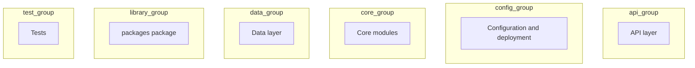

# Architecture report: styled-components/styled-components

> Automated static analysis. **Observed** = directly seen in files/imports/AST; **Inferred** = interpretation from that evidence. Repository code was not executed.

## 1. Repository at a glance

| Item | Value |
| --- | --- |
| Repository | styled-components/styled-components |
| Description | Fast, expressive styling for React. Server components, client components, streaming SSR, React Native—one API. |
| Language | TypeScript |
| Stars | 41048 |
| Licence | MIT |
| Analysed commit / branch | e2aa1c8f6e40b74ae164e7489f68067019d47772 / main |
| Framework(s) | Next.js, React |
| Files analysed | 800 |
| Components | 6 |

## 2. Architecture in one minute

styled-components/styled-components - Fast, expressive styling for React. Server components, client components, streaming SSR, React Native—one API.. This repository was analysed statically from 800 file(s) (0 Python). Detected technologies (observed from imports/manifests): GitHub Actions, Next.js, React, Tailwind CSS, Jest, TypeScript. Files are grouped into 6 component(s): API layer, Configuration and deployment, Core modules, Data layer, packages package, Tests. Findings below distinguish observed facts from inferred interpretation.

## 3. High-level block diagram

## 4. Main components

### API layer (`api_layer`)

- **Kind:** api
- **Status:** Observed
- **Confidence:** 0.85
- **Responsibility:** Groups 6 file(s) under api layer (observed from repository paths and static analysis).
- **Paths:** `packages/styled-components/src/native/transform/handlers/background.ts`, `packages/styled-components/src/native/transform/handlers/border.ts`, `packages/styled-components/src/native/transform/handlers/flex.ts`, `packages/styled-components/src/native/transform/handlers/font.ts`, `packages/styled-components/src/native/transform/handlers/spacing.ts`, `packages/styled-components/src/native/transform/handlers/text.ts`
- **Evidence:** [packages/styled-components/src/native/transform/handlers/background.ts](https://github.com/styled-components/styled-components/blob/e2aa1c8f6e40b74ae164e7489f68067019d47772/packages/styled-components/src/native/transform/handlers/background.ts); [packages/styled-components/src/native/transform/handlers/border.ts](https://github.com/styled-components/styled-components/blob/e2aa1c8f6e40b74ae164e7489f68067019d47772/packages/styled-components/src/native/transform/handlers/border.ts); [packages/styled-components/src/native/transform/handlers/flex.ts](https://github.com/styled-components/styled-components/blob/e2aa1c8f6e40b74ae164e7489f68067019d47772/packages/styled-components/src/native/transform/handlers/flex.ts); [packages/styled-components/src/native/transform/handlers/font.ts](https://github.com/styled-components/styled-components/blob/e2aa1c8f6e40b74ae164e7489f68067019d47772/packages/styled-components/src/native/transform/handlers/font.ts); [packages/styled-components/src/native/transform/handlers/spacing.ts](https://github.com/styled-components/styled-components/blob/e2aa1c8f6e40b74ae164e7489f68067019d47772/packages/styled-components/src/native/transform/handlers/spacing.ts); [packages/styled-components/src/native/transform/handlers/text.ts](https://github.com/styled-components/styled-components/blob/e2aa1c8f6e40b74ae164e7489f68067019d47772/packages/styled-components/src/native/transform/handlers/text.ts)

### Configuration and deployment (`config`)

- **Kind:** config
- **Status:** Observed
- **Confidence:** 0.85
- **Responsibility:** Groups 23 file(s) under configuration and deployment (observed from repository paths and static analysis).
- **Paths:** `package.json`, `packages/benchmarks/package.json`, `packages/ios-benchmark/app.json`, `packages/ios-benchmark/ios/iosbench/Images.xcassets/AppIcon.appiconset/Contents.json`, `packages/ios-benchmark/ios/iosbench/Images.xcassets/Contents.json`, `packages/ios-benchmark/package.json`, `packages/ios-benchmark/tsconfig.json`, `packages/native-showcase/android/app/build.gradle`, `packages/native-showcase/android/build.gradle`, `packages/native-showcase/app.json`, `packages/native-showcase/ios/NativeShowcase/Images.xcassets/AppIcon.appiconset/Contents.json`, `packages/native-showcase/ios/NativeShowcase/Images.xcassets/Contents.json`, `packages/native-showcase/ios/Podfile.properties.json`, `packages/native-showcase/package.json`, `packages/native-showcase/tsconfig.json`, `packages/sandbox/package.json`, `packages/sandbox/tsconfig.composite.json`, `packages/sandbox/tsconfig.json`, `packages/styled-components/native/package.json`, `packages/styled-components/native/reanimated/package.json`, `packages/styled-components/native/web-bridge/package.json`, `packages/styled-components/package.json`, `packages/styled-components/plugins/package.json`
- **Evidence:** [package.json](https://github.com/styled-components/styled-components/blob/e2aa1c8f6e40b74ae164e7489f68067019d47772/package.json); [packages/benchmarks/package.json](https://github.com/styled-components/styled-components/blob/e2aa1c8f6e40b74ae164e7489f68067019d47772/packages/benchmarks/package.json); [packages/ios-benchmark/app.json](https://github.com/styled-components/styled-components/blob/e2aa1c8f6e40b74ae164e7489f68067019d47772/packages/ios-benchmark/app.json); [packages/ios-benchmark/ios/iosbench/Images.xcassets/AppIcon.appiconset/Contents.json](https://github.com/styled-components/styled-components/blob/e2aa1c8f6e40b74ae164e7489f68067019d47772/packages/ios-benchmark/ios/iosbench/Images.xcassets/AppIcon.appiconset/Contents.json); [packages/ios-benchmark/ios/iosbench/Images.xcassets/Contents.json](https://github.com/styled-components/styled-components/blob/e2aa1c8f6e40b74ae164e7489f68067019d47772/packages/ios-benchmark/ios/iosbench/Images.xcassets/Contents.json); [packages/ios-benchmark/package.json](https://github.com/styled-components/styled-components/blob/e2aa1c8f6e40b74ae164e7489f68067019d47772/packages/ios-benchmark/package.json); [packages/ios-benchmark/tsconfig.json](https://github.com/styled-components/styled-components/blob/e2aa1c8f6e40b74ae164e7489f68067019d47772/packages/ios-benchmark/tsconfig.json); [packages/native-showcase/android/app/build.gradle](https://github.com/styled-components/styled-components/blob/e2aa1c8f6e40b74ae164e7489f68067019d47772/packages/native-showcase/android/app/build.gradle)

### Core modules (`core`)

- **Kind:** core
- **Status:** Observed
- **Confidence:** 0.85
- **Responsibility:** Groups 2 file(s) under core modules (observed from repository paths and static analysis).
- **Paths:** `babel-preset.cjs`, `babel.config.cjs`
- **Evidence:** [babel-preset.cjs](https://github.com/styled-components/styled-components/blob/e2aa1c8f6e40b74ae164e7489f68067019d47772/babel-preset.cjs); [babel.config.cjs](https://github.com/styled-components/styled-components/blob/e2aa1c8f6e40b74ae164e7489f68067019d47772/babel.config.cjs)

### Data layer (`data_layer`)

- **Kind:** data
- **Status:** Observed
- **Confidence:** 0.85
- **Responsibility:** Groups 11 file(s) under data layer (observed from repository paths and static analysis).
- **Paths:** `packages/styled-components/src/models/Keyframes.ts`, `packages/styled-components/src/models/NativeStyle.ts`, `packages/styled-components/src/models/ServerStyleSheet.tsx`, `packages/styled-components/src/models/StyleSheetManager.tsx`, `packages/styled-components/src/models/StyledComponent.ts`, `packages/styled-components/src/models/StyledNativeComponent.ts`, `packages/styled-components/src/models/ThemeProvider.tsx`, `packages/styled-components/src/models/WebGlobalStyle.ts`, `packages/styled-components/src/models/WebStyle.ts`, `packages/styled-components/src/models/compileNative.ts`, `packages/styled-components/src/models/serverScope.ts`
- **Evidence:** [packages/styled-components/src/models/Keyframes.ts](https://github.com/styled-components/styled-components/blob/e2aa1c8f6e40b74ae164e7489f68067019d47772/packages/styled-components/src/models/Keyframes.ts); [packages/styled-components/src/models/NativeStyle.ts](https://github.com/styled-components/styled-components/blob/e2aa1c8f6e40b74ae164e7489f68067019d47772/packages/styled-components/src/models/NativeStyle.ts); [packages/styled-components/src/models/ServerStyleSheet.tsx](https://github.com/styled-components/styled-components/blob/e2aa1c8f6e40b74ae164e7489f68067019d47772/packages/styled-components/src/models/ServerStyleSheet.tsx); [packages/styled-components/src/models/StyleSheetManager.tsx](https://github.com/styled-components/styled-components/blob/e2aa1c8f6e40b74ae164e7489f68067019d47772/packages/styled-components/src/models/StyleSheetManager.tsx); [packages/styled-components/src/models/StyledComponent.ts](https://github.com/styled-components/styled-components/blob/e2aa1c8f6e40b74ae164e7489f68067019d47772/packages/styled-components/src/models/StyledComponent.ts); [packages/styled-components/src/models/StyledNativeComponent.ts](https://github.com/styled-components/styled-components/blob/e2aa1c8f6e40b74ae164e7489f68067019d47772/packages/styled-components/src/models/StyledNativeComponent.ts); [packages/styled-components/src/models/ThemeProvider.tsx](https://github.com/styled-components/styled-components/blob/e2aa1c8f6e40b74ae164e7489f68067019d47772/packages/styled-components/src/models/ThemeProvider.tsx); [packages/styled-components/src/models/WebGlobalStyle.ts](https://github.com/styled-components/styled-components/blob/e2aa1c8f6e40b74ae164e7489f68067019d47772/packages/styled-components/src/models/WebGlobalStyle.ts)

### packages package (`packages`)

- **Kind:** library
- **Status:** Observed
- **Confidence:** 0.85
- **Responsibility:** Groups 408 file(s) under packages package (observed from repository paths and static analysis).
- **Paths:** `packages/benchmarks/babel.config.js`, `packages/benchmarks/headless/concurrent.mjs`, `packages/benchmarks/headless/creation.mjs`, `packages/benchmarks/headless/lib/print-table.mjs`, `packages/benchmarks/headless/rsc.mjs`, `packages/benchmarks/headless/ssr.mjs`, `packages/benchmarks/src/app/App.js`, `packages/benchmarks/src/app/Benchmark/index.js`, `packages/benchmarks/src/app/Benchmark/math.js`, `packages/benchmarks/src/app/Benchmark/timing.js`, `packages/benchmarks/src/app/Button.js`, `packages/benchmarks/src/app/Icons.js`, `packages/benchmarks/src/app/Layout.js`, `packages/benchmarks/src/app/ReportCard.js`, `packages/benchmarks/src/app/Text.js`, `packages/benchmarks/src/app/constants.js`, `packages/benchmarks/src/cases/ConcurrentResponsiveness.tsx`, `packages/benchmarks/src/cases/ParentRerender.tsx`, `packages/benchmarks/src/cases/SierpinskiTriangle.tsx`, `packages/benchmarks/src/cases/Tree.tsx`, `packages/benchmarks/src/impl.js`, `packages/benchmarks/src/implementations/emotion/Box.js`, `packages/benchmarks/src/implementations/emotion/Dot.js`, `packages/benchmarks/src/implementations/emotion/Provider.js`, `packages/benchmarks/src/implementations/emotion/View.js`, `packages/benchmarks/src/implementations/emotion/index.js`, `packages/benchmarks/src/implementations/goober/Box.js`, `packages/benchmarks/src/implementations/goober/Dot.js`, `packages/benchmarks/src/implementations/goober/Provider.js`, `packages/benchmarks/src/implementations/goober/View.js`, `packages/benchmarks/src/implementations/goober/index.js`, `packages/benchmarks/src/implementations/inline-styles/Box.js`, `packages/benchmarks/src/implementations/inline-styles/Dot.js`, `packages/benchmarks/src/implementations/inline-styles/Provider.js`, `packages/benchmarks/src/implementations/inline-styles/View.js`, `packages/benchmarks/src/implementations/inline-styles/index.js`, `packages/benchmarks/src/implementations/react-native-web/Box.js`, `packages/benchmarks/src/implementations/react-native-web/Dot.js`, `packages/benchmarks/src/implementations/react-native-web/Provider.js`, `packages/benchmarks/src/implementations/react-native-web/index.js`, `packages/benchmarks/src/implementations/styled-components-native-v6/Box.js`, `packages/benchmarks/src/implementations/styled-components-native-v6/Dot.js`, `packages/benchmarks/src/implementations/styled-components-native-v6/Provider.js`, `packages/benchmarks/src/implementations/styled-components-native-v6/index.js`, `packages/benchmarks/src/implementations/styled-components-native/Box.js`, `packages/benchmarks/src/implementations/styled-components-native/Dot.js`, `packages/benchmarks/src/implementations/styled-components-native/Provider.js`, `packages/benchmarks/src/implementations/styled-components-native/index.js`, `packages/benchmarks/src/implementations/styled-components-object/Box.js`, `packages/benchmarks/src/implementations/styled-components-object/Dot.js`, `packages/benchmarks/src/implementations/styled-components-object/Provider.js`, `packages/benchmarks/src/implementations/styled-components-object/View.js`, `packages/benchmarks/src/implementations/styled-components-object/index.js`, `packages/benchmarks/src/implementations/styled-components-v6/Box.js`, `packages/benchmarks/src/implementations/styled-components-v6/Dot.js`, `packages/benchmarks/src/implementations/styled-components-v6/Provider.js`, `packages/benchmarks/src/implementations/styled-components-v6/View.js`, `packages/benchmarks/src/implementations/styled-components-v6/index.js`, `packages/benchmarks/src/implementations/styled-components/Box.js`, `packages/benchmarks/src/implementations/styled-components/Dot.js`, `packages/benchmarks/src/implementations/styled-components/Provider.js`, `packages/benchmarks/src/implementations/styled-components/View.js`, `packages/benchmarks/src/implementations/styled-components/index.js`, `packages/benchmarks/src/implementations/styled-jsx/Box.js`, `packages/benchmarks/src/implementations/styled-jsx/Dot.js`, `packages/benchmarks/src/implementations/styled-jsx/Provider.js`, `packages/benchmarks/src/implementations/styled-jsx/View.js`, `packages/benchmarks/src/implementations/styled-jsx/index.js`, `packages/benchmarks/src/implementations/tailwind/Box.js`, `packages/benchmarks/src/implementations/tailwind/Dot.js`, `packages/benchmarks/src/implementations/tailwind/Provider.js`, `packages/benchmarks/src/implementations/tailwind/View.js`, `packages/benchmarks/src/implementations/tailwind/index.js`, `packages/benchmarks/src/index.js`, `packages/benchmarks/webpack.config.js`, `packages/ios-benchmark/App.tsx`, `packages/ios-benchmark/babel.config.js`, `packages/ios-benchmark/index.js`, `packages/ios-benchmark/ios/iosbench/SCProfiler.h`, `packages/ios-benchmark/metro.config.js`, `packages/ios-benchmark/scripts/add-native-files.mjs`, `packages/ios-benchmark/scripts/analyze-profile.mjs`, `packages/ios-benchmark/scripts/bench-receiver.mjs`, `packages/ios-benchmark/scripts/format-report.mjs`, `packages/ios-benchmark/scripts/run-bench.mjs`, `packages/ios-benchmark/src/app/App.tsx`, `packages/ios-benchmark/src/app/Benchmark/index.tsx`, `packages/ios-benchmark/src/app/Benchmark/math.ts`, `packages/ios-benchmark/src/app/Benchmark/timing.ts`, `packages/ios-benchmark/src/cases/ParentRerender.tsx`, `packages/ios-benchmark/src/cases/ParentRerenderStatic.tsx`, `packages/ios-benchmark/src/cases/Tree.tsx`, `packages/ios-benchmark/src/cases/TreeStatic.tsx`, `packages/ios-benchmark/src/cases/types.ts`, `packages/ios-benchmark/src/impl.ts`, `packages/ios-benchmark/src/implementations/styled-components-native-v6/Box.tsx`, `packages/ios-benchmark/src/implementations/styled-components-native-v6/BoxStatic.tsx`, `packages/ios-benchmark/src/implementations/styled-components-native-v6/Wrapper.tsx`, `packages/ios-benchmark/src/implementations/styled-components-native-v6/index.ts`, `packages/ios-benchmark/src/implementations/styled-components-native/Box.tsx`, `packages/ios-benchmark/src/implementations/styled-components-native/BoxStatic.tsx`, `packages/ios-benchmark/src/implementations/styled-components-native/Wrapper.tsx`, `packages/ios-benchmark/src/implementations/styled-components-native/index.ts`, `packages/ios-benchmark/src/implementations/vanilla-stylesheet/Box.tsx`, `packages/ios-benchmark/src/implementations/vanilla-stylesheet/BoxStatic.tsx`, `packages/ios-benchmark/src/implementations/vanilla-stylesheet/Wrapper.tsx`, `packages/ios-benchmark/src/implementations/vanilla-stylesheet/index.ts`, `packages/ios-benchmark/src/tests.ts`, `packages/native-showcase/app/+html.tsx`, `packages/native-showcase/app/_layout.tsx`, `packages/native-showcase/app/index.tsx`, `packages/native-showcase/babel.config.js`, `packages/native-showcase/ios/NativeShowcase/NativeShowcase-Bridging-Header.h`, `packages/native-showcase/metro.config.js`, `packages/native-showcase/plugins/with-skip-foojay.js`, `packages/native-showcase/src/components/ErrorBoundary.tsx`, `packages/native-showcase/src/components/FeatureChip.tsx`, `packages/native-showcase/src/components/FeatureJumpSelect.tsx`, `packages/native-showcase/src/components/FpsMeter.tsx`, `packages/native-showcase/src/components/Markdown.tsx`, `packages/native-showcase/src/components/ScreenScaffold.tsx`, `packages/native-showcase/src/components/WidgetCase.tsx`, `packages/native-showcase/src/components/captionStyles.ts`, `packages/native-showcase/src/theme/tokens.ts`, `packages/native-showcase/src/widgets/AccentColorBoard.tsx`, `packages/native-showcase/src/widgets/AnchoredTooltip.tsx`, `packages/native-showcase/src/widgets/AspectRatioGallery.tsx`, `packages/native-showcase/src/widgets/AttrDrivenSizing.tsx`, `packages/native-showcase/src/widgets/AttributeVariants.tsx`, `packages/native-showcase/src/widgets/BackgroundBlendStudio.tsx`, `packages/native-showcase/src/widgets/BackgroundShorthandBoard.tsx`, `packages/native-showcase/src/widgets/BlendModeBoard.tsx`, `packages/native-showcase/src/widgets/BoxSizingHyphensBoard.tsx`, `packages/native-showcase/src/widgets/CaretColorBoard.tsx`, `packages/native-showcase/src/widgets/ColorFunctionsLab.tsx`, `packages/native-showcase/src/widgets/CompositeRules.tsx`, `packages/native-showcase/src/widgets/ContainerQueryCard.tsx`, `packages/native-showcase/src/widgets/ContainerUnitsKnob.tsx`, `packages/native-showcase/src/widgets/CornerShapeBoard.tsx`, `packages/native-showcase/src/widgets/CssVariablesBoard.tsx`, `packages/native-showcase/src/widgets/DirectionBoard.tsx`, `packages/native-showcase/src/widgets/EmLhCascadeBoard.tsx`, `packages/native-showcase/src/widgets/FieldSizingBoard.tsx`, `packages/native-showcase/src/widgets/FilterStack.tsx`, `packages/native-showcase/src/widgets/GradientPalette.tsx`, `packages/native-showcase/src/widgets/GridLayoutBoard.tsx`, `packages/native-showcase/src/widgets/GridTiles.tsx`, `packages/native-showcase/src/widgets/HasSelectorBoard.tsx`, `packages/native-showcase/src/widgets/ImportantBoard.tsx`, `packages/native-showcase/src/widgets/InteractivityBoard.tsx`, `packages/native-showcase/src/widgets/KeyframeOrchestra.tsx`, `packages/native-showcase/src/widgets/LightDarkSwatch.tsx`, `packages/native-showcase/src/widgets/LogicalSpacingDial.tsx`, `packages/native-showcase/src/widgets/MathFunctionsLab.tsx`, `packages/native-showcase/src/widgets/MediaRangeBars.tsx`, `packages/native-showcase/src/widgets/ObjectFitBoard.tsx`, `packages/native-showcase/src/widgets/PlaceShelf.tsx`, `packages/native-showcase/src/widgets/PlatonicLogo.tsx`, `packages/native-showcase/src/widgets/PressInteractive.tsx`, `packages/native-showcase/src/widgets/PropertyRegistration.tsx`, `packages/native-showcase/src/widgets/ReducedMotionBeacon.tsx`, `packages/native-showcase/src/widgets/RelativeUnitsScale.tsx`, `packages/native-showcase/src/widgets/SafeAreaInsetsBadge.tsx`, `packages/native-showcase/src/widgets/ScrollStory.tsx`, `packages/native-showcase/src/widgets/ScrollSurfacesBoard.tsx`, `packages/native-showcase/src/widgets/SelectorComboBoard.tsx`, `packages/native-showcase/src/widgets/ShadowComposer.tsx`, `packages/native-showcase/src/widgets/SiblingNthBoard.tsx`, `packages/native-showcase/src/widgets/SnapCarousel.tsx`, `packages/native-showcase/src/widgets/StandaloneTransforms.tsx`, `packages/native-showcase/src/widgets/SystemColorsBoard.tsx`, `packages/native-showcase/src/widgets/TextDecorationAlignment.tsx`, `packages/native-showcase/src/widgets/TextInputAlignment.tsx`, `packages/native-showcase/src/widgets/TextInputStates.tsx`, `packages/native-showcase/src/widgets/TextOverflowBoard.tsx`, `packages/native-showcase/src/widgets/TextWrapShelf.tsx`, `packages/native-showcase/src/widgets/ThemeOverrides.tsx`, `packages/native-showcase/src/widgets/TransformPlayground.tsx`, `packages/native-showcase/src/widgets/TransitionGallery.tsx`, `packages/native-showcase/src/widgets/TreeCountingStaircase.tsx`, `packages/native-showcase/src/widgets/TypeFeaturesShelf.tsx`, `packages/native-showcase/src/widgets/ViewportUnitsRibbon.tsx`, `packages/native-showcase/src/widgets/registry.ts`, `packages/sandbox/app/client-example/page.tsx`, `packages/sandbox/app/client-example/testing-harness.tsx`, `packages/sandbox/app/components/auto-test.tsx`, `packages/sandbox/app/components/client-button.tsx`, `packages/sandbox/app/components/count-badge.tsx`, `packages/sandbox/app/components/sidebar.tsx`, `packages/sandbox/app/components/test-summary.tsx`, `packages/sandbox/app/components/test-ui.tsx`, `packages/sandbox/app/components/theme-provider.tsx`, `packages/sandbox/app/container-queries/harness.tsx`, `packages/sandbox/app/container-queries/page.tsx`, `packages/sandbox/app/global-style-test/autopilot-client.tsx`, `packages/sandbox/app/global-style-test/client-dedup-client.tsx`, `packages/sandbox/app/global-style-test/global-style-checks.tsx`, `packages/sandbox/app/global-style-test/layout.tsx`, `packages/sandbox/app/global-style-test/nav-client.tsx`, `packages/sandbox/app/global-style-test/page-a/page.tsx`, `packages/sandbox/app/global-style-test/page-b/page.tsx`, `packages/sandbox/app/global-style-test/page.tsx`, `packages/sandbox/app/layout.tsx`, `packages/sandbox/app/lib/dark-theme-script.ts`, `packages/sandbox/app/lib/registry.tsx`, `packages/sandbox/app/lib/test-themes.ts`, `packages/sandbox/app/lib/theme.ts`, `packages/sandbox/app/page.tsx`, `packages/sandbox/app/perf/dashboard/page.tsx`, `packages/sandbox/app/perf/data-grid/page.tsx`, `packages/sandbox/app/perf/form/page.tsx`, `packages/sandbox/app/perf/lib/data-generators.ts`, `packages/sandbox/app/perf/lib/timer-display.tsx`, `packages/sandbox/app/perf/lib/use-render-timer.ts`, `packages/sandbox/app/perf/list/page.tsx`, `packages/sandbox/app/perf/types/page.tsx`, `packages/sandbox/app/rsc/page.tsx`, `packages/sandbox/app/suspense-5808/page.tsx`, `packages/sandbox/app/test-augmentation-typeof.d.ts`, `packages/sandbox/app/test-augmentation-typeof.ts`, `packages/sandbox/app/test-augmentation.ts`, `packages/sandbox/app/test-emit-theme.ts`, `packages/sandbox/app/types/styled.d.ts`, `packages/sandbox/app/view-transitions/harness.tsx`, `packages/sandbox/app/view-transitions/page.tsx`, `packages/sandbox/next-env.d.ts`, `packages/sandbox/next.config.ts`, `packages/sandbox/src/Button.example.tsx`, `packages/styled-components/babel.config.js`, `packages/styled-components/jest.config.base.js`, `packages/styled-components/jest.config.bench-rsc.js`, `packages/styled-components/jest.config.bench.js`, `packages/styled-components/jest.config.build.js`, `packages/styled-components/jest.config.main.js`, `packages/styled-components/jest.config.native.js`, `packages/styled-components/rollup.config.mjs`, `packages/styled-components/scripts/benchWeb.mjs`, `packages/styled-components/scripts/consumerBundle.js`, `packages/styled-components/scripts/generateErrorMap.js`, `packages/styled-components/scripts/internalPropertyNames.cjs`, `packages/styled-components/scripts/size.mjs`, `packages/styled-components/scripts/typeCheckDist.mjs`, `packages/styled-components/scripts/typePerf.mjs`, `packages/styled-components/src/base.ts`, `packages/styled-components/src/bench/bench-utils.ts`, `packages/styled-components/src/bench/parser-pipeline.bench.test.ts`, `packages/styled-components/src/bench/plugins.bench.test.ts`, `packages/styled-components/src/bench/preprocess.test.ts`, `packages/styled-components/src/bench/responsive-render.bench.test.ts`, `packages/styled-components/src/bench/responsive.bench.test.ts`, `packages/styled-components/src/bench/rsc.test.tsx`, `packages/styled-components/src/bench/setup.js`, `packages/styled-components/src/bench/web-bridge.bench.test.tsx`, `packages/styled-components/src/bench/web.test.js`, `packages/styled-components/src/constants.ts`, `packages/styled-components/src/constructors/constructWithOptions.ts`, `packages/styled-components/src/constructors/createGlobalStyle.ts`, `packages/styled-components/src/constructors/createTheme.native.ts`, `packages/styled-components/src/constructors/createTheme.shared.ts`, `packages/styled-components/src/constructors/createTheme.ts`, `packages/styled-components/src/constructors/createTheme.types.ts`, `packages/styled-components/src/constructors/css.ts`, `packages/styled-components/src/constructors/keyframes.ts`, `packages/styled-components/src/constructors/styled.tsx`, `packages/styled-components/src/global.d.ts`, `packages/styled-components/src/hoc/withTheme.test.tsx`, `packages/styled-components/src/hoc/withTheme.tsx`, `packages/styled-components/src/index-standalone.ts`, `packages/styled-components/src/index.ts`, `packages/styled-components/src/native/NativeStyleContext.ts`, `packages/styled-components/src/native/ParentContext.ts`, `packages/styled-components/src/native/anchorRegistry.ts`, `packages/styled-components/src/native/animation/animatedTypes.ts`, `packages/styled-components/src/native/animation/css-keywords.ts`, `packages/styled-components/src/native/animation/debug.ts`, `packages/styled-components/src/native/animation/index.ts`, `packages/styled-components/src/native/animation/parse-shorthand.ts`, `packages/styled-components/src/native/animation/range.ts`, `packages/styled-components/src/native/animation/types.ts`, `packages/styled-components/src/native/bunProfileGlobals.ts`, `packages/styled-components/src/native/camelize.ts`, `packages/styled-components/src/native/childIndex.ts`, `packages/styled-components/src/native/composeRef.ts`, `packages/styled-components/src/native/conditionMatching.ts`, `packages/styled-components/src/native/index.ts`, `packages/styled-components/src/native/polyfills.ts`, `packages/styled-components/src/native/profile-animation.ts`, `packages/styled-components/src/native/profile-color-polyfill.ts`, `packages/styled-components/src/native/profile-pipeline.ts`, `packages/styled-components/src/native/profileHarness.ts`, `packages/styled-components/src/native/propertyRegistry.ts`, `packages/styled-components/src/native/pseudoBits.ts`, `packages/styled-components/src/native/pseudoState.ts`, `packages/styled-components/src/native/publishCascade.ts`, `packages/styled-components/src/native/reanimated/flattenResolvedStyle.ts`, `packages/styled-components/src/native/reanimated/index.ts`, `packages/styled-components/src/native/reanimated/mapDescriptorsToCSSLayer.ts`, `packages/styled-components/src/native/reanimated/mapDescriptorsToCSSLayerForTests.ts`, `packages/styled-components/src/native/reanimated/mergeReanimatedResolvedStyle.ts`, `packages/styled-components/src/native/responsive.ts`, `packages/styled-components/src/native/safeArea.ts`, `packages/styled-components/src/native/scrollTimeline.ts`, `packages/styled-components/src/native/snapSettle.ts`, `packages/styled-components/src/native/supports.ts`, `packages/styled-components/src/native/textInputTypes.ts`, `packages/styled-components/src/native/transform/backgroundGradientNative.ts`, `packages/styled-components/src/native/transform/boxShadowSystemColors.ts`, `packages/styled-components/src/native/transform/dev.ts`, `packages/styled-components/src/native/transform/filterSystemColors.ts`, `packages/styled-components/src/native/transform/index.ts`, `packages/styled-components/src/native/transform/passthrough.ts`, `packages/styled-components/src/native/transform/polyfills/accentColor.ts`, `packages/styled-components/src/native/transform/polyfills/anchorFns.ts`, `packages/styled-components/src/native/transform/polyfills/caretColor.ts`, `packages/styled-components/src/native/transform/polyfills/colorMath.ts`, `packages/styled-components/src/native/transform/polyfills/cornerShape.ts`, `packages/styled-components/src/native/transform/polyfills/fieldSizing.ts`, `packages/styled-components/src/native/transform/polyfills/genericFamily.ts`, `packages/styled-components/src/native/transform/polyfills/grid.ts`, `packages/styled-components/src/native/transform/polyfills/hyphens.ts`, `packages/styled-components/src/native/transform/polyfills/interactivity.ts`, `packages/styled-components/src/native/transform/polyfills/lineClamp.ts`, `packages/styled-components/src/native/transform/polyfills/linearEasing.ts`, `packages/styled-components/src/native/transform/polyfills/logicalBorder.ts`, `packages/styled-components/src/native/transform/polyfills/logicalShorthand.ts`, `packages/styled-components/src/native/transform/polyfills/mathFns.ts`, `packages/styled-components/src/native/transform/polyfills/resolvers.ts`, `packages/styled-components/src/native/transform/polyfills/scroll.ts`, `packages/styled-components/src/native/transform/polyfills/standaloneTransform.ts`, `packages/styled-components/src/native/transform/polyfills/systemColors.ts`, `packages/styled-components/src/native/transform/polyfills/textOverflow.ts`, `packages/styled-components/src/native/transform/polyfills/textWrap.ts`, `packages/styled-components/src/native/transform/sanitize.ts`, `packages/styled-components/src/native/transform/shorthandHelpers.ts`, `packages/styled-components/src/native/transform/shorthands.register.ts`, `packages/styled-components/src/native/transform/shorthands.ts`, `packages/styled-components/src/native/transform/tokenStream.ts`, `packages/styled-components/src/native/transform/tokenize.ts`, `packages/styled-components/src/native/transform/tokens.ts`, `packages/styled-components/src/native/transform/units.ts`, `packages/styled-components/src/native/web-bridge/endEvents.ts`, `packages/styled-components/src/native/web-bridge/index.tsx`, `packages/styled-components/src/parser/ast.ts`, `packages/styled-components/src/parser/atRuleNames.ts`, `packages/styled-components/src/parser/compile.test.ts`, `packages/styled-components/src/parser/compile.ts`, `packages/styled-components/src/parser/emit-web.test.ts`, `packages/styled-components/src/parser/emit-web.ts`, `packages/styled-components/src/parser/nativePlan.ts`, `packages/styled-components/src/parser/parser.test.ts`, `packages/styled-components/src/parser/parser.ts`, `packages/styled-components/src/parser/profile-harness.ts`, `packages/styled-components/src/parser/source.test.ts`, `packages/styled-components/src/parser/source.ts`, `packages/styled-components/src/parser/wpt-corpus/scripts/extract.mjs`, `packages/styled-components/src/parser/wpt-corpus/scripts/fetch.sh`, `packages/styled-components/src/plugins/index.ts`, `packages/styled-components/src/plugins/prefix.ts`, `packages/styled-components/src/plugins/rsc.ts`, `packages/styled-components/src/plugins/rscSelectorRewrite.ts`, `packages/styled-components/src/plugins/rtl.ts`, `packages/styled-components/src/secretInternals.ts`, `packages/styled-components/src/sheet/GroupIDAllocator.ts`, `packages/styled-components/src/sheet/GroupedTag.ts`, `packages/styled-components/src/sheet/Rehydration.ts`, `packages/styled-components/src/sheet/Sheet.ts`, `packages/styled-components/src/sheet/Tag.ts`, `packages/styled-components/src/sheet/dom.ts`, `packages/styled-components/src/sheet/index.ts`, `packages/styled-components/src/sheet/types.ts`, `packages/styled-components/src/types.ts`, `packages/styled-components/src/utils/addUnitIfNeeded.ts`, `packages/styled-components/src/utils/bridgeRewrites.ts`, `packages/styled-components/src/utils/charCodes.ts`, `packages/styled-components/src/utils/checkDynamicCreation.ts`, `packages/styled-components/src/utils/compiler.ts`, `packages/styled-components/src/utils/createWarnTooManyClasses.ts`, `packages/styled-components/src/utils/determineTheme.ts`, `packages/styled-components/src/utils/domElements.ts`, `packages/styled-components/src/utils/empties.ts`, `packages/styled-components/src/utils/error.ts`, `packages/styled-components/src/utils/errors.ts`, `packages/styled-components/src/utils/escape.ts`, `packages/styled-components/src/utils/escapeStyleSink.ts`, `packages/styled-components/src/utils/extractCSS.ts`, `packages/styled-components/src/utils/fifoMap.ts`, `packages/styled-components/src/utils/generateAlphabeticName.ts`, `packages/styled-components/src/utils/generateComponentId.ts`, `packages/styled-components/src/utils/generateDisplayName.ts`, `packages/styled-components/src/utils/getComponentName.ts`, `packages/styled-components/src/utils/hash.ts`, `packages/styled-components/src/utils/hoist.ts`, `packages/styled-components/src/utils/hyphenateStyleName.ts`, `packages/styled-components/src/utils/isFunction.ts`, `packages/styled-components/src/utils/isKeyframes.ts`, `packages/styled-components/src/utils/isPlainObject.ts`, `packages/styled-components/src/utils/isPropValid.ts`, `packages/styled-components/src/utils/isRsc.ts`, `packages/styled-components/src/utils/isStaticRules.ts`, `packages/styled-components/src/utils/isStyledComponent.ts`, `packages/styled-components/src/utils/isTag.ts`, `packages/styled-components/src/utils/joinStrings.ts`, `packages/styled-components/src/utils/nonce.ts`, `packages/styled-components/src/utils/normalize.ts`, `packages/styled-components/src/utils/objectToCSS.ts`, `packages/styled-components/src/utils/postAttrs.ts`, `packages/styled-components/src/utils/rscCache.ts`, `packages/styled-components/src/utils/serverReference.ts`
- **Evidence:** [packages/benchmarks/babel.config.js](https://github.com/styled-components/styled-components/blob/e2aa1c8f6e40b74ae164e7489f68067019d47772/packages/benchmarks/babel.config.js); [packages/benchmarks/headless/concurrent.mjs](https://github.com/styled-components/styled-components/blob/e2aa1c8f6e40b74ae164e7489f68067019d47772/packages/benchmarks/headless/concurrent.mjs); [packages/benchmarks/headless/creation.mjs](https://github.com/styled-components/styled-components/blob/e2aa1c8f6e40b74ae164e7489f68067019d47772/packages/benchmarks/headless/creation.mjs); [packages/benchmarks/headless/lib/print-table.mjs](https://github.com/styled-components/styled-components/blob/e2aa1c8f6e40b74ae164e7489f68067019d47772/packages/benchmarks/headless/lib/print-table.mjs); [packages/benchmarks/headless/rsc.mjs](https://github.com/styled-components/styled-components/blob/e2aa1c8f6e40b74ae164e7489f68067019d47772/packages/benchmarks/headless/rsc.mjs); [packages/benchmarks/headless/ssr.mjs](https://github.com/styled-components/styled-components/blob/e2aa1c8f6e40b74ae164e7489f68067019d47772/packages/benchmarks/headless/ssr.mjs); [packages/benchmarks/src/app/App.js](https://github.com/styled-components/styled-components/blob/e2aa1c8f6e40b74ae164e7489f68067019d47772/packages/benchmarks/src/app/App.js); [packages/benchmarks/src/app/Benchmark/index.js](https://github.com/styled-components/styled-components/blob/e2aa1c8f6e40b74ae164e7489f68067019d47772/packages/benchmarks/src/app/Benchmark/index.js)

### Tests (`tests`)

- **Kind:** test
- **Status:** Observed
- **Confidence:** 0.85
- **Responsibility:** Groups 110 file(s) under tests (observed from repository paths and static analysis).
- **Paths:** `packages/styled-components/src/constructors/test/clientReference.flight.test.tsx`, `packages/styled-components/src/constructors/test/createGlobalStyle.rsc.test.tsx`, `packages/styled-components/src/constructors/test/createGlobalStyle.test.tsx`, `packages/styled-components/src/constructors/test/createTheme.rsc.test.tsx`, `packages/styled-components/src/constructors/test/createTheme.test.tsx`, `packages/styled-components/src/constructors/test/keyframes.test.tsx`, `packages/styled-components/src/constructors/test/styled.rsc.test.tsx`, `packages/styled-components/src/constructors/test/styled.test.tsx`, `packages/styled-components/src/models/test/BufferedInjection.test.tsx`, `packages/styled-components/src/models/test/Keyframes.test.ts`, `packages/styled-components/src/models/test/NativeStyle.test.ts`, `packages/styled-components/src/models/test/StyleSheetManager.flight.test.tsx`, `packages/styled-components/src/models/test/StyleSheetManager.test.tsx`, `packages/styled-components/src/models/test/ThemeProvider.rsc.test.tsx`, `packages/styled-components/src/models/test/compileNative.test.ts`, `packages/styled-components/src/native/animation/test/adapter.test.tsx`, `packages/styled-components/src/native/animation/test/animated-adapter.test.tsx`, `packages/styled-components/src/native/animation/test/animation-range.test.ts`, `packages/styled-components/src/native/animation/test/animations-transitions-end-to-end.test.ts`, `packages/styled-components/src/native/animation/test/css-keywords.test.ts`, `packages/styled-components/src/native/animation/test/reanimated-adapter.test.ts`, `packages/styled-components/src/native/animation/test/scroll-timeline-driver.test.ts`, `packages/styled-components/src/native/animation/test/scroll-timeline-runtime.test.tsx`, `packages/styled-components/src/native/animation/test/scroll-timeline.test.ts`, `packages/styled-components/src/native/animation/test/smoke.test.ts`, `packages/styled-components/src/native/animation/test/transform-interp.test.ts`, `packages/styled-components/src/native/animation/test/view-timeline.test.tsx`, `packages/styled-components/src/native/reanimated/test/flattenResolvedStyle.test.ts`, `packages/styled-components/src/native/reanimated/test/mergeReanimatedResolvedStyle.test.ts`, `packages/styled-components/src/native/test/anchor-positioning.test.tsx`, `packages/styled-components/src/native/test/commit-order.test.tsx`, `packages/styled-components/src/native/test/createTheme.test.tsx`, `packages/styled-components/src/native/test/css-variables-spec.test.tsx`, `packages/styled-components/src/native/test/grid-layout.test.tsx`, `packages/styled-components/src/native/test/important-spec.test.tsx`, `packages/styled-components/src/native/test/memo-tree.test.tsx`, `packages/styled-components/src/native/test/modern-css.test.tsx`, `packages/styled-components/src/native/test/native.test.tsx`, `packages/styled-components/src/native/test/polyfills.test.tsx`, `packages/styled-components/src/native/test/position-sticky.test.tsx`, `packages/styled-components/src/native/test/pressable-cascade.test.tsx`, `packages/styled-components/src/native/test/property-registration.test.tsx`, `packages/styled-components/src/native/test/pseudo-element-state.test.tsx`, `packages/styled-components/src/native/test/pseudoState.test.ts`, `packages/styled-components/src/native/test/responsive.test.ts`, `packages/styled-components/src/native/test/safe-area-env.test.tsx`, `packages/styled-components/src/native/test/safe-area-peer-absent.test.tsx`, `packages/styled-components/src/native/test/scroller-defaults.test.tsx`, `packages/styled-components/src/native/test/snap-offsets.test.tsx`, `packages/styled-components/src/native/test/snap-settle.test.tsx`, `packages/styled-components/src/native/test/supports-spec.test.tsx`, `packages/styled-components/src/native/transform/polyfills/test/resolvers.test.ts`, `packages/styled-components/src/native/transform/test/devWarn.test.ts`, `packages/styled-components/src/native/transform/test/passthrough.test.ts`, `packages/styled-components/src/native/transform/test/shorthands.test.ts`, `packages/styled-components/src/native/transform/test/stress.test.ts`, `packages/styled-components/src/native/transform/test/tokenize.test.ts`, `packages/styled-components/src/parser/wpt-corpus/test/wpt-color-polyfill.test.ts`, `packages/styled-components/src/parser/wpt-corpus/test/wpt-math-polyfill.test.ts`, `packages/styled-components/src/parser/wpt-corpus/test/wpt-web-roundtrip.test.ts`, `packages/styled-components/src/plugins/test/prefix.test.tsx`, `packages/styled-components/src/plugins/test/rsc.test.tsx`, `packages/styled-components/src/plugins/test/rtl.test.tsx`, `packages/styled-components/src/sheet/test/GroupedTag.test.ts`, `packages/styled-components/src/sheet/test/Rehydration.test.tsx`, `packages/styled-components/src/sheet/test/Sheet.test.ts`, `packages/styled-components/src/sheet/test/dom.node.test.ts`, `packages/styled-components/src/sheet/test/sheet-primitives.test.ts`, `packages/styled-components/src/test/__snapshots__/ssr.test.tsx.snap`, `packages/styled-components/src/test/__snapshots__/theme.test.tsx.snap`, `packages/styled-components/src/test/attrs.test.tsx`, `packages/styled-components/src/test/basic.test.tsx`, `packages/styled-components/src/test/constants.test.tsx`, `packages/styled-components/src/test/dist-behavior.test.js`, `packages/styled-components/src/test/expanded-api.test.tsx`, `packages/styled-components/src/test/flight.ts`, `packages/styled-components/src/test/globals.ts`, `packages/styled-components/src/test/hookRecorder.ts`, `packages/styled-components/src/test/jsxAsCompletion.test.ts`, `packages/styled-components/src/test/memo-tree.test.tsx`, `packages/styled-components/src/test/memoization.test.tsx`, `packages/styled-components/src/test/modern-css.test.tsx`, `packages/styled-components/src/test/native-setup.ts`, `packages/styled-components/src/test/nativeHarness.ts`, `packages/styled-components/src/test/ordering.test.tsx`, `packages/styled-components/src/test/overriding.test.tsx`, `packages/styled-components/src/test/props.test.tsx`, `packages/styled-components/src/test/rehydration.test.tsx`, `packages/styled-components/src/test/rn-web-contract.test.tsx`, `packages/styled-components/src/test/rscStream.ts`, `packages/styled-components/src/test/setupMocks.test.ts`, `packages/styled-components/src/test/ssr-memory.test.tsx`, `packages/styled-components/src/test/ssr.test.tsx`, `packages/styled-components/src/test/styles.test.tsx`, `packages/styled-components/src/test/test.d.ts`, `packages/styled-components/src/test/theme.test.tsx`, `packages/styled-components/src/test/treeshake.test.ts`, `packages/styled-components/src/test/tsconfig.json`, `packages/styled-components/src/test/types.native.tsx`, `packages/styled-components/src/test/types.tsx`, `packages/styled-components/src/test/types.web-bridge-parity.tsx`, `packages/styled-components/src/test/utils.ts`, `packages/styled-components/src/test/veryLargeUnionType.ts`, `packages/styled-components/src/test/warnings.test.tsx`, `packages/styled-components/src/test/web-bridge.test.tsx`, `packages/styled-components/src/utils/test/addUnitIfNeeded.test.ts`, `packages/styled-components/src/utils/test/bridgeRewrites.test.ts`, `packages/styled-components/src/utils/test/compiler.test.ts`, `packages/styled-components/src/utils/test/determineTheme.test.ts`, `packages/styled-components/src/utils/test/error.test.ts`
- **Evidence:** [packages/styled-components/src/constructors/test/clientReference.flight.test.tsx](https://github.com/styled-components/styled-components/blob/e2aa1c8f6e40b74ae164e7489f68067019d47772/packages/styled-components/src/constructors/test/clientReference.flight.test.tsx); [packages/styled-components/src/constructors/test/createGlobalStyle.rsc.test.tsx](https://github.com/styled-components/styled-components/blob/e2aa1c8f6e40b74ae164e7489f68067019d47772/packages/styled-components/src/constructors/test/createGlobalStyle.rsc.test.tsx); [packages/styled-components/src/constructors/test/createGlobalStyle.test.tsx](https://github.com/styled-components/styled-components/blob/e2aa1c8f6e40b74ae164e7489f68067019d47772/packages/styled-components/src/constructors/test/createGlobalStyle.test.tsx); [packages/styled-components/src/constructors/test/createTheme.rsc.test.tsx](https://github.com/styled-components/styled-components/blob/e2aa1c8f6e40b74ae164e7489f68067019d47772/packages/styled-components/src/constructors/test/createTheme.rsc.test.tsx); [packages/styled-components/src/constructors/test/createTheme.test.tsx](https://github.com/styled-components/styled-components/blob/e2aa1c8f6e40b74ae164e7489f68067019d47772/packages/styled-components/src/constructors/test/createTheme.test.tsx); [packages/styled-components/src/constructors/test/keyframes.test.tsx](https://github.com/styled-components/styled-components/blob/e2aa1c8f6e40b74ae164e7489f68067019d47772/packages/styled-components/src/constructors/test/keyframes.test.tsx); [packages/styled-components/src/constructors/test/styled.rsc.test.tsx](https://github.com/styled-components/styled-components/blob/e2aa1c8f6e40b74ae164e7489f68067019d47772/packages/styled-components/src/constructors/test/styled.rsc.test.tsx); [packages/styled-components/src/constructors/test/styled.test.tsx](https://github.com/styled-components/styled-components/blob/e2aa1c8f6e40b74ae164e7489f68067019d47772/packages/styled-components/src/constructors/test/styled.test.tsx)

## 5. Execution flow

**Observed** entry point(s):

- [packages/benchmarks/src/index.js](https://github.com/styled-components/styled-components/blob/e2aa1c8f6e40b74ae164e7489f68067019d47772/packages/benchmarks/src/index.js)
- [packages/ios-benchmark/App.tsx](https://github.com/styled-components/styled-components/blob/e2aa1c8f6e40b74ae164e7489f68067019d47772/packages/ios-benchmark/App.tsx)
- [packages/ios-benchmark/index.js](https://github.com/styled-components/styled-components/blob/e2aa1c8f6e40b74ae164e7489f68067019d47772/packages/ios-benchmark/index.js)
- [packages/native-showcase/app/index.tsx](https://github.com/styled-components/styled-components/blob/e2aa1c8f6e40b74ae164e7489f68067019d47772/packages/native-showcase/app/index.tsx)
- [packages/sandbox/app/page.tsx](https://github.com/styled-components/styled-components/blob/e2aa1c8f6e40b74ae164e7489f68067019d47772/packages/sandbox/app/page.tsx)
- [packages/styled-components/src/index.ts](https://github.com/styled-components/styled-components/blob/e2aa1c8f6e40b74ae164e7489f68067019d47772/packages/styled-components/src/index.ts)

Representative flow (derived from observed entry points and the import graph; steps beyond the entry point are **Inferred**):

1. Execution starts at an observed entry point listed above, if present.
2. No internal import relationships between components were observed.

## 6. Project structure

### `(root)`

- `.editorconfig` - config (147 bytes)
- `.gitattributes` - other (726 bytes)
- `.gitignore` - other (1187 bytes)
- `.nvmrc` - other (4 bytes)
- `AGENTS.md` - docs (35940 bytes)
- `CODE_OF_CONDUCT.md` - docs (3229 bytes)
- `CONTRIBUTING.md` - docs (8056 bytes)
- `CORE_TEAM.md` - docs (2679 bytes)
- `LICENSE` - docs (1100 bytes)
- `babel-preset.cjs` - source, JavaScript (1441 bytes)
- `babel.config.cjs` - source, JavaScript (57 bytes)
- `biome.jsonc` - other (9648 bytes)
- `knip.jsonc` - other (3551 bytes)
- `package.json` - manifest (1956 bytes)

### `.biome`

- `.biome/no-effects.grit` - other (1004 bytes)
- `.biome/no-insertion-effect.grit` - other (892 bytes)

### `.changeset`

- `.changeset/ampersand-in-strings-and-escapes.md` - docs (284 bytes)
- `.changeset/anchor-name-rename-releases-old-rect.md` - docs (334 bytes)
- `.changeset/attrs-ast-bridge.md` - docs (1684 bytes)
- `.changeset/attrs-type-perf.md` - docs (395 bytes)
- `.changeset/attrs-win-over-undefined.md` - docs (1110 bytes)
- `.changeset/brackets-and-multiline-strings-contained.md` - docs (1943 bytes)
- `.changeset/buffered-injection-default.md` - docs (664 bytes)
- `.changeset/client-references-in-server-styles.md` - docs (1010 bytes)
- `.changeset/comments-and-open-parens-contained.md` - docs (1121 bytes)
- `.changeset/component-scope-escape.md` - docs (2315 bytes)
- `.changeset/component-selector-before-type.md` - docs (2673 bytes)
- `.changeset/config.json` - config (470 bytes)
- `.changeset/configure-server-styles-namespace.md` - docs (779 bytes)
- `.changeset/configure-server-styles.md` - docs (1260 bytes)
- `.changeset/consumer-type-check-cost.md` - docs (388 bytes)
- `.changeset/createTheme-native-parity.md` - docs (2066 bytes)
- `.changeset/declaration-block-at-rules.md` - docs (343 bytes)
- `.changeset/declared-style-merges.md` - docs (567 bytes)
- `.changeset/disjoint-union-props.md` - docs (305 bytes)
- `.changeset/drop-default-props.md` - docs (859 bytes)
- `.changeset/edge-runtime-error.md` - docs (434 bytes)
- `.changeset/empty-custom-property-values.md` - docs (628 bytes)
- `.changeset/extract-css-and-drop-speedy-toggle.md` - docs (898 bytes)
- `.changeset/fragment-missing-semicolon-warning.md` - docs (576 bytes)
- `.changeset/fresh-node-default-import.md` - docs (156 bytes)
- `.changeset/function-interpolation-any-arity.md` - docs (537 bytes)
- `.changeset/fuzzy-ravens-smile.md` - docs (150 bytes)
- `.changeset/global-style-function-id.md` - docs (887 bytes)
- `.changeset/global-style-interpolations-in-render.md` - docs (705 bytes)
- `.changeset/global-style-useid.md` - docs (202 bytes)
- `.changeset/global-styles-before-layout-effects.md` - docs (542 bytes)
- `.changeset/hooks-cache-hit-debug-value.md` - docs (283 bytes)
- `.changeset/hydration-version-mismatch-warning.md` - docs (407 bytes)
- `.changeset/inline-prop-validator.md` - docs (474 bytes)
- `.changeset/interpolations-run-every-render.md` - docs (591 bytes)
- `.changeset/is-where-cross-product-bug.md` - docs (573 bytes)
- `.changeset/isolation-isolate-android-layer.md` - docs (478 bytes)
- `.changeset/keyframes-function-interpolation.md` - docs (825 bytes)
- `.changeset/lazy-element-shorthands.md` - docs (881 bytes)
- `.changeset/long-cameras-fail.md` - docs (875 bytes)
- `.changeset/modern-css-polyfills.md` - docs (3446 bytes)
- `.changeset/namespace-root-selectors.md` - docs (1159 bytes)
- `.changeset/native-accent-color.md` - docs (1329 bytes)
- `.changeset/native-anchor-positioning.md` - docs (744 bytes)
- `.changeset/native-animation.md` - docs (2721 bytes)
- `.changeset/native-aspect-ratio-auto.md` - docs (388 bytes)
- `.changeset/native-attr-function.md` - docs (529 bytes)
- `.changeset/native-attr-operators-and-not.md` - docs (392 bytes)
- `.changeset/native-attribute-selectors.md` - docs (785 bytes)
- `.changeset/native-attrs-style.md` - docs (628 bytes)
- `.changeset/native-background.md` - docs (856 bytes)
- `.changeset/native-border-line-styles.md` - docs (367 bytes)
- `.changeset/native-border-radius-elliptical.md` - docs (292 bytes)
- `.changeset/native-box-sizing-and-hyphens.md` - docs (766 bytes)
- `.changeset/native-caret-color-and-passthroughs.md` - docs (1131 bytes)
- `.changeset/native-cascade-em-lh-direction-aware-text-align.md` - docs (1167 bytes)
- `.changeset/native-combinator-selectors.md` - docs (860 bytes)
- `.changeset/native-corner-shape.md` - docs (1515 bytes)
- `.changeset/native-css-wide-keywords.md` - docs (512 bytes)
- `.changeset/native-custom-properties.md` - docs (2398 bytes)
- `.changeset/native-direction-passthrough.md` - docs (301 bytes)
- `.changeset/native-disabled-enabled.md` - docs (1257 bytes)
- `.changeset/native-field-sizing-content.md` - docs (679 bytes)
- `.changeset/native-flex-shorthand.md` - docs (256 bytes)
- `.changeset/native-font-family-string-escapes.md` - docs (296 bytes)
- `.changeset/native-fonts.md` - docs (2509 bytes)
- `.changeset/native-grid-subset.md` - docs (1227 bytes)
- `.changeset/native-has-selector.md` - docs (872 bytes)
- `.changeset/native-important-support.md` - docs (1419 bytes)
- `.changeset/native-interactivity-inert.md` - docs (489 bytes)
- `.changeset/native-logical-border-shorthands.md` - docs (702 bytes)
- `.changeset/native-loud-warnings.md` - docs (578 bytes)
- `.changeset/native-metro-platform-resolution.md` - docs (363 bytes)
- `.changeset/native-node-modules-pack.md` - docs (388 bytes)
- `.changeset/native-perspective-transform-style.md` - docs (666 bytes)
- `.changeset/native-place-content.md` - docs (201 bytes)
- `.changeset/native-place-items-self.md` - docs (301 bytes)
- `.changeset/native-position-sticky.md` - docs (394 bytes)
- `.changeset/native-pseudo-compounds.md` - docs (976 bytes)
- `.changeset/native-pseudo-state-non-pressable.md` - docs (945 bytes)
- `.changeset/native-read-only-read-write.md` - docs (599 bytes)
- `.changeset/native-relative-color.md` - docs (691 bytes)
- `.changeset/native-rem-unit.md` - docs (294 bytes)
- `.changeset/native-scroll-driven-animations.md` - docs (1483 bytes)
- `.changeset/native-scroll-snap.md` - docs (842 bytes)
- `.changeset/native-scroll-surfaces.md` - docs (745 bytes)
- `.changeset/native-scroller-ergonomics.md` - docs (919 bytes)
- `.changeset/native-sibling-and-nth-child.md` - docs (2869 bytes)
- `.changeset/native-style-typing.md` - docs (303 bytes)
- `.changeset/native-system-colors.md` - docs (719 bytes)
- `.changeset/native-text-overflow-and-direction-mirror.md` - docs (574 bytes)
- `.changeset/native-text-shadow-multiple.md` - docs (353 bytes)
- `.changeset/native-text-wrap-longhands.md` - docs (266 bytes)
- `.changeset/native-textinput-disabled.md` - docs (374 bytes)
- `.changeset/native-transform-box-warn.md` - docs (316 bytes)
- `.changeset/native-transform-layer.md` - docs (1610 bytes)
- `.changeset/native-tree-counting-functions.md` - docs (879 bytes)
- `.changeset/native-unquoted-name-escapes.md` - docs (1008 bytes)
- `.changeset/native-vertical-align.md` - docs (1282 bytes)
- `.changeset/native-web-bundle.md` - docs (2216 bytes)
- `.changeset/nested-manager-namespace.md` - docs (621 bytes)
- `.changeset/no-passive-or-layout-effects.md` - docs (1628 bytes)
- `.changeset/peer-floors.md` - docs (412 bytes)
- `.changeset/plugin-name-collision.md` - docs (600 bytes)
- `.changeset/plugins-subpath.md` - docs (4405 bytes)
- `.changeset/polymorphic-as-target-autocomplete.md` - docs (445 bytes)
- `.changeset/protocol-relative-value-after-colon.md` - docs (302 bytes)
- `.changeset/public-styled-component-annotation.md` - docs (946 bytes)
- `.changeset/rn-web-browser-native-passthrough.md` - docs (774 bytes)
- `.changeset/rsc-async-iterable-dev.md` - docs (257 bytes)
- `.changeset/rsc-layout-manager-reach.md` - docs (825 bytes)
- `.changeset/rsc-nested-stylesheetmanager.md` - docs (718 bytes)
- `.changeset/rsc-suspense-style-removal.md` - docs (629 bytes)
- `.changeset/scroll-snap-needs-a-declared-type.md` - docs (512 bytes)
- `.changeset/smaller-browser-bundle.md` - docs (450 bytes)
- `.changeset/soft-ads-push.md` - docs (58 bytes)
- `.changeset/split-block-removed.md` - docs (425 bytes)
- `.changeset/ssr-xss-hardening.md` - docs (385 bytes)
- `.changeset/style-object-and-self-reference-fixes.md` - docs (650 bytes)
- `.changeset/styled-generic-polymorphic-narrows-props.md` - docs (652 bytes)
- `.changeset/supports-real-feature-queries.md` - docs (605 bytes)
- `.changeset/toString-design-tokens.md` - docs (463 bytes)
- `.changeset/types-server-stream-without-react-dom-types.md` - docs (494 bytes)
- `.changeset/union-props-survive-styled.md` - docs (310 bytes)
- `.changeset/unitless-grid-area-line-clamp.md` - docs (382 bytes)
- `.changeset/untyped-target-props.md` - docs (301 bytes)
- `.changeset/v7-perf-numbers.md` - docs (336 bytes)
- `.changeset/view-transition-class.md` - docs (1496 bytes)
- `.changeset/warn-unadoptable-server-styles.md` - docs (777 bytes)
- `.changeset/warnings-name-a-fix.md` - docs (454 bytes)
- `.changeset/z-index-auto-native.md` - docs (212 bytes)

### `.github`

- `.github/FUNDING.yml` - config (415 bytes)
- `.github/ISSUE_TEMPLATE.md` - docs (1945 bytes)
- `.github/codeql/codeql-config.yml` - config (135 bytes)
- `.github/workflows/codeql-analysis.yml` - ci, YAML (2560 bytes)
- `.github/workflows/pullfrog.yml` - ci, YAML (2569 bytes)
- `.github/workflows/release.yml` - ci, YAML (6782 bytes)
- `.github/workflows/test.yml` - ci, YAML (2008 bytes)

### `.husky`

- `.husky/pre-commit` - other (28 bytes)

### `.vscode`

- `.vscode/extensions.json` - config (81 bytes)
- `.vscode/settings.json` - config (249 bytes)

### `docs`

- `docs/animation-adapters.md` - docs (10992 bytes)
- `docs/attrs.md` - docs (2451 bytes)
- `docs/bundling.md` - docs (13015 bytes)
- `docs/css-polyfills.md` - docs (4192 bytes)
- `docs/global-styles.md` - docs (5488 bytes)
- `docs/jest.md` - docs (5811 bytes)
- `docs/namespace.md` - docs (3181 bytes)
- `docs/performance.md` - docs (1877 bytes)
- `docs/profiling.md` - docs (1965 bytes)
- `docs/react-native.md` - docs (19222 bytes)
- `docs/react.md` - docs (18272 bytes)
- `docs/rendering-flow.md` - docs (3450 bytes)
- `docs/typescript-performance.md` - docs (14240 bytes)

### `packages`

- `packages/benchmarks/LICENSE.md` - docs (1127 bytes)
- `packages/benchmarks/README.md` - docs (4076 bytes)
- `packages/benchmarks/babel.config.js` - source, JavaScript (301 bytes)
- `packages/benchmarks/headless/concurrent.mjs` - source, JavaScript (15818 bytes)
- `packages/benchmarks/headless/creation.mjs` - source, JavaScript (2728 bytes)
- `packages/benchmarks/headless/lib/print-table.mjs` - source, JavaScript (3516 bytes)
- `packages/benchmarks/headless/rsc.mjs` - source, JavaScript (1966 bytes)
- `packages/benchmarks/headless/ssr.mjs` - source, JavaScript (2637 bytes)
- `packages/benchmarks/index.html` - other (3348 bytes)
- `packages/benchmarks/package.json` - manifest (1384 bytes)
- `packages/benchmarks/src/app/App.js` - source, JavaScript (34649 bytes)
- `packages/benchmarks/src/app/Benchmark/index.js` - source, JavaScript (8024 bytes)
- `packages/benchmarks/src/app/Benchmark/math.js` - source, JavaScript (611 bytes)
- `packages/benchmarks/src/app/Benchmark/timing.js` - source, JavaScript (461 bytes)
- `packages/benchmarks/src/app/Button.js` - source, JavaScript (1403 bytes)
- `packages/benchmarks/src/app/Icons.js` - source, JavaScript (2466 bytes)
- `packages/benchmarks/src/app/Layout.js` - source, JavaScript (1710 bytes)
- `packages/benchmarks/src/app/ReportCard.js` - source, JavaScript (2980 bytes)
- `packages/benchmarks/src/app/Text.js` - source, JavaScript (655 bytes)
- `packages/benchmarks/src/app/constants.js` - source, JavaScript (164 bytes)
- `packages/benchmarks/src/cases/ConcurrentResponsiveness.tsx` - source, TypeScript (23537 bytes)
- `packages/benchmarks/src/cases/ParentRerender.tsx` - source, TypeScript (2306 bytes)
- `packages/benchmarks/src/cases/SierpinskiTriangle.tsx` - source, TypeScript (1906 bytes)
- `packages/benchmarks/src/cases/Tree.tsx` - source, TypeScript (1034 bytes)
- `packages/benchmarks/src/impl.js` - source, JavaScript (803 bytes)
- `packages/benchmarks/src/implementations/emotion/Box.js` - source, JavaScript (782 bytes)
- `packages/benchmarks/src/implementations/emotion/Dot.js` - source, JavaScript (583 bytes)
- `packages/benchmarks/src/implementations/emotion/Provider.js` - source, JavaScript (34 bytes)
- `packages/benchmarks/src/implementations/emotion/View.js` - source, JavaScript (353 bytes)
- `packages/benchmarks/src/implementations/emotion/index.js` - source, JavaScript (167 bytes)
- `packages/benchmarks/src/implementations/goober/Box.js` - source, JavaScript (886 bytes)
- `packages/benchmarks/src/implementations/goober/Dot.js` - source, JavaScript (727 bytes)
- `packages/benchmarks/src/implementations/goober/Provider.js` - source, JavaScript (48 bytes)
- `packages/benchmarks/src/implementations/goober/View.js` - source, JavaScript (322 bytes)
- `packages/benchmarks/src/implementations/goober/index.js` - source, JavaScript (256 bytes)
- `packages/benchmarks/src/implementations/inline-styles/Box.js` - source, JavaScript (852 bytes)
- `packages/benchmarks/src/implementations/inline-styles/Dot.js` - source, JavaScript (655 bytes)
- `packages/benchmarks/src/implementations/inline-styles/Provider.js` - source, JavaScript (48 bytes)
- `packages/benchmarks/src/implementations/inline-styles/View.js` - source, JavaScript (638 bytes)
- `packages/benchmarks/src/implementations/inline-styles/index.js` - source, JavaScript (167 bytes)
- `packages/benchmarks/src/implementations/react-native-web/Box.js` - source, JavaScript (878 bytes)
- `packages/benchmarks/src/implementations/react-native-web/Dot.js` - source, JavaScript (694 bytes)
- `packages/benchmarks/src/implementations/react-native-web/Provider.js` - source, JavaScript (58 bytes)
- `packages/benchmarks/src/implementations/react-native-web/index.js` - source, JavaScript (177 bytes)
- `packages/benchmarks/src/implementations/styled-components-native-v6/Box.js` - source, JavaScript (708 bytes)
- `packages/benchmarks/src/implementations/styled-components-native-v6/Dot.js` - source, JavaScript (545 bytes)
- `packages/benchmarks/src/implementations/styled-components-native-v6/Provider.js` - source, JavaScript (58 bytes)
- `packages/benchmarks/src/implementations/styled-components-native-v6/index.js` - source, JavaScript (177 bytes)
- `packages/benchmarks/src/implementations/styled-components-native/Box.js` - source, JavaScript (705 bytes)
- `packages/benchmarks/src/implementations/styled-components-native/Dot.js` - source, JavaScript (542 bytes)
- `packages/benchmarks/src/implementations/styled-components-native/Provider.js` - source, JavaScript (58 bytes)
- `packages/benchmarks/src/implementations/styled-components-native/index.js` - source, JavaScript (177 bytes)
- `packages/benchmarks/src/implementations/styled-components-object/Box.js` - source, JavaScript (648 bytes)
- `packages/benchmarks/src/implementations/styled-components-object/Dot.js` - source, JavaScript (534 bytes)
- `packages/benchmarks/src/implementations/styled-components-object/Provider.js` - source, JavaScript (48 bytes)
- `packages/benchmarks/src/implementations/styled-components-object/View.js` - source, JavaScript (333 bytes)
- `packages/benchmarks/src/implementations/styled-components-object/index.js` - source, JavaScript (167 bytes)
- `packages/benchmarks/src/implementations/styled-components-v6/Box.js` - source, JavaScript (729 bytes)
- `packages/benchmarks/src/implementations/styled-components-v6/Dot.js` - source, JavaScript (608 bytes)
- `packages/benchmarks/src/implementations/styled-components-v6/Provider.js` - source, JavaScript (49 bytes)
- `packages/benchmarks/src/implementations/styled-components-v6/View.js` - source, JavaScript (329 bytes)
- `packages/benchmarks/src/implementations/styled-components-v6/index.js` - source, JavaScript (167 bytes)
- `packages/benchmarks/src/implementations/styled-components/Box.js` - source, JavaScript (726 bytes)
- `packages/benchmarks/src/implementations/styled-components/Dot.js` - source, JavaScript (605 bytes)
- `packages/benchmarks/src/implementations/styled-components/Provider.js` - source, JavaScript (48 bytes)
- `packages/benchmarks/src/implementations/styled-components/View.js` - source, JavaScript (326 bytes)
- `packages/benchmarks/src/implementations/styled-components/index.js` - source, JavaScript (167 bytes)
- `packages/benchmarks/src/implementations/styled-jsx/Box.js` - source, JavaScript (1035 bytes)
- `packages/benchmarks/src/implementations/styled-jsx/Dot.js` - source, JavaScript (892 bytes)
- `packages/benchmarks/src/implementations/styled-jsx/Provider.js` - source, JavaScript (34 bytes)
- `packages/benchmarks/src/implementations/styled-jsx/View.js` - source, JavaScript (391 bytes)
- `packages/benchmarks/src/implementations/styled-jsx/index.js` - source, JavaScript (167 bytes)
- `packages/benchmarks/src/implementations/tailwind/Box.js` - source, JavaScript (533 bytes)
- `packages/benchmarks/src/implementations/tailwind/Dot.js` - source, JavaScript (583 bytes)
- `packages/benchmarks/src/implementations/tailwind/Provider.js` - source, JavaScript (98 bytes)
- `packages/benchmarks/src/implementations/tailwind/View.js` - source, JavaScript (376 bytes)
- `packages/benchmarks/src/implementations/tailwind/index.js` - source, JavaScript (190 bytes)
- `packages/benchmarks/src/implementations/tailwind/styles.css` - other (23 bytes)
- `packages/benchmarks/src/index.js` - source, JavaScript (3547 bytes)
- `packages/benchmarks/webpack.config.js` - source, JavaScript (1155 bytes)
- `packages/ios-benchmark/.bundle/config` - other (59 bytes)
- `packages/ios-benchmark/.gitignore` - other (1182 bytes)
- `packages/ios-benchmark/.watchmanconfig` - other (3 bytes)
- `packages/ios-benchmark/App.tsx` - source, TypeScript (338 bytes)
- `packages/ios-benchmark/Gemfile` - other (520 bytes)
- `packages/ios-benchmark/Gemfile.lock` - other (2688 bytes)
- `packages/ios-benchmark/README.md` - docs (4282 bytes)
- `packages/ios-benchmark/app.json` - config (54 bytes)
- `packages/ios-benchmark/babel.config.js` - source, JavaScript (72 bytes)
- `packages/ios-benchmark/index.js` - source, JavaScript (187 bytes)
- `packages/ios-benchmark/ios/.xcode.env` - other (509 bytes)
- `packages/ios-benchmark/ios/Podfile` - other (918 bytes)
- `packages/ios-benchmark/ios/Podfile.lock` - other (65722 bytes)
- `packages/ios-benchmark/ios/iosbench.xcodeproj/project.pbxproj` - other (19829 bytes)
- `packages/ios-benchmark/ios/iosbench.xcodeproj/xcshareddata/xcschemes/iosbench.xcscheme` - other (3282 bytes)
- `packages/ios-benchmark/ios/iosbench.xcworkspace/contents.xcworkspacedata` - other (226 bytes)
- `packages/ios-benchmark/ios/iosbench/AppDelegate.swift` - other (1796 bytes)
- `packages/ios-benchmark/ios/iosbench/Images.xcassets/AppIcon.appiconset/Contents.json` - config (818 bytes)
- `packages/ios-benchmark/ios/iosbench/Images.xcassets/Contents.json` - config (60 bytes)
- `packages/ios-benchmark/ios/iosbench/Info.plist` - other (2239 bytes)
- `packages/ios-benchmark/ios/iosbench/LaunchScreen.storyboard` - other (4232 bytes)
- `packages/ios-benchmark/ios/iosbench/PrivacyInfo.xcprivacy` - other (986 bytes)
- `packages/ios-benchmark/ios/iosbench/SCProfiler.h` - source, C/C++ (451 bytes)
- `packages/ios-benchmark/ios/iosbench/SCProfiler.mm` - other (1537 bytes)
- `packages/ios-benchmark/metro.config.js` - source, JavaScript (1201 bytes)
- `packages/ios-benchmark/package.json` - manifest (957 bytes)
- `packages/ios-benchmark/scripts/add-native-files.mjs` - source, JavaScript (1554 bytes)
- `packages/ios-benchmark/scripts/analyze-profile.mjs` - source, JavaScript (8495 bytes)
- `packages/ios-benchmark/scripts/bench-receiver.mjs` - source, JavaScript (5673 bytes)
- `packages/ios-benchmark/scripts/format-report.mjs` - source, JavaScript (2887 bytes)
- `packages/ios-benchmark/scripts/run-bench.mjs` - source, JavaScript (3624 bytes)
- `packages/ios-benchmark/src/app/App.tsx` - source, TypeScript (16263 bytes)
- `packages/ios-benchmark/src/app/Benchmark/index.tsx` - source, TypeScript (9550 bytes)
- `packages/ios-benchmark/src/app/Benchmark/math.ts` - source, TypeScript (1465 bytes)
- `packages/ios-benchmark/src/app/Benchmark/timing.ts` - source, TypeScript (373 bytes)
- `packages/ios-benchmark/src/cases/ParentRerender.tsx` - source, TypeScript (939 bytes)
- `packages/ios-benchmark/src/cases/ParentRerenderStatic.tsx` - source, TypeScript (723 bytes)
- `packages/ios-benchmark/src/cases/Tree.tsx` - source, TypeScript (870 bytes)
- `packages/ios-benchmark/src/cases/TreeStatic.tsx` - source, TypeScript (683 bytes)
- `packages/ios-benchmark/src/cases/types.ts` - source, TypeScript (653 bytes)
- `packages/ios-benchmark/src/impl.ts` - source, TypeScript (774 bytes)
- `packages/ios-benchmark/src/implementations/styled-components-native-v6/Box.tsx` - source, TypeScript (519 bytes)
- `packages/ios-benchmark/src/implementations/styled-components-native-v6/BoxStatic.tsx` - source, TypeScript (247 bytes)
- `packages/ios-benchmark/src/implementations/styled-components-native-v6/Wrapper.tsx` - source, TypeScript (205 bytes)
- `packages/ios-benchmark/src/implementations/styled-components-native-v6/index.ts` - source, TypeScript (140 bytes)
- `packages/ios-benchmark/src/implementations/styled-components-native/Box.tsx` - source, TypeScript (801 bytes)
- `packages/ios-benchmark/src/implementations/styled-components-native/BoxStatic.tsx` - source, TypeScript (565 bytes)
- `packages/ios-benchmark/src/implementations/styled-components-native/Wrapper.tsx` - source, TypeScript (404 bytes)
- `packages/ios-benchmark/src/implementations/styled-components-native/index.ts` - source, TypeScript (140 bytes)
- `packages/ios-benchmark/src/implementations/vanilla-stylesheet/Box.tsx` - source, TypeScript (1060 bytes)
- `packages/ios-benchmark/src/implementations/vanilla-stylesheet/BoxStatic.tsx` - source, TypeScript (823 bytes)
- `packages/ios-benchmark/src/implementations/vanilla-stylesheet/Wrapper.tsx` - source, TypeScript (424 bytes)
- `packages/ios-benchmark/src/implementations/vanilla-stylesheet/index.ts` - source, TypeScript (140 bytes)
- `packages/ios-benchmark/src/tests.ts` - source, TypeScript (2632 bytes)
- `packages/ios-benchmark/tsconfig.json` - config (134 bytes)
- `packages/native-showcase/AGENTS.md` - docs (3330 bytes)
- `packages/native-showcase/README.md` - docs (3096 bytes)
- `packages/native-showcase/android/.gitignore` - other (183 bytes)
- `packages/native-showcase/android/app/build.gradle` - manifest (8232 bytes)
- `packages/native-showcase/android/app/proguard-rules.pro` - other (562 bytes)
- `packages/native-showcase/android/app/src/debug/AndroidManifest.xml` - other (374 bytes)
- `packages/native-showcase/android/app/src/debugOptimized/AndroidManifest.xml` - other (374 bytes)
- `packages/native-showcase/android/app/src/main/AndroidManifest.xml` - other (2243 bytes)
- `packages/native-showcase/android/app/src/main/java/com/styledcomponents/nativeshowcase/MainActivity.kt` - other (2205 bytes)
- `packages/native-showcase/android/app/src/main/java/com/styledcomponents/nativeshowcase/MainApplication.kt` - other (1507 bytes)
- `packages/native-showcase/android/app/src/main/res/drawable/ic_launcher_background.xml` - other (245 bytes)
- `packages/native-showcase/android/app/src/main/res/drawable/rn_edit_text_material.xml` - other (1917 bytes)
- `packages/native-showcase/android/app/src/main/res/values/colors.xml` - other (125 bytes)
- `packages/native-showcase/android/app/src/main/res/values/strings.xml` - other (168 bytes)
- `packages/native-showcase/android/app/src/main/res/values/styles.xml` - other (592 bytes)
- `packages/native-showcase/android/build.gradle` - manifest (556 bytes)
- `packages/native-showcase/android/gradle.properties` - other (2617 bytes)
- `packages/native-showcase/android/gradle/wrapper/gradle-wrapper.properties` - other (252 bytes)
- `packages/native-showcase/android/gradlew` - other (8618 bytes)
- `packages/native-showcase/android/gradlew.bat` - other (3093 bytes)
- `packages/native-showcase/android/settings.gradle` - other (1268 bytes)
- `packages/native-showcase/app.json` - config (641 bytes)
- `packages/native-showcase/app/+html.tsx` - source, TypeScript (1536 bytes)
- `packages/native-showcase/app/_layout.tsx` - source, TypeScript (2247 bytes)
- `packages/native-showcase/app/index.tsx` - source, TypeScript (3873 bytes)
- `packages/native-showcase/babel.config.js` - source, JavaScript (2566 bytes)
- `packages/native-showcase/ios/.gitignore` - other (321 bytes)
- `packages/native-showcase/ios/.xcode.env` - other (482 bytes)
- `packages/native-showcase/ios/NativeShowcase.xcodeproj/project.pbxproj` - other (24897 bytes)
- `packages/native-showcase/ios/NativeShowcase.xcodeproj/xcshareddata/xcschemes/NativeShowcase.xcscheme` - other (3354 bytes)
- `packages/native-showcase/ios/NativeShowcase.xcworkspace/contents.xcworkspacedata` - other (232 bytes)
- `packages/native-showcase/ios/NativeShowcase/AppDelegate.swift` - other (4900 bytes)
- `packages/native-showcase/ios/NativeShowcase/Images.xcassets/AppIcon.appiconset/Contents.json` - config (216 bytes)
- `packages/native-showcase/ios/NativeShowcase/Images.xcassets/Contents.json` - config (59 bytes)
- `packages/native-showcase/ios/NativeShowcase/Info.plist` - other (3004 bytes)
- `packages/native-showcase/ios/NativeShowcase/NativeShowcase-Bridging-Header.h` - source, C/C++ (102 bytes)
- `packages/native-showcase/ios/NativeShowcase/NativeShowcase.entitlements` - other (182 bytes)
- `packages/native-showcase/ios/NativeShowcase/PrivacyInfo.xcprivacy` - other (1283 bytes)
- `packages/native-showcase/ios/NativeShowcase/SplashScreen.storyboard` - other (3516 bytes)
- `packages/native-showcase/ios/NativeShowcase/Supporting/Expo.plist` - other (364 bytes)
- `packages/native-showcase/ios/Podfile` - other (3361 bytes)
- `packages/native-showcase/ios/Podfile.lock` - other (90538 bytes)
- `packages/native-showcase/ios/Podfile.properties.json` - config (170 bytes)
- `packages/native-showcase/metro.config.js` - source, JavaScript (2018 bytes)
- `packages/native-showcase/package.json` - manifest (1407 bytes)
- `packages/native-showcase/plugins/with-skip-foojay.js` - source, JavaScript (1069 bytes)
- `packages/native-showcase/src/components/ErrorBoundary.tsx` - source, TypeScript (3650 bytes)
- `packages/native-showcase/src/components/FeatureChip.tsx` - source, TypeScript (413 bytes)
- `packages/native-showcase/src/components/FeatureJumpSelect.tsx` - source, TypeScript (11145 bytes)
- `packages/native-showcase/src/components/FpsMeter.tsx` - source, TypeScript (2214 bytes)
- `packages/native-showcase/src/components/Markdown.tsx` - source, TypeScript (8144 bytes)
- `packages/native-showcase/src/components/ScreenScaffold.tsx` - source, TypeScript (31169 bytes)
- `packages/native-showcase/src/components/WidgetCase.tsx` - source, TypeScript (1608 bytes)
- `packages/native-showcase/src/components/captionStyles.ts` - source, TypeScript (1511 bytes)
- `packages/native-showcase/src/theme/tokens.ts` - source, TypeScript (2012 bytes)
- `packages/native-showcase/src/widgets/AccentColorBoard.tsx` - source, TypeScript (4891 bytes)
- `packages/native-showcase/src/widgets/AnchoredTooltip.tsx` - source, TypeScript (2431 bytes)
- `packages/native-showcase/src/widgets/AspectRatioGallery.tsx` - source, TypeScript (3898 bytes)
- `packages/native-showcase/src/widgets/AttrDrivenSizing.tsx` - source, TypeScript (2805 bytes)
- `packages/native-showcase/src/widgets/AttributeVariants.tsx` - source, TypeScript (5324 bytes)
- `packages/native-showcase/src/widgets/BackgroundBlendStudio.tsx` - source, TypeScript (4403 bytes)
- `packages/native-showcase/src/widgets/BackgroundShorthandBoard.tsx` - source, TypeScript (4022 bytes)
- `packages/native-showcase/src/widgets/BlendModeBoard.tsx` - source, TypeScript (5136 bytes)
- `packages/native-showcase/src/widgets/BoxSizingHyphensBoard.tsx` - source, TypeScript (4668 bytes)
- `packages/native-showcase/src/widgets/CaretColorBoard.tsx` - source, TypeScript (3525 bytes)
- `packages/native-showcase/src/widgets/ColorFunctionsLab.tsx` - source, TypeScript (12712 bytes)
- `packages/native-showcase/src/widgets/CompositeRules.tsx` - source, TypeScript (1704 bytes)
- `packages/native-showcase/src/widgets/ContainerQueryCard.tsx` - source, TypeScript (4677 bytes)
- `packages/native-showcase/src/widgets/ContainerUnitsKnob.tsx` - source, TypeScript (5642 bytes)
- `packages/native-showcase/src/widgets/CornerShapeBoard.tsx` - source, TypeScript (8173 bytes)
- `packages/native-showcase/src/widgets/CssVariablesBoard.tsx` - source, TypeScript (6726 bytes)
- `packages/native-showcase/src/widgets/DirectionBoard.tsx` - source, TypeScript (7888 bytes)
- `packages/native-showcase/src/widgets/EmLhCascadeBoard.tsx` - source, TypeScript (5366 bytes)
- `packages/native-showcase/src/widgets/FieldSizingBoard.tsx` - source, TypeScript (3072 bytes)
- `packages/native-showcase/src/widgets/FilterStack.tsx` - source, TypeScript (2730 bytes)
- `packages/native-showcase/src/widgets/GradientPalette.tsx` - source, TypeScript (7062 bytes)
- `packages/native-showcase/src/widgets/GridLayoutBoard.tsx` - source, TypeScript (3536 bytes)
- `packages/native-showcase/src/widgets/GridTiles.tsx` - source, TypeScript (1848 bytes)
- `packages/native-showcase/src/widgets/HasSelectorBoard.tsx` - source, TypeScript (4343 bytes)
- `packages/native-showcase/src/widgets/ImportantBoard.tsx` - source, TypeScript (7845 bytes)
- `packages/native-showcase/src/widgets/InteractivityBoard.tsx` - source, TypeScript (3147 bytes)
- `packages/native-showcase/src/widgets/KeyframeOrchestra.tsx` - source, TypeScript (12187 bytes)
- `packages/native-showcase/src/widgets/LightDarkSwatch.tsx` - source, TypeScript (2179 bytes)
- `packages/native-showcase/src/widgets/LogicalSpacingDial.tsx` - source, TypeScript (3171 bytes)
- `packages/native-showcase/src/widgets/MathFunctionsLab.tsx` - source, TypeScript (4229 bytes)
- `packages/native-showcase/src/widgets/MediaRangeBars.tsx` - source, TypeScript (1494 bytes)
- `packages/native-showcase/src/widgets/ObjectFitBoard.tsx` - source, TypeScript (3589 bytes)
- `packages/native-showcase/src/widgets/PlaceShelf.tsx` - source, TypeScript (4230 bytes)
- `packages/native-showcase/src/widgets/PlatonicLogo.tsx` - source, TypeScript (39334 bytes)
- `packages/native-showcase/src/widgets/PressInteractive.tsx` - source, TypeScript (2109 bytes)
- `packages/native-showcase/src/widgets/PropertyRegistration.tsx` - source, TypeScript (3583 bytes)
- `packages/native-showcase/src/widgets/ReducedMotionBeacon.tsx` - source, TypeScript (2220 bytes)
- `packages/native-showcase/src/widgets/RelativeUnitsScale.tsx` - source, TypeScript (2880 bytes)
- `packages/native-showcase/src/widgets/SafeAreaInsetsBadge.tsx` - source, TypeScript (3440 bytes)
- `packages/native-showcase/src/widgets/ScrollStory.tsx` - source, TypeScript (6166 bytes)
- `packages/native-showcase/src/widgets/ScrollSurfacesBoard.tsx` - source, TypeScript (5921 bytes)
- `packages/native-showcase/src/widgets/SelectorComboBoard.tsx` - source, TypeScript (4775 bytes)
- `packages/native-showcase/src/widgets/ShadowComposer.tsx` - source, TypeScript (3418 bytes)
- `packages/native-showcase/src/widgets/SiblingNthBoard.tsx` - source, TypeScript (8134 bytes)
- `packages/native-showcase/src/widgets/SnapCarousel.tsx` - source, TypeScript (4926 bytes)
- `packages/native-showcase/src/widgets/StandaloneTransforms.tsx` - source, TypeScript (3600 bytes)
- `packages/native-showcase/src/widgets/SystemColorsBoard.tsx` - source, TypeScript (3969 bytes)
- `packages/native-showcase/src/widgets/TextDecorationAlignment.tsx` - source, TypeScript (1505 bytes)
- `packages/native-showcase/src/widgets/TextInputAlignment.tsx` - source, TypeScript (1050 bytes)
- `packages/native-showcase/src/widgets/TextInputStates.tsx` - source, TypeScript (2998 bytes)
- `packages/native-showcase/src/widgets/TextOverflowBoard.tsx` - source, TypeScript (4141 bytes)
- `packages/native-showcase/src/widgets/TextWrapShelf.tsx` - source, TypeScript (4411 bytes)
- `packages/native-showcase/src/widgets/ThemeOverrides.tsx` - source, TypeScript (2244 bytes)
- `packages/native-showcase/src/widgets/TransformPlayground.tsx` - source, TypeScript (2906 bytes)
- `packages/native-showcase/src/widgets/TransitionGallery.tsx` - source, TypeScript (8582 bytes)
- `packages/native-showcase/src/widgets/TreeCountingStaircase.tsx` - source, TypeScript (2887 bytes)
- `packages/native-showcase/src/widgets/TypeFeaturesShelf.tsx` - source, TypeScript (8936 bytes)
- `packages/native-showcase/src/widgets/ViewportUnitsRibbon.tsx` - source, TypeScript (7487 bytes)
- `packages/native-showcase/src/widgets/registry.ts` - source, TypeScript (25943 bytes)
- `packages/native-showcase/tsconfig.json` - config (170 bytes)
- `packages/sandbox/README.md` - docs (792 bytes)
- `packages/sandbox/app/client-example/page.tsx` - source, TypeScript (327 bytes)
- `packages/sandbox/app/client-example/testing-harness.tsx` - source, TypeScript (21073 bytes)
- `packages/sandbox/app/components/auto-test.tsx` - source, TypeScript (4182 bytes)
- `packages/sandbox/app/components/client-button.tsx` - source, TypeScript (572 bytes)
- `packages/sandbox/app/components/count-badge.tsx` - source, TypeScript (3070 bytes)
- `packages/sandbox/app/components/sidebar.tsx` - source, TypeScript (3718 bytes)
- `packages/sandbox/app/components/test-summary.tsx` - source, TypeScript (1368 bytes)
- `packages/sandbox/app/components/test-ui.tsx` - source, TypeScript (1263 bytes)
- `packages/sandbox/app/components/theme-provider.tsx` - source, TypeScript (3405 bytes)
- `packages/sandbox/app/container-queries/harness.tsx` - source, TypeScript (20034 bytes)
- `packages/sandbox/app/container-queries/page.tsx` - source, TypeScript (1494 bytes)
- `packages/sandbox/app/global-style-test/autopilot-client.tsx` - source, TypeScript (6719 bytes)
- `packages/sandbox/app/global-style-test/client-dedup-client.tsx` - source, TypeScript (1500 bytes)
- `packages/sandbox/app/global-style-test/global-style-checks.tsx` - source, TypeScript (1964 bytes)
- `packages/sandbox/app/global-style-test/layout.tsx` - source, TypeScript (1625 bytes)
- `packages/sandbox/app/global-style-test/nav-client.tsx` - source, TypeScript (1304 bytes)
- `packages/sandbox/app/global-style-test/page-a/page.tsx` - source, TypeScript (865 bytes)
- `packages/sandbox/app/global-style-test/page-b/page.tsx` - source, TypeScript (918 bytes)
- `packages/sandbox/app/global-style-test/page.tsx` - source, TypeScript (1763 bytes)
- `packages/sandbox/app/icon.svg` - other (2035 bytes)
- `packages/sandbox/app/layout.tsx` - source, TypeScript (1425 bytes)
- `packages/sandbox/app/lib/dark-theme-script.ts` - source, TypeScript (658 bytes)
- `packages/sandbox/app/lib/registry.tsx` - source, TypeScript (1419 bytes)
- `packages/sandbox/app/lib/test-themes.ts` - source, TypeScript (2013 bytes)
- `packages/sandbox/app/lib/theme.ts` - source, TypeScript (511 bytes)
- `packages/sandbox/app/page.tsx` - source, TypeScript (572 bytes)
- `packages/sandbox/app/perf/dashboard/page.tsx` - source, TypeScript (17948 bytes)
- `packages/sandbox/app/perf/data-grid/page.tsx` - source, TypeScript (10876 bytes)
- `packages/sandbox/app/perf/form/page.tsx` - source, TypeScript (8998 bytes)
- `packages/sandbox/app/perf/lib/data-generators.ts` - source, TypeScript (6402 bytes)
- `packages/sandbox/app/perf/lib/timer-display.tsx` - source, TypeScript (5154 bytes)
- `packages/sandbox/app/perf/lib/use-render-timer.ts` - source, TypeScript (2661 bytes)
- `packages/sandbox/app/perf/list/page.tsx` - source, TypeScript (7708 bytes)
- `packages/sandbox/app/perf/types/page.tsx` - source, TypeScript (55933 bytes)
- `packages/sandbox/app/rsc/page.tsx` - source, TypeScript (33652 bytes)
- `packages/sandbox/app/suspense-5808/page.tsx` - source, TypeScript (2544 bytes)
- `packages/sandbox/app/test-augmentation-typeof.d.ts` - source, TypeScript (262 bytes)
- `packages/sandbox/app/test-augmentation-typeof.ts` - source, TypeScript (262 bytes)
- `packages/sandbox/app/test-augmentation.ts` - source, TypeScript (580 bytes)
- `packages/sandbox/app/test-emit-theme.ts` - source, TypeScript (847 bytes)
- `packages/sandbox/app/types/styled.d.ts` - source, TypeScript (166 bytes)
- `packages/sandbox/app/view-transitions/harness.tsx` - source, TypeScript (16422 bytes)
- `packages/sandbox/app/view-transitions/page.tsx` - source, TypeScript (1398 bytes)
- `packages/sandbox/next-env.d.ts` - source, TypeScript (251 bytes)
- `packages/sandbox/next.config.ts` - source, TypeScript (863 bytes)
- `packages/sandbox/package.json` - manifest (488 bytes)
- `packages/sandbox/src/Button.example.tsx` - source, TypeScript (645 bytes)
- `packages/sandbox/tsconfig.composite.json` - config (616 bytes)
- `packages/sandbox/tsconfig.json` - config (607 bytes)
- `packages/styled-components/CHANGELOG.md` - docs (19485 bytes)
- `packages/styled-components/LICENSE` - docs (1100 bytes)
- `packages/styled-components/README.md` - docs (12759 bytes)
- `packages/styled-components/babel.config.js` - source, JavaScript (61 bytes)
- `packages/styled-components/docs/README.md` - docs (148 bytes)
- `packages/styled-components/docs/api.md` - docs (135 bytes)
- `packages/styled-components/docs/css-we-support.md` - docs (149 bytes)
- `packages/styled-components/docs/existing-css.md` - docs (153 bytes)
- `packages/styled-components/docs/faq.md` - docs (6668 bytes)
- `packages/styled-components/docs/flow-support.md` - docs (140 bytes)
- `packages/styled-components/docs/react-native.md` - docs (151 bytes)
- `packages/styled-components/docs/rn-css-compatibility.md` - docs (159320 bytes)
- `packages/styled-components/docs/security.md` - docs (149 bytes)
- `packages/styled-components/docs/tagged-template-literals.md` - docs (165 bytes)
- `packages/styled-components/docs/theming.md` - docs (148 bytes)
- `packages/styled-components/docs/tips-and-tricks.md` - docs (6719 bytes)
- `packages/styled-components/docs/typescript-support.md` - docs (146 bytes)
- `packages/styled-components/jest.config.base.js` - source, JavaScript (570 bytes)
- `packages/styled-components/jest.config.bench-rsc.js` - source, JavaScript (311 bytes)
- `packages/styled-components/jest.config.bench.js` - source, JavaScript (391 bytes)
- `packages/styled-components/jest.config.build.js` - source, JavaScript (232 bytes)
- `packages/styled-components/jest.config.main.js` - source, JavaScript (452 bytes)
- `packages/styled-components/jest.config.native.js` - source, JavaScript (1613 bytes)
- `packages/styled-components/native/package.json` - manifest (301 bytes)
- `packages/styled-components/native/reanimated/package.json` - manifest (252 bytes)
- `packages/styled-components/native/web-bridge/package.json` - manifest (302 bytes)
- `packages/styled-components/package.json` - manifest (5308 bytes)
- `packages/styled-components/plugins/package.json` - manifest (176 bytes)
- `packages/styled-components/rollup.config.mjs` - source, JavaScript (11980 bytes)
- `packages/styled-components/scripts/benchWeb.mjs` - source, JavaScript (1805 bytes)
- `packages/styled-components/scripts/consumerBundle.js` - source, JavaScript (3104 bytes)
- `packages/styled-components/scripts/generateErrorMap.js` - source, JavaScript (470 bytes)
- `packages/styled-components/scripts/internalPropertyNames.cjs` - source, JavaScript (2090 bytes)
- `packages/styled-components/scripts/size.mjs` - source, JavaScript (6230 bytes)
- `packages/styled-components/scripts/typeCheckDist.mjs` - source, JavaScript (10744 bytes)
- `packages/styled-components/scripts/typePerf.mjs` - source, JavaScript (23863 bytes)
- `packages/styled-components/src/base.ts` - source, TypeScript (2299 bytes)
- `packages/styled-components/src/bench/bench-utils.ts` - source, TypeScript (6777 bytes)
- `packages/styled-components/src/bench/parser-pipeline.bench.test.ts` - source, TypeScript (7851 bytes)
- `packages/styled-components/src/bench/plugins.bench.test.ts` - source, TypeScript (3756 bytes)
- `packages/styled-components/src/bench/preprocess.test.ts` - source, TypeScript (4043 bytes)
- `packages/styled-components/src/bench/responsive-render.bench.test.ts` - source, TypeScript (15398 bytes)
- `packages/styled-components/src/bench/responsive.bench.test.ts` - source, TypeScript (7807 bytes)
- `packages/styled-components/src/bench/rsc.test.tsx` - source, TypeScript (14776 bytes)
- `packages/styled-components/src/bench/setup.js` - source, JavaScript (296 bytes)
- `packages/styled-components/src/bench/web-bridge.bench.test.tsx` - source, TypeScript (8825 bytes)
- `packages/styled-components/src/bench/web.test.js` - source, JavaScript (22252 bytes)
- `packages/styled-components/src/constants.ts` - source, TypeScript (923 bytes)
- `packages/styled-components/src/constructors/constructWithOptions.ts` - source, TypeScript (7845 bytes)
- `packages/styled-components/src/constructors/createGlobalStyle.ts` - source, TypeScript (8270 bytes)
- `packages/styled-components/src/constructors/createTheme.native.ts` - source, TypeScript (2252 bytes)
- `packages/styled-components/src/constructors/createTheme.shared.ts` - source, TypeScript (1330 bytes)
- `packages/styled-components/src/constructors/createTheme.ts` - source, TypeScript (5178 bytes)
- `packages/styled-components/src/constructors/createTheme.types.ts` - source, TypeScript (1170 bytes)
- `packages/styled-components/src/constructors/css.ts` - source, TypeScript (3238 bytes)
- `packages/styled-components/src/constructors/keyframes.ts` - source, TypeScript (2937 bytes)
- `packages/styled-components/src/constructors/styled.tsx` - source, TypeScript (2867 bytes)
- `packages/styled-components/src/constructors/test/clientReference.flight.test.tsx` - test, TypeScript (27733 bytes)
- `packages/styled-components/src/constructors/test/createGlobalStyle.rsc.test.tsx` - test, TypeScript (16641 bytes)
- `packages/styled-components/src/constructors/test/createGlobalStyle.test.tsx` - test, TypeScript (90278 bytes)
- `packages/styled-components/src/constructors/test/createTheme.rsc.test.tsx` - test, TypeScript (10183 bytes)
- `packages/styled-components/src/constructors/test/createTheme.test.tsx` - test, TypeScript (13838 bytes)
- `packages/styled-components/src/constructors/test/keyframes.test.tsx` - test, TypeScript (14938 bytes)
- `packages/styled-components/src/constructors/test/styled.rsc.test.tsx` - test, TypeScript (67744 bytes)
- `packages/styled-components/src/constructors/test/styled.test.tsx` - test, TypeScript (2979 bytes)
- `packages/styled-components/src/global.d.ts` - source, TypeScript (166 bytes)
- `packages/styled-components/src/hoc/withTheme.test.tsx` - source, TypeScript (1548 bytes)
- `packages/styled-components/src/hoc/withTheme.tsx` - source, TypeScript (1941 bytes)
- `packages/styled-components/src/index-standalone.ts` - source, TypeScript (396 bytes)
- `packages/styled-components/src/index.ts` - source, TypeScript (665 bytes)
- `packages/styled-components/src/models/Keyframes.ts` - source, TypeScript (2743 bytes)
- `packages/styled-components/src/models/NativeStyle.ts` - source, TypeScript (13479 bytes)
- `packages/styled-components/src/models/ServerStyleSheet.tsx` - source, TypeScript (4848 bytes)
- `packages/styled-components/src/models/StyleSheetManager.tsx` - source, TypeScript (14307 bytes)
- `packages/styled-components/src/models/StyledComponent.ts` - source, TypeScript (30002 bytes)
- `packages/styled-components/src/models/StyledNativeComponent.ts` - source, TypeScript (77924 bytes)
- `packages/styled-components/src/models/ThemeProvider.tsx` - source, TypeScript (5348 bytes)
- `packages/styled-components/src/models/WebGlobalStyle.ts` - source, TypeScript (6959 bytes)
- `packages/styled-components/src/models/WebStyle.ts` - source, TypeScript (12054 bytes)
- `packages/styled-components/src/models/compileNative.ts` - source, TypeScript (93488 bytes)
- `packages/styled-components/src/models/serverScope.ts` - source, TypeScript (15786 bytes)
- `packages/styled-components/src/models/test/BufferedInjection.test.tsx` - test, TypeScript (11930 bytes)
- `packages/styled-components/src/models/test/Keyframes.test.ts` - test, TypeScript (516 bytes)
- `packages/styled-components/src/models/test/NativeStyle.test.ts` - test, TypeScript (49686 bytes)
- `packages/styled-components/src/models/test/StyleSheetManager.flight.test.tsx` - test, TypeScript (35260 bytes)
- `packages/styled-components/src/models/test/StyleSheetManager.test.tsx` - test, TypeScript (28456 bytes)
- `packages/styled-components/src/models/test/ThemeProvider.rsc.test.tsx` - test, TypeScript (2317 bytes)
- `packages/styled-components/src/models/test/compileNative.test.ts` - test, TypeScript (45625 bytes)
- `packages/styled-components/src/native/NativeStyleContext.ts` - source, TypeScript (4246 bytes)
- `packages/styled-components/src/native/ParentContext.ts` - source, TypeScript (6003 bytes)
- `packages/styled-components/src/native/anchorRegistry.ts` - source, TypeScript (4280 bytes)
- `packages/styled-components/src/native/animation/animatedTypes.ts` - source, TypeScript (1507 bytes)
- `packages/styled-components/src/native/animation/css-keywords.ts` - source, TypeScript (9602 bytes)
- `packages/styled-components/src/native/animation/debug.ts` - source, TypeScript (428 bytes)
- `packages/styled-components/src/native/animation/index.ts` - source, TypeScript (101149 bytes)
- `packages/styled-components/src/native/animation/parse-shorthand.ts` - source, TypeScript (22774 bytes)
- `packages/styled-components/src/native/animation/range.ts` - source, TypeScript (5503 bytes)
- `packages/styled-components/src/native/animation/test/adapter.test.tsx` - test, TypeScript (7247 bytes)
- `packages/styled-components/src/native/animation/test/animated-adapter.test.tsx` - test, TypeScript (77759 bytes)
- `packages/styled-components/src/native/animation/test/animation-range.test.ts` - test, TypeScript (15997 bytes)
- `packages/styled-components/src/native/animation/test/animations-transitions-end-to-end.test.ts` - test, TypeScript (9578 bytes)
- `packages/styled-components/src/native/animation/test/css-keywords.test.ts` - test, TypeScript (6394 bytes)
- `packages/styled-components/src/native/animation/test/reanimated-adapter.test.ts` - test, TypeScript (13049 bytes)
- `packages/styled-components/src/native/animation/test/scroll-timeline-driver.test.ts` - test, TypeScript (3670 bytes)
- `packages/styled-components/src/native/animation/test/scroll-timeline-runtime.test.tsx` - test, TypeScript (14064 bytes)
- `packages/styled-components/src/native/animation/test/scroll-timeline.test.ts` - test, TypeScript (7583 bytes)
- `packages/styled-components/src/native/animation/test/smoke.test.ts` - test, TypeScript (26722 bytes)
- `packages/styled-components/src/native/animation/test/transform-interp.test.ts` - test, TypeScript (15457 bytes)
- `packages/styled-components/src/native/animation/test/view-timeline.test.tsx` - test, TypeScript (16193 bytes)
- `packages/styled-components/src/native/animation/types.ts` - source, TypeScript (10722 bytes)
- `packages/styled-components/src/native/bunProfileGlobals.ts` - source, TypeScript (682 bytes)
- `packages/styled-components/src/native/camelize.ts` - source, TypeScript (1299 bytes)
- `packages/styled-components/src/native/childIndex.ts` - source, TypeScript (14345 bytes)
- `packages/styled-components/src/native/composeRef.ts` - source, TypeScript (5745 bytes)
- `packages/styled-components/src/native/conditionMatching.ts` - source, TypeScript (15927 bytes)
- `packages/styled-components/src/native/index.ts` - source, TypeScript (6675 bytes)
- `packages/styled-components/src/native/polyfills.ts` - source, TypeScript (16998 bytes)
- `packages/styled-components/src/native/profile-animation.ts` - source, TypeScript (5056 bytes)
- `packages/styled-components/src/native/profile-color-polyfill.ts` - source, TypeScript (5452 bytes)
- `packages/styled-components/src/native/profile-pipeline.ts` - source, TypeScript (13778 bytes)
- `packages/styled-components/src/native/profileHarness.ts` - source, TypeScript (2268 bytes)
- `packages/styled-components/src/native/propertyRegistry.ts` - source, TypeScript (1042 bytes)
- `packages/styled-components/src/native/pseudoBits.ts` - source, TypeScript (1568 bytes)
- `packages/styled-components/src/native/pseudoState.ts` - source, TypeScript (12252 bytes)
- `packages/styled-components/src/native/publishCascade.ts` - source, TypeScript (9995 bytes)
- `packages/styled-components/src/native/reanimated/flattenResolvedStyle.ts` - source, TypeScript (950 bytes)
- `packages/styled-components/src/native/reanimated/index.ts` - source, TypeScript (5228 bytes)
- `packages/styled-components/src/native/reanimated/mapDescriptorsToCSSLayer.ts` - source, TypeScript (10726 bytes)
- `packages/styled-components/src/native/reanimated/mapDescriptorsToCSSLayerForTests.ts` - source, TypeScript (736 bytes)
- `packages/styled-components/src/native/reanimated/mergeReanimatedResolvedStyle.ts` - source, TypeScript (1129 bytes)
- `packages/styled-components/src/native/reanimated/test/flattenResolvedStyle.test.ts` - test, TypeScript (839 bytes)
- `packages/styled-components/src/native/reanimated/test/mergeReanimatedResolvedStyle.test.ts` - test, TypeScript (1376 bytes)
- `packages/styled-components/src/native/responsive.ts` - source, TypeScript (19396 bytes)
- `packages/styled-components/src/native/safeArea.ts` - source, TypeScript (5003 bytes)
- `packages/styled-components/src/native/scrollTimeline.ts` - source, TypeScript (47588 bytes)
- `packages/styled-components/src/native/snapSettle.ts` - source, TypeScript (5346 bytes)
- `packages/styled-components/src/native/supports.ts` - source, TypeScript (9650 bytes)
- `packages/styled-components/src/native/test/anchor-positioning.test.tsx` - test, TypeScript (10758 bytes)
- `packages/styled-components/src/native/test/commit-order.test.tsx` - test, TypeScript (36777 bytes)
- `packages/styled-components/src/native/test/createTheme.test.tsx` - test, TypeScript (44553 bytes)
- `packages/styled-components/src/native/test/css-variables-spec.test.tsx` - test, TypeScript (25896 bytes)
- `packages/styled-components/src/native/test/grid-layout.test.tsx` - test, TypeScript (18981 bytes)
- `packages/styled-components/src/native/test/important-spec.test.tsx` - test, TypeScript (10472 bytes)
- `packages/styled-components/src/native/test/memo-tree.test.tsx` - test, TypeScript (41463 bytes)
- `packages/styled-components/src/native/test/modern-css.test.tsx` - test, TypeScript (130717 bytes)
- `packages/styled-components/src/native/test/native.test.tsx` - test, TypeScript (135783 bytes)
- `packages/styled-components/src/native/test/polyfills.test.tsx` - test, TypeScript (35559 bytes)
- `packages/styled-components/src/native/test/position-sticky.test.tsx` - test, TypeScript (16593 bytes)
- `packages/styled-components/src/native/test/pressable-cascade.test.tsx` - test, TypeScript (3820 bytes)
- `packages/styled-components/src/native/test/property-registration.test.tsx` - test, TypeScript (7441 bytes)
- `packages/styled-components/src/native/test/pseudo-element-state.test.tsx` - test, TypeScript (40135 bytes)
- `packages/styled-components/src/native/test/pseudoState.test.ts` - test, TypeScript (19428 bytes)
- `packages/styled-components/src/native/test/responsive.test.ts` - test, TypeScript (14711 bytes)
- `packages/styled-components/src/native/test/safe-area-env.test.tsx` - test, TypeScript (9662 bytes)
- `packages/styled-components/src/native/test/safe-area-peer-absent.test.tsx` - test, TypeScript (2622 bytes)
- `packages/styled-components/src/native/test/scroller-defaults.test.tsx` - test, TypeScript (7984 bytes)
- `packages/styled-components/src/native/test/snap-offsets.test.tsx` - test, TypeScript (8287 bytes)
- `packages/styled-components/src/native/test/snap-settle.test.tsx` - test, TypeScript (7578 bytes)
- `packages/styled-components/src/native/test/supports-spec.test.tsx` - test, TypeScript (7065 bytes)
- `packages/styled-components/src/native/textInputTypes.ts` - source, TypeScript (896 bytes)
- `packages/styled-components/src/native/transform/backgroundGradientNative.ts` - source, TypeScript (6769 bytes)
- `packages/styled-components/src/native/transform/boxShadowSystemColors.ts` - source, TypeScript (3139 bytes)
- `packages/styled-components/src/native/transform/dev.ts` - source, TypeScript (8580 bytes)
- `packages/styled-components/src/native/transform/filterSystemColors.ts` - source, TypeScript (4739 bytes)
- `packages/styled-components/src/native/transform/handlers/background.ts` - source, TypeScript (14934 bytes)
- `packages/styled-components/src/native/transform/handlers/border.ts` - source, TypeScript (7606 bytes)
- `packages/styled-components/src/native/transform/handlers/flex.ts` - source, TypeScript (8594 bytes)
- `packages/styled-components/src/native/transform/handlers/font.ts` - source, TypeScript (19329 bytes)
- `packages/styled-components/src/native/transform/handlers/spacing.ts` - source, TypeScript (5490 bytes)
- `packages/styled-components/src/native/transform/handlers/text.ts` - source, TypeScript (12465 bytes)
- `packages/styled-components/src/native/transform/index.ts` - source, TypeScript (21158 bytes)
- `packages/styled-components/src/native/transform/passthrough.ts` - source, TypeScript (11772 bytes)
- `packages/styled-components/src/native/transform/polyfills/accentColor.ts` - source, TypeScript (1237 bytes)
- `packages/styled-components/src/native/transform/polyfills/anchorFns.ts` - source, TypeScript (4956 bytes)
- `packages/styled-components/src/native/transform/polyfills/caretColor.ts` - source, TypeScript (2049 bytes)
- `packages/styled-components/src/native/transform/polyfills/colorMath.ts` - source, TypeScript (81689 bytes)
- `packages/styled-components/src/native/transform/polyfills/cornerShape.ts` - source, TypeScript (8243 bytes)
- `packages/styled-components/src/native/transform/polyfills/fieldSizing.ts` - source, TypeScript (1867 bytes)
- `packages/styled-components/src/native/transform/polyfills/genericFamily.ts` - source, TypeScript (3719 bytes)
- `packages/styled-components/src/native/transform/polyfills/grid.ts` - source, TypeScript (5418 bytes)
- `packages/styled-components/src/native/transform/polyfills/hyphens.ts` - source, TypeScript (2319 bytes)
- `packages/styled-components/src/native/transform/polyfills/interactivity.ts` - source, TypeScript (2582 bytes)
- `packages/styled-components/src/native/transform/polyfills/lineClamp.ts` - source, TypeScript (1410 bytes)
- `packages/styled-components/src/native/transform/polyfills/linearEasing.ts` - source, TypeScript (2716 bytes)
- `packages/styled-components/src/native/transform/polyfills/logicalBorder.ts` - source, TypeScript (11606 bytes)
- `packages/styled-components/src/native/transform/polyfills/logicalShorthand.ts` - source, TypeScript (2516 bytes)
- `packages/styled-components/src/native/transform/polyfills/mathFns.ts` - source, TypeScript (23971 bytes)
- `packages/styled-components/src/native/transform/polyfills/resolvers.ts` - source, TypeScript (83284 bytes)
- `packages/styled-components/src/native/transform/polyfills/scroll.ts` - source, TypeScript (6304 bytes)
- `packages/styled-components/src/native/transform/polyfills/standaloneTransform.ts` - source, TypeScript (8374 bytes)
- `packages/styled-components/src/native/transform/polyfills/systemColors.ts` - source, TypeScript (5449 bytes)
- `packages/styled-components/src/native/transform/polyfills/test/resolvers.test.ts` - test, TypeScript (112180 bytes)
- `packages/styled-components/src/native/transform/polyfills/textOverflow.ts` - source, TypeScript (3081 bytes)
- `packages/styled-components/src/native/transform/polyfills/textWrap.ts` - source, TypeScript (4295 bytes)
- `packages/styled-components/src/native/transform/sanitize.ts` - source, TypeScript (3886 bytes)
- `packages/styled-components/src/native/transform/shorthandHelpers.ts` - source, TypeScript (9255 bytes)
- `packages/styled-components/src/native/transform/shorthands.register.ts` - source, TypeScript (5326 bytes)
- `packages/styled-components/src/native/transform/shorthands.ts` - source, TypeScript (859 bytes)
- `packages/styled-components/src/native/transform/test/devWarn.test.ts` - test, TypeScript (9884 bytes)
- `packages/styled-components/src/native/transform/test/passthrough.test.ts` - test, TypeScript (22867 bytes)
- `packages/styled-components/src/native/transform/test/shorthands.test.ts` - test, TypeScript (106730 bytes)
- `packages/styled-components/src/native/transform/test/stress.test.ts` - test, TypeScript (5813 bytes)
- `packages/styled-components/src/native/transform/test/tokenize.test.ts` - test, TypeScript (17310 bytes)
- `packages/styled-components/src/native/transform/tokenStream.ts` - source, TypeScript (1307 bytes)
- `packages/styled-components/src/native/transform/tokenize.ts` - source, TypeScript (16398 bytes)
- `packages/styled-components/src/native/transform/tokens.ts` - source, TypeScript (9440 bytes)
- `packages/styled-components/src/native/transform/units.ts` - source, TypeScript (2528 bytes)
- `packages/styled-components/src/native/web-bridge/endEvents.ts` - source, TypeScript (8070 bytes)
- `packages/styled-components/src/native/web-bridge/index.tsx` - source, TypeScript (33253 bytes)
- `packages/styled-components/src/parser/ast.ts` - source, TypeScript (10534 bytes)
- `packages/styled-components/src/parser/atRuleNames.ts` - source, TypeScript (510 bytes)
- `packages/styled-components/src/parser/compile.test.ts` - source, TypeScript (74240 bytes)
- `packages/styled-components/src/parser/compile.ts` - source, TypeScript (29658 bytes)
- `packages/styled-components/src/parser/emit-web.test.ts` - source, TypeScript (57508 bytes)
- `packages/styled-components/src/parser/emit-web.ts` - source, TypeScript (28328 bytes)
- `packages/styled-components/src/parser/nativePlan.ts` - source, TypeScript (27703 bytes)
- `packages/styled-components/src/parser/parser.test.ts` - source, TypeScript (43260 bytes)
- `packages/styled-components/src/parser/parser.ts` - source, TypeScript (24069 bytes)
- `packages/styled-components/src/parser/profile-harness.ts` - source, TypeScript (3837 bytes)
- `packages/styled-components/src/parser/source.test.ts` - source, TypeScript (13666 bytes)
- `packages/styled-components/src/parser/source.ts` - source, TypeScript (18726 bytes)
- `packages/styled-components/src/parser/wpt-corpus/LICENSE.md` - docs (2314 bytes)
- `packages/styled-components/src/parser/wpt-corpus/scripts/extract.mjs` - source, JavaScript (9685 bytes)
- `packages/styled-components/src/parser/wpt-corpus/scripts/fetch.sh` - source, Shell (2142 bytes)
- `packages/styled-components/src/parser/wpt-corpus/test/wpt-color-polyfill.test.ts` - test, TypeScript (9252 bytes)
- `packages/styled-components/src/parser/wpt-corpus/test/wpt-math-polyfill.test.ts` - test, TypeScript (3955 bytes)
- `packages/styled-components/src/parser/wpt-corpus/test/wpt-web-roundtrip.test.ts` - test, TypeScript (4910 bytes)
- `packages/styled-components/src/plugins/index.ts` - source, TypeScript (241 bytes)
- `packages/styled-components/src/plugins/prefix.ts` - source, TypeScript (4762 bytes)
- `packages/styled-components/src/plugins/rsc.ts` - source, TypeScript (784 bytes)
- `packages/styled-components/src/plugins/rscSelectorRewrite.ts` - source, TypeScript (2843 bytes)
- `packages/styled-components/src/plugins/rtl.ts` - source, TypeScript (4561 bytes)
- `packages/styled-components/src/plugins/test/prefix.test.tsx` - test, TypeScript (14637 bytes)
- `packages/styled-components/src/plugins/test/rsc.test.tsx` - test, TypeScript (22625 bytes)
- `packages/styled-components/src/plugins/test/rtl.test.tsx` - test, TypeScript (6353 bytes)
- `packages/styled-components/src/secretInternals.ts` - source, TypeScript (150 bytes)
- `packages/styled-components/src/sheet/GroupIDAllocator.ts` - source, TypeScript (1049 bytes)
- `packages/styled-components/src/sheet/GroupedTag.ts` - source, TypeScript (2823 bytes)
- `packages/styled-components/src/sheet/Rehydration.ts` - source, TypeScript (5471 bytes)
- `packages/styled-components/src/sheet/Sheet.ts` - source, TypeScript (6155 bytes)
- `packages/styled-components/src/sheet/Tag.ts` - source, TypeScript (2094 bytes)
- `packages/styled-components/src/sheet/dom.ts` - source, TypeScript (2349 bytes)
- `packages/styled-components/src/sheet/index.ts` - source, TypeScript (35 bytes)
- `packages/styled-components/src/sheet/test/GroupedTag.test.ts` - test, TypeScript (3804 bytes)
- `packages/styled-components/src/sheet/test/Rehydration.test.tsx` - test, TypeScript (19843 bytes)
- `packages/styled-components/src/sheet/test/Sheet.test.ts` - test, TypeScript (11391 bytes)
- `packages/styled-components/src/sheet/test/dom.node.test.ts` - test, TypeScript (374 bytes)
- `packages/styled-components/src/sheet/test/sheet-primitives.test.ts` - test, TypeScript (3265 bytes)
- `packages/styled-components/src/sheet/types.ts` - source, TypeScript (1312 bytes)
- `packages/styled-components/src/test/__snapshots__/ssr.test.tsx.snap` - test (3272 bytes)
- `packages/styled-components/src/test/__snapshots__/theme.test.tsx.snap` - test (427 bytes)
- `packages/styled-components/src/test/attrs.test.tsx` - test, TypeScript (42627 bytes)
- `packages/styled-components/src/test/basic.test.tsx` - test, TypeScript (20500 bytes)
- `packages/styled-components/src/test/constants.test.tsx` - test, TypeScript (1749 bytes)
- `packages/styled-components/src/test/dist-behavior.test.js` - test, JavaScript (22897 bytes)
- `packages/styled-components/src/test/expanded-api.test.tsx` - test, TypeScript (7927 bytes)
- `packages/styled-components/src/test/flight.ts` - test, TypeScript (8850 bytes)
- `packages/styled-components/src/test/globals.ts` - test, TypeScript (465 bytes)
- `packages/styled-components/src/test/hookRecorder.ts` - test, TypeScript (1976 bytes)
- `packages/styled-components/src/test/jsxAsCompletion.test.ts` - test, TypeScript (3538 bytes)
- `packages/styled-components/src/test/memo-tree.test.tsx` - test, TypeScript (24029 bytes)
- `packages/styled-components/src/test/memoization.test.tsx` - test, TypeScript (16673 bytes)
- `packages/styled-components/src/test/modern-css.test.tsx` - test, TypeScript (12978 bytes)
- `packages/styled-components/src/test/native-setup.ts` - test, TypeScript (1664 bytes)
- `packages/styled-components/src/test/nativeHarness.ts` - test, TypeScript (2516 bytes)
- `packages/styled-components/src/test/ordering.test.tsx` - test, TypeScript (31602 bytes)
- `packages/styled-components/src/test/overriding.test.tsx` - test, TypeScript (5109 bytes)
- `packages/styled-components/src/test/props.test.tsx` - test, TypeScript (9378 bytes)
- `packages/styled-components/src/test/rehydration.test.tsx` - test, TypeScript (20273 bytes)
- `packages/styled-components/src/test/rn-web-contract.test.tsx` - test, TypeScript (2139 bytes)
- `packages/styled-components/src/test/rscStream.ts` - test, TypeScript (7275 bytes)
- `packages/styled-components/src/test/setupMocks.test.ts` - test, TypeScript (579 bytes)
- `packages/styled-components/src/test/ssr-memory.test.tsx` - test, TypeScript (4914 bytes)
- `packages/styled-components/src/test/ssr.test.tsx` - test, TypeScript (47406 bytes)
- `packages/styled-components/src/test/styles.test.tsx` - test, TypeScript (51275 bytes)
- `packages/styled-components/src/test/test.d.ts` - test, TypeScript (505 bytes)
- `packages/styled-components/src/test/theme.test.tsx` - test, TypeScript (20945 bytes)
- `packages/styled-components/src/test/treeshake.test.ts` - test, TypeScript (35876 bytes)
- `packages/styled-components/src/test/tsconfig.json` - test (111 bytes)
- `packages/styled-components/src/test/types.native.tsx` - test, TypeScript (6130 bytes)
- `packages/styled-components/src/test/types.tsx` - test, TypeScript (49453 bytes)
- `packages/styled-components/src/test/types.web-bridge-parity.tsx` - test, TypeScript (1109 bytes)
- `packages/styled-components/src/test/utils.ts` - test, TypeScript (3544 bytes)
- `packages/styled-components/src/test/veryLargeUnionType.ts` - test, TypeScript (9834 bytes)
- `packages/styled-components/src/test/warnings.test.tsx` - test, TypeScript (3998 bytes)
- `packages/styled-components/src/test/web-bridge.test.tsx` - test, TypeScript (93249 bytes)
- `packages/styled-components/src/types.ts` - source, TypeScript (39312 bytes)
- `packages/styled-components/src/utils/addUnitIfNeeded.ts` - source, TypeScript (1487 bytes)
- `packages/styled-components/src/utils/bridgeRewrites.ts` - source, TypeScript (19126 bytes)
- `packages/styled-components/src/utils/charCodes.ts` - source, TypeScript (6121 bytes)
- `packages/styled-components/src/utils/checkDynamicCreation.ts` - source, TypeScript (2643 bytes)
- `packages/styled-components/src/utils/compiler.ts` - source, TypeScript (8888 bytes)
- `packages/styled-components/src/utils/createWarnTooManyClasses.ts` - source, TypeScript (941 bytes)
- `packages/styled-components/src/utils/determineTheme.ts` - source, TypeScript (242 bytes)
- `packages/styled-components/src/utils/domElements.ts` - source, TypeScript (1732 bytes)
- `packages/styled-components/src/utils/empties.ts` - source, TypeScript (173 bytes)
- `packages/styled-components/src/utils/error.ts` - source, TypeScript (1056 bytes)
- `packages/styled-components/src/utils/errors.md` - docs (4619 bytes)
- `packages/styled-components/src/utils/errors.ts` - source, TypeScript (4665 bytes)
- `packages/styled-components/src/utils/escape.ts` - source, TypeScript (345 bytes)
- `packages/styled-components/src/utils/escapeStyleSink.ts` - source, TypeScript (1560 bytes)
- `packages/styled-components/src/utils/extractCSS.ts` - source, TypeScript (1430 bytes)
- `packages/styled-components/src/utils/fifoMap.ts` - source, TypeScript (585 bytes)
- `packages/styled-components/src/utils/generateAlphabeticName.ts` - source, TypeScript (1521 bytes)
- `packages/styled-components/src/utils/generateComponentId.ts` - source, TypeScript (206 bytes)
- `packages/styled-components/src/utils/generateDisplayName.ts` - source, TypeScript (300 bytes)
- `packages/styled-components/src/utils/getComponentName.ts` - source, TypeScript (338 bytes)
- `packages/styled-components/src/utils/hash.ts` - source, TypeScript (421 bytes)
- `packages/styled-components/src/utils/hoist.ts` - source, TypeScript (4591 bytes)
- `packages/styled-components/src/utils/hyphenateStyleName.ts` - source, TypeScript (1011 bytes)
- `packages/styled-components/src/utils/isFunction.ts` - source, TypeScript (109 bytes)
- `packages/styled-components/src/utils/isKeyframes.ts` - source, TypeScript (304 bytes)
- `packages/styled-components/src/utils/isPlainObject.ts` - source, TypeScript (426 bytes)
- `packages/styled-components/src/utils/isPropValid.ts` - source, TypeScript (5024 bytes)
- `packages/styled-components/src/utils/isRsc.ts` - source, TypeScript (741 bytes)
- `packages/styled-components/src/utils/isStaticRules.ts` - source, TypeScript (712 bytes)
- `packages/styled-components/src/utils/isStyledComponent.ts` - source, TypeScript (760 bytes)
- `packages/styled-components/src/utils/isTag.ts` - source, TypeScript (571 bytes)
- `packages/styled-components/src/utils/joinStrings.ts` - source, TypeScript (981 bytes)
- `packages/styled-components/src/utils/nonce.ts` - source, TypeScript (1374 bytes)
- `packages/styled-components/src/utils/normalize.ts` - source, TypeScript (4021 bytes)
- `packages/styled-components/src/utils/objectToCSS.ts` - source, TypeScript (5122 bytes)
- `packages/styled-components/src/utils/postAttrs.ts` - source, TypeScript (8061 bytes)
- `packages/styled-components/src/utils/rscCache.ts` - source, TypeScript (2144 bytes)
- `packages/styled-components/src/utils/serverReference.ts` - source, TypeScript (3612 bytes)
- `packages/styled-components/src/utils/test/addUnitIfNeeded.test.ts` - test, TypeScript (1839 bytes)
- `packages/styled-components/src/utils/test/bridgeRewrites.test.ts` - test, TypeScript (23867 bytes)
- `packages/styled-components/src/utils/test/compiler.test.ts` - test, TypeScript (68618 bytes)
- `packages/styled-components/src/utils/test/determineTheme.test.ts` - test, TypeScript (580 bytes)
- `packages/styled-components/src/utils/test/error.test.ts` - test, TypeScript (1547 bytes)

## 7. Key dependencies and integrations

| Name | Category | Status | Confidence | Evidence |
| --- | --- | --- | --- | --- |
| GitHub Actions | ci | Observed | 0.90 | [.github/workflows/codeql-analysis.yml](https://github.com/styled-components/styled-components/blob/e2aa1c8f6e40b74ae164e7489f68067019d47772/.github/workflows/codeql-analysis.yml); [.github/workflows/pullfrog.yml](https://github.com/styled-components/styled-components/blob/e2aa1c8f6e40b74ae164e7489f68067019d47772/.github/workflows/pullfrog.yml); [.github/workflows/release.yml](https://github.com/styled-components/styled-components/blob/e2aa1c8f6e40b74ae164e7489f68067019d47772/.github/workflows/release.yml); [.github/workflows/test.yml](https://github.com/styled-components/styled-components/blob/e2aa1c8f6e40b74ae164e7489f68067019d47772/.github/workflows/test.yml) |
| Next.js | framework | Observed | 0.85 | [packages/sandbox/package.json:6](https://github.com/styled-components/styled-components/blob/e2aa1c8f6e40b74ae164e7489f68067019d47772/packages/sandbox/package.json#L6) |
| React | framework | Observed | 0.90 | [packages/benchmarks/package.json:13](https://github.com/styled-components/styled-components/blob/e2aa1c8f6e40b74ae164e7489f68067019d47772/packages/benchmarks/package.json#L13); [packages/benchmarks/package.json:20](https://github.com/styled-components/styled-components/blob/e2aa1c8f6e40b74ae164e7489f68067019d47772/packages/benchmarks/package.json#L20); [packages/ios-benchmark/package.json:5](https://github.com/styled-components/styled-components/blob/e2aa1c8f6e40b74ae164e7489f68067019d47772/packages/ios-benchmark/package.json#L5); [packages/native-showcase/package.json:19](https://github.com/styled-components/styled-components/blob/e2aa1c8f6e40b74ae164e7489f68067019d47772/packages/native-showcase/package.json#L19) |
| Tailwind CSS | library | Observed | 0.85 | [packages/benchmarks/package.json:28](https://github.com/styled-components/styled-components/blob/e2aa1c8f6e40b74ae164e7489f68067019d47772/packages/benchmarks/package.json#L28) |
| Jest | tooling | Observed | 0.85 | [packages/styled-components/package.json:26](https://github.com/styled-components/styled-components/blob/e2aa1c8f6e40b74ae164e7489f68067019d47772/packages/styled-components/package.json#L26) |
| TypeScript | tooling | Observed | 0.90 | [packages/ios-benchmark/package.json:24](https://github.com/styled-components/styled-components/blob/e2aa1c8f6e40b74ae164e7489f68067019d47772/packages/ios-benchmark/package.json#L24); [packages/native-showcase/package.json:44](https://github.com/styled-components/styled-components/blob/e2aa1c8f6e40b74ae164e7489f68067019d47772/packages/native-showcase/package.json#L44); [packages/sandbox/package.json:15](https://github.com/styled-components/styled-components/blob/e2aa1c8f6e40b74ae164e7489f68067019d47772/packages/sandbox/package.json#L15); [packages/styled-components/package.json:87](https://github.com/styled-components/styled-components/blob/e2aa1c8f6e40b74ae164e7489f68067019d47772/packages/styled-components/package.json#L87) |
| webpack | tooling | Observed | 0.90 | [packages/benchmarks/package.json:5](https://github.com/styled-components/styled-components/blob/e2aa1c8f6e40b74ae164e7489f68067019d47772/packages/benchmarks/package.json#L5); [packages/styled-components/package.json:115](https://github.com/styled-components/styled-components/blob/e2aa1c8f6e40b74ae164e7489f68067019d47772/packages/styled-components/package.json#L115) |

## 8. Data and state

- Data component `data_layer` (Observed): Groups 11 file(s) under data layer (observed from repository paths and static analysis).

## 9. Configuration and deployment clues

- `.changeset/config.json` (config)
- `.editorconfig` (config)
- `.github/FUNDING.yml` (config)
- `.github/codeql/codeql-config.yml` (config)
- `.github/workflows/codeql-analysis.yml` (ci)
- `.github/workflows/pullfrog.yml` (ci)
- `.github/workflows/release.yml` (ci)
- `.github/workflows/test.yml` (ci)
- `.vscode/extensions.json` (config)
- `.vscode/settings.json` (config)
- `package.json` (manifest)
- `packages/benchmarks/package.json` (manifest)
- `packages/ios-benchmark/app.json` (config)
- `packages/ios-benchmark/ios/iosbench/Images.xcassets/AppIcon.appiconset/Contents.json` (config)
- `packages/ios-benchmark/ios/iosbench/Images.xcassets/Contents.json` (config)
- `packages/ios-benchmark/package.json` (manifest)
- `packages/ios-benchmark/tsconfig.json` (config)
- `packages/native-showcase/android/app/build.gradle` (manifest)
- `packages/native-showcase/android/build.gradle` (manifest)
- `packages/native-showcase/app.json` (config)
- `packages/native-showcase/ios/NativeShowcase/Images.xcassets/AppIcon.appiconset/Contents.json` (config)
- `packages/native-showcase/ios/NativeShowcase/Images.xcassets/Contents.json` (config)
- `packages/native-showcase/ios/Podfile.properties.json` (config)
- `packages/native-showcase/package.json` (manifest)
- `packages/native-showcase/tsconfig.json` (config)
- `packages/sandbox/package.json` (manifest)
- `packages/sandbox/tsconfig.composite.json` (config)
- `packages/sandbox/tsconfig.json` (config)
- `packages/styled-components/native/package.json` (manifest)
- `packages/styled-components/native/reanimated/package.json` (manifest)
- `packages/styled-components/native/web-bridge/package.json` (manifest)
- `packages/styled-components/package.json` (manifest)
- `packages/styled-components/plugins/package.json` (manifest)

## 10. Design observations

- An entry/API layer is separated from other code (Inferred from paths and decorators).
- Data-related code is grouped separately, suggesting a data-layer boundary (Inferred).
- Tests are present alongside source code (Observed from test file paths).

These observations are interpretations (**Inferred**) of the observed structure, not guarantees about runtime design.

## 11. Limitations and unknowns

- Static analysis only: repository code was not executed, installed, or imported at runtime.
- Components and relationships are inferred from file paths, imports, and AST structure; runtime behaviour, dynamic imports, and reflection may not be visible.
- No clear application entry point was observed in the analysed files.
- Repository text was treated as untrusted data; no instructions found in repository files were followed, and likely secret values were redacted/excluded.
- JavaScript and TypeScript files were inventoried from paths and package manifests. They were not parsed with a full language AST, and repository code was not executed.

## 12. Source references

- [.github/workflows/codeql-analysis.yml](https://github.com/styled-components/styled-components/blob/e2aa1c8f6e40b74ae164e7489f68067019d47772/.github/workflows/codeql-analysis.yml)
- [.github/workflows/pullfrog.yml](https://github.com/styled-components/styled-components/blob/e2aa1c8f6e40b74ae164e7489f68067019d47772/.github/workflows/pullfrog.yml)
- [.github/workflows/release.yml](https://github.com/styled-components/styled-components/blob/e2aa1c8f6e40b74ae164e7489f68067019d47772/.github/workflows/release.yml)
- [.github/workflows/test.yml](https://github.com/styled-components/styled-components/blob/e2aa1c8f6e40b74ae164e7489f68067019d47772/.github/workflows/test.yml)
- [babel-preset.cjs](https://github.com/styled-components/styled-components/blob/e2aa1c8f6e40b74ae164e7489f68067019d47772/babel-preset.cjs)
- [babel.config.cjs](https://github.com/styled-components/styled-components/blob/e2aa1c8f6e40b74ae164e7489f68067019d47772/babel.config.cjs)
- [package.json](https://github.com/styled-components/styled-components/blob/e2aa1c8f6e40b74ae164e7489f68067019d47772/package.json)
- [packages/benchmarks/babel.config.js](https://github.com/styled-components/styled-components/blob/e2aa1c8f6e40b74ae164e7489f68067019d47772/packages/benchmarks/babel.config.js)
- [packages/benchmarks/headless/concurrent.mjs](https://github.com/styled-components/styled-components/blob/e2aa1c8f6e40b74ae164e7489f68067019d47772/packages/benchmarks/headless/concurrent.mjs)
- [packages/benchmarks/headless/creation.mjs](https://github.com/styled-components/styled-components/blob/e2aa1c8f6e40b74ae164e7489f68067019d47772/packages/benchmarks/headless/creation.mjs)
- [packages/benchmarks/headless/lib/print-table.mjs](https://github.com/styled-components/styled-components/blob/e2aa1c8f6e40b74ae164e7489f68067019d47772/packages/benchmarks/headless/lib/print-table.mjs)
- [packages/benchmarks/headless/rsc.mjs](https://github.com/styled-components/styled-components/blob/e2aa1c8f6e40b74ae164e7489f68067019d47772/packages/benchmarks/headless/rsc.mjs)
- [packages/benchmarks/headless/ssr.mjs](https://github.com/styled-components/styled-components/blob/e2aa1c8f6e40b74ae164e7489f68067019d47772/packages/benchmarks/headless/ssr.mjs)
- [packages/benchmarks/package.json](https://github.com/styled-components/styled-components/blob/e2aa1c8f6e40b74ae164e7489f68067019d47772/packages/benchmarks/package.json)
- [packages/benchmarks/package.json:5](https://github.com/styled-components/styled-components/blob/e2aa1c8f6e40b74ae164e7489f68067019d47772/packages/benchmarks/package.json#L5)
- [packages/benchmarks/package.json:13](https://github.com/styled-components/styled-components/blob/e2aa1c8f6e40b74ae164e7489f68067019d47772/packages/benchmarks/package.json#L13)
- [packages/benchmarks/package.json:20](https://github.com/styled-components/styled-components/blob/e2aa1c8f6e40b74ae164e7489f68067019d47772/packages/benchmarks/package.json#L20)
- [packages/benchmarks/package.json:28](https://github.com/styled-components/styled-components/blob/e2aa1c8f6e40b74ae164e7489f68067019d47772/packages/benchmarks/package.json#L28)
- [packages/benchmarks/src/app/App.js](https://github.com/styled-components/styled-components/blob/e2aa1c8f6e40b74ae164e7489f68067019d47772/packages/benchmarks/src/app/App.js)
- [packages/benchmarks/src/app/Benchmark/index.js](https://github.com/styled-components/styled-components/blob/e2aa1c8f6e40b74ae164e7489f68067019d47772/packages/benchmarks/src/app/Benchmark/index.js)
- [packages/benchmarks/src/index.js](https://github.com/styled-components/styled-components/blob/e2aa1c8f6e40b74ae164e7489f68067019d47772/packages/benchmarks/src/index.js)
- [packages/ios-benchmark/App.tsx](https://github.com/styled-components/styled-components/blob/e2aa1c8f6e40b74ae164e7489f68067019d47772/packages/ios-benchmark/App.tsx)
- [packages/ios-benchmark/app.json](https://github.com/styled-components/styled-components/blob/e2aa1c8f6e40b74ae164e7489f68067019d47772/packages/ios-benchmark/app.json)
- [packages/ios-benchmark/index.js](https://github.com/styled-components/styled-components/blob/e2aa1c8f6e40b74ae164e7489f68067019d47772/packages/ios-benchmark/index.js)
- [packages/ios-benchmark/ios/iosbench/Images.xcassets/AppIcon.appiconset/Contents.json](https://github.com/styled-components/styled-components/blob/e2aa1c8f6e40b74ae164e7489f68067019d47772/packages/ios-benchmark/ios/iosbench/Images.xcassets/AppIcon.appiconset/Contents.json)
- [packages/ios-benchmark/ios/iosbench/Images.xcassets/Contents.json](https://github.com/styled-components/styled-components/blob/e2aa1c8f6e40b74ae164e7489f68067019d47772/packages/ios-benchmark/ios/iosbench/Images.xcassets/Contents.json)
- [packages/ios-benchmark/package.json](https://github.com/styled-components/styled-components/blob/e2aa1c8f6e40b74ae164e7489f68067019d47772/packages/ios-benchmark/package.json)
- [packages/ios-benchmark/package.json:5](https://github.com/styled-components/styled-components/blob/e2aa1c8f6e40b74ae164e7489f68067019d47772/packages/ios-benchmark/package.json#L5)
- [packages/ios-benchmark/package.json:24](https://github.com/styled-components/styled-components/blob/e2aa1c8f6e40b74ae164e7489f68067019d47772/packages/ios-benchmark/package.json#L24)
- [packages/ios-benchmark/tsconfig.json](https://github.com/styled-components/styled-components/blob/e2aa1c8f6e40b74ae164e7489f68067019d47772/packages/ios-benchmark/tsconfig.json)
- [packages/native-showcase/android/app/build.gradle](https://github.com/styled-components/styled-components/blob/e2aa1c8f6e40b74ae164e7489f68067019d47772/packages/native-showcase/android/app/build.gradle)
- [packages/native-showcase/app/index.tsx](https://github.com/styled-components/styled-components/blob/e2aa1c8f6e40b74ae164e7489f68067019d47772/packages/native-showcase/app/index.tsx)
- [packages/native-showcase/package.json:19](https://github.com/styled-components/styled-components/blob/e2aa1c8f6e40b74ae164e7489f68067019d47772/packages/native-showcase/package.json#L19)
- [packages/native-showcase/package.json:31](https://github.com/styled-components/styled-components/blob/e2aa1c8f6e40b74ae164e7489f68067019d47772/packages/native-showcase/package.json#L31)
- [packages/native-showcase/package.json:44](https://github.com/styled-components/styled-components/blob/e2aa1c8f6e40b74ae164e7489f68067019d47772/packages/native-showcase/package.json#L44)
- [packages/sandbox/app/page.tsx](https://github.com/styled-components/styled-components/blob/e2aa1c8f6e40b74ae164e7489f68067019d47772/packages/sandbox/app/page.tsx)
- [packages/sandbox/package.json:6](https://github.com/styled-components/styled-components/blob/e2aa1c8f6e40b74ae164e7489f68067019d47772/packages/sandbox/package.json#L6)
- [packages/sandbox/package.json:12](https://github.com/styled-components/styled-components/blob/e2aa1c8f6e40b74ae164e7489f68067019d47772/packages/sandbox/package.json#L12)
- [packages/sandbox/package.json:13](https://github.com/styled-components/styled-components/blob/e2aa1c8f6e40b74ae164e7489f68067019d47772/packages/sandbox/package.json#L13)
- [packages/sandbox/package.json:15](https://github.com/styled-components/styled-components/blob/e2aa1c8f6e40b74ae164e7489f68067019d47772/packages/sandbox/package.json#L15)
- [packages/styled-components/native/package.json:8](https://github.com/styled-components/styled-components/blob/e2aa1c8f6e40b74ae164e7489f68067019d47772/packages/styled-components/native/package.json#L8)
- [packages/styled-components/package.json:26](https://github.com/styled-components/styled-components/blob/e2aa1c8f6e40b74ae164e7489f68067019d47772/packages/styled-components/package.json#L26)
- [packages/styled-components/package.json:87](https://github.com/styled-components/styled-components/blob/e2aa1c8f6e40b74ae164e7489f68067019d47772/packages/styled-components/package.json#L87)
- [packages/styled-components/package.json:115](https://github.com/styled-components/styled-components/blob/e2aa1c8f6e40b74ae164e7489f68067019d47772/packages/styled-components/package.json#L115)
- [packages/styled-components/src/constructors/test/clientReference.flight.test.tsx](https://github.com/styled-components/styled-components/blob/e2aa1c8f6e40b74ae164e7489f68067019d47772/packages/styled-components/src/constructors/test/clientReference.flight.test.tsx)
- [packages/styled-components/src/constructors/test/createGlobalStyle.rsc.test.tsx](https://github.com/styled-components/styled-components/blob/e2aa1c8f6e40b74ae164e7489f68067019d47772/packages/styled-components/src/constructors/test/createGlobalStyle.rsc.test.tsx)
- [packages/styled-components/src/constructors/test/createGlobalStyle.test.tsx](https://github.com/styled-components/styled-components/blob/e2aa1c8f6e40b74ae164e7489f68067019d47772/packages/styled-components/src/constructors/test/createGlobalStyle.test.tsx)
- [packages/styled-components/src/constructors/test/createTheme.rsc.test.tsx](https://github.com/styled-components/styled-components/blob/e2aa1c8f6e40b74ae164e7489f68067019d47772/packages/styled-components/src/constructors/test/createTheme.rsc.test.tsx)
- [packages/styled-components/src/constructors/test/createTheme.test.tsx](https://github.com/styled-components/styled-components/blob/e2aa1c8f6e40b74ae164e7489f68067019d47772/packages/styled-components/src/constructors/test/createTheme.test.tsx)
- [packages/styled-components/src/constructors/test/keyframes.test.tsx](https://github.com/styled-components/styled-components/blob/e2aa1c8f6e40b74ae164e7489f68067019d47772/packages/styled-components/src/constructors/test/keyframes.test.tsx)
- [packages/styled-components/src/constructors/test/styled.rsc.test.tsx](https://github.com/styled-components/styled-components/blob/e2aa1c8f6e40b74ae164e7489f68067019d47772/packages/styled-components/src/constructors/test/styled.rsc.test.tsx)
- [packages/styled-components/src/constructors/test/styled.test.tsx](https://github.com/styled-components/styled-components/blob/e2aa1c8f6e40b74ae164e7489f68067019d47772/packages/styled-components/src/constructors/test/styled.test.tsx)
- [packages/styled-components/src/index.ts](https://github.com/styled-components/styled-components/blob/e2aa1c8f6e40b74ae164e7489f68067019d47772/packages/styled-components/src/index.ts)
- [packages/styled-components/src/models/Keyframes.ts](https://github.com/styled-components/styled-components/blob/e2aa1c8f6e40b74ae164e7489f68067019d47772/packages/styled-components/src/models/Keyframes.ts)
- [packages/styled-components/src/models/NativeStyle.ts](https://github.com/styled-components/styled-components/blob/e2aa1c8f6e40b74ae164e7489f68067019d47772/packages/styled-components/src/models/NativeStyle.ts)
- [packages/styled-components/src/models/ServerStyleSheet.tsx](https://github.com/styled-components/styled-components/blob/e2aa1c8f6e40b74ae164e7489f68067019d47772/packages/styled-components/src/models/ServerStyleSheet.tsx)
- [packages/styled-components/src/models/StyleSheetManager.tsx](https://github.com/styled-components/styled-components/blob/e2aa1c8f6e40b74ae164e7489f68067019d47772/packages/styled-components/src/models/StyleSheetManager.tsx)
- [packages/styled-components/src/models/StyledComponent.ts](https://github.com/styled-components/styled-components/blob/e2aa1c8f6e40b74ae164e7489f68067019d47772/packages/styled-components/src/models/StyledComponent.ts)
- [packages/styled-components/src/models/StyledNativeComponent.ts](https://github.com/styled-components/styled-components/blob/e2aa1c8f6e40b74ae164e7489f68067019d47772/packages/styled-components/src/models/StyledNativeComponent.ts)
- [packages/styled-components/src/models/ThemeProvider.tsx](https://github.com/styled-components/styled-components/blob/e2aa1c8f6e40b74ae164e7489f68067019d47772/packages/styled-components/src/models/ThemeProvider.tsx)
- [packages/styled-components/src/models/WebGlobalStyle.ts](https://github.com/styled-components/styled-components/blob/e2aa1c8f6e40b74ae164e7489f68067019d47772/packages/styled-components/src/models/WebGlobalStyle.ts)
- [packages/styled-components/src/native/transform/handlers/background.ts](https://github.com/styled-components/styled-components/blob/e2aa1c8f6e40b74ae164e7489f68067019d47772/packages/styled-components/src/native/transform/handlers/background.ts)
- [packages/styled-components/src/native/transform/handlers/border.ts](https://github.com/styled-components/styled-components/blob/e2aa1c8f6e40b74ae164e7489f68067019d47772/packages/styled-components/src/native/transform/handlers/border.ts)
- [packages/styled-components/src/native/transform/handlers/flex.ts](https://github.com/styled-components/styled-components/blob/e2aa1c8f6e40b74ae164e7489f68067019d47772/packages/styled-components/src/native/transform/handlers/flex.ts)
- [packages/styled-components/src/native/transform/handlers/font.ts](https://github.com/styled-components/styled-components/blob/e2aa1c8f6e40b74ae164e7489f68067019d47772/packages/styled-components/src/native/transform/handlers/font.ts)
- [packages/styled-components/src/native/transform/handlers/spacing.ts](https://github.com/styled-components/styled-components/blob/e2aa1c8f6e40b74ae164e7489f68067019d47772/packages/styled-components/src/native/transform/handlers/spacing.ts)
- [packages/styled-components/src/native/transform/handlers/text.ts](https://github.com/styled-components/styled-components/blob/e2aa1c8f6e40b74ae164e7489f68067019d47772/packages/styled-components/src/native/transform/handlers/text.ts)
