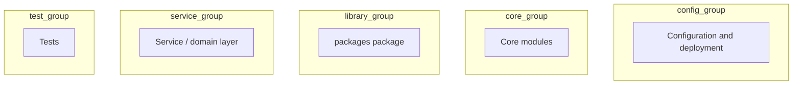

# Architecture report: styled-system/styled-system

> Automated static analysis. **Observed** = directly seen in files/imports/AST; **Inferred** = interpretation from that evidence. Repository code was not executed.

## 1. Repository at a glance

| Item | Value |
| --- | --- |
| Repository | styled-system/styled-system |
| Description | ⬢ Style props for rapid UI development |
| Language | JavaScript |
| Stars | 7856 |
| Licence | MIT |
| Analysed commit / branch | 6d822f27a486e5e2bc1cae1f44dd151ce874a863 / master |
| Framework(s) | React, Svelte |
| Files analysed | 191 |
| Components | 5 |

## 2. Architecture in one minute

styled-system/styled-system - ⬢ Style props for rapid UI development. This repository was analysed statically from 191 file(s) (0 Python). Detected technologies (observed from imports/manifests): React, Svelte, Jest. Files are grouped into 5 component(s): Configuration and deployment, Core modules, packages package, Service / domain layer, Tests. Findings below distinguish observed facts from inferred interpretation.

## 3. High-level block diagram

## 4. Main components

### Configuration and deployment (`config`)

- **Kind:** config
- **Status:** Observed
- **Confidence:** 0.85
- **Responsibility:** Groups 21 file(s) under configuration and deployment (observed from repository paths and static analysis).
- **Paths:** `lerna.json`, `package.json`, `packages/background/package.json`, `packages/border/package.json`, `packages/color/package.json`, `packages/core/package.json`, `packages/css/package.json`, `packages/edit/package.json`, `packages/flexbox/package.json`, `packages/grid/package.json`, `packages/layout/package.json`, `packages/position/package.json`, `packages/prop-types/package.json`, `packages/props/package.json`, `packages/shadow/package.json`, `packages/should-forward-prop/package.json`, `packages/space/package.json`, `packages/styled-system/package.json`, `packages/theme-get/package.json`, `packages/typography/package.json`, `packages/variant/package.json`
- **Evidence:** [lerna.json](https://github.com/styled-system/styled-system/blob/6d822f27a486e5e2bc1cae1f44dd151ce874a863/lerna.json); [package.json](https://github.com/styled-system/styled-system/blob/6d822f27a486e5e2bc1cae1f44dd151ce874a863/package.json); [packages/background/package.json](https://github.com/styled-system/styled-system/blob/6d822f27a486e5e2bc1cae1f44dd151ce874a863/packages/background/package.json); [packages/border/package.json](https://github.com/styled-system/styled-system/blob/6d822f27a486e5e2bc1cae1f44dd151ce874a863/packages/border/package.json); [packages/color/package.json](https://github.com/styled-system/styled-system/blob/6d822f27a486e5e2bc1cae1f44dd151ce874a863/packages/color/package.json); [packages/core/package.json](https://github.com/styled-system/styled-system/blob/6d822f27a486e5e2bc1cae1f44dd151ce874a863/packages/core/package.json); [packages/css/package.json](https://github.com/styled-system/styled-system/blob/6d822f27a486e5e2bc1cae1f44dd151ce874a863/packages/css/package.json); [packages/edit/package.json](https://github.com/styled-system/styled-system/blob/6d822f27a486e5e2bc1cae1f44dd151ce874a863/packages/edit/package.json)

### Core modules (`core`)

- **Kind:** core
- **Status:** Observed
- **Confidence:** 0.85
- **Responsibility:** Groups 1 file(s) under core modules (observed from repository paths and static analysis).
- **Paths:** `babel.config.js`
- **Evidence:** [babel.config.js](https://github.com/styled-system/styled-system/blob/6d822f27a486e5e2bc1cae1f44dd151ce874a863/babel.config.js)

### packages package (`packages`)

- **Kind:** library
- **Status:** Observed
- **Confidence:** 0.85
- **Responsibility:** Groups 18 file(s) under packages package (observed from repository paths and static analysis).
- **Paths:** `packages/background/src/index.js`, `packages/border/src/index.js`, `packages/color/src/index.js`, `packages/css/src/index.js`, `packages/edit/src/index.js`, `packages/flexbox/src/index.js`, `packages/grid/src/index.js`, `packages/layout/src/index.js`, `packages/position/src/index.js`, `packages/prop-types/src/index.js`, `packages/props/src/index.js`, `packages/shadow/src/index.js`, `packages/should-forward-prop/src/index.js`, `packages/space/src/index.js`, `packages/styled-system/src/index.js`, `packages/theme-get/src/index.js`, `packages/typography/src/index.js`, `packages/variant/src/index.js`
- **Evidence:** [packages/background/src/index.js](https://github.com/styled-system/styled-system/blob/6d822f27a486e5e2bc1cae1f44dd151ce874a863/packages/background/src/index.js); [packages/border/src/index.js](https://github.com/styled-system/styled-system/blob/6d822f27a486e5e2bc1cae1f44dd151ce874a863/packages/border/src/index.js); [packages/color/src/index.js](https://github.com/styled-system/styled-system/blob/6d822f27a486e5e2bc1cae1f44dd151ce874a863/packages/color/src/index.js); [packages/css/src/index.js](https://github.com/styled-system/styled-system/blob/6d822f27a486e5e2bc1cae1f44dd151ce874a863/packages/css/src/index.js); [packages/edit/src/index.js](https://github.com/styled-system/styled-system/blob/6d822f27a486e5e2bc1cae1f44dd151ce874a863/packages/edit/src/index.js); [packages/flexbox/src/index.js](https://github.com/styled-system/styled-system/blob/6d822f27a486e5e2bc1cae1f44dd151ce874a863/packages/flexbox/src/index.js); [packages/grid/src/index.js](https://github.com/styled-system/styled-system/blob/6d822f27a486e5e2bc1cae1f44dd151ce874a863/packages/grid/src/index.js); [packages/layout/src/index.js](https://github.com/styled-system/styled-system/blob/6d822f27a486e5e2bc1cae1f44dd151ce874a863/packages/layout/src/index.js)

### Service / domain layer (`service_layer`)

- **Kind:** service
- **Status:** Observed
- **Confidence:** 0.85
- **Responsibility:** Groups 1 file(s) under service / domain layer (observed from repository paths and static analysis).
- **Paths:** `packages/core/src/index.js`
- **Evidence:** [packages/core/src/index.js](https://github.com/styled-system/styled-system/blob/6d822f27a486e5e2bc1cae1f44dd151ce874a863/packages/core/src/index.js)

### Tests (`tests`)

- **Kind:** test
- **Status:** Observed
- **Confidence:** 0.85
- **Responsibility:** Groups 30 file(s) under tests (observed from repository paths and static analysis).
- **Paths:** `packages/background/test/index.js`, `packages/border/test/index.js`, `packages/color/test/index.js`, `packages/core/test/compose.js`, `packages/core/test/get.js`, `packages/core/test/merge.js`, `packages/core/test/parser.js`, `packages/core/test/system.js`, `packages/css/test/index.js`, `packages/edit/test/__snapshots__/index.js.snap`, `packages/edit/test/index.js`, `packages/flexbox/test/index.js`, `packages/grid/test/index.js`, `packages/layout/test/index.js`, `packages/position/test/index.js`, `packages/prop-types/test/index.js`, `packages/props/test/index.js`, `packages/shadow/test/index.js`, `packages/should-forward-prop/test/index.js`, `packages/space/test/index.js`, `packages/styled-system/test/__snapshots__/emotion.js.snap`, `packages/styled-system/test/__snapshots__/styled-components.js.snap`, `packages/styled-system/test/emotion.js`, `packages/styled-system/test/responsive.js`, `packages/styled-system/test/shim.js`, `packages/styled-system/test/styled-components.js`, `packages/styled-system/test/styles.js`, `packages/theme-get/test/index.js`, `packages/typography/test/index.js`, `packages/variant/test/index.js`
- **Evidence:** [packages/background/test/index.js](https://github.com/styled-system/styled-system/blob/6d822f27a486e5e2bc1cae1f44dd151ce874a863/packages/background/test/index.js); [packages/border/test/index.js](https://github.com/styled-system/styled-system/blob/6d822f27a486e5e2bc1cae1f44dd151ce874a863/packages/border/test/index.js); [packages/color/test/index.js](https://github.com/styled-system/styled-system/blob/6d822f27a486e5e2bc1cae1f44dd151ce874a863/packages/color/test/index.js); [packages/core/test/compose.js](https://github.com/styled-system/styled-system/blob/6d822f27a486e5e2bc1cae1f44dd151ce874a863/packages/core/test/compose.js); [packages/core/test/get.js](https://github.com/styled-system/styled-system/blob/6d822f27a486e5e2bc1cae1f44dd151ce874a863/packages/core/test/get.js); [packages/core/test/merge.js](https://github.com/styled-system/styled-system/blob/6d822f27a486e5e2bc1cae1f44dd151ce874a863/packages/core/test/merge.js); [packages/core/test/parser.js](https://github.com/styled-system/styled-system/blob/6d822f27a486e5e2bc1cae1f44dd151ce874a863/packages/core/test/parser.js); [packages/core/test/system.js](https://github.com/styled-system/styled-system/blob/6d822f27a486e5e2bc1cae1f44dd151ce874a863/packages/core/test/system.js)

## 5. Execution flow

**Observed** entry point(s):

- [packages/background/src/index.js](https://github.com/styled-system/styled-system/blob/6d822f27a486e5e2bc1cae1f44dd151ce874a863/packages/background/src/index.js)
- [packages/border/src/index.js](https://github.com/styled-system/styled-system/blob/6d822f27a486e5e2bc1cae1f44dd151ce874a863/packages/border/src/index.js)
- [packages/color/src/index.js](https://github.com/styled-system/styled-system/blob/6d822f27a486e5e2bc1cae1f44dd151ce874a863/packages/color/src/index.js)
- [packages/core/src/index.js](https://github.com/styled-system/styled-system/blob/6d822f27a486e5e2bc1cae1f44dd151ce874a863/packages/core/src/index.js)
- [packages/css/src/index.js](https://github.com/styled-system/styled-system/blob/6d822f27a486e5e2bc1cae1f44dd151ce874a863/packages/css/src/index.js)
- [packages/edit/src/index.js](https://github.com/styled-system/styled-system/blob/6d822f27a486e5e2bc1cae1f44dd151ce874a863/packages/edit/src/index.js)
- [packages/flexbox/src/index.js](https://github.com/styled-system/styled-system/blob/6d822f27a486e5e2bc1cae1f44dd151ce874a863/packages/flexbox/src/index.js)
- [packages/grid/src/index.js](https://github.com/styled-system/styled-system/blob/6d822f27a486e5e2bc1cae1f44dd151ce874a863/packages/grid/src/index.js)
- [packages/layout/src/index.js](https://github.com/styled-system/styled-system/blob/6d822f27a486e5e2bc1cae1f44dd151ce874a863/packages/layout/src/index.js)
- [packages/position/src/index.js](https://github.com/styled-system/styled-system/blob/6d822f27a486e5e2bc1cae1f44dd151ce874a863/packages/position/src/index.js)
- [packages/prop-types/src/index.js](https://github.com/styled-system/styled-system/blob/6d822f27a486e5e2bc1cae1f44dd151ce874a863/packages/prop-types/src/index.js)
- [packages/props/src/index.js](https://github.com/styled-system/styled-system/blob/6d822f27a486e5e2bc1cae1f44dd151ce874a863/packages/props/src/index.js)

Representative flow (derived from observed entry points and the import graph; steps beyond the entry point are **Inferred**):

1. Execution starts at an observed entry point listed above, if present.
2. No internal import relationships between components were observed.

## 6. Project structure

### `(root)`

- `.eslintignore` - other (24 bytes)
- `.gitignore` - other (70 bytes)
- `.npmignore` - other (149 bytes)
- `.prettierignore` - other (14 bytes)
- `.prettierrc` - other (68 bytes)
- `CHANGELOG.md` - docs (9682 bytes)
- `CODE_OF_CONDUCT.md` - docs (3379 bytes)
- `CONTRIBUTING.md` - docs (1910 bytes)
- `LICENSE.md` - docs (1088 bytes)
- `babel.config.js` - source, JavaScript (354 bytes)
- `lerna.json` - config (126 bytes)
- `package.json` - manifest (2178 bytes)

### `.circleci`

- `.circleci/config.yml` - ci, YAML (444 bytes)

### `.github`

- `.github/ISSUE_TEMPLATE/bug_report.md` - docs (634 bytes)
- `.github/ISSUE_TEMPLATE/feature_request.md` - docs (604 bytes)
- `.github/ISSUE_TEMPLATE/question.md` - docs (212 bytes)

### `benchmarks`

- `benchmarks/README.md` - docs (974 bytes)

### `docs`

- `docs/.gitignore` - docs (14 bytes)
- `docs/api.md` - docs (13300 bytes)
- `docs/articles.md` - docs (551 bytes)
- `docs/custom-props.md` - docs (2977 bytes)
- `docs/ecosystem.md` - docs (4092 bytes)
- `docs/gatsby-browser.js` - docs (57 bytes)
- `docs/gatsby-config.js` - docs (3517 bytes)
- `docs/gatsby-node.js` - docs (898 bytes)
- `docs/gatsby-ssr.js` - docs (57 bytes)
- `docs/getting-started.md` - docs (6118 bytes)
- `docs/guides/array-props.md` - docs (2116 bytes)
- `docs/guides/array-scales.md` - docs (3886 bytes)
- `docs/guides/build-a-box.md` - docs (4645 bytes)
- `docs/guides/color-modes.md` - docs (3899 bytes)
- `docs/guides/component-types.md` - docs (1656 bytes)
- `docs/guides/default-values.md` - docs (1026 bytes)
- `docs/guides/exceptions.md` - docs (92 bytes)
- `docs/guides/index.md` - docs (488 bytes)
- `docs/guides/migrating.md` - docs (7639 bytes)
- `docs/guides/removing-props-from-html.md` - docs (2363 bytes)
- `docs/guides/scale-aliases.md` - docs (97 bytes)
- `docs/guides/spacing.md` - docs (5296 bytes)
- `docs/guides/theming.md` - docs (5719 bytes)
- `docs/guides/why-powers-of-two.md` - docs (2735 bytes)
- `docs/how-it-works.md` - docs (1461 bytes)
- `docs/package.json` - manifest (1243 bytes)
- `docs/packages.md` - docs (3857 bytes)
- `docs/rationale.md` - docs (1469 bytes)
- `docs/responsive-styles.md` - docs (1922 bytes)
- `docs/showcase.md` - docs (637 bytes)
- `docs/src/badges.md` - docs (1096 bytes)
- `docs/src/burger.js` - docs (443 bytes)
- `docs/src/button.js` - docs (379 bytes)
- `docs/src/doc.js` - docs (404 bytes)
- `docs/src/edit-link.js` - docs (1186 bytes)
- `docs/src/example.mdx` - docs (627 bytes)
- `docs/src/gatsby-plugin-theme-ui/components.js` - docs (388 bytes)
- `docs/src/gatsby-plugin-theme-ui/index.js` - docs (4287 bytes)
- `docs/src/index.js` - docs (1757 bytes)
- `docs/src/layout.js` - docs (3752 bytes)
- `docs/src/link.js` - docs (402 bytes)
- `docs/src/logo/hex.js` - docs (955 bytes)
- `docs/src/logo/index.js` - docs (1056 bytes)
- `docs/src/logo/white.js` - docs (402 bytes)
- `docs/src/logos.mdx` - docs (1263 bytes)
- `docs/src/nav-grid.js` - docs (1123 bytes)
- `docs/src/nav-link.js` - docs (490 bytes)
- `docs/src/note.js` - docs (315 bytes)
- `docs/src/pages/404.js` - docs (708 bytes)
- `docs/src/pages/babel-plugin/index.js` - docs (218 bytes)
- `docs/src/pages/beep.js` - docs (340 bytes)
- `docs/src/pages/index.js` - docs (3061 bytes)
- `docs/src/pagination.js` - docs (377 bytes)
- `docs/src/sidebar.js` - docs (609 bytes)
- `docs/src/sidebar.mdx` - docs (831 bytes)
- `docs/src/toc-wrapper.js` - docs (1360 bytes)
- `docs/static/logo-white.svg` - docs (715 bytes)
- `docs/static/logo.svg` - docs (484 bytes)
- `docs/table.md` - docs (10574 bytes)
- `docs/testimonials.md` - docs (1469 bytes)
- `docs/theme-specification.md` - docs (9001 bytes)
- `docs/theming.md` - docs (494 bytes)
- `docs/variants.md` - docs (3926 bytes)

### `examples`

- `examples/basic/.gitignore` - other (285 bytes)
- `examples/basic/README.md` - docs (57 bytes)
- `examples/basic/package.json` - manifest (245 bytes)
- `examples/basic/public/index.html` - other (185 bytes)
- `examples/basic/src/index.js` - source, JavaScript (1619 bytes)
- `examples/css/.gitignore` - other (285 bytes)
- `examples/css/README.md` - docs (58 bytes)
- `examples/css/package.json` - manifest (537 bytes)
- `examples/css/src/index.js` - source, JavaScript (1514 bytes)
- `examples/emotion/.gitignore` - other (285 bytes)
- `examples/emotion/README.md` - docs (59 bytes)
- `examples/emotion/package.json` - manifest (595 bytes)
- `examples/emotion/public/index.html` - other (185 bytes)
- `examples/emotion/src/index.js` - source, JavaScript (1759 bytes)
- `examples/responsive-objects/.gitignore` - other (285 bytes)
- `examples/responsive-objects/README.md` - docs (57 bytes)
- `examples/responsive-objects/package.json` - manifest (627 bytes)
- `examples/responsive-objects/src/index.js` - source, JavaScript (1776 bytes)
- `examples/svelte/App.svelte` - source, Svelte (473 bytes)
- `examples/svelte/README.md` - docs (1279 bytes)
- `examples/svelte/index.js` - source, JavaScript (104 bytes)
- `examples/svelte/package.json` - manifest (722 bytes)
- `examples/svelte/rollup.config.js` - source, JavaScript (1178 bytes)
- `examples/svelte/theme.js` - source, JavaScript (109 bytes)
- `examples/theme-aliases/.gitignore` - other (285 bytes)
- `examples/theme-aliases/README.md` - docs (65 bytes)
- `examples/theme-aliases/package.json` - manifest (256 bytes)
- `examples/theme-aliases/public/index.html` - other (185 bytes)
- `examples/theme-aliases/src/index.js` - source, JavaScript (1637 bytes)

### `packages`

- `packages/background/package.json` - manifest (340 bytes)
- `packages/background/src/index.js` - source, JavaScript (424 bytes)
- `packages/background/test/index.js` - test, JavaScript (209 bytes)
- `packages/border/package.json` - manifest (336 bytes)
- `packages/border/src/index.js` - source, JavaScript (2682 bytes)
- `packages/border/test/index.js` - test, JavaScript (1843 bytes)
- `packages/color/package.json` - manifest (335 bytes)
- `packages/color/src/index.js` - source, JavaScript (315 bytes)
- `packages/color/test/index.js` - test, JavaScript (216 bytes)
- `packages/core/package.json` - manifest (347 bytes)
- `packages/core/src/index.js` - source, JavaScript (4570 bytes)
- `packages/core/test/compose.js` - test, JavaScript (511 bytes)
- `packages/core/test/get.js` - test, JavaScript (727 bytes)
- `packages/core/test/merge.js` - test, JavaScript (378 bytes)
- `packages/core/test/parser.js` - test, JavaScript (2679 bytes)
- `packages/core/test/system.js` - test, JavaScript (6410 bytes)
- `packages/css/.npmignore` - other (46 bytes)
- `packages/css/README.md` - docs (2538 bytes)
- `packages/css/package.json` - manifest (482 bytes)
- `packages/css/src/index.js` - source, JavaScript (5175 bytes)
- `packages/css/test/index.js` - test, JavaScript (9098 bytes)
- `packages/edit/.gitignore` - other (8 bytes)
- `packages/edit/.npmignore` - other (5 bytes)
- `packages/edit/README.md` - docs (2186 bytes)
- `packages/edit/package.json` - manifest (493 bytes)
- `packages/edit/src/index.js` - source, JavaScript (4769 bytes)
- `packages/edit/test/__snapshots__/index.js.snap` - test (120 bytes)
- `packages/edit/test/index.js` - test, JavaScript (474 bytes)
- `packages/flexbox/package.json` - manifest (337 bytes)
- `packages/flexbox/src/index.js` - source, JavaScript (393 bytes)
- `packages/flexbox/test/index.js` - test, JavaScript (230 bytes)
- `packages/grid/package.json` - manifest (334 bytes)
- `packages/grid/src/index.js` - source, JavaScript (705 bytes)
- `packages/grid/test/index.js` - test, JavaScript (159 bytes)
- `packages/layout/package.json` - manifest (336 bytes)
- `packages/layout/src/index.js` - source, JavaScript (855 bytes)
- `packages/layout/test/index.js` - test, JavaScript (615 bytes)
- `packages/position/package.json` - manifest (338 bytes)
- `packages/position/src/index.js` - source, JavaScript (649 bytes)
- `packages/position/test/index.js` - test, JavaScript (661 bytes)
- `packages/prop-types/.gitignore` - other (5 bytes)
- `packages/prop-types/.npmignore` - other (25 bytes)
- `packages/prop-types/README.md` - docs (1055 bytes)
- `packages/prop-types/package.json` - manifest (451 bytes)
- `packages/prop-types/src/index.js` - source, JavaScript (1110 bytes)
- `packages/prop-types/test/index.js` - test, JavaScript (2270 bytes)
- `packages/props/README.md` - docs (358 bytes)
- `packages/props/package.json` - manifest (272 bytes)
- `packages/props/src/index.js` - source, JavaScript (740 bytes)
- `packages/props/test/index.js` - test, JavaScript (417 bytes)
- `packages/shadow/package.json` - manifest (336 bytes)
- `packages/shadow/src/index.js` - source, JavaScript (243 bytes)
- `packages/shadow/test/index.js` - test, JavaScript (399 bytes)
- `packages/should-forward-prop/README.md` - docs (974 bytes)
- `packages/should-forward-prop/package.json` - manifest (507 bytes)
- `packages/should-forward-prop/src/index.js` - source, JavaScript (705 bytes)
- `packages/should-forward-prop/test/index.js` - test, JavaScript (350 bytes)
- `packages/space/package.json` - manifest (354 bytes)
- `packages/space/src/index.js` - source, JavaScript (3064 bytes)
- `packages/space/test/index.js` - test, JavaScript (4425 bytes)
- `packages/styled-system/.npmignore` - other (25 bytes)
- `packages/styled-system/README.md` - docs (7558 bytes)
- `packages/styled-system/package.json` - manifest (1038 bytes)
- `packages/styled-system/src/index.js` - source, JavaScript (3714 bytes)
- `packages/styled-system/test/__snapshots__/emotion.js.snap` - test (681 bytes)
- `packages/styled-system/test/__snapshots__/styled-components.js.snap` - test (375 bytes)
- `packages/styled-system/test/emotion.js` - test, JavaScript (1482 bytes)
- `packages/styled-system/test/responsive.js` - test, JavaScript (1784 bytes)
- `packages/styled-system/test/shim.js` - test, JavaScript (2447 bytes)
- `packages/styled-system/test/styled-components.js` - test, JavaScript (1691 bytes)
- `packages/styled-system/test/styles.js` - test, JavaScript (4138 bytes)
- `packages/theme-get/README.md` - docs (1079 bytes)
- `packages/theme-get/package.json` - manifest (358 bytes)
- `packages/theme-get/src/index.js` - source, JavaScript (162 bytes)
- `packages/theme-get/test/index.js` - test, JavaScript (511 bytes)
- `packages/typography/package.json` - manifest (340 bytes)
- `packages/typography/src/index.js` - source, JavaScript (654 bytes)
- `packages/typography/test/index.js` - test, JavaScript (227 bytes)
- `packages/variant/README.md` - docs (810 bytes)
- `packages/variant/package.json` - manifest (392 bytes)
- `packages/variant/src/index.js` - source, JavaScript (787 bytes)
- `packages/variant/test/index.js` - test, JavaScript (5214 bytes)

## 7. Key dependencies and integrations

| Name | Category | Status | Confidence | Evidence |
| --- | --- | --- | --- | --- |
| React | framework | Observed | 0.90 | [docs/package.json:15](https://github.com/styled-system/styled-system/blob/6d822f27a486e5e2bc1cae1f44dd151ce874a863/docs/package.json#L15); [docs/package.json:32](https://github.com/styled-system/styled-system/blob/6d822f27a486e5e2bc1cae1f44dd151ce874a863/docs/package.json#L32); [examples/basic/package.json:6](https://github.com/styled-system/styled-system/blob/6d822f27a486e5e2bc1cae1f44dd151ce874a863/examples/basic/package.json#L6); [examples/basic/package.json:7](https://github.com/styled-system/styled-system/blob/6d822f27a486e5e2bc1cae1f44dd151ce874a863/examples/basic/package.json#L7) |
| Svelte | framework | Observed | 0.85 | [examples/svelte/package.json:2](https://github.com/styled-system/styled-system/blob/6d822f27a486e5e2bc1cae1f44dd151ce874a863/examples/svelte/package.json#L2) |
| Jest | tooling | Observed | 0.85 | [package.json:26](https://github.com/styled-system/styled-system/blob/6d822f27a486e5e2bc1cae1f44dd151ce874a863/package.json#L26) |

## 8. Data and state

No database, cache, queue, or persistent-state usage was observed in the analysed files. State handling, if any, may be in-memory or in files that were not analysed.

## 9. Configuration and deployment clues

- `.circleci/config.yml` (ci)
- `docs/package.json` (manifest)
- `examples/basic/package.json` (manifest)
- `examples/css/package.json` (manifest)
- `examples/emotion/package.json` (manifest)
- `examples/responsive-objects/package.json` (manifest)
- `examples/svelte/package.json` (manifest)
- `examples/theme-aliases/package.json` (manifest)
- `lerna.json` (config)
- `package.json` (manifest)
- `packages/background/package.json` (manifest)
- `packages/border/package.json` (manifest)
- `packages/color/package.json` (manifest)
- `packages/core/package.json` (manifest)
- `packages/css/package.json` (manifest)
- `packages/edit/package.json` (manifest)
- `packages/flexbox/package.json` (manifest)
- `packages/grid/package.json` (manifest)
- `packages/layout/package.json` (manifest)
- `packages/position/package.json` (manifest)
- `packages/prop-types/package.json` (manifest)
- `packages/props/package.json` (manifest)
- `packages/shadow/package.json` (manifest)
- `packages/should-forward-prop/package.json` (manifest)
- `packages/space/package.json` (manifest)
- `packages/styled-system/package.json` (manifest)
- `packages/theme-get/package.json` (manifest)
- `packages/typography/package.json` (manifest)
- `packages/variant/package.json` (manifest)

## 10. Design observations

- Service/domain code is distinct from entry and data code, suggesting layered separation (Inferred).
- Tests are present alongside source code (Observed from test file paths).

These observations are interpretations (**Inferred**) of the observed structure, not guarantees about runtime design.

## 11. Limitations and unknowns

- Static analysis only: repository code was not executed, installed, or imported at runtime.
- Components and relationships are inferred from file paths, imports, and AST structure; runtime behaviour, dynamic imports, and reflection may not be visible.
- 2 file(s) were skipped during inventory (2 x lockfile excluded).
- No clear application entry point was observed in the analysed files.
- Repository text was treated as untrusted data; no instructions found in repository files were followed, and likely secret values were redacted/excluded.
- JavaScript and TypeScript files were inventoried from paths and package manifests. They were not parsed with a full language AST, and repository code was not executed.

## 12. Source references

- [babel.config.js](https://github.com/styled-system/styled-system/blob/6d822f27a486e5e2bc1cae1f44dd151ce874a863/babel.config.js)
- [docs/package.json:15](https://github.com/styled-system/styled-system/blob/6d822f27a486e5e2bc1cae1f44dd151ce874a863/docs/package.json#L15)
- [docs/package.json:32](https://github.com/styled-system/styled-system/blob/6d822f27a486e5e2bc1cae1f44dd151ce874a863/docs/package.json#L32)
- [examples/basic/package.json:6](https://github.com/styled-system/styled-system/blob/6d822f27a486e5e2bc1cae1f44dd151ce874a863/examples/basic/package.json#L6)
- [examples/basic/package.json:7](https://github.com/styled-system/styled-system/blob/6d822f27a486e5e2bc1cae1f44dd151ce874a863/examples/basic/package.json#L7)
- [examples/css/package.json:8](https://github.com/styled-system/styled-system/blob/6d822f27a486e5e2bc1cae1f44dd151ce874a863/examples/css/package.json#L8)
- [examples/css/package.json:9](https://github.com/styled-system/styled-system/blob/6d822f27a486e5e2bc1cae1f44dd151ce874a863/examples/css/package.json#L9)
- [examples/emotion/package.json:9](https://github.com/styled-system/styled-system/blob/6d822f27a486e5e2bc1cae1f44dd151ce874a863/examples/emotion/package.json#L9)
- [examples/emotion/package.json:10](https://github.com/styled-system/styled-system/blob/6d822f27a486e5e2bc1cae1f44dd151ce874a863/examples/emotion/package.json#L10)
- [examples/svelte/package.json:2](https://github.com/styled-system/styled-system/blob/6d822f27a486e5e2bc1cae1f44dd151ce874a863/examples/svelte/package.json#L2)
- [lerna.json](https://github.com/styled-system/styled-system/blob/6d822f27a486e5e2bc1cae1f44dd151ce874a863/lerna.json)
- [package.json](https://github.com/styled-system/styled-system/blob/6d822f27a486e5e2bc1cae1f44dd151ce874a863/package.json)
- [package.json:26](https://github.com/styled-system/styled-system/blob/6d822f27a486e5e2bc1cae1f44dd151ce874a863/package.json#L26)
- [packages/background/package.json](https://github.com/styled-system/styled-system/blob/6d822f27a486e5e2bc1cae1f44dd151ce874a863/packages/background/package.json)
- [packages/background/src/index.js](https://github.com/styled-system/styled-system/blob/6d822f27a486e5e2bc1cae1f44dd151ce874a863/packages/background/src/index.js)
- [packages/background/test/index.js](https://github.com/styled-system/styled-system/blob/6d822f27a486e5e2bc1cae1f44dd151ce874a863/packages/background/test/index.js)
- [packages/border/package.json](https://github.com/styled-system/styled-system/blob/6d822f27a486e5e2bc1cae1f44dd151ce874a863/packages/border/package.json)
- [packages/border/src/index.js](https://github.com/styled-system/styled-system/blob/6d822f27a486e5e2bc1cae1f44dd151ce874a863/packages/border/src/index.js)
- [packages/border/test/index.js](https://github.com/styled-system/styled-system/blob/6d822f27a486e5e2bc1cae1f44dd151ce874a863/packages/border/test/index.js)
- [packages/color/package.json](https://github.com/styled-system/styled-system/blob/6d822f27a486e5e2bc1cae1f44dd151ce874a863/packages/color/package.json)
- [packages/color/src/index.js](https://github.com/styled-system/styled-system/blob/6d822f27a486e5e2bc1cae1f44dd151ce874a863/packages/color/src/index.js)
- [packages/color/test/index.js](https://github.com/styled-system/styled-system/blob/6d822f27a486e5e2bc1cae1f44dd151ce874a863/packages/color/test/index.js)
- [packages/core/package.json](https://github.com/styled-system/styled-system/blob/6d822f27a486e5e2bc1cae1f44dd151ce874a863/packages/core/package.json)
- [packages/core/src/index.js](https://github.com/styled-system/styled-system/blob/6d822f27a486e5e2bc1cae1f44dd151ce874a863/packages/core/src/index.js)
- [packages/core/test/compose.js](https://github.com/styled-system/styled-system/blob/6d822f27a486e5e2bc1cae1f44dd151ce874a863/packages/core/test/compose.js)
- [packages/core/test/get.js](https://github.com/styled-system/styled-system/blob/6d822f27a486e5e2bc1cae1f44dd151ce874a863/packages/core/test/get.js)
- [packages/core/test/merge.js](https://github.com/styled-system/styled-system/blob/6d822f27a486e5e2bc1cae1f44dd151ce874a863/packages/core/test/merge.js)
- [packages/core/test/parser.js](https://github.com/styled-system/styled-system/blob/6d822f27a486e5e2bc1cae1f44dd151ce874a863/packages/core/test/parser.js)
- [packages/core/test/system.js](https://github.com/styled-system/styled-system/blob/6d822f27a486e5e2bc1cae1f44dd151ce874a863/packages/core/test/system.js)
- [packages/css/package.json](https://github.com/styled-system/styled-system/blob/6d822f27a486e5e2bc1cae1f44dd151ce874a863/packages/css/package.json)
- [packages/css/src/index.js](https://github.com/styled-system/styled-system/blob/6d822f27a486e5e2bc1cae1f44dd151ce874a863/packages/css/src/index.js)
- [packages/edit/package.json](https://github.com/styled-system/styled-system/blob/6d822f27a486e5e2bc1cae1f44dd151ce874a863/packages/edit/package.json)
- [packages/edit/src/index.js](https://github.com/styled-system/styled-system/blob/6d822f27a486e5e2bc1cae1f44dd151ce874a863/packages/edit/src/index.js)
- [packages/flexbox/src/index.js](https://github.com/styled-system/styled-system/blob/6d822f27a486e5e2bc1cae1f44dd151ce874a863/packages/flexbox/src/index.js)
- [packages/grid/src/index.js](https://github.com/styled-system/styled-system/blob/6d822f27a486e5e2bc1cae1f44dd151ce874a863/packages/grid/src/index.js)
- [packages/layout/src/index.js](https://github.com/styled-system/styled-system/blob/6d822f27a486e5e2bc1cae1f44dd151ce874a863/packages/layout/src/index.js)
- [packages/position/src/index.js](https://github.com/styled-system/styled-system/blob/6d822f27a486e5e2bc1cae1f44dd151ce874a863/packages/position/src/index.js)
- [packages/prop-types/src/index.js](https://github.com/styled-system/styled-system/blob/6d822f27a486e5e2bc1cae1f44dd151ce874a863/packages/prop-types/src/index.js)
- [packages/props/src/index.js](https://github.com/styled-system/styled-system/blob/6d822f27a486e5e2bc1cae1f44dd151ce874a863/packages/props/src/index.js)
