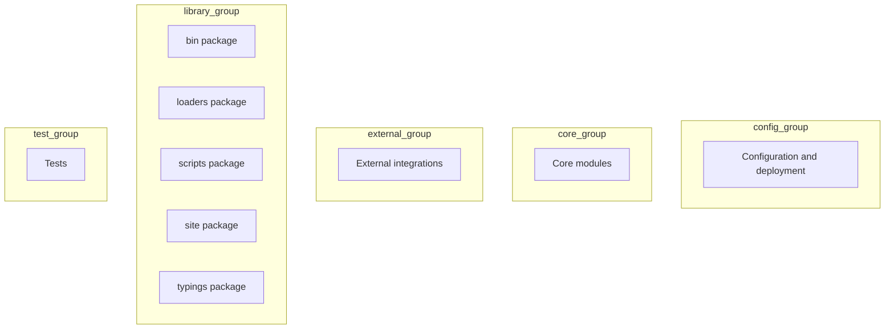

# Architecture report: styleguidist/react-styleguidist

> Automated static analysis. **Observed** = directly seen in files/imports/AST; **Inferred** = interpretation from that evidence. Repository code was not executed.

## 1. Repository at a glance

| Item | Value |
| --- | --- |
| Repository | styleguidist/react-styleguidist |
| Description | Isolated React component development environment with a living style guide |
| Language | TypeScript |
| Stars | 11048 |
| Licence | MIT |
| Analysed commit / branch | c223f9a279f4e872cf6ff925fb21d2a7f6e27a77 / master |
| Framework(s) | React |
| Files analysed | 737 |
| Components | 9 |

## 2. Architecture in one minute

styleguidist/react-styleguidist - Isolated React component development environment with a living style guide. This repository was analysed statically from 737 file(s) (0 Python). Detected technologies (observed from imports/manifests): GitHub Actions, React, Jest, TypeScript, webpack. Files are grouped into 9 component(s): bin package, Configuration and deployment, Core modules, External integrations, loaders package, scripts package, site package, Tests. Findings below distinguish observed facts from inferred interpretation.

## 3. High-level block diagram

## 4. Main components

### bin package (`bin`)

- **Kind:** library
- **Status:** Observed
- **Confidence:** 0.85
- **Responsibility:** Groups 2 file(s) under bin package (observed from repository paths and static analysis).
- **Paths:** `src/bin/__tests__/styleguidist.spec.js`, `src/bin/styleguidist.js`
- **Evidence:** [src/bin/__tests__/styleguidist.spec.js](https://github.com/styleguidist/react-styleguidist/blob/c223f9a279f4e872cf6ff925fb21d2a7f6e27a77/src/bin/__tests__/styleguidist.spec.js); [src/bin/styleguidist.js](https://github.com/styleguidist/react-styleguidist/blob/c223f9a279f4e872cf6ff925fb21d2a7f6e27a77/src/bin/styleguidist.js)

### Configuration and deployment (`config`)

- **Kind:** config
- **Status:** Observed
- **Confidence:** 0.85
- **Responsibility:** Groups 7 file(s) under configuration and deployment (observed from repository paths and static analysis).
- **Paths:** `cypress.json`, `package.json`, `site/.eslintrc.json`, `site/package.json`, `site/src/.eslintrc.json`, `tsconfig.json`, `tsconfig.types.json`
- **Evidence:** [cypress.json](https://github.com/styleguidist/react-styleguidist/blob/c223f9a279f4e872cf6ff925fb21d2a7f6e27a77/cypress.json); [package.json](https://github.com/styleguidist/react-styleguidist/blob/c223f9a279f4e872cf6ff925fb21d2a7f6e27a77/package.json); [site/.eslintrc.json](https://github.com/styleguidist/react-styleguidist/blob/c223f9a279f4e872cf6ff925fb21d2a7f6e27a77/site/.eslintrc.json); [site/package.json](https://github.com/styleguidist/react-styleguidist/blob/c223f9a279f4e872cf6ff925fb21d2a7f6e27a77/site/package.json); [site/src/.eslintrc.json](https://github.com/styleguidist/react-styleguidist/blob/c223f9a279f4e872cf6ff925fb21d2a7f6e27a77/site/src/.eslintrc.json); [tsconfig.json](https://github.com/styleguidist/react-styleguidist/blob/c223f9a279f4e872cf6ff925fb21d2a7f6e27a77/tsconfig.json); [tsconfig.types.json](https://github.com/styleguidist/react-styleguidist/blob/c223f9a279f4e872cf6ff925fb21d2a7f6e27a77/tsconfig.types.json)

### Core modules (`core`)

- **Kind:** core
- **Status:** Observed
- **Confidence:** 0.85
- **Responsibility:** Groups 3 file(s) under core modules (observed from repository paths and static analysis).
- **Paths:** `babel.config.js`, `dangerfile.ts`, `styleguide.config.js`
- **Evidence:** [babel.config.js](https://github.com/styleguidist/react-styleguidist/blob/c223f9a279f4e872cf6ff925fb21d2a7f6e27a77/babel.config.js); [dangerfile.ts](https://github.com/styleguidist/react-styleguidist/blob/c223f9a279f4e872cf6ff925fb21d2a7f6e27a77/dangerfile.ts); [styleguide.config.js](https://github.com/styleguidist/react-styleguidist/blob/c223f9a279f4e872cf6ff925fb21d2a7f6e27a77/styleguide.config.js)

### External integrations (`external_integrations`)

- **Kind:** external
- **Status:** Observed
- **Confidence:** 0.85
- **Responsibility:** Groups 246 file(s) under external integrations (observed from repository paths and static analysis).
- **Paths:** `src/client/consts.ts`, `src/client/index.ts`, `src/client/polyfills.ts`, `src/client/rsg-components/Argument/Argument.spec.tsx`, `src/client/rsg-components/Argument/ArgumentRenderer.tsx`, `src/client/rsg-components/Argument/index.ts`, `src/client/rsg-components/Arguments/Arguments.spec.tsx`, `src/client/rsg-components/Arguments/ArgumentsRenderer.tsx`, `src/client/rsg-components/Arguments/index.ts`, `src/client/rsg-components/Code/Code.spec.tsx`, `src/client/rsg-components/Code/CodeRenderer.tsx`, `src/client/rsg-components/Code/index.ts`, `src/client/rsg-components/ComplexType/ComplexType.spec.tsx`, `src/client/rsg-components/ComplexType/ComplexTypeRenderder.tsx`, `src/client/rsg-components/ComplexType/index.ts`, `src/client/rsg-components/Components/Components.spec.tsx`, `src/client/rsg-components/Components/Components.tsx`, `src/client/rsg-components/Components/ComponentsRenderer.tsx`, `src/client/rsg-components/Components/index.ts`, `src/client/rsg-components/ComponentsList/ComponentsList.spec.tsx`, `src/client/rsg-components/ComponentsList/ComponentsList.tsx`, `src/client/rsg-components/ComponentsList/ComponentsListRenderer.tsx`, `src/client/rsg-components/ComponentsList/index.ts`, `src/client/rsg-components/Context/Context.ts`, `src/client/rsg-components/Context/index.ts`, `src/client/rsg-components/Editor/Editor.spec.tsx`, `src/client/rsg-components/Editor/Editor.tsx`, `src/client/rsg-components/Editor/index.ts`, `src/client/rsg-components/Error/Error.spec.tsx`, `src/client/rsg-components/Error/ErrorRenderer.tsx`, `src/client/rsg-components/Error/index.ts`, `src/client/rsg-components/ExamplePlaceholder/ExamplePlaceholder.spec.tsx`, `src/client/rsg-components/ExamplePlaceholder/ExamplePlaceholderRenderer.tsx`, `src/client/rsg-components/ExamplePlaceholder/index.ts`, `src/client/rsg-components/Examples/Examples.spec.tsx`, `src/client/rsg-components/Examples/Examples.tsx`, `src/client/rsg-components/Examples/ExamplesRenderer.tsx`, `src/client/rsg-components/Examples/index.ts`, `src/client/rsg-components/Heading/Heading.spec.tsx`, `src/client/rsg-components/Heading/HeadingRenderer.tsx`, `src/client/rsg-components/Heading/index.ts`, `src/client/rsg-components/JsDoc/JsDoc.spec.tsx`, `src/client/rsg-components/JsDoc/JsDoc.tsx`, `src/client/rsg-components/JsDoc/index.ts`, `src/client/rsg-components/Link/Link.spec.tsx`, `src/client/rsg-components/Link/LinkRenderer.tsx`, `src/client/rsg-components/Link/index.ts`, `src/client/rsg-components/Logo/Logo.spec.tsx`, `src/client/rsg-components/Logo/LogoRenderer.tsx`, `src/client/rsg-components/Logo/index.ts`, `src/client/rsg-components/Markdown/Blockquote/Blockquote.spec.tsx`, `src/client/rsg-components/Markdown/Blockquote/BlockquoteRenderer.tsx`, `src/client/rsg-components/Markdown/Blockquote/index.ts`, `src/client/rsg-components/Markdown/Checkbox/Checkbox.spec.tsx`, `src/client/rsg-components/Markdown/Checkbox/CheckboxRenderer.tsx`, `src/client/rsg-components/Markdown/Checkbox/index.ts`, `src/client/rsg-components/Markdown/Details/Details.spec.tsx`, `src/client/rsg-components/Markdown/Details/DetailsRenderer.tsx`, `src/client/rsg-components/Markdown/Details/DetailsSummaryRenderer.tsx`, `src/client/rsg-components/Markdown/Details/index.ts`, `src/client/rsg-components/Markdown/Hr/Hr.spec.tsx`, `src/client/rsg-components/Markdown/Hr/HrRenderer.tsx`, `src/client/rsg-components/Markdown/Hr/index.ts`, `src/client/rsg-components/Markdown/List/List.spec.tsx`, `src/client/rsg-components/Markdown/List/ListRenderer.tsx`, `src/client/rsg-components/Markdown/List/index.ts`, `src/client/rsg-components/Markdown/Markdown.spec.tsx`, `src/client/rsg-components/Markdown/Markdown.tsx`, `src/client/rsg-components/Markdown/MarkdownHeading/MarkdownHeading.spec.tsx`, `src/client/rsg-components/Markdown/MarkdownHeading/MarkdownHeadingRenderer.tsx`, `src/client/rsg-components/Markdown/MarkdownHeading/index.ts`, `src/client/rsg-components/Markdown/Pre/Pre.spec.tsx`, `src/client/rsg-components/Markdown/Pre/PreRenderer.tsx`, `src/client/rsg-components/Markdown/Pre/index.ts`, `src/client/rsg-components/Markdown/Table/Table.spec.tsx`, `src/client/rsg-components/Markdown/Table/TableBodyRenderer.tsx`, `src/client/rsg-components/Markdown/Table/TableCellRenderer.tsx`, `src/client/rsg-components/Markdown/Table/TableHeadRenderer.tsx`, `src/client/rsg-components/Markdown/Table/TableRenderer.tsx`, `src/client/rsg-components/Markdown/Table/TableRowRenderer.tsx`, `src/client/rsg-components/Markdown/Table/index.ts`, `src/client/rsg-components/Markdown/index.ts`, `src/client/rsg-components/Message/Message.spec.tsx`, `src/client/rsg-components/Message/MessageRenderer.tsx`, `src/client/rsg-components/Message/index.ts`, `src/client/rsg-components/Methods/Methods.spec.tsx`, `src/client/rsg-components/Methods/MethodsRenderer.tsx`, `src/client/rsg-components/Methods/index.ts`, `src/client/rsg-components/Name/Name.spec.tsx`, `src/client/rsg-components/Name/NameRenderer.tsx`, `src/client/rsg-components/Name/index.ts`, `src/client/rsg-components/NotFound/NotFound.spec.tsx`, `src/client/rsg-components/NotFound/NotFoundRenderer.tsx`, `src/client/rsg-components/NotFound/index.ts`, `src/client/rsg-components/Para/Para.spec.tsx`, `src/client/rsg-components/Para/ParaRenderer.tsx`, `src/client/rsg-components/Para/index.ts`, `src/client/rsg-components/Pathline/Pathline.spec.tsx`, `src/client/rsg-components/Pathline/PathlineRenderer.tsx`, `src/client/rsg-components/Pathline/index.ts`, `src/client/rsg-components/Playground/Playground.spec.tsx`, `src/client/rsg-components/Playground/Playground.tsx`, `src/client/rsg-components/Playground/PlaygroundRenderer.tsx`, `src/client/rsg-components/Playground/index.ts`, `src/client/rsg-components/PlaygroundError/PlaygroundError.spec.tsx`, `src/client/rsg-components/PlaygroundError/PlaygroundErrorRenderer.tsx`, `src/client/rsg-components/PlaygroundError/index.ts`, `src/client/rsg-components/Preview/Preview.spec.tsx`, `src/client/rsg-components/Preview/Preview.tsx`, `src/client/rsg-components/Preview/index.ts`, `src/client/rsg-components/Props/Props.spec.tsx`, `src/client/rsg-components/Props/PropsRenderer.tsx`, `src/client/rsg-components/Props/index.ts`, `src/client/rsg-components/Props/renderDefault.tsx`, `src/client/rsg-components/Props/renderExtra.tsx`, `src/client/rsg-components/Props/renderType.tsx`, `src/client/rsg-components/Props/util.ts`, `src/client/rsg-components/ReactComponent/ReactComponent.spec.tsx`, `src/client/rsg-components/ReactComponent/ReactComponent.tsx`, `src/client/rsg-components/ReactComponent/ReactComponentRenderer.tsx`, `src/client/rsg-components/ReactComponent/index.ts`, `src/client/rsg-components/ReactExample/ReactExample.spec.tsx`, `src/client/rsg-components/ReactExample/ReactExample.tsx`, `src/client/rsg-components/ReactExample/index.ts`, `src/client/rsg-components/Ribbon/Ribbon.spec.tsx`, `src/client/rsg-components/Ribbon/Ribbon.tsx`, `src/client/rsg-components/Ribbon/RibbonRenderer.tsx`, `src/client/rsg-components/Ribbon/index.ts`, `src/client/rsg-components/Section/Section.spec.tsx`, `src/client/rsg-components/Section/Section.tsx`, `src/client/rsg-components/Section/SectionRenderer.tsx`, `src/client/rsg-components/Section/index.ts`, `src/client/rsg-components/SectionHeading/SectionHeading.spec.tsx`, `src/client/rsg-components/SectionHeading/SectionHeading.tsx`, `src/client/rsg-components/SectionHeading/SectionHeadingRenderer.tsx`, `src/client/rsg-components/SectionHeading/index.ts`, `src/client/rsg-components/Sections/Sections.spec.tsx`, `src/client/rsg-components/Sections/Sections.tsx`, `src/client/rsg-components/Sections/SectionsRenderer.tsx`, `src/client/rsg-components/Sections/index.ts`, `src/client/rsg-components/Slot/Slot.spec.tsx`, `src/client/rsg-components/Slot/Slot.tsx`, `src/client/rsg-components/Slot/index.ts`, `src/client/rsg-components/StyleGuide/StyleGuide.spec.tsx`, `src/client/rsg-components/StyleGuide/StyleGuide.tsx`, `src/client/rsg-components/StyleGuide/StyleGuideRenderer.tsx`, `src/client/rsg-components/StyleGuide/index.ts`, `src/client/rsg-components/Styled/Styled.spec.tsx`, `src/client/rsg-components/Styled/Styled.tsx`, `src/client/rsg-components/Styled/index.ts`, `src/client/rsg-components/TabButton/TabButton.spec.tsx`, `src/client/rsg-components/TabButton/TabButtonRenderer.tsx`, `src/client/rsg-components/TabButton/index.ts`, `src/client/rsg-components/Table/Table.spec.tsx`, `src/client/rsg-components/Table/TableRenderer.tsx`, `src/client/rsg-components/Table/index.ts`, `src/client/rsg-components/TableOfContents/TableOfContents.spec.tsx`, `src/client/rsg-components/TableOfContents/TableOfContents.tsx`, `src/client/rsg-components/TableOfContents/TableOfContentsRenderer.tsx`, `src/client/rsg-components/TableOfContents/index.ts`, `src/client/rsg-components/Text/Text.spec.tsx`, `src/client/rsg-components/Text/TextRenderer.tsx`, `src/client/rsg-components/Text/index.ts`, `src/client/rsg-components/ToolbarButton/ToolbarButton.spec.tsx`, `src/client/rsg-components/ToolbarButton/ToolbarButtonRenderer.tsx`, `src/client/rsg-components/ToolbarButton/index.ts`, `src/client/rsg-components/Tooltip/Tooltip.spec.tsx`, `src/client/rsg-components/Tooltip/TooltipRenderer.tsx`, `src/client/rsg-components/Tooltip/index.ts`, `src/client/rsg-components/Type/Type.spec.tsx`, `src/client/rsg-components/Type/TypeRenderer.tsx`, `src/client/rsg-components/Type/index.ts`, `src/client/rsg-components/Usage/Usage.spec.tsx`, `src/client/rsg-components/Usage/Usage.tsx`, `src/client/rsg-components/Usage/index.ts`, `src/client/rsg-components/Version/Version.spec.tsx`, `src/client/rsg-components/Version/VersionRenderer.tsx`, `src/client/rsg-components/Version/index.ts`, `src/client/rsg-components/Welcome/Welcome.spec.tsx`, `src/client/rsg-components/Welcome/WelcomeRenderer.tsx`, `src/client/rsg-components/Welcome/index.ts`, `src/client/rsg-components/Wrapper/Wrapper.spec.tsx`, `src/client/rsg-components/Wrapper/Wrapper.ts`, `src/client/rsg-components/Wrapper/index.ts`, `src/client/rsg-components/slots/CodeTabButton.tsx`, `src/client/rsg-components/slots/IsolateButton.spec.tsx`, `src/client/rsg-components/slots/IsolateButton.tsx`, `src/client/rsg-components/slots/UsageTabButton.spec.tsx`, `src/client/rsg-components/slots/UsageTabButton.tsx`, `src/client/rsg-components/slots/index.ts`, `src/client/styles/__tests__/createStyleSheet.spec.ts`, `src/client/styles/__tests__/setupjss.spec.ts`, `src/client/styles/createStyleSheet.ts`, `src/client/styles/index.ts`, `src/client/styles/nonInheritedProps.ts`, `src/client/styles/prismTheme.ts`, `src/client/styles/setupjss.ts`, `src/client/styles/styles.ts`, `src/client/styles/theme.ts`, `src/client/utils/__tests__/compileCode.spec.ts`, `src/client/utils/__tests__/filterComponentExamples.spec.ts`, `src/client/utils/__tests__/filterComponentsByExactName.spec.ts`, `src/client/utils/__tests__/filterComponentsByName.spec.ts`, `src/client/utils/__tests__/filterComponentsInSectionsByExactName.spec.ts`, `src/client/utils/__tests__/filterSectionExamples.spec.ts`, `src/client/utils/__tests__/filterSectionsByName.spec.ts`, `src/client/utils/__tests__/findSection.spec.ts`, `src/client/utils/__tests__/getAst.spec.ts`, `src/client/utils/__tests__/getComponent.spec.ts`, `src/client/utils/__tests__/getFilterRegExp.spec.ts`, `src/client/utils/__tests__/getInfoFromHash.spec.ts`, `src/client/utils/__tests__/getPageTitle.spec.ts`, `src/client/utils/__tests__/getRouteData.spec.ts`, `src/client/utils/__tests__/getUrl.spec.ts`, `src/client/utils/__tests__/handleHash.spec.ts`, `src/client/utils/__tests__/processComponents.spec.ts`, `src/client/utils/__tests__/processSections.spec.ts`, `src/client/utils/__tests__/renderStyleguide.spec.ts`, `src/client/utils/__tests__/splitExampleCode.spec.ts`, `src/client/utils/__tests__/transpileImports.spec.ts`, `src/client/utils/compileCode.ts`, `src/client/utils/filterComponentExamples.ts`, `src/client/utils/filterComponentsByExactName.ts`, `src/client/utils/filterComponentsByName.ts`, `src/client/utils/filterComponentsInSectionsByExactName.ts`, `src/client/utils/filterSectionExamples.ts`, `src/client/utils/filterSectionsByName.ts`, `src/client/utils/findSection.ts`, `src/client/utils/getAst.ts`, `src/client/utils/getComponent.ts`, `src/client/utils/getFilterRegExp.ts`, `src/client/utils/getInfoFromHash.ts`, `src/client/utils/getPageTitle.ts`, `src/client/utils/getRouteData.ts`, `src/client/utils/getUrl.ts`, `src/client/utils/handleHash.ts`, `src/client/utils/processComponents.ts`, `src/client/utils/processSections.ts`, `src/client/utils/renderStyleguide.tsx`, `src/client/utils/rewriteImports.ts`, `src/client/utils/splitExampleCode.ts`, `src/client/utils/transpileImports.ts`, `src/loaders/utils/client/__tests__/evalInContext.spec.js`, `src/loaders/utils/client/__tests__/requireInRuntime.spec.js`, `src/loaders/utils/client/evalInContext.ts`, `src/loaders/utils/client/requireInRuntime.ts`
- **Evidence:** [src/client/consts.ts](https://github.com/styleguidist/react-styleguidist/blob/c223f9a279f4e872cf6ff925fb21d2a7f6e27a77/src/client/consts.ts); [src/client/index.ts](https://github.com/styleguidist/react-styleguidist/blob/c223f9a279f4e872cf6ff925fb21d2a7f6e27a77/src/client/index.ts); [src/client/polyfills.ts](https://github.com/styleguidist/react-styleguidist/blob/c223f9a279f4e872cf6ff925fb21d2a7f6e27a77/src/client/polyfills.ts); [src/client/rsg-components/Argument/Argument.spec.tsx](https://github.com/styleguidist/react-styleguidist/blob/c223f9a279f4e872cf6ff925fb21d2a7f6e27a77/src/client/rsg-components/Argument/Argument.spec.tsx); [src/client/rsg-components/Argument/ArgumentRenderer.tsx](https://github.com/styleguidist/react-styleguidist/blob/c223f9a279f4e872cf6ff925fb21d2a7f6e27a77/src/client/rsg-components/Argument/ArgumentRenderer.tsx); [src/client/rsg-components/Argument/index.ts](https://github.com/styleguidist/react-styleguidist/blob/c223f9a279f4e872cf6ff925fb21d2a7f6e27a77/src/client/rsg-components/Argument/index.ts); [src/client/rsg-components/Arguments/Arguments.spec.tsx](https://github.com/styleguidist/react-styleguidist/blob/c223f9a279f4e872cf6ff925fb21d2a7f6e27a77/src/client/rsg-components/Arguments/Arguments.spec.tsx); [src/client/rsg-components/Arguments/ArgumentsRenderer.tsx](https://github.com/styleguidist/react-styleguidist/blob/c223f9a279f4e872cf6ff925fb21d2a7f6e27a77/src/client/rsg-components/Arguments/ArgumentsRenderer.tsx)

### loaders package (`loaders`)

- **Kind:** library
- **Status:** Observed
- **Confidence:** 0.85
- **Responsibility:** Groups 51 file(s) under loaders package (observed from repository paths and static analysis).
- **Paths:** `src/loaders/__tests__/examples-loader.spec.ts`, `src/loaders/__tests__/props-loader.spec.ts`, `src/loaders/__tests__/styleguide-loader.spec.ts`, `src/loaders/examples-loader.ts`, `src/loaders/props-loader.ts`, `src/loaders/styleguide-loader.ts`, `src/loaders/utils/__tests__/chunkify.spec.ts`, `src/loaders/utils/__tests__/expandDefaultComponent.spec.ts`, `src/loaders/utils/__tests__/filterComponentsWithExample.spec.ts`, `src/loaders/utils/__tests__/getAllContentPages.spec.ts`, `src/loaders/utils/__tests__/getAst.spec.ts`, `src/loaders/utils/__tests__/getComponentFiles.spec.ts`, `src/loaders/utils/__tests__/getComponentFilesFromSections.spec.ts`, `src/loaders/utils/__tests__/getComponentPatternsFromSections.spec.ts`, `src/loaders/utils/__tests__/getComponents.spec.ts`, `src/loaders/utils/__tests__/getExamples.spec.ts`, `src/loaders/utils/__tests__/getImports.spec.ts`, `src/loaders/utils/__tests__/getNameFromFilePath.spec.ts`, `src/loaders/utils/__tests__/getProps.spec.ts`, `src/loaders/utils/__tests__/getSections.spec.ts`, `src/loaders/utils/__tests__/highlightCode.spec.ts`, `src/loaders/utils/__tests__/highlightCodeInMarkdown.spec.ts`, `src/loaders/utils/__tests__/parseExample.spec.ts`, `src/loaders/utils/__tests__/processComponent.spec.ts`, `src/loaders/utils/__tests__/removeDoclets.spec.ts`, `src/loaders/utils/__tests__/requireIt.spec.ts`, `src/loaders/utils/__tests__/resolveESModule.spec.ts`, `src/loaders/utils/__tests__/sortProps.spec.ts`, `src/loaders/utils/chunkify.ts`, `src/loaders/utils/expandDefaultComponent.ts`, `src/loaders/utils/filterComponentsWithExample.ts`, `src/loaders/utils/getAllContentPages.ts`, `src/loaders/utils/getAst.ts`, `src/loaders/utils/getComponentFiles.ts`, `src/loaders/utils/getComponentFilesFromSections.ts`, `src/loaders/utils/getComponentPatternsFromSections.ts`, `src/loaders/utils/getComponents.ts`, `src/loaders/utils/getExamples.ts`, `src/loaders/utils/getImports.ts`, `src/loaders/utils/getNameFromFilePath.ts`, `src/loaders/utils/getProps.ts`, `src/loaders/utils/getSections.ts`, `src/loaders/utils/highlightCode.ts`, `src/loaders/utils/highlightCodeInMarkdown.ts`, `src/loaders/utils/parseExample.ts`, `src/loaders/utils/processComponent.ts`, `src/loaders/utils/removeDoclets.ts`, `src/loaders/utils/requireIt.ts`, `src/loaders/utils/resolveESModule.ts`, `src/loaders/utils/slugger.ts`, `src/loaders/utils/sortProps.ts`
- **Evidence:** [src/loaders/__tests__/examples-loader.spec.ts](https://github.com/styleguidist/react-styleguidist/blob/c223f9a279f4e872cf6ff925fb21d2a7f6e27a77/src/loaders/__tests__/examples-loader.spec.ts); [src/loaders/__tests__/props-loader.spec.ts](https://github.com/styleguidist/react-styleguidist/blob/c223f9a279f4e872cf6ff925fb21d2a7f6e27a77/src/loaders/__tests__/props-loader.spec.ts); [src/loaders/__tests__/styleguide-loader.spec.ts](https://github.com/styleguidist/react-styleguidist/blob/c223f9a279f4e872cf6ff925fb21d2a7f6e27a77/src/loaders/__tests__/styleguide-loader.spec.ts); [src/loaders/examples-loader.ts](https://github.com/styleguidist/react-styleguidist/blob/c223f9a279f4e872cf6ff925fb21d2a7f6e27a77/src/loaders/examples-loader.ts); [src/loaders/props-loader.ts](https://github.com/styleguidist/react-styleguidist/blob/c223f9a279f4e872cf6ff925fb21d2a7f6e27a77/src/loaders/props-loader.ts); [src/loaders/styleguide-loader.ts](https://github.com/styleguidist/react-styleguidist/blob/c223f9a279f4e872cf6ff925fb21d2a7f6e27a77/src/loaders/styleguide-loader.ts); [src/loaders/utils/__tests__/chunkify.spec.ts](https://github.com/styleguidist/react-styleguidist/blob/c223f9a279f4e872cf6ff925fb21d2a7f6e27a77/src/loaders/utils/__tests__/chunkify.spec.ts); [src/loaders/utils/__tests__/expandDefaultComponent.spec.ts](https://github.com/styleguidist/react-styleguidist/blob/c223f9a279f4e872cf6ff925fb21d2a7f6e27a77/src/loaders/utils/__tests__/expandDefaultComponent.spec.ts)

### scripts package (`scripts`)

- **Kind:** library
- **Status:** Observed
- **Confidence:** 0.85
- **Responsibility:** Groups 34 file(s) under scripts package (observed from repository paths and static analysis).
- **Paths:** `src/scripts/__mocks__/build.ts`, `src/scripts/__mocks__/server.ts`, `src/scripts/__tests__/config.spec.ts`, `src/scripts/__tests__/create-server.spec.ts`, `src/scripts/__tests__/index.esm.spec.ts`, `src/scripts/__tests__/logger.spec.ts`, `src/scripts/__tests__/make-webpack-config.spec.ts`, `src/scripts/__tests__/server.spec.ts`, `src/scripts/build.ts`, `src/scripts/config.ts`, `src/scripts/consts.ts`, `src/scripts/create-server.ts`, `src/scripts/index.esm.ts`, `src/scripts/index.ts`, `src/scripts/logger.ts`, `src/scripts/make-webpack-config.ts`, `src/scripts/schemas/config.ts`, `src/scripts/server.ts`, `src/scripts/utils/StyleguidistOptionsPlugin.ts`, `src/scripts/utils/__tests__/StyleguidistOptionsPlugin.spec.ts`, `src/scripts/utils/__tests__/findFileCaseInsensitive.spec.ts`, `src/scripts/utils/__tests__/findUserWebpackConfig.spec.ts`, `src/scripts/utils/__tests__/getUserPackageJson.spec.ts`, `src/scripts/utils/__tests__/getWebpackVersion.spec.ts`, `src/scripts/utils/__tests__/mergeWebpackConfig.spec.ts`, `src/scripts/utils/__tests__/sanitizeConfig.spec.ts`, `src/scripts/utils/ensureWebpack.ts`, `src/scripts/utils/error.ts`, `src/scripts/utils/findFileCaseInsensitive.ts`, `src/scripts/utils/findUserWebpackConfig.ts`, `src/scripts/utils/getUserPackageJson.ts`, `src/scripts/utils/getWebpackVersion.ts`, `src/scripts/utils/mergeWebpackConfig.ts`, `src/scripts/utils/sanitizeConfig.ts`
- **Evidence:** [src/scripts/__mocks__/build.ts](https://github.com/styleguidist/react-styleguidist/blob/c223f9a279f4e872cf6ff925fb21d2a7f6e27a77/src/scripts/__mocks__/build.ts); [src/scripts/__mocks__/server.ts](https://github.com/styleguidist/react-styleguidist/blob/c223f9a279f4e872cf6ff925fb21d2a7f6e27a77/src/scripts/__mocks__/server.ts); [src/scripts/__tests__/config.spec.ts](https://github.com/styleguidist/react-styleguidist/blob/c223f9a279f4e872cf6ff925fb21d2a7f6e27a77/src/scripts/__tests__/config.spec.ts); [src/scripts/__tests__/create-server.spec.ts](https://github.com/styleguidist/react-styleguidist/blob/c223f9a279f4e872cf6ff925fb21d2a7f6e27a77/src/scripts/__tests__/create-server.spec.ts); [src/scripts/__tests__/index.esm.spec.ts](https://github.com/styleguidist/react-styleguidist/blob/c223f9a279f4e872cf6ff925fb21d2a7f6e27a77/src/scripts/__tests__/index.esm.spec.ts); [src/scripts/__tests__/logger.spec.ts](https://github.com/styleguidist/react-styleguidist/blob/c223f9a279f4e872cf6ff925fb21d2a7f6e27a77/src/scripts/__tests__/logger.spec.ts); [src/scripts/__tests__/make-webpack-config.spec.ts](https://github.com/styleguidist/react-styleguidist/blob/c223f9a279f4e872cf6ff925fb21d2a7f6e27a77/src/scripts/__tests__/make-webpack-config.spec.ts); [src/scripts/__tests__/server.spec.ts](https://github.com/styleguidist/react-styleguidist/blob/c223f9a279f4e872cf6ff925fb21d2a7f6e27a77/src/scripts/__tests__/server.spec.ts)

### site package (`site`)

- **Kind:** library
- **Status:** Observed
- **Confidence:** 0.85
- **Responsibility:** Groups 16 file(s) under site package (observed from repository paths and static analysis).
- **Paths:** `site/docusaurus.config.js`, `site/remark.js`, `site/scripts/deploy.sh`, `site/scripts/sync.js`, `site/sidebars.js`, `site/src/components/Box.js`, `site/src/components/Column.js`, `site/src/components/ImageLink.js`, `site/src/components/List.js`, `site/src/components/Stack.js`, `site/src/components/VideoImage.js`, `site/src/components/VisuallyHidden.js`, `site/src/pages/index.js`, `site/src/pages/learn.js`, `site/src/plugins/goatcounter-plugin.js`, `site/src/theme/DocSidebar/index.js`
- **Evidence:** [site/docusaurus.config.js](https://github.com/styleguidist/react-styleguidist/blob/c223f9a279f4e872cf6ff925fb21d2a7f6e27a77/site/docusaurus.config.js); [site/remark.js](https://github.com/styleguidist/react-styleguidist/blob/c223f9a279f4e872cf6ff925fb21d2a7f6e27a77/site/remark.js); [site/scripts/deploy.sh](https://github.com/styleguidist/react-styleguidist/blob/c223f9a279f4e872cf6ff925fb21d2a7f6e27a77/site/scripts/deploy.sh); [site/scripts/sync.js](https://github.com/styleguidist/react-styleguidist/blob/c223f9a279f4e872cf6ff925fb21d2a7f6e27a77/site/scripts/sync.js); [site/sidebars.js](https://github.com/styleguidist/react-styleguidist/blob/c223f9a279f4e872cf6ff925fb21d2a7f6e27a77/site/sidebars.js); [site/src/components/Box.js](https://github.com/styleguidist/react-styleguidist/blob/c223f9a279f4e872cf6ff925fb21d2a7f6e27a77/site/src/components/Box.js); [site/src/components/Column.js](https://github.com/styleguidist/react-styleguidist/blob/c223f9a279f4e872cf6ff925fb21d2a7f6e27a77/site/src/components/Column.js); [site/src/components/ImageLink.js](https://github.com/styleguidist/react-styleguidist/blob/c223f9a279f4e872cf6ff925fb21d2a7f6e27a77/site/src/components/ImageLink.js)

### Tests (`tests`)

- **Kind:** test
- **Status:** Observed
- **Confidence:** 0.85
- **Responsibility:** Groups 42 file(s) under tests (observed from repository paths and static analysis).
- **Paths:** `test/apps/basic/package.json`, `test/apps/basic/styleguide.config.js`, `test/apps/basic/webpack.config.js`, `test/apps/cra/package.json`, `test/apps/defaults/package.json`, `test/apps/defaults/src/components/Button.js`, `test/apps/defaults/src/components/Button.md`, `test/apps/defaults/src/components/Placeholder.js`, `test/apps/defaults/styleguide.config.js`, `test/apps/no-webpack/package.json`, `test/apps/no-webpack/styleguide.config.js`, `test/browser.js`, `test/classes.js`, `test/components/.eslintrc`, `test/components/Annotation/Annotation.js`, `test/components/Button/Button.js`, `test/components/Button/Readme.md`, `test/components/Label/Label.md`, `test/components/Label/index.js`, `test/components/Placeholder/Placeholder.js`, `test/components/Placeholder/Placeholder.json`, `test/components/Placeholder/Placeholder.md`, `test/components/Placeholder/examples.md`, `test/components/Price/Price.js`, `test/components/RandomButton/RandomButton.js`, `test/cypress/.eslintrc`, `test/cypress/fixtures/example.json`, `test/cypress/integration/component_spec.js`, `test/cypress/integration/core_spec.js`, `test/cypress/plugins/index.js`, `test/cypress/support/commands.js`, `test/cypress/support/index.js`, `test/data/badconfig.config.js`, `test/data/styleguide.config.js`, `test/data/webpack.config.func.js`, `test/data/webpack.config.js`, `test/deabsdeepSerializer.js`, `test/empty.js`, `test/jestsetup.js`, `test/raf-polyfill.js`, `test/run.build.js`, `test/run.server.js`
- **Evidence:** [test/apps/basic/package.json](https://github.com/styleguidist/react-styleguidist/blob/c223f9a279f4e872cf6ff925fb21d2a7f6e27a77/test/apps/basic/package.json); [test/apps/basic/styleguide.config.js](https://github.com/styleguidist/react-styleguidist/blob/c223f9a279f4e872cf6ff925fb21d2a7f6e27a77/test/apps/basic/styleguide.config.js); [test/apps/basic/webpack.config.js](https://github.com/styleguidist/react-styleguidist/blob/c223f9a279f4e872cf6ff925fb21d2a7f6e27a77/test/apps/basic/webpack.config.js); [test/apps/cra/package.json](https://github.com/styleguidist/react-styleguidist/blob/c223f9a279f4e872cf6ff925fb21d2a7f6e27a77/test/apps/cra/package.json); [test/apps/defaults/package.json](https://github.com/styleguidist/react-styleguidist/blob/c223f9a279f4e872cf6ff925fb21d2a7f6e27a77/test/apps/defaults/package.json); [test/apps/defaults/src/components/Button.js](https://github.com/styleguidist/react-styleguidist/blob/c223f9a279f4e872cf6ff925fb21d2a7f6e27a77/test/apps/defaults/src/components/Button.js); [test/apps/defaults/src/components/Button.md](https://github.com/styleguidist/react-styleguidist/blob/c223f9a279f4e872cf6ff925fb21d2a7f6e27a77/test/apps/defaults/src/components/Button.md); [test/apps/defaults/src/components/Placeholder.js](https://github.com/styleguidist/react-styleguidist/blob/c223f9a279f4e872cf6ff925fb21d2a7f6e27a77/test/apps/defaults/src/components/Placeholder.js)

### typings package (`typings`)

- **Kind:** library
- **Status:** Observed
- **Confidence:** 0.85
- **Responsibility:** Groups 25 file(s) under typings package (observed from repository paths and static analysis).
- **Paths:** `src/typings/RecursivePartial.ts`, `src/typings/RsgComponent.ts`, `src/typings/RsgExample.ts`, `src/typings/RsgPropsObject.ts`, `src/typings/RsgRequireItResult.ts`, `src/typings/RsgSection.ts`, `src/typings/RsgStyleguidistConfig.ts`, `src/typings/RsgTheme.ts`, `src/typings/dependencies/acorn-jsx.ts`, `src/typings/dependencies/common-dir.ts`, `src/typings/dependencies/deabsdeep.ts`, `src/typings/dependencies/deepfreeze.ts`, `src/typings/dependencies/findup.ts`, `src/typings/dependencies/github-slugger.ts`, `src/typings/dependencies/glogg.ts`, `src/typings/dependencies/listify.ts`, `src/typings/dependencies/mini-html-webpack-template.ts`, `src/typings/dependencies/q-i.ts`, `src/typings/dependencies/react-docgen.ts`, `src/typings/dependencies/strip-shebang.ts`, `src/typings/dependencies/stripHtmlComments.ts`, `src/typings/dependencies/to-ast.ts`, `src/typings/dependencies/webpack-merge.ts`, `src/typings/index.ts`, `src/typings/test.Classes.d.ts`
- **Evidence:** [src/typings/RecursivePartial.ts](https://github.com/styleguidist/react-styleguidist/blob/c223f9a279f4e872cf6ff925fb21d2a7f6e27a77/src/typings/RecursivePartial.ts); [src/typings/RsgComponent.ts](https://github.com/styleguidist/react-styleguidist/blob/c223f9a279f4e872cf6ff925fb21d2a7f6e27a77/src/typings/RsgComponent.ts); [src/typings/RsgExample.ts](https://github.com/styleguidist/react-styleguidist/blob/c223f9a279f4e872cf6ff925fb21d2a7f6e27a77/src/typings/RsgExample.ts); [src/typings/RsgPropsObject.ts](https://github.com/styleguidist/react-styleguidist/blob/c223f9a279f4e872cf6ff925fb21d2a7f6e27a77/src/typings/RsgPropsObject.ts); [src/typings/RsgRequireItResult.ts](https://github.com/styleguidist/react-styleguidist/blob/c223f9a279f4e872cf6ff925fb21d2a7f6e27a77/src/typings/RsgRequireItResult.ts); [src/typings/RsgSection.ts](https://github.com/styleguidist/react-styleguidist/blob/c223f9a279f4e872cf6ff925fb21d2a7f6e27a77/src/typings/RsgSection.ts); [src/typings/RsgStyleguidistConfig.ts](https://github.com/styleguidist/react-styleguidist/blob/c223f9a279f4e872cf6ff925fb21d2a7f6e27a77/src/typings/RsgStyleguidistConfig.ts); [src/typings/RsgTheme.ts](https://github.com/styleguidist/react-styleguidist/blob/c223f9a279f4e872cf6ff925fb21d2a7f6e27a77/src/typings/RsgTheme.ts)

## 5. Execution flow

**Observed** entry point(s):

- [site/src/pages/index.js](https://github.com/styleguidist/react-styleguidist/blob/c223f9a279f4e872cf6ff925fb21d2a7f6e27a77/site/src/pages/index.js)
- [src/client/index.ts](https://github.com/styleguidist/react-styleguidist/blob/c223f9a279f4e872cf6ff925fb21d2a7f6e27a77/src/client/index.ts)
- [src/client/styles/index.ts](https://github.com/styleguidist/react-styleguidist/blob/c223f9a279f4e872cf6ff925fb21d2a7f6e27a77/src/client/styles/index.ts)
- [src/scripts/__mocks__/server.ts](https://github.com/styleguidist/react-styleguidist/blob/c223f9a279f4e872cf6ff925fb21d2a7f6e27a77/src/scripts/__mocks__/server.ts)
- [src/scripts/index.ts](https://github.com/styleguidist/react-styleguidist/blob/c223f9a279f4e872cf6ff925fb21d2a7f6e27a77/src/scripts/index.ts)
- [src/scripts/server.ts](https://github.com/styleguidist/react-styleguidist/blob/c223f9a279f4e872cf6ff925fb21d2a7f6e27a77/src/scripts/server.ts)
- [src/typings/index.ts](https://github.com/styleguidist/react-styleguidist/blob/c223f9a279f4e872cf6ff925fb21d2a7f6e27a77/src/typings/index.ts)

Representative flow (derived from observed entry points and the import graph; steps beyond the entry point are **Inferred**):

1. Execution starts at an observed entry point listed above, if present.
2. No internal import relationships between components were observed.

## 6. Project structure

### `(root)`

- `.editorconfig` - config (241 bytes)
- `.eslintignore` - other (564 bytes)
- `.eslintrc` - other (1653 bytes)
- `.gitignore` - other (334 bytes)
- `.npmignore` - other (11 bytes)
- `.nvmrc` - other (4 bytes)
- `.prettierignore` - other (28 bytes)
- `.prettierrc` - other (498 bytes)
- `License.md` - docs (1106 bytes)
- `Readme.md` - docs (15690 bytes)
- `babel.config.js` - source, JavaScript (935 bytes)
- `cypress.json` - config (377 bytes)
- `dangerfile.ts` - source, TypeScript (783 bytes)
- `package.json` - manifest (8333 bytes)
- `styleguide.config.js` - source, JavaScript (304 bytes)
- `tsconfig.json` - config (501 bytes)
- `tsconfig.types.json` - config (394 bytes)

### `.github`

- `.github/Code_of_Conduct.md` - docs (3213 bytes)
- `.github/Contributing.md` - docs (3293 bytes)
- `.github/FUNDING.yml` - config (106 bytes)
- `.github/ISSUE_TEMPLATE/Bug_report.md` - docs (776 bytes)
- `.github/ISSUE_TEMPLATE/Feature_request.md` - docs (688 bytes)
- `.github/ISSUE_TEMPLATE/Question.md` - docs (706 bytes)
- `.github/ISSUE_TEMPLATE/Support.md` - docs (982 bytes)
- `.github/Issue_Template.md` - docs (1053 bytes)
- `.github/stale.yml` - config (802 bytes)
- `.github/workflows/coverage.yml` - ci, YAML (441 bytes)
- `.github/workflows/danger-js.yml` - ci, YAML (394 bytes)
- `.github/workflows/node.js.yml` - ci, YAML (1551 bytes)
- `.github/workflows/release.yml` - ci, YAML (423 bytes)

### `docs`

- `docs/API.md` - docs (3012 bytes)
- `docs/CLI.md` - docs (1077 bytes)
- `docs/Components.md` - docs (6101 bytes)
- `docs/Configuration.md` - docs (22453 bytes)
- `docs/Cookbook.md` - docs (23433 bytes)
- `docs/Development.md` - docs (5997 bytes)
- `docs/Documenting.md` - docs (9176 bytes)
- `docs/GettingStarted.md` - docs (1113 bytes)
- `docs/Maintenance.md` - docs (7018 bytes)
- `docs/Readme.md` - docs (804 bytes)
- `docs/Thirdparties.md` - docs (8857 bytes)
- `docs/Webpack.md` - docs (6009 bytes)

### `examples`

- `examples/.eslintrc` - other (321 bytes)
- `examples/basic/Readme.md` - docs (482 bytes)
- `examples/basic/babel.config.js` - source, JavaScript (209 bytes)
- `examples/basic/package.json` - manifest (1116 bytes)
- `examples/basic/src/components/Button/Button.css` - other (590 bytes)
- `examples/basic/src/components/Button/Button.js` - source, JavaScript (997 bytes)
- `examples/basic/src/components/Button/Readme.md` - docs (2338 bytes)
- `examples/basic/src/components/Button/index.js` - source, JavaScript (36 bytes)
- `examples/basic/src/components/CounterButton/CounterButton.js` - source, JavaScript (861 bytes)
- `examples/basic/src/components/CounterButton/Readme.md` - docs (177 bytes)
- `examples/basic/src/components/CounterButton/index.js` - source, JavaScript (43 bytes)
- `examples/basic/src/components/Label/Label.md` - docs (135 bytes)
- `examples/basic/src/components/Label/index.js` - source, JavaScript (592 bytes)
- `examples/basic/src/components/Placeholder/Placeholder.css` - other (36 bytes)
- `examples/basic/src/components/Placeholder/Placeholder.js` - source, JavaScript (1378 bytes)
- `examples/basic/src/components/Placeholder/Readme.md` - docs (40 bytes)
- `examples/basic/src/components/Placeholder/index.js` - source, JavaScript (41 bytes)
- `examples/basic/src/components/PushButton/PushButton.css` - other (199 bytes)
- `examples/basic/src/components/PushButton/PushButton.js` - source, JavaScript (726 bytes)
- `examples/basic/src/components/PushButton/index.js` - source, JavaScript (40 bytes)
- `examples/basic/src/components/RandomButton/RandomButton.css` - other (239 bytes)
- `examples/basic/src/components/RandomButton/RandomButton.js` - source, JavaScript (728 bytes)
- `examples/basic/src/components/RandomButton/Readme.md` - docs (174 bytes)
- `examples/basic/src/components/RandomButton/index.js` - source, JavaScript (104 bytes)
- `examples/basic/src/components/WrappedButton/Readme.md` - docs (108 bytes)
- `examples/basic/src/components/WrappedButton/WrappedButton.css` - other (202 bytes)
- `examples/basic/src/components/WrappedButton/WrappedButton.js` - source, JavaScript (1632 bytes)
- `examples/basic/src/components/WrappedButton/index.js` - source, JavaScript (43 bytes)
- `examples/basic/styleguide.config.js` - source, JavaScript (546 bytes)
- `examples/cra/Readme.md` - docs (415 bytes)
- `examples/cra/package.json` - manifest (918 bytes)
- `examples/cra/public/index.html` - other (1137 bytes)
- `examples/cra/src/App.css` - other (337 bytes)
- `examples/cra/src/App.js` - source, JavaScript (481 bytes)
- `examples/cra/src/App.test.js` - source, JavaScript (206 bytes)
- `examples/cra/src/components/Button.css` - other (194 bytes)
- `examples/cra/src/components/Button.js` - source, JavaScript (633 bytes)
- `examples/cra/src/components/Button.md` - docs (746 bytes)
- `examples/cra/src/components/Placeholder.css` - other (36 bytes)
- `examples/cra/src/components/Placeholder.js` - source, JavaScript (1378 bytes)
- `examples/cra/src/components/Placeholder.md` - docs (40 bytes)
- `examples/cra/src/components/RandomButton.css` - other (239 bytes)
- `examples/cra/src/components/RandomButton.js` - source, JavaScript (679 bytes)
- `examples/cra/src/components/RandomButton.md` - docs (127 bytes)
- `examples/cra/src/index.css` - other (60 bytes)
- `examples/cra/src/index.js` - source, JavaScript (168 bytes)
- `examples/cra/src/logo.svg` - other (2671 bytes)
- `examples/cra/styleguide.config.js` - source, JavaScript (132 bytes)
- `examples/customised/Readme.md` - docs (388 bytes)
- `examples/customised/babel.config.js` - source, JavaScript (226 bytes)
- `examples/customised/package.json` - manifest (1098 bytes)
- `examples/customised/src/components/Button/Button.css` - other (192 bytes)
- `examples/customised/src/components/Button/Button.js` - source, JavaScript (640 bytes)
- `examples/customised/src/components/Button/Button.json` - config (40 bytes)
- `examples/customised/src/components/Button/Readme.md` - docs (746 bytes)
- `examples/customised/src/components/Button/index.js` - source, JavaScript (36 bytes)
- `examples/customised/src/components/Placeholder/Placeholder.css` - other (29 bytes)
- `examples/customised/src/components/Placeholder/Placeholder.js` - source, JavaScript (1357 bytes)
- `examples/customised/src/components/Placeholder/Placeholder.json` - config (26 bytes)
- `examples/customised/src/components/Placeholder/Readme.md` - docs (40 bytes)
- `examples/customised/src/components/Placeholder/index.js` - source, JavaScript (41 bytes)
- `examples/customised/src/components/RandomButton/RandomButton.css` - other (230 bytes)
- `examples/customised/src/components/RandomButton/RandomButton.js` - source, JavaScript (679 bytes)
- `examples/customised/src/components/RandomButton/RandomButton.json` - config (50 bytes)
- `examples/customised/src/components/RandomButton/Readme.md` - docs (127 bytes)
- `examples/customised/src/components/RandomButton/index.js` - source, JavaScript (42 bytes)
- `examples/customised/styleguide.config.js` - source, JavaScript (2074 bytes)
- `examples/customised/styleguide/components/Logo.js` - source, JavaScript (748 bytes)
- `examples/customised/styleguide/components/SectionsRenderer.js` - source, JavaScript (1049 bytes)
- `examples/customised/styleguide/components/StyleGuide.js` - source, JavaScript (2446 bytes)
- `examples/customised/styleguide/components/logo.svg` - other (2671 bytes)
- `examples/express/Readme.md` - docs (414 bytes)
- `examples/express/babel.config.js` - source, JavaScript (226 bytes)
- `examples/express/package.json` - manifest (1075 bytes)
- `examples/express/src/components/CustomEndpoint/CustomEndpoint.js` - source, JavaScript (732 bytes)
- `examples/express/src/components/CustomEndpoint/Readme.md` - docs (137 bytes)
- `examples/express/src/components/CustomEndpoint/index.js` - source, JavaScript (44 bytes)
- `examples/express/styleguide.config.js` - source, JavaScript (551 bytes)
- `examples/preact/Readme.md` - docs (408 bytes)
- `examples/preact/babel.config.js` - source, JavaScript (226 bytes)
- `examples/preact/package.json` - manifest (1175 bytes)
- `examples/preact/src/components/Button/Button.css` - other (194 bytes)
- `examples/preact/src/components/Button/Button.js` - source, JavaScript (633 bytes)
- `examples/preact/src/components/Button/Readme.md` - docs (746 bytes)
- `examples/preact/src/components/Button/index.js` - source, JavaScript (36 bytes)
- `examples/preact/src/components/CounterButton/CounterButton.js` - source, JavaScript (810 bytes)
- `examples/preact/src/components/CounterButton/Readme.md` - docs (29 bytes)
- `examples/preact/src/components/CounterButton/index.js` - source, JavaScript (43 bytes)
- `examples/preact/src/components/Placeholder/Placeholder.css` - other (36 bytes)
- `examples/preact/src/components/Placeholder/Placeholder.js` - source, JavaScript (1378 bytes)
- `examples/preact/src/components/Placeholder/Readme.md` - docs (40 bytes)
- `examples/preact/src/components/Placeholder/index.js` - source, JavaScript (41 bytes)
- `examples/preact/src/components/PushButton/PushButton.css` - other (199 bytes)
- `examples/preact/src/components/PushButton/PushButton.js` - source, JavaScript (668 bytes)
- `examples/preact/src/components/PushButton/index.js` - source, JavaScript (40 bytes)
- `examples/preact/src/components/RandomButton/RandomButton.css` - other (239 bytes)
- `examples/preact/src/components/RandomButton/RandomButton.js` - source, JavaScript (679 bytes)
- `examples/preact/src/components/RandomButton/Readme.md` - docs (127 bytes)
- `examples/preact/src/components/RandomButton/index.js` - source, JavaScript (42 bytes)
- `examples/preact/src/components/WrappedButton/Readme.md` - docs (108 bytes)
- `examples/preact/src/components/WrappedButton/WrappedButton.css` - other (202 bytes)
- `examples/preact/src/components/WrappedButton/WrappedButton.js` - source, JavaScript (844 bytes)
- `examples/preact/src/components/WrappedButton/index.js` - source, JavaScript (43 bytes)
- `examples/preact/styleguide.config.js` - source, JavaScript (511 bytes)
- `examples/react-native/.editorconfig` - config (286 bytes)
- `examples/react-native/.gitignore` - other (74 bytes)
- `examples/react-native/.watchmanconfig` - other (3 bytes)
- `examples/react-native/App.js` - source, JavaScript (53 bytes)
- `examples/react-native/README.md` - docs (2018 bytes)
- `examples/react-native/app.json` - config (607 bytes)
- `examples/react-native/babel.config.js` - source, JavaScript (103 bytes)
- `examples/react-native/package.json` - manifest (1040 bytes)
- `examples/react-native/src/Root.js` - source, JavaScript (958 bytes)
- `examples/react-native/src/Root.md` - docs (17 bytes)
- `examples/react-native/src/SimpleCard.js` - source, JavaScript (1242 bytes)
- `examples/react-native/src/SimpleCard.md` - docs (556 bytes)
- `examples/react-native/styleguide.config.js` - source, JavaScript (1188 bytes)
- `examples/sections/Readme.md` - docs (417 bytes)
- `examples/sections/babel.config.js` - source, JavaScript (209 bytes)
- `examples/sections/docs/Components.md` - docs (611 bytes)
- `examples/sections/docs/Documentation.md` - docs (1063 bytes)
- `examples/sections/docs/Files.md` - docs (1088 bytes)
- `examples/sections/docs/One.md` - docs (1688 bytes)
- `examples/sections/docs/Two.md` - docs (147 bytes)
- `examples/sections/package.json` - manifest (1169 bytes)
- `examples/sections/src/ThemeContext.js` - source, JavaScript (149 bytes)
- `examples/sections/src/components/Button/Button.css` - other (194 bytes)
- `examples/sections/src/components/Button/Button.js` - source, JavaScript (633 bytes)
- `examples/sections/src/components/Button/Readme.md` - docs (746 bytes)
- `examples/sections/src/components/Button/index.js` - source, JavaScript (36 bytes)
- `examples/sections/src/components/Label/Label.js` - source, JavaScript (129 bytes)
- `examples/sections/src/components/Label/Readme.md` - docs (75 bytes)
- `examples/sections/src/components/Label/index.js` - source, JavaScript (35 bytes)
- `examples/sections/src/components/MyLabel/Label.js` - source, JavaScript (150 bytes)
- `examples/sections/src/components/MyLabel/Readme.md` - docs (75 bytes)
- `examples/sections/src/components/MyLabel/index.js` - source, JavaScript (35 bytes)
- `examples/sections/src/components/Placeholder/Example.md` - docs (131 bytes)
- `examples/sections/src/components/Placeholder/Placeholder.css` - other (36 bytes)
- `examples/sections/src/components/Placeholder/Placeholder.js` - source, JavaScript (1406 bytes)
- `examples/sections/src/components/Placeholder/_Readme.md` - docs (40 bytes)
- `examples/sections/src/components/Placeholder/index.js` - source, JavaScript (41 bytes)
- `examples/sections/src/components/RandomButton/RandomButton.css` - other (239 bytes)
- `examples/sections/src/components/RandomButton/RandomButton.js` - source, JavaScript (679 bytes)
- `examples/sections/src/components/RandomButton/index.js` - source, JavaScript (42 bytes)
- `examples/sections/src/components/ThemeButton/Readme.md` - docs (575 bytes)
- `examples/sections/src/components/ThemeButton/ThemeButton.css` - other (337 bytes)
- `examples/sections/src/components/ThemeButton/ThemeButton.js` - source, JavaScript (636 bytes)
- `examples/sections/src/components/ThemeButton/index.js` - source, JavaScript (41 bytes)
- `examples/sections/src/components/WrappedButton/Readme.md` - docs (223 bytes)
- `examples/sections/src/components/WrappedButton/WrappedButton.js` - source, JavaScript (275 bytes)
- `examples/sections/src/components/WrappedButton/index.js` - source, JavaScript (43 bytes)
- `examples/sections/src/styles.css` - other (960 bytes)
- `examples/sections/styleguide.config.js` - source, JavaScript (2605 bytes)
- `examples/sections/styleguide/CNAME` - other (26 bytes)
- `examples/styled-components/Readme.md` - docs (343 bytes)
- `examples/styled-components/babel.config.js` - source, JavaScript (250 bytes)
- `examples/styled-components/package.json` - manifest (1546 bytes)
- `examples/styled-components/src/StyleGuideWrapper.tsx` - source, TypeScript (424 bytes)
- `examples/styled-components/src/ThemeProvider.tsx` - source, TypeScript (393 bytes)
- `examples/styled-components/src/components/Box/Box.js` - source, JavaScript (185 bytes)
- `examples/styled-components/src/components/Button/Button.md` - docs (588 bytes)
- `examples/styled-components/src/components/Button/Button.tsx` - source, TypeScript (1563 bytes)
- `examples/styled-components/src/components/Button/index.ts` - source, TypeScript (35 bytes)
- `examples/styled-components/src/components/Flex/Flex.tsx` - source, TypeScript (180 bytes)
- `examples/styled-components/src/components/Heading/Heading.md` - docs (36 bytes)
- `examples/styled-components/src/components/Heading/Heading.tsx` - source, TypeScript (318 bytes)
- `examples/styled-components/src/components/Heading/index.ts` - source, TypeScript (36 bytes)
- `examples/styled-components/src/styles.ts` - source, TypeScript (255 bytes)
- `examples/styled-components/src/theme.ts` - source, TypeScript (1410 bytes)
- `examples/styled-components/styleguide.config.js` - source, JavaScript (610 bytes)
- `examples/styled-components/tsconfig.json` - config (560 bytes)
- `examples/themed/Readme.md` - docs (294 bytes)
- `examples/themed/babel.config.js` - source, JavaScript (209 bytes)
- `examples/themed/package.json` - manifest (1119 bytes)
- `examples/themed/src/Components/Button/Button.css` - other (590 bytes)
- `examples/themed/src/Components/Button/Button.js` - source, JavaScript (997 bytes)
- `examples/themed/src/Components/Button/Readme.md` - docs (1116 bytes)
- `examples/themed/src/Components/Button/index.js` - source, JavaScript (36 bytes)
- `examples/themed/src/Components/CounterButton/CounterButton.js` - source, JavaScript (861 bytes)
- `examples/themed/src/Components/CounterButton/Readme.md` - docs (177 bytes)
- `examples/themed/src/Components/CounterButton/index.js` - source, JavaScript (43 bytes)
- `examples/themed/styleguide.config.js` - source, JavaScript (610 bytes)
- `examples/themed/styleguide.styles.js` - source, JavaScript (174 bytes)
- `examples/themed/styleguide.theme.js` - source, JavaScript (50 bytes)
- `examples/webpack/Readme.md` - docs (410 bytes)
- `examples/webpack/babel.config.js` - source, JavaScript (216 bytes)
- `examples/webpack/package.json` - manifest (1145 bytes)
- `examples/webpack/src/App.css` - other (337 bytes)
- `examples/webpack/src/App.js` - source, JavaScript (475 bytes)
- `examples/webpack/src/App.test.js` - source, JavaScript (206 bytes)
- `examples/webpack/src/components/Button.css` - other (194 bytes)
- `examples/webpack/src/components/Button.js` - source, JavaScript (633 bytes)
- `examples/webpack/src/components/Button.md` - docs (746 bytes)
- `examples/webpack/src/components/Placeholder.css` - other (36 bytes)
- `examples/webpack/src/components/Placeholder.js` - source, JavaScript (1378 bytes)
- `examples/webpack/src/components/Placeholder.md` - docs (40 bytes)
- `examples/webpack/src/components/RandomButton.css` - other (239 bytes)
- `examples/webpack/src/components/RandomButton.js` - source, JavaScript (679 bytes)
- `examples/webpack/src/components/RandomButton.md` - docs (127 bytes)
- `examples/webpack/src/index.css` - other (60 bytes)
- `examples/webpack/src/index.js` - source, JavaScript (186 bytes)
- `examples/webpack/src/logo.svg` - other (2671 bytes)
- `examples/webpack/styleguide.config.js` - source, JavaScript (98 bytes)
- `examples/webpack/webpack.config.js` - source, JavaScript (574 bytes)

### `site`

- `site/.eslintrc.json` - config (107 bytes)
- `site/.gitignore` - other (238 bytes)
- `site/CNAME` - other (26 bytes)
- `site/Readme.md` - docs (730 bytes)
- `site/docusaurus.config.js` - source, JavaScript (3137 bytes)
- `site/package.json` - manifest (846 bytes)
- `site/remark.js` - source, JavaScript (924 bytes)
- `site/scripts/deploy.sh` - source, Shell (521 bytes)
- `site/scripts/sync.js` - source, JavaScript (1689 bytes)
- `site/sidebars.js` - source, JavaScript (243 bytes)
- `site/src/.eslintrc.json` - config (45 bytes)
- `site/src/components/Box.js` - source, JavaScript (515 bytes)
- `site/src/components/Box.module.css` - other (48 bytes)
- `site/src/components/Column.js` - source, JavaScript (885 bytes)
- `site/src/components/Column.module.css` - other (62 bytes)
- `site/src/components/ImageLink.js` - source, JavaScript (451 bytes)
- `site/src/components/ImageLink.module.css` - other (260 bytes)
- `site/src/components/List.js` - source, JavaScript (404 bytes)
- `site/src/components/List.module.css` - other (54 bytes)
- `site/src/components/Stack.js` - source, JavaScript (524 bytes)
- `site/src/components/Stack.module.css` - other (420 bytes)
- `site/src/components/VideoImage.js` - source, JavaScript (404 bytes)
- `site/src/components/VideoImage.module.css` - other (371 bytes)
- `site/src/components/VisuallyHidden.js` - source, JavaScript (378 bytes)
- `site/src/components/VisuallyHidden.module.css` - other (191 bytes)
- `site/src/css/custom.css` - other (4858 bytes)
- `site/src/pages/index.js` - source, JavaScript (5147 bytes)
- `site/src/pages/index.module.css` - other (1149 bytes)
- `site/src/pages/learn.js` - source, JavaScript (4584 bytes)
- `site/src/pages/learn.module.css` - other (283 bytes)
- `site/src/plugins/goatcounter-plugin.js` - source, JavaScript (766 bytes)
- `site/src/theme/DocSidebar/index.js` - source, JavaScript (1446 bytes)
- `site/src/theme/DocSidebar/styles.module.css` - other (1586 bytes)
- `site/static/img/component-driven-inverted.svg` - other (9732 bytes)
- `site/static/img/logo.svg` - other (14122 bytes)

### `src`

- `src/bin/.eslintrc` - other (73 bytes)
- `src/bin/__tests__/styleguidist.spec.js` - source, JavaScript (479 bytes)
- `src/bin/styleguidist.js` - source, JavaScript (9039 bytes)
- `src/client/consts.ts` - source, TypeScript (520 bytes)
- `src/client/index.ts` - source, TypeScript (1657 bytes)
- `src/client/polyfills.ts` - source, TypeScript (206 bytes)
- `src/client/rsg-components/Argument/Argument.spec.tsx` - source, TypeScript (2470 bytes)
- `src/client/rsg-components/Argument/ArgumentRenderer.tsx` - source, TypeScript (1857 bytes)
- `src/client/rsg-components/Argument/__snapshots__/Argument.spec.tsx.snap` - other (2157 bytes)
- `src/client/rsg-components/Argument/index.ts` - source, TypeScript (126 bytes)
- `src/client/rsg-components/Arguments/Arguments.spec.tsx` - source, TypeScript (969 bytes)
- `src/client/rsg-components/Arguments/ArgumentsRenderer.tsx` - source, TypeScript (992 bytes)
- `src/client/rsg-components/Arguments/__snapshots__/Arguments.spec.tsx.snap` - other (571 bytes)
- `src/client/rsg-components/Arguments/index.ts` - source, TypeScript (70 bytes)
- `src/client/rsg-components/Code/Code.spec.tsx` - source, TypeScript (413 bytes)
- `src/client/rsg-components/Code/CodeRenderer.tsx` - source, TypeScript (797 bytes)
- `src/client/rsg-components/Code/__snapshots__/Code.spec.tsx.snap` - other (144 bytes)
- `src/client/rsg-components/Code/index.ts` - source, TypeScript (60 bytes)
- `src/client/rsg-components/ComplexType/ComplexType.spec.tsx` - source, TypeScript (680 bytes)
- `src/client/rsg-components/ComplexType/ComplexTypeRenderder.tsx` - source, TypeScript (962 bytes)
- `src/client/rsg-components/ComplexType/index.ts` - source, TypeScript (75 bytes)
- `src/client/rsg-components/Components/Components.spec.tsx` - source, TypeScript (1419 bytes)
- `src/client/rsg-components/Components/Components.tsx` - source, TypeScript (918 bytes)
- `src/client/rsg-components/Components/ComponentsRenderer.tsx` - source, TypeScript (261 bytes)
- `src/client/rsg-components/Components/__snapshots__/Components.spec.tsx.snap` - other (1465 bytes)
- `src/client/rsg-components/Components/index.ts` - source, TypeScript (40 bytes)
- `src/client/rsg-components/ComponentsList/ComponentsList.spec.tsx` - source, TypeScript (3335 bytes)
- `src/client/rsg-components/ComponentsList/ComponentsList.tsx` - source, TypeScript (597 bytes)
- `src/client/rsg-components/ComponentsList/ComponentsListRenderer.tsx` - source, TypeScript (2350 bytes)
- `src/client/rsg-components/ComponentsList/index.ts` - source, TypeScript (134 bytes)
- `src/client/rsg-components/Context/Context.ts` - source, TypeScript (735 bytes)
- `src/client/rsg-components/Context/index.ts` - source, TypeScript (106 bytes)
- `src/client/rsg-components/Editor/Editor.spec.tsx` - source, TypeScript (1061 bytes)
- `src/client/rsg-components/Editor/Editor.tsx` - source, TypeScript (2605 bytes)
- `src/client/rsg-components/Editor/__snapshots__/Editor.spec.tsx.snap` - other (278 bytes)
- `src/client/rsg-components/Editor/index.ts` - source, TypeScript (56 bytes)
- `src/client/rsg-components/Error/Error.spec.tsx` - source, TypeScript (448 bytes)
- `src/client/rsg-components/Error/ErrorRenderer.tsx` - source, TypeScript (1460 bytes)
- `src/client/rsg-components/Error/__snapshots__/Error.spec.tsx.snap` - other (569 bytes)
- `src/client/rsg-components/Error/index.ts` - source, TypeScript (62 bytes)
- `src/client/rsg-components/ExamplePlaceholder/ExamplePlaceholder.spec.tsx` - source, TypeScript (543 bytes)
- `src/client/rsg-components/ExamplePlaceholder/ExamplePlaceholderRenderer.tsx` - source, TypeScript (1769 bytes)
- `src/client/rsg-components/ExamplePlaceholder/index.ts` - source, TypeScript (88 bytes)
- `src/client/rsg-components/Examples/Examples.spec.tsx` - source, TypeScript (1475 bytes)
- `src/client/rsg-components/Examples/Examples.tsx` - source, TypeScript (1341 bytes)
- `src/client/rsg-components/Examples/ExamplesRenderer.tsx` - source, TypeScript (785 bytes)
- `src/client/rsg-components/Examples/index.ts` - source, TypeScript (110 bytes)
- `src/client/rsg-components/Heading/Heading.spec.tsx` - source, TypeScript (619 bytes)
- `src/client/rsg-components/Heading/HeadingRenderer.tsx` - source, TypeScript (1398 bytes)
- `src/client/rsg-components/Heading/__snapshots__/Heading.spec.tsx.snap` - other (461 bytes)
- `src/client/rsg-components/Heading/index.ts` - source, TypeScript (66 bytes)
- `src/client/rsg-components/JsDoc/JsDoc.spec.tsx` - source, TypeScript (1672 bytes)
- `src/client/rsg-components/JsDoc/JsDoc.tsx` - source, TypeScript (1451 bytes)
- `src/client/rsg-components/JsDoc/__snapshots__/JsDoc.spec.tsx.snap` - other (789 bytes)
- `src/client/rsg-components/JsDoc/index.ts` - source, TypeScript (54 bytes)
- `src/client/rsg-components/Link/Link.spec.tsx` - source, TypeScript (1029 bytes)
- `src/client/rsg-components/Link/LinkRenderer.tsx` - source, TypeScript (1062 bytes)
- `src/client/rsg-components/Link/__snapshots__/Link.spec.tsx.snap` - other (137 bytes)
- `src/client/rsg-components/Link/index.ts` - source, TypeScript (60 bytes)
- `src/client/rsg-components/Logo/Logo.spec.tsx` - source, TypeScript (290 bytes)
- `src/client/rsg-components/Logo/LogoRenderer.tsx` - source, TypeScript (593 bytes)
- `src/client/rsg-components/Logo/__snapshots__/Logo.spec.tsx.snap` - other (153 bytes)
- `src/client/rsg-components/Logo/index.ts` - source, TypeScript (60 bytes)
- `src/client/rsg-components/Markdown/Blockquote/Blockquote.spec.tsx` - source, TypeScript (566 bytes)
- `src/client/rsg-components/Markdown/Blockquote/BlockquoteRenderer.tsx` - source, TypeScript (1048 bytes)
- `src/client/rsg-components/Markdown/Blockquote/__snapshots__/Blockquote.spec.tsx.snap` - other (404 bytes)
- `src/client/rsg-components/Markdown/Blockquote/index.ts` - source, TypeScript (81 bytes)
- `src/client/rsg-components/Markdown/Checkbox/Checkbox.spec.tsx` - source, TypeScript (292 bytes)
- `src/client/rsg-components/Markdown/Checkbox/CheckboxRenderer.tsx` - source, TypeScript (579 bytes)
- `src/client/rsg-components/Markdown/Checkbox/__snapshots__/Checkbox.spec.tsx.snap` - other (168 bytes)
- `src/client/rsg-components/Markdown/Checkbox/index.ts` - source, TypeScript (77 bytes)
- `src/client/rsg-components/Markdown/Details/Details.spec.tsx` - source, TypeScript (394 bytes)
- `src/client/rsg-components/Markdown/Details/DetailsRenderer.tsx` - source, TypeScript (827 bytes)
- `src/client/rsg-components/Markdown/Details/DetailsSummaryRenderer.tsx` - source, TypeScript (1037 bytes)
- `src/client/rsg-components/Markdown/Details/__snapshots__/Details.spec.tsx.snap` - other (253 bytes)
- `src/client/rsg-components/Markdown/Details/index.ts` - source, TypeScript (186 bytes)
- `src/client/rsg-components/Markdown/Hr/Hr.spec.tsx` - source, TypeScript (275 bytes)
- `src/client/rsg-components/Markdown/Hr/HrRenderer.tsx` - source, TypeScript (619 bytes)
- `src/client/rsg-components/Markdown/Hr/__snapshots__/Hr.spec.tsx.snap` - other (139 bytes)
- `src/client/rsg-components/Markdown/Hr/index.ts` - source, TypeScript (65 bytes)
- `src/client/rsg-components/Markdown/List/List.spec.tsx` - source, TypeScript (540 bytes)
- `src/client/rsg-components/Markdown/List/ListRenderer.tsx` - source, TypeScript (1088 bytes)
- `src/client/rsg-components/Markdown/List/__snapshots__/List.spec.tsx.snap` - other (484 bytes)
- `src/client/rsg-components/Markdown/List/index.ts` - source, TypeScript (69 bytes)
- `src/client/rsg-components/Markdown/Markdown.spec.tsx` - source, TypeScript (3277 bytes)
- `src/client/rsg-components/Markdown/Markdown.tsx` - source, TypeScript (3220 bytes)
- `src/client/rsg-components/Markdown/MarkdownHeading/MarkdownHeading.spec.tsx` - source, TypeScript (422 bytes)
- `src/client/rsg-components/Markdown/MarkdownHeading/MarkdownHeadingRenderer.tsx` - source, TypeScript (976 bytes)
- `src/client/rsg-components/Markdown/MarkdownHeading/__snapshots__/MarkdownHeading.spec.tsx.snap` - other (314 bytes)
- `src/client/rsg-components/Markdown/MarkdownHeading/index.ts` - source, TypeScript (91 bytes)
- `src/client/rsg-components/Markdown/Pre/Pre.spec.tsx` - source, TypeScript (508 bytes)
- `src/client/rsg-components/Markdown/Pre/PreRenderer.tsx` - source, TypeScript (1569 bytes)
- `src/client/rsg-components/Markdown/Pre/__snapshots__/Pre.spec.tsx.snap` - other (364 bytes)
- `src/client/rsg-components/Markdown/Pre/index.ts` - source, TypeScript (124 bytes)
- `src/client/rsg-components/Markdown/Table/Table.spec.tsx` - source, TypeScript (640 bytes)
- `src/client/rsg-components/Markdown/Table/TableBodyRenderer.tsx` - source, TypeScript (320 bytes)
- `src/client/rsg-components/Markdown/Table/TableCellRenderer.tsx` - source, TypeScript (843 bytes)
- `src/client/rsg-components/Markdown/Table/TableHeadRenderer.tsx` - source, TypeScript (746 bytes)
- `src/client/rsg-components/Markdown/Table/TableRenderer.tsx` - source, TypeScript (745 bytes)
- `src/client/rsg-components/Markdown/Table/TableRowRenderer.tsx` - source, TypeScript (311 bytes)
- `src/client/rsg-components/Markdown/Table/__snapshots__/Table.spec.tsx.snap` - other (590 bytes)
- `src/client/rsg-components/Markdown/Table/index.ts` - source, TypeScript (430 bytes)
- `src/client/rsg-components/Markdown/__snapshots__/Markdown.spec.tsx.snap` - other (4752 bytes)
- `src/client/rsg-components/Markdown/index.ts` - source, TypeScript (60 bytes)
- `src/client/rsg-components/Message/Message.spec.tsx` - source, TypeScript (677 bytes)
- `src/client/rsg-components/Message/MessageRenderer.tsx` - source, TypeScript (908 bytes)
- `src/client/rsg-components/Message/__snapshots__/Message.spec.tsx.snap` - other (279 bytes)
- `src/client/rsg-components/Message/index.ts` - source, TypeScript (66 bytes)
- `src/client/rsg-components/Methods/Methods.spec.tsx` - source, TypeScript (2859 bytes)
- `src/client/rsg-components/Methods/MethodsRenderer.tsx` - source, TypeScript (1310 bytes)
- `src/client/rsg-components/Methods/__snapshots__/Methods.spec.tsx.snap` - other (3317 bytes)
- `src/client/rsg-components/Methods/index.ts` - source, TypeScript (122 bytes)
- `src/client/rsg-components/Name/Name.spec.tsx` - source, TypeScript (647 bytes)
- `src/client/rsg-components/Name/NameRenderer.tsx` - source, TypeScript (1022 bytes)
- `src/client/rsg-components/Name/__snapshots__/Name.spec.tsx.snap` - other (265 bytes)
- `src/client/rsg-components/Name/index.ts` - source, TypeScript (60 bytes)
- `src/client/rsg-components/NotFound/NotFound.spec.tsx` - source, TypeScript (349 bytes)
- `src/client/rsg-components/NotFound/NotFoundRenderer.tsx` - source, TypeScript (752 bytes)
- `src/client/rsg-components/NotFound/__snapshots__/NotFound.spec.tsx.snap` - other (237 bytes)
- `src/client/rsg-components/NotFound/index.ts` - source, TypeScript (68 bytes)
- `src/client/rsg-components/Para/Para.spec.tsx` - source, TypeScript (636 bytes)
- `src/client/rsg-components/Para/ParaRenderer.tsx` - source, TypeScript (933 bytes)
- `src/client/rsg-components/Para/__snapshots__/Para.spec.tsx.snap` - other (231 bytes)
- `src/client/rsg-components/Para/index.ts` - source, TypeScript (60 bytes)
- `src/client/rsg-components/Pathline/Pathline.spec.tsx` - source, TypeScript (785 bytes)
- `src/client/rsg-components/Pathline/PathlineRenderer.tsx` - source, TypeScript (1019 bytes)
- `src/client/rsg-components/Pathline/__snapshots__/Pathline.spec.tsx.snap` - other (316 bytes)
- `src/client/rsg-components/Pathline/index.ts` - source, TypeScript (68 bytes)
- `src/client/rsg-components/Playground/Playground.spec.tsx` - source, TypeScript (3438 bytes)
- `src/client/rsg-components/Playground/Playground.tsx` - source, TypeScript (3173 bytes)
- `src/client/rsg-components/Playground/PlaygroundRenderer.tsx` - source, TypeScript (2504 bytes)
- `src/client/rsg-components/Playground/index.ts` - source, TypeScript (64 bytes)
- `src/client/rsg-components/PlaygroundError/PlaygroundError.spec.tsx` - source, TypeScript (413 bytes)
- `src/client/rsg-components/PlaygroundError/PlaygroundErrorRenderer.tsx` - source, TypeScript (870 bytes)
- `src/client/rsg-components/PlaygroundError/__snapshots__/PlaygroundError.spec.tsx.snap` - other (125 bytes)
- `src/client/rsg-components/PlaygroundError/index.ts` - source, TypeScript (82 bytes)
- `src/client/rsg-components/Preview/Preview.spec.tsx` - source, TypeScript (3581 bytes)
- `src/client/rsg-components/Preview/Preview.tsx` - source, TypeScript (3349 bytes)
- `src/client/rsg-components/Preview/index.ts` - source, TypeScript (58 bytes)
- `src/client/rsg-components/Props/Props.spec.tsx` - source, TypeScript (18638 bytes)
- `src/client/rsg-components/Props/PropsRenderer.tsx` - source, TypeScript (1920 bytes)
- `src/client/rsg-components/Props/index.ts` - source, TypeScript (62 bytes)
- `src/client/rsg-components/Props/renderDefault.tsx` - source, TypeScript (2068 bytes)
- `src/client/rsg-components/Props/renderExtra.tsx` - source, TypeScript (2412 bytes)
- `src/client/rsg-components/Props/renderType.tsx` - source, TypeScript (1409 bytes)
- `src/client/rsg-components/Props/util.ts` - source, TypeScript (1643 bytes)
- `src/client/rsg-components/ReactComponent/ReactComponent.spec.tsx` - source, TypeScript (4711 bytes)
- `src/client/rsg-components/ReactComponent/ReactComponent.tsx` - source, TypeScript (3115 bytes)
- `src/client/rsg-components/ReactComponent/ReactComponentRenderer.tsx` - source, TypeScript (2137 bytes)
- `src/client/rsg-components/ReactComponent/index.ts` - source, TypeScript (134 bytes)
- `src/client/rsg-components/ReactExample/ReactExample.spec.tsx` - source, TypeScript (1908 bytes)
- `src/client/rsg-components/ReactExample/ReactExample.tsx` - source, TypeScript (1481 bytes)
- `src/client/rsg-components/ReactExample/__snapshots__/ReactExample.spec.tsx.snap` - other (257 bytes)
- `src/client/rsg-components/ReactExample/index.ts` - source, TypeScript (68 bytes)
- `src/client/rsg-components/Ribbon/Ribbon.spec.tsx` - source, TypeScript (1059 bytes)
- `src/client/rsg-components/Ribbon/Ribbon.tsx` - source, TypeScript (311 bytes)
- `src/client/rsg-components/Ribbon/RibbonRenderer.tsx` - source, TypeScript (1149 bytes)
- `src/client/rsg-components/Ribbon/index.ts` - source, TypeScript (56 bytes)
- `src/client/rsg-components/Section/Section.spec.tsx` - source, TypeScript (2694 bytes)
- `src/client/rsg-components/Section/Section.tsx` - source, TypeScript (1564 bytes)
- `src/client/rsg-components/Section/SectionRenderer.tsx` - source, TypeScript (1727 bytes)
- `src/client/rsg-components/Section/index.ts` - source, TypeScript (106 bytes)
- `src/client/rsg-components/SectionHeading/SectionHeading.spec.tsx` - source, TypeScript (1609 bytes)
- `src/client/rsg-components/SectionHeading/SectionHeading.tsx` - source, TypeScript (1031 bytes)
- `src/client/rsg-components/SectionHeading/SectionHeadingRenderer.tsx` - source, TypeScript (1778 bytes)
- `src/client/rsg-components/SectionHeading/__snapshots__/SectionHeading.spec.tsx.snap` - other (1594 bytes)
- `src/client/rsg-components/SectionHeading/index.ts` - source, TypeScript (72 bytes)
- `src/client/rsg-components/Sections/Sections.spec.tsx` - source, TypeScript (1667 bytes)
- `src/client/rsg-components/Sections/Sections.tsx` - source, TypeScript (724 bytes)
- `src/client/rsg-components/Sections/SectionsRenderer.tsx` - source, TypeScript (678 bytes)
- `src/client/rsg-components/Sections/__snapshots__/Sections.spec.tsx.snap` - other (3012 bytes)
- `src/client/rsg-components/Sections/index.ts` - source, TypeScript (60 bytes)
- `src/client/rsg-components/Slot/Slot.spec.tsx` - source, TypeScript (3078 bytes)
- `src/client/rsg-components/Slot/Slot.tsx` - source, TypeScript (1852 bytes)
- `src/client/rsg-components/Slot/index.ts` - source, TypeScript (52 bytes)
- `src/client/rsg-components/StyleGuide/StyleGuide.spec.tsx` - source, TypeScript (3430 bytes)
- `src/client/rsg-components/StyleGuide/StyleGuide.tsx` - source, TypeScript (3067 bytes)
- `src/client/rsg-components/StyleGuide/StyleGuideRenderer.tsx` - source, TypeScript (2669 bytes)
- `src/client/rsg-components/StyleGuide/index.ts` - source, TypeScript (64 bytes)
- `src/client/rsg-components/Styled/Styled.spec.tsx` - source, TypeScript (1235 bytes)
- `src/client/rsg-components/Styled/Styled.tsx` - source, TypeScript (1436 bytes)
- `src/client/rsg-components/Styled/index.ts` - source, TypeScript (102 bytes)
- `src/client/rsg-components/TabButton/TabButton.spec.tsx` - source, TypeScript (404 bytes)
- `src/client/rsg-components/TabButton/TabButtonRenderer.tsx` - source, TypeScript (1578 bytes)
- `src/client/rsg-components/TabButton/index.ts` - source, TypeScript (70 bytes)
- `src/client/rsg-components/Table/Table.spec.tsx` - source, TypeScript (899 bytes)
- `src/client/rsg-components/Table/TableRenderer.tsx` - source, TypeScript (2169 bytes)
- `src/client/rsg-components/Table/__snapshots__/Table.spec.tsx.snap` - other (1153 bytes)
- `src/client/rsg-components/Table/index.ts` - source, TypeScript (62 bytes)
- `src/client/rsg-components/TableOfContents/TableOfContents.spec.tsx` - source, TypeScript (9426 bytes)
- `src/client/rsg-components/TableOfContents/TableOfContents.tsx` - source, TypeScript (3413 bytes)
- `src/client/rsg-components/TableOfContents/TableOfContentsRenderer.tsx` - source, TypeScript (1940 bytes)
- `src/client/rsg-components/TableOfContents/index.ts` - source, TypeScript (74 bytes)
- `src/client/rsg-components/Text/Text.spec.tsx` - source, TypeScript (1639 bytes)
- `src/client/rsg-components/Text/TextRenderer.tsx` - source, TypeScript (1434 bytes)
- `src/client/rsg-components/Text/__snapshots__/Text.spec.tsx.snap` - other (811 bytes)
- `src/client/rsg-components/Text/index.ts` - source, TypeScript (60 bytes)
- `src/client/rsg-components/ToolbarButton/ToolbarButton.spec.tsx` - source, TypeScript (1556 bytes)
- `src/client/rsg-components/ToolbarButton/ToolbarButtonRenderer.tsx` - source, TypeScript (2037 bytes)
- `src/client/rsg-components/ToolbarButton/__snapshots__/ToolbarButton.spec.tsx.snap` - other (963 bytes)
- `src/client/rsg-components/ToolbarButton/index.ts` - source, TypeScript (78 bytes)
- `src/client/rsg-components/Tooltip/Tooltip.spec.tsx` - source, TypeScript (2182 bytes)
- `src/client/rsg-components/Tooltip/TooltipRenderer.tsx` - source, TypeScript (1249 bytes)
- `src/client/rsg-components/Tooltip/index.ts` - source, TypeScript (66 bytes)
- `src/client/rsg-components/Type/Type.spec.tsx` - source, TypeScript (395 bytes)
- `src/client/rsg-components/Type/TypeRenderer.tsx` - source, TypeScript (774 bytes)
- `src/client/rsg-components/Type/__snapshots__/Type.spec.tsx.snap` - other (135 bytes)
- `src/client/rsg-components/Type/index.ts` - source, TypeScript (60 bytes)
- `src/client/rsg-components/Usage/Usage.spec.tsx` - source, TypeScript (1208 bytes)
- `src/client/rsg-components/Usage/Usage.tsx` - source, TypeScript (712 bytes)
- `src/client/rsg-components/Usage/__snapshots__/Usage.spec.tsx.snap` - other (903 bytes)
- `src/client/rsg-components/Usage/index.ts` - source, TypeScript (54 bytes)
- `src/client/rsg-components/Version/Version.spec.tsx` - source, TypeScript (292 bytes)
- `src/client/rsg-components/Version/VersionRenderer.tsx` - source, TypeScript (855 bytes)
- `src/client/rsg-components/Version/__snapshots__/Version.spec.tsx.snap` - other (167 bytes)
- `src/client/rsg-components/Version/index.ts` - source, TypeScript (66 bytes)
- `src/client/rsg-components/Welcome/Welcome.spec.tsx` - source, TypeScript (379 bytes)
- `src/client/rsg-components/Welcome/WelcomeRenderer.tsx` - source, TypeScript (1246 bytes)
- `src/client/rsg-components/Welcome/__snapshots__/Welcome.spec.tsx.snap` - other (526 bytes)
- `src/client/rsg-components/Welcome/index.ts` - source, TypeScript (66 bytes)
- `src/client/rsg-components/Wrapper/Wrapper.spec.tsx` - source, TypeScript (831 bytes)
- `src/client/rsg-components/Wrapper/Wrapper.ts` - source, TypeScript (447 bytes)
- `src/client/rsg-components/Wrapper/__snapshots__/Wrapper.spec.tsx.snap` - other (110 bytes)
- `src/client/rsg-components/Wrapper/index.ts` - source, TypeScript (58 bytes)
- `src/client/rsg-components/slots/CodeTabButton.tsx` - source, TypeScript (358 bytes)
- `src/client/rsg-components/slots/IsolateButton.spec.tsx` - source, TypeScript (816 bytes)
- `src/client/rsg-components/slots/IsolateButton.tsx` - source, TypeScript (1020 bytes)
- `src/client/rsg-components/slots/UsageTabButton.spec.tsx` - source, TypeScript (633 bytes)
- `src/client/rsg-components/slots/UsageTabButton.tsx` - source, TypeScript (827 bytes)
- `src/client/rsg-components/slots/__snapshots__/IsolateButton.spec.tsx.snap` - other (683 bytes)
- `src/client/rsg-components/slots/__snapshots__/UsageTabButton.spec.tsx.snap` - other (305 bytes)
- `src/client/rsg-components/slots/index.ts` - source, TypeScript (1029 bytes)
- `src/client/styles/__tests__/createStyleSheet.spec.ts` - source, TypeScript (2437 bytes)
- `src/client/styles/__tests__/setupjss.spec.ts` - source, TypeScript (1698 bytes)
- `src/client/styles/createStyleSheet.ts` - source, TypeScript (1508 bytes)
- `src/client/styles/index.ts` - source, TypeScript (40 bytes)
- `src/client/styles/nonInheritedProps.ts` - source, TypeScript (1529 bytes)
- `src/client/styles/prismTheme.ts` - source, TypeScript (1604 bytes)
- `src/client/styles/setupjss.ts` - source, TypeScript (1062 bytes)
- `src/client/styles/styles.ts` - source, TypeScript (300 bytes)
- `src/client/styles/theme.ts` - source, TypeScript (1490 bytes)
- `src/client/utils/__tests__/__snapshots__/filterSectionsByName.spec.ts.snap` - other (626 bytes)
- `src/client/utils/__tests__/__snapshots__/getAst.spec.ts.snap` - other (419 bytes)
- `src/client/utils/__tests__/__snapshots__/getRouteData.spec.ts.snap` - other (5105 bytes)
- `src/client/utils/__tests__/compileCode.spec.ts` - source, TypeScript (2983 bytes)
- `src/client/utils/__tests__/filterComponentExamples.spec.ts` - source, TypeScript (649 bytes)
- `src/client/utils/__tests__/filterComponentsByExactName.spec.ts` - source, TypeScript (432 bytes)
- `src/client/utils/__tests__/filterComponentsByName.spec.ts` - source, TypeScript (1218 bytes)
- `src/client/utils/__tests__/filterComponentsInSectionsByExactName.spec.ts` - source, TypeScript (650 bytes)
- `src/client/utils/__tests__/filterSectionExamples.spec.ts` - source, TypeScript (456 bytes)
- `src/client/utils/__tests__/filterSectionsByName.spec.ts` - source, TypeScript (865 bytes)
- `src/client/utils/__tests__/findSection.spec.ts` - source, TypeScript (723 bytes)
- `src/client/utils/__tests__/getAst.spec.ts` - source, TypeScript (164 bytes)
- `src/client/utils/__tests__/getComponent.spec.ts` - source, TypeScript (1525 bytes)
- `src/client/utils/__tests__/getFilterRegExp.spec.ts` - source, TypeScript (805 bytes)
- `src/client/utils/__tests__/getInfoFromHash.spec.ts` - source, TypeScript (1789 bytes)
- `src/client/utils/__tests__/getPageTitle.spec.ts` - source, TypeScript (1637 bytes)
- `src/client/utils/__tests__/getRouteData.spec.ts` - source, TypeScript (3138 bytes)
- `src/client/utils/__tests__/getUrl.spec.ts` - source, TypeScript (4327 bytes)
- `src/client/utils/__tests__/handleHash.spec.ts` - source, TypeScript (2422 bytes)
- `src/client/utils/__tests__/processComponents.spec.ts` - source, TypeScript (1747 bytes)
- `src/client/utils/__tests__/processSections.spec.ts` - source, TypeScript (1399 bytes)
- `src/client/utils/__tests__/renderStyleguide.spec.ts` - source, TypeScript (1975 bytes)
- `src/client/utils/__tests__/splitExampleCode.spec.ts` - source, TypeScript (1829 bytes)
- `src/client/utils/__tests__/transpileImports.spec.ts` - source, TypeScript (2971 bytes)
- `src/client/utils/compileCode.ts` - source, TypeScript (1278 bytes)
- `src/client/utils/filterComponentExamples.ts` - source, TypeScript (617 bytes)
- `src/client/utils/filterComponentsByExactName.ts` - source, TypeScript (356 bytes)
- `src/client/utils/filterComponentsByName.ts` - source, TypeScript (450 bytes)
- `src/client/utils/filterComponentsInSectionsByExactName.ts` - source, TypeScript (1034 bytes)
- `src/client/utils/filterSectionExamples.ts` - source, TypeScript (450 bytes)
- `src/client/utils/filterSectionsByName.ts` - source, TypeScript (831 bytes)
- `src/client/utils/findSection.ts` - source, TypeScript (767 bytes)
- `src/client/utils/getAst.ts` - source, TypeScript (612 bytes)
- `src/client/utils/getComponent.ts` - source, TypeScript (1471 bytes)
- `src/client/utils/getFilterRegExp.ts` - source, TypeScript (289 bytes)
- `src/client/utils/getInfoFromHash.ts` - source, TypeScript (1031 bytes)
- `src/client/utils/getPageTitle.ts` - source, TypeScript (1086 bytes)
- `src/client/utils/getRouteData.ts` - source, TypeScript (4656 bytes)
- `src/client/utils/getUrl.ts` - source, TypeScript (3297 bytes)
- `src/client/utils/handleHash.ts` - source, TypeScript (2117 bytes)
- `src/client/utils/processComponents.ts` - source, TypeScript (1399 bytes)
- `src/client/utils/processSections.ts` - source, TypeScript (1182 bytes)
- `src/client/utils/renderStyleguide.tsx` - source, TypeScript (2209 bytes)
- `src/client/utils/rewriteImports.ts` - source, TypeScript (1205 bytes)
- `src/client/utils/splitExampleCode.ts` - source, TypeScript (1103 bytes)
- `src/client/utils/transpileImports.ts` - source, TypeScript (1456 bytes)
- `src/loaders/__tests__/examples-loader.spec.ts` - source, TypeScript (6514 bytes)
- `src/loaders/__tests__/props-loader.spec.ts` - source, TypeScript (6903 bytes)
- `src/loaders/__tests__/styleguide-loader.spec.ts` - source, TypeScript (7812 bytes)
- `src/loaders/examples-loader.ts` - source, TypeScript (4148 bytes)
- `src/loaders/props-loader.ts` - source, TypeScript (3430 bytes)
- `src/loaders/styleguide-loader.ts` - source, TypeScript (4780 bytes)
- `src/loaders/utils/__tests__/.eslintrc` - other (35 bytes)
- `src/loaders/utils/__tests__/__snapshots__/chunkify.spec.ts.snap` - other (3715 bytes)
- `src/loaders/utils/__tests__/__snapshots__/filterComponentsWithExample.spec.ts.snap` - other (794 bytes)
- `src/loaders/utils/__tests__/__snapshots__/getAst.spec.ts.snap` - other (1164 bytes)
- `src/loaders/utils/__tests__/__snapshots__/getComponents.spec.ts.snap` - other (723 bytes)
- `src/loaders/utils/__tests__/__snapshots__/getProps.spec.ts.snap` - other (6114 bytes)
- `src/loaders/utils/__tests__/__snapshots__/getSections.spec.ts.snap` - other (12096 bytes)
- `src/loaders/utils/__tests__/__snapshots__/highlightCode.spec.ts.snap` - other (447 bytes)
- `src/loaders/utils/__tests__/__snapshots__/highlightCodeInMarkdown.spec.ts.snap` - other (608 bytes)
- `src/loaders/utils/__tests__/__snapshots__/processComponent.spec.ts.snap` - other (423 bytes)
- `src/loaders/utils/__tests__/chunkify.spec.ts` - source, TypeScript (3628 bytes)
- `src/loaders/utils/__tests__/expandDefaultComponent.spec.ts` - source, TypeScript (537 bytes)
- `src/loaders/utils/__tests__/filterComponentsWithExample.spec.ts` - source, TypeScript (971 bytes)
- `src/loaders/utils/__tests__/getAllContentPages.spec.ts` - source, TypeScript (854 bytes)
- `src/loaders/utils/__tests__/getAst.spec.ts` - source, TypeScript (326 bytes)
- `src/loaders/utils/__tests__/getComponentFiles.spec.ts` - source, TypeScript (3656 bytes)
- `src/loaders/utils/__tests__/getComponentFilesFromSections.spec.ts` - source, TypeScript (1106 bytes)
- `src/loaders/utils/__tests__/getComponentPatternsFromSections.spec.ts` - source, TypeScript (829 bytes)
- `src/loaders/utils/__tests__/getComponents.spec.ts` - source, TypeScript (408 bytes)
- `src/loaders/utils/__tests__/getExamples.spec.ts` - source, TypeScript (1645 bytes)
- `src/loaders/utils/__tests__/getImports.spec.ts` - source, TypeScript (2201 bytes)
- `src/loaders/utils/__tests__/getNameFromFilePath.spec.ts` - source, TypeScript (1307 bytes)
- `src/loaders/utils/__tests__/getProps.spec.ts` - source, TypeScript (5233 bytes)
- `src/loaders/utils/__tests__/getSections.spec.ts` - source, TypeScript (3728 bytes)
- `src/loaders/utils/__tests__/highlightCode.spec.ts` - source, TypeScript (894 bytes)
- `src/loaders/utils/__tests__/highlightCodeInMarkdown.spec.ts` - source, TypeScript (515 bytes)
- `src/loaders/utils/__tests__/parseExample.spec.ts` - source, TypeScript (1731 bytes)
- `src/loaders/utils/__tests__/processComponent.spec.ts` - source, TypeScript (473 bytes)
- `src/loaders/utils/__tests__/removeDoclets.spec.ts` - source, TypeScript (341 bytes)
- `src/loaders/utils/__tests__/requireIt.spec.ts` - source, TypeScript (320 bytes)
- `src/loaders/utils/__tests__/resolveESModule.spec.ts` - source, TypeScript (448 bytes)
- `src/loaders/utils/__tests__/sortProps.spec.ts` - source, TypeScript (1079 bytes)
- `src/loaders/utils/chunkify.ts` - source, TypeScript (2363 bytes)
- `src/loaders/utils/client/__tests__/.eslintrc` - other (66 bytes)
- `src/loaders/utils/client/__tests__/evalInContext.spec.js` - source, JavaScript (479 bytes)
- `src/loaders/utils/client/__tests__/requireInRuntime.spec.js` - source, JavaScript (407 bytes)
- `src/loaders/utils/client/evalInContext.ts` - source, TypeScript (1190 bytes)
- `src/loaders/utils/client/requireInRuntime.ts` - source, TypeScript (664 bytes)
- `src/loaders/utils/expandDefaultComponent.ts` - source, TypeScript (488 bytes)
- `src/loaders/utils/filterComponentsWithExample.ts` - source, TypeScript (565 bytes)
- `src/loaders/utils/getAllContentPages.ts` - source, TypeScript (545 bytes)
- `src/loaders/utils/getAst.ts` - source, TypeScript (715 bytes)
- `src/loaders/utils/getComponentFiles.ts` - source, TypeScript (1725 bytes)
- `src/loaders/utils/getComponentFilesFromSections.ts` - source, TypeScript (761 bytes)
- `src/loaders/utils/getComponentPatternsFromSections.ts` - source, TypeScript (594 bytes)
- `src/loaders/utils/getComponents.ts` - source, TypeScript (426 bytes)
- `src/loaders/utils/getExamples.ts` - source, TypeScript (959 bytes)
- `src/loaders/utils/getImports.ts` - source, TypeScript (1152 bytes)
- `src/loaders/utils/getNameFromFilePath.ts` - source, TypeScript (543 bytes)
- `src/loaders/utils/getProps.ts` - source, TypeScript (5948 bytes)
- `src/loaders/utils/getSections.ts` - source, TypeScript (2918 bytes)
- `src/loaders/utils/highlightCode.ts` - source, TypeScript (1414 bytes)
- `src/loaders/utils/highlightCodeInMarkdown.ts` - source, TypeScript (517 bytes)
- `src/loaders/utils/parseExample.ts` - source, TypeScript (1297 bytes)
- `src/loaders/utils/processComponent.ts` - source, TypeScript (1491 bytes)
- `src/loaders/utils/removeDoclets.ts` - source, TypeScript (306 bytes)
- `src/loaders/utils/requireIt.ts` - source, TypeScript (517 bytes)
- `src/loaders/utils/resolveESModule.ts` - source, TypeScript (1085 bytes)
- `src/loaders/utils/slugger.ts` - source, TypeScript (131 bytes)
- `src/loaders/utils/sortProps.ts` - source, TypeScript (577 bytes)
- `src/scripts/__mocks__/build.ts` - source, TypeScript (215 bytes)
- `src/scripts/__mocks__/server.ts` - source, TypeScript (187 bytes)
- `src/scripts/__tests__/__snapshots__/make-webpack-config.spec.ts.snap` - other (1040 bytes)
- `src/scripts/__tests__/config.spec.ts` - source, TypeScript (8034 bytes)
- `src/scripts/__tests__/create-server.spec.ts` - source, TypeScript (3098 bytes)
- `src/scripts/__tests__/index.esm.spec.ts` - source, TypeScript (5116 bytes)
- `src/scripts/__tests__/logger.spec.ts` - source, TypeScript (983 bytes)
- `src/scripts/__tests__/make-webpack-config.spec.ts` - source, TypeScript (6248 bytes)
- `src/scripts/__tests__/server.spec.ts` - source, TypeScript (657 bytes)
- `src/scripts/build.ts` - source, TypeScript (465 bytes)
- `src/scripts/config.ts` - source, TypeScript (2187 bytes)
- `src/scripts/consts.ts` - source, TypeScript (562 bytes)
- `src/scripts/create-server.ts` - source, TypeScript (1338 bytes)
- `src/scripts/index.esm.ts` - source, TypeScript (1770 bytes)
- `src/scripts/index.ts` - source, TypeScript (141 bytes)
- `src/scripts/logger.ts` - source, TypeScript (1076 bytes)
- `src/scripts/make-webpack-config.ts` - source, TypeScript (4807 bytes)
- `src/scripts/schemas/config.ts` - source, TypeScript (10004 bytes)
- `src/scripts/server.ts` - source, TypeScript (470 bytes)
- `src/scripts/utils/StyleguidistOptionsPlugin.ts` - source, TypeScript (1243 bytes)
- `src/scripts/utils/__tests__/StyleguidistOptionsPlugin.spec.ts` - source, TypeScript (1335 bytes)
- `src/scripts/utils/__tests__/findFileCaseInsensitive.spec.ts` - source, TypeScript (621 bytes)
- `src/scripts/utils/__tests__/findUserWebpackConfig.spec.ts` - source, TypeScript (1170 bytes)
- `src/scripts/utils/__tests__/getUserPackageJson.spec.ts` - source, TypeScript (335 bytes)
- `src/scripts/utils/__tests__/getWebpackVersion.spec.ts` - source, TypeScript (182 bytes)
- `src/scripts/utils/__tests__/mergeWebpackConfig.spec.ts` - source, TypeScript (2243 bytes)
- `src/scripts/utils/__tests__/sanitizeConfig.spec.ts` - source, TypeScript (7791 bytes)
- `src/scripts/utils/ensureWebpack.ts` - source, TypeScript (880 bytes)
- `src/scripts/utils/error.ts` - source, TypeScript (364 bytes)
- `src/scripts/utils/findFileCaseInsensitive.ts` - source, TypeScript (706 bytes)
- `src/scripts/utils/findUserWebpackConfig.ts` - source, TypeScript (1366 bytes)
- `src/scripts/utils/getUserPackageJson.ts` - source, TypeScript (242 bytes)
- `src/scripts/utils/getWebpackVersion.ts` - source, TypeScript (292 bytes)
- `src/scripts/utils/mergeWebpackConfig.ts` - source, TypeScript (1649 bytes)
- `src/scripts/utils/sanitizeConfig.ts` - source, TypeScript (4941 bytes)
- `src/typings/RecursivePartial.ts` - source, TypeScript (569 bytes)
- `src/typings/RsgComponent.ts` - source, TypeScript (962 bytes)
- `src/typings/RsgExample.ts` - source, TypeScript (390 bytes)
- `src/typings/RsgPropsObject.ts` - source, TypeScript (606 bytes)
- `src/typings/RsgRequireItResult.ts` - source, TypeScript (112 bytes)
- `src/typings/RsgSection.ts` - source, TypeScript (1749 bytes)
- `src/typings/RsgStyleguidistConfig.ts` - source, TypeScript (3885 bytes)
- `src/typings/RsgTheme.ts` - source, TypeScript (1153 bytes)
- `src/typings/dependencies/acorn-jsx.ts` - source, TypeScript (153 bytes)
- `src/typings/dependencies/common-dir.ts` - source, TypeScript (98 bytes)
- `src/typings/dependencies/deabsdeep.ts` - source, TypeScript (170 bytes)
- `src/typings/dependencies/deepfreeze.ts` - source, TypeScript (100 bytes)
- `src/typings/dependencies/findup.ts` - source, TypeScript (110 bytes)
- `src/typings/dependencies/github-slugger.ts` - source, TypeScript (123 bytes)
- `src/typings/dependencies/glogg.ts` - source, TypeScript (406 bytes)
- `src/typings/dependencies/listify.ts` - source, TypeScript (162 bytes)
- `src/typings/dependencies/mini-html-webpack-template.ts` - source, TypeScript (118 bytes)
- `src/typings/dependencies/q-i.ts` - source, TypeScript (72 bytes)
- `src/typings/dependencies/react-docgen.ts` - source, TypeScript (4348 bytes)
- `src/typings/dependencies/strip-shebang.ts` - source, TypeScript (106 bytes)
- `src/typings/dependencies/stripHtmlComments.ts` - source, TypeScript (121 bytes)
- `src/typings/dependencies/to-ast.ts` - source, TypeScript (120 bytes)
- `src/typings/dependencies/webpack-merge.ts` - source, TypeScript (653 bytes)
- `src/typings/index.ts` - source, TypeScript (784 bytes)
- `src/typings/test.Classes.d.ts` - source, TypeScript (231 bytes)

### `templates`

- `templates/DefaultExample.md` - docs (57 bytes)

### `test`

- `test/apps/basic/package.json` - test (87 bytes)
- `test/apps/basic/styleguide.config.js` - test, JavaScript (532 bytes)
- `test/apps/basic/webpack.config.js` - test, JavaScript (83 bytes)
- `test/apps/cra/package.json` - test (116 bytes)
- `test/apps/defaults/package.json` - test (22 bytes)
- `test/apps/defaults/src/components/Button.js` - test, JavaScript (0 bytes)
- `test/apps/defaults/src/components/Button.md` - test (0 bytes)
- `test/apps/defaults/src/components/Placeholder.js` - test, JavaScript (0 bytes)
- `test/apps/defaults/styleguide.config.js` - test, JavaScript (21 bytes)
- `test/apps/no-webpack/package.json` - test (58 bytes)
- `test/apps/no-webpack/styleguide.config.js` - test, JavaScript (101 bytes)
- `test/browser.js` - test, JavaScript (1113 bytes)
- `test/classes.js` - test, JavaScript (142 bytes)
- `test/components/.eslintrc` - test (92 bytes)
- `test/components/Annotation/Annotation.js` - test, JavaScript (162 bytes)
- `test/components/Button/Button.js` - test, JavaScript (678 bytes)
- `test/components/Button/Readme.md` - test (372 bytes)
- `test/components/Label/Label.md` - test (135 bytes)
- `test/components/Label/index.js` - test, JavaScript (592 bytes)
- `test/components/Placeholder/Placeholder.js` - test, JavaScript (1518 bytes)
- `test/components/Placeholder/Placeholder.json` - test (160 bytes)
- `test/components/Placeholder/Placeholder.md` - test (32 bytes)
- `test/components/Placeholder/examples.md` - test (13 bytes)
- `test/components/Price/Price.js` - test, JavaScript (725 bytes)
- `test/components/RandomButton/RandomButton.js` - test, JavaScript (605 bytes)
- `test/cypress/.eslintrc` - test (37 bytes)
- `test/cypress/fixtures/example.json` - test (154 bytes)
- `test/cypress/integration/component_spec.js` - test, JavaScript (2628 bytes)
- `test/cypress/integration/core_spec.js` - test, JavaScript (1011 bytes)
- `test/cypress/plugins/index.js` - test, JavaScript (649 bytes)
- `test/cypress/support/commands.js` - test, JavaScript (841 bytes)
- `test/cypress/support/index.js` - test, JavaScript (673 bytes)
- `test/data/badconfig.config.js` - test, JavaScript (122 bytes)
- `test/data/styleguide.config.js` - test, JavaScript (532 bytes)
- `test/data/webpack.config.func.js` - test, JavaScript (90 bytes)
- `test/data/webpack.config.js` - test, JavaScript (83 bytes)
- `test/deabsdeepSerializer.js` - test, JavaScript (2253 bytes)
- `test/empty.js` - test, JavaScript (21 bytes)
- `test/jestsetup.js` - test, JavaScript (418 bytes)
- `test/raf-polyfill.js` - test, JavaScript (144 bytes)
- `test/run.build.js` - test, JavaScript (285 bytes)
- `test/run.server.js` - test, JavaScript (966 bytes)

## 7. Key dependencies and integrations

| Name | Category | Status | Confidence | Evidence |
| --- | --- | --- | --- | --- |
| GitHub Actions | ci | Observed | 0.90 | [.github/workflows/coverage.yml](https://github.com/styleguidist/react-styleguidist/blob/c223f9a279f4e872cf6ff925fb21d2a7f6e27a77/.github/workflows/coverage.yml); [.github/workflows/danger-js.yml](https://github.com/styleguidist/react-styleguidist/blob/c223f9a279f4e872cf6ff925fb21d2a7f6e27a77/.github/workflows/danger-js.yml); [.github/workflows/node.js.yml](https://github.com/styleguidist/react-styleguidist/blob/c223f9a279f4e872cf6ff925fb21d2a7f6e27a77/.github/workflows/node.js.yml); [.github/workflows/release.yml](https://github.com/styleguidist/react-styleguidist/blob/c223f9a279f4e872cf6ff925fb21d2a7f6e27a77/.github/workflows/release.yml) |
| React | framework | Observed | 0.90 | [examples/basic/package.json:2](https://github.com/styleguidist/react-styleguidist/blob/c223f9a279f4e872cf6ff925fb21d2a7f6e27a77/examples/basic/package.json#L2); [examples/basic/package.json:28](https://github.com/styleguidist/react-styleguidist/blob/c223f9a279f4e872cf6ff925fb21d2a7f6e27a77/examples/basic/package.json#L28); [examples/cra/package.json:2](https://github.com/styleguidist/react-styleguidist/blob/c223f9a279f4e872cf6ff925fb21d2a7f6e27a77/examples/cra/package.json#L2); [examples/cra/package.json:27](https://github.com/styleguidist/react-styleguidist/blob/c223f9a279f4e872cf6ff925fb21d2a7f6e27a77/examples/cra/package.json#L27) |
| Jest | tooling | Observed | 0.85 | [package.json:108](https://github.com/styleguidist/react-styleguidist/blob/c223f9a279f4e872cf6ff925fb21d2a7f6e27a77/package.json#L108) |
| TypeScript | tooling | Observed | 0.90 | [examples/styled-components/package.json:43](https://github.com/styleguidist/react-styleguidist/blob/c223f9a279f4e872cf6ff925fb21d2a7f6e27a77/examples/styled-components/package.json#L43); [package.json:107](https://github.com/styleguidist/react-styleguidist/blob/c223f9a279f4e872cf6ff925fb21d2a7f6e27a77/package.json#L107) |
| webpack | tooling | Observed | 0.90 | [examples/basic/package.json:41](https://github.com/styleguidist/react-styleguidist/blob/c223f9a279f4e872cf6ff925fb21d2a7f6e27a77/examples/basic/package.json#L41); [examples/customised/package.json:40](https://github.com/styleguidist/react-styleguidist/blob/c223f9a279f4e872cf6ff925fb21d2a7f6e27a77/examples/customised/package.json#L40); [examples/express/package.json:35](https://github.com/styleguidist/react-styleguidist/blob/c223f9a279f4e872cf6ff925fb21d2a7f6e27a77/examples/express/package.json#L35); [examples/preact/package.json:39](https://github.com/styleguidist/react-styleguidist/blob/c223f9a279f4e872cf6ff925fb21d2a7f6e27a77/examples/preact/package.json#L39) |

## 8. Data and state

No database, cache, queue, or persistent-state usage was observed in the analysed files. State handling, if any, may be in-memory or in files that were not analysed.

## 9. Configuration and deployment clues

- `.editorconfig` (config)
- `.github/FUNDING.yml` (config)
- `.github/stale.yml` (config)
- `.github/workflows/coverage.yml` (ci)
- `.github/workflows/danger-js.yml` (ci)
- `.github/workflows/node.js.yml` (ci)
- `.github/workflows/release.yml` (ci)
- `cypress.json` (config)
- `examples/basic/package.json` (manifest)
- `examples/cra/package.json` (manifest)
- `examples/customised/package.json` (manifest)
- `examples/customised/src/components/Button/Button.json` (config)
- `examples/customised/src/components/Placeholder/Placeholder.json` (config)
- `examples/customised/src/components/RandomButton/RandomButton.json` (config)
- `examples/express/package.json` (manifest)
- `examples/preact/package.json` (manifest)
- `examples/react-native/.editorconfig` (config)
- `examples/react-native/app.json` (config)
- `examples/react-native/package.json` (manifest)
- `examples/sections/package.json` (manifest)
- `examples/styled-components/package.json` (manifest)
- `examples/styled-components/tsconfig.json` (config)
- `examples/themed/package.json` (manifest)
- `examples/webpack/package.json` (manifest)
- `package.json` (manifest)
- `site/.eslintrc.json` (config)
- `site/package.json` (manifest)
- `site/src/.eslintrc.json` (config)
- `tsconfig.json` (config)
- `tsconfig.types.json` (config)

## 10. Design observations

- Tests are present alongside source code (Observed from test file paths).
- External integrations appear isolated behind a boundary component (Inferred from imports/paths).

These observations are interpretations (**Inferred**) of the observed structure, not guarantees about runtime design.

## 11. Limitations and unknowns

- Static analysis only: repository code was not executed, installed, or imported at runtime.
- Components and relationships are inferred from file paths, imports, and AST structure; runtime behaviour, dynamic imports, and reflection may not be visible.
- 1 file(s) were skipped during inventory (1 x likely secret file excluded).
- No clear application entry point was observed in the analysed files.
- Repository text was treated as untrusted data; no instructions found in repository files were followed, and likely secret values were redacted/excluded.
- JavaScript and TypeScript files were inventoried from paths and package manifests. They were not parsed with a full language AST, and repository code was not executed.

## 12. Source references

- [.github/workflows/coverage.yml](https://github.com/styleguidist/react-styleguidist/blob/c223f9a279f4e872cf6ff925fb21d2a7f6e27a77/.github/workflows/coverage.yml)
- [.github/workflows/danger-js.yml](https://github.com/styleguidist/react-styleguidist/blob/c223f9a279f4e872cf6ff925fb21d2a7f6e27a77/.github/workflows/danger-js.yml)
- [.github/workflows/node.js.yml](https://github.com/styleguidist/react-styleguidist/blob/c223f9a279f4e872cf6ff925fb21d2a7f6e27a77/.github/workflows/node.js.yml)
- [.github/workflows/release.yml](https://github.com/styleguidist/react-styleguidist/blob/c223f9a279f4e872cf6ff925fb21d2a7f6e27a77/.github/workflows/release.yml)
- [babel.config.js](https://github.com/styleguidist/react-styleguidist/blob/c223f9a279f4e872cf6ff925fb21d2a7f6e27a77/babel.config.js)
- [cypress.json](https://github.com/styleguidist/react-styleguidist/blob/c223f9a279f4e872cf6ff925fb21d2a7f6e27a77/cypress.json)
- [dangerfile.ts](https://github.com/styleguidist/react-styleguidist/blob/c223f9a279f4e872cf6ff925fb21d2a7f6e27a77/dangerfile.ts)
- [examples/basic/package.json:2](https://github.com/styleguidist/react-styleguidist/blob/c223f9a279f4e872cf6ff925fb21d2a7f6e27a77/examples/basic/package.json#L2)
- [examples/basic/package.json:28](https://github.com/styleguidist/react-styleguidist/blob/c223f9a279f4e872cf6ff925fb21d2a7f6e27a77/examples/basic/package.json#L28)
- [examples/basic/package.json:41](https://github.com/styleguidist/react-styleguidist/blob/c223f9a279f4e872cf6ff925fb21d2a7f6e27a77/examples/basic/package.json#L41)
- [examples/cra/package.json:2](https://github.com/styleguidist/react-styleguidist/blob/c223f9a279f4e872cf6ff925fb21d2a7f6e27a77/examples/cra/package.json#L2)
- [examples/cra/package.json:27](https://github.com/styleguidist/react-styleguidist/blob/c223f9a279f4e872cf6ff925fb21d2a7f6e27a77/examples/cra/package.json#L27)
- [examples/customised/package.json:2](https://github.com/styleguidist/react-styleguidist/blob/c223f9a279f4e872cf6ff925fb21d2a7f6e27a77/examples/customised/package.json#L2)
- [examples/customised/package.json:24](https://github.com/styleguidist/react-styleguidist/blob/c223f9a279f4e872cf6ff925fb21d2a7f6e27a77/examples/customised/package.json#L24)
- [examples/customised/package.json:40](https://github.com/styleguidist/react-styleguidist/blob/c223f9a279f4e872cf6ff925fb21d2a7f6e27a77/examples/customised/package.json#L40)
- [examples/express/package.json:2](https://github.com/styleguidist/react-styleguidist/blob/c223f9a279f4e872cf6ff925fb21d2a7f6e27a77/examples/express/package.json#L2)
- [examples/express/package.json:22](https://github.com/styleguidist/react-styleguidist/blob/c223f9a279f4e872cf6ff925fb21d2a7f6e27a77/examples/express/package.json#L22)
- [examples/express/package.json:35](https://github.com/styleguidist/react-styleguidist/blob/c223f9a279f4e872cf6ff925fb21d2a7f6e27a77/examples/express/package.json#L35)
- [examples/preact/package.json:39](https://github.com/styleguidist/react-styleguidist/blob/c223f9a279f4e872cf6ff925fb21d2a7f6e27a77/examples/preact/package.json#L39)
- [examples/react-native/package.json:31](https://github.com/styleguidist/react-styleguidist/blob/c223f9a279f4e872cf6ff925fb21d2a7f6e27a77/examples/react-native/package.json#L31)
- [examples/sections/package.json:39](https://github.com/styleguidist/react-styleguidist/blob/c223f9a279f4e872cf6ff925fb21d2a7f6e27a77/examples/sections/package.json#L39)
- [examples/styled-components/package.json:43](https://github.com/styleguidist/react-styleguidist/blob/c223f9a279f4e872cf6ff925fb21d2a7f6e27a77/examples/styled-components/package.json#L43)
- [examples/styled-components/package.json:50](https://github.com/styleguidist/react-styleguidist/blob/c223f9a279f4e872cf6ff925fb21d2a7f6e27a77/examples/styled-components/package.json#L50)
- [examples/themed/package.json:41](https://github.com/styleguidist/react-styleguidist/blob/c223f9a279f4e872cf6ff925fb21d2a7f6e27a77/examples/themed/package.json#L41)
- [package.json](https://github.com/styleguidist/react-styleguidist/blob/c223f9a279f4e872cf6ff925fb21d2a7f6e27a77/package.json)
- [package.json:107](https://github.com/styleguidist/react-styleguidist/blob/c223f9a279f4e872cf6ff925fb21d2a7f6e27a77/package.json#L107)
- [package.json:108](https://github.com/styleguidist/react-styleguidist/blob/c223f9a279f4e872cf6ff925fb21d2a7f6e27a77/package.json#L108)
- [site/.eslintrc.json](https://github.com/styleguidist/react-styleguidist/blob/c223f9a279f4e872cf6ff925fb21d2a7f6e27a77/site/.eslintrc.json)
- [site/docusaurus.config.js](https://github.com/styleguidist/react-styleguidist/blob/c223f9a279f4e872cf6ff925fb21d2a7f6e27a77/site/docusaurus.config.js)
- [site/package.json](https://github.com/styleguidist/react-styleguidist/blob/c223f9a279f4e872cf6ff925fb21d2a7f6e27a77/site/package.json)
- [site/remark.js](https://github.com/styleguidist/react-styleguidist/blob/c223f9a279f4e872cf6ff925fb21d2a7f6e27a77/site/remark.js)
- [site/scripts/deploy.sh](https://github.com/styleguidist/react-styleguidist/blob/c223f9a279f4e872cf6ff925fb21d2a7f6e27a77/site/scripts/deploy.sh)
- [site/scripts/sync.js](https://github.com/styleguidist/react-styleguidist/blob/c223f9a279f4e872cf6ff925fb21d2a7f6e27a77/site/scripts/sync.js)
- [site/sidebars.js](https://github.com/styleguidist/react-styleguidist/blob/c223f9a279f4e872cf6ff925fb21d2a7f6e27a77/site/sidebars.js)
- [site/src/.eslintrc.json](https://github.com/styleguidist/react-styleguidist/blob/c223f9a279f4e872cf6ff925fb21d2a7f6e27a77/site/src/.eslintrc.json)
- [site/src/components/Box.js](https://github.com/styleguidist/react-styleguidist/blob/c223f9a279f4e872cf6ff925fb21d2a7f6e27a77/site/src/components/Box.js)
- [site/src/components/Column.js](https://github.com/styleguidist/react-styleguidist/blob/c223f9a279f4e872cf6ff925fb21d2a7f6e27a77/site/src/components/Column.js)
- [site/src/components/ImageLink.js](https://github.com/styleguidist/react-styleguidist/blob/c223f9a279f4e872cf6ff925fb21d2a7f6e27a77/site/src/components/ImageLink.js)
- [site/src/pages/index.js](https://github.com/styleguidist/react-styleguidist/blob/c223f9a279f4e872cf6ff925fb21d2a7f6e27a77/site/src/pages/index.js)
- [src/bin/__tests__/styleguidist.spec.js](https://github.com/styleguidist/react-styleguidist/blob/c223f9a279f4e872cf6ff925fb21d2a7f6e27a77/src/bin/__tests__/styleguidist.spec.js)
- [src/bin/styleguidist.js](https://github.com/styleguidist/react-styleguidist/blob/c223f9a279f4e872cf6ff925fb21d2a7f6e27a77/src/bin/styleguidist.js)
- [src/client/consts.ts](https://github.com/styleguidist/react-styleguidist/blob/c223f9a279f4e872cf6ff925fb21d2a7f6e27a77/src/client/consts.ts)
- [src/client/index.ts](https://github.com/styleguidist/react-styleguidist/blob/c223f9a279f4e872cf6ff925fb21d2a7f6e27a77/src/client/index.ts)
- [src/client/polyfills.ts](https://github.com/styleguidist/react-styleguidist/blob/c223f9a279f4e872cf6ff925fb21d2a7f6e27a77/src/client/polyfills.ts)
- [src/client/rsg-components/Argument/Argument.spec.tsx](https://github.com/styleguidist/react-styleguidist/blob/c223f9a279f4e872cf6ff925fb21d2a7f6e27a77/src/client/rsg-components/Argument/Argument.spec.tsx)
- [src/client/rsg-components/Argument/ArgumentRenderer.tsx](https://github.com/styleguidist/react-styleguidist/blob/c223f9a279f4e872cf6ff925fb21d2a7f6e27a77/src/client/rsg-components/Argument/ArgumentRenderer.tsx)
- [src/client/rsg-components/Argument/index.ts](https://github.com/styleguidist/react-styleguidist/blob/c223f9a279f4e872cf6ff925fb21d2a7f6e27a77/src/client/rsg-components/Argument/index.ts)
- [src/client/rsg-components/Arguments/Arguments.spec.tsx](https://github.com/styleguidist/react-styleguidist/blob/c223f9a279f4e872cf6ff925fb21d2a7f6e27a77/src/client/rsg-components/Arguments/Arguments.spec.tsx)
- [src/client/rsg-components/Arguments/ArgumentsRenderer.tsx](https://github.com/styleguidist/react-styleguidist/blob/c223f9a279f4e872cf6ff925fb21d2a7f6e27a77/src/client/rsg-components/Arguments/ArgumentsRenderer.tsx)
- [src/client/styles/index.ts](https://github.com/styleguidist/react-styleguidist/blob/c223f9a279f4e872cf6ff925fb21d2a7f6e27a77/src/client/styles/index.ts)
- [src/loaders/__tests__/examples-loader.spec.ts](https://github.com/styleguidist/react-styleguidist/blob/c223f9a279f4e872cf6ff925fb21d2a7f6e27a77/src/loaders/__tests__/examples-loader.spec.ts)
- [src/loaders/__tests__/props-loader.spec.ts](https://github.com/styleguidist/react-styleguidist/blob/c223f9a279f4e872cf6ff925fb21d2a7f6e27a77/src/loaders/__tests__/props-loader.spec.ts)
- [src/loaders/__tests__/styleguide-loader.spec.ts](https://github.com/styleguidist/react-styleguidist/blob/c223f9a279f4e872cf6ff925fb21d2a7f6e27a77/src/loaders/__tests__/styleguide-loader.spec.ts)
- [src/loaders/examples-loader.ts](https://github.com/styleguidist/react-styleguidist/blob/c223f9a279f4e872cf6ff925fb21d2a7f6e27a77/src/loaders/examples-loader.ts)
- [src/loaders/props-loader.ts](https://github.com/styleguidist/react-styleguidist/blob/c223f9a279f4e872cf6ff925fb21d2a7f6e27a77/src/loaders/props-loader.ts)
- [src/loaders/styleguide-loader.ts](https://github.com/styleguidist/react-styleguidist/blob/c223f9a279f4e872cf6ff925fb21d2a7f6e27a77/src/loaders/styleguide-loader.ts)
- [src/loaders/utils/__tests__/chunkify.spec.ts](https://github.com/styleguidist/react-styleguidist/blob/c223f9a279f4e872cf6ff925fb21d2a7f6e27a77/src/loaders/utils/__tests__/chunkify.spec.ts)
- [src/loaders/utils/__tests__/expandDefaultComponent.spec.ts](https://github.com/styleguidist/react-styleguidist/blob/c223f9a279f4e872cf6ff925fb21d2a7f6e27a77/src/loaders/utils/__tests__/expandDefaultComponent.spec.ts)
- [src/scripts/__mocks__/build.ts](https://github.com/styleguidist/react-styleguidist/blob/c223f9a279f4e872cf6ff925fb21d2a7f6e27a77/src/scripts/__mocks__/build.ts)
- [src/scripts/__mocks__/server.ts](https://github.com/styleguidist/react-styleguidist/blob/c223f9a279f4e872cf6ff925fb21d2a7f6e27a77/src/scripts/__mocks__/server.ts)
- [src/scripts/__tests__/config.spec.ts](https://github.com/styleguidist/react-styleguidist/blob/c223f9a279f4e872cf6ff925fb21d2a7f6e27a77/src/scripts/__tests__/config.spec.ts)
- [src/scripts/__tests__/create-server.spec.ts](https://github.com/styleguidist/react-styleguidist/blob/c223f9a279f4e872cf6ff925fb21d2a7f6e27a77/src/scripts/__tests__/create-server.spec.ts)
- [src/scripts/__tests__/index.esm.spec.ts](https://github.com/styleguidist/react-styleguidist/blob/c223f9a279f4e872cf6ff925fb21d2a7f6e27a77/src/scripts/__tests__/index.esm.spec.ts)
- [src/scripts/__tests__/logger.spec.ts](https://github.com/styleguidist/react-styleguidist/blob/c223f9a279f4e872cf6ff925fb21d2a7f6e27a77/src/scripts/__tests__/logger.spec.ts)
- [src/scripts/__tests__/make-webpack-config.spec.ts](https://github.com/styleguidist/react-styleguidist/blob/c223f9a279f4e872cf6ff925fb21d2a7f6e27a77/src/scripts/__tests__/make-webpack-config.spec.ts)
- [src/scripts/__tests__/server.spec.ts](https://github.com/styleguidist/react-styleguidist/blob/c223f9a279f4e872cf6ff925fb21d2a7f6e27a77/src/scripts/__tests__/server.spec.ts)
- [src/scripts/index.ts](https://github.com/styleguidist/react-styleguidist/blob/c223f9a279f4e872cf6ff925fb21d2a7f6e27a77/src/scripts/index.ts)
- [src/scripts/server.ts](https://github.com/styleguidist/react-styleguidist/blob/c223f9a279f4e872cf6ff925fb21d2a7f6e27a77/src/scripts/server.ts)
- [src/typings/RecursivePartial.ts](https://github.com/styleguidist/react-styleguidist/blob/c223f9a279f4e872cf6ff925fb21d2a7f6e27a77/src/typings/RecursivePartial.ts)
- [src/typings/RsgComponent.ts](https://github.com/styleguidist/react-styleguidist/blob/c223f9a279f4e872cf6ff925fb21d2a7f6e27a77/src/typings/RsgComponent.ts)
- [src/typings/RsgExample.ts](https://github.com/styleguidist/react-styleguidist/blob/c223f9a279f4e872cf6ff925fb21d2a7f6e27a77/src/typings/RsgExample.ts)
- [src/typings/RsgPropsObject.ts](https://github.com/styleguidist/react-styleguidist/blob/c223f9a279f4e872cf6ff925fb21d2a7f6e27a77/src/typings/RsgPropsObject.ts)
- [src/typings/RsgRequireItResult.ts](https://github.com/styleguidist/react-styleguidist/blob/c223f9a279f4e872cf6ff925fb21d2a7f6e27a77/src/typings/RsgRequireItResult.ts)
- [src/typings/RsgSection.ts](https://github.com/styleguidist/react-styleguidist/blob/c223f9a279f4e872cf6ff925fb21d2a7f6e27a77/src/typings/RsgSection.ts)
- [src/typings/RsgStyleguidistConfig.ts](https://github.com/styleguidist/react-styleguidist/blob/c223f9a279f4e872cf6ff925fb21d2a7f6e27a77/src/typings/RsgStyleguidistConfig.ts)
- [src/typings/RsgTheme.ts](https://github.com/styleguidist/react-styleguidist/blob/c223f9a279f4e872cf6ff925fb21d2a7f6e27a77/src/typings/RsgTheme.ts)
- [src/typings/index.ts](https://github.com/styleguidist/react-styleguidist/blob/c223f9a279f4e872cf6ff925fb21d2a7f6e27a77/src/typings/index.ts)
- [styleguide.config.js](https://github.com/styleguidist/react-styleguidist/blob/c223f9a279f4e872cf6ff925fb21d2a7f6e27a77/styleguide.config.js)
- [test/apps/basic/package.json](https://github.com/styleguidist/react-styleguidist/blob/c223f9a279f4e872cf6ff925fb21d2a7f6e27a77/test/apps/basic/package.json)
- [test/apps/basic/styleguide.config.js](https://github.com/styleguidist/react-styleguidist/blob/c223f9a279f4e872cf6ff925fb21d2a7f6e27a77/test/apps/basic/styleguide.config.js)
- [test/apps/basic/webpack.config.js](https://github.com/styleguidist/react-styleguidist/blob/c223f9a279f4e872cf6ff925fb21d2a7f6e27a77/test/apps/basic/webpack.config.js)
- [test/apps/cra/package.json](https://github.com/styleguidist/react-styleguidist/blob/c223f9a279f4e872cf6ff925fb21d2a7f6e27a77/test/apps/cra/package.json)
- [test/apps/defaults/package.json](https://github.com/styleguidist/react-styleguidist/blob/c223f9a279f4e872cf6ff925fb21d2a7f6e27a77/test/apps/defaults/package.json)
- [test/apps/defaults/src/components/Button.js](https://github.com/styleguidist/react-styleguidist/blob/c223f9a279f4e872cf6ff925fb21d2a7f6e27a77/test/apps/defaults/src/components/Button.js)
- [test/apps/defaults/src/components/Button.md](https://github.com/styleguidist/react-styleguidist/blob/c223f9a279f4e872cf6ff925fb21d2a7f6e27a77/test/apps/defaults/src/components/Button.md)
- [test/apps/defaults/src/components/Placeholder.js](https://github.com/styleguidist/react-styleguidist/blob/c223f9a279f4e872cf6ff925fb21d2a7f6e27a77/test/apps/defaults/src/components/Placeholder.js)
- [tsconfig.json](https://github.com/styleguidist/react-styleguidist/blob/c223f9a279f4e872cf6ff925fb21d2a7f6e27a77/tsconfig.json)
- [tsconfig.types.json](https://github.com/styleguidist/react-styleguidist/blob/c223f9a279f4e872cf6ff925fb21d2a7f6e27a77/tsconfig.types.json)
