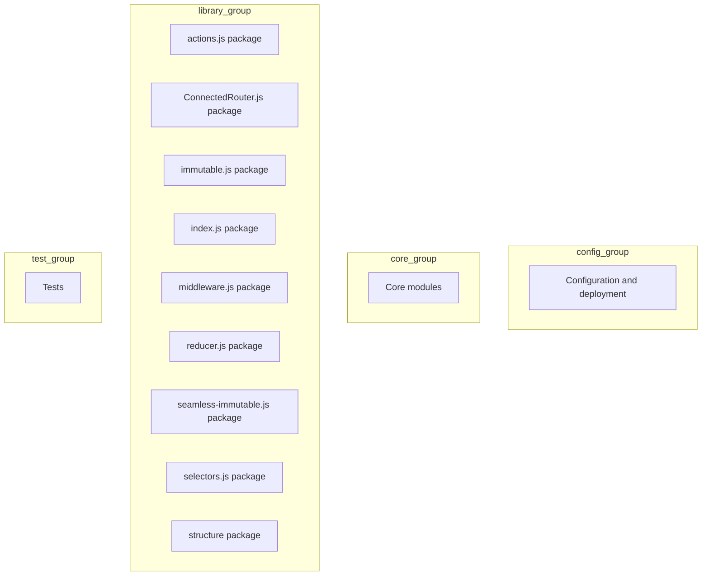

# Architecture report: supasate/connected-react-router

> Automated static analysis. **Observed** = directly seen in files/imports/AST; **Inferred** = interpretation from that evidence. Repository code was not executed.

## 1. Repository at a glance

| Item | Value |
| --- | --- |
| Repository | supasate/connected-react-router |
| Description | A Redux binding for React Router v4 |
| Language | JavaScript |
| Stars | 4681 |
| Licence | MIT |
| Analysed commit / branch | 5d4c197043deb89238f9b380a6a1ef4d909f14a7 / master |
| Framework(s) | Express, React |
| Files analysed | 152 |
| Components | 12 |

## 2. Architecture in one minute

supasate/connected-react-router - A Redux binding for React Router v4. This repository was analysed statically from 152 file(s) (0 Python). Detected technologies (observed from imports/manifests): GitHub Actions, Express, React, React Router, Redux, Jest. Files are grouped into 12 component(s): actions.js package, Configuration and deployment, ConnectedRouter.js package, Core modules, immutable.js package, index.js package, middleware.js package, reducer.js package. Findings below distinguish observed facts from inferred interpretation.

## 3. High-level block diagram

## 4. Main components

### actions.js package (`actions_js`)

- **Kind:** library
- **Status:** Observed
- **Confidence:** 0.85
- **Responsibility:** Groups 1 file(s) under actions.js package (observed from repository paths and static analysis).
- **Paths:** `src/actions.js`
- **Evidence:** [src/actions.js](https://github.com/supasate/connected-react-router/blob/5d4c197043deb89238f9b380a6a1ef4d909f14a7/src/actions.js)

### Configuration and deployment (`config`)

- **Kind:** config
- **Status:** Observed
- **Confidence:** 0.85
- **Responsibility:** Groups 1 file(s) under configuration and deployment (observed from repository paths and static analysis).
- **Paths:** `package.json`
- **Evidence:** [package.json](https://github.com/supasate/connected-react-router/blob/5d4c197043deb89238f9b380a6a1ef4d909f14a7/package.json)

### ConnectedRouter.js package (`connectedrouter_js`)

- **Kind:** library
- **Status:** Observed
- **Confidence:** 0.85
- **Responsibility:** Groups 1 file(s) under connectedrouter.js package (observed from repository paths and static analysis).
- **Paths:** `src/ConnectedRouter.js`
- **Evidence:** [src/ConnectedRouter.js](https://github.com/supasate/connected-react-router/blob/5d4c197043deb89238f9b380a6a1ef4d909f14a7/src/ConnectedRouter.js)

### Core modules (`core`)

- **Kind:** core
- **Status:** Observed
- **Confidence:** 0.85
- **Responsibility:** Groups 6 file(s) under core modules (observed from repository paths and static analysis).
- **Paths:** `immutable.d.ts`, `immutable.js`, `index.d.ts`, `seamless-immutable.d.ts`, `seamless-immutable.js`, `webpack.config.js`
- **Evidence:** [immutable.d.ts](https://github.com/supasate/connected-react-router/blob/5d4c197043deb89238f9b380a6a1ef4d909f14a7/immutable.d.ts); [immutable.js](https://github.com/supasate/connected-react-router/blob/5d4c197043deb89238f9b380a6a1ef4d909f14a7/immutable.js); [index.d.ts](https://github.com/supasate/connected-react-router/blob/5d4c197043deb89238f9b380a6a1ef4d909f14a7/index.d.ts); [seamless-immutable.d.ts](https://github.com/supasate/connected-react-router/blob/5d4c197043deb89238f9b380a6a1ef4d909f14a7/seamless-immutable.d.ts); [seamless-immutable.js](https://github.com/supasate/connected-react-router/blob/5d4c197043deb89238f9b380a6a1ef4d909f14a7/seamless-immutable.js); [webpack.config.js](https://github.com/supasate/connected-react-router/blob/5d4c197043deb89238f9b380a6a1ef4d909f14a7/webpack.config.js)

### immutable.js package (`immutable_js`)

- **Kind:** library
- **Status:** Observed
- **Confidence:** 0.85
- **Responsibility:** Groups 1 file(s) under immutable.js package (observed from repository paths and static analysis).
- **Paths:** `src/immutable.js`
- **Evidence:** [src/immutable.js](https://github.com/supasate/connected-react-router/blob/5d4c197043deb89238f9b380a6a1ef4d909f14a7/src/immutable.js)

### index.js package (`index_js`)

- **Kind:** library
- **Status:** Observed
- **Confidence:** 0.85
- **Responsibility:** Groups 1 file(s) under index.js package (observed from repository paths and static analysis).
- **Paths:** `src/index.js`
- **Evidence:** [src/index.js](https://github.com/supasate/connected-react-router/blob/5d4c197043deb89238f9b380a6a1ef4d909f14a7/src/index.js)

### middleware.js package (`middleware_js`)

- **Kind:** library
- **Status:** Observed
- **Confidence:** 0.85
- **Responsibility:** Groups 1 file(s) under middleware.js package (observed from repository paths and static analysis).
- **Paths:** `src/middleware.js`
- **Evidence:** [src/middleware.js](https://github.com/supasate/connected-react-router/blob/5d4c197043deb89238f9b380a6a1ef4d909f14a7/src/middleware.js)

### reducer.js package (`reducer_js`)

- **Kind:** library
- **Status:** Observed
- **Confidence:** 0.85
- **Responsibility:** Groups 1 file(s) under reducer.js package (observed from repository paths and static analysis).
- **Paths:** `src/reducer.js`
- **Evidence:** [src/reducer.js](https://github.com/supasate/connected-react-router/blob/5d4c197043deb89238f9b380a6a1ef4d909f14a7/src/reducer.js)

### seamless-immutable.js package (`seamless_immutable_js`)

- **Kind:** library
- **Status:** Observed
- **Confidence:** 0.85
- **Responsibility:** Groups 1 file(s) under seamless-immutable.js package (observed from repository paths and static analysis).
- **Paths:** `src/seamless-immutable.js`
- **Evidence:** [src/seamless-immutable.js](https://github.com/supasate/connected-react-router/blob/5d4c197043deb89238f9b380a6a1ef4d909f14a7/src/seamless-immutable.js)

### selectors.js package (`selectors_js`)

- **Kind:** library
- **Status:** Observed
- **Confidence:** 0.85
- **Responsibility:** Groups 1 file(s) under selectors.js package (observed from repository paths and static analysis).
- **Paths:** `src/selectors.js`
- **Evidence:** [src/selectors.js](https://github.com/supasate/connected-react-router/blob/5d4c197043deb89238f9b380a6a1ef4d909f14a7/src/selectors.js)

### structure package (`structure`)

- **Kind:** library
- **Status:** Observed
- **Confidence:** 0.85
- **Responsibility:** Groups 5 file(s) under structure package (observed from repository paths and static analysis).
- **Paths:** `src/structure/immutable/getIn.js`, `src/structure/immutable/index.js`, `src/structure/plain/getIn.js`, `src/structure/plain/index.js`, `src/structure/seamless-immutable/index.js`
- **Evidence:** [src/structure/immutable/getIn.js](https://github.com/supasate/connected-react-router/blob/5d4c197043deb89238f9b380a6a1ef4d909f14a7/src/structure/immutable/getIn.js); [src/structure/immutable/index.js](https://github.com/supasate/connected-react-router/blob/5d4c197043deb89238f9b380a6a1ef4d909f14a7/src/structure/immutable/index.js); [src/structure/plain/getIn.js](https://github.com/supasate/connected-react-router/blob/5d4c197043deb89238f9b380a6a1ef4d909f14a7/src/structure/plain/getIn.js); [src/structure/plain/index.js](https://github.com/supasate/connected-react-router/blob/5d4c197043deb89238f9b380a6a1ef4d909f14a7/src/structure/plain/index.js); [src/structure/seamless-immutable/index.js](https://github.com/supasate/connected-react-router/blob/5d4c197043deb89238f9b380a6a1ef4d909f14a7/src/structure/seamless-immutable/index.js)

### Tests (`tests`)

- **Kind:** test
- **Status:** Observed
- **Confidence:** 0.85
- **Responsibility:** Groups 6 file(s) under tests (observed from repository paths and static analysis).
- **Paths:** `test/.eslintrc`, `test/ConnectedRouter.test.js`, `test/actions.test.js`, `test/middleware.test.js`, `test/reducer.test.js`, `test/selectors.test.js`
- **Evidence:** [test/.eslintrc](https://github.com/supasate/connected-react-router/blob/5d4c197043deb89238f9b380a6a1ef4d909f14a7/test/.eslintrc); [test/ConnectedRouter.test.js](https://github.com/supasate/connected-react-router/blob/5d4c197043deb89238f9b380a6a1ef4d909f14a7/test/ConnectedRouter.test.js); [test/actions.test.js](https://github.com/supasate/connected-react-router/blob/5d4c197043deb89238f9b380a6a1ef4d909f14a7/test/actions.test.js); [test/middleware.test.js](https://github.com/supasate/connected-react-router/blob/5d4c197043deb89238f9b380a6a1ef4d909f14a7/test/middleware.test.js); [test/reducer.test.js](https://github.com/supasate/connected-react-router/blob/5d4c197043deb89238f9b380a6a1ef4d909f14a7/test/reducer.test.js); [test/selectors.test.js](https://github.com/supasate/connected-react-router/blob/5d4c197043deb89238f9b380a6a1ef4d909f14a7/test/selectors.test.js)

## 5. Execution flow

**Observed** entry point(s):

- [examples/basic/src/index.js](https://github.com/supasate/connected-react-router/blob/5d4c197043deb89238f9b380a6a1ef4d909f14a7/examples/basic/src/index.js)
- [examples/immutable/src/index.js](https://github.com/supasate/connected-react-router/blob/5d4c197043deb89238f9b380a6a1ef4d909f14a7/examples/immutable/src/index.js)
- [examples/typescript/src/index.tsx](https://github.com/supasate/connected-react-router/blob/5d4c197043deb89238f9b380a6a1ef4d909f14a7/examples/typescript/src/index.tsx)
- [src/index.js](https://github.com/supasate/connected-react-router/blob/5d4c197043deb89238f9b380a6a1ef4d909f14a7/src/index.js)
- [src/structure/immutable/index.js](https://github.com/supasate/connected-react-router/blob/5d4c197043deb89238f9b380a6a1ef4d909f14a7/src/structure/immutable/index.js)
- [src/structure/plain/index.js](https://github.com/supasate/connected-react-router/blob/5d4c197043deb89238f9b380a6a1ef4d909f14a7/src/structure/plain/index.js)
- [src/structure/seamless-immutable/index.js](https://github.com/supasate/connected-react-router/blob/5d4c197043deb89238f9b380a6a1ef4d909f14a7/src/structure/seamless-immutable/index.js)

Representative flow (derived from observed entry points and the import graph; steps beyond the entry point are **Inferred**):

1. Execution starts at an observed entry point listed above, if present.
2. No internal import relationships between components were observed.

## 6. Project structure

### `(root)`

- `.babelrc` - other (253 bytes)
- `.eslintignore` - other (29 bytes)
- `.eslintrc` - other (363 bytes)
- `.gitignore` - other (58 bytes)
- `.jestrc.json` - config (62 bytes)
- `.travis.yml` - ci, YAML (122 bytes)
- `ACKNOWLEDGE.md` - docs (813 bytes)
- `CODE_OF_CONDUCT.md` - docs (3352 bytes)
- `FAQ.md` - docs (10506 bytes)
- `LICENSE.md` - docs (1095 bytes)
- `README.md` - docs (7602 bytes)
- `immutable.d.ts` - source, TypeScript (135 bytes)
- `immutable.js` - source, JavaScript (44 bytes)
- `index.d.ts` - source, TypeScript (4009 bytes)
- `package.json` - manifest (2827 bytes)
- `seamless-immutable.d.ts` - source, TypeScript (144 bytes)
- `seamless-immutable.js` - source, JavaScript (53 bytes)
- `webpack.config.js` - source, JavaScript (373 bytes)

### `.github`

- `.github/workflows/codeql-analysis.yml` - ci, YAML (2364 bytes)

### `examples`

- `examples/basic/.babelrc` - other (74 bytes)
- `examples/basic/.eslintrc` - other (279 bytes)
- `examples/basic/README.md` - docs (353 bytes)
- `examples/basic/index.html` - other (206 bytes)
- `examples/basic/package.json` - manifest (979 bytes)
- `examples/basic/server.js` - source, JavaScript (762 bytes)
- `examples/basic/src/App.js` - source, JavaScript (347 bytes)
- `examples/basic/src/actions/counter.js` - source, JavaScript (117 bytes)
- `examples/basic/src/components/Counter.js` - source, JavaScript (725 bytes)
- `examples/basic/src/components/Hello.js` - source, JavaScript (168 bytes)
- `examples/basic/src/components/HelloChild.js` - source, JavaScript (840 bytes)
- `examples/basic/src/components/Home.js` - source, JavaScript (97 bytes)
- `examples/basic/src/components/NavBar.js` - source, JavaScript (238 bytes)
- `examples/basic/src/components/NoMatch.js` - source, JavaScript (107 bytes)
- `examples/basic/src/configureStore.js` - source, JavaScript (804 bytes)
- `examples/basic/src/index.js` - source, JavaScript (600 bytes)
- `examples/basic/src/reducers/counter.js` - source, JavaScript (232 bytes)
- `examples/basic/src/reducers/index.js` - source, JavaScript (275 bytes)
- `examples/basic/src/routes/index.js` - source, JavaScript (565 bytes)
- `examples/basic/webpack.config.js` - source, JavaScript (778 bytes)
- `examples/immutable/.babelrc` - other (74 bytes)
- `examples/immutable/.eslintrc` - other (279 bytes)
- `examples/immutable/README.md` - docs (353 bytes)
- `examples/immutable/index.html` - other (206 bytes)
- `examples/immutable/package.json` - manifest (1034 bytes)
- `examples/immutable/server.js` - source, JavaScript (762 bytes)
- `examples/immutable/src/App.js` - source, JavaScript (357 bytes)
- `examples/immutable/src/actions/counter.js` - source, JavaScript (117 bytes)
- `examples/immutable/src/components/Counter.js` - source, JavaScript (736 bytes)
- `examples/immutable/src/components/Hello.js` - source, JavaScript (168 bytes)
- `examples/immutable/src/components/HelloChild.js` - source, JavaScript (891 bytes)
- `examples/immutable/src/components/Home.js` - source, JavaScript (97 bytes)
- `examples/immutable/src/components/NavBar.js` - source, JavaScript (238 bytes)
- `examples/immutable/src/components/NoMatch.js` - source, JavaScript (107 bytes)
- `examples/immutable/src/configureStore.js` - source, JavaScript (814 bytes)
- `examples/immutable/src/index.js` - source, JavaScript (683 bytes)
- `examples/immutable/src/reducers/counter.js` - source, JavaScript (232 bytes)
- `examples/immutable/src/reducers/index.js` - source, JavaScript (295 bytes)
- `examples/immutable/src/routes/index.js` - source, JavaScript (565 bytes)
- `examples/immutable/webpack.config.js` - source, JavaScript (778 bytes)
- `examples/react-native/.buckconfig` - other (114 bytes)
- `examples/react-native/.eslintrc.js` - source, JavaScript (74 bytes)
- `examples/react-native/.flowconfig` - other (3234 bytes)
- `examples/react-native/.gitattributes` - other (16 bytes)
- `examples/react-native/.gitignore` - other (817 bytes)
- `examples/react-native/.prettierrc.js` - source, JavaScript (120 bytes)
- `examples/react-native/.watchmanconfig` - other (2 bytes)
- `examples/react-native/android/app/BUCK` - other (1334 bytes)
- `examples/react-native/android/app/build.gradle` - manifest (8257 bytes)
- `examples/react-native/android/app/build_defs.bzl` - other (602 bytes)
- `examples/react-native/android/app/proguard-rules.pro` - other (435 bytes)
- `examples/react-native/android/app/src/debug/AndroidManifest.xml` - other (368 bytes)
- `examples/react-native/android/app/src/main/AndroidManifest.xml` - other (982 bytes)
- `examples/react-native/android/app/src/main/java/com/connectedreactrouter/MainActivity.java` - source, Java (385 bytes)
- `examples/react-native/android/app/src/main/java/com/connectedreactrouter/MainApplication.java` - source, Java (1373 bytes)
- `examples/react-native/android/app/src/main/res/values/strings.xml` - other (83 bytes)
- `examples/react-native/android/app/src/main/res/values/styles.xml` - other (246 bytes)
- `examples/react-native/android/build.gradle` - manifest (993 bytes)
- `examples/react-native/android/gradle.properties` - other (910 bytes)
- `examples/react-native/android/gradle/wrapper/gradle-wrapper.properties` - other (202 bytes)
- `examples/react-native/android/gradlew` - other (5916 bytes)
- `examples/react-native/android/gradlew.bat` - other (2941 bytes)
- `examples/react-native/android/settings.gradle` - other (204 bytes)
- `examples/react-native/app.json` - config (77 bytes)
- `examples/react-native/babel.config.js` - source, JavaScript (77 bytes)
- `examples/react-native/index.js` - source, JavaScript (187 bytes)
- `examples/react-native/ios/ConnectedReactRouter-tvOS/Info.plist` - other (1489 bytes)
- `examples/react-native/ios/ConnectedReactRouter-tvOSTests/Info.plist` - other (765 bytes)
- `examples/react-native/ios/ConnectedReactRouter.xcodeproj/project.pbxproj` - other (42114 bytes)
- `examples/react-native/ios/ConnectedReactRouter.xcodeproj/xcshareddata/xcschemes/ConnectedReactRouter-tvOS.xcscheme` - other (5220 bytes)
- `examples/react-native/ios/ConnectedReactRouter.xcodeproj/xcshareddata/xcschemes/ConnectedReactRouter.xcscheme` - other (5155 bytes)
- `examples/react-native/ios/ConnectedReactRouter.xcworkspace/contents.xcworkspacedata` - other (238 bytes)
- `examples/react-native/ios/ConnectedReactRouter/AppDelegate.h` - source, C/C++ (386 bytes)
- `examples/react-native/ios/ConnectedReactRouter/AppDelegate.m` - other (1425 bytes)
- `examples/react-native/ios/ConnectedReactRouter/Base.lproj/LaunchScreen.xib` - other (3723 bytes)
- `examples/react-native/ios/ConnectedReactRouter/Images.xcassets/AppIcon.appiconset/Contents.json` - config (585 bytes)
- `examples/react-native/ios/ConnectedReactRouter/Images.xcassets/Contents.json` - config (63 bytes)
- `examples/react-native/ios/ConnectedReactRouter/Info.plist` - other (1606 bytes)
- `examples/react-native/ios/ConnectedReactRouter/main.m` - other (390 bytes)
- `examples/react-native/ios/ConnectedReactRouterTests/ConnectedReactRouterTests.m` - other (1967 bytes)
- `examples/react-native/ios/ConnectedReactRouterTests/Info.plist` - other (733 bytes)
- `examples/react-native/ios/Podfile` - other (2255 bytes)
- `examples/react-native/ios/Podfile.lock` - other (7151 bytes)
- `examples/react-native/metro.config.js` - source, JavaScript (300 bytes)
- `examples/react-native/package.json` - manifest (734 bytes)
- `examples/react-native/src/App.js` - source, JavaScript (672 bytes)
- `examples/react-native/src/configureStore.js` - source, JavaScript (460 bytes)
- `examples/react-native/src/routes/index.js` - source, JavaScript (483 bytes)
- `examples/react-native/src/screens/Account.js` - source, JavaScript (628 bytes)
- `examples/react-native/src/screens/Home.js` - source, JavaScript (542 bytes)
- `examples/react-native/src/screens/__tests__/Account-test.js` - source, JavaScript (450 bytes)
- `examples/react-native/src/screens/__tests__/Home-test.js` - source, JavaScript (325 bytes)
- `examples/react-native/src/screens/__tests__/__snapshots__/Account-test.js.snap` - other (1160 bytes)
- `examples/react-native/src/screens/__tests__/__snapshots__/Home-test.js.snap` - other (1184 bytes)
- `examples/react-native/src/utils/__tests__/url-test.js` - source, JavaScript (357 bytes)
- `examples/react-native/src/utils/url.js` - source, JavaScript (315 bytes)
- `examples/typescript/README.md` - docs (428 bytes)
- `examples/typescript/index.html` - other (206 bytes)
- `examples/typescript/package.json` - manifest (1093 bytes)
- `examples/typescript/src/App.tsx` - source, TypeScript (350 bytes)
- `examples/typescript/src/actions/counter.ts` - source, TypeScript (117 bytes)
- `examples/typescript/src/components/Counter.tsx` - source, TypeScript (926 bytes)
- `examples/typescript/src/components/Hello.tsx` - source, TypeScript (168 bytes)
- `examples/typescript/src/components/HelloChild.tsx` - source, TypeScript (837 bytes)
- `examples/typescript/src/components/Home.tsx` - source, TypeScript (97 bytes)
- `examples/typescript/src/components/NavBar.tsx` - source, TypeScript (238 bytes)
- `examples/typescript/src/components/NoMatch.tsx` - source, TypeScript (107 bytes)
- `examples/typescript/src/configureStore.tsx` - source, TypeScript (835 bytes)
- `examples/typescript/src/index.tsx` - source, TypeScript (600 bytes)
- `examples/typescript/src/reducers/counter.ts` - source, TypeScript (273 bytes)
- `examples/typescript/src/reducers/index.ts` - source, TypeScript (397 bytes)
- `examples/typescript/src/routes/index.tsx` - source, TypeScript (565 bytes)
- `examples/typescript/tsconfig.json` - config (482 bytes)
- `examples/typescript/webpack.config.js` - source, JavaScript (625 bytes)

### `src`

- `src/ConnectedRouter.js` - source, JavaScript (5431 bytes)
- `src/actions.js` - source, JavaScript (1248 bytes)
- `src/immutable.js` - source, JavaScript (707 bytes)
- `src/index.js` - source, JavaScript (687 bytes)
- `src/middleware.js` - source, JavaScript (556 bytes)
- `src/reducer.js` - source, JavaScript (1909 bytes)
- `src/seamless-immutable.js` - source, JavaScript (716 bytes)
- `src/selectors.js` - source, JavaScript (1762 bytes)
- `src/structure/immutable/getIn.js` - source, JavaScript (278 bytes)
- `src/structure/immutable/index.js` - source, JavaScript (368 bytes)
- `src/structure/plain/getIn.js` - source, JavaScript (352 bytes)
- `src/structure/plain/index.js` - source, JavaScript (193 bytes)
- `src/structure/seamless-immutable/index.js` - source, JavaScript (341 bytes)

### `test`

- `test/.eslintrc` - test (35 bytes)
- `test/ConnectedRouter.test.js` - test, JavaScript (17618 bytes)
- `test/actions.test.js` - test, JavaScript (2644 bytes)
- `test/middleware.test.js` - test, JavaScript (2176 bytes)
- `test/reducer.test.js` - test, JavaScript (8520 bytes)
- `test/selectors.test.js` - test, JavaScript (5219 bytes)

## 7. Key dependencies and integrations

| Name | Category | Status | Confidence | Evidence |
| --- | --- | --- | --- | --- |
| GitHub Actions | ci | Observed | 0.85 | [.github/workflows/codeql-analysis.yml](https://github.com/supasate/connected-react-router/blob/5d4c197043deb89238f9b380a6a1ef4d909f14a7/.github/workflows/codeql-analysis.yml) |
| Express | framework | Observed | 0.90 | [examples/basic/package.json:18](https://github.com/supasate/connected-react-router/blob/5d4c197043deb89238f9b380a6a1ef4d909f14a7/examples/basic/package.json#L18); [examples/immutable/package.json:17](https://github.com/supasate/connected-react-router/blob/5d4c197043deb89238f9b380a6a1ef4d909f14a7/examples/immutable/package.json#L17) |
| React | framework | Observed | 0.90 | [examples/basic/package.json:2](https://github.com/supasate/connected-react-router/blob/5d4c197043deb89238f9b380a6a1ef4d909f14a7/examples/basic/package.json#L2); [examples/basic/package.json:30](https://github.com/supasate/connected-react-router/blob/5d4c197043deb89238f9b380a6a1ef4d909f14a7/examples/basic/package.json#L30); [examples/immutable/package.json:2](https://github.com/supasate/connected-react-router/blob/5d4c197043deb89238f9b380a6a1ef4d909f14a7/examples/immutable/package.json#L2); [examples/immutable/package.json:30](https://github.com/supasate/connected-react-router/blob/5d4c197043deb89238f9b380a6a1ef4d909f14a7/examples/immutable/package.json#L30) |
| React Router | library | Observed | 0.90 | [examples/basic/package.json:2](https://github.com/supasate/connected-react-router/blob/5d4c197043deb89238f9b380a6a1ef4d909f14a7/examples/basic/package.json#L2); [examples/basic/package.json:33](https://github.com/supasate/connected-react-router/blob/5d4c197043deb89238f9b380a6a1ef4d909f14a7/examples/basic/package.json#L33); [examples/immutable/package.json:2](https://github.com/supasate/connected-react-router/blob/5d4c197043deb89238f9b380a6a1ef4d909f14a7/examples/immutable/package.json#L2); [examples/immutable/package.json:33](https://github.com/supasate/connected-react-router/blob/5d4c197043deb89238f9b380a6a1ef4d909f14a7/examples/immutable/package.json#L33) |
| Redux | library | Observed | 0.90 | [examples/basic/package.json:31](https://github.com/supasate/connected-react-router/blob/5d4c197043deb89238f9b380a6a1ef4d909f14a7/examples/basic/package.json#L31); [examples/immutable/package.json:31](https://github.com/supasate/connected-react-router/blob/5d4c197043deb89238f9b380a6a1ef4d909f14a7/examples/immutable/package.json#L31); [examples/react-native/package.json:14](https://github.com/supasate/connected-react-router/blob/5d4c197043deb89238f9b380a6a1ef4d909f14a7/examples/react-native/package.json#L14); [examples/typescript/package.json:17](https://github.com/supasate/connected-react-router/blob/5d4c197043deb89238f9b380a6a1ef4d909f14a7/examples/typescript/package.json#L17) |
| Jest | tooling | Observed | 0.90 | [examples/react-native/package.json:7](https://github.com/supasate/connected-react-router/blob/5d4c197043deb89238f9b380a6a1ef4d909f14a7/examples/react-native/package.json#L7); [package.json:26](https://github.com/supasate/connected-react-router/blob/5d4c197043deb89238f9b380a6a1ef4d909f14a7/package.json#L26) |
| TypeScript | tooling | Observed | 0.85 | [examples/typescript/package.json:2](https://github.com/supasate/connected-react-router/blob/5d4c197043deb89238f9b380a6a1ef4d909f14a7/examples/typescript/package.json#L2) |
| webpack | tooling | Observed | 0.90 | [examples/basic/package.json:8](https://github.com/supasate/connected-react-router/blob/5d4c197043deb89238f9b380a6a1ef4d909f14a7/examples/basic/package.json#L8); [examples/immutable/package.json:8](https://github.com/supasate/connected-react-router/blob/5d4c197043deb89238f9b380a6a1ef4d909f14a7/examples/immutable/package.json#L8); [examples/typescript/package.json:7](https://github.com/supasate/connected-react-router/blob/5d4c197043deb89238f9b380a6a1ef4d909f14a7/examples/typescript/package.json#L7); [package.json:22](https://github.com/supasate/connected-react-router/blob/5d4c197043deb89238f9b380a6a1ef4d909f14a7/package.json#L22) |

## 8. Data and state

No database, cache, queue, or persistent-state usage was observed in the analysed files. State handling, if any, may be in-memory or in files that were not analysed.

## 9. Configuration and deployment clues

- `.github/workflows/codeql-analysis.yml` (ci)
- `.jestrc.json` (config)
- `.travis.yml` (ci)
- `examples/basic/package.json` (manifest)
- `examples/immutable/package.json` (manifest)
- `examples/react-native/android/app/build.gradle` (manifest)
- `examples/react-native/android/build.gradle` (manifest)
- `examples/react-native/app.json` (config)
- `examples/react-native/ios/ConnectedReactRouter/Images.xcassets/AppIcon.appiconset/Contents.json` (config)
- `examples/react-native/ios/ConnectedReactRouter/Images.xcassets/Contents.json` (config)
- `examples/react-native/package.json` (manifest)
- `examples/typescript/package.json` (manifest)
- `examples/typescript/tsconfig.json` (config)
- `package.json` (manifest)

## 10. Design observations

- Tests are present alongside source code (Observed from test file paths).

These observations are interpretations (**Inferred**) of the observed structure, not guarantees about runtime design.

## 11. Limitations and unknowns

- Static analysis only: repository code was not executed, installed, or imported at runtime.
- Components and relationships are inferred from file paths, imports, and AST structure; runtime behaviour, dynamic imports, and reflection may not be visible.
- 2 file(s) were skipped during inventory (2 x lockfile excluded).
- No clear application entry point was observed in the analysed files.
- Repository text was treated as untrusted data; no instructions found in repository files were followed, and likely secret values were redacted/excluded.
- JavaScript and TypeScript files were inventoried from paths and package manifests. They were not parsed with a full language AST, and repository code was not executed.

## 12. Source references

- [.github/workflows/codeql-analysis.yml](https://github.com/supasate/connected-react-router/blob/5d4c197043deb89238f9b380a6a1ef4d909f14a7/.github/workflows/codeql-analysis.yml)
- [examples/basic/package.json:2](https://github.com/supasate/connected-react-router/blob/5d4c197043deb89238f9b380a6a1ef4d909f14a7/examples/basic/package.json#L2)
- [examples/basic/package.json:8](https://github.com/supasate/connected-react-router/blob/5d4c197043deb89238f9b380a6a1ef4d909f14a7/examples/basic/package.json#L8)
- [examples/basic/package.json:18](https://github.com/supasate/connected-react-router/blob/5d4c197043deb89238f9b380a6a1ef4d909f14a7/examples/basic/package.json#L18)
- [examples/basic/package.json:30](https://github.com/supasate/connected-react-router/blob/5d4c197043deb89238f9b380a6a1ef4d909f14a7/examples/basic/package.json#L30)
- [examples/basic/package.json:31](https://github.com/supasate/connected-react-router/blob/5d4c197043deb89238f9b380a6a1ef4d909f14a7/examples/basic/package.json#L31)
- [examples/basic/package.json:33](https://github.com/supasate/connected-react-router/blob/5d4c197043deb89238f9b380a6a1ef4d909f14a7/examples/basic/package.json#L33)
- [examples/basic/src/index.js](https://github.com/supasate/connected-react-router/blob/5d4c197043deb89238f9b380a6a1ef4d909f14a7/examples/basic/src/index.js)
- [examples/immutable/package.json:2](https://github.com/supasate/connected-react-router/blob/5d4c197043deb89238f9b380a6a1ef4d909f14a7/examples/immutable/package.json#L2)
- [examples/immutable/package.json:8](https://github.com/supasate/connected-react-router/blob/5d4c197043deb89238f9b380a6a1ef4d909f14a7/examples/immutable/package.json#L8)
- [examples/immutable/package.json:17](https://github.com/supasate/connected-react-router/blob/5d4c197043deb89238f9b380a6a1ef4d909f14a7/examples/immutable/package.json#L17)
- [examples/immutable/package.json:30](https://github.com/supasate/connected-react-router/blob/5d4c197043deb89238f9b380a6a1ef4d909f14a7/examples/immutable/package.json#L30)
- [examples/immutable/package.json:31](https://github.com/supasate/connected-react-router/blob/5d4c197043deb89238f9b380a6a1ef4d909f14a7/examples/immutable/package.json#L31)
- [examples/immutable/package.json:33](https://github.com/supasate/connected-react-router/blob/5d4c197043deb89238f9b380a6a1ef4d909f14a7/examples/immutable/package.json#L33)
- [examples/immutable/src/index.js](https://github.com/supasate/connected-react-router/blob/5d4c197043deb89238f9b380a6a1ef4d909f14a7/examples/immutable/src/index.js)
- [examples/react-native/package.json:2](https://github.com/supasate/connected-react-router/blob/5d4c197043deb89238f9b380a6a1ef4d909f14a7/examples/react-native/package.json#L2)
- [examples/react-native/package.json:7](https://github.com/supasate/connected-react-router/blob/5d4c197043deb89238f9b380a6a1ef4d909f14a7/examples/react-native/package.json#L7)
- [examples/react-native/package.json:14](https://github.com/supasate/connected-react-router/blob/5d4c197043deb89238f9b380a6a1ef4d909f14a7/examples/react-native/package.json#L14)
- [examples/typescript/package.json:2](https://github.com/supasate/connected-react-router/blob/5d4c197043deb89238f9b380a6a1ef4d909f14a7/examples/typescript/package.json#L2)
- [examples/typescript/package.json:7](https://github.com/supasate/connected-react-router/blob/5d4c197043deb89238f9b380a6a1ef4d909f14a7/examples/typescript/package.json#L7)
- [examples/typescript/package.json:15](https://github.com/supasate/connected-react-router/blob/5d4c197043deb89238f9b380a6a1ef4d909f14a7/examples/typescript/package.json#L15)
- [examples/typescript/package.json:17](https://github.com/supasate/connected-react-router/blob/5d4c197043deb89238f9b380a6a1ef4d909f14a7/examples/typescript/package.json#L17)
- [examples/typescript/package.json:19](https://github.com/supasate/connected-react-router/blob/5d4c197043deb89238f9b380a6a1ef4d909f14a7/examples/typescript/package.json#L19)
- [examples/typescript/src/index.tsx](https://github.com/supasate/connected-react-router/blob/5d4c197043deb89238f9b380a6a1ef4d909f14a7/examples/typescript/src/index.tsx)
- [immutable.d.ts](https://github.com/supasate/connected-react-router/blob/5d4c197043deb89238f9b380a6a1ef4d909f14a7/immutable.d.ts)
- [immutable.js](https://github.com/supasate/connected-react-router/blob/5d4c197043deb89238f9b380a6a1ef4d909f14a7/immutable.js)
- [index.d.ts](https://github.com/supasate/connected-react-router/blob/5d4c197043deb89238f9b380a6a1ef4d909f14a7/index.d.ts)
- [package.json](https://github.com/supasate/connected-react-router/blob/5d4c197043deb89238f9b380a6a1ef4d909f14a7/package.json)
- [package.json:2](https://github.com/supasate/connected-react-router/blob/5d4c197043deb89238f9b380a6a1ef4d909f14a7/package.json#L2)
- [package.json:4](https://github.com/supasate/connected-react-router/blob/5d4c197043deb89238f9b380a6a1ef4d909f14a7/package.json#L4)
- [package.json:22](https://github.com/supasate/connected-react-router/blob/5d4c197043deb89238f9b380a6a1ef4d909f14a7/package.json#L22)
- [package.json:26](https://github.com/supasate/connected-react-router/blob/5d4c197043deb89238f9b380a6a1ef4d909f14a7/package.json#L26)
- [seamless-immutable.d.ts](https://github.com/supasate/connected-react-router/blob/5d4c197043deb89238f9b380a6a1ef4d909f14a7/seamless-immutable.d.ts)
- [seamless-immutable.js](https://github.com/supasate/connected-react-router/blob/5d4c197043deb89238f9b380a6a1ef4d909f14a7/seamless-immutable.js)
- [src/ConnectedRouter.js](https://github.com/supasate/connected-react-router/blob/5d4c197043deb89238f9b380a6a1ef4d909f14a7/src/ConnectedRouter.js)
- [src/actions.js](https://github.com/supasate/connected-react-router/blob/5d4c197043deb89238f9b380a6a1ef4d909f14a7/src/actions.js)
- [src/immutable.js](https://github.com/supasate/connected-react-router/blob/5d4c197043deb89238f9b380a6a1ef4d909f14a7/src/immutable.js)
- [src/index.js](https://github.com/supasate/connected-react-router/blob/5d4c197043deb89238f9b380a6a1ef4d909f14a7/src/index.js)
- [src/middleware.js](https://github.com/supasate/connected-react-router/blob/5d4c197043deb89238f9b380a6a1ef4d909f14a7/src/middleware.js)
- [src/reducer.js](https://github.com/supasate/connected-react-router/blob/5d4c197043deb89238f9b380a6a1ef4d909f14a7/src/reducer.js)
- [src/seamless-immutable.js](https://github.com/supasate/connected-react-router/blob/5d4c197043deb89238f9b380a6a1ef4d909f14a7/src/seamless-immutable.js)
- [src/selectors.js](https://github.com/supasate/connected-react-router/blob/5d4c197043deb89238f9b380a6a1ef4d909f14a7/src/selectors.js)
- [src/structure/immutable/getIn.js](https://github.com/supasate/connected-react-router/blob/5d4c197043deb89238f9b380a6a1ef4d909f14a7/src/structure/immutable/getIn.js)
- [src/structure/immutable/index.js](https://github.com/supasate/connected-react-router/blob/5d4c197043deb89238f9b380a6a1ef4d909f14a7/src/structure/immutable/index.js)
- [src/structure/plain/getIn.js](https://github.com/supasate/connected-react-router/blob/5d4c197043deb89238f9b380a6a1ef4d909f14a7/src/structure/plain/getIn.js)
- [src/structure/plain/index.js](https://github.com/supasate/connected-react-router/blob/5d4c197043deb89238f9b380a6a1ef4d909f14a7/src/structure/plain/index.js)
- [src/structure/seamless-immutable/index.js](https://github.com/supasate/connected-react-router/blob/5d4c197043deb89238f9b380a6a1ef4d909f14a7/src/structure/seamless-immutable/index.js)
- [test/.eslintrc](https://github.com/supasate/connected-react-router/blob/5d4c197043deb89238f9b380a6a1ef4d909f14a7/test/.eslintrc)
- [test/ConnectedRouter.test.js](https://github.com/supasate/connected-react-router/blob/5d4c197043deb89238f9b380a6a1ef4d909f14a7/test/ConnectedRouter.test.js)
- [test/actions.test.js](https://github.com/supasate/connected-react-router/blob/5d4c197043deb89238f9b380a6a1ef4d909f14a7/test/actions.test.js)
- [test/middleware.test.js](https://github.com/supasate/connected-react-router/blob/5d4c197043deb89238f9b380a6a1ef4d909f14a7/test/middleware.test.js)
- [test/reducer.test.js](https://github.com/supasate/connected-react-router/blob/5d4c197043deb89238f9b380a6a1ef4d909f14a7/test/reducer.test.js)
- [test/selectors.test.js](https://github.com/supasate/connected-react-router/blob/5d4c197043deb89238f9b380a6a1ef4d909f14a7/test/selectors.test.js)
- [webpack.config.js](https://github.com/supasate/connected-react-router/blob/5d4c197043deb89238f9b380a6a1ef4d909f14a7/webpack.config.js)
