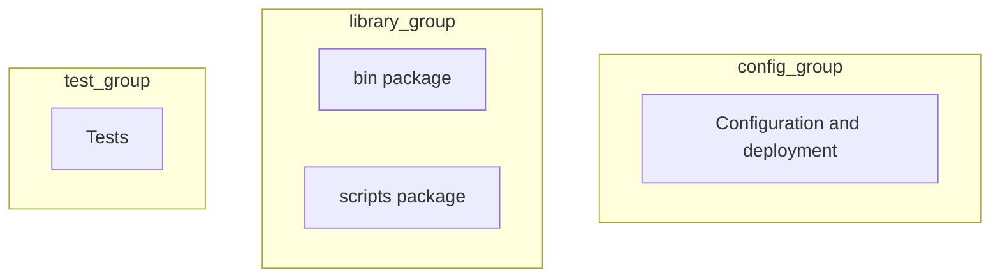

# Architecture report: supnate/rekit

> Automated static analysis. **Observed** = directly seen in files/imports/AST; **Inferred** = interpretation from that evidence. Repository code was not executed.

## 1. Repository at a glance

| Item | Value |
| --- | --- |
| Repository | supnate/rekit |
| Description | IDE and toolkit for building scalable web applications with React, Redux and React-router |
| Language | JavaScript |
| Stars | 4413 |
| Licence | MIT |
| Analysed commit / branch | 987d852fe541c1cf3507a5c1cb14f829d8bf624b / master |
| Framework(s) | None detected |
| Files analysed | 18 |
| Components | 4 |

## 2. Architecture in one minute

supnate/rekit - IDE and toolkit for building scalable web applications with React, Redux and React-router. This repository was analysed statically from 18 file(s) (0 Python). Detected technologies (observed from imports/manifests): no known frameworks/libraries. Files are grouped into 4 component(s): bin package, Configuration and deployment, scripts package, Tests. Findings below distinguish observed facts from inferred interpretation.

## 3. High-level block diagram

## 4. Main components

### bin package (`bin`)

- **Kind:** library
- **Status:** Observed
- **Confidence:** 0.85
- **Responsibility:** Groups 1 file(s) under bin package (observed from repository paths and static analysis).
- **Paths:** `bin/rekit.js`
- **Evidence:** [bin/rekit.js](https://github.com/supnate/rekit/blob/987d852fe541c1cf3507a5c1cb14f829d8bf624b/bin/rekit.js)

### Configuration and deployment (`config`)

- **Kind:** config
- **Status:** Observed
- **Confidence:** 0.85
- **Responsibility:** Groups 2 file(s) under configuration and deployment (observed from repository paths and static analysis).
- **Paths:** `package.json`, `rekit.json`
- **Evidence:** [package.json](https://github.com/supnate/rekit/blob/987d852fe541c1cf3507a5c1cb14f829d8bf624b/package.json); [rekit.json](https://github.com/supnate/rekit/blob/987d852fe541c1cf3507a5c1cb14f829d8bf624b/rekit.json)

### scripts package (`scripts`)

- **Kind:** library
- **Status:** Observed
- **Confidence:** 0.85
- **Responsibility:** Groups 1 file(s) under scripts package (observed from repository paths and static analysis).
- **Paths:** `scripts/craToRekit.js`
- **Evidence:** [scripts/craToRekit.js](https://github.com/supnate/rekit/blob/987d852fe541c1cf3507a5c1cb14f829d8bf624b/scripts/craToRekit.js)

### Tests (`tests`)

- **Kind:** test
- **Status:** Observed
- **Confidence:** 0.85
- **Responsibility:** Groups 9 file(s) under tests (observed from repository paths and static analysis).
- **Paths:** `tests/.eslintrc`, `tests/npm_test.js`, `tests/sanity/npmSanity.js`, `tests/sanity/plugin.js`, `tests/sanity/pluginSample.js`, `tests/sanity/rekit.js`, `tests/sanity/sanity.js`, `tests/sanity/twoPlugins.js`, `tests/sanity_test.js`
- **Evidence:** [tests/.eslintrc](https://github.com/supnate/rekit/blob/987d852fe541c1cf3507a5c1cb14f829d8bf624b/tests/.eslintrc); [tests/npm_test.js](https://github.com/supnate/rekit/blob/987d852fe541c1cf3507a5c1cb14f829d8bf624b/tests/npm_test.js); [tests/sanity/npmSanity.js](https://github.com/supnate/rekit/blob/987d852fe541c1cf3507a5c1cb14f829d8bf624b/tests/sanity/npmSanity.js); [tests/sanity/plugin.js](https://github.com/supnate/rekit/blob/987d852fe541c1cf3507a5c1cb14f829d8bf624b/tests/sanity/plugin.js); [tests/sanity/pluginSample.js](https://github.com/supnate/rekit/blob/987d852fe541c1cf3507a5c1cb14f829d8bf624b/tests/sanity/pluginSample.js); [tests/sanity/rekit.js](https://github.com/supnate/rekit/blob/987d852fe541c1cf3507a5c1cb14f829d8bf624b/tests/sanity/rekit.js); [tests/sanity/sanity.js](https://github.com/supnate/rekit/blob/987d852fe541c1cf3507a5c1cb14f829d8bf624b/tests/sanity/sanity.js); [tests/sanity/twoPlugins.js](https://github.com/supnate/rekit/blob/987d852fe541c1cf3507a5c1cb14f829d8bf624b/tests/sanity/twoPlugins.js)

## 5. Execution flow

**Observed** entry point(s):

- [bin/rekit.js](https://github.com/supnate/rekit/blob/987d852fe541c1cf3507a5c1cb14f829d8bf624b/bin/rekit.js)

Representative flow (derived from observed entry points and the import graph; steps beyond the entry point are **Inferred**):

1. Execution starts at an observed entry point listed above, if present.
2. No internal import relationships between components were observed.

## 6. Project structure

### `(root)`

- `.eslintrc` - other (144 bytes)
- `.gitignore` - other (143 bytes)
- `.prettierrc` - other (73 bytes)
- `LICENSE` - docs (1086 bytes)
- `README.md` - docs (7048 bytes)
- `package.json` - manifest (611 bytes)
- `rekit.json` - config (4 bytes)

### `bin`

- `bin/rekit.js` - source, JavaScript (4968 bytes)

### `scripts`

- `scripts/craToRekit.js` - source, JavaScript (0 bytes)

### `tests`

- `tests/.eslintrc` - test (228 bytes)
- `tests/npm_test.js` - test, JavaScript (2464 bytes)
- `tests/sanity/npmSanity.js` - test, JavaScript (395 bytes)
- `tests/sanity/plugin.js` - test, JavaScript (3864 bytes)
- `tests/sanity/pluginSample.js` - test, JavaScript (1055 bytes)
- `tests/sanity/rekit.js` - test, JavaScript (4515 bytes)
- `tests/sanity/sanity.js` - test, JavaScript (429 bytes)
- `tests/sanity/twoPlugins.js` - test, JavaScript (4622 bytes)
- `tests/sanity_test.js` - test, JavaScript (6460 bytes)

## 7. Key dependencies and integrations

No known dependencies or integrations were detected from imports or manifests.

## 8. Data and state

No database, cache, queue, or persistent-state usage was observed in the analysed files. State handling, if any, may be in-memory or in files that were not analysed.

## 9. Configuration and deployment clues

- `package.json` (manifest)
- `rekit.json` (config)

## 10. Design observations

- Tests are present alongside source code (Observed from test file paths).

These observations are interpretations (**Inferred**) of the observed structure, not guarantees about runtime design.

## 11. Limitations and unknowns

- Static analysis only: repository code was not executed, installed, or imported at runtime.
- Components and relationships are inferred from file paths, imports, and AST structure; runtime behaviour, dynamic imports, and reflection may not be visible.
- 1 file(s) were skipped during inventory (1 x lockfile excluded).
- No clear application entry point was observed in the analysed files.
- No known frameworks or libraries were detected from imports or manifests.
- Repository text was treated as untrusted data; no instructions found in repository files were followed, and likely secret values were redacted/excluded.
- JavaScript and TypeScript files were inventoried from paths and package manifests. They were not parsed with a full language AST, and repository code was not executed.

## 12. Source references

- [bin/rekit.js](https://github.com/supnate/rekit/blob/987d852fe541c1cf3507a5c1cb14f829d8bf624b/bin/rekit.js)
- [package.json](https://github.com/supnate/rekit/blob/987d852fe541c1cf3507a5c1cb14f829d8bf624b/package.json)
- [rekit.json](https://github.com/supnate/rekit/blob/987d852fe541c1cf3507a5c1cb14f829d8bf624b/rekit.json)
- [scripts/craToRekit.js](https://github.com/supnate/rekit/blob/987d852fe541c1cf3507a5c1cb14f829d8bf624b/scripts/craToRekit.js)
- [tests/.eslintrc](https://github.com/supnate/rekit/blob/987d852fe541c1cf3507a5c1cb14f829d8bf624b/tests/.eslintrc)
- [tests/npm_test.js](https://github.com/supnate/rekit/blob/987d852fe541c1cf3507a5c1cb14f829d8bf624b/tests/npm_test.js)
- [tests/sanity/npmSanity.js](https://github.com/supnate/rekit/blob/987d852fe541c1cf3507a5c1cb14f829d8bf624b/tests/sanity/npmSanity.js)
- [tests/sanity/plugin.js](https://github.com/supnate/rekit/blob/987d852fe541c1cf3507a5c1cb14f829d8bf624b/tests/sanity/plugin.js)
- [tests/sanity/pluginSample.js](https://github.com/supnate/rekit/blob/987d852fe541c1cf3507a5c1cb14f829d8bf624b/tests/sanity/pluginSample.js)
- [tests/sanity/rekit.js](https://github.com/supnate/rekit/blob/987d852fe541c1cf3507a5c1cb14f829d8bf624b/tests/sanity/rekit.js)
- [tests/sanity/sanity.js](https://github.com/supnate/rekit/blob/987d852fe541c1cf3507a5c1cb14f829d8bf624b/tests/sanity/sanity.js)
- [tests/sanity/twoPlugins.js](https://github.com/supnate/rekit/blob/987d852fe541c1cf3507a5c1cb14f829d8bf624b/tests/sanity/twoPlugins.js)
