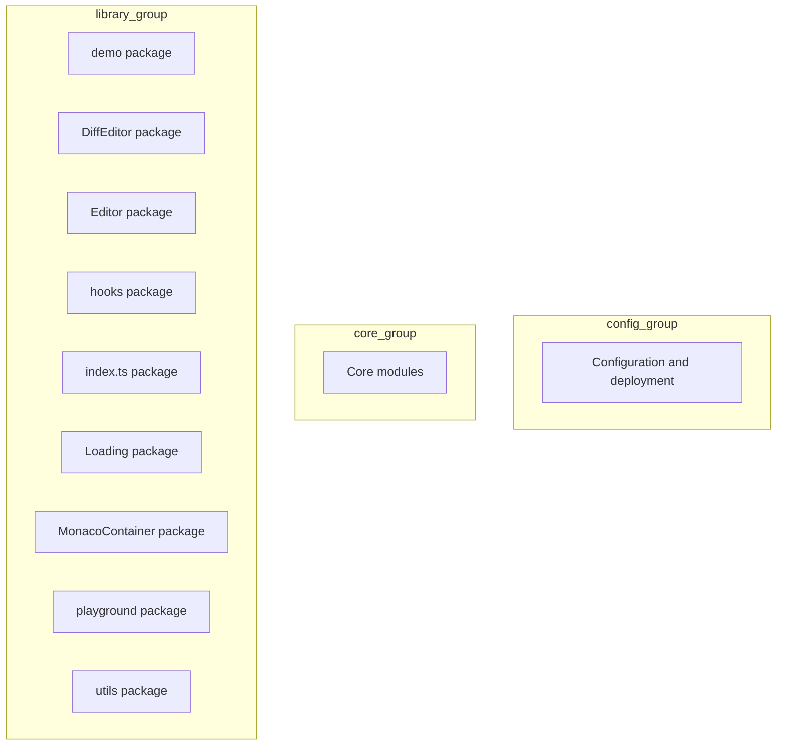

# Architecture report: suren-atoyan/monaco-react

> Automated static analysis. **Observed** = directly seen in files/imports/AST; **Inferred** = interpretation from that evidence. Repository code was not executed.

## 1. Repository at a glance

| Item | Value |
| --- | --- |
| Repository | suren-atoyan/monaco-react |
| Description | Monaco Editor for React - use the monaco-editor in any React application without needing to use webpack (or rollup/parcel/etc) configuration files / plugins |
| Language | TypeScript |
| Stars | 4756 |
| Licence | MIT |
| Analysed commit / branch | f7ef2e686c83449babaea49815c69db3668d2ab7 / master |
| Framework(s) | React |
| Files analysed | 94 |
| Components | 11 |

## 2. Architecture in one minute

suren-atoyan/monaco-react - Monaco Editor for React - use the monaco-editor in any React application without needing to use webpack (or rollup/parcel/etc) configuration files / plugins. This repository was analysed statically from 94 file(s) (0 Python). Detected technologies (observed from imports/manifests): GitHub Actions, React, TypeScript, Vite, Vitest. Files are grouped into 11 component(s): Configuration and deployment, Core modules, demo package, DiffEditor package, Editor package, hooks package, index.ts package, Loading package. Findings below distinguish observed facts from inferred interpretation.

## 3. High-level block diagram

## 4. Main components

### Configuration and deployment (`config`)

- **Kind:** config
- **Status:** Observed
- **Confidence:** 0.85
- **Responsibility:** Groups 16 file(s) under configuration and deployment (observed from repository paths and static analysis).
- **Paths:** `demo/biome.json`, `demo/package.json`, `demo/src/Editor/Settings/Settings.tsx`, `demo/src/Editor/Settings/index.ts`, `demo/src/Editor/Settings/styled.ts`, `demo/src/Editor/Settings/utils.ts`, `demo/src/config/diff.ts`, `demo/src/config/examples.ts`, `demo/src/config/index.ts`, `demo/tsconfig.app.json`, `demo/tsconfig.json`, `demo/tsconfig.node.json`, `package.json`, `playground/package.json`, `tea.yaml`, `tsconfig.json`
- **Evidence:** [demo/biome.json](https://github.com/suren-atoyan/monaco-react/blob/f7ef2e686c83449babaea49815c69db3668d2ab7/demo/biome.json); [demo/package.json](https://github.com/suren-atoyan/monaco-react/blob/f7ef2e686c83449babaea49815c69db3668d2ab7/demo/package.json); [demo/src/Editor/Settings/Settings.tsx](https://github.com/suren-atoyan/monaco-react/blob/f7ef2e686c83449babaea49815c69db3668d2ab7/demo/src/Editor/Settings/Settings.tsx); [demo/src/Editor/Settings/index.ts](https://github.com/suren-atoyan/monaco-react/blob/f7ef2e686c83449babaea49815c69db3668d2ab7/demo/src/Editor/Settings/index.ts); [demo/src/Editor/Settings/styled.ts](https://github.com/suren-atoyan/monaco-react/blob/f7ef2e686c83449babaea49815c69db3668d2ab7/demo/src/Editor/Settings/styled.ts); [demo/src/Editor/Settings/utils.ts](https://github.com/suren-atoyan/monaco-react/blob/f7ef2e686c83449babaea49815c69db3668d2ab7/demo/src/Editor/Settings/utils.ts); [demo/src/config/diff.ts](https://github.com/suren-atoyan/monaco-react/blob/f7ef2e686c83449babaea49815c69db3668d2ab7/demo/src/config/diff.ts); [demo/src/config/examples.ts](https://github.com/suren-atoyan/monaco-react/blob/f7ef2e686c83449babaea49815c69db3668d2ab7/demo/src/config/examples.ts)

### Core modules (`core`)

- **Kind:** core
- **Status:** Observed
- **Confidence:** 0.85
- **Responsibility:** Groups 4 file(s) under core modules (observed from repository paths and static analysis).
- **Paths:** `eslint.config.mjs`, `setupTests.ts`, `tsup.config.ts`, `vitest.config.ts`
- **Evidence:** [eslint.config.mjs](https://github.com/suren-atoyan/monaco-react/blob/f7ef2e686c83449babaea49815c69db3668d2ab7/eslint.config.mjs); [setupTests.ts](https://github.com/suren-atoyan/monaco-react/blob/f7ef2e686c83449babaea49815c69db3668d2ab7/setupTests.ts); [tsup.config.ts](https://github.com/suren-atoyan/monaco-react/blob/f7ef2e686c83449babaea49815c69db3668d2ab7/tsup.config.ts); [vitest.config.ts](https://github.com/suren-atoyan/monaco-react/blob/f7ef2e686c83449babaea49815c69db3668d2ab7/vitest.config.ts)

### demo package (`demo`)

- **Kind:** library
- **Status:** Observed
- **Confidence:** 0.85
- **Responsibility:** Groups 18 file(s) under demo package (observed from repository paths and static analysis).
- **Paths:** `demo/eslint.config.js`, `demo/src/App.tsx`, `demo/src/DiffEditor/DiffEditor.tsx`, `demo/src/DiffEditor/index.ts`, `demo/src/Editor/Editor.tsx`, `demo/src/Editor/atoms/index.ts`, `demo/src/Editor/index.ts`, `demo/src/Editor/styled.ts`, `demo/src/ErrorBoundary/ErrorBoundary.tsx`, `demo/src/ErrorBoundary/index.ts`, `demo/src/ErrorBoundary/styled.ts`, `demo/src/main.tsx`, `demo/src/monaco-themes.d.ts`, `demo/src/root.tsx`, `demo/src/styled.ts`, `demo/src/utils/rTabs.ts`, `demo/src/vite-env.d.ts`, `demo/vite.config.ts`
- **Evidence:** [demo/eslint.config.js](https://github.com/suren-atoyan/monaco-react/blob/f7ef2e686c83449babaea49815c69db3668d2ab7/demo/eslint.config.js); [demo/src/App.tsx](https://github.com/suren-atoyan/monaco-react/blob/f7ef2e686c83449babaea49815c69db3668d2ab7/demo/src/App.tsx); [demo/src/DiffEditor/DiffEditor.tsx](https://github.com/suren-atoyan/monaco-react/blob/f7ef2e686c83449babaea49815c69db3668d2ab7/demo/src/DiffEditor/DiffEditor.tsx); [demo/src/DiffEditor/index.ts](https://github.com/suren-atoyan/monaco-react/blob/f7ef2e686c83449babaea49815c69db3668d2ab7/demo/src/DiffEditor/index.ts); [demo/src/Editor/Editor.tsx](https://github.com/suren-atoyan/monaco-react/blob/f7ef2e686c83449babaea49815c69db3668d2ab7/demo/src/Editor/Editor.tsx); [demo/src/Editor/atoms/index.ts](https://github.com/suren-atoyan/monaco-react/blob/f7ef2e686c83449babaea49815c69db3668d2ab7/demo/src/Editor/atoms/index.ts); [demo/src/Editor/index.ts](https://github.com/suren-atoyan/monaco-react/blob/f7ef2e686c83449babaea49815c69db3668d2ab7/demo/src/Editor/index.ts); [demo/src/Editor/styled.ts](https://github.com/suren-atoyan/monaco-react/blob/f7ef2e686c83449babaea49815c69db3668d2ab7/demo/src/Editor/styled.ts)

### DiffEditor package (`diffeditor`)

- **Kind:** library
- **Status:** Observed
- **Confidence:** 0.85
- **Responsibility:** Groups 4 file(s) under diffeditor package (observed from repository paths and static analysis).
- **Paths:** `src/DiffEditor/DiffEditor.tsx`, `src/DiffEditor/index.spec.tsx`, `src/DiffEditor/index.ts`, `src/DiffEditor/types.ts`
- **Evidence:** [src/DiffEditor/DiffEditor.tsx](https://github.com/suren-atoyan/monaco-react/blob/f7ef2e686c83449babaea49815c69db3668d2ab7/src/DiffEditor/DiffEditor.tsx); [src/DiffEditor/index.spec.tsx](https://github.com/suren-atoyan/monaco-react/blob/f7ef2e686c83449babaea49815c69db3668d2ab7/src/DiffEditor/index.spec.tsx); [src/DiffEditor/index.ts](https://github.com/suren-atoyan/monaco-react/blob/f7ef2e686c83449babaea49815c69db3668d2ab7/src/DiffEditor/index.ts); [src/DiffEditor/types.ts](https://github.com/suren-atoyan/monaco-react/blob/f7ef2e686c83449babaea49815c69db3668d2ab7/src/DiffEditor/types.ts)

### Editor package (`editor`)

- **Kind:** library
- **Status:** Observed
- **Confidence:** 0.85
- **Responsibility:** Groups 4 file(s) under editor package (observed from repository paths and static analysis).
- **Paths:** `src/Editor/Editor.tsx`, `src/Editor/index.spec.tsx`, `src/Editor/index.ts`, `src/Editor/types.ts`
- **Evidence:** [src/Editor/Editor.tsx](https://github.com/suren-atoyan/monaco-react/blob/f7ef2e686c83449babaea49815c69db3668d2ab7/src/Editor/Editor.tsx); [src/Editor/index.spec.tsx](https://github.com/suren-atoyan/monaco-react/blob/f7ef2e686c83449babaea49815c69db3668d2ab7/src/Editor/index.spec.tsx); [src/Editor/index.ts](https://github.com/suren-atoyan/monaco-react/blob/f7ef2e686c83449babaea49815c69db3668d2ab7/src/Editor/index.ts); [src/Editor/types.ts](https://github.com/suren-atoyan/monaco-react/blob/f7ef2e686c83449babaea49815c69db3668d2ab7/src/Editor/types.ts)

### hooks package (`hooks`)

- **Kind:** library
- **Status:** Observed
- **Confidence:** 0.85
- **Responsibility:** Groups 4 file(s) under hooks package (observed from repository paths and static analysis).
- **Paths:** `src/hooks/useMonaco/index.ts`, `src/hooks/useMount/index.ts`, `src/hooks/usePrevious/index.ts`, `src/hooks/useUpdate/index.ts`
- **Evidence:** [src/hooks/useMonaco/index.ts](https://github.com/suren-atoyan/monaco-react/blob/f7ef2e686c83449babaea49815c69db3668d2ab7/src/hooks/useMonaco/index.ts); [src/hooks/useMount/index.ts](https://github.com/suren-atoyan/monaco-react/blob/f7ef2e686c83449babaea49815c69db3668d2ab7/src/hooks/useMount/index.ts); [src/hooks/usePrevious/index.ts](https://github.com/suren-atoyan/monaco-react/blob/f7ef2e686c83449babaea49815c69db3668d2ab7/src/hooks/usePrevious/index.ts); [src/hooks/useUpdate/index.ts](https://github.com/suren-atoyan/monaco-react/blob/f7ef2e686c83449babaea49815c69db3668d2ab7/src/hooks/useUpdate/index.ts)

### index.ts package (`index_ts`)

- **Kind:** library
- **Status:** Observed
- **Confidence:** 0.85
- **Responsibility:** Groups 1 file(s) under index.ts package (observed from repository paths and static analysis).
- **Paths:** `src/index.ts`
- **Evidence:** [src/index.ts](https://github.com/suren-atoyan/monaco-react/blob/f7ef2e686c83449babaea49815c69db3668d2ab7/src/index.ts)

### Loading package (`loading`)

- **Kind:** library
- **Status:** Observed
- **Confidence:** 0.85
- **Responsibility:** Groups 4 file(s) under loading package (observed from repository paths and static analysis).
- **Paths:** `src/Loading/Loading.tsx`, `src/Loading/index.spec.tsx`, `src/Loading/index.ts`, `src/Loading/styles.ts`
- **Evidence:** [src/Loading/Loading.tsx](https://github.com/suren-atoyan/monaco-react/blob/f7ef2e686c83449babaea49815c69db3668d2ab7/src/Loading/Loading.tsx); [src/Loading/index.spec.tsx](https://github.com/suren-atoyan/monaco-react/blob/f7ef2e686c83449babaea49815c69db3668d2ab7/src/Loading/index.spec.tsx); [src/Loading/index.ts](https://github.com/suren-atoyan/monaco-react/blob/f7ef2e686c83449babaea49815c69db3668d2ab7/src/Loading/index.ts); [src/Loading/styles.ts](https://github.com/suren-atoyan/monaco-react/blob/f7ef2e686c83449babaea49815c69db3668d2ab7/src/Loading/styles.ts)

### MonacoContainer package (`monacocontainer`)

- **Kind:** library
- **Status:** Observed
- **Confidence:** 0.85
- **Responsibility:** Groups 5 file(s) under monacocontainer package (observed from repository paths and static analysis).
- **Paths:** `src/MonacoContainer/MonacoContainer.tsx`, `src/MonacoContainer/index.spec.tsx`, `src/MonacoContainer/index.ts`, `src/MonacoContainer/styles.ts`, `src/MonacoContainer/types.ts`
- **Evidence:** [src/MonacoContainer/MonacoContainer.tsx](https://github.com/suren-atoyan/monaco-react/blob/f7ef2e686c83449babaea49815c69db3668d2ab7/src/MonacoContainer/MonacoContainer.tsx); [src/MonacoContainer/index.spec.tsx](https://github.com/suren-atoyan/monaco-react/blob/f7ef2e686c83449babaea49815c69db3668d2ab7/src/MonacoContainer/index.spec.tsx); [src/MonacoContainer/index.ts](https://github.com/suren-atoyan/monaco-react/blob/f7ef2e686c83449babaea49815c69db3668d2ab7/src/MonacoContainer/index.ts); [src/MonacoContainer/styles.ts](https://github.com/suren-atoyan/monaco-react/blob/f7ef2e686c83449babaea49815c69db3668d2ab7/src/MonacoContainer/styles.ts); [src/MonacoContainer/types.ts](https://github.com/suren-atoyan/monaco-react/blob/f7ef2e686c83449babaea49815c69db3668d2ab7/src/MonacoContainer/types.ts)

### playground package (`playground`)

- **Kind:** library
- **Status:** Observed
- **Confidence:** 0.85
- **Responsibility:** Groups 3 file(s) under playground package (observed from repository paths and static analysis).
- **Paths:** `playground/src/App.tsx`, `playground/src/main.tsx`, `playground/vite.config.ts`
- **Evidence:** [playground/src/App.tsx](https://github.com/suren-atoyan/monaco-react/blob/f7ef2e686c83449babaea49815c69db3668d2ab7/playground/src/App.tsx); [playground/src/main.tsx](https://github.com/suren-atoyan/monaco-react/blob/f7ef2e686c83449babaea49815c69db3668d2ab7/playground/src/main.tsx); [playground/vite.config.ts](https://github.com/suren-atoyan/monaco-react/blob/f7ef2e686c83449babaea49815c69db3668d2ab7/playground/vite.config.ts)

### utils package (`utils`)

- **Kind:** library
- **Status:** Observed
- **Confidence:** 0.85
- **Responsibility:** Groups 1 file(s) under utils package (observed from repository paths and static analysis).
- **Paths:** `src/utils/index.ts`
- **Evidence:** [src/utils/index.ts](https://github.com/suren-atoyan/monaco-react/blob/f7ef2e686c83449babaea49815c69db3668d2ab7/src/utils/index.ts)

## 5. Execution flow

**Observed** entry point(s):

- [demo/src/App.tsx](https://github.com/suren-atoyan/monaco-react/blob/f7ef2e686c83449babaea49815c69db3668d2ab7/demo/src/App.tsx)
- [demo/src/DiffEditor/index.ts](https://github.com/suren-atoyan/monaco-react/blob/f7ef2e686c83449babaea49815c69db3668d2ab7/demo/src/DiffEditor/index.ts)
- [demo/src/Editor/index.ts](https://github.com/suren-atoyan/monaco-react/blob/f7ef2e686c83449babaea49815c69db3668d2ab7/demo/src/Editor/index.ts)
- [demo/src/ErrorBoundary/index.ts](https://github.com/suren-atoyan/monaco-react/blob/f7ef2e686c83449babaea49815c69db3668d2ab7/demo/src/ErrorBoundary/index.ts)
- [demo/src/config/index.ts](https://github.com/suren-atoyan/monaco-react/blob/f7ef2e686c83449babaea49815c69db3668d2ab7/demo/src/config/index.ts)
- [demo/src/main.tsx](https://github.com/suren-atoyan/monaco-react/blob/f7ef2e686c83449babaea49815c69db3668d2ab7/demo/src/main.tsx)
- [playground/src/App.tsx](https://github.com/suren-atoyan/monaco-react/blob/f7ef2e686c83449babaea49815c69db3668d2ab7/playground/src/App.tsx)
- [playground/src/main.tsx](https://github.com/suren-atoyan/monaco-react/blob/f7ef2e686c83449babaea49815c69db3668d2ab7/playground/src/main.tsx)
- [src/DiffEditor/index.ts](https://github.com/suren-atoyan/monaco-react/blob/f7ef2e686c83449babaea49815c69db3668d2ab7/src/DiffEditor/index.ts)
- [src/Editor/index.ts](https://github.com/suren-atoyan/monaco-react/blob/f7ef2e686c83449babaea49815c69db3668d2ab7/src/Editor/index.ts)
- [src/Loading/index.ts](https://github.com/suren-atoyan/monaco-react/blob/f7ef2e686c83449babaea49815c69db3668d2ab7/src/Loading/index.ts)
- [src/MonacoContainer/index.ts](https://github.com/suren-atoyan/monaco-react/blob/f7ef2e686c83449babaea49815c69db3668d2ab7/src/MonacoContainer/index.ts)

Representative flow (derived from observed entry points and the import graph; steps beyond the entry point are **Inferred**):

1. Execution starts at an observed entry point listed above, if present.
2. No internal import relationships between components were observed.

## 6. Project structure

### `(root)`

- `.gitignore` - other (93 bytes)
- `.npmignore` - other (190 bytes)
- `.prettierrc.json` - config (126 bytes)
- `CHANGELOG.md` - docs (14546 bytes)
- `CODE_OF_CONDUCT.md` - docs (3355 bytes)
- `LICENSE` - docs (1069 bytes)
- `README.md` - docs (40139 bytes)
- `eslint.config.mjs` - source, JavaScript (1444 bytes)
- `package.json` - manifest (1807 bytes)
- `setupTests.ts` - source, TypeScript (36 bytes)
- `tea.yaml` - config (126 bytes)
- `tsconfig.json` - config (574 bytes)
- `tsup.config.ts` - source, TypeScript (245 bytes)
- `v4.changes.md` - docs (3132 bytes)
- `vitest.config.ts` - source, TypeScript (311 bytes)

### `.github`

- `.github/FUNDING.yml` - config (620 bytes)
- `.github/ISSUE_TEMPLATE/bug_report.md` - docs (787 bytes)
- `.github/ISSUE_TEMPLATE/feature_request.md` - docs (595 bytes)
- `.github/dependabot.yml` - config (540 bytes)
- `.github/workflows/auto-merge-dependabot.yml` - ci, YAML (829 bytes)
- `.github/workflows/stale.yml` - ci, YAML (936 bytes)

### `.husky`

- `.husky/pre-commit` - other (41 bytes)

### `demo`

- `demo/.gitignore` - other (248 bytes)
- `demo/README.md` - docs (1607 bytes)
- `demo/biome.json` - config (498 bytes)
- `demo/eslint.config.js` - source, JavaScript (734 bytes)
- `demo/index.html` - other (728 bytes)
- `demo/package.json` - manifest (1019 bytes)
- `demo/public/robots.txt` - docs (24 bytes)
- `demo/src/App.tsx` - source, TypeScript (1539 bytes)
- `demo/src/DiffEditor/DiffEditor.tsx` - source, TypeScript (593 bytes)
- `demo/src/DiffEditor/index.ts` - source, TypeScript (67 bytes)
- `demo/src/Editor/Editor.tsx` - source, TypeScript (1691 bytes)
- `demo/src/Editor/Settings/Settings.tsx` - source, TypeScript (4505 bytes)
- `demo/src/Editor/Settings/index.ts` - source, TypeScript (61 bytes)
- `demo/src/Editor/Settings/styled.ts` - source, TypeScript (1630 bytes)
- `demo/src/Editor/Settings/utils.ts` - source, TypeScript (6970 bytes)
- `demo/src/Editor/atoms/index.ts` - source, TypeScript (346 bytes)
- `demo/src/Editor/index.ts` - source, TypeScript (55 bytes)
- `demo/src/Editor/styled.ts` - source, TypeScript (516 bytes)
- `demo/src/ErrorBoundary/ErrorBoundary.tsx` - source, TypeScript (1028 bytes)
- `demo/src/ErrorBoundary/index.ts` - source, TypeScript (76 bytes)
- `demo/src/ErrorBoundary/styled.ts` - source, TypeScript (430 bytes)
- `demo/src/assets/github-mark.svg` - other (963 bytes)
- `demo/src/assets/logo.svg` - other (6580 bytes)
- `demo/src/config/diff.ts` - source, TypeScript (58575 bytes)
- `demo/src/config/examples.ts` - source, TypeScript (42945 bytes)
- `demo/src/config/index.ts` - source, TypeScript (1200 bytes)
- `demo/src/index.css` - other (413 bytes)
- `demo/src/main.tsx` - source, TypeScript (613 bytes)
- `demo/src/monaco-themes.d.ts` - source, TypeScript (475 bytes)
- `demo/src/root.tsx` - source, TypeScript (337 bytes)
- `demo/src/styled.ts` - source, TypeScript (1639 bytes)
- `demo/src/utils/rTabs.ts` - source, TypeScript (93 bytes)
- `demo/src/vite-env.d.ts` - source, TypeScript (318 bytes)
- `demo/tsconfig.app.json` - config (665 bytes)
- `demo/tsconfig.json` - config (119 bytes)
- `demo/tsconfig.node.json` - config (593 bytes)
- `demo/vite.config.ts` - source, TypeScript (567 bytes)

### `playground`

- `playground/.gitignore` - other (45 bytes)
- `playground/index.html` - other (298 bytes)
- `playground/logo.svg` - other (6580 bytes)
- `playground/package.json` - manifest (558 bytes)
- `playground/src/App.tsx` - source, TypeScript (198 bytes)
- `playground/src/global.css` - other (366 bytes)
- `playground/src/main.tsx` - source, TypeScript (220 bytes)
- `playground/vite.config.ts` - source, TypeScript (373 bytes)

### `src`

- `src/DiffEditor/DiffEditor.tsx` - source, TypeScript (6031 bytes)
- `src/DiffEditor/__snapshots__/index.spec.tsx.snap` - other (2752 bytes)
- `src/DiffEditor/index.spec.tsx` - source, TypeScript (288 bytes)
- `src/DiffEditor/index.ts` - source, TypeScript (130 bytes)
- `src/DiffEditor/types.ts` - source, TypeScript (3083 bytes)
- `src/Editor/Editor.tsx` - source, TypeScript (7299 bytes)
- `src/Editor/__snapshots__/index.spec.tsx.snap` - other (2748 bytes)
- `src/Editor/index.spec.tsx` - source, TypeScript (276 bytes)
- `src/Editor/index.ts` - source, TypeScript (118 bytes)
- `src/Editor/types.ts` - source, TypeScript (3374 bytes)
- `src/Loading/Loading.tsx` - source, TypeScript (224 bytes)
- `src/Loading/__snapshots__/index.spec.tsx.snap` - other (2169 bytes)
- `src/Loading/index.spec.tsx` - source, TypeScript (834 bytes)
- `src/Loading/index.ts` - source, TypeScript (58 bytes)
- `src/Loading/styles.ts` - source, TypeScript (256 bytes)
- `src/MonacoContainer/MonacoContainer.tsx` - source, TypeScript (788 bytes)
- `src/MonacoContainer/__snapshots__/index.spec.tsx.snap` - other (2661 bytes)
- `src/MonacoContainer/index.spec.tsx` - source, TypeScript (467 bytes)
- `src/MonacoContainer/index.ts` - source, TypeScript (119 bytes)
- `src/MonacoContainer/styles.ts` - source, TypeScript (286 bytes)
- `src/MonacoContainer/types.ts` - source, TypeScript (290 bytes)
- `src/hooks/useMonaco/index.ts` - source, TypeScript (508 bytes)
- `src/hooks/useMount/index.ts` - source, TypeScript (154 bytes)
- `src/hooks/usePrevious/index.ts` - source, TypeScript (222 bytes)
- `src/hooks/useUpdate/index.ts` - source, TypeScript (399 bytes)
- `src/index.ts` - source, TypeScript (512 bytes)
- `src/utils/index.ts` - source, TypeScript (1925 bytes)

## 7. Key dependencies and integrations

| Name | Category | Status | Confidence | Evidence |
| --- | --- | --- | --- | --- |
| GitHub Actions | ci | Observed | 0.90 | [.github/workflows/auto-merge-dependabot.yml](https://github.com/suren-atoyan/monaco-react/blob/f7ef2e686c83449babaea49815c69db3668d2ab7/.github/workflows/auto-merge-dependabot.yml); [.github/workflows/stale.yml](https://github.com/suren-atoyan/monaco-react/blob/f7ef2e686c83449babaea49815c69db3668d2ab7/.github/workflows/stale.yml) |
| React | framework | Observed | 0.90 | [demo/package.json:13](https://github.com/suren-atoyan/monaco-react/blob/f7ef2e686c83449babaea49815c69db3668d2ab7/demo/package.json#L13); [demo/package.json:18](https://github.com/suren-atoyan/monaco-react/blob/f7ef2e686c83449babaea49815c69db3668d2ab7/demo/package.json#L18); [package.json:2](https://github.com/suren-atoyan/monaco-react/blob/f7ef2e686c83449babaea49815c69db3668d2ab7/package.json#L2); [package.json:37](https://github.com/suren-atoyan/monaco-react/blob/f7ef2e686c83449babaea49815c69db3668d2ab7/package.json#L37) |
| TypeScript | tooling | Observed | 0.90 | [demo/package.json:35](https://github.com/suren-atoyan/monaco-react/blob/f7ef2e686c83449babaea49815c69db3668d2ab7/demo/package.json#L35); [package.json:45](https://github.com/suren-atoyan/monaco-react/blob/f7ef2e686c83449babaea49815c69db3668d2ab7/package.json#L45) |
| Vite | tooling | Observed | 0.90 | [demo/package.json:7](https://github.com/suren-atoyan/monaco-react/blob/f7ef2e686c83449babaea49815c69db3668d2ab7/demo/package.json#L7); [playground/package.json:6](https://github.com/suren-atoyan/monaco-react/blob/f7ef2e686c83449babaea49815c69db3668d2ab7/playground/package.json#L6) |
| Vitest | tooling | Observed | 0.85 | [package.json:15](https://github.com/suren-atoyan/monaco-react/blob/f7ef2e686c83449babaea49815c69db3668d2ab7/package.json#L15) |

## 8. Data and state

No database, cache, queue, or persistent-state usage was observed in the analysed files. State handling, if any, may be in-memory or in files that were not analysed.

## 9. Configuration and deployment clues

- `.github/FUNDING.yml` (config)
- `.github/dependabot.yml` (config)
- `.github/workflows/auto-merge-dependabot.yml` (ci)
- `.github/workflows/stale.yml` (ci)
- `.prettierrc.json` (config)
- `demo/biome.json` (config)
- `demo/package.json` (manifest)
- `demo/tsconfig.app.json` (config)
- `demo/tsconfig.json` (config)
- `demo/tsconfig.node.json` (config)
- `package.json` (manifest)
- `playground/package.json` (manifest)
- `tea.yaml` (config)
- `tsconfig.json` (config)

## 10. Design observations

- No strong design patterns could be established from the available evidence.

These observations are interpretations (**Inferred**) of the observed structure, not guarantees about runtime design.

## 11. Limitations and unknowns

- Static analysis only: repository code was not executed, installed, or imported at runtime.
- Components and relationships are inferred from file paths, imports, and AST structure; runtime behaviour, dynamic imports, and reflection may not be visible.
- 64 file(s) were skipped during inventory (1 x likely secret file excluded; 2 x lockfile excluded; 61 x vendored/generated directory excluded).
- No clear application entry point was observed in the analysed files.
- Repository text was treated as untrusted data; no instructions found in repository files were followed, and likely secret values were redacted/excluded.
- JavaScript and TypeScript files were inventoried from paths and package manifests. They were not parsed with a full language AST, and repository code was not executed.

## 12. Source references

- [.github/workflows/auto-merge-dependabot.yml](https://github.com/suren-atoyan/monaco-react/blob/f7ef2e686c83449babaea49815c69db3668d2ab7/.github/workflows/auto-merge-dependabot.yml)
- [.github/workflows/stale.yml](https://github.com/suren-atoyan/monaco-react/blob/f7ef2e686c83449babaea49815c69db3668d2ab7/.github/workflows/stale.yml)
- [demo/biome.json](https://github.com/suren-atoyan/monaco-react/blob/f7ef2e686c83449babaea49815c69db3668d2ab7/demo/biome.json)
- [demo/eslint.config.js](https://github.com/suren-atoyan/monaco-react/blob/f7ef2e686c83449babaea49815c69db3668d2ab7/demo/eslint.config.js)
- [demo/package.json](https://github.com/suren-atoyan/monaco-react/blob/f7ef2e686c83449babaea49815c69db3668d2ab7/demo/package.json)
- [demo/package.json:7](https://github.com/suren-atoyan/monaco-react/blob/f7ef2e686c83449babaea49815c69db3668d2ab7/demo/package.json#L7)
- [demo/package.json:13](https://github.com/suren-atoyan/monaco-react/blob/f7ef2e686c83449babaea49815c69db3668d2ab7/demo/package.json#L13)
- [demo/package.json:18](https://github.com/suren-atoyan/monaco-react/blob/f7ef2e686c83449babaea49815c69db3668d2ab7/demo/package.json#L18)
- [demo/package.json:35](https://github.com/suren-atoyan/monaco-react/blob/f7ef2e686c83449babaea49815c69db3668d2ab7/demo/package.json#L35)
- [demo/src/App.tsx](https://github.com/suren-atoyan/monaco-react/blob/f7ef2e686c83449babaea49815c69db3668d2ab7/demo/src/App.tsx)
- [demo/src/DiffEditor/DiffEditor.tsx](https://github.com/suren-atoyan/monaco-react/blob/f7ef2e686c83449babaea49815c69db3668d2ab7/demo/src/DiffEditor/DiffEditor.tsx)
- [demo/src/DiffEditor/index.ts](https://github.com/suren-atoyan/monaco-react/blob/f7ef2e686c83449babaea49815c69db3668d2ab7/demo/src/DiffEditor/index.ts)
- [demo/src/Editor/Editor.tsx](https://github.com/suren-atoyan/monaco-react/blob/f7ef2e686c83449babaea49815c69db3668d2ab7/demo/src/Editor/Editor.tsx)
- [demo/src/Editor/Settings/Settings.tsx](https://github.com/suren-atoyan/monaco-react/blob/f7ef2e686c83449babaea49815c69db3668d2ab7/demo/src/Editor/Settings/Settings.tsx)
- [demo/src/Editor/Settings/index.ts](https://github.com/suren-atoyan/monaco-react/blob/f7ef2e686c83449babaea49815c69db3668d2ab7/demo/src/Editor/Settings/index.ts)
- [demo/src/Editor/Settings/styled.ts](https://github.com/suren-atoyan/monaco-react/blob/f7ef2e686c83449babaea49815c69db3668d2ab7/demo/src/Editor/Settings/styled.ts)
- [demo/src/Editor/Settings/utils.ts](https://github.com/suren-atoyan/monaco-react/blob/f7ef2e686c83449babaea49815c69db3668d2ab7/demo/src/Editor/Settings/utils.ts)
- [demo/src/Editor/atoms/index.ts](https://github.com/suren-atoyan/monaco-react/blob/f7ef2e686c83449babaea49815c69db3668d2ab7/demo/src/Editor/atoms/index.ts)
- [demo/src/Editor/index.ts](https://github.com/suren-atoyan/monaco-react/blob/f7ef2e686c83449babaea49815c69db3668d2ab7/demo/src/Editor/index.ts)
- [demo/src/Editor/styled.ts](https://github.com/suren-atoyan/monaco-react/blob/f7ef2e686c83449babaea49815c69db3668d2ab7/demo/src/Editor/styled.ts)
- [demo/src/ErrorBoundary/index.ts](https://github.com/suren-atoyan/monaco-react/blob/f7ef2e686c83449babaea49815c69db3668d2ab7/demo/src/ErrorBoundary/index.ts)
- [demo/src/config/diff.ts](https://github.com/suren-atoyan/monaco-react/blob/f7ef2e686c83449babaea49815c69db3668d2ab7/demo/src/config/diff.ts)
- [demo/src/config/examples.ts](https://github.com/suren-atoyan/monaco-react/blob/f7ef2e686c83449babaea49815c69db3668d2ab7/demo/src/config/examples.ts)
- [demo/src/config/index.ts](https://github.com/suren-atoyan/monaco-react/blob/f7ef2e686c83449babaea49815c69db3668d2ab7/demo/src/config/index.ts)
- [demo/src/main.tsx](https://github.com/suren-atoyan/monaco-react/blob/f7ef2e686c83449babaea49815c69db3668d2ab7/demo/src/main.tsx)
- [eslint.config.mjs](https://github.com/suren-atoyan/monaco-react/blob/f7ef2e686c83449babaea49815c69db3668d2ab7/eslint.config.mjs)
- [package.json:2](https://github.com/suren-atoyan/monaco-react/blob/f7ef2e686c83449babaea49815c69db3668d2ab7/package.json#L2)
- [package.json:15](https://github.com/suren-atoyan/monaco-react/blob/f7ef2e686c83449babaea49815c69db3668d2ab7/package.json#L15)
- [package.json:37](https://github.com/suren-atoyan/monaco-react/blob/f7ef2e686c83449babaea49815c69db3668d2ab7/package.json#L37)
- [package.json:45](https://github.com/suren-atoyan/monaco-react/blob/f7ef2e686c83449babaea49815c69db3668d2ab7/package.json#L45)
- [playground/package.json:6](https://github.com/suren-atoyan/monaco-react/blob/f7ef2e686c83449babaea49815c69db3668d2ab7/playground/package.json#L6)
- [playground/package.json:11](https://github.com/suren-atoyan/monaco-react/blob/f7ef2e686c83449babaea49815c69db3668d2ab7/playground/package.json#L11)
- [playground/package.json:12](https://github.com/suren-atoyan/monaco-react/blob/f7ef2e686c83449babaea49815c69db3668d2ab7/playground/package.json#L12)
- [playground/src/App.tsx](https://github.com/suren-atoyan/monaco-react/blob/f7ef2e686c83449babaea49815c69db3668d2ab7/playground/src/App.tsx)
- [playground/src/main.tsx](https://github.com/suren-atoyan/monaco-react/blob/f7ef2e686c83449babaea49815c69db3668d2ab7/playground/src/main.tsx)
- [playground/vite.config.ts](https://github.com/suren-atoyan/monaco-react/blob/f7ef2e686c83449babaea49815c69db3668d2ab7/playground/vite.config.ts)
- [setupTests.ts](https://github.com/suren-atoyan/monaco-react/blob/f7ef2e686c83449babaea49815c69db3668d2ab7/setupTests.ts)
- [src/DiffEditor/DiffEditor.tsx](https://github.com/suren-atoyan/monaco-react/blob/f7ef2e686c83449babaea49815c69db3668d2ab7/src/DiffEditor/DiffEditor.tsx)
- [src/DiffEditor/index.spec.tsx](https://github.com/suren-atoyan/monaco-react/blob/f7ef2e686c83449babaea49815c69db3668d2ab7/src/DiffEditor/index.spec.tsx)
- [src/DiffEditor/index.ts](https://github.com/suren-atoyan/monaco-react/blob/f7ef2e686c83449babaea49815c69db3668d2ab7/src/DiffEditor/index.ts)
- [src/DiffEditor/types.ts](https://github.com/suren-atoyan/monaco-react/blob/f7ef2e686c83449babaea49815c69db3668d2ab7/src/DiffEditor/types.ts)
- [src/Editor/Editor.tsx](https://github.com/suren-atoyan/monaco-react/blob/f7ef2e686c83449babaea49815c69db3668d2ab7/src/Editor/Editor.tsx)
- [src/Editor/index.spec.tsx](https://github.com/suren-atoyan/monaco-react/blob/f7ef2e686c83449babaea49815c69db3668d2ab7/src/Editor/index.spec.tsx)
- [src/Editor/index.ts](https://github.com/suren-atoyan/monaco-react/blob/f7ef2e686c83449babaea49815c69db3668d2ab7/src/Editor/index.ts)
- [src/Editor/types.ts](https://github.com/suren-atoyan/monaco-react/blob/f7ef2e686c83449babaea49815c69db3668d2ab7/src/Editor/types.ts)
- [src/Loading/Loading.tsx](https://github.com/suren-atoyan/monaco-react/blob/f7ef2e686c83449babaea49815c69db3668d2ab7/src/Loading/Loading.tsx)
- [src/Loading/index.spec.tsx](https://github.com/suren-atoyan/monaco-react/blob/f7ef2e686c83449babaea49815c69db3668d2ab7/src/Loading/index.spec.tsx)
- [src/Loading/index.ts](https://github.com/suren-atoyan/monaco-react/blob/f7ef2e686c83449babaea49815c69db3668d2ab7/src/Loading/index.ts)
- [src/Loading/styles.ts](https://github.com/suren-atoyan/monaco-react/blob/f7ef2e686c83449babaea49815c69db3668d2ab7/src/Loading/styles.ts)
- [src/MonacoContainer/MonacoContainer.tsx](https://github.com/suren-atoyan/monaco-react/blob/f7ef2e686c83449babaea49815c69db3668d2ab7/src/MonacoContainer/MonacoContainer.tsx)
- [src/MonacoContainer/index.spec.tsx](https://github.com/suren-atoyan/monaco-react/blob/f7ef2e686c83449babaea49815c69db3668d2ab7/src/MonacoContainer/index.spec.tsx)
- [src/MonacoContainer/index.ts](https://github.com/suren-atoyan/monaco-react/blob/f7ef2e686c83449babaea49815c69db3668d2ab7/src/MonacoContainer/index.ts)
- [src/MonacoContainer/styles.ts](https://github.com/suren-atoyan/monaco-react/blob/f7ef2e686c83449babaea49815c69db3668d2ab7/src/MonacoContainer/styles.ts)
- [src/MonacoContainer/types.ts](https://github.com/suren-atoyan/monaco-react/blob/f7ef2e686c83449babaea49815c69db3668d2ab7/src/MonacoContainer/types.ts)
- [src/hooks/useMonaco/index.ts](https://github.com/suren-atoyan/monaco-react/blob/f7ef2e686c83449babaea49815c69db3668d2ab7/src/hooks/useMonaco/index.ts)
- [src/hooks/useMount/index.ts](https://github.com/suren-atoyan/monaco-react/blob/f7ef2e686c83449babaea49815c69db3668d2ab7/src/hooks/useMount/index.ts)
- [src/hooks/usePrevious/index.ts](https://github.com/suren-atoyan/monaco-react/blob/f7ef2e686c83449babaea49815c69db3668d2ab7/src/hooks/usePrevious/index.ts)
- [src/hooks/useUpdate/index.ts](https://github.com/suren-atoyan/monaco-react/blob/f7ef2e686c83449babaea49815c69db3668d2ab7/src/hooks/useUpdate/index.ts)
- [src/index.ts](https://github.com/suren-atoyan/monaco-react/blob/f7ef2e686c83449babaea49815c69db3668d2ab7/src/index.ts)
- [src/utils/index.ts](https://github.com/suren-atoyan/monaco-react/blob/f7ef2e686c83449babaea49815c69db3668d2ab7/src/utils/index.ts)
- [tsup.config.ts](https://github.com/suren-atoyan/monaco-react/blob/f7ef2e686c83449babaea49815c69db3668d2ab7/tsup.config.ts)
- [vitest.config.ts](https://github.com/suren-atoyan/monaco-react/blob/f7ef2e686c83449babaea49815c69db3668d2ab7/vitest.config.ts)
