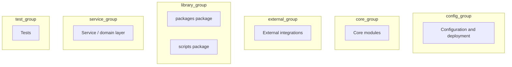

# Architecture report: system-ui/theme-ui

> Automated static analysis. **Observed** = directly seen in files/imports/AST; **Inferred** = interpretation from that evidence. Repository code was not executed.

## 1. Repository at a glance

| Item | Value |
| --- | --- |
| Repository | system-ui/theme-ui |
| Description | Build consistent, themeable React apps based on constraint-based design principles |
| Language | TypeScript |
| Stars | 5410 |
| Licence | MIT |
| Analysed commit / branch | bc87592449bdd43312b363753c077dcd8cb05b30 / develop |
| Framework(s) | Next.js, React |
| Files analysed | 576 |
| Components | 7 |

## 2. Architecture in one minute

system-ui/theme-ui - Build consistent, themeable React apps based on constraint-based design principles. This repository was analysed statically from 576 file(s) (0 Python). Detected technologies (observed from imports/manifests): GitHub Actions, Next.js, React, Tailwind CSS, Jest, TypeScript. Files are grouped into 7 component(s): Configuration and deployment, Core modules, External integrations, packages package, scripts package, Service / domain layer, Tests. Findings below distinguish observed facts from inferred interpretation.

## 3. High-level block diagram

## 4. Main components

### Configuration and deployment (`config`)

- **Kind:** config
- **Status:** Observed
- **Confidence:** 0.85
- **Responsibility:** Groups 72 file(s) under configuration and deployment (observed from repository paths and static analysis).
- **Paths:** `package.json`, `packages/color-modes/package.json`, `packages/color/package.json`, `packages/components/package.json`, `packages/core/jsx-dev-runtime/package.json`, `packages/core/jsx-runtime/package.json`, `packages/core/package.json`, `packages/css/package.json`, `packages/css/utils/package.json`, `packages/custom-properties/package.json`, `packages/docs/package.json`, `packages/docs/tsconfig.json`, `packages/e2e/package.json`, `packages/e2e/tsconfig.json`, `packages/gatsby-plugin-theme-ui/package.json`, `packages/gatsby-theme-style-guide/package.json`, `packages/gatsby-theme-ui-layout/package.json`, `packages/global/package.json`, `packages/match-media/package.json`, `packages/mdx/package.json`, `packages/preset-base/package.json`, `packages/preset-bootstrap/package.json`, `packages/preset-bulma/package.json`, `packages/preset-dark/package.json`, `packages/preset-deep/package.json`, `packages/preset-funk/package.json`, `packages/preset-future/package.json`, `packages/preset-polaris/package.json`, `packages/preset-roboto/package.json`, `packages/preset-sketchy/package.json`, `packages/preset-swiss/package.json`, `packages/preset-system/package.json`, `packages/preset-tailwind/package.json`, `packages/preset-tosh/package.json`, `packages/presets/package.json`, `packages/prism/package.json`, `packages/prism/presets/dracula.json`, `packages/prism/presets/duotone-dark.json`, `packages/prism/presets/duotone-light.json`, `packages/prism/presets/github.json`, `packages/prism/presets/night-owl-light.json`, `packages/prism/presets/night-owl.json`, `packages/prism/presets/oceanic-next.json`, `packages/prism/presets/prism-coy.json`, `packages/prism/presets/prism-dark.json`, `packages/prism/presets/prism-funky.json`, `packages/prism/presets/prism-okaidia.json`, `packages/prism/presets/prism-solarizedlight.json`, `packages/prism/presets/prism-tomorrow.json`, `packages/prism/presets/prism-twilight.json`, `packages/prism/presets/prism.json`, `packages/prism/presets/shades-of-purple.json`, `packages/prism/presets/ultramin.json`, `packages/prism/presets/vs-dark.json`, `packages/style-guide/package.json`, `packages/tachyons/package.json`, `packages/tailwind/package.json`, `packages/test-utils/package.json`, `packages/test-utils/tsconfig.json`, `packages/theme-provider/package.json`, `packages/theme-ui/jsx-dev-runtime/package.json`, `packages/theme-ui/jsx-runtime/package.json`, `packages/theme-ui/package.json`, `packages/typography/package.json`, `pnpm-workspace.yaml`, `scripts/typecheck-built-files/package.json`, `scripts/typecheck-built-files/pnpm-workspace.yaml`, `scripts/typecheck-built-files/tsconfig.json`, `tsconfig.json`, `tsconfig.options.json`, `tsconfig.test.json`, `vercel.json`
- **Evidence:** [package.json](https://github.com/system-ui/theme-ui/blob/bc87592449bdd43312b363753c077dcd8cb05b30/package.json); [packages/color-modes/package.json](https://github.com/system-ui/theme-ui/blob/bc87592449bdd43312b363753c077dcd8cb05b30/packages/color-modes/package.json); [packages/color/package.json](https://github.com/system-ui/theme-ui/blob/bc87592449bdd43312b363753c077dcd8cb05b30/packages/color/package.json); [packages/components/package.json](https://github.com/system-ui/theme-ui/blob/bc87592449bdd43312b363753c077dcd8cb05b30/packages/components/package.json); [packages/core/jsx-dev-runtime/package.json](https://github.com/system-ui/theme-ui/blob/bc87592449bdd43312b363753c077dcd8cb05b30/packages/core/jsx-dev-runtime/package.json); [packages/core/jsx-runtime/package.json](https://github.com/system-ui/theme-ui/blob/bc87592449bdd43312b363753c077dcd8cb05b30/packages/core/jsx-runtime/package.json); [packages/core/package.json](https://github.com/system-ui/theme-ui/blob/bc87592449bdd43312b363753c077dcd8cb05b30/packages/core/package.json); [packages/css/package.json](https://github.com/system-ui/theme-ui/blob/bc87592449bdd43312b363753c077dcd8cb05b30/packages/css/package.json)

### Core modules (`core`)

- **Kind:** core
- **Status:** Observed
- **Confidence:** 0.85
- **Responsibility:** Groups 6 file(s) under core modules (observed from repository paths and static analysis).
- **Paths:** `auto.config.ts`, `babel.config.js`, `jest-preprocess.js`, `jest.config.ts`, `lint-staged.config.js`, `prettier.config.js`
- **Evidence:** [auto.config.ts](https://github.com/system-ui/theme-ui/blob/bc87592449bdd43312b363753c077dcd8cb05b30/auto.config.ts); [babel.config.js](https://github.com/system-ui/theme-ui/blob/bc87592449bdd43312b363753c077dcd8cb05b30/babel.config.js); [jest-preprocess.js](https://github.com/system-ui/theme-ui/blob/bc87592449bdd43312b363753c077dcd8cb05b30/jest-preprocess.js); [jest.config.ts](https://github.com/system-ui/theme-ui/blob/bc87592449bdd43312b363753c077dcd8cb05b30/jest.config.ts); [lint-staged.config.js](https://github.com/system-ui/theme-ui/blob/bc87592449bdd43312b363753c077dcd8cb05b30/lint-staged.config.js); [prettier.config.js](https://github.com/system-ui/theme-ui/blob/bc87592449bdd43312b363753c077dcd8cb05b30/prettier.config.js)

### External integrations (`external_integrations`)

- **Kind:** external
- **Status:** Observed
- **Confidence:** 0.85
- **Responsibility:** Groups 2 file(s) under external integrations (observed from repository paths and static analysis).
- **Paths:** `packages/e2e/integration/docs-color-modes.ts`, `packages/e2e/integration/docs-navigation.ts`
- **Evidence:** [packages/e2e/integration/docs-color-modes.ts](https://github.com/system-ui/theme-ui/blob/bc87592449bdd43312b363753c077dcd8cb05b30/packages/e2e/integration/docs-color-modes.ts); [packages/e2e/integration/docs-navigation.ts](https://github.com/system-ui/theme-ui/blob/bc87592449bdd43312b363753c077dcd8cb05b30/packages/e2e/integration/docs-navigation.ts)

### packages package (`packages`)

- **Kind:** library
- **Status:** Observed
- **Confidence:** 0.85
- **Responsibility:** Groups 119 file(s) under packages package (observed from repository paths and static analysis).
- **Paths:** `packages/color-modes/src/custom-properties.ts`, `packages/color-modes/src/index.tsx`, `packages/color/src/index.ts`, `packages/components/src/Alert.tsx`, `packages/components/src/AspectImage.tsx`, `packages/components/src/AspectRatio.tsx`, `packages/components/src/Avatar.tsx`, `packages/components/src/Badge.tsx`, `packages/components/src/Box.tsx`, `packages/components/src/Button.tsx`, `packages/components/src/Card.tsx`, `packages/components/src/Checkbox.tsx`, `packages/components/src/Close.tsx`, `packages/components/src/Container.tsx`, `packages/components/src/Divider.tsx`, `packages/components/src/Donut.tsx`, `packages/components/src/Embed.tsx`, `packages/components/src/Field.tsx`, `packages/components/src/Flex.tsx`, `packages/components/src/Grid.tsx`, `packages/components/src/Heading.tsx`, `packages/components/src/IconButton.tsx`, `packages/components/src/Image.tsx`, `packages/components/src/Input.tsx`, `packages/components/src/Label.tsx`, `packages/components/src/Link.tsx`, `packages/components/src/MenuButton.tsx`, `packages/components/src/Message.tsx`, `packages/components/src/NavLink.tsx`, `packages/components/src/Paragraph.tsx`, `packages/components/src/Progress.tsx`, `packages/components/src/Radio.tsx`, `packages/components/src/SVG.tsx`, `packages/components/src/Select.tsx`, `packages/components/src/Slider.tsx`, `packages/components/src/Spinner.tsx`, `packages/components/src/Switch.tsx`, `packages/components/src/Text.tsx`, `packages/components/src/Textarea.tsx`, `packages/components/src/index.ts`, `packages/components/src/types.ts`, `packages/components/src/util.ts`, `packages/css/src/index.ts`, `packages/css/src/options.ts`, `packages/css/src/types.ts`, `packages/css/src/utils.ts`, `packages/custom-properties/src/index.ts`, `packages/e2e/cypress.config.js`, `packages/e2e/plugins.js`, `packages/e2e/support.ts`, `packages/gatsby-plugin-theme-ui/gatsby-browser.js`, `packages/gatsby-plugin-theme-ui/gatsby-node.js`, `packages/gatsby-plugin-theme-ui/gatsby-ssr.js`, `packages/gatsby-plugin-theme-ui/index.js`, `packages/gatsby-plugin-theme-ui/src/components.js`, `packages/gatsby-plugin-theme-ui/src/hooks/configOptions.js`, `packages/gatsby-plugin-theme-ui/src/index.js`, `packages/gatsby-plugin-theme-ui/src/provider.js`, `packages/gatsby-plugin-theme-ui/utils/preset-dictionary.js`, `packages/gatsby-theme-style-guide/gatsby-config.js`, `packages/gatsby-theme-style-guide/gatsby-node.js`, `packages/gatsby-theme-style-guide/index.js`, `packages/gatsby-theme-style-guide/src/colors.js`, `packages/gatsby-theme-style-guide/src/header.js`, `packages/gatsby-theme-style-guide/src/index.js`, `packages/gatsby-theme-style-guide/src/layout.js`, `packages/gatsby-theme-style-guide/src/template.js`, `packages/gatsby-theme-style-guide/src/typography.js`, `packages/gatsby-theme-ui-layout/index.js`, `packages/gatsby-theme-ui-layout/src/index.js`, `packages/gatsby-theme-ui-layout/src/layout.js`, `packages/global/src/index.tsx`, `packages/match-media/src/index.ts`, `packages/mdx/src/Themed.tsx`, `packages/mdx/src/index.tsx`, `packages/mdx/src/useThemeStylesWithMdx.tsx`, `packages/mdx/src/wrapComponentsWithThemeStyles.tsx`, `packages/preset-base/src/index.ts`, `packages/preset-bootstrap/src/index.ts`, `packages/preset-bulma/src/index.ts`, `packages/preset-dark/src/index.ts`, `packages/preset-deep/src/index.ts`, `packages/preset-funk/src/index.ts`, `packages/preset-future/src/index.ts`, `packages/preset-polaris/src/index.ts`, `packages/preset-roboto/src/index.ts`, `packages/preset-sketchy/src/index.ts`, `packages/preset-sketchy/src/variants.ts`, `packages/preset-swiss/src/index.ts`, `packages/preset-system/src/index.ts`, `packages/preset-tailwind/src/index.ts`, `packages/preset-tosh/src/index.ts`, `packages/presets/src/index.ts`, `packages/prism/build-presets.js`, `packages/prism/presets/theme-ui.js`, `packages/prism/src/index.tsx`, `packages/style-guide/src/Card.tsx`, `packages/style-guide/src/ColorPalette.tsx`, `packages/style-guide/src/ColorSwatch.tsx`, `packages/style-guide/src/FontFamily.ts`, `packages/style-guide/src/HeadingStyle.tsx`, `packages/style-guide/src/ThemeCard.tsx`, `packages/style-guide/src/TypeScale.tsx`, `packages/style-guide/src/TypeStyle.tsx`, `packages/style-guide/src/color.ts`, `packages/style-guide/src/context.ts`, `packages/style-guide/src/index.ts`, `packages/tachyons/src/index.ts`, `packages/tachyons/types/tachyons-generator/index.d.ts`, `packages/tailwind/src/index.ts`, `packages/test-utils/src/index.tsx`, `packages/theme-provider/src/index.tsx`, `packages/theme-ui/src/index.ts`, `packages/theme-ui/src/jsx-dev-runtime.ts`, `packages/theme-ui/src/jsx-runtime.ts`, `packages/typography/declarations.d.ts`, `packages/typography/src/index.ts`, `packages/typography/src/styles.ts`, `packages/typography/src/to-theme.ts`
- **Evidence:** [packages/color-modes/src/custom-properties.ts](https://github.com/system-ui/theme-ui/blob/bc87592449bdd43312b363753c077dcd8cb05b30/packages/color-modes/src/custom-properties.ts); [packages/color-modes/src/index.tsx](https://github.com/system-ui/theme-ui/blob/bc87592449bdd43312b363753c077dcd8cb05b30/packages/color-modes/src/index.tsx); [packages/color/src/index.ts](https://github.com/system-ui/theme-ui/blob/bc87592449bdd43312b363753c077dcd8cb05b30/packages/color/src/index.ts); [packages/components/src/Alert.tsx](https://github.com/system-ui/theme-ui/blob/bc87592449bdd43312b363753c077dcd8cb05b30/packages/components/src/Alert.tsx); [packages/components/src/AspectImage.tsx](https://github.com/system-ui/theme-ui/blob/bc87592449bdd43312b363753c077dcd8cb05b30/packages/components/src/AspectImage.tsx); [packages/components/src/AspectRatio.tsx](https://github.com/system-ui/theme-ui/blob/bc87592449bdd43312b363753c077dcd8cb05b30/packages/components/src/AspectRatio.tsx); [packages/components/src/Avatar.tsx](https://github.com/system-ui/theme-ui/blob/bc87592449bdd43312b363753c077dcd8cb05b30/packages/components/src/Avatar.tsx); [packages/components/src/Badge.tsx](https://github.com/system-ui/theme-ui/blob/bc87592449bdd43312b363753c077dcd8cb05b30/packages/components/src/Badge.tsx)

### scripts package (`scripts`)

- **Kind:** library
- **Status:** Observed
- **Confidence:** 0.85
- **Responsibility:** Groups 4 file(s) under scripts package (observed from repository paths and static analysis).
- **Paths:** `scripts/all-contributors-check.js`, `scripts/publish-to-npm.mjs`, `scripts/should-skip-deploy.sh`, `scripts/typecheck-built-files/imports.ts`
- **Evidence:** [scripts/all-contributors-check.js](https://github.com/system-ui/theme-ui/blob/bc87592449bdd43312b363753c077dcd8cb05b30/scripts/all-contributors-check.js); [scripts/publish-to-npm.mjs](https://github.com/system-ui/theme-ui/blob/bc87592449bdd43312b363753c077dcd8cb05b30/scripts/publish-to-npm.mjs); [scripts/should-skip-deploy.sh](https://github.com/system-ui/theme-ui/blob/bc87592449bdd43312b363753c077dcd8cb05b30/scripts/should-skip-deploy.sh); [scripts/typecheck-built-files/imports.ts](https://github.com/system-ui/theme-ui/blob/bc87592449bdd43312b363753c077dcd8cb05b30/scripts/typecheck-built-files/imports.ts)

### Service / domain layer (`service_layer`)

- **Kind:** service
- **Status:** Observed
- **Confidence:** 0.85
- **Responsibility:** Groups 6 file(s) under service / domain layer (observed from repository paths and static analysis).
- **Paths:** `packages/core/src/index.ts`, `packages/core/src/jsx-dev-runtime.ts`, `packages/core/src/jsx-namespace.ts`, `packages/core/src/jsx-runtime.ts`, `packages/core/src/parseProps.tsx`, `packages/core/src/types.ts`
- **Evidence:** [packages/core/src/index.ts](https://github.com/system-ui/theme-ui/blob/bc87592449bdd43312b363753c077dcd8cb05b30/packages/core/src/index.ts); [packages/core/src/jsx-dev-runtime.ts](https://github.com/system-ui/theme-ui/blob/bc87592449bdd43312b363753c077dcd8cb05b30/packages/core/src/jsx-dev-runtime.ts); [packages/core/src/jsx-namespace.ts](https://github.com/system-ui/theme-ui/blob/bc87592449bdd43312b363753c077dcd8cb05b30/packages/core/src/jsx-namespace.ts); [packages/core/src/jsx-runtime.ts](https://github.com/system-ui/theme-ui/blob/bc87592449bdd43312b363753c077dcd8cb05b30/packages/core/src/jsx-runtime.ts); [packages/core/src/parseProps.tsx](https://github.com/system-ui/theme-ui/blob/bc87592449bdd43312b363753c077dcd8cb05b30/packages/core/src/parseProps.tsx); [packages/core/src/types.ts](https://github.com/system-ui/theme-ui/blob/bc87592449bdd43312b363753c077dcd8cb05b30/packages/core/src/types.ts)

### Tests (`tests`)

- **Kind:** test
- **Status:** Observed
- **Confidence:** 0.85
- **Responsibility:** Groups 60 file(s) under tests (observed from repository paths and static analysis).
- **Paths:** `packages/color-modes/test/__snapshots__/index.tsx.snap`, `packages/color-modes/test/custom-properties.tsx`, `packages/color-modes/test/index.tsx`, `packages/color/test/index.tsx`, `packages/components/test/Box.spec.tsx`, `packages/components/test/Button.spec.tsx`, `packages/components/test/Flex.spec.tsx`, `packages/components/test/Grid.spec.tsx`, `packages/components/test/SVG.spec.tsx`, `packages/components/test/Switch.spec.tsx`, `packages/components/test/__snapshots__/Box.spec.tsx.snap`, `packages/components/test/__snapshots__/Button.spec.tsx.snap`, `packages/components/test/__snapshots__/Grid.spec.tsx.snap`, `packages/components/test/__snapshots__/index.tsx.snap`, `packages/components/test/__test-utils__/index.tsx`, `packages/components/test/index.tsx`, `packages/components/test/types.tsx`, `packages/core/test/__snapshots__/index.tsx.snap`, `packages/core/test/__snapshots__/react-jsx.tsx.snap`, `packages/core/test/index.tsx`, `packages/core/test/jsx-dev-runtime.ts`, `packages/core/test/jsx-runtime.ts`, `packages/core/test/parseProps.tsx`, `packages/core/test/react-jsx.tsx`, `packages/css/test/errors-and-inference.ts`, `packages/css/test/index.ts`, `packages/css/test/past-bugs.ts`, `packages/css/test/utils.ts`, `packages/custom-properties/test/__snapshots__/test.mjs.snap`, `packages/custom-properties/test/test.mjs`, `packages/gatsby-plugin-theme-ui/test/provider-v2.skipped`, `packages/global/test/__snapshots__/index.tsx.snap`, `packages/global/test/index.tsx`, `packages/match-media/test/index.tsx`, `packages/match-media/test/ssr.tsx`, `packages/mdx/test/Themed.tsx`, `packages/mdx/test/__test-utils__/evalMdx.mjs`, `packages/mdx/test/defaultMdxComponents-mdx-v2.mjs`, `packages/mdx/test/defaultMdxComponents.tsx`, `packages/mdx/test/index.tsx`, `packages/mdx/test/useThemedStylesWithMdx-mdx-v2.mjs`, `packages/presets/test/index.tsx`, `packages/prism/test/__snapshots__/index.tsx.snap`, `packages/prism/test/index.tsx`, `packages/tailwind/test/__snapshots__/test.ts.snap`, `packages/tailwind/test/fixture.css`, `packages/tailwind/test/index.html`, `packages/tailwind/test/test.ts`, `packages/theme-provider/test/__snapshots__/index.tsx.snap`, `packages/theme-provider/test/index.tsx`, `packages/theme-ui/test/__snapshots__/index.tsx.snap`, `packages/theme-ui/test/color-modes.tsx`, `packages/theme-ui/test/index.tsx`, `packages/theme-ui/test/jsx-dev-runtime.ts`, `packages/theme-ui/test/jsx-runtime.ts`, `packages/theme-ui/test/node.tsx`, `packages/typography/test/__snapshots__/to-theme.ts.snap`, `packages/typography/test/fixtures/themes.ts`, `packages/typography/test/styles.ts`, `packages/typography/test/to-theme.ts`
- **Evidence:** [packages/color-modes/test/__snapshots__/index.tsx.snap](https://github.com/system-ui/theme-ui/blob/bc87592449bdd43312b363753c077dcd8cb05b30/packages/color-modes/test/__snapshots__/index.tsx.snap); [packages/color-modes/test/custom-properties.tsx](https://github.com/system-ui/theme-ui/blob/bc87592449bdd43312b363753c077dcd8cb05b30/packages/color-modes/test/custom-properties.tsx); [packages/color-modes/test/index.tsx](https://github.com/system-ui/theme-ui/blob/bc87592449bdd43312b363753c077dcd8cb05b30/packages/color-modes/test/index.tsx); [packages/color/test/index.tsx](https://github.com/system-ui/theme-ui/blob/bc87592449bdd43312b363753c077dcd8cb05b30/packages/color/test/index.tsx); [packages/components/test/Box.spec.tsx](https://github.com/system-ui/theme-ui/blob/bc87592449bdd43312b363753c077dcd8cb05b30/packages/components/test/Box.spec.tsx); [packages/components/test/Button.spec.tsx](https://github.com/system-ui/theme-ui/blob/bc87592449bdd43312b363753c077dcd8cb05b30/packages/components/test/Button.spec.tsx); [packages/components/test/Flex.spec.tsx](https://github.com/system-ui/theme-ui/blob/bc87592449bdd43312b363753c077dcd8cb05b30/packages/components/test/Flex.spec.tsx); [packages/components/test/Grid.spec.tsx](https://github.com/system-ui/theme-ui/blob/bc87592449bdd43312b363753c077dcd8cb05b30/packages/components/test/Grid.spec.tsx)

## 5. Execution flow

**Observed** entry point(s):

- [packages/color-modes/src/index.tsx](https://github.com/system-ui/theme-ui/blob/bc87592449bdd43312b363753c077dcd8cb05b30/packages/color-modes/src/index.tsx)
- [packages/color/src/index.ts](https://github.com/system-ui/theme-ui/blob/bc87592449bdd43312b363753c077dcd8cb05b30/packages/color/src/index.ts)
- [packages/components/src/index.ts](https://github.com/system-ui/theme-ui/blob/bc87592449bdd43312b363753c077dcd8cb05b30/packages/components/src/index.ts)
- [packages/core/src/index.ts](https://github.com/system-ui/theme-ui/blob/bc87592449bdd43312b363753c077dcd8cb05b30/packages/core/src/index.ts)
- [packages/css/src/index.ts](https://github.com/system-ui/theme-ui/blob/bc87592449bdd43312b363753c077dcd8cb05b30/packages/css/src/index.ts)
- [packages/custom-properties/src/index.ts](https://github.com/system-ui/theme-ui/blob/bc87592449bdd43312b363753c077dcd8cb05b30/packages/custom-properties/src/index.ts)
- [packages/gatsby-plugin-theme-ui/index.js](https://github.com/system-ui/theme-ui/blob/bc87592449bdd43312b363753c077dcd8cb05b30/packages/gatsby-plugin-theme-ui/index.js)
- [packages/gatsby-plugin-theme-ui/src/index.js](https://github.com/system-ui/theme-ui/blob/bc87592449bdd43312b363753c077dcd8cb05b30/packages/gatsby-plugin-theme-ui/src/index.js)
- [packages/gatsby-theme-style-guide/index.js](https://github.com/system-ui/theme-ui/blob/bc87592449bdd43312b363753c077dcd8cb05b30/packages/gatsby-theme-style-guide/index.js)
- [packages/gatsby-theme-style-guide/src/index.js](https://github.com/system-ui/theme-ui/blob/bc87592449bdd43312b363753c077dcd8cb05b30/packages/gatsby-theme-style-guide/src/index.js)
- [packages/gatsby-theme-ui-layout/index.js](https://github.com/system-ui/theme-ui/blob/bc87592449bdd43312b363753c077dcd8cb05b30/packages/gatsby-theme-ui-layout/index.js)
- [packages/gatsby-theme-ui-layout/src/index.js](https://github.com/system-ui/theme-ui/blob/bc87592449bdd43312b363753c077dcd8cb05b30/packages/gatsby-theme-ui-layout/src/index.js)

Representative flow (derived from observed entry points and the import graph; steps beyond the entry point are **Inferred**):

1. Execution starts at an observed entry point listed above, if present.
2. No internal import relationships between components were observed.

## 6. Project structure

### `(root)`

- `.all-contributorsrc` - other (31137 bytes)
- `.eslintignore` - other (60 bytes)
- `.eslintrc.js` - source, JavaScript (1034 bytes)
- `.gitignore` - other (136 bytes)
- `.nvmrc` - other (3 bytes)
- `.pnpmfile.cjs` - source, JavaScript (961 bytes)
- `.prettierignore` - other (205 bytes)
- `.size-limit.json` - config (1163 bytes)
- `CHANGELOG.md` - docs (73420 bytes)
- `CODE_OF_CONDUCT.md` - docs (3213 bytes)
- `CONTRIBUTING.md` - docs (2299 bytes)
- `LICENSE.md` - docs (1082 bytes)
- `MIGRATING.md` - docs (14471 bytes)
- `auto.config.ts` - source, TypeScript (1856 bytes)
- `babel.config.js` - source, JavaScript (453 bytes)
- `jest-preprocess.js` - source, JavaScript (245 bytes)
- `jest.config.ts` - source, TypeScript (1434 bytes)
- `lint-staged.config.js` - source, JavaScript (60 bytes)
- `package.json` - manifest (4339 bytes)
- `pnpm-workspace.yaml` - config (44 bytes)
- `prettier.config.js` - source, JavaScript (147 bytes)
- `tsconfig.json` - config (196 bytes)
- `tsconfig.options.json` - config (513 bytes)
- `tsconfig.test.json` - config (507 bytes)
- `vercel.json` - config (2165 bytes)

### `.codesandbox`

- `.codesandbox/ci.json` - config (208 bytes)

### `.github`

- `.github/CODEOWNERS` - other (1780 bytes)
- `.github/ISSUE_TEMPLATE/bug_report.md` - docs (535 bytes)
- `.github/ISSUE_TEMPLATE/config.yml` - config (160 bytes)
- `.github/ISSUE_TEMPLATE/feature_request.md` - docs (594 bytes)
- `.github/dependabot.yml` - config (2791 bytes)
- `.github/validate-codeowners.sh` - source, Shell (304 bytes)
- `.github/workflows/ci.yml` - ci, YAML (3138 bytes)
- `.github/workflows/codeql-analysis.yml` - ci, YAML (2344 bytes)
- `.github/workflows/e2e.yml` - ci, YAML (1563 bytes)

### `.husky`

- `.husky/_/husky.sh` - source, Shell (592 bytes)

### `examples`

- `examples/gatsby-plugin/gatsby-config.js` - source, JavaScript (126 bytes)
- `examples/gatsby-plugin/package.json` - manifest (662 bytes)
- `examples/gatsby-plugin/src/gatsby-plugin-theme-ui/index.js` - source, JavaScript (777 bytes)
- `examples/gatsby-plugin/src/layout.js` - source, JavaScript (305 bytes)
- `examples/gatsby-plugin/src/pages/index.mdx` - other (188 bytes)
- `examples/gatsby/gatsby-browser.js` - source, JavaScript (133 bytes)
- `examples/gatsby/gatsby-config.js` - source, JavaScript (281 bytes)
- `examples/gatsby/gatsby-ssr.js` - source, JavaScript (164 bytes)
- `examples/gatsby/package.json` - manifest (757 bytes)
- `examples/gatsby/src/index.tsx` - source, TypeScript (556 bytes)
- `examples/gatsby/src/layout.tsx` - source, TypeScript (359 bytes)
- `examples/gatsby/src/pages/index.mdx` - other (190 bytes)
- `examples/gatsby/src/theme.ts` - source, TypeScript (759 bytes)
- `examples/gatsby/tsconfig.json` - config (96 bytes)
- `examples/next/.gitignore` - other (14 bytes)
- `examples/next/components/Header.tsx` - source, TypeScript (399 bytes)
- `examples/next/components/about.mdx` - other (296 bytes)
- `examples/next/lib/mdx.d.ts` - source, TypeScript (105 bytes)
- `examples/next/lib/theme.ts` - source, TypeScript (964 bytes)
- `examples/next/next-env.d.ts` - source, TypeScript (264 bytes)
- `examples/next/next.config.js` - source, JavaScript (1373 bytes)
- `examples/next/package.json` - manifest (710 bytes)
- `examples/next/pages/_app.tsx` - source, TypeScript (753 bytes)
- `examples/next/pages/_document.tsx` - source, TypeScript (300 bytes)
- `examples/next/pages/index.tsx` - source, TypeScript (321 bytes)
- `examples/next/tsconfig.json` - config (572 bytes)
- `examples/typography/gatsby-browser.js` - source, JavaScript (164 bytes)
- `examples/typography/gatsby-config.js` - source, JavaScript (474 bytes)
- `examples/typography/gatsby-ssr.js` - source, JavaScript (164 bytes)
- `examples/typography/package.json` - manifest (867 bytes)
- `examples/typography/src/index.tsx` - source, TypeScript (244 bytes)
- `examples/typography/src/layout.tsx` - source, TypeScript (192 bytes)
- `examples/typography/src/pages/index.mdx` - other (254 bytes)
- `examples/typography/src/theme.tsx` - source, TypeScript (625 bytes)
- `examples/typography/tsconfig.json` - config (160 bytes)

### `packages`

- `packages/color-modes/CHANGELOG.md` - docs (9636 bytes)
- `packages/color-modes/README.md` - docs (581 bytes)
- `packages/color-modes/package.json` - manifest (834 bytes)
- `packages/color-modes/src/custom-properties.ts` - source, TypeScript (3458 bytes)
- `packages/color-modes/src/index.tsx` - source, TypeScript (11010 bytes)
- `packages/color-modes/test/__snapshots__/index.tsx.snap` - test (347 bytes)
- `packages/color-modes/test/custom-properties.tsx` - test, TypeScript (7413 bytes)
- `packages/color-modes/test/index.tsx` - test, TypeScript (26254 bytes)
- `packages/color/CHANGELOG.md` - docs (6391 bytes)
- `packages/color/README.md` - docs (3382 bytes)
- `packages/color/package.json` - manifest (629 bytes)
- `packages/color/src/index.ts` - source, TypeScript (3007 bytes)
- `packages/color/test/index.tsx` - test, TypeScript (8236 bytes)
- `packages/components/CHANGELOG.md` - docs (9118 bytes)
- `packages/components/README.md` - docs (299 bytes)
- `packages/components/package.json` - manifest (950 bytes)
- `packages/components/src/Alert.tsx` - source, TypeScript (965 bytes)
- `packages/components/src/AspectImage.tsx` - source, TypeScript (790 bytes)
- `packages/components/src/AspectRatio.tsx` - source, TypeScript (1112 bytes)
- `packages/components/src/Avatar.tsx` - source, TypeScript (622 bytes)
- `packages/components/src/Badge.tsx` - source, TypeScript (778 bytes)
- `packages/components/src/Box.tsx` - source, TypeScript (2963 bytes)
- `packages/components/src/Button.tsx` - source, TypeScript (1259 bytes)
- `packages/components/src/Card.tsx` - source, TypeScript (644 bytes)
- `packages/components/src/Checkbox.tsx` - source, TypeScript (2625 bytes)
- `packages/components/src/Close.tsx` - source, TypeScript (1147 bytes)
- `packages/components/src/Container.tsx` - source, TypeScript (865 bytes)
- `packages/components/src/Divider.tsx` - source, TypeScript (720 bytes)
- `packages/components/src/Donut.tsx` - source, TypeScript (1756 bytes)
- `packages/components/src/Embed.tsx` - source, TypeScript (2125 bytes)
- `packages/components/src/Field.tsx` - source, TypeScript (1511 bytes)
- `packages/components/src/Flex.tsx` - source, TypeScript (686 bytes)
- `packages/components/src/Grid.tsx` - source, TypeScript (2148 bytes)
- `packages/components/src/Heading.tsx` - source, TypeScript (962 bytes)
- `packages/components/src/IconButton.tsx` - source, TypeScript (1491 bytes)
- `packages/components/src/Image.tsx` - source, TypeScript (890 bytes)
- `packages/components/src/Input.tsx` - source, TypeScript (1691 bytes)
- `packages/components/src/Label.tsx` - source, TypeScript (822 bytes)
- `packages/components/src/Link.tsx` - source, TypeScript (759 bytes)
- `packages/components/src/MenuButton.tsx` - source, TypeScript (1134 bytes)
- `packages/components/src/Message.tsx` - source, TypeScript (986 bytes)
- `packages/components/src/NavLink.tsx` - source, TypeScript (980 bytes)
- `packages/components/src/Paragraph.tsx` - source, TypeScript (955 bytes)
- `packages/components/src/Progress.tsx` - source, TypeScript (1233 bytes)
- `packages/components/src/Radio.tsx` - source, TypeScript (2595 bytes)
- `packages/components/src/SVG.tsx` - source, TypeScript (655 bytes)
- `packages/components/src/Select.tsx` - source, TypeScript (1712 bytes)
- `packages/components/src/Slider.tsx` - source, TypeScript (1417 bytes)
- `packages/components/src/Spinner.tsx` - source, TypeScript (1736 bytes)
- `packages/components/src/Switch.tsx` - source, TypeScript (2276 bytes)
- `packages/components/src/Text.tsx` - source, TypeScript (639 bytes)
- `packages/components/src/Textarea.tsx` - source, TypeScript (1196 bytes)
- `packages/components/src/index.ts` - source, TypeScript (887 bytes)
- `packages/components/src/types.ts` - source, TypeScript (270 bytes)
- `packages/components/src/util.ts` - source, TypeScript (931 bytes)
- `packages/components/test/Box.spec.tsx` - test, TypeScript (2875 bytes)
- `packages/components/test/Button.spec.tsx` - test, TypeScript (619 bytes)
- `packages/components/test/Flex.spec.tsx` - test, TypeScript (406 bytes)
- `packages/components/test/Grid.spec.tsx` - test, TypeScript (1679 bytes)
- `packages/components/test/SVG.spec.tsx` - test, TypeScript (430 bytes)
- `packages/components/test/Switch.spec.tsx` - test, TypeScript (764 bytes)
- `packages/components/test/__snapshots__/Box.spec.tsx.snap` - test (209 bytes)
- `packages/components/test/__snapshots__/Button.spec.tsx.snap` - test (1249 bytes)
- `packages/components/test/__snapshots__/Grid.spec.tsx.snap` - test (2719 bytes)
- `packages/components/test/__snapshots__/index.tsx.snap` - test (25878 bytes)
- `packages/components/test/__test-utils__/index.tsx` - test, TypeScript (888 bytes)
- `packages/components/test/index.tsx` - test, TypeScript (10402 bytes)
- `packages/components/test/types.tsx` - test, TypeScript (10336 bytes)
- `packages/core/CHANGELOG.md` - docs (7669 bytes)
- `packages/core/README.md` - docs (1499 bytes)
- `packages/core/jsx-dev-runtime/package.json` - manifest (539 bytes)
- `packages/core/jsx-runtime/package.json` - manifest (511 bytes)
- `packages/core/package.json` - manifest (2094 bytes)
- `packages/core/src/index.ts` - source, TypeScript (4536 bytes)
- `packages/core/src/jsx-dev-runtime.ts` - source, TypeScript (627 bytes)
- `packages/core/src/jsx-namespace.ts` - source, TypeScript (1395 bytes)
- `packages/core/src/jsx-runtime.ts` - source, TypeScript (626 bytes)
- `packages/core/src/parseProps.tsx` - source, TypeScript (502 bytes)
- `packages/core/src/types.ts` - source, TypeScript (1142 bytes)
- `packages/core/test/__snapshots__/index.tsx.snap` - test (182 bytes)
- `packages/core/test/__snapshots__/react-jsx.tsx.snap` - test (369 bytes)
- `packages/core/test/index.tsx` - test, TypeScript (7672 bytes)
- `packages/core/test/jsx-dev-runtime.ts` - test, TypeScript (1471 bytes)
- `packages/core/test/jsx-runtime.ts` - test, TypeScript (926 bytes)
- `packages/core/test/parseProps.tsx` - test, TypeScript (3224 bytes)
- `packages/core/test/react-jsx.tsx` - test, TypeScript (3335 bytes)
- `packages/css/CHANGELOG.md` - docs (13816 bytes)
- `packages/css/README.md` - docs (1158 bytes)
- `packages/css/package.json` - manifest (1527 bytes)
- `packages/css/src/index.ts` - source, TypeScript (11094 bytes)
- `packages/css/src/options.ts` - source, TypeScript (996 bytes)
- `packages/css/src/types.ts` - source, TypeScript (31753 bytes)
- `packages/css/src/utils.ts` - source, TypeScript (549 bytes)
- `packages/css/test/errors-and-inference.ts` - test, TypeScript (2390 bytes)
- `packages/css/test/index.ts` - test, TypeScript (16096 bytes)
- `packages/css/test/past-bugs.ts` - test, TypeScript (1103 bytes)
- `packages/css/test/utils.ts` - test, TypeScript (1721 bytes)
- `packages/css/utils/package.json` - manifest (196 bytes)
- `packages/custom-properties/.npmignore` - other (30 bytes)
- `packages/custom-properties/CHANGELOG.md` - docs (3619 bytes)
- `packages/custom-properties/README.md` - docs (712 bytes)
- `packages/custom-properties/package.json` - manifest (652 bytes)
- `packages/custom-properties/src/index.ts` - source, TypeScript (1576 bytes)
- `packages/custom-properties/test/__snapshots__/test.mjs.snap` - test (2254 bytes)
- `packages/custom-properties/test/test.mjs` - test, JavaScript (1813 bytes)
- `packages/docs/.babelrc` - docs (163 bytes)
- `packages/docs/.eslintignore` - docs (9 bytes)
- `packages/docs/.eslintrc.js` - docs (54 bytes)
- `packages/docs/.gitignore` - docs (18 bytes)
- `packages/docs/declarations.d.ts` - docs (296 bytes)
- `packages/docs/gatsby-browser.js` - docs (288 bytes)
- `packages/docs/gatsby-config.js` - docs (1187 bytes)
- `packages/docs/gatsby-node.js` - docs (1771 bytes)
- `packages/docs/gatsby-ssr.js` - docs (382 bytes)
- `packages/docs/package.json` - manifest (4343 bytes)
- `packages/docs/scripts/svg-logo.js` - docs (755 bytes)
- `packages/docs/src/components/banner.js` - docs (504 bytes)
- `packages/docs/src/components/button.js` - docs (476 bytes)
- `packages/docs/src/components/cards.js` - docs (404 bytes)
- `packages/docs/src/components/code.tsx` - docs (4966 bytes)
- `packages/docs/src/components/color-keys.mdx` - docs (1179 bytes)
- `packages/docs/src/components/components.mdx` - docs (4281 bytes)
- `packages/docs/src/components/debug-theme.js` - docs (152 bytes)
- `packages/docs/src/components/edit-link.js` - docs (1223 bytes)
- `packages/docs/src/components/google-fonts.js` - docs (855 bytes)
- `packages/docs/src/components/graph.js` - docs (4347 bytes)
- `packages/docs/src/components/head.js` - docs (1569 bytes)
- `packages/docs/src/components/intro-code-samples/index.js` - docs (470 bytes)
- `packages/docs/src/components/intro-code-samples/snippets/basic-usage.tsx` - docs (307 bytes)
- `packages/docs/src/components/intro-code-samples/snippets/theme.tsx` - docs (279 bytes)
- `packages/docs/src/components/layout.js` - docs (5471 bytes)
- `packages/docs/src/components/logo.js` - docs (1171 bytes)
- `packages/docs/src/components/lorem.mdx` - docs (8083 bytes)
- `packages/docs/src/components/menu-button.js` - docs (663 bytes)
- `packages/docs/src/components/nav-link.js` - docs (433 bytes)
- `packages/docs/src/components/note.js` - docs (261 bytes)
- `packages/docs/src/components/og-image.js` - docs (437 bytes)
- `packages/docs/src/components/pagination.tsx` - docs (313 bytes)
- `packages/docs/src/components/preset.js` - docs (1749 bytes)
- `packages/docs/src/components/presets-demo.js` - docs (2717 bytes)
- `packages/docs/src/components/readme-badges.js` - docs (2531 bytes)
- `packages/docs/src/components/search-input.tsx` - docs (5040 bytes)
- `packages/docs/src/components/sidenav.tsx` - docs (8340 bytes)
- `packages/docs/src/components/skip-link.js` - docs (558 bytes)
- `packages/docs/src/components/theme-scales.js` - docs (1541 bytes)
- `packages/docs/src/components/tiles.js` - docs (737 bytes)
- `packages/docs/src/components/typography-layout.js` - docs (1796 bytes)
- `packages/docs/src/components/typography-themes.js` - docs (2390 bytes)
- `packages/docs/src/gatsby-plugin-theme-ui/components.js` - docs (648 bytes)
- `packages/docs/src/gatsby-plugin-theme-ui/index.js` - docs (7165 bytes)
- `packages/docs/src/gatsby-theme-code-recipes/recipe.js` - docs (376 bytes)
- `packages/docs/src/index.js` - docs (1001 bytes)
- `packages/docs/src/pages/404.mdx` - docs (22 bytes)
- `packages/docs/src/pages/api.mdx` - docs (4622 bytes)
- `packages/docs/src/pages/color-modes.mdx` - docs (7493 bytes)
- `packages/docs/src/pages/components/alert.mdx` - docs (921 bytes)
- `packages/docs/src/pages/components/aspect-image.mdx` - docs (215 bytes)
- `packages/docs/src/pages/components/aspect-ratio.mdx` - docs (541 bytes)
- `packages/docs/src/pages/components/avatar.mdx` - docs (425 bytes)
- `packages/docs/src/pages/components/badge.mdx` - docs (772 bytes)
- `packages/docs/src/pages/components/box.mdx` - docs (242 bytes)
- `packages/docs/src/pages/components/button.mdx` - docs (656 bytes)
- `packages/docs/src/pages/components/card.mdx` - docs (625 bytes)
- `packages/docs/src/pages/components/checkbox.mdx` - docs (323 bytes)
- `packages/docs/src/pages/components/close.mdx` - docs (520 bytes)
- `packages/docs/src/pages/components/container.mdx` - docs (451 bytes)
- `packages/docs/src/pages/components/divider.mdx` - docs (211 bytes)
- `packages/docs/src/pages/components/donut.mdx` - docs (1154 bytes)
- `packages/docs/src/pages/components/embed.mdx` - docs (444 bytes)
- `packages/docs/src/pages/components/field.mdx` - docs (771 bytes)
- `packages/docs/src/pages/components/flex.mdx` - docs (472 bytes)
- `packages/docs/src/pages/components/forms.mdx` - docs (2519 bytes)
- `packages/docs/src/pages/components/grid.mdx` - docs (2435 bytes)
- `packages/docs/src/pages/components/heading.mdx` - docs (691 bytes)
- `packages/docs/src/pages/components/icon-button.mdx` - docs (630 bytes)
- `packages/docs/src/pages/components/image.mdx` - docs (415 bytes)
- `packages/docs/src/pages/components/index.mdx` - docs (3746 bytes)
- `packages/docs/src/pages/components/input.mdx` - docs (520 bytes)
- `packages/docs/src/pages/components/label.mdx` - docs (271 bytes)
- `packages/docs/src/pages/components/link.mdx` - docs (467 bytes)
- `packages/docs/src/pages/components/menu-button.mdx` - docs (316 bytes)
- `packages/docs/src/pages/components/message.mdx` - docs (297 bytes)
- `packages/docs/src/pages/components/nav-link.mdx` - docs (632 bytes)
- `packages/docs/src/pages/components/paragraph.mdx` - docs (1705 bytes)
- `packages/docs/src/pages/components/progress.mdx` - docs (443 bytes)
- `packages/docs/src/pages/components/radio.mdx` - docs (441 bytes)
- `packages/docs/src/pages/components/select.mdx` - docs (917 bytes)
- `packages/docs/src/pages/components/slider.mdx` - docs (458 bytes)
- `packages/docs/src/pages/components/spinner.mdx` - docs (1044 bytes)
- `packages/docs/src/pages/components/switch.mdx` - docs (1578 bytes)
- `packages/docs/src/pages/components/text.mdx` - docs (731 bytes)
- `packages/docs/src/pages/components/textarea.mdx` - docs (306 bytes)
- `packages/docs/src/pages/components/variants.mdx` - docs (3459 bytes)
- `packages/docs/src/pages/demo.mdx` - docs (99 bytes)
- `packages/docs/src/pages/design-graph.mdx` - docs (1162 bytes)
- `packages/docs/src/pages/getting-started/gatsby.mdx` - docs (948 bytes)
- `packages/docs/src/pages/getting-started/index.mdx` - docs (3098 bytes)
- `packages/docs/src/pages/guides/color-mode-toggles.mdx` - docs (974 bytes)
- `packages/docs/src/pages/guides/custom-cache-provider.mdx` - docs (1677 bytes)
- `packages/docs/src/pages/guides/global-styles.mdx` - docs (1168 bytes)
- `packages/docs/src/pages/guides/how-it-works.mdx` - docs (1760 bytes)
- `packages/docs/src/pages/guides/index.mdx` - docs (1359 bytes)
- `packages/docs/src/pages/guides/jsx-pragma.mdx` - docs (5542 bytes)
- `packages/docs/src/pages/guides/keyframes.mdx` - docs (1471 bytes)
- `packages/docs/src/pages/guides/layouts.mdx` - docs (2639 bytes)
- `packages/docs/src/pages/guides/merging-themes.mdx` - docs (2181 bytes)
- `packages/docs/src/pages/guides/motivation.mdx` - docs (5534 bytes)
- `packages/docs/src/pages/guides/nested-theme-providers.mdx` - docs (1788 bytes)
- `packages/docs/src/pages/guides/object-styles.mdx` - docs (2034 bytes)
- `packages/docs/src/pages/guides/responsive-typography.mdx` - docs (2575 bytes)
- `packages/docs/src/pages/guides/styled-components.mdx` - docs (1624 bytes)
- `packages/docs/src/pages/guides/theme-color-meta-tag.mdx` - docs (1702 bytes)
- `packages/docs/src/pages/guides/typescript.mdx` - docs (3457 bytes)
- `packages/docs/src/pages/guides/variants.mdx` - docs (5733 bytes)
- `packages/docs/src/pages/hooks.mdx` - docs (1089 bytes)
- `packages/docs/src/pages/index.mdx` - docs (2132 bytes)
- `packages/docs/src/pages/layout.mdx` - docs (151 bytes)
- `packages/docs/src/pages/logos.mdx` - docs (160 bytes)
- `packages/docs/src/pages/mdx/components.mdx` - docs (1180 bytes)
- `packages/docs/src/pages/mdx/index.mdx` - docs (1247 bytes)
- `packages/docs/src/pages/mdx/layout-components.mdx` - docs (1662 bytes)
- `packages/docs/src/pages/mdx/linked-headings.mdx` - docs (2643 bytes)
- `packages/docs/src/pages/mdx/styling.mdx` - docs (2764 bytes)
- `packages/docs/src/pages/mdx/syntax-highlighting.mdx` - docs (1878 bytes)
- `packages/docs/src/pages/mdx/themed.mdx` - docs (1199 bytes)
- `packages/docs/src/pages/migrating.mdx` - docs (92 bytes)
- `packages/docs/src/pages/packages/color.mdx` - docs (95 bytes)
- `packages/docs/src/pages/packages/components.mdx` - docs (105 bytes)
- `packages/docs/src/pages/packages/core.mdx` - docs (93 bytes)
- `packages/docs/src/pages/packages/css.mdx` - docs (91 bytes)
- `packages/docs/src/pages/packages/gatsby-plugin.mdx` - docs (108 bytes)
- `packages/docs/src/pages/packages/gatsby-theme-style-guide.mdx` - docs (140 bytes)
- `packages/docs/src/pages/packages/gatsby-theme-ui-blog.mdx` - docs (2853 bytes)
- `packages/docs/src/pages/packages/global.mdx` - docs (97 bytes)
- `packages/docs/src/pages/packages/index.mdx` - docs (841 bytes)
- `packages/docs/src/pages/packages/match-media.mdx` - docs (107 bytes)
- `packages/docs/src/pages/packages/mdx.mdx` - docs (91 bytes)
- `packages/docs/src/pages/packages/presets.mdx` - docs (87 bytes)
- `packages/docs/src/pages/packages/prism.mdx` - docs (95 bytes)
- `packages/docs/src/pages/packages/style-guide.mdx` - docs (576 bytes)
- `packages/docs/src/pages/packages/tachyons.mdx` - docs (64 bytes)
- `packages/docs/src/pages/packages/tailwind.mdx` - docs (64 bytes)
- `packages/docs/src/pages/packages/typography.mdx` - docs (1257 bytes)
- `packages/docs/src/pages/readme.mdx` - docs (86 bytes)
- `packages/docs/src/pages/recipes/button.mdx` - docs (1462 bytes)
- `packages/docs/src/pages/recipes/centered-container.mdx` - docs (683 bytes)
- `packages/docs/src/pages/recipes/css-grid.mdx` - docs (999 bytes)
- `packages/docs/src/pages/recipes/flexbox-layout.mdx` - docs (3401 bytes)
- `packages/docs/src/pages/recipes/flexbox-sidebar.mdx` - docs (928 bytes)
- `packages/docs/src/pages/recipes/footer-a1.mdx` - docs (521 bytes)
- `packages/docs/src/pages/recipes/footer-a2.mdx` - docs (691 bytes)
- `packages/docs/src/pages/recipes/footer-a3.mdx` - docs (472 bytes)
- `packages/docs/src/pages/recipes/footer-a4.mdx` - docs (2187 bytes)
- `packages/docs/src/pages/recipes/gatsby-link.mdx` - docs (799 bytes)
- `packages/docs/src/pages/recipes/grid.mdx` - docs (285 bytes)
- `packages/docs/src/pages/recipes/header-a1.mdx` - docs (525 bytes)
- `packages/docs/src/pages/recipes/header-a2.mdx` - docs (721 bytes)
- `packages/docs/src/pages/recipes/header-a3.mdx` - docs (1646 bytes)
- `packages/docs/src/pages/recipes/header-a4.mdx` - docs (1635 bytes)
- `packages/docs/src/pages/recipes/header-a5.mdx` - docs (1212 bytes)
- `packages/docs/src/pages/recipes/index.js` - docs (1090 bytes)
- `packages/docs/src/pages/recipes/mdx-table-align.mdx` - docs (316 bytes)
- `packages/docs/src/pages/recipes/post-list-a1.mdx` - docs (740 bytes)
- `packages/docs/src/pages/recipes/post-list-a2.mdx` - docs (865 bytes)
- `packages/docs/src/pages/recipes/stack.mdx` - docs (492 bytes)
- `packages/docs/src/pages/recipes/tiled-layout.mdx` - docs (637 bytes)
- `packages/docs/src/pages/resources.mdx` - docs (4949 bytes)
- `packages/docs/src/pages/static-css.mdx` - docs (655 bytes)
- `packages/docs/src/pages/styled.mdx` - docs (328 bytes)
- `packages/docs/src/pages/sx-prop.mdx` - docs (13341 bytes)
- `packages/docs/src/pages/testimonials.mdx` - docs (1451 bytes)
- `packages/docs/src/pages/theme-spec.mdx` - docs (8586 bytes)
- `packages/docs/src/pages/theming.mdx` - docs (9054 bytes)
- `packages/docs/src/rehype-meta-props.cjs` - docs (653 bytes)
- `packages/docs/src/sidebar.ts` - docs (5125 bytes)
- `packages/docs/src/templates/preset.js` - docs (177 bytes)
- `packages/docs/static/card.svg` - docs (1113 bytes)
- `packages/docs/static/logo.svg` - docs (874 bytes)
- `packages/docs/tsconfig.json` - config (300 bytes)
- `packages/e2e/.gitignore` - other (23 bytes)
- `packages/e2e/cypress.config.js` - source, JavaScript (606 bytes)
- `packages/e2e/integration/docs-color-modes.ts` - source, TypeScript (2783 bytes)
- `packages/e2e/integration/docs-navigation.ts` - source, TypeScript (1851 bytes)
- `packages/e2e/package.json` - manifest (744 bytes)
- `packages/e2e/plugins.js` - source, JavaScript (564 bytes)
- `packages/e2e/support.ts` - source, TypeScript (906 bytes)
- `packages/e2e/tsconfig.json` - config (471 bytes)
- `packages/gatsby-plugin-theme-ui/CHANGELOG.md` - docs (5968 bytes)
- `packages/gatsby-plugin-theme-ui/README.md` - docs (4460 bytes)
- `packages/gatsby-plugin-theme-ui/gatsby-browser.js` - source, JavaScript (181 bytes)
- `packages/gatsby-plugin-theme-ui/gatsby-node.js` - source, JavaScript (1419 bytes)
- `packages/gatsby-plugin-theme-ui/gatsby-ssr.js` - source, JavaScript (469 bytes)
- `packages/gatsby-plugin-theme-ui/index.js` - source, JavaScript (32 bytes)
- `packages/gatsby-plugin-theme-ui/package.json` - manifest (1556 bytes)
- `packages/gatsby-plugin-theme-ui/src/components.js` - source, JavaScript (83 bytes)
- `packages/gatsby-plugin-theme-ui/src/hooks/configOptions.js` - source, JavaScript (319 bytes)
- `packages/gatsby-plugin-theme-ui/src/index.js` - source, JavaScript (143 bytes)
- `packages/gatsby-plugin-theme-ui/src/provider.js` - source, JavaScript (939 bytes)
- `packages/gatsby-plugin-theme-ui/test/provider-v2.skipped` - test (1073 bytes)
- `packages/gatsby-plugin-theme-ui/utils/preset-dictionary.js` - source, JavaScript (1172 bytes)
- `packages/gatsby-theme-style-guide/CHANGELOG.md` - docs (4596 bytes)
- `packages/gatsby-theme-style-guide/README.md` - docs (1401 bytes)
- `packages/gatsby-theme-style-guide/gatsby-config.js` - source, JavaScript (20 bytes)
- `packages/gatsby-theme-style-guide/gatsby-node.js` - source, JavaScript (218 bytes)
- `packages/gatsby-theme-style-guide/index.js` - source, JavaScript (8 bytes)
- `packages/gatsby-theme-style-guide/package.json` - manifest (635 bytes)
- `packages/gatsby-theme-style-guide/src/colors.js` - source, JavaScript (285 bytes)
- `packages/gatsby-theme-style-guide/src/header.js` - source, JavaScript (186 bytes)
- `packages/gatsby-theme-style-guide/src/index.js` - source, JavaScript (8 bytes)
- `packages/gatsby-theme-style-guide/src/layout.js` - source, JavaScript (75 bytes)
- `packages/gatsby-theme-style-guide/src/template.js` - source, JavaScript (291 bytes)
- `packages/gatsby-theme-style-guide/src/typography.js` - source, JavaScript (1964 bytes)
- `packages/gatsby-theme-ui-layout/CHANGELOG.md` - docs (2638 bytes)
- `packages/gatsby-theme-ui-layout/README.md` - docs (564 bytes)
- `packages/gatsby-theme-ui-layout/index.js` - source, JavaScript (22 bytes)
- `packages/gatsby-theme-ui-layout/package.json` - manifest (414 bytes)
- `packages/gatsby-theme-ui-layout/src/index.js` - source, JavaScript (45 bytes)
- `packages/gatsby-theme-ui-layout/src/layout.js` - source, JavaScript (41 bytes)
- `packages/global/README.md` - docs (538 bytes)
- `packages/global/package.json` - manifest (672 bytes)
- `packages/global/src/index.tsx` - source, TypeScript (526 bytes)
- `packages/global/test/__snapshots__/index.tsx.snap` - test (861 bytes)
- `packages/global/test/index.tsx` - test, TypeScript (1715 bytes)
- `packages/match-media/CHANGELOG.md` - docs (3843 bytes)
- `packages/match-media/README.md` - docs (2034 bytes)
- `packages/match-media/package.json` - manifest (845 bytes)
- `packages/match-media/src/index.ts` - source, TypeScript (1834 bytes)
- `packages/match-media/test/index.tsx` - test, TypeScript (3807 bytes)
- `packages/match-media/test/ssr.tsx` - test, TypeScript (2137 bytes)
- `packages/mdx/CHANGELOG.md` - docs (5078 bytes)
- `packages/mdx/README.md` - docs (1568 bytes)
- `packages/mdx/package.json` - manifest (893 bytes)
- `packages/mdx/src/Themed.tsx` - source, TypeScript (3070 bytes)
- `packages/mdx/src/index.tsx` - source, TypeScript (320 bytes)
- `packages/mdx/src/useThemeStylesWithMdx.tsx` - source, TypeScript (725 bytes)
- `packages/mdx/src/wrapComponentsWithThemeStyles.tsx` - source, TypeScript (1015 bytes)
- `packages/mdx/test/Themed.tsx` - test, TypeScript (1823 bytes)
- `packages/mdx/test/__test-utils__/evalMdx.mjs` - test, JavaScript (574 bytes)
- `packages/mdx/test/defaultMdxComponents-mdx-v2.mjs` - test, JavaScript (2248 bytes)
- `packages/mdx/test/defaultMdxComponents.tsx` - test, TypeScript (683 bytes)
- `packages/mdx/test/index.tsx` - test, TypeScript (287 bytes)
- `packages/mdx/test/useThemedStylesWithMdx-mdx-v2.mjs` - test, JavaScript (3598 bytes)
- `packages/preset-base/CHANGELOG.md` - docs (1989 bytes)
- `packages/preset-base/README.md` - docs (736 bytes)
- `packages/preset-base/package.json` - manifest (520 bytes)
- `packages/preset-base/src/index.ts` - source, TypeScript (1837 bytes)
- `packages/preset-bootstrap/CHANGELOG.md` - docs (2910 bytes)
- `packages/preset-bootstrap/README.md` - docs (761 bytes)
- `packages/preset-bootstrap/package.json` - manifest (589 bytes)
- `packages/preset-bootstrap/src/index.ts` - source, TypeScript (4229 bytes)
- `packages/preset-bulma/CHANGELOG.md` - docs (2910 bytes)
- `packages/preset-bulma/README.md` - docs (741 bytes)
- `packages/preset-bulma/package.json` - manifest (591 bytes)
- `packages/preset-bulma/src/index.ts` - source, TypeScript (3059 bytes)
- `packages/preset-dark/CHANGELOG.md` - docs (2910 bytes)
- `packages/preset-dark/README.md` - docs (736 bytes)
- `packages/preset-dark/package.json` - manifest (569 bytes)
- `packages/preset-dark/src/index.ts` - source, TypeScript (3083 bytes)
- `packages/preset-deep/CHANGELOG.md` - docs (2910 bytes)
- `packages/preset-deep/README.md` - docs (736 bytes)
- `packages/preset-deep/package.json` - manifest (520 bytes)
- `packages/preset-deep/src/index.ts` - source, TypeScript (3194 bytes)
- `packages/preset-funk/CHANGELOG.md` - docs (2910 bytes)
- `packages/preset-funk/README.md` - docs (736 bytes)
- `packages/preset-funk/package.json` - manifest (588 bytes)
- `packages/preset-funk/src/index.ts` - source, TypeScript (553 bytes)
- `packages/preset-future/CHANGELOG.md` - docs (2910 bytes)
- `packages/preset-future/README.md` - docs (746 bytes)
- `packages/preset-future/package.json` - manifest (594 bytes)
- `packages/preset-future/src/index.ts` - source, TypeScript (796 bytes)
- `packages/preset-polaris/CHANGELOG.md` - docs (2910 bytes)
- `packages/preset-polaris/README.md` - docs (871 bytes)
- `packages/preset-polaris/package.json` - manifest (599 bytes)
- `packages/preset-polaris/src/index.ts` - source, TypeScript (975 bytes)
- `packages/preset-roboto/CHANGELOG.md` - docs (2910 bytes)
- `packages/preset-roboto/README.md` - docs (746 bytes)
- `packages/preset-roboto/package.json` - manifest (645 bytes)
- `packages/preset-roboto/src/index.ts` - source, TypeScript (538 bytes)
- `packages/preset-sketchy/CHANGELOG.md` - docs (4904 bytes)
- `packages/preset-sketchy/README.md` - docs (966 bytes)
- `packages/preset-sketchy/package.json` - manifest (518 bytes)
- `packages/preset-sketchy/src/index.ts` - source, TypeScript (2691 bytes)
- `packages/preset-sketchy/src/variants.ts` - source, TypeScript (6677 bytes)
- `packages/preset-swiss/CHANGELOG.md` - docs (2910 bytes)
- `packages/preset-swiss/README.md` - docs (741 bytes)
- `packages/preset-swiss/package.json` - manifest (573 bytes)
- `packages/preset-swiss/src/index.ts` - source, TypeScript (3181 bytes)
- `packages/preset-system/CHANGELOG.md` - docs (3347 bytes)
- `packages/preset-system/README.md` - docs (744 bytes)
- `packages/preset-system/package.json` - manifest (577 bytes)
- `packages/preset-system/src/index.ts` - source, TypeScript (3507 bytes)
- `packages/preset-tailwind/CHANGELOG.md` - docs (2910 bytes)
- `packages/preset-tailwind/README.md` - docs (814 bytes)
- `packages/preset-tailwind/package.json` - manifest (585 bytes)
- `packages/preset-tailwind/src/index.ts` - source, TypeScript (15022 bytes)
- `packages/preset-tosh/CHANGELOG.md` - docs (2426 bytes)
- `packages/preset-tosh/README.md` - docs (736 bytes)
- `packages/preset-tosh/package.json` - manifest (568 bytes)
- `packages/preset-tosh/src/index.ts` - source, TypeScript (3039 bytes)
- `packages/presets/CHANGELOG.md` - docs (4207 bytes)
- `packages/presets/README.md` - docs (1487 bytes)
- `packages/presets/package.json` - manifest (1244 bytes)
- `packages/presets/src/index.ts` - source, TypeScript (831 bytes)
- `packages/presets/test/index.tsx` - test, TypeScript (534 bytes)
- `packages/prism/CHANGELOG.md` - docs (4465 bytes)
- `packages/prism/README.md` - docs (4524 bytes)
- `packages/prism/build-presets.js` - source, JavaScript (2717 bytes)
- `packages/prism/package.json` - manifest (1012 bytes)
- `packages/prism/presets/dracula.json` - config (712 bytes)
- `packages/prism/presets/duotone-dark.json` - config (897 bytes)
- `packages/prism/presets/duotone-light.json` - config (932 bytes)
- `packages/prism/presets/github.json` - config (736 bytes)
- `packages/prism/presets/night-owl-light.json` - config (1058 bytes)
- `packages/prism/presets/night-owl.json` - config (1161 bytes)
- `packages/prism/presets/oceanic-next.json` - config (1037 bytes)
- `packages/prism/presets/prism-coy.json` - config (1038 bytes)
- `packages/prism/presets/prism-dark.json` - config (909 bytes)
- `packages/prism/presets/prism-funky.json` - config (831 bytes)
- `packages/prism/presets/prism-okaidia.json` - config (917 bytes)
- `packages/prism/presets/prism-solarizedlight.json` - config (846 bytes)
- `packages/prism/presets/prism-tomorrow.json` - config (903 bytes)
- `packages/prism/presets/prism-twilight.json` - config (2143 bytes)
- `packages/prism/presets/prism.json` - config (910 bytes)
- `packages/prism/presets/shades-of-purple.json` - config (919 bytes)
- `packages/prism/presets/theme-ui.js` - source, JavaScript (590 bytes)
- `packages/prism/presets/ultramin.json` - config (339 bytes)
- `packages/prism/presets/vs-dark.json` - config (947 bytes)
- `packages/prism/src/index.tsx` - source, TypeScript (4687 bytes)
- `packages/prism/test/__snapshots__/index.tsx.snap` - test (5819 bytes)
- `packages/prism/test/index.tsx` - test, TypeScript (2015 bytes)
- `packages/style-guide/CHANGELOG.md` - docs (5171 bytes)
- `packages/style-guide/README.md` - docs (608 bytes)
- `packages/style-guide/package.json` - manifest (856 bytes)
- `packages/style-guide/src/Card.tsx` - source, TypeScript (241 bytes)
- `packages/style-guide/src/ColorPalette.tsx` - source, TypeScript (2285 bytes)
- `packages/style-guide/src/ColorSwatch.tsx` - source, TypeScript (910 bytes)
- `packages/style-guide/src/FontFamily.ts` - source, TypeScript (190 bytes)
- `packages/style-guide/src/HeadingStyle.tsx` - source, TypeScript (253 bytes)
- `packages/style-guide/src/ThemeCard.tsx` - source, TypeScript (462 bytes)
- `packages/style-guide/src/TypeScale.tsx` - source, TypeScript (1157 bytes)
- `packages/style-guide/src/TypeStyle.tsx` - source, TypeScript (818 bytes)
- `packages/style-guide/src/color.ts` - source, TypeScript (483 bytes)
- `packages/style-guide/src/context.ts` - source, TypeScript (87 bytes)
- `packages/style-guide/src/index.ts` - source, TypeScript (380 bytes)
- `packages/tachyons/.npmignore` - other (30 bytes)
- `packages/tachyons/CHANGELOG.md` - docs (2632 bytes)
- `packages/tachyons/README.md` - docs (983 bytes)
- `packages/tachyons/package.json` - manifest (822 bytes)
- `packages/tachyons/src/index.ts` - source, TypeScript (1223 bytes)
- `packages/tachyons/types/tachyons-generator/index.d.ts` - source, TypeScript (164 bytes)
- `packages/tailwind/.gitignore` - other (27 bytes)
- `packages/tailwind/.npmignore` - other (31 bytes)
- `packages/tailwind/CHANGELOG.md` - docs (3107 bytes)
- `packages/tailwind/README.md` - docs (768 bytes)
- `packages/tailwind/package.json` - manifest (760 bytes)
- `packages/tailwind/src/index.ts` - source, TypeScript (1193 bytes)
- `packages/tailwind/test/__snapshots__/test.ts.snap` - test (18684 bytes)
- `packages/tailwind/test/fixture.css` - test (59 bytes)
- `packages/tailwind/test/index.html` - test (7613 bytes)
- `packages/tailwind/test/test.ts` - test, TypeScript (1983 bytes)
- `packages/test-utils/README.md` - docs (209 bytes)
- `packages/test-utils/package.json` - manifest (844 bytes)
- `packages/test-utils/src/index.tsx` - source, TypeScript (2454 bytes)
- `packages/test-utils/tsconfig.json` - config (153 bytes)
- `packages/theme-provider/CHANGELOG.md` - docs (6904 bytes)
- `packages/theme-provider/README.md` - docs (161 bytes)
- `packages/theme-provider/package.json` - manifest (793 bytes)
- `packages/theme-provider/src/index.tsx` - source, TypeScript (2174 bytes)
- `packages/theme-provider/test/__snapshots__/index.tsx.snap` - test (91 bytes)
- `packages/theme-provider/test/index.tsx` - test, TypeScript (4518 bytes)
- `packages/theme-ui/.npmignore` - other (54 bytes)
- `packages/theme-ui/CHANGELOG.md` - docs (8297 bytes)
- `packages/theme-ui/README.md` - docs (53431 bytes)
- `packages/theme-ui/jsx-dev-runtime/package.json` - manifest (273 bytes)
- `packages/theme-ui/jsx-runtime/package.json` - manifest (253 bytes)
- `packages/theme-ui/package.json` - manifest (2331 bytes)
- `packages/theme-ui/src/index.ts` - source, TypeScript (1967 bytes)
- `packages/theme-ui/src/jsx-dev-runtime.ts` - source, TypeScript (147 bytes)
- `packages/theme-ui/src/jsx-runtime.ts` - source, TypeScript (142 bytes)
- `packages/theme-ui/test/__snapshots__/index.tsx.snap` - test (414 bytes)
- `packages/theme-ui/test/color-modes.tsx` - test, TypeScript (11822 bytes)
- `packages/theme-ui/test/index.tsx` - test, TypeScript (6269 bytes)
- `packages/theme-ui/test/jsx-dev-runtime.ts` - test, TypeScript (1465 bytes)
- `packages/theme-ui/test/jsx-runtime.ts` - test, TypeScript (917 bytes)
- `packages/theme-ui/test/node.tsx` - test, TypeScript (586 bytes)
- `packages/typography/.npmignore` - other (31 bytes)
- `packages/typography/CHANGELOG.md` - docs (3897 bytes)
- `packages/typography/README.md` - docs (383 bytes)
- `packages/typography/declarations.d.ts` - source, TypeScript (56 bytes)
- `packages/typography/package.json` - manifest (2494 bytes)
- `packages/typography/src/index.ts` - source, TypeScript (181 bytes)
- `packages/typography/src/styles.ts` - source, TypeScript (2367 bytes)
- `packages/typography/src/to-theme.ts` - source, TypeScript (6390 bytes)
- `packages/typography/test/__snapshots__/to-theme.ts.snap` - test (170469 bytes)
- `packages/typography/test/fixtures/themes.ts` - test, TypeScript (2379 bytes)
- `packages/typography/test/styles.ts` - test, TypeScript (3600 bytes)
- `packages/typography/test/to-theme.ts` - test, TypeScript (2741 bytes)

### `scripts`

- `scripts/all-contributors-check.js` - source, JavaScript (520 bytes)
- `scripts/publish-to-npm.mjs` - source, JavaScript (2894 bytes)
- `scripts/should-skip-deploy.sh` - source, Shell (247 bytes)
- `scripts/typecheck-built-files/README.md` - docs (463 bytes)
- `scripts/typecheck-built-files/imports.ts` - source, TypeScript (595 bytes)
- `scripts/typecheck-built-files/package.json` - manifest (1299 bytes)
- `scripts/typecheck-built-files/pnpm-workspace.yaml` - config (63 bytes)
- `scripts/typecheck-built-files/tsconfig.json` - config (225 bytes)

## 7. Key dependencies and integrations

| Name | Category | Status | Confidence | Evidence |
| --- | --- | --- | --- | --- |
| GitHub Actions | ci | Observed | 0.90 | [.github/workflows/ci.yml](https://github.com/system-ui/theme-ui/blob/bc87592449bdd43312b363753c077dcd8cb05b30/.github/workflows/ci.yml); [.github/workflows/codeql-analysis.yml](https://github.com/system-ui/theme-ui/blob/bc87592449bdd43312b363753c077dcd8cb05b30/.github/workflows/codeql-analysis.yml); [.github/workflows/e2e.yml](https://github.com/system-ui/theme-ui/blob/bc87592449bdd43312b363753c077dcd8cb05b30/.github/workflows/e2e.yml) |
| Next.js | framework | Observed | 0.85 | [examples/next/package.json:3](https://github.com/system-ui/theme-ui/blob/bc87592449bdd43312b363753c077dcd8cb05b30/examples/next/package.json#L3) |
| React | framework | Observed | 0.90 | [examples/gatsby-plugin/package.json:15](https://github.com/system-ui/theme-ui/blob/bc87592449bdd43312b363753c077dcd8cb05b30/examples/gatsby-plugin/package.json#L15); [examples/gatsby-plugin/package.json:20](https://github.com/system-ui/theme-ui/blob/bc87592449bdd43312b363753c077dcd8cb05b30/examples/gatsby-plugin/package.json#L20); [examples/gatsby/package.json:15](https://github.com/system-ui/theme-ui/blob/bc87592449bdd43312b363753c077dcd8cb05b30/examples/gatsby/package.json#L15); [examples/gatsby/package.json:22](https://github.com/system-ui/theme-ui/blob/bc87592449bdd43312b363753c077dcd8cb05b30/examples/gatsby/package.json#L22) |
| Tailwind CSS | library | Observed | 0.85 | [packages/tailwind/package.json:15](https://github.com/system-ui/theme-ui/blob/bc87592449bdd43312b363753c077dcd8cb05b30/packages/tailwind/package.json#L15) |
| Jest | tooling | Observed | 0.85 | [package.json:13](https://github.com/system-ui/theme-ui/blob/bc87592449bdd43312b363753c077dcd8cb05b30/package.json#L13) |
| TypeScript | tooling | Observed | 0.90 | [examples/gatsby-plugin/package.json:26](https://github.com/system-ui/theme-ui/blob/bc87592449bdd43312b363753c077dcd8cb05b30/examples/gatsby-plugin/package.json#L26); [examples/gatsby/package.json:29](https://github.com/system-ui/theme-ui/blob/bc87592449bdd43312b363753c077dcd8cb05b30/examples/gatsby/package.json#L29); [examples/next/package.json:27](https://github.com/system-ui/theme-ui/blob/bc87592449bdd43312b363753c077dcd8cb05b30/examples/next/package.json#L27); [examples/typography/package.json:32](https://github.com/system-ui/theme-ui/blob/bc87592449bdd43312b363753c077dcd8cb05b30/examples/typography/package.json#L32) |

## 8. Data and state

No database, cache, queue, or persistent-state usage was observed in the analysed files. State handling, if any, may be in-memory or in files that were not analysed.

## 9. Configuration and deployment clues

- `.codesandbox/ci.json` (config)
- `.github/ISSUE_TEMPLATE/config.yml` (config)
- `.github/dependabot.yml` (config)
- `.github/workflows/ci.yml` (ci)
- `.github/workflows/codeql-analysis.yml` (ci)
- `.github/workflows/e2e.yml` (ci)
- `.size-limit.json` (config)
- `examples/gatsby-plugin/package.json` (manifest)
- `examples/gatsby/package.json` (manifest)
- `examples/gatsby/tsconfig.json` (config)
- `examples/next/package.json` (manifest)
- `examples/next/tsconfig.json` (config)
- `examples/typography/package.json` (manifest)
- `examples/typography/tsconfig.json` (config)
- `package.json` (manifest)
- `packages/color-modes/package.json` (manifest)
- `packages/color/package.json` (manifest)
- `packages/components/package.json` (manifest)
- `packages/core/jsx-dev-runtime/package.json` (manifest)
- `packages/core/jsx-runtime/package.json` (manifest)
- `packages/core/package.json` (manifest)
- `packages/css/package.json` (manifest)
- `packages/css/utils/package.json` (manifest)
- `packages/custom-properties/package.json` (manifest)
- `packages/docs/package.json` (manifest)
- `packages/docs/tsconfig.json` (config)
- `packages/e2e/package.json` (manifest)
- `packages/e2e/tsconfig.json` (config)
- `packages/gatsby-plugin-theme-ui/package.json` (manifest)
- `packages/gatsby-theme-style-guide/package.json` (manifest)
- `packages/gatsby-theme-ui-layout/package.json` (manifest)
- `packages/global/package.json` (manifest)
- `packages/match-media/package.json` (manifest)
- `packages/mdx/package.json` (manifest)
- `packages/preset-base/package.json` (manifest)
- `packages/preset-bootstrap/package.json` (manifest)
- `packages/preset-bulma/package.json` (manifest)
- `packages/preset-dark/package.json` (manifest)
- `packages/preset-deep/package.json` (manifest)
- `packages/preset-funk/package.json` (manifest)
- `packages/preset-future/package.json` (manifest)
- `packages/preset-polaris/package.json` (manifest)
- `packages/preset-roboto/package.json` (manifest)
- `packages/preset-sketchy/package.json` (manifest)
- `packages/preset-swiss/package.json` (manifest)
- `packages/preset-system/package.json` (manifest)
- `packages/preset-tailwind/package.json` (manifest)
- `packages/preset-tosh/package.json` (manifest)
- `packages/presets/package.json` (manifest)
- `packages/prism/package.json` (manifest)
- `packages/prism/presets/dracula.json` (config)
- `packages/prism/presets/duotone-dark.json` (config)
- `packages/prism/presets/duotone-light.json` (config)
- `packages/prism/presets/github.json` (config)
- `packages/prism/presets/night-owl-light.json` (config)
- `packages/prism/presets/night-owl.json` (config)
- `packages/prism/presets/oceanic-next.json` (config)
- `packages/prism/presets/prism-coy.json` (config)
- `packages/prism/presets/prism-dark.json` (config)
- `packages/prism/presets/prism-funky.json` (config)
- `packages/prism/presets/prism-okaidia.json` (config)
- `packages/prism/presets/prism-solarizedlight.json` (config)
- `packages/prism/presets/prism-tomorrow.json` (config)
- `packages/prism/presets/prism-twilight.json` (config)
- `packages/prism/presets/prism.json` (config)
- `packages/prism/presets/shades-of-purple.json` (config)
- `packages/prism/presets/ultramin.json` (config)
- `packages/prism/presets/vs-dark.json` (config)
- `packages/style-guide/package.json` (manifest)
- `packages/tachyons/package.json` (manifest)
- `packages/tailwind/package.json` (manifest)
- `packages/test-utils/package.json` (manifest)
- `packages/test-utils/tsconfig.json` (config)
- `packages/theme-provider/package.json` (manifest)
- `packages/theme-ui/jsx-dev-runtime/package.json` (manifest)
- `packages/theme-ui/jsx-runtime/package.json` (manifest)
- `packages/theme-ui/package.json` (manifest)
- `packages/typography/package.json` (manifest)
- `pnpm-workspace.yaml` (config)
- `scripts/typecheck-built-files/package.json` (manifest)
- `scripts/typecheck-built-files/pnpm-workspace.yaml` (config)
- `scripts/typecheck-built-files/tsconfig.json` (config)
- `tsconfig.json` (config)
- `tsconfig.options.json` (config)
- `tsconfig.test.json` (config)
- `vercel.json` (config)

## 10. Design observations

- Service/domain code is distinct from entry and data code, suggesting layered separation (Inferred).
- Tests are present alongside source code (Observed from test file paths).
- External integrations appear isolated behind a boundary component (Inferred from imports/paths).

These observations are interpretations (**Inferred**) of the observed structure, not guarantees about runtime design.

## 11. Limitations and unknowns

- Static analysis only: repository code was not executed, installed, or imported at runtime.
- Components and relationships are inferred from file paths, imports, and AST structure; runtime behaviour, dynamic imports, and reflection may not be visible.
- 3 file(s) were skipped during inventory (2 x likely secret file excluded; 1 x lockfile excluded).
- No clear application entry point was observed in the analysed files.
- Repository text was treated as untrusted data; no instructions found in repository files were followed, and likely secret values were redacted/excluded.
- JavaScript and TypeScript files were inventoried from paths and package manifests. They were not parsed with a full language AST, and repository code was not executed.

## 12. Source references

- [.github/workflows/ci.yml](https://github.com/system-ui/theme-ui/blob/bc87592449bdd43312b363753c077dcd8cb05b30/.github/workflows/ci.yml)
- [.github/workflows/codeql-analysis.yml](https://github.com/system-ui/theme-ui/blob/bc87592449bdd43312b363753c077dcd8cb05b30/.github/workflows/codeql-analysis.yml)
- [.github/workflows/e2e.yml](https://github.com/system-ui/theme-ui/blob/bc87592449bdd43312b363753c077dcd8cb05b30/.github/workflows/e2e.yml)
- [auto.config.ts](https://github.com/system-ui/theme-ui/blob/bc87592449bdd43312b363753c077dcd8cb05b30/auto.config.ts)
- [babel.config.js](https://github.com/system-ui/theme-ui/blob/bc87592449bdd43312b363753c077dcd8cb05b30/babel.config.js)
- [examples/gatsby-plugin/package.json:15](https://github.com/system-ui/theme-ui/blob/bc87592449bdd43312b363753c077dcd8cb05b30/examples/gatsby-plugin/package.json#L15)
- [examples/gatsby-plugin/package.json:20](https://github.com/system-ui/theme-ui/blob/bc87592449bdd43312b363753c077dcd8cb05b30/examples/gatsby-plugin/package.json#L20)
- [examples/gatsby-plugin/package.json:26](https://github.com/system-ui/theme-ui/blob/bc87592449bdd43312b363753c077dcd8cb05b30/examples/gatsby-plugin/package.json#L26)
- [examples/gatsby/package.json:15](https://github.com/system-ui/theme-ui/blob/bc87592449bdd43312b363753c077dcd8cb05b30/examples/gatsby/package.json#L15)
- [examples/gatsby/package.json:22](https://github.com/system-ui/theme-ui/blob/bc87592449bdd43312b363753c077dcd8cb05b30/examples/gatsby/package.json#L22)
- [examples/gatsby/package.json:29](https://github.com/system-ui/theme-ui/blob/bc87592449bdd43312b363753c077dcd8cb05b30/examples/gatsby/package.json#L29)
- [examples/next/package.json:3](https://github.com/system-ui/theme-ui/blob/bc87592449bdd43312b363753c077dcd8cb05b30/examples/next/package.json#L3)
- [examples/next/package.json:15](https://github.com/system-ui/theme-ui/blob/bc87592449bdd43312b363753c077dcd8cb05b30/examples/next/package.json#L15)
- [examples/next/package.json:22](https://github.com/system-ui/theme-ui/blob/bc87592449bdd43312b363753c077dcd8cb05b30/examples/next/package.json#L22)
- [examples/next/package.json:27](https://github.com/system-ui/theme-ui/blob/bc87592449bdd43312b363753c077dcd8cb05b30/examples/next/package.json#L27)
- [examples/typography/package.json:14](https://github.com/system-ui/theme-ui/blob/bc87592449bdd43312b363753c077dcd8cb05b30/examples/typography/package.json#L14)
- [examples/typography/package.json:21](https://github.com/system-ui/theme-ui/blob/bc87592449bdd43312b363753c077dcd8cb05b30/examples/typography/package.json#L21)
- [examples/typography/package.json:32](https://github.com/system-ui/theme-ui/blob/bc87592449bdd43312b363753c077dcd8cb05b30/examples/typography/package.json#L32)
- [jest-preprocess.js](https://github.com/system-ui/theme-ui/blob/bc87592449bdd43312b363753c077dcd8cb05b30/jest-preprocess.js)
- [jest.config.ts](https://github.com/system-ui/theme-ui/blob/bc87592449bdd43312b363753c077dcd8cb05b30/jest.config.ts)
- [lint-staged.config.js](https://github.com/system-ui/theme-ui/blob/bc87592449bdd43312b363753c077dcd8cb05b30/lint-staged.config.js)
- [package.json](https://github.com/system-ui/theme-ui/blob/bc87592449bdd43312b363753c077dcd8cb05b30/package.json)
- [package.json:13](https://github.com/system-ui/theme-ui/blob/bc87592449bdd43312b363753c077dcd8cb05b30/package.json#L13)
- [package.json:61](https://github.com/system-ui/theme-ui/blob/bc87592449bdd43312b363753c077dcd8cb05b30/package.json#L61)
- [packages/color-modes/package.json](https://github.com/system-ui/theme-ui/blob/bc87592449bdd43312b363753c077dcd8cb05b30/packages/color-modes/package.json)
- [packages/color-modes/src/custom-properties.ts](https://github.com/system-ui/theme-ui/blob/bc87592449bdd43312b363753c077dcd8cb05b30/packages/color-modes/src/custom-properties.ts)
- [packages/color-modes/src/index.tsx](https://github.com/system-ui/theme-ui/blob/bc87592449bdd43312b363753c077dcd8cb05b30/packages/color-modes/src/index.tsx)
- [packages/color-modes/test/__snapshots__/index.tsx.snap](https://github.com/system-ui/theme-ui/blob/bc87592449bdd43312b363753c077dcd8cb05b30/packages/color-modes/test/__snapshots__/index.tsx.snap)
- [packages/color-modes/test/custom-properties.tsx](https://github.com/system-ui/theme-ui/blob/bc87592449bdd43312b363753c077dcd8cb05b30/packages/color-modes/test/custom-properties.tsx)
- [packages/color-modes/test/index.tsx](https://github.com/system-ui/theme-ui/blob/bc87592449bdd43312b363753c077dcd8cb05b30/packages/color-modes/test/index.tsx)
- [packages/color/package.json](https://github.com/system-ui/theme-ui/blob/bc87592449bdd43312b363753c077dcd8cb05b30/packages/color/package.json)
- [packages/color/src/index.ts](https://github.com/system-ui/theme-ui/blob/bc87592449bdd43312b363753c077dcd8cb05b30/packages/color/src/index.ts)
- [packages/color/test/index.tsx](https://github.com/system-ui/theme-ui/blob/bc87592449bdd43312b363753c077dcd8cb05b30/packages/color/test/index.tsx)
- [packages/components/package.json](https://github.com/system-ui/theme-ui/blob/bc87592449bdd43312b363753c077dcd8cb05b30/packages/components/package.json)
- [packages/components/src/Alert.tsx](https://github.com/system-ui/theme-ui/blob/bc87592449bdd43312b363753c077dcd8cb05b30/packages/components/src/Alert.tsx)
- [packages/components/src/AspectImage.tsx](https://github.com/system-ui/theme-ui/blob/bc87592449bdd43312b363753c077dcd8cb05b30/packages/components/src/AspectImage.tsx)
- [packages/components/src/AspectRatio.tsx](https://github.com/system-ui/theme-ui/blob/bc87592449bdd43312b363753c077dcd8cb05b30/packages/components/src/AspectRatio.tsx)
- [packages/components/src/Avatar.tsx](https://github.com/system-ui/theme-ui/blob/bc87592449bdd43312b363753c077dcd8cb05b30/packages/components/src/Avatar.tsx)
- [packages/components/src/Badge.tsx](https://github.com/system-ui/theme-ui/blob/bc87592449bdd43312b363753c077dcd8cb05b30/packages/components/src/Badge.tsx)
- [packages/components/src/index.ts](https://github.com/system-ui/theme-ui/blob/bc87592449bdd43312b363753c077dcd8cb05b30/packages/components/src/index.ts)
- [packages/components/test/Box.spec.tsx](https://github.com/system-ui/theme-ui/blob/bc87592449bdd43312b363753c077dcd8cb05b30/packages/components/test/Box.spec.tsx)
- [packages/components/test/Button.spec.tsx](https://github.com/system-ui/theme-ui/blob/bc87592449bdd43312b363753c077dcd8cb05b30/packages/components/test/Button.spec.tsx)
- [packages/components/test/Flex.spec.tsx](https://github.com/system-ui/theme-ui/blob/bc87592449bdd43312b363753c077dcd8cb05b30/packages/components/test/Flex.spec.tsx)
- [packages/components/test/Grid.spec.tsx](https://github.com/system-ui/theme-ui/blob/bc87592449bdd43312b363753c077dcd8cb05b30/packages/components/test/Grid.spec.tsx)
- [packages/core/jsx-dev-runtime/package.json](https://github.com/system-ui/theme-ui/blob/bc87592449bdd43312b363753c077dcd8cb05b30/packages/core/jsx-dev-runtime/package.json)
- [packages/core/jsx-runtime/package.json](https://github.com/system-ui/theme-ui/blob/bc87592449bdd43312b363753c077dcd8cb05b30/packages/core/jsx-runtime/package.json)
- [packages/core/package.json](https://github.com/system-ui/theme-ui/blob/bc87592449bdd43312b363753c077dcd8cb05b30/packages/core/package.json)
- [packages/core/src/index.ts](https://github.com/system-ui/theme-ui/blob/bc87592449bdd43312b363753c077dcd8cb05b30/packages/core/src/index.ts)
- [packages/core/src/jsx-dev-runtime.ts](https://github.com/system-ui/theme-ui/blob/bc87592449bdd43312b363753c077dcd8cb05b30/packages/core/src/jsx-dev-runtime.ts)
- [packages/core/src/jsx-namespace.ts](https://github.com/system-ui/theme-ui/blob/bc87592449bdd43312b363753c077dcd8cb05b30/packages/core/src/jsx-namespace.ts)
- [packages/core/src/jsx-runtime.ts](https://github.com/system-ui/theme-ui/blob/bc87592449bdd43312b363753c077dcd8cb05b30/packages/core/src/jsx-runtime.ts)
- [packages/core/src/parseProps.tsx](https://github.com/system-ui/theme-ui/blob/bc87592449bdd43312b363753c077dcd8cb05b30/packages/core/src/parseProps.tsx)
- [packages/core/src/types.ts](https://github.com/system-ui/theme-ui/blob/bc87592449bdd43312b363753c077dcd8cb05b30/packages/core/src/types.ts)
- [packages/css/package.json](https://github.com/system-ui/theme-ui/blob/bc87592449bdd43312b363753c077dcd8cb05b30/packages/css/package.json)
- [packages/css/src/index.ts](https://github.com/system-ui/theme-ui/blob/bc87592449bdd43312b363753c077dcd8cb05b30/packages/css/src/index.ts)
- [packages/custom-properties/src/index.ts](https://github.com/system-ui/theme-ui/blob/bc87592449bdd43312b363753c077dcd8cb05b30/packages/custom-properties/src/index.ts)
- [packages/docs/package.json:112](https://github.com/system-ui/theme-ui/blob/bc87592449bdd43312b363753c077dcd8cb05b30/packages/docs/package.json#L112)
- [packages/e2e/integration/docs-color-modes.ts](https://github.com/system-ui/theme-ui/blob/bc87592449bdd43312b363753c077dcd8cb05b30/packages/e2e/integration/docs-color-modes.ts)
- [packages/e2e/integration/docs-navigation.ts](https://github.com/system-ui/theme-ui/blob/bc87592449bdd43312b363753c077dcd8cb05b30/packages/e2e/integration/docs-navigation.ts)
- [packages/gatsby-plugin-theme-ui/index.js](https://github.com/system-ui/theme-ui/blob/bc87592449bdd43312b363753c077dcd8cb05b30/packages/gatsby-plugin-theme-ui/index.js)
- [packages/gatsby-plugin-theme-ui/package.json:41](https://github.com/system-ui/theme-ui/blob/bc87592449bdd43312b363753c077dcd8cb05b30/packages/gatsby-plugin-theme-ui/package.json#L41)
- [packages/gatsby-plugin-theme-ui/src/index.js](https://github.com/system-ui/theme-ui/blob/bc87592449bdd43312b363753c077dcd8cb05b30/packages/gatsby-plugin-theme-ui/src/index.js)
- [packages/gatsby-theme-style-guide/index.js](https://github.com/system-ui/theme-ui/blob/bc87592449bdd43312b363753c077dcd8cb05b30/packages/gatsby-theme-style-guide/index.js)
- [packages/gatsby-theme-style-guide/package.json:23](https://github.com/system-ui/theme-ui/blob/bc87592449bdd43312b363753c077dcd8cb05b30/packages/gatsby-theme-style-guide/package.json#L23)
- [packages/gatsby-theme-style-guide/src/index.js](https://github.com/system-ui/theme-ui/blob/bc87592449bdd43312b363753c077dcd8cb05b30/packages/gatsby-theme-style-guide/src/index.js)
- [packages/gatsby-theme-ui-layout/index.js](https://github.com/system-ui/theme-ui/blob/bc87592449bdd43312b363753c077dcd8cb05b30/packages/gatsby-theme-ui-layout/index.js)
- [packages/gatsby-theme-ui-layout/src/index.js](https://github.com/system-ui/theme-ui/blob/bc87592449bdd43312b363753c077dcd8cb05b30/packages/gatsby-theme-ui-layout/src/index.js)
- [packages/tailwind/package.json:15](https://github.com/system-ui/theme-ui/blob/bc87592449bdd43312b363753c077dcd8cb05b30/packages/tailwind/package.json#L15)
- [prettier.config.js](https://github.com/system-ui/theme-ui/blob/bc87592449bdd43312b363753c077dcd8cb05b30/prettier.config.js)
- [scripts/all-contributors-check.js](https://github.com/system-ui/theme-ui/blob/bc87592449bdd43312b363753c077dcd8cb05b30/scripts/all-contributors-check.js)
- [scripts/publish-to-npm.mjs](https://github.com/system-ui/theme-ui/blob/bc87592449bdd43312b363753c077dcd8cb05b30/scripts/publish-to-npm.mjs)
- [scripts/should-skip-deploy.sh](https://github.com/system-ui/theme-ui/blob/bc87592449bdd43312b363753c077dcd8cb05b30/scripts/should-skip-deploy.sh)
- [scripts/typecheck-built-files/imports.ts](https://github.com/system-ui/theme-ui/blob/bc87592449bdd43312b363753c077dcd8cb05b30/scripts/typecheck-built-files/imports.ts)
