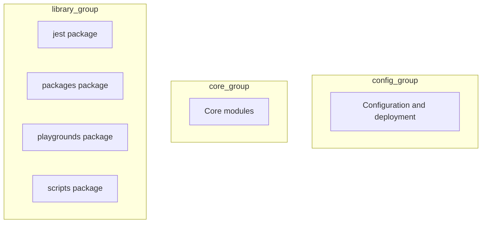

# Architecture report: tailwindlabs/headlessui

> Automated static analysis. **Observed** = directly seen in files/imports/AST; **Inferred** = interpretation from that evidence. Repository code was not executed.

## 1. Repository at a glance

| Item | Value |
| --- | --- |
| Repository | tailwindlabs/headlessui |
| Description | Completely unstyled, fully accessible UI components, designed to integrate beautifully with Tailwind CSS. |
| Language | TypeScript |
| Stars | 28828 |
| Licence | MIT |
| Analysed commit / branch | eea57cf46fd6767ed1059012f7073b88eb159fba / main |
| Framework(s) | Next.js, React, Vue |
| Files analysed | 470 |
| Components | 6 |

## 2. Architecture in one minute

tailwindlabs/headlessui - Completely unstyled, fully accessible UI components, designed to integrate beautifully with Tailwind CSS.. This repository was analysed statically from 470 file(s) (0 Python). Detected technologies (observed from imports/manifests): GitHub Actions, Next.js, React, Vue, Tailwind CSS, Jest. Files are grouped into 6 component(s): Configuration and deployment, Core modules, jest package, packages package, playgrounds package, scripts package. Findings below distinguish observed facts from inferred interpretation.

## 3. High-level block diagram

## 4. Main components

### Configuration and deployment (`config`)

- **Kind:** config
- **Status:** Observed
- **Confidence:** 0.85
- **Responsibility:** Groups 12 file(s) under configuration and deployment (observed from repository paths and static analysis).
- **Paths:** `package.json`, `packages/@headlessui-react/package.json`, `packages/@headlessui-react/tsconfig.json`, `packages/@headlessui-tailwindcss/package.json`, `packages/@headlessui-tailwindcss/tsconfig.json`, `packages/@headlessui-vue/package.json`, `packages/@headlessui-vue/tsconfig.json`, `playgrounds/react/package.json`, `playgrounds/react/tsconfig.json`, `playgrounds/vue/package.json`, `playgrounds/vue/tsconfig.json`, `playgrounds/vue/vercel.json`
- **Evidence:** [package.json](https://github.com/tailwindlabs/headlessui/blob/eea57cf46fd6767ed1059012f7073b88eb159fba/package.json); [packages/@headlessui-react/package.json](https://github.com/tailwindlabs/headlessui/blob/eea57cf46fd6767ed1059012f7073b88eb159fba/packages/%40headlessui-react/package.json); [packages/@headlessui-react/tsconfig.json](https://github.com/tailwindlabs/headlessui/blob/eea57cf46fd6767ed1059012f7073b88eb159fba/packages/%40headlessui-react/tsconfig.json); [packages/@headlessui-tailwindcss/package.json](https://github.com/tailwindlabs/headlessui/blob/eea57cf46fd6767ed1059012f7073b88eb159fba/packages/%40headlessui-tailwindcss/package.json); [packages/@headlessui-tailwindcss/tsconfig.json](https://github.com/tailwindlabs/headlessui/blob/eea57cf46fd6767ed1059012f7073b88eb159fba/packages/%40headlessui-tailwindcss/tsconfig.json); [packages/@headlessui-vue/package.json](https://github.com/tailwindlabs/headlessui/blob/eea57cf46fd6767ed1059012f7073b88eb159fba/packages/%40headlessui-vue/package.json); [packages/@headlessui-vue/tsconfig.json](https://github.com/tailwindlabs/headlessui/blob/eea57cf46fd6767ed1059012f7073b88eb159fba/packages/%40headlessui-vue/tsconfig.json); [playgrounds/react/package.json](https://github.com/tailwindlabs/headlessui/blob/eea57cf46fd6767ed1059012f7073b88eb159fba/playgrounds/react/package.json)

### Core modules (`core`)

- **Kind:** core
- **Status:** Observed
- **Confidence:** 0.85
- **Responsibility:** Groups 1 file(s) under core modules (observed from repository paths and static analysis).
- **Paths:** `jest.config.cjs`
- **Evidence:** [jest.config.cjs](https://github.com/tailwindlabs/headlessui/blob/eea57cf46fd6767ed1059012f7073b88eb159fba/jest.config.cjs)

### jest package (`jest`)

- **Kind:** library
- **Status:** Observed
- **Confidence:** 0.85
- **Responsibility:** Groups 3 file(s) under jest package (observed from repository paths and static analysis).
- **Paths:** `jest/create-jest-config.cjs`, `jest/custom-matchers.ts`, `jest/polyfills.ts`
- **Evidence:** [jest/create-jest-config.cjs](https://github.com/tailwindlabs/headlessui/blob/eea57cf46fd6767ed1059012f7073b88eb159fba/jest/create-jest-config.cjs); [jest/custom-matchers.ts](https://github.com/tailwindlabs/headlessui/blob/eea57cf46fd6767ed1059012f7073b88eb159fba/jest/custom-matchers.ts); [jest/polyfills.ts](https://github.com/tailwindlabs/headlessui/blob/eea57cf46fd6767ed1059012f7073b88eb159fba/jest/polyfills.ts)

### packages package (`packages`)

- **Kind:** library
- **Status:** Observed
- **Confidence:** 0.85
- **Responsibility:** Groups 305 file(s) under packages package (observed from repository paths and static analysis).
- **Paths:** `packages/@headlessui-react/jest.config.cjs`, `packages/@headlessui-react/jest.setup.js`, `packages/@headlessui-react/src/components/button/button.test.tsx`, `packages/@headlessui-react/src/components/button/button.tsx`, `packages/@headlessui-react/src/components/checkbox/checkbox.test.tsx`, `packages/@headlessui-react/src/components/checkbox/checkbox.tsx`, `packages/@headlessui-react/src/components/close-button/close-button.tsx`, `packages/@headlessui-react/src/components/combobox-button/combobox-button.tsx`, `packages/@headlessui-react/src/components/combobox-input/combobox-input.tsx`, `packages/@headlessui-react/src/components/combobox-label/combobox-label.tsx`, `packages/@headlessui-react/src/components/combobox-option/combobox-option.tsx`, `packages/@headlessui-react/src/components/combobox-options/combobox-options.tsx`, `packages/@headlessui-react/src/components/combobox/combobox-machine-glue.tsx`, `packages/@headlessui-react/src/components/combobox/combobox-machine.ts`, `packages/@headlessui-react/src/components/combobox/combobox.test.tsx`, `packages/@headlessui-react/src/components/combobox/combobox.tsx`, `packages/@headlessui-react/src/components/data-interactive/data-interactive.test.tsx`, `packages/@headlessui-react/src/components/data-interactive/data-interactive.tsx`, `packages/@headlessui-react/src/components/description/description.test.tsx`, `packages/@headlessui-react/src/components/description/description.tsx`, `packages/@headlessui-react/src/components/dialog-description/dialog-description.tsx`, `packages/@headlessui-react/src/components/dialog-panel/dialog-panel.tsx`, `packages/@headlessui-react/src/components/dialog-title/dialog-title.tsx`, `packages/@headlessui-react/src/components/dialog/dialog.test.tsx`, `packages/@headlessui-react/src/components/dialog/dialog.tsx`, `packages/@headlessui-react/src/components/disclosure-button/disclosure-button.tsx`, `packages/@headlessui-react/src/components/disclosure-panel/disclosure-panel.tsx`, `packages/@headlessui-react/src/components/disclosure/disclosure.test.tsx`, `packages/@headlessui-react/src/components/disclosure/disclosure.tsx`, `packages/@headlessui-react/src/components/field/field.test.tsx`, `packages/@headlessui-react/src/components/field/field.tsx`, `packages/@headlessui-react/src/components/fieldset/fieldset.test.tsx`, `packages/@headlessui-react/src/components/fieldset/fieldset.tsx`, `packages/@headlessui-react/src/components/focus-trap-features/focus-trap-features.tsx`, `packages/@headlessui-react/src/components/focus-trap/focus-trap.test.tsx`, `packages/@headlessui-react/src/components/focus-trap/focus-trap.tsx`, `packages/@headlessui-react/src/components/input/input.test.tsx`, `packages/@headlessui-react/src/components/input/input.tsx`, `packages/@headlessui-react/src/components/keyboard.ts`, `packages/@headlessui-react/src/components/label/label.test.tsx`, `packages/@headlessui-react/src/components/label/label.tsx`, `packages/@headlessui-react/src/components/legend/legend.tsx`, `packages/@headlessui-react/src/components/listbox-button/listbox-button.tsx`, `packages/@headlessui-react/src/components/listbox-label/listbox-label.tsx`, `packages/@headlessui-react/src/components/listbox-option/listbox-option.tsx`, `packages/@headlessui-react/src/components/listbox-options/listbox-options.tsx`, `packages/@headlessui-react/src/components/listbox-selected-option/listbox-selected-option.tsx`, `packages/@headlessui-react/src/components/listbox/listbox-machine-glue.tsx`, `packages/@headlessui-react/src/components/listbox/listbox-machine.ts`, `packages/@headlessui-react/src/components/listbox/listbox.test.tsx`, `packages/@headlessui-react/src/components/listbox/listbox.tsx`, `packages/@headlessui-react/src/components/menu-button/menu-button.tsx`, `packages/@headlessui-react/src/components/menu-heading/menu-heading.tsx`, `packages/@headlessui-react/src/components/menu-item/menu-item.tsx`, `packages/@headlessui-react/src/components/menu-items/menu-items.tsx`, `packages/@headlessui-react/src/components/menu-section/menu-section.tsx`, `packages/@headlessui-react/src/components/menu-separator/menu-separator.tsx`, `packages/@headlessui-react/src/components/menu/menu-machine-glue.tsx`, `packages/@headlessui-react/src/components/menu/menu-machine.ts`, `packages/@headlessui-react/src/components/menu/menu.test.tsx`, `packages/@headlessui-react/src/components/menu/menu.tsx`, `packages/@headlessui-react/src/components/mouse.ts`, `packages/@headlessui-react/src/components/popover-backdrop/popover-backdrop.tsx`, `packages/@headlessui-react/src/components/popover-button/popover-button.tsx`, `packages/@headlessui-react/src/components/popover-group/popover-group.tsx`, `packages/@headlessui-react/src/components/popover-overlay/popover-overlay.tsx`, `packages/@headlessui-react/src/components/popover-panel/popover-panel.tsx`, `packages/@headlessui-react/src/components/popover/popover-machine-glue.tsx`, `packages/@headlessui-react/src/components/popover/popover-machine.ts`, `packages/@headlessui-react/src/components/popover/popover.test.tsx`, `packages/@headlessui-react/src/components/popover/popover.tsx`, `packages/@headlessui-react/src/components/portal/portal.test.tsx`, `packages/@headlessui-react/src/components/portal/portal.tsx`, `packages/@headlessui-react/src/components/radio-group-description/radio-group-description.tsx`, `packages/@headlessui-react/src/components/radio-group-label/radio-group-label.tsx`, `packages/@headlessui-react/src/components/radio-group-option/radio-group-option.tsx`, `packages/@headlessui-react/src/components/radio-group/radio-group.test.tsx`, `packages/@headlessui-react/src/components/radio-group/radio-group.tsx`, `packages/@headlessui-react/src/components/radio/radio.tsx`, `packages/@headlessui-react/src/components/select/select.test.tsx`, `packages/@headlessui-react/src/components/select/select.tsx`, `packages/@headlessui-react/src/components/switch-description/switch-description.tsx`, `packages/@headlessui-react/src/components/switch-group/switch-group.tsx`, `packages/@headlessui-react/src/components/switch-label/switch-label.tsx`, `packages/@headlessui-react/src/components/switch/switch.test.tsx`, `packages/@headlessui-react/src/components/switch/switch.tsx`, `packages/@headlessui-react/src/components/tab-group/tab-group.tsx`, `packages/@headlessui-react/src/components/tab-list/tab-list.tsx`, `packages/@headlessui-react/src/components/tab-panel/tab-panel.tsx`, `packages/@headlessui-react/src/components/tab-panels/tab-panels.tsx`, `packages/@headlessui-react/src/components/tab/tab.tsx`, `packages/@headlessui-react/src/components/tabs/tabs.ssr.test.tsx`, `packages/@headlessui-react/src/components/tabs/tabs.test.tsx`, `packages/@headlessui-react/src/components/tabs/tabs.tsx`, `packages/@headlessui-react/src/components/textarea/textarea.test.tsx`, `packages/@headlessui-react/src/components/textarea/textarea.tsx`, `packages/@headlessui-react/src/components/tooltip/tooltip.tsx`, `packages/@headlessui-react/src/components/transition-child/transition-child.tsx`, `packages/@headlessui-react/src/components/transition/transition.ssr.test.tsx`, `packages/@headlessui-react/src/components/transition/transition.test.tsx`, `packages/@headlessui-react/src/components/transition/transition.tsx`, `packages/@headlessui-react/src/components/transitions/transition.tsx`, `packages/@headlessui-react/src/hooks/__mocks__/use-id.ts`, `packages/@headlessui-react/src/hooks/document-overflow/adjust-scrollbar-padding.ts`, `packages/@headlessui-react/src/hooks/document-overflow/handle-ios-locking.ts`, `packages/@headlessui-react/src/hooks/document-overflow/overflow-store.ts`, `packages/@headlessui-react/src/hooks/document-overflow/prevent-scroll.ts`, `packages/@headlessui-react/src/hooks/document-overflow/use-document-overflow.ts`, `packages/@headlessui-react/src/hooks/use-active-press.tsx`, `packages/@headlessui-react/src/hooks/use-by-comparator.ts`, `packages/@headlessui-react/src/hooks/use-computed.ts`, `packages/@headlessui-react/src/hooks/use-controllable.ts`, `packages/@headlessui-react/src/hooks/use-default-value.ts`, `packages/@headlessui-react/src/hooks/use-disposables.ts`, `packages/@headlessui-react/src/hooks/use-document-event.ts`, `packages/@headlessui-react/src/hooks/use-element-size.ts`, `packages/@headlessui-react/src/hooks/use-escape.ts`, `packages/@headlessui-react/src/hooks/use-event-listener.ts`, `packages/@headlessui-react/src/hooks/use-event.ts`, `packages/@headlessui-react/src/hooks/use-flags.ts`, `packages/@headlessui-react/src/hooks/use-handle-toggle.tsx`, `packages/@headlessui-react/src/hooks/use-id.ts`, `packages/@headlessui-react/src/hooks/use-inert-others.test.tsx`, `packages/@headlessui-react/src/hooks/use-inert-others.tsx`, `packages/@headlessui-react/src/hooks/use-is-initial-render.ts`, `packages/@headlessui-react/src/hooks/use-is-mounted.ts`, `packages/@headlessui-react/src/hooks/use-is-top-layer.ts`, `packages/@headlessui-react/src/hooks/use-is-touch-device.ts`, `packages/@headlessui-react/src/hooks/use-iso-morphic-effect.ts`, `packages/@headlessui-react/src/hooks/use-latest-value.ts`, `packages/@headlessui-react/src/hooks/use-on-disappear.ts`, `packages/@headlessui-react/src/hooks/use-on-unmount.ts`, `packages/@headlessui-react/src/hooks/use-outside-click.ts`, `packages/@headlessui-react/src/hooks/use-owner.ts`, `packages/@headlessui-react/src/hooks/use-quick-release.ts`, `packages/@headlessui-react/src/hooks/use-refocusable-input.ts`, `packages/@headlessui-react/src/hooks/use-resolve-button-type.ts`, `packages/@headlessui-react/src/hooks/use-resolved-tag.ts`, `packages/@headlessui-react/src/hooks/use-root-containers.tsx`, `packages/@headlessui-react/src/hooks/use-scroll-lock.ts`, `packages/@headlessui-react/src/hooks/use-server-handoff-complete.ts`, `packages/@headlessui-react/src/hooks/use-slot.ts`, `packages/@headlessui-react/src/hooks/use-store.ts`, `packages/@headlessui-react/src/hooks/use-sync-refs.ts`, `packages/@headlessui-react/src/hooks/use-tab-direction.ts`, `packages/@headlessui-react/src/hooks/use-text-value.ts`, `packages/@headlessui-react/src/hooks/use-tracked-pointer.ts`, `packages/@headlessui-react/src/hooks/use-transition.ts`, `packages/@headlessui-react/src/hooks/use-tree-walker.ts`, `packages/@headlessui-react/src/hooks/use-watch.ts`, `packages/@headlessui-react/src/hooks/use-window-event.ts`, `packages/@headlessui-react/src/index.test.ts`, `packages/@headlessui-react/src/index.ts`, `packages/@headlessui-react/src/internal/close-provider.tsx`, `packages/@headlessui-react/src/internal/disabled.tsx`, `packages/@headlessui-react/src/internal/floating.tsx`, `packages/@headlessui-react/src/internal/focus-sentinel.tsx`, `packages/@headlessui-react/src/internal/form-fields.tsx`, `packages/@headlessui-react/src/internal/frozen.tsx`, `packages/@headlessui-react/src/internal/hidden.tsx`, `packages/@headlessui-react/src/internal/id.tsx`, `packages/@headlessui-react/src/internal/open-closed.tsx`, `packages/@headlessui-react/src/internal/portal-force-root.tsx`, `packages/@headlessui-react/src/machine.ts`, `packages/@headlessui-react/src/machines/stack-machine.ts`, `packages/@headlessui-react/src/react-glue.tsx`, `packages/@headlessui-react/src/test-utils/accessibility-assertions.ts`, `packages/@headlessui-react/src/test-utils/execute-timeline.ts`, `packages/@headlessui-react/src/test-utils/fake-pointer.ts`, `packages/@headlessui-react/src/test-utils/interactions.test.tsx`, `packages/@headlessui-react/src/test-utils/interactions.ts`, `packages/@headlessui-react/src/test-utils/report-dom-node-changes.ts`, `packages/@headlessui-react/src/test-utils/scenarios.tsx`, `packages/@headlessui-react/src/test-utils/snapshot.ts`, `packages/@headlessui-react/src/test-utils/ssr.tsx`, `packages/@headlessui-react/src/test-utils/suppress-console-logs.ts`, `packages/@headlessui-react/src/types.ts`, `packages/@headlessui-react/src/utils/active-element-history.ts`, `packages/@headlessui-react/src/utils/bugs.ts`, `packages/@headlessui-react/src/utils/calculate-active-index.ts`, `packages/@headlessui-react/src/utils/class-names.ts`, `packages/@headlessui-react/src/utils/default-map.ts`, `packages/@headlessui-react/src/utils/disposables.ts`, `packages/@headlessui-react/src/utils/document-ready.ts`, `packages/@headlessui-react/src/utils/dom.ts`, `packages/@headlessui-react/src/utils/element-movement.ts`, `packages/@headlessui-react/src/utils/env.ts`, `packages/@headlessui-react/src/utils/focus-management.ts`, `packages/@headlessui-react/src/utils/form.test.ts`, `packages/@headlessui-react/src/utils/form.ts`, `packages/@headlessui-react/src/utils/get-text-value.test.ts`, `packages/@headlessui-react/src/utils/get-text-value.ts`, `packages/@headlessui-react/src/utils/match.ts`, `packages/@headlessui-react/src/utils/micro-task.ts`, `packages/@headlessui-react/src/utils/once.ts`, `packages/@headlessui-react/src/utils/owner.ts`, `packages/@headlessui-react/src/utils/platform.ts`, `packages/@headlessui-react/src/utils/render.test.tsx`, `packages/@headlessui-react/src/utils/render.ts`, `packages/@headlessui-react/src/utils/stable-collection.tsx`, `packages/@headlessui-react/src/utils/start-transition.ts`, `packages/@headlessui-react/src/utils/store.ts`, `packages/@headlessui-react/types/jest.d.ts`, `packages/@headlessui-tailwindcss/jest.config.cjs`, `packages/@headlessui-tailwindcss/scripts/fix-types.cjs`, `packages/@headlessui-tailwindcss/src/index.test.ts`, `packages/@headlessui-tailwindcss/src/index.ts`, `packages/@headlessui-vue/jest.config.cjs`, `packages/@headlessui-vue/src/components/combobox/combobox.ts`, `packages/@headlessui-vue/src/components/description/description.test.ts`, `packages/@headlessui-vue/src/components/description/description.ts`, `packages/@headlessui-vue/src/components/dialog/dialog.test.ts`, `packages/@headlessui-vue/src/components/dialog/dialog.ts`, `packages/@headlessui-vue/src/components/disclosure/disclosure.srr.test.ts`, `packages/@headlessui-vue/src/components/disclosure/disclosure.test.ts`, `packages/@headlessui-vue/src/components/disclosure/disclosure.ts`, `packages/@headlessui-vue/src/components/focus-trap/focus-trap.test.ts`, `packages/@headlessui-vue/src/components/focus-trap/focus-trap.ts`, `packages/@headlessui-vue/src/components/label/label.test.ts`, `packages/@headlessui-vue/src/components/label/label.ts`, `packages/@headlessui-vue/src/components/listbox/listbox.test.tsx`, `packages/@headlessui-vue/src/components/listbox/listbox.ts`, `packages/@headlessui-vue/src/components/menu/menu.test.tsx`, `packages/@headlessui-vue/src/components/menu/menu.ts`, `packages/@headlessui-vue/src/components/popover/popover.test.ts`, `packages/@headlessui-vue/src/components/popover/popover.ts`, `packages/@headlessui-vue/src/components/portal/portal.test.ts`, `packages/@headlessui-vue/src/components/portal/portal.ts`, `packages/@headlessui-vue/src/components/radio-group/radio-group.test.ts`, `packages/@headlessui-vue/src/components/radio-group/radio-group.ts`, `packages/@headlessui-vue/src/components/switch/switch.test.tsx`, `packages/@headlessui-vue/src/components/switch/switch.ts`, `packages/@headlessui-vue/src/components/tabs/tabs.ssr.test.ts`, `packages/@headlessui-vue/src/components/tabs/tabs.test.ts`, `packages/@headlessui-vue/src/components/tabs/tabs.ts`, `packages/@headlessui-vue/src/components/transitions/transition.ssr.test.ts`, `packages/@headlessui-vue/src/components/transitions/transition.test.ts`, `packages/@headlessui-vue/src/components/transitions/transition.ts`, `packages/@headlessui-vue/src/components/transitions/utils/transition.test.ts`, `packages/@headlessui-vue/src/components/transitions/utils/transition.ts`, `packages/@headlessui-vue/src/hooks/__mocks__/use-id.ts`, `packages/@headlessui-vue/src/hooks/document-overflow/adjust-scrollbar-padding.ts`, `packages/@headlessui-vue/src/hooks/document-overflow/handle-ios-locking.ts`, `packages/@headlessui-vue/src/hooks/document-overflow/overflow-store.ts`, `packages/@headlessui-vue/src/hooks/document-overflow/prevent-scroll.ts`, `packages/@headlessui-vue/src/hooks/document-overflow/use-document-overflow.ts`, `packages/@headlessui-vue/src/hooks/use-controllable.ts`, `packages/@headlessui-vue/src/hooks/use-disposables.ts`, `packages/@headlessui-vue/src/hooks/use-document-event.ts`, `packages/@headlessui-vue/src/hooks/use-event-listener.ts`, `packages/@headlessui-vue/src/hooks/use-frame-debounce.ts`, `packages/@headlessui-vue/src/hooks/use-id.ts`, `packages/@headlessui-vue/src/hooks/use-inert.test.ts`, `packages/@headlessui-vue/src/hooks/use-inert.ts`, `packages/@headlessui-vue/src/hooks/use-outside-click.ts`, `packages/@headlessui-vue/src/hooks/use-resolve-button-type.ts`, `packages/@headlessui-vue/src/hooks/use-root-containers.ts`, `packages/@headlessui-vue/src/hooks/use-store.ts`, `packages/@headlessui-vue/src/hooks/use-tab-direction.ts`, `packages/@headlessui-vue/src/hooks/use-text-value.ts`, `packages/@headlessui-vue/src/hooks/use-tracked-pointer.ts`, `packages/@headlessui-vue/src/hooks/use-tree-walker.ts`, `packages/@headlessui-vue/src/hooks/use-window-event.ts`, `packages/@headlessui-vue/src/index.test.ts`, `packages/@headlessui-vue/src/index.ts`, `packages/@headlessui-vue/src/internal/dom-containers.ts`, `packages/@headlessui-vue/src/internal/focus-sentinel.ts`, `packages/@headlessui-vue/src/internal/hidden.ts`, `packages/@headlessui-vue/src/internal/open-closed.ts`, `packages/@headlessui-vue/src/internal/portal-force-root.ts`, `packages/@headlessui-vue/src/internal/stack-context.ts`, `packages/@headlessui-vue/src/keyboard.ts`, `packages/@headlessui-vue/src/mouse.ts`, `packages/@headlessui-vue/src/test-utils/accessibility-assertions.ts`, `packages/@headlessui-vue/src/test-utils/execute-timeline.ts`, `packages/@headlessui-vue/src/test-utils/fake-pointer.ts`, `packages/@headlessui-vue/src/test-utils/html.ts`, `packages/@headlessui-vue/src/test-utils/interactions.test.ts`, `packages/@headlessui-vue/src/test-utils/interactions.ts`, `packages/@headlessui-vue/src/test-utils/report-dom-node-changes.ts`, `packages/@headlessui-vue/src/test-utils/ssr.ts`, `packages/@headlessui-vue/src/test-utils/suppress-console-logs.ts`, `packages/@headlessui-vue/src/test-utils/vue-testing-library.ts`, `packages/@headlessui-vue/src/utils/active-element-history.ts`, `packages/@headlessui-vue/src/utils/calculate-active-index.ts`, `packages/@headlessui-vue/src/utils/disposables.ts`, `packages/@headlessui-vue/src/utils/document-ready.ts`, `packages/@headlessui-vue/src/utils/dom.ts`, `packages/@headlessui-vue/src/utils/env.ts`, `packages/@headlessui-vue/src/utils/focus-management.ts`, `packages/@headlessui-vue/src/utils/form.test.ts`, `packages/@headlessui-vue/src/utils/form.ts`, `packages/@headlessui-vue/src/utils/get-text-value.test.ts`, `packages/@headlessui-vue/src/utils/get-text-value.ts`, `packages/@headlessui-vue/src/utils/match.ts`, `packages/@headlessui-vue/src/utils/micro-task.ts`, `packages/@headlessui-vue/src/utils/once.ts`, `packages/@headlessui-vue/src/utils/owner.ts`, `packages/@headlessui-vue/src/utils/pipeline.ts`, `packages/@headlessui-vue/src/utils/platform.ts`, `packages/@headlessui-vue/src/utils/render.test.ts`, `packages/@headlessui-vue/src/utils/render.ts`, `packages/@headlessui-vue/src/utils/resolve-prop-value.ts`, `packages/@headlessui-vue/src/utils/store.ts`, `packages/@headlessui-vue/types/jest.d.ts`
- **Evidence:** [packages/@headlessui-react/jest.config.cjs](https://github.com/tailwindlabs/headlessui/blob/eea57cf46fd6767ed1059012f7073b88eb159fba/packages/%40headlessui-react/jest.config.cjs); [packages/@headlessui-react/jest.setup.js](https://github.com/tailwindlabs/headlessui/blob/eea57cf46fd6767ed1059012f7073b88eb159fba/packages/%40headlessui-react/jest.setup.js); [packages/@headlessui-react/src/components/button/button.test.tsx](https://github.com/tailwindlabs/headlessui/blob/eea57cf46fd6767ed1059012f7073b88eb159fba/packages/%40headlessui-react/src/components/button/button.test.tsx); [packages/@headlessui-react/src/components/button/button.tsx](https://github.com/tailwindlabs/headlessui/blob/eea57cf46fd6767ed1059012f7073b88eb159fba/packages/%40headlessui-react/src/components/button/button.tsx); [packages/@headlessui-react/src/components/checkbox/checkbox.test.tsx](https://github.com/tailwindlabs/headlessui/blob/eea57cf46fd6767ed1059012f7073b88eb159fba/packages/%40headlessui-react/src/components/checkbox/checkbox.test.tsx); [packages/@headlessui-react/src/components/checkbox/checkbox.tsx](https://github.com/tailwindlabs/headlessui/blob/eea57cf46fd6767ed1059012f7073b88eb159fba/packages/%40headlessui-react/src/components/checkbox/checkbox.tsx); [packages/@headlessui-react/src/components/close-button/close-button.tsx](https://github.com/tailwindlabs/headlessui/blob/eea57cf46fd6767ed1059012f7073b88eb159fba/packages/%40headlessui-react/src/components/close-button/close-button.tsx); [packages/@headlessui-react/src/components/combobox-button/combobox-button.tsx](https://github.com/tailwindlabs/headlessui/blob/eea57cf46fd6767ed1059012f7073b88eb159fba/packages/%40headlessui-react/src/components/combobox-button/combobox-button.tsx)

### playgrounds package (`playgrounds`)

- **Kind:** library
- **Status:** Observed
- **Confidence:** 0.85
- **Responsibility:** Groups 101 file(s) under playgrounds package (observed from repository paths and static analysis).
- **Paths:** `playgrounds/react/app/[...slug]/page-loader.tsx`, `playgrounds/react/app/[...slug]/page.tsx`, `playgrounds/react/app/layout-chrome.tsx`, `playgrounds/react/app/layout.tsx`, `playgrounds/react/app/page.tsx`, `playgrounds/react/components/button.tsx`, `playgrounds/react/components/input.tsx`, `playgrounds/react/data.ts`, `playgrounds/react/next-env.d.ts`, `playgrounds/react/next.config.js`, `playgrounds/react/page-examples/combinations/form.tsx`, `playgrounds/react/page-examples/combinations/tabs-in-dialog.tsx`, `playgrounds/react/page-examples/combobox/combobox-countries.tsx`, `playgrounds/react/page-examples/combobox/combobox-open-on-focus.tsx`, `playgrounds/react/page-examples/combobox/combobox-virtual-with-empty-states.tsx`, `playgrounds/react/page-examples/combobox/combobox-virtualized.tsx`, `playgrounds/react/page-examples/combobox/combobox-with-pure-tailwind.tsx`, `playgrounds/react/page-examples/combobox/command-palette-with-groups.tsx`, `playgrounds/react/page-examples/combobox/command-palette.tsx`, `playgrounds/react/page-examples/combobox/multi-select.tsx`, `playgrounds/react/page-examples/dialog/dialog-built-in-transition.tsx`, `playgrounds/react/page-examples/dialog/dialog-focus-issue.tsx`, `playgrounds/react/page-examples/dialog/dialog-scroll-issue.tsx`, `playgrounds/react/page-examples/dialog/dialog-with-shadow-children.tsx`, `playgrounds/react/page-examples/dialog/dialog.tsx`, `playgrounds/react/page-examples/dialog/scrollable-dialog.tsx`, `playgrounds/react/page-examples/dialog/scrollable-page-with-dialog.tsx`, `playgrounds/react/page-examples/dialog/sibling-dialogs.tsx`, `playgrounds/react/page-examples/disclosure/disclosure.tsx`, `playgrounds/react/page-examples/listbox/listbox-overlaps.tsx`, `playgrounds/react/page-examples/listbox/listbox-with-pure-tailwind.tsx`, `playgrounds/react/page-examples/listbox/multi-select.tsx`, `playgrounds/react/page-examples/listbox/multiple-elements.tsx`, `playgrounds/react/page-examples/menu/menu-with-floating-ui.tsx`, `playgrounds/react/page-examples/menu/menu-with-framer-motion.tsx`, `playgrounds/react/page-examples/menu/menu-with-popper.tsx`, `playgrounds/react/page-examples/menu/menu-with-transition-and-popper.tsx`, `playgrounds/react/page-examples/menu/menu-with-transition.tsx`, `playgrounds/react/page-examples/menu/menu.tsx`, `playgrounds/react/page-examples/menu/multiple-elements.tsx`, `playgrounds/react/page-examples/popover/popover.tsx`, `playgrounds/react/page-examples/radio-group/radio-group.tsx`, `playgrounds/react/page-examples/suspense/portal.tsx`, `playgrounds/react/page-examples/switch/switch-with-pure-tailwind.tsx`, `playgrounds/react/page-examples/tabs/tabs-with-pure-tailwind.tsx`, `playgrounds/react/page-examples/transitions/appear.tsx`, `playgrounds/react/page-examples/transitions/both-apis.tsx`, `playgrounds/react/page-examples/transitions/component-examples/dropdown.tsx`, `playgrounds/react/page-examples/transitions/component-examples/modal.tsx`, `playgrounds/react/page-examples/transitions/component-examples/nested/hidden.tsx`, `playgrounds/react/page-examples/transitions/component-examples/nested/unmount.tsx`, `playgrounds/react/page-examples/transitions/component-examples/peek-a-boo.tsx`, `playgrounds/react/page-examples/transitions/full-page-examples/full-page-transition.tsx`, `playgrounds/react/page-examples/transitions/full-page-examples/layout-with-sidebar.tsx`, `playgrounds/react/page-examples/transitions/react-hot-toast.tsx`, `playgrounds/react/postcss.config.js`, `playgrounds/react/utils/class-names.ts`, `playgrounds/react/utils/hooks/use-popper.ts`, `playgrounds/react/utils/match.ts`, `playgrounds/react/utils/resolve-all-examples.ts`, `playgrounds/vue/postcss.config.js`, `playgrounds/vue/src/App.vue`, `playgrounds/vue/src/KeyCaster.vue`, `playgrounds/vue/src/Layout.vue`, `playgrounds/vue/src/components/Button.vue`, `playgrounds/vue/src/components/Home.vue`, `playgrounds/vue/src/components/combinations/form.vue`, `playgrounds/vue/src/components/combinations/tabs-in-dialog.vue`, `playgrounds/vue/src/components/combobox/_virtual-example.vue`, `playgrounds/vue/src/components/combobox/combobox-countries.vue`, `playgrounds/vue/src/components/combobox/combobox-open-on-focus.vue`, `playgrounds/vue/src/components/combobox/combobox-virtual-with-empty-states.vue`, `playgrounds/vue/src/components/combobox/combobox-virtualized.vue`, `playgrounds/vue/src/components/combobox/combobox-with-pure-tailwind.vue`, `playgrounds/vue/src/components/combobox/command-palette-with-groups.vue`, `playgrounds/vue/src/components/combobox/command-palette.vue`, `playgrounds/vue/src/components/combobox/multi-select.vue`, `playgrounds/vue/src/components/dialog/dialog.vue`, `playgrounds/vue/src/components/dialog/slide-over.vue`, `playgrounds/vue/src/components/disclosure/disclosure.vue`, `playgrounds/vue/src/components/focus-trap/focus-trap.vue`, `playgrounds/vue/src/components/listbox/listbox.vue`, `playgrounds/vue/src/components/listbox/multi-select.vue`, `playgrounds/vue/src/components/listbox/multiple-elements.vue`, `playgrounds/vue/src/components/menu/menu-with-floating-ui.vue`, `playgrounds/vue/src/components/menu/menu-with-popper.vue`, `playgrounds/vue/src/components/menu/menu-with-transition-and-popper.vue`, `playgrounds/vue/src/components/menu/menu-with-transition.vue`, `playgrounds/vue/src/components/menu/menu.vue`, `playgrounds/vue/src/components/menu/multiple-elements.vue`, `playgrounds/vue/src/components/popover/popover.vue`, `playgrounds/vue/src/components/portal/portal.vue`, `playgrounds/vue/src/components/radio-group/radio-group.vue`, `playgrounds/vue/src/components/switch/switch.vue`, `playgrounds/vue/src/components/tabs/simple-tabs.vue`, `playgrounds/vue/src/components/tabs/tabs.vue`, `playgrounds/vue/src/data.ts`, `playgrounds/vue/src/main.ts`, `playgrounds/vue/src/playground-utils/hooks/use-popper.js`, `playgrounds/vue/src/router.ts`, `playgrounds/vue/vite.config.js`
- **Evidence:** [playgrounds/react/app/[...slug]/page-loader.tsx](https://github.com/tailwindlabs/headlessui/blob/eea57cf46fd6767ed1059012f7073b88eb159fba/playgrounds/react/app/%5B...slug%5D/page-loader.tsx); [playgrounds/react/app/[...slug]/page.tsx](https://github.com/tailwindlabs/headlessui/blob/eea57cf46fd6767ed1059012f7073b88eb159fba/playgrounds/react/app/%5B...slug%5D/page.tsx); [playgrounds/react/app/layout-chrome.tsx](https://github.com/tailwindlabs/headlessui/blob/eea57cf46fd6767ed1059012f7073b88eb159fba/playgrounds/react/app/layout-chrome.tsx); [playgrounds/react/app/layout.tsx](https://github.com/tailwindlabs/headlessui/blob/eea57cf46fd6767ed1059012f7073b88eb159fba/playgrounds/react/app/layout.tsx); [playgrounds/react/app/page.tsx](https://github.com/tailwindlabs/headlessui/blob/eea57cf46fd6767ed1059012f7073b88eb159fba/playgrounds/react/app/page.tsx); [playgrounds/react/components/button.tsx](https://github.com/tailwindlabs/headlessui/blob/eea57cf46fd6767ed1059012f7073b88eb159fba/playgrounds/react/components/button.tsx); [playgrounds/react/components/input.tsx](https://github.com/tailwindlabs/headlessui/blob/eea57cf46fd6767ed1059012f7073b88eb159fba/playgrounds/react/components/input.tsx); [playgrounds/react/data.ts](https://github.com/tailwindlabs/headlessui/blob/eea57cf46fd6767ed1059012f7073b88eb159fba/playgrounds/react/data.ts)

### scripts package (`scripts`)

- **Kind:** library
- **Status:** Observed
- **Confidence:** 0.85
- **Responsibility:** Groups 10 file(s) under scripts package (observed from repository paths and static analysis).
- **Paths:** `scripts/build.sh`, `scripts/lint.sh`, `scripts/make-nextjs-happy.js`, `scripts/package-path.js`, `scripts/release-channel.js`, `scripts/release-notes.js`, `scripts/resolve-files.js`, `scripts/rewrite-imports.js`, `scripts/test.sh`, `scripts/watch.sh`
- **Evidence:** [scripts/build.sh](https://github.com/tailwindlabs/headlessui/blob/eea57cf46fd6767ed1059012f7073b88eb159fba/scripts/build.sh); [scripts/lint.sh](https://github.com/tailwindlabs/headlessui/blob/eea57cf46fd6767ed1059012f7073b88eb159fba/scripts/lint.sh); [scripts/make-nextjs-happy.js](https://github.com/tailwindlabs/headlessui/blob/eea57cf46fd6767ed1059012f7073b88eb159fba/scripts/make-nextjs-happy.js); [scripts/package-path.js](https://github.com/tailwindlabs/headlessui/blob/eea57cf46fd6767ed1059012f7073b88eb159fba/scripts/package-path.js); [scripts/release-channel.js](https://github.com/tailwindlabs/headlessui/blob/eea57cf46fd6767ed1059012f7073b88eb159fba/scripts/release-channel.js); [scripts/release-notes.js](https://github.com/tailwindlabs/headlessui/blob/eea57cf46fd6767ed1059012f7073b88eb159fba/scripts/release-notes.js); [scripts/resolve-files.js](https://github.com/tailwindlabs/headlessui/blob/eea57cf46fd6767ed1059012f7073b88eb159fba/scripts/resolve-files.js); [scripts/rewrite-imports.js](https://github.com/tailwindlabs/headlessui/blob/eea57cf46fd6767ed1059012f7073b88eb159fba/scripts/rewrite-imports.js)

## 5. Execution flow

**Observed** entry point(s):

- [packages/@headlessui-react/src/index.ts](https://github.com/tailwindlabs/headlessui/blob/eea57cf46fd6767ed1059012f7073b88eb159fba/packages/%40headlessui-react/src/index.ts)
- [packages/@headlessui-tailwindcss/src/index.ts](https://github.com/tailwindlabs/headlessui/blob/eea57cf46fd6767ed1059012f7073b88eb159fba/packages/%40headlessui-tailwindcss/src/index.ts)
- [packages/@headlessui-vue/src/index.ts](https://github.com/tailwindlabs/headlessui/blob/eea57cf46fd6767ed1059012f7073b88eb159fba/packages/%40headlessui-vue/src/index.ts)
- [playgrounds/react/app/page.tsx](https://github.com/tailwindlabs/headlessui/blob/eea57cf46fd6767ed1059012f7073b88eb159fba/playgrounds/react/app/page.tsx)
- [playgrounds/vue/src/main.ts](https://github.com/tailwindlabs/headlessui/blob/eea57cf46fd6767ed1059012f7073b88eb159fba/playgrounds/vue/src/main.ts)

Representative flow (derived from observed entry points and the import graph; steps beyond the entry point are **Inferred**):

1. Execution starts at an observed entry point listed above, if present.
2. No internal import relationships between components were observed.

## 6. Project structure

### `(root)`

- `.eslintignore` - other (63 bytes)
- `.gitignore` - other (636 bytes)
- `.prettierignore` - other (37 bytes)
- `.swcrc` - other (165 bytes)
- `CHANGELOG.md` - docs (406 bytes)
- `LICENSE` - docs (1069 bytes)
- `README.md` - docs (3162 bytes)
- `jest.config.cjs` - source, JavaScript (75 bytes)
- `package.json` - manifest (2532 bytes)

### `.github`

- `.github/CONTRIBUTING.md` - docs (5187 bytes)
- `.github/FUNDING.yml` - config (44 bytes)
- `.github/ISSUE_TEMPLATE/bug-report.md` - docs (1522 bytes)
- `.github/ISSUE_TEMPLATE/config.yml` - config (632 bytes)
- `.github/workflows/main.yml` - ci, YAML (2367 bytes)
- `.github/workflows/prepare-release.yml` - ci, YAML (1189 bytes)
- `.github/workflows/release.yml` - ci, YAML (2342 bytes)

### `jest`

- `jest/create-jest-config.cjs` - source, JavaScript (503 bytes)
- `jest/custom-matchers.ts` - source, TypeScript (839 bytes)
- `jest/polyfills.ts` - source, TypeScript (1758 bytes)

### `packages`

- `packages/@headlessui-react/CHANGELOG.md` - docs (70121 bytes)
- `packages/@headlessui-react/LICENSE` - docs (1069 bytes)
- `packages/@headlessui-react/README.md` - docs (1006 bytes)
- `packages/@headlessui-react/jest.config.cjs` - source, JavaScript (165 bytes)
- `packages/@headlessui-react/jest.setup.js` - source, JavaScript (43 bytes)
- `packages/@headlessui-react/package.json` - manifest (1997 bytes)
- `packages/@headlessui-react/src/components/button/button.test.tsx` - source, TypeScript (1391 bytes)
- `packages/@headlessui-react/src/components/button/button.tsx` - source, TypeScript (2153 bytes)
- `packages/@headlessui-react/src/components/checkbox/checkbox.test.tsx` - source, TypeScript (4171 bytes)
- `packages/@headlessui-react/src/components/checkbox/checkbox.tsx` - source, TypeScript (5684 bytes)
- `packages/@headlessui-react/src/components/close-button/close-button.tsx` - source, TypeScript (759 bytes)
- `packages/@headlessui-react/src/components/combobox-button/combobox-button.tsx` - source, TypeScript (149 bytes)
- `packages/@headlessui-react/src/components/combobox-input/combobox-input.tsx` - source, TypeScript (148 bytes)
- `packages/@headlessui-react/src/components/combobox-label/combobox-label.tsx` - source, TypeScript (148 bytes)
- `packages/@headlessui-react/src/components/combobox-option/combobox-option.tsx` - source, TypeScript (149 bytes)
- `packages/@headlessui-react/src/components/combobox-options/combobox-options.tsx` - source, TypeScript (150 bytes)
- `packages/@headlessui-react/src/components/combobox/combobox-machine-glue.tsx` - source, TypeScript (895 bytes)
- `packages/@headlessui-react/src/components/combobox/combobox-machine.ts` - source, TypeScript (21278 bytes)
- `packages/@headlessui-react/src/components/combobox/combobox.test.tsx` - source, TypeScript (195810 bytes)
- `packages/@headlessui-react/src/components/combobox/combobox.tsx` - source, TypeScript (55003 bytes)
- `packages/@headlessui-react/src/components/data-interactive/data-interactive.test.tsx` - source, TypeScript (1269 bytes)
- `packages/@headlessui-react/src/components/data-interactive/data-interactive.tsx` - source, TypeScript (2061 bytes)
- `packages/@headlessui-react/src/components/description/__snapshots__/description.test.tsx.snap` - other (933 bytes)
- `packages/@headlessui-react/src/components/description/description.test.tsx` - source, TypeScript (2083 bytes)
- `packages/@headlessui-react/src/components/description/description.tsx` - source, TypeScript (4087 bytes)
- `packages/@headlessui-react/src/components/dialog-description/dialog-description.tsx` - source, TypeScript (144 bytes)
- `packages/@headlessui-react/src/components/dialog-panel/dialog-panel.tsx` - source, TypeScript (138 bytes)
- `packages/@headlessui-react/src/components/dialog-title/dialog-title.tsx` - source, TypeScript (138 bytes)
- `packages/@headlessui-react/src/components/dialog/dialog.test.tsx` - source, TypeScript (51081 bytes)
- `packages/@headlessui-react/src/components/dialog/dialog.tsx` - source, TypeScript (18710 bytes)
- `packages/@headlessui-react/src/components/disclosure-button/disclosure-button.tsx` - source, TypeScript (159 bytes)
- `packages/@headlessui-react/src/components/disclosure-panel/disclosure-panel.tsx` - source, TypeScript (158 bytes)
- `packages/@headlessui-react/src/components/disclosure/disclosure.test.tsx` - source, TypeScript (31675 bytes)
- `packages/@headlessui-react/src/components/disclosure/disclosure.tsx` - source, TypeScript (16061 bytes)
- `packages/@headlessui-react/src/components/field/field.test.tsx` - source, TypeScript (1594 bytes)
- `packages/@headlessui-react/src/components/field/field.tsx` - source, TypeScript (2539 bytes)
- `packages/@headlessui-react/src/components/fieldset/fieldset.test.tsx` - source, TypeScript (3341 bytes)
- `packages/@headlessui-react/src/components/fieldset/fieldset.tsx` - source, TypeScript (2262 bytes)
- `packages/@headlessui-react/src/components/focus-trap-features/focus-trap-features.tsx` - source, TypeScript (160 bytes)
- `packages/@headlessui-react/src/components/focus-trap/focus-trap.test.tsx` - source, TypeScript (14801 bytes)
- `packages/@headlessui-react/src/components/focus-trap/focus-trap.tsx` - source, TypeScript (14837 bytes)
- `packages/@headlessui-react/src/components/input/input.test.tsx` - source, TypeScript (508 bytes)
- `packages/@headlessui-react/src/components/input/input.tsx` - source, TypeScript (2520 bytes)
- `packages/@headlessui-react/src/components/keyboard.ts` - source, TypeScript (454 bytes)
- `packages/@headlessui-react/src/components/label/__snapshots__/label.test.tsx.snap` - other (847 bytes)
- `packages/@headlessui-react/src/components/label/label.test.tsx` - source, TypeScript (1888 bytes)
- `packages/@headlessui-react/src/components/label/label.tsx` - source, TypeScript (7237 bytes)
- `packages/@headlessui-react/src/components/legend/legend.tsx` - source, TypeScript (1169 bytes)
- `packages/@headlessui-react/src/components/listbox-button/listbox-button.tsx` - source, TypeScript (144 bytes)
- `packages/@headlessui-react/src/components/listbox-label/listbox-label.tsx` - source, TypeScript (143 bytes)
- `packages/@headlessui-react/src/components/listbox-option/listbox-option.tsx` - source, TypeScript (144 bytes)
- `packages/@headlessui-react/src/components/listbox-options/listbox-options.tsx` - source, TypeScript (145 bytes)
- `packages/@headlessui-react/src/components/listbox-selected-option/listbox-selected-option.tsx` - source, TypeScript (152 bytes)
- `packages/@headlessui-react/src/components/listbox/listbox-machine-glue.tsx` - source, TypeScript (855 bytes)
- `packages/@headlessui-react/src/components/listbox/listbox-machine.ts` - source, TypeScript (20177 bytes)
- `packages/@headlessui-react/src/components/listbox/listbox.test.tsx` - source, TypeScript (152646 bytes)
- `packages/@headlessui-react/src/components/listbox/listbox.tsx` - source, TypeScript (33436 bytes)
- `packages/@headlessui-react/src/components/menu-button/menu-button.tsx` - source, TypeScript (129 bytes)
- `packages/@headlessui-react/src/components/menu-heading/menu-heading.tsx` - source, TypeScript (130 bytes)
- `packages/@headlessui-react/src/components/menu-item/menu-item.tsx` - source, TypeScript (127 bytes)
- `packages/@headlessui-react/src/components/menu-items/menu-items.tsx` - source, TypeScript (128 bytes)
- `packages/@headlessui-react/src/components/menu-section/menu-section.tsx` - source, TypeScript (130 bytes)
- `packages/@headlessui-react/src/components/menu-separator/menu-separator.tsx` - source, TypeScript (132 bytes)
- `packages/@headlessui-react/src/components/menu/menu-machine-glue.tsx` - source, TypeScript (784 bytes)
- `packages/@headlessui-react/src/components/menu/menu-machine.ts` - source, TypeScript (14593 bytes)
- `packages/@headlessui-react/src/components/menu/menu.test.tsx` - source, TypeScript (101062 bytes)
- `packages/@headlessui-react/src/components/menu/menu.tsx` - source, TypeScript (27709 bytes)
- `packages/@headlessui-react/src/components/mouse.ts` - source, TypeScript (53 bytes)
- `packages/@headlessui-react/src/components/popover-backdrop/popover-backdrop.tsx` - source, TypeScript (146 bytes)
- `packages/@headlessui-react/src/components/popover-button/popover-button.tsx` - source, TypeScript (144 bytes)
- `packages/@headlessui-react/src/components/popover-group/popover-group.tsx` - source, TypeScript (143 bytes)
- `packages/@headlessui-react/src/components/popover-overlay/popover-overlay.tsx` - source, TypeScript (145 bytes)
- `packages/@headlessui-react/src/components/popover-panel/popover-panel.tsx` - source, TypeScript (143 bytes)
- `packages/@headlessui-react/src/components/popover/popover-machine-glue.tsx` - source, TypeScript (829 bytes)
- `packages/@headlessui-react/src/components/popover/popover-machine.ts` - source, TypeScript (6182 bytes)
- `packages/@headlessui-react/src/components/popover/popover.test.tsx` - source, TypeScript (84312 bytes)
- `packages/@headlessui-react/src/components/popover/popover.tsx` - source, TypeScript (34911 bytes)
- `packages/@headlessui-react/src/components/portal/__snapshots__/portal.test.tsx.snap` - other (411 bytes)
- `packages/@headlessui-react/src/components/portal/portal.test.tsx` - source, TypeScript (7380 bytes)
- `packages/@headlessui-react/src/components/portal/portal.tsx` - source, TypeScript (7213 bytes)
- `packages/@headlessui-react/src/components/radio-group-description/radio-group-description.tsx` - source, TypeScript (168 bytes)
- `packages/@headlessui-react/src/components/radio-group-label/radio-group-label.tsx` - source, TypeScript (162 bytes)
- `packages/@headlessui-react/src/components/radio-group-option/radio-group-option.tsx` - source, TypeScript (163 bytes)
- `packages/@headlessui-react/src/components/radio-group/radio-group.test.tsx` - source, TypeScript (53249 bytes)
- `packages/@headlessui-react/src/components/radio-group/radio-group.tsx` - source, TypeScript (18213 bytes)
- `packages/@headlessui-react/src/components/radio/radio.tsx` - source, TypeScript (152 bytes)
- `packages/@headlessui-react/src/components/select/select.test.tsx` - source, TypeScript (722 bytes)
- `packages/@headlessui-react/src/components/select/select.tsx` - source, TypeScript (2747 bytes)
- `packages/@headlessui-react/src/components/switch-description/switch-description.tsx` - source, TypeScript (144 bytes)
- `packages/@headlessui-react/src/components/switch-group/switch-group.tsx` - source, TypeScript (138 bytes)
- `packages/@headlessui-react/src/components/switch-label/switch-label.tsx` - source, TypeScript (138 bytes)
- `packages/@headlessui-react/src/components/switch/switch.test.tsx` - source, TypeScript (23689 bytes)
- `packages/@headlessui-react/src/components/switch/switch.tsx` - source, TypeScript (8897 bytes)
- `packages/@headlessui-react/src/components/tab-group/tab-group.tsx` - source, TypeScript (127 bytes)
- `packages/@headlessui-react/src/components/tab-list/tab-list.tsx` - source, TypeScript (126 bytes)
- `packages/@headlessui-react/src/components/tab-panel/tab-panel.tsx` - source, TypeScript (127 bytes)
- `packages/@headlessui-react/src/components/tab-panels/tab-panels.tsx` - source, TypeScript (128 bytes)
- `packages/@headlessui-react/src/components/tab/tab.tsx` - source, TypeScript (122 bytes)
- `packages/@headlessui-react/src/components/tabs/tabs.ssr.test.tsx` - source, TypeScript (4362 bytes)
- `packages/@headlessui-react/src/components/tabs/tabs.test.tsx` - source, TypeScript (83909 bytes)
- `packages/@headlessui-react/src/components/tabs/tabs.tsx` - source, TypeScript (20838 bytes)
- `packages/@headlessui-react/src/components/textarea/textarea.test.tsx` - source, TypeScript (533 bytes)
- `packages/@headlessui-react/src/components/textarea/textarea.tsx` - source, TypeScript (2609 bytes)
- `packages/@headlessui-react/src/components/tooltip/tooltip.tsx` - source, TypeScript (13556 bytes)
- `packages/@headlessui-react/src/components/transition-child/transition-child.tsx` - source, TypeScript (158 bytes)
- `packages/@headlessui-react/src/components/transition/__snapshots__/transition.test.tsx.snap` - other (3490 bytes)
- `packages/@headlessui-react/src/components/transition/transition.ssr.test.tsx` - source, TypeScript (1736 bytes)
- `packages/@headlessui-react/src/components/transition/transition.test.tsx` - source, TypeScript (36694 bytes)
- `packages/@headlessui-react/src/components/transition/transition.tsx` - source, TypeScript (20059 bytes)
- `packages/@headlessui-react/src/components/transitions/transition.tsx` - source, TypeScript (111 bytes)
- `packages/@headlessui-react/src/hooks/__mocks__/use-id.ts` - source, TypeScript (194 bytes)
- `packages/@headlessui-react/src/hooks/document-overflow/adjust-scrollbar-padding.ts` - source, TypeScript (877 bytes)
- `packages/@headlessui-react/src/hooks/document-overflow/handle-ios-locking.ts` - source, TypeScript (7684 bytes)
- `packages/@headlessui-react/src/hooks/document-overflow/overflow-store.ts` - source, TypeScript (3438 bytes)
- `packages/@headlessui-react/src/hooks/document-overflow/prevent-scroll.ts` - source, TypeScript (212 bytes)
- `packages/@headlessui-react/src/hooks/document-overflow/use-document-overflow.ts` - source, TypeScript (784 bytes)
- `packages/@headlessui-react/src/hooks/use-active-press.tsx` - source, TypeScript (2821 bytes)
- `packages/@headlessui-react/src/hooks/use-by-comparator.ts` - source, TypeScript (685 bytes)
- `packages/@headlessui-react/src/hooks/use-computed.ts` - source, TypeScript (409 bytes)
- `packages/@headlessui-react/src/hooks/use-controllable.ts` - source, TypeScript (1793 bytes)
- `packages/@headlessui-react/src/hooks/use-default-value.ts` - source, TypeScript (437 bytes)
- `packages/@headlessui-react/src/hooks/use-disposables.ts` - source, TypeScript (424 bytes)
- `packages/@headlessui-react/src/hooks/use-document-event.ts` - source, TypeScript (638 bytes)
- `packages/@headlessui-react/src/hooks/use-element-size.ts` - source, TypeScript (1303 bytes)
- `packages/@headlessui-react/src/hooks/use-escape.ts` - source, TypeScript (547 bytes)
- `packages/@headlessui-react/src/hooks/use-event-listener.ts` - source, TypeScript (712 bytes)
- `packages/@headlessui-react/src/hooks/use-event.ts` - source, TypeScript (436 bytes)
- `packages/@headlessui-react/src/hooks/use-flags.ts` - source, TypeScript (624 bytes)
- `packages/@headlessui-react/src/hooks/use-handle-toggle.tsx` - source, TypeScript (2009 bytes)
- `packages/@headlessui-react/src/hooks/use-id.ts` - source, TypeScript (110 bytes)
- `packages/@headlessui-react/src/hooks/use-inert-others.test.tsx` - source, TypeScript (4991 bytes)
- `packages/@headlessui-react/src/hooks/use-inert-others.tsx` - source, TypeScript (4080 bytes)
- `packages/@headlessui-react/src/hooks/use-is-initial-render.ts` - source, TypeScript (252 bytes)
- `packages/@headlessui-react/src/hooks/use-is-mounted.ts` - source, TypeScript (301 bytes)
- `packages/@headlessui-react/src/hooks/use-is-top-layer.ts` - source, TypeScript (2245 bytes)
- `packages/@headlessui-react/src/hooks/use-is-touch-device.ts` - source, TypeScript (661 bytes)
- `packages/@headlessui-react/src/hooks/use-iso-morphic-effect.ts` - source, TypeScript (328 bytes)
- `packages/@headlessui-react/src/hooks/use-latest-value.ts` - source, TypeScript (258 bytes)
- `packages/@headlessui-react/src/hooks/use-on-disappear.ts` - source, TypeScript (1543 bytes)
- `packages/@headlessui-react/src/hooks/use-on-unmount.ts` - source, TypeScript (478 bytes)
- `packages/@headlessui-react/src/hooks/use-outside-click.ts` - source, TypeScript (6998 bytes)
- `packages/@headlessui-react/src/hooks/use-owner.ts` - source, TypeScript (374 bytes)
- `packages/@headlessui-react/src/hooks/use-quick-release.ts` - source, TypeScript (3033 bytes)
- `packages/@headlessui-react/src/hooks/use-refocusable-input.ts` - source, TypeScript (2003 bytes)
- `packages/@headlessui-react/src/hooks/use-resolve-button-type.ts` - source, TypeScript (641 bytes)
- `packages/@headlessui-react/src/hooks/use-resolved-tag.ts` - source, TypeScript (1163 bytes)
- `packages/@headlessui-react/src/hooks/use-root-containers.tsx` - source, TypeScript (5522 bytes)
- `packages/@headlessui-react/src/hooks/use-scroll-lock.ts` - source, TypeScript (513 bytes)
- `packages/@headlessui-react/src/hooks/use-server-handoff-complete.ts` - source, TypeScript (1784 bytes)
- `packages/@headlessui-react/src/hooks/use-slot.ts` - source, TypeScript (318 bytes)
- `packages/@headlessui-react/src/hooks/use-store.ts` - source, TypeScript (229 bytes)
- `packages/@headlessui-react/src/hooks/use-sync-refs.ts` - source, TypeScript (801 bytes)
- `packages/@headlessui-react/src/hooks/use-tab-direction.ts` - source, TypeScript (471 bytes)
- `packages/@headlessui-react/src/hooks/use-text-value.ts` - source, TypeScript (701 bytes)
- `packages/@headlessui-react/src/hooks/use-tracked-pointer.ts` - source, TypeScript (1005 bytes)
- `packages/@headlessui-react/src/hooks/use-transition.ts` - source, TypeScript (9244 bytes)
- `packages/@headlessui-react/src/hooks/use-tree-walker.ts` - source, TypeScript (1331 bytes)
- `packages/@headlessui-react/src/hooks/use-watch.ts` - source, TypeScript (681 bytes)
- `packages/@headlessui-react/src/hooks/use-window-event.ts` - source, TypeScript (626 bytes)
- `packages/@headlessui-react/src/index.test.ts` - source, TypeScript (1572 bytes)
- `packages/@headlessui-react/src/index.ts` - source, TypeScript (1313 bytes)
- `packages/@headlessui-react/src/internal/close-provider.tsx` - source, TypeScript (366 bytes)
- `packages/@headlessui-react/src/internal/disabled.tsx` - source, TypeScript (395 bytes)
- `packages/@headlessui-react/src/internal/floating.tsx` - source, TypeScript (20421 bytes)
- `packages/@headlessui-react/src/internal/focus-sentinel.tsx` - source, TypeScript (1366 bytes)
- `packages/@headlessui-react/src/internal/form-fields.tsx` - source, TypeScript (2889 bytes)
- `packages/@headlessui-react/src/internal/frozen.tsx` - source, TypeScript (888 bytes)
- `packages/@headlessui-react/src/internal/hidden.tsx` - source, TypeScript (2117 bytes)
- `packages/@headlessui-react/src/internal/id.tsx` - source, TypeScript (362 bytes)
- `packages/@headlessui-react/src/internal/open-closed.tsx` - source, TypeScript (733 bytes)
- `packages/@headlessui-react/src/internal/portal-force-root.tsx` - source, TypeScript (481 bytes)
- `packages/@headlessui-react/src/machine.ts` - source, TypeScript (4125 bytes)
- `packages/@headlessui-react/src/machines/stack-machine.ts` - source, TypeScript (1795 bytes)
- `packages/@headlessui-react/src/react-glue.tsx` - source, TypeScript (672 bytes)
- `packages/@headlessui-react/src/test-utils/accessibility-assertions.ts` - source, TypeScript (57118 bytes)
- `packages/@headlessui-react/src/test-utils/execute-timeline.ts` - source, TypeScript (5696 bytes)
- `packages/@headlessui-react/src/test-utils/fake-pointer.ts` - source, TypeScript (1263 bytes)
- `packages/@headlessui-react/src/test-utils/interactions.test.tsx` - source, TypeScript (5564 bytes)
- `packages/@headlessui-react/src/test-utils/interactions.ts` - source, TypeScript (14175 bytes)
- `packages/@headlessui-react/src/test-utils/report-dom-node-changes.ts` - source, TypeScript (383 bytes)
- `packages/@headlessui-react/src/test-utils/scenarios.tsx` - source, TypeScript (8583 bytes)
- `packages/@headlessui-react/src/test-utils/snapshot.ts` - source, TypeScript (555 bytes)
- `packages/@headlessui-react/src/test-utils/ssr.tsx` - source, TypeScript (1751 bytes)
- `packages/@headlessui-react/src/test-utils/suppress-console-logs.ts` - source, TypeScript (1006 bytes)
- `packages/@headlessui-react/src/types.ts` - source, TypeScript (1842 bytes)
- `packages/@headlessui-react/src/utils/__snapshots__/render.test.tsx.snap` - other (5599 bytes)
- `packages/@headlessui-react/src/utils/active-element-history.ts` - source, TypeScript (1428 bytes)
- `packages/@headlessui-react/src/utils/bugs.ts` - source, TypeScript (991 bytes)
- `packages/@headlessui-react/src/utils/calculate-active-index.ts` - source, TypeScript (2307 bytes)
- `packages/@headlessui-react/src/utils/class-names.ts` - source, TypeScript (318 bytes)
- `packages/@headlessui-react/src/utils/default-map.ts` - source, TypeScript (301 bytes)
- `packages/@headlessui-react/src/utils/disposables.ts` - source, TypeScript (2827 bytes)
- `packages/@headlessui-react/src/utils/document-ready.ts` - source, TypeScript (344 bytes)
- `packages/@headlessui-react/src/utils/dom.ts` - source, TypeScript (2988 bytes)
- `packages/@headlessui-react/src/utils/element-movement.ts` - source, TypeScript (1216 bytes)
- `packages/@headlessui-react/src/utils/env.ts` - source, TypeScript (966 bytes)
- `packages/@headlessui-react/src/utils/focus-management.ts` - source, TypeScript (10134 bytes)
- `packages/@headlessui-react/src/utils/form.test.ts` - source, TypeScript (579 bytes)
- `packages/@headlessui-react/src/utils/form.ts` - source, TypeScript (2676 bytes)
- `packages/@headlessui-react/src/utils/get-text-value.test.ts` - source, TypeScript (3506 bytes)
- `packages/@headlessui-react/src/utils/get-text-value.ts` - source, TypeScript (3055 bytes)
- `packages/@headlessui-react/src/utils/match.ts` - source, TypeScript (658 bytes)
- `packages/@headlessui-react/src/utils/micro-task.ts` - source, TypeScript (264 bytes)
- `packages/@headlessui-react/src/utils/once.ts` - source, TypeScript (198 bytes)
- `packages/@headlessui-react/src/utils/owner.ts` - source, TypeScript (868 bytes)
- `packages/@headlessui-react/src/utils/platform.ts` - source, TypeScript (1100 bytes)
- `packages/@headlessui-react/src/utils/render.test.tsx` - source, TypeScript (12329 bytes)
- `packages/@headlessui-react/src/utils/render.ts` - source, TypeScript (15711 bytes)
- `packages/@headlessui-react/src/utils/stable-collection.tsx` - source, TypeScript (1803 bytes)
- `packages/@headlessui-react/src/utils/start-transition.ts` - source, TypeScript (198 bytes)
- `packages/@headlessui-react/src/utils/store.ts` - source, TypeScript (959 bytes)
- `packages/@headlessui-react/tsconfig.json` - config (730 bytes)
- `packages/@headlessui-react/types/jest.d.ts` - source, TypeScript (134 bytes)
- `packages/@headlessui-tailwindcss/CHANGELOG.md` - docs (2432 bytes)
- `packages/@headlessui-tailwindcss/LICENSE` - docs (1069 bytes)
- `packages/@headlessui-tailwindcss/README.md` - docs (2115 bytes)
- `packages/@headlessui-tailwindcss/jest.config.cjs` - source, JavaScript (122 bytes)
- `packages/@headlessui-tailwindcss/package.json` - manifest (1264 bytes)
- `packages/@headlessui-tailwindcss/scripts/fix-types.cjs` - source, JavaScript (957 bytes)
- `packages/@headlessui-tailwindcss/src/__snapshots__/index.test.ts.snap` - other (1798 bytes)
- `packages/@headlessui-tailwindcss/src/index.test.ts` - source, TypeScript (2287 bytes)
- `packages/@headlessui-tailwindcss/src/index.ts` - source, TypeScript (1393 bytes)
- `packages/@headlessui-tailwindcss/tsconfig.json` - config (766 bytes)
- `packages/@headlessui-vue/CHANGELOG.md` - docs (40561 bytes)
- `packages/@headlessui-vue/LICENSE` - docs (1069 bytes)
- `packages/@headlessui-vue/README.md` - docs (1046 bytes)
- `packages/@headlessui-vue/jest.config.cjs` - source, JavaScript (119 bytes)
- `packages/@headlessui-vue/package.json` - manifest (1463 bytes)
- `packages/@headlessui-vue/src/components/combobox/combobox.ts` - source, TypeScript (53268 bytes)
- `packages/@headlessui-vue/src/components/description/__snapshots__/description.test.ts.snap` - other (1377 bytes)
- `packages/@headlessui-vue/src/components/description/description.test.ts` - source, TypeScript (3374 bytes)
- `packages/@headlessui-vue/src/components/description/description.ts` - source, TypeScript (2183 bytes)
- `packages/@headlessui-vue/src/components/dialog/dialog.test.ts` - source, TypeScript (72919 bytes)
- `packages/@headlessui-vue/src/components/dialog/dialog.ts` - source, TypeScript (15366 bytes)
- `packages/@headlessui-vue/src/components/disclosure/disclosure.srr.test.ts` - source, TypeScript (2816 bytes)
- `packages/@headlessui-vue/src/components/disclosure/disclosure.test.ts` - source, TypeScript (31512 bytes)
- `packages/@headlessui-vue/src/components/disclosure/disclosure.ts` - source, TypeScript (8630 bytes)
- `packages/@headlessui-vue/src/components/focus-trap/focus-trap.test.ts` - source, TypeScript (12802 bytes)
- `packages/@headlessui-vue/src/components/focus-trap/focus-trap.ts` - source, TypeScript (12599 bytes)
- `packages/@headlessui-vue/src/components/label/__snapshots__/label.test.ts.snap` - other (1269 bytes)
- `packages/@headlessui-vue/src/components/label/label.test.ts` - source, TypeScript (3171 bytes)
- `packages/@headlessui-vue/src/components/label/label.ts` - source, TypeScript (2779 bytes)
- `packages/@headlessui-vue/src/components/listbox/listbox.test.tsx` - source, TypeScript (168939 bytes)
- `packages/@headlessui-vue/src/components/listbox/listbox.ts` - source, TypeScript (25738 bytes)
- `packages/@headlessui-vue/src/components/menu/menu.test.tsx` - source, TypeScript (104283 bytes)
- `packages/@headlessui-vue/src/components/menu/menu.ts` - source, TypeScript (18057 bytes)
- `packages/@headlessui-vue/src/components/popover/popover.test.ts` - source, TypeScript (79184 bytes)
- `packages/@headlessui-vue/src/components/popover/popover.ts` - source, TypeScript (25217 bytes)
- `packages/@headlessui-vue/src/components/portal/__snapshots__/portal.test.ts.snap` - other (383 bytes)
- `packages/@headlessui-vue/src/components/portal/portal.test.ts` - source, TypeScript (9781 bytes)
- `packages/@headlessui-vue/src/components/portal/portal.ts` - source, TypeScript (5105 bytes)
- `packages/@headlessui-vue/src/components/radio-group/radio-group.test.ts` - source, TypeScript (58558 bytes)
- `packages/@headlessui-vue/src/components/radio-group/radio-group.ts` - source, TypeScript (11433 bytes)
- `packages/@headlessui-vue/src/components/switch/switch.test.tsx` - source, TypeScript (27895 bytes)
- `packages/@headlessui-vue/src/components/switch/switch.ts` - source, TypeScript (5663 bytes)
- `packages/@headlessui-vue/src/components/tabs/tabs.ssr.test.ts` - source, TypeScript (2241 bytes)
- `packages/@headlessui-vue/src/components/tabs/tabs.test.ts` - source, TypeScript (72506 bytes)
- `packages/@headlessui-vue/src/components/tabs/tabs.ts` - source, TypeScript (16086 bytes)
- `packages/@headlessui-vue/src/components/transitions/__snapshots__/transition.test.ts.snap` - other (9390 bytes)
- `packages/@headlessui-vue/src/components/transitions/transition.ssr.test.ts` - source, TypeScript (2266 bytes)
- `packages/@headlessui-vue/src/components/transitions/transition.test.ts` - source, TypeScript (28663 bytes)
- `packages/@headlessui-vue/src/components/transitions/transition.ts` - source, TypeScript (13707 bytes)
- `packages/@headlessui-vue/src/components/transitions/utils/transition.test.ts` - source, TypeScript (5228 bytes)
- `packages/@headlessui-vue/src/components/transitions/utils/transition.ts` - source, TypeScript (3046 bytes)
- `packages/@headlessui-vue/src/hooks/__mocks__/use-id.ts` - source, TypeScript (134 bytes)
- `packages/@headlessui-vue/src/hooks/document-overflow/adjust-scrollbar-padding.ts` - source, TypeScript (877 bytes)
- `packages/@headlessui-vue/src/hooks/document-overflow/handle-ios-locking.ts` - source, TypeScript (7467 bytes)
- `packages/@headlessui-vue/src/hooks/document-overflow/overflow-store.ts` - source, TypeScript (2851 bytes)
- `packages/@headlessui-vue/src/hooks/document-overflow/prevent-scroll.ts` - source, TypeScript (212 bytes)
- `packages/@headlessui-vue/src/hooks/document-overflow/use-document-overflow.ts` - source, TypeScript (1081 bytes)
- `packages/@headlessui-vue/src/hooks/use-controllable.ts` - source, TypeScript (680 bytes)
- `packages/@headlessui-vue/src/hooks/use-disposables.ts` - source, TypeScript (312 bytes)
- `packages/@headlessui-vue/src/hooks/use-document-event.ts` - source, TypeScript (542 bytes)
- `packages/@headlessui-vue/src/hooks/use-event-listener.ts` - source, TypeScript (581 bytes)
- `packages/@headlessui-vue/src/hooks/use-frame-debounce.ts` - source, TypeScript (403 bytes)
- `packages/@headlessui-vue/src/hooks/use-id.ts` - source, TypeScript (102 bytes)
- `packages/@headlessui-vue/src/hooks/use-inert.test.ts` - source, TypeScript (4790 bytes)
- `packages/@headlessui-vue/src/hooks/use-inert.ts` - source, TypeScript (1812 bytes)
- `packages/@headlessui-vue/src/hooks/use-outside-click.ts` - source, TypeScript (6845 bytes)
- `packages/@headlessui-vue/src/hooks/use-resolve-button-type.ts` - source, TypeScript (888 bytes)
- `packages/@headlessui-vue/src/hooks/use-root-containers.ts` - source, TypeScript (2784 bytes)
- `packages/@headlessui-vue/src/hooks/use-store.ts` - source, TypeScript (302 bytes)
- `packages/@headlessui-vue/src/hooks/use-tab-direction.ts` - source, TypeScript (432 bytes)
- `packages/@headlessui-vue/src/hooks/use-text-value.ts` - source, TypeScript (639 bytes)
- `packages/@headlessui-vue/src/hooks/use-tracked-pointer.ts` - source, TypeScript (1023 bytes)
- `packages/@headlessui-vue/src/hooks/use-tree-walker.ts` - source, TypeScript (1067 bytes)
- `packages/@headlessui-vue/src/hooks/use-window-event.ts` - source, TypeScript (530 bytes)
- `packages/@headlessui-vue/src/index.test.ts` - source, TypeScript (1432 bytes)
- `packages/@headlessui-vue/src/index.ts` - source, TypeScript (573 bytes)
- `packages/@headlessui-vue/src/internal/dom-containers.ts` - source, TypeScript (188 bytes)
- `packages/@headlessui-vue/src/internal/focus-sentinel.ts` - source, TypeScript (1300 bytes)
- `packages/@headlessui-vue/src/internal/hidden.ts` - source, TypeScript (1571 bytes)
- `packages/@headlessui-vue/src/internal/open-closed.ts` - source, TypeScript (454 bytes)
- `packages/@headlessui-vue/src/internal/portal-force-root.ts` - source, TypeScript (796 bytes)
- `packages/@headlessui-vue/src/internal/stack-context.ts` - source, TypeScript (1251 bytes)
- `packages/@headlessui-vue/src/keyboard.ts` - source, TypeScript (454 bytes)
- `packages/@headlessui-vue/src/mouse.ts` - source, TypeScript (53 bytes)
- `packages/@headlessui-vue/src/test-utils/accessibility-assertions.ts` - source, TypeScript (53075 bytes)
- `packages/@headlessui-vue/src/test-utils/execute-timeline.ts` - source, TypeScript (5525 bytes)
- `packages/@headlessui-vue/src/test-utils/fake-pointer.ts` - source, TypeScript (1263 bytes)
- `packages/@headlessui-vue/src/test-utils/html.ts` - source, TypeScript (172 bytes)
- `packages/@headlessui-vue/src/test-utils/interactions.test.ts` - source, TypeScript (6287 bytes)
- `packages/@headlessui-vue/src/test-utils/interactions.ts` - source, TypeScript (13527 bytes)
- `packages/@headlessui-vue/src/test-utils/report-dom-node-changes.ts` - source, TypeScript (383 bytes)
- `packages/@headlessui-vue/src/test-utils/ssr.ts` - source, TypeScript (848 bytes)
- `packages/@headlessui-vue/src/test-utils/suppress-console-logs.ts` - source, TypeScript (544 bytes)
- `packages/@headlessui-vue/src/test-utils/vue-testing-library.ts` - source, TypeScript (2204 bytes)
- `packages/@headlessui-vue/src/utils/active-element-history.ts` - source, TypeScript (1383 bytes)
- `packages/@headlessui-vue/src/utils/calculate-active-index.ts` - source, TypeScript (2307 bytes)
- `packages/@headlessui-vue/src/utils/disposables.ts` - source, TypeScript (2143 bytes)
- `packages/@headlessui-vue/src/utils/document-ready.ts` - source, TypeScript (344 bytes)
- `packages/@headlessui-vue/src/utils/dom.ts` - source, TypeScript (2166 bytes)
- `packages/@headlessui-vue/src/utils/env.ts` - source, TypeScript (651 bytes)
- `packages/@headlessui-vue/src/utils/focus-management.ts` - source, TypeScript (7983 bytes)
- `packages/@headlessui-vue/src/utils/form.test.ts` - source, TypeScript (579 bytes)
- `packages/@headlessui-vue/src/utils/form.ts` - source, TypeScript (2293 bytes)
- `packages/@headlessui-vue/src/utils/get-text-value.test.ts` - source, TypeScript (3506 bytes)
- `packages/@headlessui-vue/src/utils/get-text-value.ts` - source, TypeScript (3031 bytes)
- `packages/@headlessui-vue/src/utils/match.ts` - source, TypeScript (658 bytes)
- `packages/@headlessui-vue/src/utils/micro-task.ts` - source, TypeScript (264 bytes)
- `packages/@headlessui-vue/src/utils/once.ts` - source, TypeScript (198 bytes)
- `packages/@headlessui-vue/src/utils/owner.ts` - source, TypeScript (440 bytes)
- `packages/@headlessui-vue/src/utils/pipeline.ts` - source, TypeScript (451 bytes)
- `packages/@headlessui-vue/src/utils/platform.ts` - source, TypeScript (1100 bytes)
- `packages/@headlessui-vue/src/utils/render.test.ts` - source, TypeScript (4555 bytes)
- `packages/@headlessui-vue/src/utils/render.ts` - source, TypeScript (8029 bytes)
- `packages/@headlessui-vue/src/utils/resolve-prop-value.ts` - source, TypeScript (210 bytes)
- `packages/@headlessui-vue/src/utils/store.ts` - source, TypeScript (959 bytes)
- `packages/@headlessui-vue/tsconfig.json` - config (700 bytes)
- `packages/@headlessui-vue/types/jest.d.ts` - source, TypeScript (134 bytes)

### `playgrounds`

- `playgrounds/react/.prettierignore` - other (6 bytes)
- `playgrounds/react/app/[...slug]/page-loader.tsx` - source, TypeScript (287 bytes)
- `playgrounds/react/app/[...slug]/page.tsx` - source, TypeScript (461 bytes)
- `playgrounds/react/app/layout-chrome.tsx` - source, TypeScript (9544 bytes)
- `playgrounds/react/app/layout.tsx` - source, TypeScript (910 bytes)
- `playgrounds/react/app/page.tsx` - source, TypeScript (967 bytes)
- `playgrounds/react/components/button.tsx` - source, TypeScript (633 bytes)
- `playgrounds/react/components/input.tsx` - source, TypeScript (645 bytes)
- `playgrounds/react/data.ts` - source, TypeScript (4592 bytes)
- `playgrounds/react/next-env.d.ts` - source, TypeScript (250 bytes)
- `playgrounds/react/next.config.js` - source, JavaScript (88 bytes)
- `playgrounds/react/package.json` - manifest (1261 bytes)
- `playgrounds/react/page-examples/combinations/form.tsx` - source, TypeScript (18005 bytes)
- `playgrounds/react/page-examples/combinations/tabs-in-dialog.tsx` - source, TypeScript (1315 bytes)
- `playgrounds/react/page-examples/combobox/combobox-countries.tsx` - source, TypeScript (5120 bytes)
- `playgrounds/react/page-examples/combobox/combobox-open-on-focus.tsx` - source, TypeScript (5203 bytes)
- `playgrounds/react/page-examples/combobox/combobox-virtual-with-empty-states.tsx` - source, TypeScript (8635 bytes)
- `playgrounds/react/page-examples/combobox/combobox-virtualized.tsx` - source, TypeScript (8875 bytes)
- `playgrounds/react/page-examples/combobox/combobox-with-pure-tailwind.tsx` - source, TypeScript (5166 bytes)
- `playgrounds/react/page-examples/combobox/command-palette-with-groups.tsx` - source, TypeScript (6726 bytes)
- `playgrounds/react/page-examples/combobox/command-palette.tsx` - source, TypeScript (5934 bytes)
- `playgrounds/react/page-examples/combobox/multi-select.tsx` - source, TypeScript (6901 bytes)
- `playgrounds/react/page-examples/dialog/dialog-built-in-transition.tsx` - source, TypeScript (2420 bytes)
- `playgrounds/react/page-examples/dialog/dialog-focus-issue.tsx` - source, TypeScript (1557 bytes)
- `playgrounds/react/page-examples/dialog/dialog-scroll-issue.tsx` - source, TypeScript (2613 bytes)
- `playgrounds/react/page-examples/dialog/dialog-with-shadow-children.tsx` - source, TypeScript (2379 bytes)
- `playgrounds/react/page-examples/dialog/dialog.tsx` - source, TypeScript (11378 bytes)
- `playgrounds/react/page-examples/dialog/scrollable-dialog.tsx` - source, TypeScript (4827 bytes)
- `playgrounds/react/page-examples/dialog/scrollable-page-with-dialog.tsx` - source, TypeScript (7345 bytes)
- `playgrounds/react/page-examples/dialog/sibling-dialogs.tsx` - source, TypeScript (4285 bytes)
- `playgrounds/react/page-examples/disclosure/disclosure.tsx` - source, TypeScript (824 bytes)
- `playgrounds/react/page-examples/listbox/listbox-overlaps.tsx` - source, TypeScript (3504 bytes)
- `playgrounds/react/page-examples/listbox/listbox-with-pure-tailwind.tsx` - source, TypeScript (3650 bytes)
- `playgrounds/react/page-examples/listbox/multi-select.tsx` - source, TypeScript (6466 bytes)
- `playgrounds/react/page-examples/listbox/multiple-elements.tsx` - source, TypeScript (4772 bytes)
- `playgrounds/react/page-examples/menu/menu-with-floating-ui.tsx` - source, TypeScript (3219 bytes)
- `playgrounds/react/page-examples/menu/menu-with-framer-motion.tsx` - source, TypeScript (3395 bytes)
- `playgrounds/react/page-examples/menu/menu-with-popper.tsx` - source, TypeScript (3196 bytes)
- `playgrounds/react/page-examples/menu/menu-with-transition-and-popper.tsx` - source, TypeScript (3296 bytes)
- `playgrounds/react/page-examples/menu/menu-with-transition.tsx` - source, TypeScript (3172 bytes)
- `playgrounds/react/page-examples/menu/menu.tsx` - source, TypeScript (2713 bytes)
- `playgrounds/react/page-examples/menu/multiple-elements.tsx` - source, TypeScript (2754 bytes)
- `playgrounds/react/page-examples/popover/popover.tsx` - source, TypeScript (3227 bytes)
- `playgrounds/react/page-examples/radio-group/radio-group.tsx` - source, TypeScript (3584 bytes)
- `playgrounds/react/page-examples/styles.css` - other (614 bytes)
- `playgrounds/react/page-examples/suspense/portal.tsx` - source, TypeScript (2843 bytes)
- `playgrounds/react/page-examples/switch/switch-with-pure-tailwind.tsx` - source, TypeScript (1314 bytes)
- `playgrounds/react/page-examples/tabs/tabs-with-pure-tailwind.tsx` - source, TypeScript (3254 bytes)
- `playgrounds/react/page-examples/transitions/appear.tsx` - source, TypeScript (10795 bytes)
- `playgrounds/react/page-examples/transitions/both-apis.tsx` - source, TypeScript (1584 bytes)
- `playgrounds/react/page-examples/transitions/component-examples/dropdown.tsx` - source, TypeScript (3468 bytes)
- `playgrounds/react/page-examples/transitions/component-examples/modal.tsx` - source, TypeScript (7720 bytes)
- `playgrounds/react/page-examples/transitions/component-examples/nested/hidden.tsx` - source, TypeScript (1928 bytes)
- `playgrounds/react/page-examples/transitions/component-examples/nested/unmount.tsx` - source, TypeScript (1941 bytes)
- `playgrounds/react/page-examples/transitions/component-examples/peek-a-boo.tsx` - source, TypeScript (1693 bytes)
- `playgrounds/react/page-examples/transitions/full-page-examples/full-page-transition.tsx` - source, TypeScript (6684 bytes)
- `playgrounds/react/page-examples/transitions/full-page-examples/layout-with-sidebar.tsx` - source, TypeScript (6782 bytes)
- `playgrounds/react/page-examples/transitions/react-hot-toast.tsx` - source, TypeScript (1091 bytes)
- `playgrounds/react/postcss.config.js` - source, JavaScript (71 bytes)
- `playgrounds/react/tsconfig.json` - config (711 bytes)
- `playgrounds/react/utils/class-names.ts` - source, TypeScript (133 bytes)
- `playgrounds/react/utils/hooks/use-popper.ts` - source, TypeScript (1065 bytes)
- `playgrounds/react/utils/match.ts` - source, TypeScript (658 bytes)
- `playgrounds/react/utils/resolve-all-examples.ts` - source, TypeScript (1150 bytes)
- `playgrounds/vue/index.html` - other (502 bytes)
- `playgrounds/vue/package.json` - manifest (1143 bytes)
- `playgrounds/vue/postcss.config.js` - source, JavaScript (71 bytes)
- `playgrounds/vue/src/.generated/.gitignore` - other (14 bytes)
- `playgrounds/vue/src/App.vue` - source, Vue (523 bytes)
- `playgrounds/vue/src/KeyCaster.vue` - source, Vue (1548 bytes)
- `playgrounds/vue/src/Layout.vue` - source, Vue (6646 bytes)
- `playgrounds/vue/src/components/Button.vue` - source, Vue (299 bytes)
- `playgrounds/vue/src/components/Home.vue` - source, Vue (1169 bytes)
- `playgrounds/vue/src/components/combinations/form.vue` - source, Vue (12347 bytes)
- `playgrounds/vue/src/components/combinations/tabs-in-dialog.vue` - source, Vue (1124 bytes)
- `playgrounds/vue/src/components/combobox/_virtual-example.vue` - source, Vue (5885 bytes)
- `playgrounds/vue/src/components/combobox/combobox-countries.vue` - source, Vue (4498 bytes)
- `playgrounds/vue/src/components/combobox/combobox-open-on-focus.vue` - source, Vue (4856 bytes)
- `playgrounds/vue/src/components/combobox/combobox-virtual-with-empty-states.vue` - source, Vue (6168 bytes)
- `playgrounds/vue/src/components/combobox/combobox-virtualized.vue` - source, Vue (1126 bytes)
- `playgrounds/vue/src/components/combobox/combobox-with-pure-tailwind.vue` - source, Vue (4846 bytes)
- `playgrounds/vue/src/components/combobox/command-palette-with-groups.vue` - source, Vue (5873 bytes)
- `playgrounds/vue/src/components/combobox/command-palette.vue` - source, Vue (5047 bytes)
- `playgrounds/vue/src/components/combobox/multi-select.vue` - source, Vue (6184 bytes)
- `playgrounds/vue/src/components/dialog/dialog.vue` - source, Vue (10564 bytes)
- `playgrounds/vue/src/components/dialog/slide-over.vue` - source, Vue (3520 bytes)
- `playgrounds/vue/src/components/disclosure/disclosure.vue` - source, Vue (931 bytes)
- `playgrounds/vue/src/components/focus-trap/focus-trap.vue` - source, Vue (599 bytes)
- `playgrounds/vue/src/components/listbox/listbox.vue` - source, Vue (4094 bytes)
- `playgrounds/vue/src/components/listbox/multi-select.vue` - source, Vue (5773 bytes)
- `playgrounds/vue/src/components/listbox/multiple-elements.vue` - source, Vue (7678 bytes)
- `playgrounds/vue/src/components/menu/menu-with-floating-ui.vue` - source, Vue (3391 bytes)
- `playgrounds/vue/src/components/menu/menu-with-popper.vue` - source, Vue (3206 bytes)
- `playgrounds/vue/src/components/menu/menu-with-transition-and-popper.vue` - source, Vue (3641 bytes)
- `playgrounds/vue/src/components/menu/menu-with-transition.vue` - source, Vue (3142 bytes)
- `playgrounds/vue/src/components/menu/menu.vue` - source, Vue (2988 bytes)
- `playgrounds/vue/src/components/menu/multiple-elements.vue` - source, Vue (4851 bytes)
- `playgrounds/vue/src/components/popover/popover.vue` - source, Vue (4460 bytes)
- `playgrounds/vue/src/components/portal/portal.vue` - source, Vue (844 bytes)
- `playgrounds/vue/src/components/radio-group/radio-group.vue` - source, Vue (3119 bytes)
- `playgrounds/vue/src/components/switch/switch.vue` - source, Vue (1334 bytes)
- `playgrounds/vue/src/components/tabs/simple-tabs.vue` - source, Vue (1540 bytes)
- `playgrounds/vue/src/components/tabs/tabs.vue` - source, Vue (3037 bytes)
- `playgrounds/vue/src/data.ts` - source, TypeScript (4592 bytes)
- `playgrounds/vue/src/main.ts` - source, TypeScript (202 bytes)
- `playgrounds/vue/src/playground-utils/hooks/use-popper.js` - source, JavaScript (680 bytes)
- `playgrounds/vue/src/router.ts` - source, TypeScript (2031 bytes)
- `playgrounds/vue/src/styles.css` - other (614 bytes)
- `playgrounds/vue/tsconfig.json` - config (570 bytes)
- `playgrounds/vue/vercel.json` - config (72 bytes)
- `playgrounds/vue/vite.config.js` - source, JavaScript (153 bytes)

### `scripts`

- `scripts/build.sh` - source, Shell (2321 bytes)
- `scripts/lint.sh` - source, Shell (784 bytes)
- `scripts/make-nextjs-happy.js` - source, JavaScript (1221 bytes)
- `scripts/package-path.js` - source, JavaScript (500 bytes)
- `scripts/release-channel.js` - source, JavaScript (866 bytes)
- `scripts/release-notes.js` - source, JavaScript (883 bytes)
- `scripts/resolve-files.js` - source, JavaScript (679 bytes)
- `scripts/rewrite-imports.js` - source, JavaScript (784 bytes)
- `scripts/test.sh` - source, Shell (312 bytes)
- `scripts/watch.sh` - source, Shell (413 bytes)

## 7. Key dependencies and integrations

| Name | Category | Status | Confidence | Evidence |
| --- | --- | --- | --- | --- |
| GitHub Actions | ci | Observed | 0.90 | [.github/workflows/main.yml](https://github.com/tailwindlabs/headlessui/blob/eea57cf46fd6767ed1059012f7073b88eb159fba/.github/workflows/main.yml); [.github/workflows/prepare-release.yml](https://github.com/tailwindlabs/headlessui/blob/eea57cf46fd6767ed1059012f7073b88eb159fba/.github/workflows/prepare-release.yml); [.github/workflows/release.yml](https://github.com/tailwindlabs/headlessui/blob/eea57cf46fd6767ed1059012f7073b88eb159fba/.github/workflows/release.yml) |
| Next.js | framework | Observed | 0.85 | [playgrounds/react/package.json:10](https://github.com/tailwindlabs/headlessui/blob/eea57cf46fd6767ed1059012f7073b88eb159fba/playgrounds/react/package.json#L10) |
| React | framework | Observed | 0.90 | [packages/@headlessui-react/package.json:2](https://github.com/tailwindlabs/headlessui/blob/eea57cf46fd6767ed1059012f7073b88eb159fba/packages/%40headlessui-react/package.json#L2); [packages/@headlessui-react/package.json:36](https://github.com/tailwindlabs/headlessui/blob/eea57cf46fd6767ed1059012f7073b88eb159fba/packages/%40headlessui-react/package.json#L36); [playgrounds/react/package.json:2](https://github.com/tailwindlabs/headlessui/blob/eea57cf46fd6767ed1059012f7073b88eb159fba/playgrounds/react/package.json#L2); [playgrounds/react/package.json:29](https://github.com/tailwindlabs/headlessui/blob/eea57cf46fd6767ed1059012f7073b88eb159fba/playgrounds/react/package.json#L29) |
| Vue | framework | Observed | 0.90 | [packages/@headlessui-vue/package.json:2](https://github.com/tailwindlabs/headlessui/blob/eea57cf46fd6767ed1059012f7073b88eb159fba/packages/%40headlessui-vue/package.json#L2); [playgrounds/vue/package.json:2](https://github.com/tailwindlabs/headlessui/blob/eea57cf46fd6767ed1059012f7073b88eb159fba/playgrounds/vue/package.json#L2) |
| Tailwind CSS | library | Observed | 0.90 | [packages/@headlessui-tailwindcss/package.json:2](https://github.com/tailwindlabs/headlessui/blob/eea57cf46fd6767ed1059012f7073b88eb159fba/packages/%40headlessui-tailwindcss/package.json#L2); [playgrounds/react/package.json:6](https://github.com/tailwindlabs/headlessui/blob/eea57cf46fd6767ed1059012f7073b88eb159fba/playgrounds/react/package.json#L6); [playgrounds/vue/package.json:9](https://github.com/tailwindlabs/headlessui/blob/eea57cf46fd6767ed1059012f7073b88eb159fba/playgrounds/vue/package.json#L9) |
| Jest | tooling | Observed | 0.85 | [package.json:70](https://github.com/tailwindlabs/headlessui/blob/eea57cf46fd6767ed1059012f7073b88eb159fba/package.json#L70) |
| TypeScript | tooling | Observed | 0.85 | [package.json:85](https://github.com/tailwindlabs/headlessui/blob/eea57cf46fd6767ed1059012f7073b88eb159fba/package.json#L85) |
| Vite | tooling | Observed | 0.85 | [playgrounds/vue/package.json:13](https://github.com/tailwindlabs/headlessui/blob/eea57cf46fd6767ed1059012f7073b88eb159fba/playgrounds/vue/package.json#L13) |

## 8. Data and state

No database, cache, queue, or persistent-state usage was observed in the analysed files. State handling, if any, may be in-memory or in files that were not analysed.

## 9. Configuration and deployment clues

- `.github/FUNDING.yml` (config)
- `.github/ISSUE_TEMPLATE/config.yml` (config)
- `.github/workflows/main.yml` (ci)
- `.github/workflows/prepare-release.yml` (ci)
- `.github/workflows/release.yml` (ci)
- `package.json` (manifest)
- `packages/@headlessui-react/package.json` (manifest)
- `packages/@headlessui-react/tsconfig.json` (config)
- `packages/@headlessui-tailwindcss/package.json` (manifest)
- `packages/@headlessui-tailwindcss/tsconfig.json` (config)
- `packages/@headlessui-vue/package.json` (manifest)
- `packages/@headlessui-vue/tsconfig.json` (config)
- `playgrounds/react/package.json` (manifest)
- `playgrounds/react/tsconfig.json` (config)
- `playgrounds/vue/package.json` (manifest)
- `playgrounds/vue/tsconfig.json` (config)
- `playgrounds/vue/vercel.json` (config)

## 10. Design observations

- No strong design patterns could be established from the available evidence.

These observations are interpretations (**Inferred**) of the observed structure, not guarantees about runtime design.

## 11. Limitations and unknowns

- Static analysis only: repository code was not executed, installed, or imported at runtime.
- Components and relationships are inferred from file paths, imports, and AST structure; runtime behaviour, dynamic imports, and reflection may not be visible.
- 3 file(s) were skipped during inventory (3 x vendored/generated directory excluded).
- No clear application entry point was observed in the analysed files.
- Repository text was treated as untrusted data; no instructions found in repository files were followed, and likely secret values were redacted/excluded.
- JavaScript and TypeScript files were inventoried from paths and package manifests. They were not parsed with a full language AST, and repository code was not executed.

## 12. Source references

- [.github/workflows/main.yml](https://github.com/tailwindlabs/headlessui/blob/eea57cf46fd6767ed1059012f7073b88eb159fba/.github/workflows/main.yml)
- [.github/workflows/prepare-release.yml](https://github.com/tailwindlabs/headlessui/blob/eea57cf46fd6767ed1059012f7073b88eb159fba/.github/workflows/prepare-release.yml)
- [.github/workflows/release.yml](https://github.com/tailwindlabs/headlessui/blob/eea57cf46fd6767ed1059012f7073b88eb159fba/.github/workflows/release.yml)
- [jest.config.cjs](https://github.com/tailwindlabs/headlessui/blob/eea57cf46fd6767ed1059012f7073b88eb159fba/jest.config.cjs)
- [jest/create-jest-config.cjs](https://github.com/tailwindlabs/headlessui/blob/eea57cf46fd6767ed1059012f7073b88eb159fba/jest/create-jest-config.cjs)
- [jest/custom-matchers.ts](https://github.com/tailwindlabs/headlessui/blob/eea57cf46fd6767ed1059012f7073b88eb159fba/jest/custom-matchers.ts)
- [jest/polyfills.ts](https://github.com/tailwindlabs/headlessui/blob/eea57cf46fd6767ed1059012f7073b88eb159fba/jest/polyfills.ts)
- [package.json](https://github.com/tailwindlabs/headlessui/blob/eea57cf46fd6767ed1059012f7073b88eb159fba/package.json)
- [package.json:70](https://github.com/tailwindlabs/headlessui/blob/eea57cf46fd6767ed1059012f7073b88eb159fba/package.json#L70)
- [package.json:85](https://github.com/tailwindlabs/headlessui/blob/eea57cf46fd6767ed1059012f7073b88eb159fba/package.json#L85)
- [packages/@headlessui-react/jest.config.cjs](https://github.com/tailwindlabs/headlessui/blob/eea57cf46fd6767ed1059012f7073b88eb159fba/packages/%40headlessui-react/jest.config.cjs)
- [packages/@headlessui-react/jest.setup.js](https://github.com/tailwindlabs/headlessui/blob/eea57cf46fd6767ed1059012f7073b88eb159fba/packages/%40headlessui-react/jest.setup.js)
- [packages/@headlessui-react/package.json](https://github.com/tailwindlabs/headlessui/blob/eea57cf46fd6767ed1059012f7073b88eb159fba/packages/%40headlessui-react/package.json)
- [packages/@headlessui-react/package.json:2](https://github.com/tailwindlabs/headlessui/blob/eea57cf46fd6767ed1059012f7073b88eb159fba/packages/%40headlessui-react/package.json#L2)
- [packages/@headlessui-react/package.json:36](https://github.com/tailwindlabs/headlessui/blob/eea57cf46fd6767ed1059012f7073b88eb159fba/packages/%40headlessui-react/package.json#L36)
- [packages/@headlessui-react/src/components/button/button.test.tsx](https://github.com/tailwindlabs/headlessui/blob/eea57cf46fd6767ed1059012f7073b88eb159fba/packages/%40headlessui-react/src/components/button/button.test.tsx)
- [packages/@headlessui-react/src/components/button/button.tsx](https://github.com/tailwindlabs/headlessui/blob/eea57cf46fd6767ed1059012f7073b88eb159fba/packages/%40headlessui-react/src/components/button/button.tsx)
- [packages/@headlessui-react/src/components/checkbox/checkbox.test.tsx](https://github.com/tailwindlabs/headlessui/blob/eea57cf46fd6767ed1059012f7073b88eb159fba/packages/%40headlessui-react/src/components/checkbox/checkbox.test.tsx)
- [packages/@headlessui-react/src/components/checkbox/checkbox.tsx](https://github.com/tailwindlabs/headlessui/blob/eea57cf46fd6767ed1059012f7073b88eb159fba/packages/%40headlessui-react/src/components/checkbox/checkbox.tsx)
- [packages/@headlessui-react/src/components/close-button/close-button.tsx](https://github.com/tailwindlabs/headlessui/blob/eea57cf46fd6767ed1059012f7073b88eb159fba/packages/%40headlessui-react/src/components/close-button/close-button.tsx)
- [packages/@headlessui-react/src/components/combobox-button/combobox-button.tsx](https://github.com/tailwindlabs/headlessui/blob/eea57cf46fd6767ed1059012f7073b88eb159fba/packages/%40headlessui-react/src/components/combobox-button/combobox-button.tsx)
- [packages/@headlessui-react/src/index.ts](https://github.com/tailwindlabs/headlessui/blob/eea57cf46fd6767ed1059012f7073b88eb159fba/packages/%40headlessui-react/src/index.ts)
- [packages/@headlessui-react/tsconfig.json](https://github.com/tailwindlabs/headlessui/blob/eea57cf46fd6767ed1059012f7073b88eb159fba/packages/%40headlessui-react/tsconfig.json)
- [packages/@headlessui-tailwindcss/package.json](https://github.com/tailwindlabs/headlessui/blob/eea57cf46fd6767ed1059012f7073b88eb159fba/packages/%40headlessui-tailwindcss/package.json)
- [packages/@headlessui-tailwindcss/package.json:2](https://github.com/tailwindlabs/headlessui/blob/eea57cf46fd6767ed1059012f7073b88eb159fba/packages/%40headlessui-tailwindcss/package.json#L2)
- [packages/@headlessui-tailwindcss/src/index.ts](https://github.com/tailwindlabs/headlessui/blob/eea57cf46fd6767ed1059012f7073b88eb159fba/packages/%40headlessui-tailwindcss/src/index.ts)
- [packages/@headlessui-tailwindcss/tsconfig.json](https://github.com/tailwindlabs/headlessui/blob/eea57cf46fd6767ed1059012f7073b88eb159fba/packages/%40headlessui-tailwindcss/tsconfig.json)
- [packages/@headlessui-vue/package.json](https://github.com/tailwindlabs/headlessui/blob/eea57cf46fd6767ed1059012f7073b88eb159fba/packages/%40headlessui-vue/package.json)
- [packages/@headlessui-vue/package.json:2](https://github.com/tailwindlabs/headlessui/blob/eea57cf46fd6767ed1059012f7073b88eb159fba/packages/%40headlessui-vue/package.json#L2)
- [packages/@headlessui-vue/src/index.ts](https://github.com/tailwindlabs/headlessui/blob/eea57cf46fd6767ed1059012f7073b88eb159fba/packages/%40headlessui-vue/src/index.ts)
- [packages/@headlessui-vue/tsconfig.json](https://github.com/tailwindlabs/headlessui/blob/eea57cf46fd6767ed1059012f7073b88eb159fba/packages/%40headlessui-vue/tsconfig.json)
- [playgrounds/react/app/[...slug]/page-loader.tsx](https://github.com/tailwindlabs/headlessui/blob/eea57cf46fd6767ed1059012f7073b88eb159fba/playgrounds/react/app/%5B...slug%5D/page-loader.tsx)
- [playgrounds/react/app/[...slug]/page.tsx](https://github.com/tailwindlabs/headlessui/blob/eea57cf46fd6767ed1059012f7073b88eb159fba/playgrounds/react/app/%5B...slug%5D/page.tsx)
- [playgrounds/react/app/layout-chrome.tsx](https://github.com/tailwindlabs/headlessui/blob/eea57cf46fd6767ed1059012f7073b88eb159fba/playgrounds/react/app/layout-chrome.tsx)
- [playgrounds/react/app/layout.tsx](https://github.com/tailwindlabs/headlessui/blob/eea57cf46fd6767ed1059012f7073b88eb159fba/playgrounds/react/app/layout.tsx)
- [playgrounds/react/app/page.tsx](https://github.com/tailwindlabs/headlessui/blob/eea57cf46fd6767ed1059012f7073b88eb159fba/playgrounds/react/app/page.tsx)
- [playgrounds/react/components/button.tsx](https://github.com/tailwindlabs/headlessui/blob/eea57cf46fd6767ed1059012f7073b88eb159fba/playgrounds/react/components/button.tsx)
- [playgrounds/react/components/input.tsx](https://github.com/tailwindlabs/headlessui/blob/eea57cf46fd6767ed1059012f7073b88eb159fba/playgrounds/react/components/input.tsx)
- [playgrounds/react/data.ts](https://github.com/tailwindlabs/headlessui/blob/eea57cf46fd6767ed1059012f7073b88eb159fba/playgrounds/react/data.ts)
- [playgrounds/react/package.json](https://github.com/tailwindlabs/headlessui/blob/eea57cf46fd6767ed1059012f7073b88eb159fba/playgrounds/react/package.json)
- [playgrounds/react/package.json:2](https://github.com/tailwindlabs/headlessui/blob/eea57cf46fd6767ed1059012f7073b88eb159fba/playgrounds/react/package.json#L2)
- [playgrounds/react/package.json:6](https://github.com/tailwindlabs/headlessui/blob/eea57cf46fd6767ed1059012f7073b88eb159fba/playgrounds/react/package.json#L6)
- [playgrounds/react/package.json:10](https://github.com/tailwindlabs/headlessui/blob/eea57cf46fd6767ed1059012f7073b88eb159fba/playgrounds/react/package.json#L10)
- [playgrounds/react/package.json:29](https://github.com/tailwindlabs/headlessui/blob/eea57cf46fd6767ed1059012f7073b88eb159fba/playgrounds/react/package.json#L29)
- [playgrounds/vue/package.json:2](https://github.com/tailwindlabs/headlessui/blob/eea57cf46fd6767ed1059012f7073b88eb159fba/playgrounds/vue/package.json#L2)
- [playgrounds/vue/package.json:9](https://github.com/tailwindlabs/headlessui/blob/eea57cf46fd6767ed1059012f7073b88eb159fba/playgrounds/vue/package.json#L9)
- [playgrounds/vue/package.json:13](https://github.com/tailwindlabs/headlessui/blob/eea57cf46fd6767ed1059012f7073b88eb159fba/playgrounds/vue/package.json#L13)
- [playgrounds/vue/src/main.ts](https://github.com/tailwindlabs/headlessui/blob/eea57cf46fd6767ed1059012f7073b88eb159fba/playgrounds/vue/src/main.ts)
- [scripts/build.sh](https://github.com/tailwindlabs/headlessui/blob/eea57cf46fd6767ed1059012f7073b88eb159fba/scripts/build.sh)
- [scripts/lint.sh](https://github.com/tailwindlabs/headlessui/blob/eea57cf46fd6767ed1059012f7073b88eb159fba/scripts/lint.sh)
- [scripts/make-nextjs-happy.js](https://github.com/tailwindlabs/headlessui/blob/eea57cf46fd6767ed1059012f7073b88eb159fba/scripts/make-nextjs-happy.js)
- [scripts/package-path.js](https://github.com/tailwindlabs/headlessui/blob/eea57cf46fd6767ed1059012f7073b88eb159fba/scripts/package-path.js)
- [scripts/release-channel.js](https://github.com/tailwindlabs/headlessui/blob/eea57cf46fd6767ed1059012f7073b88eb159fba/scripts/release-channel.js)
- [scripts/release-notes.js](https://github.com/tailwindlabs/headlessui/blob/eea57cf46fd6767ed1059012f7073b88eb159fba/scripts/release-notes.js)
- [scripts/resolve-files.js](https://github.com/tailwindlabs/headlessui/blob/eea57cf46fd6767ed1059012f7073b88eb159fba/scripts/resolve-files.js)
- [scripts/rewrite-imports.js](https://github.com/tailwindlabs/headlessui/blob/eea57cf46fd6767ed1059012f7073b88eb159fba/scripts/rewrite-imports.js)
