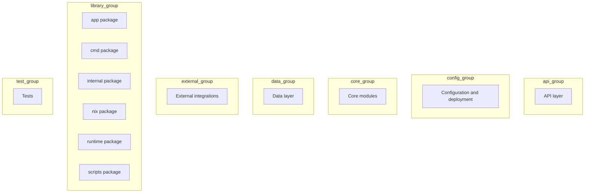

# Architecture report: tale/headplane

> Automated static analysis. **Observed** = directly seen in files/imports/AST; **Inferred** = interpretation from that evidence. Repository code was not executed.

## 1. Repository at a glance

| Item | Value |
| --- | --- |
| Repository | tale/headplane |
| Description | A feature-complete Web UI for Headscale |
| Language | TypeScript |
| Stars | 3304 |
| Licence | MIT |
| Analysed commit / branch | c8c192dbf0ade31f5947777fa4f46e45885edb49 / main |
| Framework(s) | React |
| Files analysed | 434 |
| Components | 12 |

## 2. Architecture in one minute

tale/headplane - A feature-complete Web UI for Headscale. This repository was analysed statically from 434 file(s) (0 Python). Detected technologies (observed from imports/manifests): GitHub Actions, React, React Router, Tailwind CSS, Docker, Docker Compose. Files are grouped into 12 component(s): API layer, app package, cmd package, Configuration and deployment, Core modules, Data layer, External integrations, internal package. Findings below distinguish observed facts from inferred interpretation.

## 3. High-level block diagram

## 4. Main components

### API layer (`api_layer`)

- **Kind:** api
- **Status:** Observed
- **Confidence:** 0.85
- **Responsibility:** Groups 108 file(s) under api layer (observed from repository paths and static analysis).
- **Paths:** `app/routes/acls/acl-action.ts`, `app/routes/acls/acl-loader.ts`, `app/routes/acls/components/cm.client.tsx`, `app/routes/acls/components/editor-section.tsx`, `app/routes/acls/components/fallback.tsx`, `app/routes/acls/components/rules-editor.tsx`, `app/routes/acls/components/tags-groups-editor.tsx`, `app/routes/acls/components/theme.ts`, `app/routes/acls/dialogs/acl-rule.tsx`, `app/routes/acls/dialogs/auto-approver.tsx`, `app/routes/acls/dialogs/editor-dialog.tsx`, `app/routes/acls/dialogs/grant.tsx`, `app/routes/acls/dialogs/host.tsx`, `app/routes/acls/dialogs/named-list.tsx`, `app/routes/acls/dialogs/ssh-rule.tsx`, `app/routes/acls/overview.tsx`, `app/routes/auth/link.tsx`, `app/routes/auth/login/action.ts`, `app/routes/auth/login/config-error.tsx`, `app/routes/auth/login/grid.tsx`, `app/routes/auth/login/logout.tsx`, `app/routes/auth/login/oidc-error.tsx`, `app/routes/auth/login/page.tsx`, `app/routes/auth/login/shell.tsx`, `app/routes/auth/logout.ts`, `app/routes/auth/oidc-callback.ts`, `app/routes/auth/oidc-start.ts`, `app/routes/dns/components/general.tsx`, `app/routes/dns/components/manage-domains.tsx`, `app/routes/dns/components/manage-ns.tsx`, `app/routes/dns/components/manage-records.tsx`, `app/routes/dns/components/rename-tailnet.tsx`, `app/routes/dns/components/reorder.tsx`, `app/routes/dns/dialogs/add-domain.tsx`, `app/routes/dns/dialogs/add-ns.tsx`, `app/routes/dns/dialogs/add-record.tsx`, `app/routes/dns/dns-actions.ts`, `app/routes/dns/overview.tsx`, `app/routes/dns/reorder.ts`, `app/routes/dns/schemas.ts`, `app/routes/home.tsx`, `app/routes/machines/components/machine-filters.tsx`, `app/routes/machines/components/machine-row.tsx`, `app/routes/machines/components/menu.tsx`, `app/routes/machines/dialogs/delete.tsx`, `app/routes/machines/dialogs/expire.tsx`, `app/routes/machines/dialogs/key-expiry.tsx`, `app/routes/machines/dialogs/move.tsx`, `app/routes/machines/dialogs/new.tsx`, `app/routes/machines/dialogs/rename.tsx`, `app/routes/machines/dialogs/routes.tsx`, `app/routes/machines/dialogs/tags.tsx`, `app/routes/machines/hooks/use-machine-filter-params.ts`, `app/routes/machines/machine-actions.ts`, `app/routes/machines/machine.tsx`, `app/routes/machines/overview.tsx`, `app/routes/machines/schemas.ts`, `app/routes/settings/agent.tsx`, `app/routes/settings/auth-keys/actions.ts`, `app/routes/settings/auth-keys/auth-key-row.tsx`, `app/routes/settings/auth-keys/dialogs/add-auth-key.tsx`, `app/routes/settings/auth-keys/dialogs/expire-auth-key.tsx`, `app/routes/settings/auth-keys/overview.tsx`, `app/routes/settings/layout.tsx`, `app/routes/settings/overview.tsx`, `app/routes/settings/restrictions/actions.ts`, `app/routes/settings/restrictions/dialogs/add-restriction.tsx`, `app/routes/settings/restrictions/overview.tsx`, `app/routes/settings/restrictions/restriction-section.tsx`, `app/routes/settings/restrictions/schemas.ts`, `app/routes/ssh/errors.tsx`, `app/routes/ssh/ghostty.client.tsx`, `app/routes/ssh/page.tsx`, `app/routes/ssh/user-prompt.tsx`, `app/routes/ssh/wasm.client.ts`, `app/routes/ssh/wasm_js.d.ts`, `app/routes/users/components/headplane-user-row.tsx`, `app/routes/users/components/headscale-user-menu.tsx`, `app/routes/users/components/headscale-user-row.tsx`, `app/routes/users/components/machines-seen.tsx`, `app/routes/users/components/menu.tsx`, `app/routes/users/dialogs/create-user.tsx`, `app/routes/users/dialogs/delete-user.tsx`, `app/routes/users/dialogs/link-user.tsx`, `app/routes/users/dialogs/reassign-user.tsx`, `app/routes/users/dialogs/rename-user.tsx`, `app/routes/users/dialogs/transfer-ownership.tsx`, `app/routes/users/dialogs/user-groups.tsx`, `app/routes/users/overview.tsx`, `app/routes/users/schemas.ts`, `app/routes/users/user-actions.ts`, `app/routes/util/color-scheme.ts`, `app/routes/util/healthz.ts`, `app/routes/util/info.ts`, `app/routes/util/live.ts`, `app/routes/util/redirect.ts`, `app/server/headscale/api/capabilities.ts`, `app/server/headscale/api/error-client.ts`, `app/server/headscale/api/error.ts`, `app/server/headscale/api/index.ts`, `app/server/headscale/api/resources/api-keys.ts`, `app/server/headscale/api/resources/auth.ts`, `app/server/headscale/api/resources/nodes.ts`, `app/server/headscale/api/resources/policy.ts`, `app/server/headscale/api/resources/pre-auth-keys.ts`, `app/server/headscale/api/resources/users.ts`, `app/server/headscale/api/server-version.ts`, `app/server/headscale/api/transport.ts`
- **Evidence:** [app/routes/acls/acl-action.ts](https://github.com/tale/headplane/blob/c8c192dbf0ade31f5947777fa4f46e45885edb49/app/routes/acls/acl-action.ts); [app/routes/acls/acl-loader.ts](https://github.com/tale/headplane/blob/c8c192dbf0ade31f5947777fa4f46e45885edb49/app/routes/acls/acl-loader.ts); [app/routes/acls/components/cm.client.tsx](https://github.com/tale/headplane/blob/c8c192dbf0ade31f5947777fa4f46e45885edb49/app/routes/acls/components/cm.client.tsx); [app/routes/acls/components/editor-section.tsx](https://github.com/tale/headplane/blob/c8c192dbf0ade31f5947777fa4f46e45885edb49/app/routes/acls/components/editor-section.tsx); [app/routes/acls/components/fallback.tsx](https://github.com/tale/headplane/blob/c8c192dbf0ade31f5947777fa4f46e45885edb49/app/routes/acls/components/fallback.tsx); [app/routes/acls/components/rules-editor.tsx](https://github.com/tale/headplane/blob/c8c192dbf0ade31f5947777fa4f46e45885edb49/app/routes/acls/components/rules-editor.tsx); [app/routes/acls/components/tags-groups-editor.tsx](https://github.com/tale/headplane/blob/c8c192dbf0ade31f5947777fa4f46e45885edb49/app/routes/acls/components/tags-groups-editor.tsx); [app/routes/acls/components/theme.ts](https://github.com/tale/headplane/blob/c8c192dbf0ade31f5947777fa4f46e45885edb49/app/routes/acls/components/theme.ts)

### app package (`app`)

- **Kind:** library
- **Status:** Observed
- **Confidence:** 0.85
- **Responsibility:** Groups 85 file(s) under app package (observed from repository paths and static analysis).
- **Paths:** `app/components/action-dialog.tsx`, `app/components/attribute.tsx`, `app/components/avatar.tsx`, `app/components/button.tsx`, `app/components/callout.tsx`, `app/components/card.tsx`, `app/components/chip.tsx`, `app/components/code-block.tsx`, `app/components/code.tsx`, `app/components/dialog.tsx`, `app/components/field.tsx`, `app/components/filter-dropdown.tsx`, `app/components/input.tsx`, `app/components/link.tsx`, `app/components/list.tsx`, `app/components/logo-mark.tsx`, `app/components/menu.tsx`, `app/components/number-input.tsx`, `app/components/page-error.tsx`, `app/components/page-header.tsx`, `app/components/radio-group.tsx`, `app/components/section.tsx`, `app/components/select.tsx`, `app/components/status-circle.tsx`, `app/components/switch.tsx`, `app/components/table.tsx`, `app/components/tabs.tsx`, `app/components/tags/ExitNode.tsx`, `app/components/tags/Expiry.tsx`, `app/components/tags/HeadplaneAgent.tsx`, `app/components/tags/Subnet.tsx`, `app/components/tags/TailscaleSSH.tsx`, `app/components/token-list.tsx`, `app/components/tooltip.tsx`, `app/entry.client.tsx`, `app/entry.server.tsx`, `app/globals.d.ts`, `app/layout/app.tsx`, `app/layout/error-page.tsx`, `app/layout/footer.tsx`, `app/layout/header.tsx`, `app/layout/scrollbar.tsx`, `app/root.tsx`, `app/routes.ts`, `app/server/app.ts`, `app/server/assets.ts`, `app/server/context.ts`, `app/server/feature.ts`, `app/server/headscale/config-dns.ts`, `app/server/headscale/config-loader.ts`, `app/server/headscale/live-store.ts`, `app/server/hp-agent.ts`, `app/server/main.ts`, `app/server/oidc/provider.ts`, `app/server/result.ts`, `app/server/tailscale-release.ts`, `app/server/web/actions.ts`, `app/server/web/auth.ts`, `app/server/web/headscale-identity.ts`, `app/server/web/link.ts`, `app/server/web/roles.ts`, `app/types/HostInfo.ts`, `app/types/Key.ts`, `app/types/Machine.ts`, `app/types/PreAuthKey.ts`, `app/types/Route.ts`, `app/types/User.ts`, `app/types/index.ts`, `app/utils/acl-policy.ts`, `app/utils/cn.ts`, `app/utils/color-scheme.ts`, `app/utils/copy.ts`, `app/utils/describe-error.ts`, `app/utils/form.ts`, `app/utils/host-info.ts`, `app/utils/live-data.tsx`, `app/utils/log.ts`, `app/utils/node-info.ts`, `app/utils/oidc-state.ts`, `app/utils/register-key.ts`, `app/utils/res.ts`, `app/utils/time.ts`, `app/utils/toast-provider.tsx`, `app/utils/toast.ts`, `app/utils/user.ts`
- **Evidence:** [app/components/action-dialog.tsx](https://github.com/tale/headplane/blob/c8c192dbf0ade31f5947777fa4f46e45885edb49/app/components/action-dialog.tsx); [app/components/attribute.tsx](https://github.com/tale/headplane/blob/c8c192dbf0ade31f5947777fa4f46e45885edb49/app/components/attribute.tsx); [app/components/avatar.tsx](https://github.com/tale/headplane/blob/c8c192dbf0ade31f5947777fa4f46e45885edb49/app/components/avatar.tsx); [app/components/button.tsx](https://github.com/tale/headplane/blob/c8c192dbf0ade31f5947777fa4f46e45885edb49/app/components/button.tsx); [app/components/callout.tsx](https://github.com/tale/headplane/blob/c8c192dbf0ade31f5947777fa4f46e45885edb49/app/components/callout.tsx); [app/components/card.tsx](https://github.com/tale/headplane/blob/c8c192dbf0ade31f5947777fa4f46e45885edb49/app/components/card.tsx); [app/components/chip.tsx](https://github.com/tale/headplane/blob/c8c192dbf0ade31f5947777fa4f46e45885edb49/app/components/chip.tsx); [app/components/code-block.tsx](https://github.com/tale/headplane/blob/c8c192dbf0ade31f5947777fa4f46e45885edb49/app/components/code-block.tsx)

### cmd package (`cmd`)

- **Kind:** library
- **Status:** Observed
- **Confidence:** 0.85
- **Responsibility:** Groups 4 file(s) under cmd package (observed from repository paths and static analysis).
- **Paths:** `cmd/fake_sh/fake_sh.go`, `cmd/hp_agent/hp_agent.go`, `cmd/hp_healthcheck/hp_healthcheck.go`, `cmd/hp_ssh/wasm_js.go`
- **Evidence:** [cmd/fake_sh/fake_sh.go](https://github.com/tale/headplane/blob/c8c192dbf0ade31f5947777fa4f46e45885edb49/cmd/fake_sh/fake_sh.go); [cmd/hp_agent/hp_agent.go](https://github.com/tale/headplane/blob/c8c192dbf0ade31f5947777fa4f46e45885edb49/cmd/hp_agent/hp_agent.go); [cmd/hp_healthcheck/hp_healthcheck.go](https://github.com/tale/headplane/blob/c8c192dbf0ade31f5947777fa4f46e45885edb49/cmd/hp_healthcheck/hp_healthcheck.go); [cmd/hp_ssh/wasm_js.go](https://github.com/tale/headplane/blob/c8c192dbf0ade31f5947777fa4f46e45885edb49/cmd/hp_ssh/wasm_js.go)

### Configuration and deployment (`config`)

- **Kind:** config
- **Status:** Observed
- **Confidence:** 0.85
- **Responsibility:** Groups 23 file(s) under configuration and deployment (observed from repository paths and static analysis).
- **Paths:** `Dockerfile`, `app/server/config/config-schema.ts`, `app/server/config/error.ts`, `app/server/config/load.ts`, `app/server/config/utils.ts`, `compose.yaml`, `config.example.yaml`, `drizzle/20250619175127_spicy_bloodscream/snapshot.json`, `drizzle/20250818220542_naive_lilith/snapshot.json`, `drizzle/20250819153327_square_bloodstorm/snapshot.json`, `drizzle/20260307210718_thick_otto_octavius/snapshot.json`, `drizzle/20260314162950_nappy_praxagora/snapshot.json`, `drizzle/20260330175441_add_user_picture/snapshot.json`, `drizzle/20260408181638_parallel_synch/snapshot.json`, `drizzle/20260426221245_add_oidc_id_token/snapshot.json`, `go.mod`, `internal/config/config.go`, `internal/config/config_test.go`, `internal/config/preflight.go`, `lefthook.yml`, `mise.toml`, `package.json`, `tsconfig.json`
- **Evidence:** [Dockerfile](https://github.com/tale/headplane/blob/c8c192dbf0ade31f5947777fa4f46e45885edb49/Dockerfile); [app/server/config/config-schema.ts](https://github.com/tale/headplane/blob/c8c192dbf0ade31f5947777fa4f46e45885edb49/app/server/config/config-schema.ts); [app/server/config/error.ts](https://github.com/tale/headplane/blob/c8c192dbf0ade31f5947777fa4f46e45885edb49/app/server/config/error.ts); [app/server/config/load.ts](https://github.com/tale/headplane/blob/c8c192dbf0ade31f5947777fa4f46e45885edb49/app/server/config/load.ts); [app/server/config/utils.ts](https://github.com/tale/headplane/blob/c8c192dbf0ade31f5947777fa4f46e45885edb49/app/server/config/utils.ts); [compose.yaml](https://github.com/tale/headplane/blob/c8c192dbf0ade31f5947777fa4f46e45885edb49/compose.yaml); [config.example.yaml](https://github.com/tale/headplane/blob/c8c192dbf0ade31f5947777fa4f46e45885edb49/config.example.yaml); [drizzle/20250619175127_spicy_bloodscream/snapshot.json](https://github.com/tale/headplane/blob/c8c192dbf0ade31f5947777fa4f46e45885edb49/drizzle/20250619175127_spicy_bloodscream/snapshot.json)

### Core modules (`core`)

- **Kind:** core
- **Status:** Observed
- **Confidence:** 0.85
- **Responsibility:** Groups 5 file(s) under core modules (observed from repository paths and static analysis).
- **Paths:** `build.sh`, `drizzle.config.ts`, `react-router.config.ts`, `vite.config.ts`, `vitest.config.ts`
- **Evidence:** [build.sh](https://github.com/tale/headplane/blob/c8c192dbf0ade31f5947777fa4f46e45885edb49/build.sh); [drizzle.config.ts](https://github.com/tale/headplane/blob/c8c192dbf0ade31f5947777fa4f46e45885edb49/drizzle.config.ts); [react-router.config.ts](https://github.com/tale/headplane/blob/c8c192dbf0ade31f5947777fa4f46e45885edb49/react-router.config.ts); [vite.config.ts](https://github.com/tale/headplane/blob/c8c192dbf0ade31f5947777fa4f46e45885edb49/vite.config.ts); [vitest.config.ts](https://github.com/tale/headplane/blob/c8c192dbf0ade31f5947777fa4f46e45885edb49/vitest.config.ts)

### Data layer (`data_layer`)

- **Kind:** data
- **Status:** Observed
- **Confidence:** 0.85
- **Responsibility:** Groups 2 file(s) under data layer (observed from repository paths and static analysis).
- **Paths:** `app/server/db/client.server.ts`, `app/server/db/schema.ts`
- **Evidence:** [app/server/db/client.server.ts](https://github.com/tale/headplane/blob/c8c192dbf0ade31f5947777fa4f46e45885edb49/app/server/db/client.server.ts); [app/server/db/schema.ts](https://github.com/tale/headplane/blob/c8c192dbf0ade31f5947777fa4f46e45885edb49/app/server/db/schema.ts)

### External integrations (`external_integrations`)

- **Kind:** external
- **Status:** Observed
- **Confidence:** 0.85
- **Responsibility:** Groups 6 file(s) under external integrations (observed from repository paths and static analysis).
- **Paths:** `app/server/config/integration/abstract.ts`, `app/server/config/integration/docker.ts`, `app/server/config/integration/index.ts`, `app/server/config/integration/kubernetes.ts`, `app/server/config/integration/proc-helper.ts`, `app/server/config/integration/proc.ts`
- **Evidence:** [app/server/config/integration/abstract.ts](https://github.com/tale/headplane/blob/c8c192dbf0ade31f5947777fa4f46e45885edb49/app/server/config/integration/abstract.ts); [app/server/config/integration/docker.ts](https://github.com/tale/headplane/blob/c8c192dbf0ade31f5947777fa4f46e45885edb49/app/server/config/integration/docker.ts); [app/server/config/integration/index.ts](https://github.com/tale/headplane/blob/c8c192dbf0ade31f5947777fa4f46e45885edb49/app/server/config/integration/index.ts); [app/server/config/integration/kubernetes.ts](https://github.com/tale/headplane/blob/c8c192dbf0ade31f5947777fa4f46e45885edb49/app/server/config/integration/kubernetes.ts); [app/server/config/integration/proc-helper.ts](https://github.com/tale/headplane/blob/c8c192dbf0ade31f5947777fa4f46e45885edb49/app/server/config/integration/proc-helper.ts); [app/server/config/integration/proc.ts](https://github.com/tale/headplane/blob/c8c192dbf0ade31f5947777fa4f46e45885edb49/app/server/config/integration/proc.ts)

### internal package (`internal`)

- **Kind:** library
- **Status:** Observed
- **Confidence:** 0.85
- **Responsibility:** Groups 3 file(s) under internal package (observed from repository paths and static analysis).
- **Paths:** `internal/tsnet/peers.go`, `internal/tsnet/server.go`, `internal/util/logger.go`
- **Evidence:** [internal/tsnet/peers.go](https://github.com/tale/headplane/blob/c8c192dbf0ade31f5947777fa4f46e45885edb49/internal/tsnet/peers.go); [internal/tsnet/server.go](https://github.com/tale/headplane/blob/c8c192dbf0ade31f5947777fa4f46e45885edb49/internal/tsnet/server.go); [internal/util/logger.go](https://github.com/tale/headplane/blob/c8c192dbf0ade31f5947777fa4f46e45885edb49/internal/util/logger.go)

### nix package (`nix`)

- **Kind:** library
- **Status:** Observed
- **Confidence:** 0.85
- **Responsibility:** Groups 1 file(s) under nix package (observed from repository paths and static analysis).
- **Paths:** `nix/docs.js`
- **Evidence:** [nix/docs.js](https://github.com/tale/headplane/blob/c8c192dbf0ade31f5947777fa4f46e45885edb49/nix/docs.js)

### runtime package (`runtime`)

- **Kind:** library
- **Status:** Observed
- **Confidence:** 0.85
- **Responsibility:** Groups 2 file(s) under runtime package (observed from repository paths and static analysis).
- **Paths:** `runtime/http.ts`, `runtime/vite-plugin.ts`
- **Evidence:** [runtime/http.ts](https://github.com/tale/headplane/blob/c8c192dbf0ade31f5947777fa4f46e45885edb49/runtime/http.ts); [runtime/vite-plugin.ts](https://github.com/tale/headplane/blob/c8c192dbf0ade31f5947777fa4f46e45885edb49/runtime/vite-plugin.ts)

### scripts package (`scripts`)

- **Kind:** library
- **Status:** Observed
- **Confidence:** 0.85
- **Responsibility:** Groups 3 file(s) under scripts package (observed from repository paths and static analysis).
- **Paths:** `scripts/release.ts`, `scripts/sync-tsconnect.sh`, `scripts/wasm-tags.go`
- **Evidence:** [scripts/release.ts](https://github.com/tale/headplane/blob/c8c192dbf0ade31f5947777fa4f46e45885edb49/scripts/release.ts); [scripts/sync-tsconnect.sh](https://github.com/tale/headplane/blob/c8c192dbf0ade31f5947777fa4f46e45885edb49/scripts/sync-tsconnect.sh); [scripts/wasm-tags.go](https://github.com/tale/headplane/blob/c8c192dbf0ade31f5947777fa4f46e45885edb49/scripts/wasm-tags.go)

### Tests (`tests`)

- **Kind:** test
- **Status:** Observed
- **Confidence:** 0.85
- **Responsibility:** Groups 69 file(s) under tests (observed from repository paths and static analysis).
- **Paths:** `tests/README.md`, `tests/harness/agent-hostinfo.ts`, `tests/harness/browser-ssh-client.ts`, `tests/harness/browser-ssh.ts`, `tests/harness/cli.ts`, `tests/harness/dex.ts`, `tests/harness/headplane.ts`, `tests/harness/headscale.ts`, `tests/harness/launch.ts`, `tests/harness/loadgen.go`, `tests/harness/node.ts`, `tests/harness/scenario.ts`, `tests/harness/scenarios/fleet.ts`, `tests/harness/scenarios/homelab.ts`, `tests/harness/scenarios/minimal.ts`, `tests/harness/screenshots.ts`, `tests/harness/tailnet.ts`, `tests/harness/versions.ts`, `tests/harness/wait.ts`, `tests/integration/agent/fault-proxy.ts`, `tests/integration/agent/faults.test.ts`, `tests/integration/agent/harness.ts`, `tests/integration/agent/lifecycle.test.ts`, `tests/integration/agent/page.test.ts`, `tests/integration/agent/setup.ts`, `tests/integration/harness/scenarios.test.ts`, `tests/integration/harness/tailnet.test.ts`, `tests/integration/headplane/acls.test.ts`, `tests/integration/headplane/auth-keys.test.ts`, `tests/integration/headplane/dns.test.ts`, `tests/integration/headplane/link.test.ts`, `tests/integration/headplane/login.test.ts`, `tests/integration/headplane/logout.test.ts`, `tests/integration/headplane/machines.test.ts`, `tests/integration/headplane/permissions.test.ts`, `tests/integration/headplane/restrictions.test.ts`, `tests/integration/headplane/sso.test.ts`, `tests/integration/headplane/status.test.ts`, `tests/integration/headplane/users.test.ts`, `tests/integration/headscale/contract.test.ts`, `tests/integration/oidc/oidc.test.ts`, `tests/integration/platform/base-path.test.ts`, `tests/integration/platform/docker.test.ts`, `tests/integration/platform/proc.test.ts`, `tests/integration/ssh/browser-ssh.test.ts`, `tests/integration/ssh/setup.ts`, `tests/support/app.ts`, `tests/support/temp.ts`, `tests/unit/auth/auth-service.test.ts`, `tests/unit/auth/create-auth.ts`, `tests/unit/auth/headscale-identity.test.ts`, `tests/unit/config/base-path.test.ts`, `tests/unit/config/config-file.test.ts`, `tests/unit/config/env-vars.test.ts`, `tests/unit/config/path-casing.test.ts`, `tests/unit/config/secret-path.test.ts`, `tests/unit/headscale/api-paths.test.ts`, `tests/unit/headscale/config-loader.test.ts`, `tests/unit/headscale/error-client.test.ts`, `tests/unit/headscale/headscale-resilience.test.ts`, `tests/unit/headscale/live-store.test.ts`, `tests/unit/headscale/server-version.test.ts`, `tests/unit/oidc/provider.test.ts`, `tests/unit/runtime/http.test.ts`, `tests/unit/utils/acl-policy.test.ts`, `tests/unit/utils/form.test.ts`, `tests/unit/utils/node-info.test.ts`, `tests/unit/utils/register-key.test.ts`, `tests/unit/utils/user.test.ts`
- **Evidence:** [tests/README.md](https://github.com/tale/headplane/blob/c8c192dbf0ade31f5947777fa4f46e45885edb49/tests/README.md); [tests/harness/agent-hostinfo.ts](https://github.com/tale/headplane/blob/c8c192dbf0ade31f5947777fa4f46e45885edb49/tests/harness/agent-hostinfo.ts); [tests/harness/browser-ssh-client.ts](https://github.com/tale/headplane/blob/c8c192dbf0ade31f5947777fa4f46e45885edb49/tests/harness/browser-ssh-client.ts); [tests/harness/browser-ssh.ts](https://github.com/tale/headplane/blob/c8c192dbf0ade31f5947777fa4f46e45885edb49/tests/harness/browser-ssh.ts); [tests/harness/cli.ts](https://github.com/tale/headplane/blob/c8c192dbf0ade31f5947777fa4f46e45885edb49/tests/harness/cli.ts); [tests/harness/dex.ts](https://github.com/tale/headplane/blob/c8c192dbf0ade31f5947777fa4f46e45885edb49/tests/harness/dex.ts); [tests/harness/headplane.ts](https://github.com/tale/headplane/blob/c8c192dbf0ade31f5947777fa4f46e45885edb49/tests/harness/headplane.ts); [tests/harness/headscale.ts](https://github.com/tale/headplane/blob/c8c192dbf0ade31f5947777fa4f46e45885edb49/tests/harness/headscale.ts)

## 5. Execution flow

**Observed** entry point(s):

- [app/layout/app.tsx](https://github.com/tale/headplane/blob/c8c192dbf0ade31f5947777fa4f46e45885edb49/app/layout/app.tsx)
- [app/routes/ssh/page.tsx](https://github.com/tale/headplane/blob/c8c192dbf0ade31f5947777fa4f46e45885edb49/app/routes/ssh/page.tsx)
- [app/server/app.ts](https://github.com/tale/headplane/blob/c8c192dbf0ade31f5947777fa4f46e45885edb49/app/server/app.ts)
- [app/server/main.ts](https://github.com/tale/headplane/blob/c8c192dbf0ade31f5947777fa4f46e45885edb49/app/server/main.ts)
- [app/types/index.ts](https://github.com/tale/headplane/blob/c8c192dbf0ade31f5947777fa4f46e45885edb49/app/types/index.ts)

Representative flow (derived from observed entry points and the import graph; steps beyond the entry point are **Inferred**):

1. Execution starts at an observed entry point listed above, if present.
2. No internal import relationships between components were observed.

## 6. Project structure

### `(root)`

- `.dockerignore` - container (95 bytes)
- `.gitattributes` - other (172 bytes)
- `.gitignore` - other (207 bytes)
- `.oxfmtrc.json` - config (235 bytes)
- `.oxlintrc.json` - config (4993 bytes)
- `AGENTS.md` - docs (10189 bytes)
- `CHANGELOG.md` - docs (60780 bytes)
- `Caddyfile` - other (260 bytes)
- `Dockerfile` - container (2628 bytes)
- `LICENSE` - docs (1068 bytes)
- `README.md` - docs (2544 bytes)
- `build.sh` - source, Shell (5867 bytes)
- `compose.yaml` - container (1013 bytes)
- `config.example.yaml` - config (14745 bytes)
- `drizzle.config.ts` - source, TypeScript (198 bytes)
- `flake.lock` - other (2020 bytes)
- `flake.nix` - other (2614 bytes)
- `go.mod` - manifest (2470 bytes)
- `go.sum` - other (22549 bytes)
- `lefthook.yml` - config (409 bytes)
- `mise.toml` - config (980 bytes)
- `package.json` - manifest (3853 bytes)
- `react-router.config.ts` - source, TypeScript (180 bytes)
- `tsconfig.json` - config (589 bytes)
- `vite.config.ts` - source, TypeScript (3184 bytes)
- `vitest.config.ts` - source, TypeScript (2094 bytes)

### `.devcontainer`

- `.devcontainer/Dockerfile` - container (266 bytes)
- `.devcontainer/devcontainer.json` - config (1158 bytes)

### `.github`

- `.github/CODEOWNERS` - other (43 bytes)
- `.github/CONTRIBUTING.md` - docs (3397 bytes)
- `.github/FUNDING.yml` - config (26 bytes)
- `.github/ISSUE_TEMPLATE/bug-report.yaml` - config (980 bytes)
- `.github/ISSUE_TEMPLATE/config.yml` - config (198 bytes)
- `.github/ISSUE_TEMPLATE/feature-request.yaml` - config (624 bytes)
- `.github/SECURITY.md` - docs (441 bytes)
- `.github/labeler.yml` - config (910 bytes)
- `.github/workflows/automated.yaml` - ci, YAML (2321 bytes)
- `.github/workflows/build.yaml` - ci, YAML (2915 bytes)
- `.github/workflows/docs-beta.yaml` - ci, YAML (1361 bytes)
- `.github/workflows/docs-build.yaml` - ci, YAML (2744 bytes)
- `.github/workflows/docs-publish.yaml` - ci, YAML (3189 bytes)
- `.github/workflows/labeler.yaml` - ci, YAML (336 bytes)
- `.github/workflows/lifecycle.yaml` - ci, YAML (3206 bytes)
- `.github/workflows/pullfrog.yml` - ci, YAML (1981 bytes)
- `.github/workflows/release.yaml` - ci, YAML (3988 bytes)
- `.github/workflows/stale.yaml` - ci, YAML (849 bytes)
- `.github/workflows/triage.yaml` - ci, YAML (462 bytes)

### `app`

- `app/assets/android.svg` - other (1041 bytes)
- `app/assets/ios.svg` - other (903 bytes)
- `app/assets/macos.svg` - other (1762 bytes)
- `app/assets/windows.svg` - other (361 bytes)
- `app/components/action-dialog.tsx` - source, TypeScript (3659 bytes)
- `app/components/attribute.tsx` - source, TypeScript (2677 bytes)
- `app/components/avatar.tsx` - source, TypeScript (966 bytes)
- `app/components/button.tsx` - source, TypeScript (1552 bytes)
- `app/components/callout.tsx` - source, TypeScript (1960 bytes)
- `app/components/card.tsx` - source, TypeScript (369 bytes)
- `app/components/chip.tsx` - source, TypeScript (812 bytes)
- `app/components/code-block.tsx` - source, TypeScript (990 bytes)
- `app/components/code.tsx` - source, TypeScript (391 bytes)
- `app/components/dialog.tsx` - source, TypeScript (3079 bytes)
- `app/components/field.tsx` - source, TypeScript (2345 bytes)
- `app/components/filter-dropdown.tsx` - source, TypeScript (1745 bytes)
- `app/components/input.tsx` - source, TypeScript (1109 bytes)
- `app/components/link.tsx` - source, TypeScript (1029 bytes)
- `app/components/list.tsx` - source, TypeScript (608 bytes)
- `app/components/logo-mark.tsx` - source, TypeScript (605 bytes)
- `app/components/menu.tsx` - source, TypeScript (2397 bytes)
- `app/components/number-input.tsx` - source, TypeScript (1786 bytes)
- `app/components/page-error.tsx` - source, TypeScript (2887 bytes)
- `app/components/page-header.tsx` - source, TypeScript (994 bytes)
- `app/components/radio-group.tsx` - source, TypeScript (1527 bytes)
- `app/components/section.tsx` - source, TypeScript (3152 bytes)
- `app/components/select.tsx` - source, TypeScript (3597 bytes)
- `app/components/status-circle.tsx` - source, TypeScript (551 bytes)
- `app/components/switch.tsx` - source, TypeScript (1611 bytes)
- `app/components/table.tsx` - source, TypeScript (2051 bytes)
- `app/components/tabs.tsx` - source, TypeScript (1914 bytes)
- `app/components/tags/ExitNode.tsx` - source, TypeScript (604 bytes)
- `app/components/tags/Expiry.tsx` - source, TypeScript (1283 bytes)
- `app/components/tags/HeadplaneAgent.tsx` - source, TypeScript (290 bytes)
- `app/components/tags/Subnet.tsx` - source, TypeScript (682 bytes)
- `app/components/tags/TailscaleSSH.tsx` - source, TypeScript (329 bytes)
- `app/components/token-list.tsx` - source, TypeScript (3991 bytes)
- `app/components/tooltip.tsx` - source, TypeScript (1094 bytes)
- `app/entry.client.tsx` - source, TypeScript (276 bytes)
- `app/entry.server.tsx` - source, TypeScript (2417 bytes)
- `app/globals.d.ts` - source, TypeScript (110 bytes)
- `app/layout/app.tsx` - source, TypeScript (5392 bytes)
- `app/layout/error-page.tsx` - source, TypeScript (1176 bytes)
- `app/layout/footer.tsx` - source, TypeScript (1917 bytes)
- `app/layout/header.tsx` - source, TypeScript (6685 bytes)
- `app/layout/scrollbar.tsx` - source, TypeScript (4132 bytes)
- `app/root.tsx` - source, TypeScript (2209 bytes)
- `app/routes.ts` - source, TypeScript (1485 bytes)
- `app/routes/acls/acl-action.ts` - source, TypeScript (2681 bytes)
- `app/routes/acls/acl-loader.ts` - source, TypeScript (3118 bytes)
- `app/routes/acls/components/cm.client.tsx` - source, TypeScript (3754 bytes)
- `app/routes/acls/components/editor-section.tsx` - source, TypeScript (1801 bytes)
- `app/routes/acls/components/fallback.tsx` - source, TypeScript (540 bytes)
- `app/routes/acls/components/rules-editor.tsx` - source, TypeScript (13727 bytes)
- `app/routes/acls/components/tags-groups-editor.tsx` - source, TypeScript (6214 bytes)
- `app/routes/acls/components/theme.ts` - source, TypeScript (2260 bytes)
- `app/routes/acls/dialogs/acl-rule.tsx` - source, TypeScript (2802 bytes)
- `app/routes/acls/dialogs/auto-approver.tsx` - source, TypeScript (3099 bytes)
- `app/routes/acls/dialogs/editor-dialog.tsx` - source, TypeScript (1307 bytes)
- `app/routes/acls/dialogs/grant.tsx` - source, TypeScript (3238 bytes)
- `app/routes/acls/dialogs/host.tsx` - source, TypeScript (1841 bytes)
- `app/routes/acls/dialogs/named-list.tsx` - source, TypeScript (3086 bytes)
- `app/routes/acls/dialogs/ssh-rule.tsx` - source, TypeScript (3497 bytes)
- `app/routes/acls/overview.tsx` - source, TypeScript (9273 bytes)
- `app/routes/auth/link.tsx` - source, TypeScript (3287 bytes)
- `app/routes/auth/login/action.ts` - source, TypeScript (3673 bytes)
- `app/routes/auth/login/config-error.tsx` - source, TypeScript (2465 bytes)
- `app/routes/auth/login/grid.tsx` - source, TypeScript (9241 bytes)
- `app/routes/auth/login/logout.tsx` - source, TypeScript (487 bytes)
- `app/routes/auth/login/oidc-error.tsx` - source, TypeScript (1475 bytes)
- `app/routes/auth/login/page.tsx` - source, TypeScript (6199 bytes)
- `app/routes/auth/login/shell.tsx` - source, TypeScript (2339 bytes)
- `app/routes/auth/logout.ts` - source, TypeScript (1750 bytes)
- `app/routes/auth/oidc-callback.ts` - source, TypeScript (3924 bytes)
- `app/routes/auth/oidc-start.ts` - source, TypeScript (1264 bytes)
- `app/routes/dns/components/general.tsx` - source, TypeScript (2827 bytes)
- `app/routes/dns/components/manage-domains.tsx` - source, TypeScript (2191 bytes)
- `app/routes/dns/components/manage-ns.tsx` - source, TypeScript (3197 bytes)
- `app/routes/dns/components/manage-records.tsx` - source, TypeScript (2719 bytes)
- `app/routes/dns/components/rename-tailnet.tsx` - source, TypeScript (697 bytes)
- `app/routes/dns/components/reorder.tsx` - source, TypeScript (3421 bytes)
- `app/routes/dns/dialogs/add-domain.tsx` - source, TypeScript (643 bytes)
- `app/routes/dns/dialogs/add-ns.tsx` - source, TypeScript (1527 bytes)
- `app/routes/dns/dialogs/add-record.tsx` - source, TypeScript (1537 bytes)
- `app/routes/dns/dns-actions.ts` - source, TypeScript (8873 bytes)
- `app/routes/dns/overview.tsx` - source, TypeScript (3727 bytes)
- `app/routes/dns/reorder.ts` - source, TypeScript (383 bytes)
- `app/routes/dns/schemas.ts` - source, TypeScript (301 bytes)
- `app/routes/home.tsx` - source, TypeScript (7139 bytes)
- `app/routes/machines/components/machine-filters.tsx` - source, TypeScript (2437 bytes)
- `app/routes/machines/components/machine-row.tsx` - source, TypeScript (8524 bytes)
- `app/routes/machines/components/menu.tsx` - source, TypeScript (5643 bytes)
- `app/routes/machines/dialogs/delete.tsx` - source, TypeScript (652 bytes)
- `app/routes/machines/dialogs/expire.tsx` - source, TypeScript (625 bytes)
- `app/routes/machines/dialogs/key-expiry.tsx` - source, TypeScript (1048 bytes)
- `app/routes/machines/dialogs/move.tsx` - source, TypeScript (1256 bytes)
- `app/routes/machines/dialogs/new.tsx` - source, TypeScript (3097 bytes)
- `app/routes/machines/dialogs/rename.tsx` - source, TypeScript (1690 bytes)
- `app/routes/machines/dialogs/routes.tsx` - source, TypeScript (3618 bytes)
- `app/routes/machines/dialogs/tags.tsx` - source, TypeScript (2383 bytes)
- `app/routes/machines/hooks/use-machine-filter-params.ts` - source, TypeScript (1471 bytes)
- `app/routes/machines/machine-actions.ts` - source, TypeScript (5612 bytes)
- `app/routes/machines/machine.tsx` - source, TypeScript (11618 bytes)
- `app/routes/machines/overview.tsx` - source, TypeScript (13455 bytes)
- `app/routes/machines/schemas.ts` - source, TypeScript (236 bytes)
- `app/routes/settings/agent.tsx` - source, TypeScript (9483 bytes)
- `app/routes/settings/auth-keys/actions.ts` - source, TypeScript (3632 bytes)
- `app/routes/settings/auth-keys/auth-key-row.tsx` - source, TypeScript (2003 bytes)
- `app/routes/settings/auth-keys/dialogs/add-auth-key.tsx` - source, TypeScript (5396 bytes)
- `app/routes/settings/auth-keys/dialogs/expire-auth-key.tsx` - source, TypeScript (638 bytes)
- `app/routes/settings/auth-keys/overview.tsx` - source, TypeScript (9895 bytes)
- `app/routes/settings/layout.tsx` - source, TypeScript (2012 bytes)
- `app/routes/settings/overview.tsx` - source, TypeScript (113 bytes)
- `app/routes/settings/restrictions/actions.ts` - source, TypeScript (2848 bytes)
- `app/routes/settings/restrictions/dialogs/add-restriction.tsx` - source, TypeScript (1870 bytes)
- `app/routes/settings/restrictions/overview.tsx` - source, TypeScript (3127 bytes)
- `app/routes/settings/restrictions/restriction-section.tsx` - source, TypeScript (1963 bytes)
- `app/routes/settings/restrictions/schemas.ts` - source, TypeScript (629 bytes)
- `app/routes/ssh/errors.tsx` - source, TypeScript (2175 bytes)
- `app/routes/ssh/ghostty.client.tsx` - source, TypeScript (4185 bytes)
- `app/routes/ssh/page.tsx` - source, TypeScript (8545 bytes)
- `app/routes/ssh/user-prompt.tsx` - source, TypeScript (1624 bytes)
- `app/routes/ssh/wasm.client.ts` - source, TypeScript (2456 bytes)
- `app/routes/ssh/wasm_js.d.ts` - source, TypeScript (2748 bytes)
- `app/routes/users/components/headplane-user-row.tsx` - source, TypeScript (3398 bytes)
- `app/routes/users/components/headscale-user-menu.tsx` - source, TypeScript (2404 bytes)
- `app/routes/users/components/headscale-user-row.tsx` - source, TypeScript (2182 bytes)
- `app/routes/users/components/machines-seen.tsx` - source, TypeScript (667 bytes)
- `app/routes/users/components/menu.tsx` - source, TypeScript (4282 bytes)
- `app/routes/users/dialogs/create-user.tsx` - source, TypeScript (1378 bytes)
- `app/routes/users/dialogs/delete-user.tsx` - source, TypeScript (1122 bytes)
- `app/routes/users/dialogs/link-user.tsx` - source, TypeScript (1483 bytes)
- `app/routes/users/dialogs/reassign-user.tsx` - source, TypeScript (2842 bytes)
- `app/routes/users/dialogs/rename-user.tsx` - source, TypeScript (1030 bytes)
- `app/routes/users/dialogs/transfer-ownership.tsx` - source, TypeScript (808 bytes)
- `app/routes/users/dialogs/user-groups.tsx` - source, TypeScript (2107 bytes)
- `app/routes/users/overview.tsx` - source, TypeScript (10507 bytes)
- `app/routes/users/schemas.ts` - source, TypeScript (216 bytes)
- `app/routes/users/user-actions.ts` - source, TypeScript (6978 bytes)
- `app/routes/util/color-scheme.ts` - source, TypeScript (861 bytes)
- `app/routes/util/healthz.ts` - source, TypeScript (444 bytes)
- `app/routes/util/info.ts` - source, TypeScript (1425 bytes)
- `app/routes/util/live.ts` - source, TypeScript (2220 bytes)
- `app/routes/util/redirect.ts` - source, TypeScript (109 bytes)
- `app/server/ARCHITECTURE.md` - docs (2378 bytes)
- `app/server/README.md` - docs (5387 bytes)
- `app/server/app.ts` - source, TypeScript (2231 bytes)
- `app/server/assets.ts` - source, TypeScript (1188 bytes)
- `app/server/config/config-schema.ts` - source, TypeScript (8588 bytes)
- `app/server/config/error.ts` - source, TypeScript (2375 bytes)
- `app/server/config/integration/abstract.ts` - source, TypeScript (430 bytes)
- `app/server/config/integration/docker.ts` - source, TypeScript (9045 bytes)
- `app/server/config/integration/index.ts` - source, TypeScript (1649 bytes)
- `app/server/config/integration/kubernetes.ts` - source, TypeScript (4928 bytes)
- `app/server/config/integration/proc-helper.ts` - source, TypeScript (2895 bytes)
- `app/server/config/integration/proc.ts` - source, TypeScript (1406 bytes)
- `app/server/config/load.ts` - source, TypeScript (8128 bytes)
- `app/server/config/utils.ts` - source, TypeScript (256 bytes)
- `app/server/context.ts` - source, TypeScript (7594 bytes)
- `app/server/db/client.server.ts` - source, TypeScript (769 bytes)
- `app/server/db/schema.ts` - source, TypeScript (1872 bytes)
- `app/server/feature.ts` - source, TypeScript (798 bytes)
- `app/server/headscale/api/capabilities.ts` - source, TypeScript (2510 bytes)
- `app/server/headscale/api/error-client.ts` - source, TypeScript (2986 bytes)
- `app/server/headscale/api/error.ts` - source, TypeScript (1750 bytes)
- `app/server/headscale/api/index.ts` - source, TypeScript (5828 bytes)
- `app/server/headscale/api/resources/api-keys.ts` - source, TypeScript (534 bytes)
- `app/server/headscale/api/resources/auth.ts` - source, TypeScript (627 bytes)
- `app/server/headscale/api/resources/nodes.ts` - source, TypeScript (4141 bytes)
- `app/server/headscale/api/resources/policy.ts` - source, TypeScript (1010 bytes)
- `app/server/headscale/api/resources/pre-auth-keys.ts` - source, TypeScript (2768 bytes)
- `app/server/headscale/api/resources/users.ts` - source, TypeScript (1804 bytes)
- `app/server/headscale/api/server-version.ts` - source, TypeScript (4200 bytes)
- `app/server/headscale/api/transport.ts` - source, TypeScript (6103 bytes)
- `app/server/headscale/config-dns.ts` - source, TypeScript (3174 bytes)
- `app/server/headscale/config-loader.ts` - source, TypeScript (11397 bytes)
- `app/server/headscale/live-store.ts` - source, TypeScript (6289 bytes)
- `app/server/hp-agent.ts` - source, TypeScript (18492 bytes)
- `app/server/main.ts` - source, TypeScript (2893 bytes)
- `app/server/oidc/provider.ts` - source, TypeScript (33402 bytes)
- `app/server/result.ts` - source, TypeScript (257 bytes)
- `app/server/tailscale-release.ts` - source, TypeScript (1098 bytes)
- `app/server/web/actions.ts` - source, TypeScript (2577 bytes)
- `app/server/web/auth.ts` - source, TypeScript (21987 bytes)
- `app/server/web/headscale-identity.ts` - source, TypeScript (1662 bytes)
- `app/server/web/link.ts` - source, TypeScript (1555 bytes)
- `app/server/web/roles.ts` - source, TypeScript (3346 bytes)
- `app/tailwind.css` - other (6698 bytes)
- `app/tokens.css` - other (2462 bytes)
- `app/types/HostInfo.ts` - source, TypeScript (6221 bytes)
- `app/types/Key.ts` - source, TypeScript (114 bytes)
- `app/types/Machine.ts` - source, TypeScript (719 bytes)
- `app/types/PreAuthKey.ts` - source, TypeScript (243 bytes)
- `app/types/Route.ts` - source, TypeScript (247 bytes)
- `app/types/User.ts` - source, TypeScript (189 bytes)
- `app/types/index.ts` - source, TypeScript (157 bytes)
- `app/utils/acl-policy.ts` - source, TypeScript (20581 bytes)
- `app/utils/cn.ts` - source, TypeScript (122 bytes)
- `app/utils/color-scheme.ts` - source, TypeScript (804 bytes)
- `app/utils/copy.ts` - source, TypeScript (1134 bytes)
- `app/utils/describe-error.ts` - source, TypeScript (3412 bytes)
- `app/utils/form.ts` - source, TypeScript (2152 bytes)
- `app/utils/host-info.ts` - source, TypeScript (1346 bytes)
- `app/utils/live-data.tsx` - source, TypeScript (4104 bytes)
- `app/utils/log.ts` - source, TypeScript (1264 bytes)
- `app/utils/node-info.ts` - source, TypeScript (4341 bytes)
- `app/utils/oidc-state.ts` - source, TypeScript (1434 bytes)
- `app/utils/register-key.ts` - source, TypeScript (1259 bytes)
- `app/utils/res.ts` - source, TypeScript (634 bytes)
- `app/utils/time.ts` - source, TypeScript (992 bytes)
- `app/utils/toast-provider.tsx` - source, TypeScript (1224 bytes)
- `app/utils/toast.ts` - source, TypeScript (674 bytes)
- `app/utils/user.ts` - source, TypeScript (1608 bytes)

### `cmd`

- `cmd/fake_sh/fake_sh.go` - source, Go (365 bytes)
- `cmd/hp_agent/hp_agent.go` - source, Go (1651 bytes)
- `cmd/hp_healthcheck/hp_healthcheck.go` - source, Go (1733 bytes)
- `cmd/hp_ssh/build-tags.txt` - docs (1375 bytes)
- `cmd/hp_ssh/wasm_js.go` - source, Go (20134 bytes)

### `docs`

- `docs/app/app.css` - docs (4279 bytes)
- `docs/app/components/architecture.tsx` - docs (1889 bytes)
- `docs/app/components/callout.tsx` - docs (1407 bytes)
- `docs/app/components/dynamic-code-block.tsx` - docs (530 bytes)
- `docs/app/components/figure.tsx` - docs (894 bytes)
- `docs/app/components/header.tsx` - docs (6013 bytes)
- `docs/app/components/logo-mark.tsx` - docs (600 bytes)
- `docs/app/components/mdx.tsx` - docs (1093 bytes)
- `docs/app/components/release.tsx` - docs (3957 bytes)
- `docs/app/components/search.tsx` - docs (805 bytes)
- `docs/app/components/sidebar.tsx` - docs (3607 bytes)
- `docs/app/components/upgrade-notes.tsx` - docs (1897 bytes)
- `docs/app/components/version-banner.tsx` - docs (1339 bytes)
- `docs/app/components/version-picker.tsx` - docs (2375 bytes)
- `docs/app/env.d.ts` - docs (122 bytes)
- `docs/app/lib/changelog.ts` - docs (429 bytes)
- `docs/app/lib/releases.ts` - docs (1160 bytes)
- `docs/app/lib/remark-changelog.ts` - docs (5856 bytes)
- `docs/app/lib/source.ts` - docs (787 bytes)
- `docs/app/lib/versions.ts` - docs (660 bytes)
- `docs/app/root.tsx` - docs (2293 bytes)
- `docs/app/routes.ts` - docs (268 bytes)
- `docs/app/routes/changelog.tsx` - docs (925 bytes)
- `docs/app/routes/docs.tsx` - docs (3149 bytes)
- `docs/app/routes/home.tsx` - docs (2251 bytes)
- `docs/app/routes/search.ts` - docs (1018 bytes)
- `docs/configuration/api-keys.md` - docs (1859 bytes)
- `docs/configuration/compose-examples.ts` - docs (3685 bytes)
- `docs/configuration/index.md` - docs (2151 bytes)
- `docs/configuration/integrations.mdx` - docs (6584 bytes)
- `docs/configuration/meta.json` - config (140 bytes)
- `docs/configuration/reverse-proxy.mdx` - docs (4069 bytes)
- `docs/configuration/sensitive-values.md` - docs (1598 bytes)
- `docs/configuration/tls.md` - docs (1904 bytes)
- `docs/features/acls.mdx` - docs (4304 bytes)
- `docs/features/agent.mdx` - docs (4335 bytes)
- `docs/features/meta.json` - config (76 bytes)
- `docs/features/proxy-auth.md` - docs (3218 bytes)
- `docs/features/ssh.mdx` - docs (5975 bytes)
- `docs/features/sso.mdx` - docs (10571 bytes)
- `docs/features/users-roles.mdx` - docs (4715 bytes)
- `docs/install/docker.mdx` - docs (2166 bytes)
- `docs/install/index.mdx` - docs (2417 bytes)
- `docs/install/meta.json` - config (99 bytes)
- `docs/install/native-mode.mdx` - docs (2901 bytes)
- `docs/install/nix.md` - docs (2845 bytes)
- `docs/introduction.mdx` - docs (2487 bytes)
- `docs/meta.json` - config (239 bytes)
- `docs/public/_redirects` - docs (461 bytes)
- `docs/public/favicon.svg` - docs (706 bytes)
- `docs/quickstart-examples.ts` - docs (1194 bytes)
- `docs/quickstart.mdx` - docs (4161 bytes)
- `docs/react-router.config.ts` - docs (820 bytes)
- `docs/reference/meta.json` - config (81 bytes)
- `docs/reference/nixos-options.md` - docs (10834 bytes)
- `docs/scripts/finish-build.ts` - docs (883 bytes)
- `docs/troubleshooting.mdx` - docs (2963 bytes)
- `docs/tsconfig.json` - config (567 bytes)
- `docs/upgrading.mdx` - docs (743 bytes)
- `docs/vite.config.ts` - docs (2003 bytes)

### `drizzle`

- `drizzle/20250619175127_spicy_bloodscream/migration.sql` - data, SQL (92 bytes)
- `drizzle/20250619175127_spicy_bloodscream/snapshot.json` - config (877 bytes)
- `drizzle/20250818220542_naive_lilith/migration.sql` - data, SQL (107 bytes)
- `drizzle/20250818220542_naive_lilith/snapshot.json` - config (1768 bytes)
- `drizzle/20250819153327_square_bloodstorm/migration.sql` - data, SQL (245 bytes)
- `drizzle/20250819153327_square_bloodstorm/snapshot.json` - config (3113 bytes)
- `drizzle/20260307210718_thick_otto_octavius/migration.sql` - data, SQL (1162 bytes)
- `drizzle/20260307210718_thick_otto_octavius/snapshot.json` - config (6347 bytes)
- `drizzle/20260314162950_nappy_praxagora/migration.sql` - data, SQL (167 bytes)
- `drizzle/20260314162950_nappy_praxagora/snapshot.json` - config (6551 bytes)
- `drizzle/20260330175441_add_user_picture/migration.sql` - data, SQL (1024 bytes)
- `drizzle/20260330175441_add_user_picture/snapshot.json` - config (6523 bytes)
- `drizzle/20260408181638_parallel_synch/migration.sql` - data, SQL (29 bytes)
- `drizzle/20260408181638_parallel_synch/snapshot.json` - config (5825 bytes)
- `drizzle/20260426221245_add_oidc_id_token/migration.sql` - data, SQL (53 bytes)
- `drizzle/20260426221245_add_oidc_id_token/snapshot.json` - config (6055 bytes)

### `internal`

- `internal/config/config.go` - source, Go (1076 bytes)
- `internal/config/config_test.go` - source, Go (944 bytes)
- `internal/config/preflight.go` - source, Go (1440 bytes)
- `internal/tsnet/peers.go` - source, Go (4205 bytes)
- `internal/tsnet/server.go` - source, Go (1743 bytes)
- `internal/util/logger.go` - source, Go (1425 bytes)

### `nix`

- `nix/agent.nix` - other (266 bytes)
- `nix/docs.js` - source, JavaScript (1040 bytes)
- `nix/docs.nix` - other (541 bytes)
- `nix/module.nix` - other (2001 bytes)
- `nix/options.nix` - other (19770 bytes)
- `nix/package.nix` - other (1279 bytes)
- `nix/ssh-wasm.nix` - other (1245 bytes)

### `patches`

- `patches/tailscale-netcheck-derp-port.patch` - other (998 bytes)
- `patches/tsconnect-ssh-banner.patch` - other (1427 bytes)
- `patches/tsconnect-term-type.patch` - other (916 bytes)
- `patches/tsconnect-types.patch` - other (1173 bytes)
- `patches/tsconnect-utf8-chunks.patch` - other (1684 bytes)

### `public`

- `public/favicon.svg` - other (706 bytes)

### `runtime`

- `runtime/http.ts` - source, TypeScript (8547 bytes)
- `runtime/vite-plugin.ts` - source, TypeScript (2416 bytes)

### `scripts`

- `scripts/release.ts` - source, TypeScript (3193 bytes)
- `scripts/sync-tsconnect.sh` - source, Shell (2276 bytes)
- `scripts/wasm-tags.go` - source, Go (889 bytes)

### `tests`

- `tests/README.md` - test (4982 bytes)
- `tests/harness/agent-hostinfo.ts` - test, TypeScript (889 bytes)
- `tests/harness/browser-ssh-client.ts` - test, TypeScript (2951 bytes)
- `tests/harness/browser-ssh.ts` - test, TypeScript (2456 bytes)
- `tests/harness/cli.ts` - test, TypeScript (3372 bytes)
- `tests/harness/dex.ts` - test, TypeScript (5829 bytes)
- `tests/harness/headplane.ts` - test, TypeScript (2105 bytes)
- `tests/harness/headscale.ts` - test, TypeScript (8611 bytes)
- `tests/harness/launch.ts` - test, TypeScript (331 bytes)
- `tests/harness/loadgen.go` - test, Go (1708 bytes)
- `tests/harness/node.ts` - test, TypeScript (5643 bytes)
- `tests/harness/scenario.ts` - test, TypeScript (1870 bytes)
- `tests/harness/scenarios/fleet.ts` - test, TypeScript (543 bytes)
- `tests/harness/scenarios/homelab.ts` - test, TypeScript (2794 bytes)
- `tests/harness/scenarios/minimal.ts` - test, TypeScript (239 bytes)
- `tests/harness/screenshots.ts` - test, TypeScript (19363 bytes)
- `tests/harness/tailnet.ts` - test, TypeScript (3945 bytes)
- `tests/harness/versions.ts` - test, TypeScript (1239 bytes)
- `tests/harness/wait.ts` - test, TypeScript (728 bytes)
- `tests/integration/agent/fault-proxy.ts` - test, TypeScript (1756 bytes)
- `tests/integration/agent/faults.test.ts` - test, TypeScript (12972 bytes)
- `tests/integration/agent/harness.ts` - test, TypeScript (5657 bytes)
- `tests/integration/agent/lifecycle.test.ts` - test, TypeScript (3158 bytes)
- `tests/integration/agent/page.test.ts` - test, TypeScript (2465 bytes)
- `tests/integration/agent/setup.ts` - test, TypeScript (760 bytes)
- `tests/integration/harness/scenarios.test.ts` - test, TypeScript (926 bytes)
- `tests/integration/harness/tailnet.test.ts` - test, TypeScript (900 bytes)
- `tests/integration/headplane/acls.test.ts` - test, TypeScript (5175 bytes)
- `tests/integration/headplane/auth-keys.test.ts` - test, TypeScript (5530 bytes)
- `tests/integration/headplane/dns.test.ts` - test, TypeScript (14667 bytes)
- `tests/integration/headplane/link.test.ts` - test, TypeScript (3185 bytes)
- `tests/integration/headplane/login.test.ts` - test, TypeScript (2726 bytes)
- `tests/integration/headplane/logout.test.ts` - test, TypeScript (1847 bytes)
- `tests/integration/headplane/machines.test.ts` - test, TypeScript (10544 bytes)
- `tests/integration/headplane/permissions.test.ts` - test, TypeScript (5069 bytes)
- `tests/integration/headplane/restrictions.test.ts` - test, TypeScript (4103 bytes)
- `tests/integration/headplane/sso.test.ts` - test, TypeScript (5370 bytes)
- `tests/integration/headplane/status.test.ts` - test, TypeScript (4511 bytes)
- `tests/integration/headplane/users.test.ts` - test, TypeScript (12962 bytes)
- `tests/integration/headscale/contract.test.ts` - test, TypeScript (19901 bytes)
- `tests/integration/oidc/oidc.test.ts` - test, TypeScript (5062 bytes)
- `tests/integration/platform/base-path.test.ts` - test, TypeScript (6669 bytes)
- `tests/integration/platform/docker.test.ts` - test, TypeScript (2524 bytes)
- `tests/integration/platform/proc.test.ts` - test, TypeScript (3584 bytes)
- `tests/integration/ssh/browser-ssh.test.ts` - test, TypeScript (5570 bytes)
- `tests/integration/ssh/setup.ts` - test, TypeScript (1022 bytes)
- `tests/support/app.ts` - test, TypeScript (4870 bytes)
- `tests/support/temp.ts` - test, TypeScript (721 bytes)
- `tests/unit/auth/auth-service.test.ts` - test, TypeScript (13860 bytes)
- `tests/unit/auth/create-auth.ts` - test, TypeScript (904 bytes)
- `tests/unit/auth/headscale-identity.test.ts` - test, TypeScript (3238 bytes)
- `tests/unit/config/base-path.test.ts` - test, TypeScript (1677 bytes)
- `tests/unit/config/config-file.test.ts` - test, TypeScript (2742 bytes)
- `tests/unit/config/env-vars.test.ts` - test, TypeScript (3714 bytes)
- `tests/unit/config/path-casing.test.ts` - test, TypeScript (1967 bytes)
- `tests/unit/config/secret-path.test.ts` - test, TypeScript (2472 bytes)
- `tests/unit/headscale/api-paths.test.ts` - test, TypeScript (1869 bytes)
- `tests/unit/headscale/config-loader.test.ts` - test, TypeScript (6821 bytes)
- `tests/unit/headscale/error-client.test.ts` - test, TypeScript (1559 bytes)
- `tests/unit/headscale/headscale-resilience.test.ts` - test, TypeScript (5181 bytes)
- `tests/unit/headscale/live-store.test.ts` - test, TypeScript (2403 bytes)
- `tests/unit/headscale/server-version.test.ts` - test, TypeScript (3047 bytes)
- `tests/unit/oidc/provider.test.ts` - test, TypeScript (41754 bytes)
- `tests/unit/runtime/http.test.ts` - test, TypeScript (1997 bytes)
- `tests/unit/utils/acl-policy.test.ts` - test, TypeScript (16304 bytes)
- `tests/unit/utils/form.test.ts` - test, TypeScript (1631 bytes)
- `tests/unit/utils/node-info.test.ts` - test, TypeScript (2553 bytes)
- `tests/unit/utils/register-key.test.ts` - test, TypeScript (2086 bytes)
- `tests/unit/utils/user.test.ts` - test, TypeScript (1009 bytes)

## 7. Key dependencies and integrations

| Name | Category | Status | Confidence | Evidence |
| --- | --- | --- | --- | --- |
| GitHub Actions | ci | Observed | 0.90 | [.github/workflows/automated.yaml](https://github.com/tale/headplane/blob/c8c192dbf0ade31f5947777fa4f46e45885edb49/.github/workflows/automated.yaml); [.github/workflows/build.yaml](https://github.com/tale/headplane/blob/c8c192dbf0ade31f5947777fa4f46e45885edb49/.github/workflows/build.yaml); [.github/workflows/docs-beta.yaml](https://github.com/tale/headplane/blob/c8c192dbf0ade31f5947777fa4f46e45885edb49/.github/workflows/docs-beta.yaml); [.github/workflows/docs-build.yaml](https://github.com/tale/headplane/blob/c8c192dbf0ade31f5947777fa4f46e45885edb49/.github/workflows/docs-build.yaml) |
| React | framework | Observed | 0.90 | [package.json:9](https://github.com/tale/headplane/blob/c8c192dbf0ade31f5947777fa4f46e45885edb49/package.json#L9); [package.json:48](https://github.com/tale/headplane/blob/c8c192dbf0ade31f5947777fa4f46e45885edb49/package.json#L48) |
| React Router | library | Observed | 0.85 | [package.json:9](https://github.com/tale/headplane/blob/c8c192dbf0ade31f5947777fa4f46e45885edb49/package.json#L9) |
| Tailwind CSS | library | Observed | 0.85 | [package.json:60](https://github.com/tale/headplane/blob/c8c192dbf0ade31f5947777fa4f46e45885edb49/package.json#L60) |
| Docker | tooling | Observed | 0.90 | [.devcontainer/Dockerfile](https://github.com/tale/headplane/blob/c8c192dbf0ade31f5947777fa4f46e45885edb49/.devcontainer/Dockerfile); [.github/workflows/release.yaml:38](https://github.com/tale/headplane/blob/c8c192dbf0ade31f5947777fa4f46e45885edb49/.github/workflows/release.yaml#L38); [Dockerfile](https://github.com/tale/headplane/blob/c8c192dbf0ade31f5947777fa4f46e45885edb49/Dockerfile) |
| Docker Compose | tooling | Observed | 0.85 | [compose.yaml](https://github.com/tale/headplane/blob/c8c192dbf0ade31f5947777fa4f46e45885edb49/compose.yaml) |
| TypeScript | tooling | Observed | 0.85 | [package.json:82](https://github.com/tale/headplane/blob/c8c192dbf0ade31f5947777fa4f46e45885edb49/package.json#L82) |
| Vite | tooling | Observed | 0.85 | [package.json:16](https://github.com/tale/headplane/blob/c8c192dbf0ade31f5947777fa4f46e45885edb49/package.json#L16) |
| Vitest | tooling | Observed | 0.85 | [package.json:16](https://github.com/tale/headplane/blob/c8c192dbf0ade31f5947777fa4f46e45885edb49/package.json#L16) |

## 8. Data and state

- Data component `data_layer` (Observed): Groups 2 file(s) under data layer (observed from repository paths and static analysis).

## 9. Configuration and deployment clues

- `.devcontainer/Dockerfile` (container)
- `.devcontainer/devcontainer.json` (config)
- `.dockerignore` (container)
- `.github/FUNDING.yml` (config)
- `.github/ISSUE_TEMPLATE/bug-report.yaml` (config)
- `.github/ISSUE_TEMPLATE/config.yml` (config)
- `.github/ISSUE_TEMPLATE/feature-request.yaml` (config)
- `.github/labeler.yml` (config)
- `.github/workflows/automated.yaml` (ci)
- `.github/workflows/build.yaml` (ci)
- `.github/workflows/docs-beta.yaml` (ci)
- `.github/workflows/docs-build.yaml` (ci)
- `.github/workflows/docs-publish.yaml` (ci)
- `.github/workflows/labeler.yaml` (ci)
- `.github/workflows/lifecycle.yaml` (ci)
- `.github/workflows/pullfrog.yml` (ci)
- `.github/workflows/release.yaml` (ci)
- `.github/workflows/stale.yaml` (ci)
- `.github/workflows/triage.yaml` (ci)
- `.oxfmtrc.json` (config)
- `.oxlintrc.json` (config)
- `Dockerfile` (container)
- `compose.yaml` (container)
- `config.example.yaml` (config)
- `docs/configuration/meta.json` (config)
- `docs/features/meta.json` (config)
- `docs/install/meta.json` (config)
- `docs/meta.json` (config)
- `docs/reference/meta.json` (config)
- `docs/tsconfig.json` (config)
- `drizzle/20250619175127_spicy_bloodscream/snapshot.json` (config)
- `drizzle/20250818220542_naive_lilith/snapshot.json` (config)
- `drizzle/20250819153327_square_bloodstorm/snapshot.json` (config)
- `drizzle/20260307210718_thick_otto_octavius/snapshot.json` (config)
- `drizzle/20260314162950_nappy_praxagora/snapshot.json` (config)
- `drizzle/20260330175441_add_user_picture/snapshot.json` (config)
- `drizzle/20260408181638_parallel_synch/snapshot.json` (config)
- `drizzle/20260426221245_add_oidc_id_token/snapshot.json` (config)
- `go.mod` (manifest)
- `lefthook.yml` (config)
- `mise.toml` (config)
- `package.json` (manifest)
- `tsconfig.json` (config)

## 10. Design observations

- An entry/API layer is separated from other code (Inferred from paths and decorators).
- Data-related code is grouped separately, suggesting a data-layer boundary (Inferred).
- Tests are present alongside source code (Observed from test file paths).
- External integrations appear isolated behind a boundary component (Inferred from imports/paths).

These observations are interpretations (**Inferred**) of the observed structure, not guarantees about runtime design.

## 11. Limitations and unknowns

- Static analysis only: repository code was not executed, installed, or imported at runtime.
- Components and relationships are inferred from file paths, imports, and AST structure; runtime behaviour, dynamic imports, and reflection may not be visible.
- 1 file(s) were skipped during inventory (1 x likely secret file excluded).
- No clear application entry point was observed in the analysed files.
- Repository text was treated as untrusted data; no instructions found in repository files were followed, and likely secret values were redacted/excluded.
- JavaScript and TypeScript files were inventoried from paths and package manifests. They were not parsed with a full language AST, and repository code was not executed.

## 12. Source references

- [.devcontainer/Dockerfile](https://github.com/tale/headplane/blob/c8c192dbf0ade31f5947777fa4f46e45885edb49/.devcontainer/Dockerfile)
- [.github/workflows/automated.yaml](https://github.com/tale/headplane/blob/c8c192dbf0ade31f5947777fa4f46e45885edb49/.github/workflows/automated.yaml)
- [.github/workflows/build.yaml](https://github.com/tale/headplane/blob/c8c192dbf0ade31f5947777fa4f46e45885edb49/.github/workflows/build.yaml)
- [.github/workflows/docs-beta.yaml](https://github.com/tale/headplane/blob/c8c192dbf0ade31f5947777fa4f46e45885edb49/.github/workflows/docs-beta.yaml)
- [.github/workflows/docs-build.yaml](https://github.com/tale/headplane/blob/c8c192dbf0ade31f5947777fa4f46e45885edb49/.github/workflows/docs-build.yaml)
- [.github/workflows/docs-publish.yaml](https://github.com/tale/headplane/blob/c8c192dbf0ade31f5947777fa4f46e45885edb49/.github/workflows/docs-publish.yaml)
- [.github/workflows/labeler.yaml](https://github.com/tale/headplane/blob/c8c192dbf0ade31f5947777fa4f46e45885edb49/.github/workflows/labeler.yaml)
- [.github/workflows/lifecycle.yaml](https://github.com/tale/headplane/blob/c8c192dbf0ade31f5947777fa4f46e45885edb49/.github/workflows/lifecycle.yaml)
- [.github/workflows/pullfrog.yml](https://github.com/tale/headplane/blob/c8c192dbf0ade31f5947777fa4f46e45885edb49/.github/workflows/pullfrog.yml)
- [.github/workflows/release.yaml:38](https://github.com/tale/headplane/blob/c8c192dbf0ade31f5947777fa4f46e45885edb49/.github/workflows/release.yaml#L38)
- [Dockerfile](https://github.com/tale/headplane/blob/c8c192dbf0ade31f5947777fa4f46e45885edb49/Dockerfile)
- [app/components/action-dialog.tsx](https://github.com/tale/headplane/blob/c8c192dbf0ade31f5947777fa4f46e45885edb49/app/components/action-dialog.tsx)
- [app/components/attribute.tsx](https://github.com/tale/headplane/blob/c8c192dbf0ade31f5947777fa4f46e45885edb49/app/components/attribute.tsx)
- [app/components/avatar.tsx](https://github.com/tale/headplane/blob/c8c192dbf0ade31f5947777fa4f46e45885edb49/app/components/avatar.tsx)
- [app/components/button.tsx](https://github.com/tale/headplane/blob/c8c192dbf0ade31f5947777fa4f46e45885edb49/app/components/button.tsx)
- [app/components/callout.tsx](https://github.com/tale/headplane/blob/c8c192dbf0ade31f5947777fa4f46e45885edb49/app/components/callout.tsx)
- [app/components/card.tsx](https://github.com/tale/headplane/blob/c8c192dbf0ade31f5947777fa4f46e45885edb49/app/components/card.tsx)
- [app/components/chip.tsx](https://github.com/tale/headplane/blob/c8c192dbf0ade31f5947777fa4f46e45885edb49/app/components/chip.tsx)
- [app/components/code-block.tsx](https://github.com/tale/headplane/blob/c8c192dbf0ade31f5947777fa4f46e45885edb49/app/components/code-block.tsx)
- [app/layout/app.tsx](https://github.com/tale/headplane/blob/c8c192dbf0ade31f5947777fa4f46e45885edb49/app/layout/app.tsx)
- [app/routes/acls/acl-action.ts](https://github.com/tale/headplane/blob/c8c192dbf0ade31f5947777fa4f46e45885edb49/app/routes/acls/acl-action.ts)
- [app/routes/acls/acl-loader.ts](https://github.com/tale/headplane/blob/c8c192dbf0ade31f5947777fa4f46e45885edb49/app/routes/acls/acl-loader.ts)
- [app/routes/acls/components/cm.client.tsx](https://github.com/tale/headplane/blob/c8c192dbf0ade31f5947777fa4f46e45885edb49/app/routes/acls/components/cm.client.tsx)
- [app/routes/acls/components/editor-section.tsx](https://github.com/tale/headplane/blob/c8c192dbf0ade31f5947777fa4f46e45885edb49/app/routes/acls/components/editor-section.tsx)
- [app/routes/acls/components/fallback.tsx](https://github.com/tale/headplane/blob/c8c192dbf0ade31f5947777fa4f46e45885edb49/app/routes/acls/components/fallback.tsx)
- [app/routes/acls/components/rules-editor.tsx](https://github.com/tale/headplane/blob/c8c192dbf0ade31f5947777fa4f46e45885edb49/app/routes/acls/components/rules-editor.tsx)
- [app/routes/acls/components/tags-groups-editor.tsx](https://github.com/tale/headplane/blob/c8c192dbf0ade31f5947777fa4f46e45885edb49/app/routes/acls/components/tags-groups-editor.tsx)
- [app/routes/acls/components/theme.ts](https://github.com/tale/headplane/blob/c8c192dbf0ade31f5947777fa4f46e45885edb49/app/routes/acls/components/theme.ts)
- [app/routes/ssh/page.tsx](https://github.com/tale/headplane/blob/c8c192dbf0ade31f5947777fa4f46e45885edb49/app/routes/ssh/page.tsx)
- [app/server/app.ts](https://github.com/tale/headplane/blob/c8c192dbf0ade31f5947777fa4f46e45885edb49/app/server/app.ts)
- [app/server/config/config-schema.ts](https://github.com/tale/headplane/blob/c8c192dbf0ade31f5947777fa4f46e45885edb49/app/server/config/config-schema.ts)
- [app/server/config/error.ts](https://github.com/tale/headplane/blob/c8c192dbf0ade31f5947777fa4f46e45885edb49/app/server/config/error.ts)
- [app/server/config/integration/abstract.ts](https://github.com/tale/headplane/blob/c8c192dbf0ade31f5947777fa4f46e45885edb49/app/server/config/integration/abstract.ts)
- [app/server/config/integration/docker.ts](https://github.com/tale/headplane/blob/c8c192dbf0ade31f5947777fa4f46e45885edb49/app/server/config/integration/docker.ts)
- [app/server/config/integration/index.ts](https://github.com/tale/headplane/blob/c8c192dbf0ade31f5947777fa4f46e45885edb49/app/server/config/integration/index.ts)
- [app/server/config/integration/kubernetes.ts](https://github.com/tale/headplane/blob/c8c192dbf0ade31f5947777fa4f46e45885edb49/app/server/config/integration/kubernetes.ts)
- [app/server/config/integration/proc-helper.ts](https://github.com/tale/headplane/blob/c8c192dbf0ade31f5947777fa4f46e45885edb49/app/server/config/integration/proc-helper.ts)
- [app/server/config/integration/proc.ts](https://github.com/tale/headplane/blob/c8c192dbf0ade31f5947777fa4f46e45885edb49/app/server/config/integration/proc.ts)
- [app/server/config/load.ts](https://github.com/tale/headplane/blob/c8c192dbf0ade31f5947777fa4f46e45885edb49/app/server/config/load.ts)
- [app/server/config/utils.ts](https://github.com/tale/headplane/blob/c8c192dbf0ade31f5947777fa4f46e45885edb49/app/server/config/utils.ts)
- [app/server/db/client.server.ts](https://github.com/tale/headplane/blob/c8c192dbf0ade31f5947777fa4f46e45885edb49/app/server/db/client.server.ts)
- [app/server/db/schema.ts](https://github.com/tale/headplane/blob/c8c192dbf0ade31f5947777fa4f46e45885edb49/app/server/db/schema.ts)
- [app/server/main.ts](https://github.com/tale/headplane/blob/c8c192dbf0ade31f5947777fa4f46e45885edb49/app/server/main.ts)
- [app/types/index.ts](https://github.com/tale/headplane/blob/c8c192dbf0ade31f5947777fa4f46e45885edb49/app/types/index.ts)
- [build.sh](https://github.com/tale/headplane/blob/c8c192dbf0ade31f5947777fa4f46e45885edb49/build.sh)
- [cmd/fake_sh/fake_sh.go](https://github.com/tale/headplane/blob/c8c192dbf0ade31f5947777fa4f46e45885edb49/cmd/fake_sh/fake_sh.go)
- [cmd/hp_agent/hp_agent.go](https://github.com/tale/headplane/blob/c8c192dbf0ade31f5947777fa4f46e45885edb49/cmd/hp_agent/hp_agent.go)
- [cmd/hp_healthcheck/hp_healthcheck.go](https://github.com/tale/headplane/blob/c8c192dbf0ade31f5947777fa4f46e45885edb49/cmd/hp_healthcheck/hp_healthcheck.go)
- [cmd/hp_ssh/wasm_js.go](https://github.com/tale/headplane/blob/c8c192dbf0ade31f5947777fa4f46e45885edb49/cmd/hp_ssh/wasm_js.go)
- [compose.yaml](https://github.com/tale/headplane/blob/c8c192dbf0ade31f5947777fa4f46e45885edb49/compose.yaml)
- [config.example.yaml](https://github.com/tale/headplane/blob/c8c192dbf0ade31f5947777fa4f46e45885edb49/config.example.yaml)
- [drizzle.config.ts](https://github.com/tale/headplane/blob/c8c192dbf0ade31f5947777fa4f46e45885edb49/drizzle.config.ts)
- [drizzle/20250619175127_spicy_bloodscream/snapshot.json](https://github.com/tale/headplane/blob/c8c192dbf0ade31f5947777fa4f46e45885edb49/drizzle/20250619175127_spicy_bloodscream/snapshot.json)
- [internal/tsnet/peers.go](https://github.com/tale/headplane/blob/c8c192dbf0ade31f5947777fa4f46e45885edb49/internal/tsnet/peers.go)
- [internal/tsnet/server.go](https://github.com/tale/headplane/blob/c8c192dbf0ade31f5947777fa4f46e45885edb49/internal/tsnet/server.go)
- [internal/util/logger.go](https://github.com/tale/headplane/blob/c8c192dbf0ade31f5947777fa4f46e45885edb49/internal/util/logger.go)
- [nix/docs.js](https://github.com/tale/headplane/blob/c8c192dbf0ade31f5947777fa4f46e45885edb49/nix/docs.js)
- [package.json:9](https://github.com/tale/headplane/blob/c8c192dbf0ade31f5947777fa4f46e45885edb49/package.json#L9)
- [package.json:16](https://github.com/tale/headplane/blob/c8c192dbf0ade31f5947777fa4f46e45885edb49/package.json#L16)
- [package.json:48](https://github.com/tale/headplane/blob/c8c192dbf0ade31f5947777fa4f46e45885edb49/package.json#L48)
- [package.json:60](https://github.com/tale/headplane/blob/c8c192dbf0ade31f5947777fa4f46e45885edb49/package.json#L60)
- [package.json:82](https://github.com/tale/headplane/blob/c8c192dbf0ade31f5947777fa4f46e45885edb49/package.json#L82)
- [react-router.config.ts](https://github.com/tale/headplane/blob/c8c192dbf0ade31f5947777fa4f46e45885edb49/react-router.config.ts)
- [runtime/http.ts](https://github.com/tale/headplane/blob/c8c192dbf0ade31f5947777fa4f46e45885edb49/runtime/http.ts)
- [runtime/vite-plugin.ts](https://github.com/tale/headplane/blob/c8c192dbf0ade31f5947777fa4f46e45885edb49/runtime/vite-plugin.ts)
- [scripts/release.ts](https://github.com/tale/headplane/blob/c8c192dbf0ade31f5947777fa4f46e45885edb49/scripts/release.ts)
- [scripts/sync-tsconnect.sh](https://github.com/tale/headplane/blob/c8c192dbf0ade31f5947777fa4f46e45885edb49/scripts/sync-tsconnect.sh)
- [scripts/wasm-tags.go](https://github.com/tale/headplane/blob/c8c192dbf0ade31f5947777fa4f46e45885edb49/scripts/wasm-tags.go)
- [tests/README.md](https://github.com/tale/headplane/blob/c8c192dbf0ade31f5947777fa4f46e45885edb49/tests/README.md)
- [tests/harness/agent-hostinfo.ts](https://github.com/tale/headplane/blob/c8c192dbf0ade31f5947777fa4f46e45885edb49/tests/harness/agent-hostinfo.ts)
- [tests/harness/browser-ssh-client.ts](https://github.com/tale/headplane/blob/c8c192dbf0ade31f5947777fa4f46e45885edb49/tests/harness/browser-ssh-client.ts)
- [tests/harness/browser-ssh.ts](https://github.com/tale/headplane/blob/c8c192dbf0ade31f5947777fa4f46e45885edb49/tests/harness/browser-ssh.ts)
- [tests/harness/cli.ts](https://github.com/tale/headplane/blob/c8c192dbf0ade31f5947777fa4f46e45885edb49/tests/harness/cli.ts)
- [tests/harness/dex.ts](https://github.com/tale/headplane/blob/c8c192dbf0ade31f5947777fa4f46e45885edb49/tests/harness/dex.ts)
- [tests/harness/headplane.ts](https://github.com/tale/headplane/blob/c8c192dbf0ade31f5947777fa4f46e45885edb49/tests/harness/headplane.ts)
- [tests/harness/headscale.ts](https://github.com/tale/headplane/blob/c8c192dbf0ade31f5947777fa4f46e45885edb49/tests/harness/headscale.ts)
- [vite.config.ts](https://github.com/tale/headplane/blob/c8c192dbf0ade31f5947777fa4f46e45885edb49/vite.config.ts)
- [vitest.config.ts](https://github.com/tale/headplane/blob/c8c192dbf0ade31f5947777fa4f46e45885edb49/vitest.config.ts)
