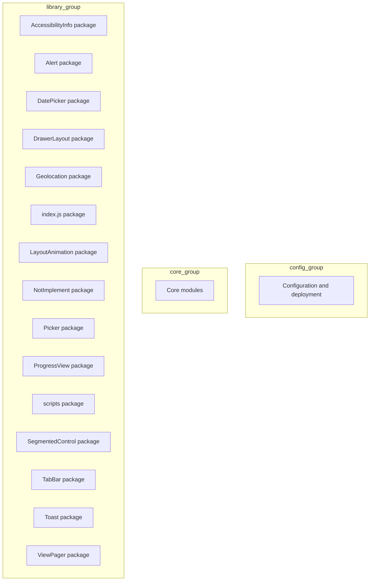

# Architecture report: taofed/react-web

> Automated static analysis. **Observed** = directly seen in files/imports/AST; **Inferred** = interpretation from that evidence. Repository code was not executed.

## 1. Repository at a glance

| Item | Value |
| --- | --- |
| Repository | taofed/react-web |
| Description | A framework for building web apps with React Native compatible API. |
| Language | JavaScript |
| Stars | 3323 |
| Licence | Other |
| Analysed commit / branch | bcdd7c015134785710c9ffd9e844532d6aa6f53d / master |
| Framework(s) | React |
| Files analysed | 43 |
| Components | 17 |

## 2. Architecture in one minute

taofed/react-web - A framework for building web apps with React Native compatible API.. This repository was analysed statically from 43 file(s) (0 Python). Detected technologies (observed from imports/manifests): React, webpack. Files are grouped into 17 component(s): AccessibilityInfo package, Alert package, Configuration and deployment, Core modules, DatePicker package, DrawerLayout package, Geolocation package, index.js package. Findings below distinguish observed facts from inferred interpretation.

## 3. High-level block diagram

## 4. Main components

### AccessibilityInfo package (`accessibilityinfo`)

- **Kind:** library
- **Status:** Observed
- **Confidence:** 0.85
- **Responsibility:** Groups 2 file(s) under accessibilityinfo package (observed from repository paths and static analysis).
- **Paths:** `src/AccessibilityInfo/AccessibilityInfo.web.js`, `src/AccessibilityInfo/index.js`
- **Evidence:** [src/AccessibilityInfo/AccessibilityInfo.web.js](https://github.com/taofed/react-web/blob/bcdd7c015134785710c9ffd9e844532d6aa6f53d/src/AccessibilityInfo/AccessibilityInfo.web.js); [src/AccessibilityInfo/index.js](https://github.com/taofed/react-web/blob/bcdd7c015134785710c9ffd9e844532d6aa6f53d/src/AccessibilityInfo/index.js)

### Alert package (`alert`)

- **Kind:** library
- **Status:** Observed
- **Confidence:** 0.85
- **Responsibility:** Groups 2 file(s) under alert package (observed from repository paths and static analysis).
- **Paths:** `src/Alert/Alert.web.js`, `src/Alert/index.js`
- **Evidence:** [src/Alert/Alert.web.js](https://github.com/taofed/react-web/blob/bcdd7c015134785710c9ffd9e844532d6aa6f53d/src/Alert/Alert.web.js); [src/Alert/index.js](https://github.com/taofed/react-web/blob/bcdd7c015134785710c9ffd9e844532d6aa6f53d/src/Alert/index.js)

### Configuration and deployment (`config`)

- **Kind:** config
- **Status:** Observed
- **Confidence:** 0.85
- **Responsibility:** Groups 3 file(s) under configuration and deployment (observed from repository paths and static analysis).
- **Paths:** `package.json`, `src/Settings/Settings.web.js`, `src/Settings/index.js`
- **Evidence:** [package.json](https://github.com/taofed/react-web/blob/bcdd7c015134785710c9ffd9e844532d6aa6f53d/package.json); [src/Settings/Settings.web.js](https://github.com/taofed/react-web/blob/bcdd7c015134785710c9ffd9e844532d6aa6f53d/src/Settings/Settings.web.js); [src/Settings/index.js](https://github.com/taofed/react-web/blob/bcdd7c015134785710c9ffd9e844532d6aa6f53d/src/Settings/index.js)

### Core modules (`core`)

- **Kind:** core
- **Status:** Observed
- **Confidence:** 0.85
- **Responsibility:** Groups 1 file(s) under core modules (observed from repository paths and static analysis).
- **Paths:** `cli.js`
- **Evidence:** [cli.js](https://github.com/taofed/react-web/blob/bcdd7c015134785710c9ffd9e844532d6aa6f53d/cli.js)

### DatePicker package (`datepicker`)

- **Kind:** library
- **Status:** Observed
- **Confidence:** 0.85
- **Responsibility:** Groups 2 file(s) under datepicker package (observed from repository paths and static analysis).
- **Paths:** `src/DatePicker/DatePicker.web.js`, `src/DatePicker/index.js`
- **Evidence:** [src/DatePicker/DatePicker.web.js](https://github.com/taofed/react-web/blob/bcdd7c015134785710c9ffd9e844532d6aa6f53d/src/DatePicker/DatePicker.web.js); [src/DatePicker/index.js](https://github.com/taofed/react-web/blob/bcdd7c015134785710c9ffd9e844532d6aa6f53d/src/DatePicker/index.js)

### DrawerLayout package (`drawerlayout`)

- **Kind:** library
- **Status:** Observed
- **Confidence:** 0.85
- **Responsibility:** Groups 2 file(s) under drawerlayout package (observed from repository paths and static analysis).
- **Paths:** `src/DrawerLayout/DrawerLayout.web.js`, `src/DrawerLayout/index.js`
- **Evidence:** [src/DrawerLayout/DrawerLayout.web.js](https://github.com/taofed/react-web/blob/bcdd7c015134785710c9ffd9e844532d6aa6f53d/src/DrawerLayout/DrawerLayout.web.js); [src/DrawerLayout/index.js](https://github.com/taofed/react-web/blob/bcdd7c015134785710c9ffd9e844532d6aa6f53d/src/DrawerLayout/index.js)

### Geolocation package (`geolocation`)

- **Kind:** library
- **Status:** Observed
- **Confidence:** 0.85
- **Responsibility:** Groups 2 file(s) under geolocation package (observed from repository paths and static analysis).
- **Paths:** `src/Geolocation/Geolocation.web.js`, `src/Geolocation/index.js`
- **Evidence:** [src/Geolocation/Geolocation.web.js](https://github.com/taofed/react-web/blob/bcdd7c015134785710c9ffd9e844532d6aa6f53d/src/Geolocation/Geolocation.web.js); [src/Geolocation/index.js](https://github.com/taofed/react-web/blob/bcdd7c015134785710c9ffd9e844532d6aa6f53d/src/Geolocation/index.js)

### index.js package (`index_js`)

- **Kind:** library
- **Status:** Observed
- **Confidence:** 0.85
- **Responsibility:** Groups 1 file(s) under index.js package (observed from repository paths and static analysis).
- **Paths:** `src/index.js`
- **Evidence:** [src/index.js](https://github.com/taofed/react-web/blob/bcdd7c015134785710c9ffd9e844532d6aa6f53d/src/index.js)

### LayoutAnimation package (`layoutanimation`)

- **Kind:** library
- **Status:** Observed
- **Confidence:** 0.85
- **Responsibility:** Groups 2 file(s) under layoutanimation package (observed from repository paths and static analysis).
- **Paths:** `src/LayoutAnimation/LayoutAnimation.web.js`, `src/LayoutAnimation/index.js`
- **Evidence:** [src/LayoutAnimation/LayoutAnimation.web.js](https://github.com/taofed/react-web/blob/bcdd7c015134785710c9ffd9e844532d6aa6f53d/src/LayoutAnimation/LayoutAnimation.web.js); [src/LayoutAnimation/index.js](https://github.com/taofed/react-web/blob/bcdd7c015134785710c9ffd9e844532d6aa6f53d/src/LayoutAnimation/index.js)

### NotImplement package (`notimplement`)

- **Kind:** library
- **Status:** Observed
- **Confidence:** 0.85
- **Responsibility:** Groups 1 file(s) under notimplement package (observed from repository paths and static analysis).
- **Paths:** `src/NotImplement/index.js`
- **Evidence:** [src/NotImplement/index.js](https://github.com/taofed/react-web/blob/bcdd7c015134785710c9ffd9e844532d6aa6f53d/src/NotImplement/index.js)

### Picker package (`picker`)

- **Kind:** library
- **Status:** Observed
- **Confidence:** 0.85
- **Responsibility:** Groups 2 file(s) under picker package (observed from repository paths and static analysis).
- **Paths:** `src/Picker/Picker.web.js`, `src/Picker/index.js`
- **Evidence:** [src/Picker/Picker.web.js](https://github.com/taofed/react-web/blob/bcdd7c015134785710c9ffd9e844532d6aa6f53d/src/Picker/Picker.web.js); [src/Picker/index.js](https://github.com/taofed/react-web/blob/bcdd7c015134785710c9ffd9e844532d6aa6f53d/src/Picker/index.js)

### ProgressView package (`progressview`)

- **Kind:** library
- **Status:** Observed
- **Confidence:** 0.85
- **Responsibility:** Groups 2 file(s) under progressview package (observed from repository paths and static analysis).
- **Paths:** `src/ProgressView/ProgressView.web.js`, `src/ProgressView/index.js`
- **Evidence:** [src/ProgressView/ProgressView.web.js](https://github.com/taofed/react-web/blob/bcdd7c015134785710c9ffd9e844532d6aa6f53d/src/ProgressView/ProgressView.web.js); [src/ProgressView/index.js](https://github.com/taofed/react-web/blob/bcdd7c015134785710c9ffd9e844532d6aa6f53d/src/ProgressView/index.js)

### scripts package (`scripts`)

- **Kind:** library
- **Status:** Observed
- **Confidence:** 0.85
- **Responsibility:** Groups 2 file(s) under scripts package (observed from repository paths and static analysis).
- **Paths:** `scripts/compile.js`, `scripts/rewrite-modules.js`
- **Evidence:** [scripts/compile.js](https://github.com/taofed/react-web/blob/bcdd7c015134785710c9ffd9e844532d6aa6f53d/scripts/compile.js); [scripts/rewrite-modules.js](https://github.com/taofed/react-web/blob/bcdd7c015134785710c9ffd9e844532d6aa6f53d/scripts/rewrite-modules.js)

### SegmentedControl package (`segmentedcontrol`)

- **Kind:** library
- **Status:** Observed
- **Confidence:** 0.85
- **Responsibility:** Groups 2 file(s) under segmentedcontrol package (observed from repository paths and static analysis).
- **Paths:** `src/SegmentedControl/SegmentedControl.web.js`, `src/SegmentedControl/index.js`
- **Evidence:** [src/SegmentedControl/SegmentedControl.web.js](https://github.com/taofed/react-web/blob/bcdd7c015134785710c9ffd9e844532d6aa6f53d/src/SegmentedControl/SegmentedControl.web.js); [src/SegmentedControl/index.js](https://github.com/taofed/react-web/blob/bcdd7c015134785710c9ffd9e844532d6aa6f53d/src/SegmentedControl/index.js)

### TabBar package (`tabbar`)

- **Kind:** library
- **Status:** Observed
- **Confidence:** 0.85
- **Responsibility:** Groups 4 file(s) under tabbar package (observed from repository paths and static analysis).
- **Paths:** `src/TabBar/TabBar.web.js`, `src/TabBar/TabBarContents.web.js`, `src/TabBar/TabBarItem.web.js`, `src/TabBar/index.js`
- **Evidence:** [src/TabBar/TabBar.web.js](https://github.com/taofed/react-web/blob/bcdd7c015134785710c9ffd9e844532d6aa6f53d/src/TabBar/TabBar.web.js); [src/TabBar/TabBarContents.web.js](https://github.com/taofed/react-web/blob/bcdd7c015134785710c9ffd9e844532d6aa6f53d/src/TabBar/TabBarContents.web.js); [src/TabBar/TabBarItem.web.js](https://github.com/taofed/react-web/blob/bcdd7c015134785710c9ffd9e844532d6aa6f53d/src/TabBar/TabBarItem.web.js); [src/TabBar/index.js](https://github.com/taofed/react-web/blob/bcdd7c015134785710c9ffd9e844532d6aa6f53d/src/TabBar/index.js)

### Toast package (`toast`)

- **Kind:** library
- **Status:** Observed
- **Confidence:** 0.85
- **Responsibility:** Groups 3 file(s) under toast package (observed from repository paths and static analysis).
- **Paths:** `src/Toast/Portal.web.js`, `src/Toast/Toast.web.js`, `src/Toast/index.js`
- **Evidence:** [src/Toast/Portal.web.js](https://github.com/taofed/react-web/blob/bcdd7c015134785710c9ffd9e844532d6aa6f53d/src/Toast/Portal.web.js); [src/Toast/Toast.web.js](https://github.com/taofed/react-web/blob/bcdd7c015134785710c9ffd9e844532d6aa6f53d/src/Toast/Toast.web.js); [src/Toast/index.js](https://github.com/taofed/react-web/blob/bcdd7c015134785710c9ffd9e844532d6aa6f53d/src/Toast/index.js)

### ViewPager package (`viewpager`)

- **Kind:** library
- **Status:** Observed
- **Confidence:** 0.85
- **Responsibility:** Groups 2 file(s) under viewpager package (observed from repository paths and static analysis).
- **Paths:** `src/ViewPager/ViewPager.web.js`, `src/ViewPager/index.js`
- **Evidence:** [src/ViewPager/ViewPager.web.js](https://github.com/taofed/react-web/blob/bcdd7c015134785710c9ffd9e844532d6aa6f53d/src/ViewPager/ViewPager.web.js); [src/ViewPager/index.js](https://github.com/taofed/react-web/blob/bcdd7c015134785710c9ffd9e844532d6aa6f53d/src/ViewPager/index.js)

## 5. Execution flow

**Observed** entry point(s):

- [src/AccessibilityInfo/index.js](https://github.com/taofed/react-web/blob/bcdd7c015134785710c9ffd9e844532d6aa6f53d/src/AccessibilityInfo/index.js)
- [src/Alert/index.js](https://github.com/taofed/react-web/blob/bcdd7c015134785710c9ffd9e844532d6aa6f53d/src/Alert/index.js)
- [src/DatePicker/index.js](https://github.com/taofed/react-web/blob/bcdd7c015134785710c9ffd9e844532d6aa6f53d/src/DatePicker/index.js)
- [src/DrawerLayout/index.js](https://github.com/taofed/react-web/blob/bcdd7c015134785710c9ffd9e844532d6aa6f53d/src/DrawerLayout/index.js)
- [src/Geolocation/index.js](https://github.com/taofed/react-web/blob/bcdd7c015134785710c9ffd9e844532d6aa6f53d/src/Geolocation/index.js)
- [src/LayoutAnimation/index.js](https://github.com/taofed/react-web/blob/bcdd7c015134785710c9ffd9e844532d6aa6f53d/src/LayoutAnimation/index.js)
- [src/NotImplement/index.js](https://github.com/taofed/react-web/blob/bcdd7c015134785710c9ffd9e844532d6aa6f53d/src/NotImplement/index.js)
- [src/Picker/index.js](https://github.com/taofed/react-web/blob/bcdd7c015134785710c9ffd9e844532d6aa6f53d/src/Picker/index.js)
- [src/ProgressView/index.js](https://github.com/taofed/react-web/blob/bcdd7c015134785710c9ffd9e844532d6aa6f53d/src/ProgressView/index.js)
- [src/SegmentedControl/index.js](https://github.com/taofed/react-web/blob/bcdd7c015134785710c9ffd9e844532d6aa6f53d/src/SegmentedControl/index.js)
- [src/Settings/index.js](https://github.com/taofed/react-web/blob/bcdd7c015134785710c9ffd9e844532d6aa6f53d/src/Settings/index.js)
- [src/TabBar/index.js](https://github.com/taofed/react-web/blob/bcdd7c015134785710c9ffd9e844532d6aa6f53d/src/TabBar/index.js)

Representative flow (derived from observed entry points and the import graph; steps beyond the entry point are **Inferred**):

1. Execution starts at an observed entry point listed above, if present.
2. No internal import relationships between components were observed.

## 6. Project structure

### `(root)`

- `.editorconfig` - config (414 bytes)
- `.eslintignore` - other (35 bytes)
- `.eslintrc` - other (2869 bytes)
- `.gitignore` - other (305 bytes)
- `.npmignore` - other (378 bytes)
- `LICENSE` - docs (1586 bytes)
- `README-zh.md` - docs (2106 bytes)
- `README.md` - docs (2444 bytes)
- `cli.js` - source, JavaScript (175 bytes)
- `package.json` - manifest (1701 bytes)

### `scripts`

- `scripts/compile.js` - source, JavaScript (1077 bytes)
- `scripts/rewrite-modules.js` - source, JavaScript (4030 bytes)

### `src`

- `src/AccessibilityInfo/AccessibilityInfo.web.js` - source, JavaScript (388 bytes)
- `src/AccessibilityInfo/index.js` - source, JavaScript (41 bytes)
- `src/Alert/Alert.web.js` - source, JavaScript (2691 bytes)
- `src/Alert/index.js` - source, JavaScript (29 bytes)
- `src/DatePicker/DatePicker.web.js` - source, JavaScript (2381 bytes)
- `src/DatePicker/index.js` - source, JavaScript (34 bytes)
- `src/DrawerLayout/DrawerLayout.web.js` - source, JavaScript (7381 bytes)
- `src/DrawerLayout/index.js` - source, JavaScript (36 bytes)
- `src/Geolocation/Geolocation.web.js` - source, JavaScript (147 bytes)
- `src/Geolocation/index.js` - source, JavaScript (35 bytes)
- `src/LayoutAnimation/LayoutAnimation.web.js` - source, JavaScript (2637 bytes)
- `src/LayoutAnimation/index.js` - source, JavaScript (39 bytes)
- `src/NotImplement/index.js` - source, JavaScript (58 bytes)
- `src/Picker/Picker.web.js` - source, JavaScript (1279 bytes)
- `src/Picker/index.js` - source, JavaScript (30 bytes)
- `src/ProgressView/ProgressView.web.js` - source, JavaScript (2181 bytes)
- `src/ProgressView/index.js` - source, JavaScript (36 bytes)
- `src/SegmentedControl/SegmentedControl.web.js` - source, JavaScript (4271 bytes)
- `src/SegmentedControl/index.js` - source, JavaScript (40 bytes)
- `src/Settings/Settings.web.js` - source, JavaScript (421 bytes)
- `src/Settings/index.js` - source, JavaScript (32 bytes)
- `src/TabBar/TabBar.web.js` - source, JavaScript (2759 bytes)
- `src/TabBar/TabBarContents.web.js` - source, JavaScript (1171 bytes)
- `src/TabBar/TabBarItem.web.js` - source, JavaScript (2903 bytes)
- `src/TabBar/index.js` - source, JavaScript (30 bytes)
- `src/Toast/Portal.web.js` - source, JavaScript (4065 bytes)
- `src/Toast/Toast.web.js` - source, JavaScript (864 bytes)
- `src/Toast/index.js` - source, JavaScript (29 bytes)
- `src/ViewPager/ViewPager.web.js` - source, JavaScript (6138 bytes)
- `src/ViewPager/index.js` - source, JavaScript (33 bytes)
- `src/index.js` - source, JavaScript (3224 bytes)

## 7. Key dependencies and integrations

| Name | Category | Status | Confidence | Evidence |
| --- | --- | --- | --- | --- |
| React | framework | Observed | 0.90 | [package.json:2](https://github.com/taofed/react-web/blob/bcdd7c015134785710c9ffd9e844532d6aa6f53d/package.json#L2); [package.json:56](https://github.com/taofed/react-web/blob/bcdd7c015134785710c9ffd9e844532d6aa6f53d/package.json#L56) |
| webpack | tooling | Observed | 0.85 | [package.json:38](https://github.com/taofed/react-web/blob/bcdd7c015134785710c9ffd9e844532d6aa6f53d/package.json#L38) |

## 8. Data and state

No database, cache, queue, or persistent-state usage was observed in the analysed files. State handling, if any, may be in-memory or in files that were not analysed.

## 9. Configuration and deployment clues

- `.editorconfig` (config)
- `package.json` (manifest)

## 10. Design observations

- No strong design patterns could be established from the available evidence.

These observations are interpretations (**Inferred**) of the observed structure, not guarantees about runtime design.

## 11. Limitations and unknowns

- Static analysis only: repository code was not executed, installed, or imported at runtime.
- Components and relationships are inferred from file paths, imports, and AST structure; runtime behaviour, dynamic imports, and reflection may not be visible.
- No clear application entry point was observed in the analysed files.
- Repository text was treated as untrusted data; no instructions found in repository files were followed, and likely secret values were redacted/excluded.
- JavaScript and TypeScript files were inventoried from paths and package manifests. They were not parsed with a full language AST, and repository code was not executed.
- The GitHub repository was marked archived at selection time.

## 12. Source references

- [cli.js](https://github.com/taofed/react-web/blob/bcdd7c015134785710c9ffd9e844532d6aa6f53d/cli.js)
- [package.json](https://github.com/taofed/react-web/blob/bcdd7c015134785710c9ffd9e844532d6aa6f53d/package.json)
- [package.json:2](https://github.com/taofed/react-web/blob/bcdd7c015134785710c9ffd9e844532d6aa6f53d/package.json#L2)
- [package.json:38](https://github.com/taofed/react-web/blob/bcdd7c015134785710c9ffd9e844532d6aa6f53d/package.json#L38)
- [package.json:56](https://github.com/taofed/react-web/blob/bcdd7c015134785710c9ffd9e844532d6aa6f53d/package.json#L56)
- [scripts/compile.js](https://github.com/taofed/react-web/blob/bcdd7c015134785710c9ffd9e844532d6aa6f53d/scripts/compile.js)
- [scripts/rewrite-modules.js](https://github.com/taofed/react-web/blob/bcdd7c015134785710c9ffd9e844532d6aa6f53d/scripts/rewrite-modules.js)
- [src/AccessibilityInfo/AccessibilityInfo.web.js](https://github.com/taofed/react-web/blob/bcdd7c015134785710c9ffd9e844532d6aa6f53d/src/AccessibilityInfo/AccessibilityInfo.web.js)
- [src/AccessibilityInfo/index.js](https://github.com/taofed/react-web/blob/bcdd7c015134785710c9ffd9e844532d6aa6f53d/src/AccessibilityInfo/index.js)
- [src/Alert/Alert.web.js](https://github.com/taofed/react-web/blob/bcdd7c015134785710c9ffd9e844532d6aa6f53d/src/Alert/Alert.web.js)
- [src/Alert/index.js](https://github.com/taofed/react-web/blob/bcdd7c015134785710c9ffd9e844532d6aa6f53d/src/Alert/index.js)
- [src/DatePicker/DatePicker.web.js](https://github.com/taofed/react-web/blob/bcdd7c015134785710c9ffd9e844532d6aa6f53d/src/DatePicker/DatePicker.web.js)
- [src/DatePicker/index.js](https://github.com/taofed/react-web/blob/bcdd7c015134785710c9ffd9e844532d6aa6f53d/src/DatePicker/index.js)
- [src/DrawerLayout/DrawerLayout.web.js](https://github.com/taofed/react-web/blob/bcdd7c015134785710c9ffd9e844532d6aa6f53d/src/DrawerLayout/DrawerLayout.web.js)
- [src/DrawerLayout/index.js](https://github.com/taofed/react-web/blob/bcdd7c015134785710c9ffd9e844532d6aa6f53d/src/DrawerLayout/index.js)
- [src/Geolocation/Geolocation.web.js](https://github.com/taofed/react-web/blob/bcdd7c015134785710c9ffd9e844532d6aa6f53d/src/Geolocation/Geolocation.web.js)
- [src/Geolocation/index.js](https://github.com/taofed/react-web/blob/bcdd7c015134785710c9ffd9e844532d6aa6f53d/src/Geolocation/index.js)
- [src/LayoutAnimation/LayoutAnimation.web.js](https://github.com/taofed/react-web/blob/bcdd7c015134785710c9ffd9e844532d6aa6f53d/src/LayoutAnimation/LayoutAnimation.web.js)
- [src/LayoutAnimation/index.js](https://github.com/taofed/react-web/blob/bcdd7c015134785710c9ffd9e844532d6aa6f53d/src/LayoutAnimation/index.js)
- [src/NotImplement/index.js](https://github.com/taofed/react-web/blob/bcdd7c015134785710c9ffd9e844532d6aa6f53d/src/NotImplement/index.js)
- [src/Picker/Picker.web.js](https://github.com/taofed/react-web/blob/bcdd7c015134785710c9ffd9e844532d6aa6f53d/src/Picker/Picker.web.js)
- [src/Picker/index.js](https://github.com/taofed/react-web/blob/bcdd7c015134785710c9ffd9e844532d6aa6f53d/src/Picker/index.js)
- [src/ProgressView/ProgressView.web.js](https://github.com/taofed/react-web/blob/bcdd7c015134785710c9ffd9e844532d6aa6f53d/src/ProgressView/ProgressView.web.js)
- [src/ProgressView/index.js](https://github.com/taofed/react-web/blob/bcdd7c015134785710c9ffd9e844532d6aa6f53d/src/ProgressView/index.js)
- [src/SegmentedControl/SegmentedControl.web.js](https://github.com/taofed/react-web/blob/bcdd7c015134785710c9ffd9e844532d6aa6f53d/src/SegmentedControl/SegmentedControl.web.js)
- [src/SegmentedControl/index.js](https://github.com/taofed/react-web/blob/bcdd7c015134785710c9ffd9e844532d6aa6f53d/src/SegmentedControl/index.js)
- [src/Settings/Settings.web.js](https://github.com/taofed/react-web/blob/bcdd7c015134785710c9ffd9e844532d6aa6f53d/src/Settings/Settings.web.js)
- [src/Settings/index.js](https://github.com/taofed/react-web/blob/bcdd7c015134785710c9ffd9e844532d6aa6f53d/src/Settings/index.js)
- [src/TabBar/TabBar.web.js](https://github.com/taofed/react-web/blob/bcdd7c015134785710c9ffd9e844532d6aa6f53d/src/TabBar/TabBar.web.js)
- [src/TabBar/TabBarContents.web.js](https://github.com/taofed/react-web/blob/bcdd7c015134785710c9ffd9e844532d6aa6f53d/src/TabBar/TabBarContents.web.js)
- [src/TabBar/TabBarItem.web.js](https://github.com/taofed/react-web/blob/bcdd7c015134785710c9ffd9e844532d6aa6f53d/src/TabBar/TabBarItem.web.js)
- [src/TabBar/index.js](https://github.com/taofed/react-web/blob/bcdd7c015134785710c9ffd9e844532d6aa6f53d/src/TabBar/index.js)
- [src/Toast/Portal.web.js](https://github.com/taofed/react-web/blob/bcdd7c015134785710c9ffd9e844532d6aa6f53d/src/Toast/Portal.web.js)
- [src/Toast/Toast.web.js](https://github.com/taofed/react-web/blob/bcdd7c015134785710c9ffd9e844532d6aa6f53d/src/Toast/Toast.web.js)
- [src/Toast/index.js](https://github.com/taofed/react-web/blob/bcdd7c015134785710c9ffd9e844532d6aa6f53d/src/Toast/index.js)
- [src/ViewPager/ViewPager.web.js](https://github.com/taofed/react-web/blob/bcdd7c015134785710c9ffd9e844532d6aa6f53d/src/ViewPager/ViewPager.web.js)
- [src/ViewPager/index.js](https://github.com/taofed/react-web/blob/bcdd7c015134785710c9ffd9e844532d6aa6f53d/src/ViewPager/index.js)
- [src/index.js](https://github.com/taofed/react-web/blob/bcdd7c015134785710c9ffd9e844532d6aa6f53d/src/index.js)
