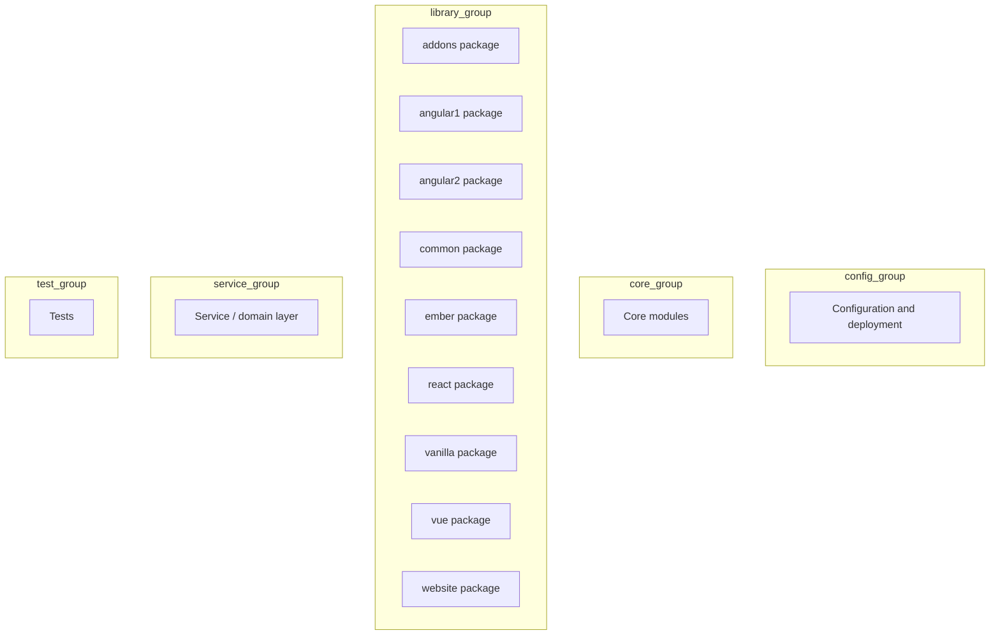

# Architecture report: text-mask/text-mask

> Automated static analysis. **Observed** = directly seen in files/imports/AST; **Inferred** = interpretation from that evidence. Repository code was not executed.

## 1. Repository at a glance

| Item | Value |
| --- | --- |
| Repository | text-mask/text-mask |
| Description | Input mask for React, Angular, Ember, Vue, & plain JavaScript |
| Language | JavaScript |
| Stars | 8203 |
| Licence | Unlicense |
| Analysed commit / branch | 120393e0de2c4c7742fb600ff8c5a72ddf3e58cf / master |
| Framework(s) | React, Vue |
| Files analysed | 181 |
| Components | 13 |

## 2. Architecture in one minute

text-mask/text-mask - Input mask for React, Angular, Ember, Vue, & plain JavaScript. This repository was analysed statically from 181 file(s) (0 Python). Detected technologies (observed from imports/manifests): React, Vue, Redux, TypeScript, webpack. Files are grouped into 13 component(s): addons package, angular1 package, angular2 package, common package, Configuration and deployment, Core modules, ember package, react package. Findings below distinguish observed facts from inferred interpretation.

## 3. High-level block diagram

## 4. Main components

### addons package (`addons`)

- **Kind:** library
- **Status:** Observed
- **Confidence:** 0.85
- **Responsibility:** Groups 7 file(s) under addons package (observed from repository paths and static analysis).
- **Paths:** `addons/publish.sh`, `addons/src/createAutoCorrectedDatePipe.js`, `addons/src/createNumberMask.js`, `addons/src/emailMask.js`, `addons/src/emailPipe.js`, `addons/src/index.js`, `addons/webpack.buildAddons.js`
- **Evidence:** [addons/publish.sh](https://github.com/text-mask/text-mask/blob/120393e0de2c4c7742fb600ff8c5a72ddf3e58cf/addons/publish.sh); [addons/src/createAutoCorrectedDatePipe.js](https://github.com/text-mask/text-mask/blob/120393e0de2c4c7742fb600ff8c5a72ddf3e58cf/addons/src/createAutoCorrectedDatePipe.js); [addons/src/createNumberMask.js](https://github.com/text-mask/text-mask/blob/120393e0de2c4c7742fb600ff8c5a72ddf3e58cf/addons/src/createNumberMask.js); [addons/src/emailMask.js](https://github.com/text-mask/text-mask/blob/120393e0de2c4c7742fb600ff8c5a72ddf3e58cf/addons/src/emailMask.js); [addons/src/emailPipe.js](https://github.com/text-mask/text-mask/blob/120393e0de2c4c7742fb600ff8c5a72ddf3e58cf/addons/src/emailPipe.js); [addons/src/index.js](https://github.com/text-mask/text-mask/blob/120393e0de2c4c7742fb600ff8c5a72ddf3e58cf/addons/src/index.js); [addons/webpack.buildAddons.js](https://github.com/text-mask/text-mask/blob/120393e0de2c4c7742fb600ff8c5a72ddf3e58cf/addons/webpack.buildAddons.js)

### angular1 package (`angular1`)

- **Kind:** library
- **Status:** Observed
- **Confidence:** 0.85
- **Responsibility:** Groups 5 file(s) under angular1 package (observed from repository paths and static analysis).
- **Paths:** `angular1/example/app.js`, `angular1/example/webpack.runAngular1Example.js`, `angular1/publish.sh`, `angular1/src/angular1TextMask.js`, `angular1/webpack.buildAngular1Integration.js`
- **Evidence:** [angular1/example/app.js](https://github.com/text-mask/text-mask/blob/120393e0de2c4c7742fb600ff8c5a72ddf3e58cf/angular1/example/app.js); [angular1/example/webpack.runAngular1Example.js](https://github.com/text-mask/text-mask/blob/120393e0de2c4c7742fb600ff8c5a72ddf3e58cf/angular1/example/webpack.runAngular1Example.js); [angular1/publish.sh](https://github.com/text-mask/text-mask/blob/120393e0de2c4c7742fb600ff8c5a72ddf3e58cf/angular1/publish.sh); [angular1/src/angular1TextMask.js](https://github.com/text-mask/text-mask/blob/120393e0de2c4c7742fb600ff8c5a72ddf3e58cf/angular1/src/angular1TextMask.js); [angular1/webpack.buildAngular1Integration.js](https://github.com/text-mask/text-mask/blob/120393e0de2c4c7742fb600ff8c5a72ddf3e58cf/angular1/webpack.buildAngular1Integration.js)

### angular2 package (`angular2`)

- **Kind:** library
- **Status:** Observed
- **Confidence:** 0.85
- **Responsibility:** Groups 11 file(s) under angular2 package (observed from repository paths and static analysis).
- **Paths:** `angular2/example/app.component.ts`, `angular2/example/app.module.ts`, `angular2/example/main.ts`, `angular2/example/systemjs.config.js`, `angular2/karma.conf.js`, `angular2/publish.sh`, `angular2/src/angular2TextMask.ts`, `angular2/typings/globals/core-js/index.d.ts`, `angular2/typings/globals/jasmine/index.d.ts`, `angular2/typings/globals/node/index.d.ts`, `angular2/typings/index.d.ts`
- **Evidence:** [angular2/example/app.component.ts](https://github.com/text-mask/text-mask/blob/120393e0de2c4c7742fb600ff8c5a72ddf3e58cf/angular2/example/app.component.ts); [angular2/example/app.module.ts](https://github.com/text-mask/text-mask/blob/120393e0de2c4c7742fb600ff8c5a72ddf3e58cf/angular2/example/app.module.ts); [angular2/example/main.ts](https://github.com/text-mask/text-mask/blob/120393e0de2c4c7742fb600ff8c5a72ddf3e58cf/angular2/example/main.ts); [angular2/example/systemjs.config.js](https://github.com/text-mask/text-mask/blob/120393e0de2c4c7742fb600ff8c5a72ddf3e58cf/angular2/example/systemjs.config.js); [angular2/karma.conf.js](https://github.com/text-mask/text-mask/blob/120393e0de2c4c7742fb600ff8c5a72ddf3e58cf/angular2/karma.conf.js); [angular2/publish.sh](https://github.com/text-mask/text-mask/blob/120393e0de2c4c7742fb600ff8c5a72ddf3e58cf/angular2/publish.sh); [angular2/src/angular2TextMask.ts](https://github.com/text-mask/text-mask/blob/120393e0de2c4c7742fb600ff8c5a72ddf3e58cf/angular2/src/angular2TextMask.ts); [angular2/typings/globals/core-js/index.d.ts](https://github.com/text-mask/text-mask/blob/120393e0de2c4c7742fb600ff8c5a72ddf3e58cf/angular2/typings/globals/core-js/index.d.ts)

### common package (`common`)

- **Kind:** library
- **Status:** Observed
- **Confidence:** 0.85
- **Responsibility:** Groups 6 file(s) under common package (observed from repository paths and static analysis).
- **Paths:** `common/domSetup.js`, `common/isVerify.js`, `common/keepCharPositionsTests.js`, `common/maskFunctionTests.js`, `common/testParameters.js`, `common/testSetup.js`
- **Evidence:** [common/domSetup.js](https://github.com/text-mask/text-mask/blob/120393e0de2c4c7742fb600ff8c5a72ddf3e58cf/common/domSetup.js); [common/isVerify.js](https://github.com/text-mask/text-mask/blob/120393e0de2c4c7742fb600ff8c5a72ddf3e58cf/common/isVerify.js); [common/keepCharPositionsTests.js](https://github.com/text-mask/text-mask/blob/120393e0de2c4c7742fb600ff8c5a72ddf3e58cf/common/keepCharPositionsTests.js); [common/maskFunctionTests.js](https://github.com/text-mask/text-mask/blob/120393e0de2c4c7742fb600ff8c5a72ddf3e58cf/common/maskFunctionTests.js); [common/testParameters.js](https://github.com/text-mask/text-mask/blob/120393e0de2c4c7742fb600ff8c5a72ddf3e58cf/common/testParameters.js); [common/testSetup.js](https://github.com/text-mask/text-mask/blob/120393e0de2c4c7742fb600ff8c5a72ddf3e58cf/common/testSetup.js)

### Configuration and deployment (`config`)

- **Kind:** config
- **Status:** Observed
- **Confidence:** 0.85
- **Responsibility:** Groups 22 file(s) under configuration and deployment (observed from repository paths and static analysis).
- **Paths:** `addons/package.json`, `angular1/package.json`, `angular2/bs-config.json`, `angular2/example/tsconfig.json`, `angular2/package.json`, `angular2/tsconfig.json`, `angular2/tsconfig.test.json`, `angular2/tslint.json`, `angular2/typings.json`, `angular2/typings/globals/core-js/typings.json`, `angular2/typings/globals/jasmine/typings.json`, `angular2/typings/globals/node/typings.json`, `core/package.json`, `ember/.editorconfig`, `ember/.travis.yml`, `ember/config/ember-try.js`, `ember/config/environment.js`, `ember/package.json`, `package.json`, `react/package.json`, `vanilla/package.json`, `vue/package.json`
- **Evidence:** [addons/package.json](https://github.com/text-mask/text-mask/blob/120393e0de2c4c7742fb600ff8c5a72ddf3e58cf/addons/package.json); [angular1/package.json](https://github.com/text-mask/text-mask/blob/120393e0de2c4c7742fb600ff8c5a72ddf3e58cf/angular1/package.json); [angular2/bs-config.json](https://github.com/text-mask/text-mask/blob/120393e0de2c4c7742fb600ff8c5a72ddf3e58cf/angular2/bs-config.json); [angular2/example/tsconfig.json](https://github.com/text-mask/text-mask/blob/120393e0de2c4c7742fb600ff8c5a72ddf3e58cf/angular2/example/tsconfig.json); [angular2/package.json](https://github.com/text-mask/text-mask/blob/120393e0de2c4c7742fb600ff8c5a72ddf3e58cf/angular2/package.json); [angular2/tsconfig.json](https://github.com/text-mask/text-mask/blob/120393e0de2c4c7742fb600ff8c5a72ddf3e58cf/angular2/tsconfig.json); [angular2/tsconfig.test.json](https://github.com/text-mask/text-mask/blob/120393e0de2c4c7742fb600ff8c5a72ddf3e58cf/angular2/tsconfig.test.json); [angular2/tslint.json](https://github.com/text-mask/text-mask/blob/120393e0de2c4c7742fb600ff8c5a72ddf3e58cf/angular2/tslint.json)

### Core modules (`core`)

- **Kind:** core
- **Status:** Observed
- **Confidence:** 0.85
- **Responsibility:** Groups 1 file(s) under core modules (observed from repository paths and static analysis).
- **Paths:** `publish.sh`
- **Evidence:** [publish.sh](https://github.com/text-mask/text-mask/blob/120393e0de2c4c7742fb600ff8c5a72ddf3e58cf/publish.sh)

### ember package (`ember`)

- **Kind:** library
- **Status:** Observed
- **Confidence:** 0.85
- **Responsibility:** Groups 8 file(s) under ember package (observed from repository paths and static analysis).
- **Paths:** `ember/.eslintrc.js`, `ember/addon/components/masked-input.js`, `ember/addon/index.js`, `ember/app/components/masked-input.js`, `ember/ember-cli-build.js`, `ember/index.js`, `ember/publish.sh`, `ember/testem.js`
- **Evidence:** [ember/.eslintrc.js](https://github.com/text-mask/text-mask/blob/120393e0de2c4c7742fb600ff8c5a72ddf3e58cf/ember/.eslintrc.js); [ember/addon/components/masked-input.js](https://github.com/text-mask/text-mask/blob/120393e0de2c4c7742fb600ff8c5a72ddf3e58cf/ember/addon/components/masked-input.js); [ember/addon/index.js](https://github.com/text-mask/text-mask/blob/120393e0de2c4c7742fb600ff8c5a72ddf3e58cf/ember/addon/index.js); [ember/app/components/masked-input.js](https://github.com/text-mask/text-mask/blob/120393e0de2c4c7742fb600ff8c5a72ddf3e58cf/ember/app/components/masked-input.js); [ember/ember-cli-build.js](https://github.com/text-mask/text-mask/blob/120393e0de2c4c7742fb600ff8c5a72ddf3e58cf/ember/ember-cli-build.js); [ember/index.js](https://github.com/text-mask/text-mask/blob/120393e0de2c4c7742fb600ff8c5a72ddf3e58cf/ember/index.js); [ember/publish.sh](https://github.com/text-mask/text-mask/blob/120393e0de2c4c7742fb600ff8c5a72ddf3e58cf/ember/publish.sh); [ember/testem.js](https://github.com/text-mask/text-mask/blob/120393e0de2c4c7742fb600ff8c5a72ddf3e58cf/ember/testem.js)

### react package (`react`)

- **Kind:** library
- **Status:** Observed
- **Confidence:** 0.85
- **Responsibility:** Groups 7 file(s) under react package (observed from repository paths and static analysis).
- **Paths:** `react/example/app.js`, `react/example/index.js`, `react/example/server.js`, `react/example/webpack.runReactExample.js`, `react/publish.sh`, `react/src/reactTextMask.js`, `react/webpack.buildReactIntegration.js`
- **Evidence:** [react/example/app.js](https://github.com/text-mask/text-mask/blob/120393e0de2c4c7742fb600ff8c5a72ddf3e58cf/react/example/app.js); [react/example/index.js](https://github.com/text-mask/text-mask/blob/120393e0de2c4c7742fb600ff8c5a72ddf3e58cf/react/example/index.js); [react/example/server.js](https://github.com/text-mask/text-mask/blob/120393e0de2c4c7742fb600ff8c5a72ddf3e58cf/react/example/server.js); [react/example/webpack.runReactExample.js](https://github.com/text-mask/text-mask/blob/120393e0de2c4c7742fb600ff8c5a72ddf3e58cf/react/example/webpack.runReactExample.js); [react/publish.sh](https://github.com/text-mask/text-mask/blob/120393e0de2c4c7742fb600ff8c5a72ddf3e58cf/react/publish.sh); [react/src/reactTextMask.js](https://github.com/text-mask/text-mask/blob/120393e0de2c4c7742fb600ff8c5a72ddf3e58cf/react/src/reactTextMask.js); [react/webpack.buildReactIntegration.js](https://github.com/text-mask/text-mask/blob/120393e0de2c4c7742fb600ff8c5a72ddf3e58cf/react/webpack.buildReactIntegration.js)

### Service / domain layer (`service_layer`)

- **Kind:** service
- **Status:** Observed
- **Confidence:** 0.85
- **Responsibility:** Groups 9 file(s) under service / domain layer (observed from repository paths and static analysis).
- **Paths:** `core/publish.sh`, `core/src/adjustCaretPosition.js`, `core/src/conformToMask.js`, `core/src/constants.js`, `core/src/createTextMaskInputElement.d.ts`, `core/src/createTextMaskInputElement.js`, `core/src/index.js`, `core/src/utilities.js`, `core/webpack.buildCore.js`
- **Evidence:** [core/publish.sh](https://github.com/text-mask/text-mask/blob/120393e0de2c4c7742fb600ff8c5a72ddf3e58cf/core/publish.sh); [core/src/adjustCaretPosition.js](https://github.com/text-mask/text-mask/blob/120393e0de2c4c7742fb600ff8c5a72ddf3e58cf/core/src/adjustCaretPosition.js); [core/src/conformToMask.js](https://github.com/text-mask/text-mask/blob/120393e0de2c4c7742fb600ff8c5a72ddf3e58cf/core/src/conformToMask.js); [core/src/constants.js](https://github.com/text-mask/text-mask/blob/120393e0de2c4c7742fb600ff8c5a72ddf3e58cf/core/src/constants.js); [core/src/createTextMaskInputElement.d.ts](https://github.com/text-mask/text-mask/blob/120393e0de2c4c7742fb600ff8c5a72ddf3e58cf/core/src/createTextMaskInputElement.d.ts); [core/src/createTextMaskInputElement.js](https://github.com/text-mask/text-mask/blob/120393e0de2c4c7742fb600ff8c5a72ddf3e58cf/core/src/createTextMaskInputElement.js); [core/src/index.js](https://github.com/text-mask/text-mask/blob/120393e0de2c4c7742fb600ff8c5a72ddf3e58cf/core/src/index.js); [core/src/utilities.js](https://github.com/text-mask/text-mask/blob/120393e0de2c4c7742fb600ff8c5a72ddf3e58cf/core/src/utilities.js)

### Tests (`tests`)

- **Kind:** test
- **Status:** Observed
- **Confidence:** 0.85
- **Responsibility:** Groups 38 file(s) under tests (observed from repository paths and static analysis).
- **Paths:** `addons/test/addonsBundle.spec.js`, `addons/test/createAutoCorrectedDatePipe.spec.js`, `addons/test/createNumberMask.spec.js`, `addons/test/emailMask.spec.js`, `angular1/test/angular1TextMask.spec.js`, `angular2/test/angular2TextMask.spec.ts`, `angular2/test/index.spec.ts`, `core/test/adjustCaretPosition.spec.js`, `core/test/conformToMask.spec.js`, `core/test/createTextMaskInputElement.spec.js`, `core/test/utilities.spec.js`, `ember/tests/.eslintrc.js`, `ember/tests/acceptance/input-mask-test.js`, `ember/tests/dummy/app/app.js`, `ember/tests/dummy/app/controllers/.gitkeep`, `ember/tests/dummy/app/controllers/application.js`, `ember/tests/dummy/app/index.html`, `ember/tests/dummy/app/resolver.js`, `ember/tests/dummy/app/router.js`, `ember/tests/dummy/app/styles/app.css`, `ember/tests/dummy/app/templates/application.hbs`, `ember/tests/dummy/config/environment.js`, `ember/tests/dummy/config/targets.js`, `ember/tests/dummy/public/crossdomain.xml`, `ember/tests/dummy/public/robots.txt`, `ember/tests/helpers/destroy-app.js`, `ember/tests/helpers/module-for-acceptance.js`, `ember/tests/helpers/resolver.js`, `ember/tests/helpers/start-app.js`, `ember/tests/index.html`, `ember/tests/integration/.gitkeep`, `ember/tests/integration/components/masked-input-test.js`, `ember/tests/test-helper.js`, `ember/tests/unit/.gitkeep`, `ember/tests/unit/components/masked-input-test.js`, `react/test/reactTextMask.spec.js`, `vanilla/test/vanillaTextMask.spec.js`, `vue/test/vueTextMask.spec.js`
- **Evidence:** [addons/test/addonsBundle.spec.js](https://github.com/text-mask/text-mask/blob/120393e0de2c4c7742fb600ff8c5a72ddf3e58cf/addons/test/addonsBundle.spec.js); [addons/test/createAutoCorrectedDatePipe.spec.js](https://github.com/text-mask/text-mask/blob/120393e0de2c4c7742fb600ff8c5a72ddf3e58cf/addons/test/createAutoCorrectedDatePipe.spec.js); [addons/test/createNumberMask.spec.js](https://github.com/text-mask/text-mask/blob/120393e0de2c4c7742fb600ff8c5a72ddf3e58cf/addons/test/createNumberMask.spec.js); [addons/test/emailMask.spec.js](https://github.com/text-mask/text-mask/blob/120393e0de2c4c7742fb600ff8c5a72ddf3e58cf/addons/test/emailMask.spec.js); [angular1/test/angular1TextMask.spec.js](https://github.com/text-mask/text-mask/blob/120393e0de2c4c7742fb600ff8c5a72ddf3e58cf/angular1/test/angular1TextMask.spec.js); [angular2/test/angular2TextMask.spec.ts](https://github.com/text-mask/text-mask/blob/120393e0de2c4c7742fb600ff8c5a72ddf3e58cf/angular2/test/angular2TextMask.spec.ts); [angular2/test/index.spec.ts](https://github.com/text-mask/text-mask/blob/120393e0de2c4c7742fb600ff8c5a72ddf3e58cf/angular2/test/index.spec.ts); [core/test/adjustCaretPosition.spec.js](https://github.com/text-mask/text-mask/blob/120393e0de2c4c7742fb600ff8c5a72ddf3e58cf/core/test/adjustCaretPosition.spec.js)

### vanilla package (`vanilla`)

- **Kind:** library
- **Status:** Observed
- **Confidence:** 0.85
- **Responsibility:** Groups 5 file(s) under vanilla package (observed from repository paths and static analysis).
- **Paths:** `vanilla/example/index.js`, `vanilla/example/webpack.runVanillaExample.js`, `vanilla/publish.sh`, `vanilla/src/vanillaTextMask.js`, `vanilla/webpack.buildVanillaIntegration.js`
- **Evidence:** [vanilla/example/index.js](https://github.com/text-mask/text-mask/blob/120393e0de2c4c7742fb600ff8c5a72ddf3e58cf/vanilla/example/index.js); [vanilla/example/webpack.runVanillaExample.js](https://github.com/text-mask/text-mask/blob/120393e0de2c4c7742fb600ff8c5a72ddf3e58cf/vanilla/example/webpack.runVanillaExample.js); [vanilla/publish.sh](https://github.com/text-mask/text-mask/blob/120393e0de2c4c7742fb600ff8c5a72ddf3e58cf/vanilla/publish.sh); [vanilla/src/vanillaTextMask.js](https://github.com/text-mask/text-mask/blob/120393e0de2c4c7742fb600ff8c5a72ddf3e58cf/vanilla/src/vanillaTextMask.js); [vanilla/webpack.buildVanillaIntegration.js](https://github.com/text-mask/text-mask/blob/120393e0de2c4c7742fb600ff8c5a72ddf3e58cf/vanilla/webpack.buildVanillaIntegration.js)

### vue package (`vue`)

- **Kind:** library
- **Status:** Observed
- **Confidence:** 0.85
- **Responsibility:** Groups 6 file(s) under vue package (observed from repository paths and static analysis).
- **Paths:** `vue/example/App.vue`, `vue/example/index.js`, `vue/example/webpack.runVueExample.js`, `vue/publish.sh`, `vue/src/vueTextMask.js`, `vue/webpack.buildVueDirective.js`
- **Evidence:** [vue/example/App.vue](https://github.com/text-mask/text-mask/blob/120393e0de2c4c7742fb600ff8c5a72ddf3e58cf/vue/example/App.vue); [vue/example/index.js](https://github.com/text-mask/text-mask/blob/120393e0de2c4c7742fb600ff8c5a72ddf3e58cf/vue/example/index.js); [vue/example/webpack.runVueExample.js](https://github.com/text-mask/text-mask/blob/120393e0de2c4c7742fb600ff8c5a72ddf3e58cf/vue/example/webpack.runVueExample.js); [vue/publish.sh](https://github.com/text-mask/text-mask/blob/120393e0de2c4c7742fb600ff8c5a72ddf3e58cf/vue/publish.sh); [vue/src/vueTextMask.js](https://github.com/text-mask/text-mask/blob/120393e0de2c4c7742fb600ff8c5a72ddf3e58cf/vue/src/vueTextMask.js); [vue/webpack.buildVueDirective.js](https://github.com/text-mask/text-mask/blob/120393e0de2c4c7742fb600ff8c5a72ddf3e58cf/vue/webpack.buildVueDirective.js)

### website package (`website`)

- **Kind:** library
- **Status:** Observed
- **Confidence:** 0.85
- **Responsibility:** Groups 11 file(s) under website package (observed from repository paths and static analysis).
- **Paths:** `website/server.js`, `website/src/app.js`, `website/src/choices.js`, `website/src/constants.js`, `website/src/createStore.js`, `website/src/helpPanel.js`, `website/src/index.js`, `website/src/partials.js`, `website/src/redux.js`, `website/webpack.buildWebsite.js`, `website/webpack.runWebsiteWithHotReloading.js`
- **Evidence:** [website/server.js](https://github.com/text-mask/text-mask/blob/120393e0de2c4c7742fb600ff8c5a72ddf3e58cf/website/server.js); [website/src/app.js](https://github.com/text-mask/text-mask/blob/120393e0de2c4c7742fb600ff8c5a72ddf3e58cf/website/src/app.js); [website/src/choices.js](https://github.com/text-mask/text-mask/blob/120393e0de2c4c7742fb600ff8c5a72ddf3e58cf/website/src/choices.js); [website/src/constants.js](https://github.com/text-mask/text-mask/blob/120393e0de2c4c7742fb600ff8c5a72ddf3e58cf/website/src/constants.js); [website/src/createStore.js](https://github.com/text-mask/text-mask/blob/120393e0de2c4c7742fb600ff8c5a72ddf3e58cf/website/src/createStore.js); [website/src/helpPanel.js](https://github.com/text-mask/text-mask/blob/120393e0de2c4c7742fb600ff8c5a72ddf3e58cf/website/src/helpPanel.js); [website/src/index.js](https://github.com/text-mask/text-mask/blob/120393e0de2c4c7742fb600ff8c5a72ddf3e58cf/website/src/index.js); [website/src/partials.js](https://github.com/text-mask/text-mask/blob/120393e0de2c4c7742fb600ff8c5a72ddf3e58cf/website/src/partials.js)

## 5. Execution flow

**Observed** entry point(s):

- [addons/src/index.js](https://github.com/text-mask/text-mask/blob/120393e0de2c4c7742fb600ff8c5a72ddf3e58cf/addons/src/index.js)
- [core/src/index.js](https://github.com/text-mask/text-mask/blob/120393e0de2c4c7742fb600ff8c5a72ddf3e58cf/core/src/index.js)
- [ember/addon/index.js](https://github.com/text-mask/text-mask/blob/120393e0de2c4c7742fb600ff8c5a72ddf3e58cf/ember/addon/index.js)
- [ember/index.js](https://github.com/text-mask/text-mask/blob/120393e0de2c4c7742fb600ff8c5a72ddf3e58cf/ember/index.js)
- [website/server.js](https://github.com/text-mask/text-mask/blob/120393e0de2c4c7742fb600ff8c5a72ddf3e58cf/website/server.js)
- [website/src/app.js](https://github.com/text-mask/text-mask/blob/120393e0de2c4c7742fb600ff8c5a72ddf3e58cf/website/src/app.js)
- [website/src/index.js](https://github.com/text-mask/text-mask/blob/120393e0de2c4c7742fb600ff8c5a72ddf3e58cf/website/src/index.js)

Representative flow (derived from observed entry points and the import graph; steps beyond the entry point are **Inferred**):

1. Execution starts at an observed entry point listed above, if present.
2. No internal import relationships between components were observed.

## 6. Project structure

### `(root)`

- `.eslintignore` - other (66 bytes)
- `.eslintrc.json` - config (5315 bytes)
- `.gitignore` - other (52 bytes)
- `.travis.yml` - ci, YAML (193 bytes)
- `LICENSE` - docs (1210 bytes)
- `README.md` - docs (2135 bytes)
- `componentDocumentation.md` - docs (7847 bytes)
- `howToContribute.md` - docs (4285 bytes)
- `index.html` - other (1527 bytes)
- `package.json` - manifest (6234 bytes)
- `publish.sh` - source, Shell (235 bytes)

### `addons`

- `addons/LICENSE` - docs (1210 bytes)
- `addons/README.md` - docs (3949 bytes)
- `addons/package.json` - manifest (643 bytes)
- `addons/publish.sh` - source, Shell (293 bytes)
- `addons/src/createAutoCorrectedDatePipe.js` - source, JavaScript (2222 bytes)
- `addons/src/createNumberMask.js` - source, JavaScript (4330 bytes)
- `addons/src/emailMask.js` - source, JavaScript (3544 bytes)
- `addons/src/emailPipe.js` - source, JavaScript (1393 bytes)
- `addons/src/index.js` - source, JavaScript (197 bytes)
- `addons/test/addonsBundle.spec.js` - test, JavaScript (1065 bytes)
- `addons/test/createAutoCorrectedDatePipe.spec.js` - test, JavaScript (8128 bytes)
- `addons/test/createNumberMask.spec.js` - test, JavaScript (8614 bytes)
- `addons/test/emailMask.spec.js` - test, JavaScript (3694 bytes)
- `addons/webpack.buildAddons.js` - source, JavaScript (1095 bytes)

### `angular1`

- `angular1/LICENSE` - docs (1210 bytes)
- `angular1/README.md` - docs (1567 bytes)
- `angular1/example/app.js` - source, JavaScript (558 bytes)
- `angular1/example/demo.html` - other (1002 bytes)
- `angular1/example/index.html` - other (899 bytes)
- `angular1/example/webpack.runAngular1Example.js` - source, JavaScript (823 bytes)
- `angular1/package.json` - manifest (396 bytes)
- `angular1/publish.sh` - source, Shell (276 bytes)
- `angular1/src/angular1TextMask.js` - source, JavaScript (1790 bytes)
- `angular1/test/angular1TextMask.spec.js` - test, JavaScript (22 bytes)
- `angular1/webpack.buildAngular1Integration.js` - source, JavaScript (842 bytes)

### `angular2`

- `angular2/.gitignore` - other (26 bytes)
- `angular2/.npmignore` - other (129 bytes)
- `angular2/LICENSE` - docs (1210 bytes)
- `angular2/README.md` - docs (2111 bytes)
- `angular2/bs-config.json` - config (152 bytes)
- `angular2/example/.gitignore` - other (13 bytes)
- `angular2/example/app.component.ts` - source, TypeScript (570 bytes)
- `angular2/example/app.html` - other (1481 bytes)
- `angular2/example/app.module.ts` - source, TypeScript (443 bytes)
- `angular2/example/index.html` - other (1256 bytes)
- `angular2/example/main.ts` - source, TypeScript (192 bytes)
- `angular2/example/systemjs.config.js` - source, JavaScript (1514 bytes)
- `angular2/example/tsconfig.json` - config (342 bytes)
- `angular2/karma.conf.js` - source, JavaScript (619 bytes)
- `angular2/package.json` - manifest (2203 bytes)
- `angular2/publish.sh` - source, Shell (267 bytes)
- `angular2/src/angular2TextMask.ts` - source, TypeScript (4437 bytes)
- `angular2/test/angular2TextMask.spec.ts` - test, TypeScript (256 bytes)
- `angular2/test/index.spec.ts` - test, TypeScript (573 bytes)
- `angular2/tsconfig.json` - config (458 bytes)
- `angular2/tsconfig.test.json` - config (415 bytes)
- `angular2/tslint.json` - config (121 bytes)
- `angular2/typings.json` - config (204 bytes)
- `angular2/typings/globals/core-js/index.d.ts` - source, TypeScript (105999 bytes)
- `angular2/typings/globals/core-js/typings.json` - config (386 bytes)
- `angular2/typings/globals/jasmine/index.d.ts` - source, TypeScript (17753 bytes)
- `angular2/typings/globals/jasmine/typings.json` - config (386 bytes)
- `angular2/typings/globals/node/index.d.ts` - source, TypeScript (108925 bytes)
- `angular2/typings/globals/node/typings.json` - config (371 bytes)
- `angular2/typings/index.d.ts` - source, TypeScript (153 bytes)

### `common`

- `common/domSetup.js` - source, JavaScript (202 bytes)
- `common/isVerify.js` - source, JavaScript (94 bytes)
- `common/keepCharPositionsTests.js` - source, JavaScript (3994 bytes)
- `common/maskFunctionTests.js` - source, JavaScript (1057 bytes)
- `common/testParameters.js` - source, JavaScript (34424 bytes)
- `common/testSetup.js` - source, JavaScript (682 bytes)

### `core`

- `core/LICENSE` - docs (1210 bytes)
- `core/README.md` - docs (5868 bytes)
- `core/package.json` - manifest (612 bytes)
- `core/publish.sh` - source, Shell (285 bytes)
- `core/src/adjustCaretPosition.js` - source, JavaScript (11895 bytes)
- `core/src/conformToMask.js` - source, JavaScript (12072 bytes)
- `core/src/constants.js` - source, JavaScript (73 bytes)
- `core/src/createTextMaskInputElement.d.ts` - source, TypeScript (64 bytes)
- `core/src/createTextMaskInputElement.js` - source, JavaScript (9077 bytes)
- `core/src/index.js` - source, JavaScript (209 bytes)
- `core/src/utilities.js` - source, JavaScript (1621 bytes)
- `core/test/adjustCaretPosition.spec.js` - test, JavaScript (9206 bytes)
- `core/test/conformToMask.spec.js` - test, JavaScript (6976 bytes)
- `core/test/createTextMaskInputElement.spec.js` - test, JavaScript (13794 bytes)
- `core/test/utilities.spec.js` - test, JavaScript (1300 bytes)
- `core/webpack.buildCore.js` - source, JavaScript (848 bytes)

### `ember`

- `ember/.editorconfig` - config (368 bytes)
- `ember/.ember-cli` - other (280 bytes)
- `ember/.eslintrc.js` - source, JavaScript (985 bytes)
- `ember/.gitignore` - other (346 bytes)
- `ember/.npmignore` - other (277 bytes)
- `ember/.travis.yml` - ci, YAML (1243 bytes)
- `ember/.watchmanconfig` - other (37 bytes)
- `ember/LICENSE` - docs (1210 bytes)
- `ember/README.md` - docs (1285 bytes)
- `ember/addon/.gitkeep` - other (0 bytes)
- `ember/addon/components/masked-input.js` - source, JavaScript (1912 bytes)
- `ember/addon/index.js` - source, JavaScript (312 bytes)
- `ember/app/.gitkeep` - other (0 bytes)
- `ember/app/components/masked-input.js` - source, JavaScript (66 bytes)
- `ember/config/ember-try.js` - source, JavaScript (1911 bytes)
- `ember/config/environment.js` - source, JavaScript (90 bytes)
- `ember/ember-cli-build.js` - source, JavaScript (558 bytes)
- `ember/index.js` - source, JavaScript (569 bytes)
- `ember/package.json` - manifest (2091 bytes)
- `ember/publish.sh` - source, Shell (271 bytes)
- `ember/testem.js` - source, JavaScript (506 bytes)
- `ember/tests/.eslintrc.js` - test, JavaScript (55 bytes)
- `ember/tests/acceptance/input-mask-test.js` - test, JavaScript (661 bytes)
- `ember/tests/dummy/app/app.js` - test, JavaScript (375 bytes)
- `ember/tests/dummy/app/controllers/.gitkeep` - test (0 bytes)
- `ember/tests/dummy/app/controllers/application.js` - test, JavaScript (251 bytes)
- `ember/tests/dummy/app/index.html` - test (694 bytes)
- `ember/tests/dummy/app/resolver.js` - test, JavaScript (65 bytes)
- `ember/tests/dummy/app/router.js` - test, JavaScript (245 bytes)
- `ember/tests/dummy/app/styles/app.css` - test (394 bytes)
- `ember/tests/dummy/app/templates/application.hbs` - test (504 bytes)
- `ember/tests/dummy/config/environment.js` - test, JavaScript (1225 bytes)
- `ember/tests/dummy/config/targets.js` - test, JavaScript (305 bytes)
- `ember/tests/dummy/public/crossdomain.xml` - test (585 bytes)
- `ember/tests/dummy/public/robots.txt` - test (51 bytes)
- `ember/tests/helpers/destroy-app.js` - test, JavaScript (122 bytes)
- `ember/tests/helpers/module-for-acceptance.js` - test, JavaScript (584 bytes)
- `ember/tests/helpers/resolver.js` - test, JavaScript (255 bytes)
- `ember/tests/helpers/start-app.js` - test, JavaScript (509 bytes)
- `ember/tests/index.html` - test (1045 bytes)
- `ember/tests/integration/.gitkeep` - test (0 bytes)
- `ember/tests/integration/components/masked-input-test.js` - test, JavaScript (4446 bytes)
- `ember/tests/test-helper.js` - test, JavaScript (228 bytes)
- `ember/tests/unit/.gitkeep` - test (0 bytes)
- `ember/tests/unit/components/masked-input-test.js` - test, JavaScript (3676 bytes)

### `react`

- `react/LICENSE` - docs (1210 bytes)
- `react/README.md` - docs (2256 bytes)
- `react/example/app.js` - source, JavaScript (526 bytes)
- `react/example/index.html` - other (598 bytes)
- `react/example/index.js` - source, JavaScript (150 bytes)
- `react/example/server.js` - source, JavaScript (484 bytes)
- `react/example/webpack.runReactExample.js` - source, JavaScript (832 bytes)
- `react/package.json` - manifest (898 bytes)
- `react/publish.sh` - source, Shell (289 bytes)
- `react/src/reactTextMask.js` - source, JavaScript (3336 bytes)
- `react/test/reactTextMask.spec.js` - test, JavaScript (23964 bytes)
- `react/webpack.buildReactIntegration.js` - source, JavaScript (1000 bytes)

### `vanilla`

- `vanilla/LICENSE` - docs (1210 bytes)
- `vanilla/README.md` - docs (1769 bytes)
- `vanilla/example/index.html` - other (870 bytes)
- `vanilla/example/index.js` - source, JavaScript (230 bytes)
- `vanilla/example/webpack.runVanillaExample.js` - source, JavaScript (650 bytes)
- `vanilla/package.json` - manifest (656 bytes)
- `vanilla/publish.sh` - source, Shell (297 bytes)
- `vanilla/src/vanillaTextMask.js` - source, JavaScript (658 bytes)
- `vanilla/test/vanillaTextMask.spec.js` - test, JavaScript (6403 bytes)
- `vanilla/webpack.buildVanillaIntegration.js` - source, JavaScript (839 bytes)

### `vue`

- `vue/LICENSE` - docs (1210 bytes)
- `vue/README.md` - docs (1812 bytes)
- `vue/example/App.vue` - source, Vue (1036 bytes)
- `vue/example/index.html` - other (570 bytes)
- `vue/example/index.js` - source, JavaScript (132 bytes)
- `vue/example/webpack.runVueExample.js` - source, JavaScript (652 bytes)
- `vue/package.json` - manifest (743 bytes)
- `vue/publish.sh` - source, Shell (281 bytes)
- `vue/src/vueTextMask.js` - source, JavaScript (2070 bytes)
- `vue/test/vueTextMask.spec.js` - test, JavaScript (8923 bytes)
- `vue/webpack.buildVueDirective.js` - source, JavaScript (1099 bytes)

### `website`

- `website/.babelrc` - other (45 bytes)
- `website/server.js` - source, JavaScript (469 bytes)
- `website/src/app.js` - source, JavaScript (4489 bytes)
- `website/src/app.scss` - other (193 bytes)
- `website/src/choices.js` - source, JavaScript (2390 bytes)
- `website/src/constants.js` - source, JavaScript (265 bytes)
- `website/src/createStore.js` - source, JavaScript (404 bytes)
- `website/src/helpPanel.js` - source, JavaScript (2405 bytes)
- `website/src/index.js` - source, JavaScript (296 bytes)
- `website/src/partials.js` - source, JavaScript (3605 bytes)
- `website/src/redux.js` - source, JavaScript (1794 bytes)
- `website/src/styles.scss` - other (647 bytes)
- `website/static/89889688147bd7575d6327160d64e760.svg` - other (108738 bytes)
- `website/webpack.buildWebsite.js` - source, JavaScript (1660 bytes)
- `website/webpack.runWebsiteWithHotReloading.js` - source, JavaScript (1487 bytes)

## 7. Key dependencies and integrations

| Name | Category | Status | Confidence | Evidence |
| --- | --- | --- | --- | --- |
| React | framework | Observed | 0.90 | [package.json:19](https://github.com/text-mask/text-mask/blob/120393e0de2c4c7742fb600ff8c5a72ddf3e58cf/package.json#L19); [package.json:111](https://github.com/text-mask/text-mask/blob/120393e0de2c4c7742fb600ff8c5a72ddf3e58cf/package.json#L111); [react/package.json:2](https://github.com/text-mask/text-mask/blob/120393e0de2c4c7742fb600ff8c5a72ddf3e58cf/react/package.json#L2) |
| Vue | framework | Observed | 0.85 | [package.json:19](https://github.com/text-mask/text-mask/blob/120393e0de2c4c7742fb600ff8c5a72ddf3e58cf/package.json#L19) |
| Redux | library | Observed | 0.85 | [package.json:113](https://github.com/text-mask/text-mask/blob/120393e0de2c4c7742fb600ff8c5a72ddf3e58cf/package.json#L113) |
| TypeScript | tooling | Observed | 0.85 | [angular2/package.json:49](https://github.com/text-mask/text-mask/blob/120393e0de2c4c7742fb600ff8c5a72ddf3e58cf/angular2/package.json#L49) |
| webpack | tooling | Observed | 0.85 | [package.json:18](https://github.com/text-mask/text-mask/blob/120393e0de2c4c7742fb600ff8c5a72ddf3e58cf/package.json#L18) |

## 8. Data and state

No database, cache, queue, or persistent-state usage was observed in the analysed files. State handling, if any, may be in-memory or in files that were not analysed.

## 9. Configuration and deployment clues

- `.eslintrc.json` (config)
- `.travis.yml` (ci)
- `addons/package.json` (manifest)
- `angular1/package.json` (manifest)
- `angular2/bs-config.json` (config)
- `angular2/example/tsconfig.json` (config)
- `angular2/package.json` (manifest)
- `angular2/tsconfig.json` (config)
- `angular2/tsconfig.test.json` (config)
- `angular2/tslint.json` (config)
- `angular2/typings.json` (config)
- `angular2/typings/globals/core-js/typings.json` (config)
- `angular2/typings/globals/jasmine/typings.json` (config)
- `angular2/typings/globals/node/typings.json` (config)
- `core/package.json` (manifest)
- `ember/.editorconfig` (config)
- `ember/.travis.yml` (ci)
- `ember/package.json` (manifest)
- `package.json` (manifest)
- `react/package.json` (manifest)
- `vanilla/package.json` (manifest)
- `vue/package.json` (manifest)

## 10. Design observations

- Service/domain code is distinct from entry and data code, suggesting layered separation (Inferred).
- Tests are present alongside source code (Observed from test file paths).

These observations are interpretations (**Inferred**) of the observed structure, not guarantees about runtime design.

## 11. Limitations and unknowns

- Static analysis only: repository code was not executed, installed, or imported at runtime.
- Components and relationships are inferred from file paths, imports, and AST structure; runtime behaviour, dynamic imports, and reflection may not be visible.
- 14 file(s) were skipped during inventory (14 x vendored/generated directory excluded).
- No clear application entry point was observed in the analysed files.
- Repository text was treated as untrusted data; no instructions found in repository files were followed, and likely secret values were redacted/excluded.
- JavaScript and TypeScript files were inventoried from paths and package manifests. They were not parsed with a full language AST, and repository code was not executed.

## 12. Source references

- [addons/package.json](https://github.com/text-mask/text-mask/blob/120393e0de2c4c7742fb600ff8c5a72ddf3e58cf/addons/package.json)
- [addons/publish.sh](https://github.com/text-mask/text-mask/blob/120393e0de2c4c7742fb600ff8c5a72ddf3e58cf/addons/publish.sh)
- [addons/src/createAutoCorrectedDatePipe.js](https://github.com/text-mask/text-mask/blob/120393e0de2c4c7742fb600ff8c5a72ddf3e58cf/addons/src/createAutoCorrectedDatePipe.js)
- [addons/src/createNumberMask.js](https://github.com/text-mask/text-mask/blob/120393e0de2c4c7742fb600ff8c5a72ddf3e58cf/addons/src/createNumberMask.js)
- [addons/src/emailMask.js](https://github.com/text-mask/text-mask/blob/120393e0de2c4c7742fb600ff8c5a72ddf3e58cf/addons/src/emailMask.js)
- [addons/src/emailPipe.js](https://github.com/text-mask/text-mask/blob/120393e0de2c4c7742fb600ff8c5a72ddf3e58cf/addons/src/emailPipe.js)
- [addons/src/index.js](https://github.com/text-mask/text-mask/blob/120393e0de2c4c7742fb600ff8c5a72ddf3e58cf/addons/src/index.js)
- [addons/test/addonsBundle.spec.js](https://github.com/text-mask/text-mask/blob/120393e0de2c4c7742fb600ff8c5a72ddf3e58cf/addons/test/addonsBundle.spec.js)
- [addons/test/createAutoCorrectedDatePipe.spec.js](https://github.com/text-mask/text-mask/blob/120393e0de2c4c7742fb600ff8c5a72ddf3e58cf/addons/test/createAutoCorrectedDatePipe.spec.js)
- [addons/test/createNumberMask.spec.js](https://github.com/text-mask/text-mask/blob/120393e0de2c4c7742fb600ff8c5a72ddf3e58cf/addons/test/createNumberMask.spec.js)
- [addons/test/emailMask.spec.js](https://github.com/text-mask/text-mask/blob/120393e0de2c4c7742fb600ff8c5a72ddf3e58cf/addons/test/emailMask.spec.js)
- [addons/webpack.buildAddons.js](https://github.com/text-mask/text-mask/blob/120393e0de2c4c7742fb600ff8c5a72ddf3e58cf/addons/webpack.buildAddons.js)
- [angular1/example/app.js](https://github.com/text-mask/text-mask/blob/120393e0de2c4c7742fb600ff8c5a72ddf3e58cf/angular1/example/app.js)
- [angular1/example/webpack.runAngular1Example.js](https://github.com/text-mask/text-mask/blob/120393e0de2c4c7742fb600ff8c5a72ddf3e58cf/angular1/example/webpack.runAngular1Example.js)
- [angular1/package.json](https://github.com/text-mask/text-mask/blob/120393e0de2c4c7742fb600ff8c5a72ddf3e58cf/angular1/package.json)
- [angular1/publish.sh](https://github.com/text-mask/text-mask/blob/120393e0de2c4c7742fb600ff8c5a72ddf3e58cf/angular1/publish.sh)
- [angular1/src/angular1TextMask.js](https://github.com/text-mask/text-mask/blob/120393e0de2c4c7742fb600ff8c5a72ddf3e58cf/angular1/src/angular1TextMask.js)
- [angular1/test/angular1TextMask.spec.js](https://github.com/text-mask/text-mask/blob/120393e0de2c4c7742fb600ff8c5a72ddf3e58cf/angular1/test/angular1TextMask.spec.js)
- [angular1/webpack.buildAngular1Integration.js](https://github.com/text-mask/text-mask/blob/120393e0de2c4c7742fb600ff8c5a72ddf3e58cf/angular1/webpack.buildAngular1Integration.js)
- [angular2/bs-config.json](https://github.com/text-mask/text-mask/blob/120393e0de2c4c7742fb600ff8c5a72ddf3e58cf/angular2/bs-config.json)
- [angular2/example/app.component.ts](https://github.com/text-mask/text-mask/blob/120393e0de2c4c7742fb600ff8c5a72ddf3e58cf/angular2/example/app.component.ts)
- [angular2/example/app.module.ts](https://github.com/text-mask/text-mask/blob/120393e0de2c4c7742fb600ff8c5a72ddf3e58cf/angular2/example/app.module.ts)
- [angular2/example/main.ts](https://github.com/text-mask/text-mask/blob/120393e0de2c4c7742fb600ff8c5a72ddf3e58cf/angular2/example/main.ts)
- [angular2/example/systemjs.config.js](https://github.com/text-mask/text-mask/blob/120393e0de2c4c7742fb600ff8c5a72ddf3e58cf/angular2/example/systemjs.config.js)
- [angular2/example/tsconfig.json](https://github.com/text-mask/text-mask/blob/120393e0de2c4c7742fb600ff8c5a72ddf3e58cf/angular2/example/tsconfig.json)
- [angular2/karma.conf.js](https://github.com/text-mask/text-mask/blob/120393e0de2c4c7742fb600ff8c5a72ddf3e58cf/angular2/karma.conf.js)
- [angular2/package.json](https://github.com/text-mask/text-mask/blob/120393e0de2c4c7742fb600ff8c5a72ddf3e58cf/angular2/package.json)
- [angular2/package.json:49](https://github.com/text-mask/text-mask/blob/120393e0de2c4c7742fb600ff8c5a72ddf3e58cf/angular2/package.json#L49)
- [angular2/publish.sh](https://github.com/text-mask/text-mask/blob/120393e0de2c4c7742fb600ff8c5a72ddf3e58cf/angular2/publish.sh)
- [angular2/src/angular2TextMask.ts](https://github.com/text-mask/text-mask/blob/120393e0de2c4c7742fb600ff8c5a72ddf3e58cf/angular2/src/angular2TextMask.ts)
- [angular2/test/angular2TextMask.spec.ts](https://github.com/text-mask/text-mask/blob/120393e0de2c4c7742fb600ff8c5a72ddf3e58cf/angular2/test/angular2TextMask.spec.ts)
- [angular2/test/index.spec.ts](https://github.com/text-mask/text-mask/blob/120393e0de2c4c7742fb600ff8c5a72ddf3e58cf/angular2/test/index.spec.ts)
- [angular2/tsconfig.json](https://github.com/text-mask/text-mask/blob/120393e0de2c4c7742fb600ff8c5a72ddf3e58cf/angular2/tsconfig.json)
- [angular2/tsconfig.test.json](https://github.com/text-mask/text-mask/blob/120393e0de2c4c7742fb600ff8c5a72ddf3e58cf/angular2/tsconfig.test.json)
- [angular2/tslint.json](https://github.com/text-mask/text-mask/blob/120393e0de2c4c7742fb600ff8c5a72ddf3e58cf/angular2/tslint.json)
- [angular2/typings/globals/core-js/index.d.ts](https://github.com/text-mask/text-mask/blob/120393e0de2c4c7742fb600ff8c5a72ddf3e58cf/angular2/typings/globals/core-js/index.d.ts)
- [common/domSetup.js](https://github.com/text-mask/text-mask/blob/120393e0de2c4c7742fb600ff8c5a72ddf3e58cf/common/domSetup.js)
- [common/isVerify.js](https://github.com/text-mask/text-mask/blob/120393e0de2c4c7742fb600ff8c5a72ddf3e58cf/common/isVerify.js)
- [common/keepCharPositionsTests.js](https://github.com/text-mask/text-mask/blob/120393e0de2c4c7742fb600ff8c5a72ddf3e58cf/common/keepCharPositionsTests.js)
- [common/maskFunctionTests.js](https://github.com/text-mask/text-mask/blob/120393e0de2c4c7742fb600ff8c5a72ddf3e58cf/common/maskFunctionTests.js)
- [common/testParameters.js](https://github.com/text-mask/text-mask/blob/120393e0de2c4c7742fb600ff8c5a72ddf3e58cf/common/testParameters.js)
- [common/testSetup.js](https://github.com/text-mask/text-mask/blob/120393e0de2c4c7742fb600ff8c5a72ddf3e58cf/common/testSetup.js)
- [core/publish.sh](https://github.com/text-mask/text-mask/blob/120393e0de2c4c7742fb600ff8c5a72ddf3e58cf/core/publish.sh)
- [core/src/adjustCaretPosition.js](https://github.com/text-mask/text-mask/blob/120393e0de2c4c7742fb600ff8c5a72ddf3e58cf/core/src/adjustCaretPosition.js)
- [core/src/conformToMask.js](https://github.com/text-mask/text-mask/blob/120393e0de2c4c7742fb600ff8c5a72ddf3e58cf/core/src/conformToMask.js)
- [core/src/constants.js](https://github.com/text-mask/text-mask/blob/120393e0de2c4c7742fb600ff8c5a72ddf3e58cf/core/src/constants.js)
- [core/src/createTextMaskInputElement.d.ts](https://github.com/text-mask/text-mask/blob/120393e0de2c4c7742fb600ff8c5a72ddf3e58cf/core/src/createTextMaskInputElement.d.ts)
- [core/src/createTextMaskInputElement.js](https://github.com/text-mask/text-mask/blob/120393e0de2c4c7742fb600ff8c5a72ddf3e58cf/core/src/createTextMaskInputElement.js)
- [core/src/index.js](https://github.com/text-mask/text-mask/blob/120393e0de2c4c7742fb600ff8c5a72ddf3e58cf/core/src/index.js)
- [core/src/utilities.js](https://github.com/text-mask/text-mask/blob/120393e0de2c4c7742fb600ff8c5a72ddf3e58cf/core/src/utilities.js)
- [core/test/adjustCaretPosition.spec.js](https://github.com/text-mask/text-mask/blob/120393e0de2c4c7742fb600ff8c5a72ddf3e58cf/core/test/adjustCaretPosition.spec.js)
- [ember/.eslintrc.js](https://github.com/text-mask/text-mask/blob/120393e0de2c4c7742fb600ff8c5a72ddf3e58cf/ember/.eslintrc.js)
- [ember/addon/components/masked-input.js](https://github.com/text-mask/text-mask/blob/120393e0de2c4c7742fb600ff8c5a72ddf3e58cf/ember/addon/components/masked-input.js)
- [ember/addon/index.js](https://github.com/text-mask/text-mask/blob/120393e0de2c4c7742fb600ff8c5a72ddf3e58cf/ember/addon/index.js)
- [ember/app/components/masked-input.js](https://github.com/text-mask/text-mask/blob/120393e0de2c4c7742fb600ff8c5a72ddf3e58cf/ember/app/components/masked-input.js)
- [ember/ember-cli-build.js](https://github.com/text-mask/text-mask/blob/120393e0de2c4c7742fb600ff8c5a72ddf3e58cf/ember/ember-cli-build.js)
- [ember/index.js](https://github.com/text-mask/text-mask/blob/120393e0de2c4c7742fb600ff8c5a72ddf3e58cf/ember/index.js)
- [ember/publish.sh](https://github.com/text-mask/text-mask/blob/120393e0de2c4c7742fb600ff8c5a72ddf3e58cf/ember/publish.sh)
- [ember/testem.js](https://github.com/text-mask/text-mask/blob/120393e0de2c4c7742fb600ff8c5a72ddf3e58cf/ember/testem.js)
- [package.json:18](https://github.com/text-mask/text-mask/blob/120393e0de2c4c7742fb600ff8c5a72ddf3e58cf/package.json#L18)
- [package.json:19](https://github.com/text-mask/text-mask/blob/120393e0de2c4c7742fb600ff8c5a72ddf3e58cf/package.json#L19)
- [package.json:111](https://github.com/text-mask/text-mask/blob/120393e0de2c4c7742fb600ff8c5a72ddf3e58cf/package.json#L111)
- [package.json:113](https://github.com/text-mask/text-mask/blob/120393e0de2c4c7742fb600ff8c5a72ddf3e58cf/package.json#L113)
- [publish.sh](https://github.com/text-mask/text-mask/blob/120393e0de2c4c7742fb600ff8c5a72ddf3e58cf/publish.sh)
- [react/example/app.js](https://github.com/text-mask/text-mask/blob/120393e0de2c4c7742fb600ff8c5a72ddf3e58cf/react/example/app.js)
- [react/example/index.js](https://github.com/text-mask/text-mask/blob/120393e0de2c4c7742fb600ff8c5a72ddf3e58cf/react/example/index.js)
- [react/example/server.js](https://github.com/text-mask/text-mask/blob/120393e0de2c4c7742fb600ff8c5a72ddf3e58cf/react/example/server.js)
- [react/example/webpack.runReactExample.js](https://github.com/text-mask/text-mask/blob/120393e0de2c4c7742fb600ff8c5a72ddf3e58cf/react/example/webpack.runReactExample.js)
- [react/package.json:2](https://github.com/text-mask/text-mask/blob/120393e0de2c4c7742fb600ff8c5a72ddf3e58cf/react/package.json#L2)
- [react/publish.sh](https://github.com/text-mask/text-mask/blob/120393e0de2c4c7742fb600ff8c5a72ddf3e58cf/react/publish.sh)
- [react/src/reactTextMask.js](https://github.com/text-mask/text-mask/blob/120393e0de2c4c7742fb600ff8c5a72ddf3e58cf/react/src/reactTextMask.js)
- [react/webpack.buildReactIntegration.js](https://github.com/text-mask/text-mask/blob/120393e0de2c4c7742fb600ff8c5a72ddf3e58cf/react/webpack.buildReactIntegration.js)
- [vanilla/example/index.js](https://github.com/text-mask/text-mask/blob/120393e0de2c4c7742fb600ff8c5a72ddf3e58cf/vanilla/example/index.js)
- [vanilla/example/webpack.runVanillaExample.js](https://github.com/text-mask/text-mask/blob/120393e0de2c4c7742fb600ff8c5a72ddf3e58cf/vanilla/example/webpack.runVanillaExample.js)
- [vanilla/publish.sh](https://github.com/text-mask/text-mask/blob/120393e0de2c4c7742fb600ff8c5a72ddf3e58cf/vanilla/publish.sh)
- [vanilla/src/vanillaTextMask.js](https://github.com/text-mask/text-mask/blob/120393e0de2c4c7742fb600ff8c5a72ddf3e58cf/vanilla/src/vanillaTextMask.js)
- [vanilla/webpack.buildVanillaIntegration.js](https://github.com/text-mask/text-mask/blob/120393e0de2c4c7742fb600ff8c5a72ddf3e58cf/vanilla/webpack.buildVanillaIntegration.js)
- [vue/example/App.vue](https://github.com/text-mask/text-mask/blob/120393e0de2c4c7742fb600ff8c5a72ddf3e58cf/vue/example/App.vue)
- [vue/example/index.js](https://github.com/text-mask/text-mask/blob/120393e0de2c4c7742fb600ff8c5a72ddf3e58cf/vue/example/index.js)
- [vue/example/webpack.runVueExample.js](https://github.com/text-mask/text-mask/blob/120393e0de2c4c7742fb600ff8c5a72ddf3e58cf/vue/example/webpack.runVueExample.js)
- [vue/publish.sh](https://github.com/text-mask/text-mask/blob/120393e0de2c4c7742fb600ff8c5a72ddf3e58cf/vue/publish.sh)
- [vue/src/vueTextMask.js](https://github.com/text-mask/text-mask/blob/120393e0de2c4c7742fb600ff8c5a72ddf3e58cf/vue/src/vueTextMask.js)
- [vue/webpack.buildVueDirective.js](https://github.com/text-mask/text-mask/blob/120393e0de2c4c7742fb600ff8c5a72ddf3e58cf/vue/webpack.buildVueDirective.js)
- [website/server.js](https://github.com/text-mask/text-mask/blob/120393e0de2c4c7742fb600ff8c5a72ddf3e58cf/website/server.js)
- [website/src/app.js](https://github.com/text-mask/text-mask/blob/120393e0de2c4c7742fb600ff8c5a72ddf3e58cf/website/src/app.js)
- [website/src/choices.js](https://github.com/text-mask/text-mask/blob/120393e0de2c4c7742fb600ff8c5a72ddf3e58cf/website/src/choices.js)
- [website/src/constants.js](https://github.com/text-mask/text-mask/blob/120393e0de2c4c7742fb600ff8c5a72ddf3e58cf/website/src/constants.js)
- [website/src/createStore.js](https://github.com/text-mask/text-mask/blob/120393e0de2c4c7742fb600ff8c5a72ddf3e58cf/website/src/createStore.js)
- [website/src/helpPanel.js](https://github.com/text-mask/text-mask/blob/120393e0de2c4c7742fb600ff8c5a72ddf3e58cf/website/src/helpPanel.js)
- [website/src/index.js](https://github.com/text-mask/text-mask/blob/120393e0de2c4c7742fb600ff8c5a72ddf3e58cf/website/src/index.js)
- [website/src/partials.js](https://github.com/text-mask/text-mask/blob/120393e0de2c4c7742fb600ff8c5a72ddf3e58cf/website/src/partials.js)
