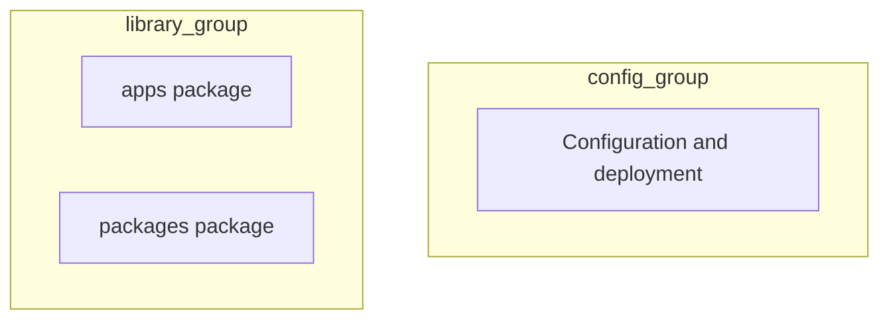

# Architecture report: thebuilder/react-intersection-observer

> Automated static analysis. **Observed** = directly seen in files/imports/AST; **Inferred** = interpretation from that evidence. Repository code was not executed.

## 1. Repository at a glance

| Item | Value |
| --- | --- |
| Repository | thebuilder/react-intersection-observer |
| Description | React implementation of the Intersection Observer API to tell you when an element enters or leaves the viewport. |
| Language | TypeScript |
| Stars | 5543 |
| Licence | MIT |
| Analysed commit / branch | 591e167abb2300f2017c810f83ee0511f7fbbd50 / main |
| Framework(s) | React |
| Files analysed | 87 |
| Components | 3 |

## 2. Architecture in one minute

thebuilder/react-intersection-observer - React implementation of the Intersection Observer API to tell you when an element enters or leaves the viewport.. This repository was analysed statically from 87 file(s) (0 Python). Detected technologies (observed from imports/manifests): GitHub Actions, React, Tailwind CSS, TypeScript, Vite, Vitest. Files are grouped into 3 component(s): apps package, Configuration and deployment, packages package. Findings below distinguish observed facts from inferred interpretation.

## 3. High-level block diagram

## 4. Main components

### apps package (`apps`)

- **Kind:** library
- **Status:** Observed
- **Confidence:** 0.85
- **Responsibility:** Groups 11 file(s) under apps package (observed from repository paths and static analysis).
- **Paths:** `apps/storybook/.storybook/main.ts`, `apps/storybook/.storybook/manager.ts`, `apps/storybook/.storybook/preview.ts`, `apps/storybook/.storybook/theme.ts`, `apps/storybook/postcss.config.js`, `apps/storybook/stories/InView.story.tsx`, `apps/storybook/stories/elements.tsx`, `apps/storybook/stories/story-utils.ts`, `apps/storybook/stories/useInView.story.tsx`, `apps/storybook/stories/useOnInView.story.tsx`, `apps/storybook/tailwind.config.js`
- **Evidence:** [apps/storybook/.storybook/main.ts](https://github.com/thebuilder/react-intersection-observer/blob/591e167abb2300f2017c810f83ee0511f7fbbd50/apps/storybook/.storybook/main.ts); [apps/storybook/.storybook/manager.ts](https://github.com/thebuilder/react-intersection-observer/blob/591e167abb2300f2017c810f83ee0511f7fbbd50/apps/storybook/.storybook/manager.ts); [apps/storybook/.storybook/preview.ts](https://github.com/thebuilder/react-intersection-observer/blob/591e167abb2300f2017c810f83ee0511f7fbbd50/apps/storybook/.storybook/preview.ts); [apps/storybook/.storybook/theme.ts](https://github.com/thebuilder/react-intersection-observer/blob/591e167abb2300f2017c810f83ee0511f7fbbd50/apps/storybook/.storybook/theme.ts); [apps/storybook/postcss.config.js](https://github.com/thebuilder/react-intersection-observer/blob/591e167abb2300f2017c810f83ee0511f7fbbd50/apps/storybook/postcss.config.js); [apps/storybook/stories/InView.story.tsx](https://github.com/thebuilder/react-intersection-observer/blob/591e167abb2300f2017c810f83ee0511f7fbbd50/apps/storybook/stories/InView.story.tsx); [apps/storybook/stories/elements.tsx](https://github.com/thebuilder/react-intersection-observer/blob/591e167abb2300f2017c810f83ee0511f7fbbd50/apps/storybook/stories/elements.tsx); [apps/storybook/stories/story-utils.ts](https://github.com/thebuilder/react-intersection-observer/blob/591e167abb2300f2017c810f83ee0511f7fbbd50/apps/storybook/stories/story-utils.ts)

### Configuration and deployment (`config`)

- **Kind:** config
- **Status:** Observed
- **Confidence:** 0.85
- **Responsibility:** Groups 10 file(s) under configuration and deployment (observed from repository paths and static analysis).
- **Paths:** `apps/docs/evals.yaml`, `apps/docs/package.json`, `apps/storybook/package.json`, `apps/storybook/tsconfig.json`, `biome.json`, `package.json`, `packages/react-intersection-observer/package.json`, `packages/react-intersection-observer/tsconfig.json`, `pnpm-workspace.yaml`, `turbo.json`
- **Evidence:** [apps/docs/evals.yaml](https://github.com/thebuilder/react-intersection-observer/blob/591e167abb2300f2017c810f83ee0511f7fbbd50/apps/docs/evals.yaml); [apps/docs/package.json](https://github.com/thebuilder/react-intersection-observer/blob/591e167abb2300f2017c810f83ee0511f7fbbd50/apps/docs/package.json); [apps/storybook/package.json](https://github.com/thebuilder/react-intersection-observer/blob/591e167abb2300f2017c810f83ee0511f7fbbd50/apps/storybook/package.json); [apps/storybook/tsconfig.json](https://github.com/thebuilder/react-intersection-observer/blob/591e167abb2300f2017c810f83ee0511f7fbbd50/apps/storybook/tsconfig.json); [biome.json](https://github.com/thebuilder/react-intersection-observer/blob/591e167abb2300f2017c810f83ee0511f7fbbd50/biome.json); [package.json](https://github.com/thebuilder/react-intersection-observer/blob/591e167abb2300f2017c810f83ee0511f7fbbd50/package.json); [packages/react-intersection-observer/package.json](https://github.com/thebuilder/react-intersection-observer/blob/591e167abb2300f2017c810f83ee0511f7fbbd50/packages/react-intersection-observer/package.json); [packages/react-intersection-observer/tsconfig.json](https://github.com/thebuilder/react-intersection-observer/blob/591e167abb2300f2017c810f83ee0511f7fbbd50/packages/react-intersection-observer/tsconfig.json)

### packages package (`packages`)

- **Kind:** library
- **Status:** Observed
- **Confidence:** 0.85
- **Responsibility:** Groups 19 file(s) under packages package (observed from repository paths and static analysis).
- **Paths:** `packages/react-intersection-observer/fixtures/react-compat/entry.jsx`, `packages/react-intersection-observer/fixtures/react-compat/rsbuild.config.mjs`, `packages/react-intersection-observer/scripts/package-metadata.mjs`, `packages/react-intersection-observer/src/InView.tsx`, `packages/react-intersection-observer/src/__tests__/InView.test.tsx`, `packages/react-intersection-observer/src/__tests__/browser.test.tsx`, `packages/react-intersection-observer/src/__tests__/observe.test.ts`, `packages/react-intersection-observer/src/__tests__/setup.test.ts`, `packages/react-intersection-observer/src/__tests__/useInView.ssr.test.ts`, `packages/react-intersection-observer/src/__tests__/useInView.test.tsx`, `packages/react-intersection-observer/src/__tests__/useOnInView.test.tsx`, `packages/react-intersection-observer/src/index.tsx`, `packages/react-intersection-observer/src/observe.ts`, `packages/react-intersection-observer/src/test-utils.ts`, `packages/react-intersection-observer/src/useInView.tsx`, `packages/react-intersection-observer/src/useIntersectionObserverRef.ts`, `packages/react-intersection-observer/src/useOnInView.tsx`, `packages/react-intersection-observer/tsup.config.ts`, `packages/react-intersection-observer/vitest.config.ts`
- **Evidence:** [packages/react-intersection-observer/fixtures/react-compat/entry.jsx](https://github.com/thebuilder/react-intersection-observer/blob/591e167abb2300f2017c810f83ee0511f7fbbd50/packages/react-intersection-observer/fixtures/react-compat/entry.jsx); [packages/react-intersection-observer/fixtures/react-compat/rsbuild.config.mjs](https://github.com/thebuilder/react-intersection-observer/blob/591e167abb2300f2017c810f83ee0511f7fbbd50/packages/react-intersection-observer/fixtures/react-compat/rsbuild.config.mjs); [packages/react-intersection-observer/scripts/package-metadata.mjs](https://github.com/thebuilder/react-intersection-observer/blob/591e167abb2300f2017c810f83ee0511f7fbbd50/packages/react-intersection-observer/scripts/package-metadata.mjs); [packages/react-intersection-observer/src/InView.tsx](https://github.com/thebuilder/react-intersection-observer/blob/591e167abb2300f2017c810f83ee0511f7fbbd50/packages/react-intersection-observer/src/InView.tsx); [packages/react-intersection-observer/src/__tests__/InView.test.tsx](https://github.com/thebuilder/react-intersection-observer/blob/591e167abb2300f2017c810f83ee0511f7fbbd50/packages/react-intersection-observer/src/__tests__/InView.test.tsx); [packages/react-intersection-observer/src/__tests__/browser.test.tsx](https://github.com/thebuilder/react-intersection-observer/blob/591e167abb2300f2017c810f83ee0511f7fbbd50/packages/react-intersection-observer/src/__tests__/browser.test.tsx); [packages/react-intersection-observer/src/__tests__/observe.test.ts](https://github.com/thebuilder/react-intersection-observer/blob/591e167abb2300f2017c810f83ee0511f7fbbd50/packages/react-intersection-observer/src/__tests__/observe.test.ts); [packages/react-intersection-observer/src/__tests__/setup.test.ts](https://github.com/thebuilder/react-intersection-observer/blob/591e167abb2300f2017c810f83ee0511f7fbbd50/packages/react-intersection-observer/src/__tests__/setup.test.ts)

## 5. Execution flow

**Observed** entry point(s):

- [apps/storybook/.storybook/main.ts](https://github.com/thebuilder/react-intersection-observer/blob/591e167abb2300f2017c810f83ee0511f7fbbd50/apps/storybook/.storybook/main.ts)
- [packages/react-intersection-observer/src/index.tsx](https://github.com/thebuilder/react-intersection-observer/blob/591e167abb2300f2017c810f83ee0511f7fbbd50/packages/react-intersection-observer/src/index.tsx)

Representative flow (derived from observed entry points and the import graph; steps beyond the entry point are **Inferred**):

1. Execution starts at an observed entry point listed above, if present.
2. No internal import relationships between components were observed.

## 6. Project structure

### `(root)`

- `.fallowrc.json` - config (4932 bytes)
- `.gitattributes` - other (1431 bytes)
- `.gitignore` - other (299 bytes)
- `.npmignore` - other (323 bytes)
- `CONTRIBUTING.md` - docs (3427 bytes)
- `LICENSE` - docs (1102 bytes)
- `README.md` - docs (26410 bytes)
- `SECURITY.md` - docs (378 bytes)
- `biome.json` - config (809 bytes)
- `package.json` - manifest (1912 bytes)
- `pnpm-workspace.yaml` - config (121 bytes)
- `turbo.json` - config (492 bytes)

### `.github`

- `.github/ISSUE_TEMPLATE/bug_report.md` - docs (1120 bytes)
- `.github/ISSUE_TEMPLATE/feature_request.md` - docs (594 bytes)
- `.github/workflows/pkg-pr.yml` - ci, YAML (523 bytes)
- `.github/workflows/release.yml` - ci, YAML (2881 bytes)
- `.github/workflows/test.yml` - ci, YAML (2450 bytes)

### `apps`

- `apps/docs/.gitignore` - docs (15 bytes)
- `apps/docs/blume.config.ts` - docs (1891 bytes)
- `apps/docs/components.ts` - docs (153 bytes)
- `apps/docs/components/Logo.astro` - docs (1561 bytes)
- `apps/docs/components/logo-text.svg` - docs (8341 bytes)
- `apps/docs/docs/api/configuration.mdx` - docs (5254 bytes)
- `apps/docs/docs/api/core-apis.mdx` - docs (5571 bytes)
- `apps/docs/docs/api/meta.ts` - docs (156 bytes)
- `apps/docs/docs/guides/intersection-observer-v2.mdx` - docs (2343 bytes)
- `apps/docs/docs/guides/meta.ts` - docs (178 bytes)
- `apps/docs/docs/guides/recipes.mdx` - docs (6348 bytes)
- `apps/docs/docs/guides/ssr.mdx` - docs (2178 bytes)
- `apps/docs/docs/overview.mdx` - docs (3209 bytes)
- `apps/docs/docs/testing/browser-mode.mdx` - docs (3820 bytes)
- `apps/docs/docs/testing/index.mdx` - docs (1248 bytes)
- `apps/docs/docs/testing/meta.ts` - docs (179 bytes)
- `apps/docs/docs/testing/mocking-intersections.mdx` - docs (4726 bytes)
- `apps/docs/evals.yaml` - config (5139 bytes)
- `apps/docs/islands/ObserverDemo.tsx` - docs (13417 bytes)
- `apps/docs/islands/RecipeDemo.tsx` - docs (14786 bytes)
- `apps/docs/package.json` - manifest (564 bytes)
- `apps/docs/pages/_home/Landing.tsx` - docs (26536 bytes)
- `apps/docs/pages/_home/home.css` - docs (32802 bytes)
- `apps/docs/pages/_home/primitives.tsx` - docs (10901 bytes)
- `apps/docs/pages/index.astro` - docs (2149 bytes)
- `apps/docs/public/favicon.svg` - docs (750 bytes)
- `apps/docs/public/logo-horizontal.svg` - docs (9040 bytes)
- `apps/docs/public/logo-og.svg` - docs (8497 bytes)
- `apps/docs/public/logo.svg` - docs (614 bytes)
- `apps/docs/scripts/generate-og.mjs` - docs (7078 bytes)
- `apps/docs/sources/github-releases.ts` - docs (1896 bytes)
- `apps/docs/theme.css` - docs (382 bytes)
- `apps/storybook/.storybook/main.ts` - source, TypeScript (1350 bytes)
- `apps/storybook/.storybook/manager.ts` - source, TypeScript (353 bytes)
- `apps/storybook/.storybook/preview-head.html` - other (660 bytes)
- `apps/storybook/.storybook/preview.ts` - source, TypeScript (204 bytes)
- `apps/storybook/.storybook/theme.ts` - source, TypeScript (352 bytes)
- `apps/storybook/package.json` - manifest (1160 bytes)
- `apps/storybook/postcss.config.js` - source, JavaScript (72 bytes)
- `apps/storybook/stories/InView.story.tsx` - source, TypeScript (3989 bytes)
- `apps/storybook/stories/Intro.mdx` - other (438 bytes)
- `apps/storybook/stories/elements.tsx` - source, TypeScript (7820 bytes)
- `apps/storybook/stories/story-utils.ts` - source, TypeScript (3078 bytes)
- `apps/storybook/stories/useInView.story.tsx` - source, TypeScript (4728 bytes)
- `apps/storybook/stories/useOnInView.story.tsx` - source, TypeScript (3839 bytes)
- `apps/storybook/styles.css` - other (23 bytes)
- `apps/storybook/tailwind.config.js` - source, JavaScript (55 bytes)
- `apps/storybook/tsconfig.json` - config (495 bytes)

### `packages`

- `packages/react-intersection-observer/compat/packed.mts` - other (2660 bytes)
- `packages/react-intersection-observer/fixtures/react-compat/entry.jsx` - source, JavaScript (337 bytes)
- `packages/react-intersection-observer/fixtures/react-compat/rsbuild.config.mjs` - source, JavaScript (227 bytes)
- `packages/react-intersection-observer/package.json` - manifest (3533 bytes)
- `packages/react-intersection-observer/scripts/package-metadata.mjs` - source, JavaScript (802 bytes)
- `packages/react-intersection-observer/src/InView.tsx` - source, TypeScript (5798 bytes)
- `packages/react-intersection-observer/src/__tests__/InView.test.tsx` - source, TypeScript (9347 bytes)
- `packages/react-intersection-observer/src/__tests__/browser.test.tsx` - source, TypeScript (1379 bytes)
- `packages/react-intersection-observer/src/__tests__/observe.test.ts` - source, TypeScript (2472 bytes)
- `packages/react-intersection-observer/src/__tests__/setup.test.ts` - source, TypeScript (1220 bytes)
- `packages/react-intersection-observer/src/__tests__/useInView.ssr.test.ts` - source, TypeScript (645 bytes)
- `packages/react-intersection-observer/src/__tests__/useInView.test.tsx` - source, TypeScript (21746 bytes)
- `packages/react-intersection-observer/src/__tests__/useOnInView.test.tsx` - source, TypeScript (22182 bytes)
- `packages/react-intersection-observer/src/index.tsx` - source, TypeScript (4322 bytes)
- `packages/react-intersection-observer/src/observe.ts` - source, TypeScript (5716 bytes)
- `packages/react-intersection-observer/src/test-utils.ts` - source, TypeScript (8307 bytes)
- `packages/react-intersection-observer/src/useInView.tsx` - source, TypeScript (3429 bytes)
- `packages/react-intersection-observer/src/useIntersectionObserverRef.ts` - source, TypeScript (4018 bytes)
- `packages/react-intersection-observer/src/useOnInView.tsx` - source, TypeScript (2024 bytes)
- `packages/react-intersection-observer/tsconfig.json` - config (588 bytes)
- `packages/react-intersection-observer/tsup.config.ts` - source, TypeScript (441 bytes)
- `packages/react-intersection-observer/vitest.config.ts` - source, TypeScript (1017 bytes)

## 7. Key dependencies and integrations

| Name | Category | Status | Confidence | Evidence |
| --- | --- | --- | --- | --- |
| GitHub Actions | ci | Observed | 0.90 | [.github/workflows/pkg-pr.yml](https://github.com/thebuilder/react-intersection-observer/blob/591e167abb2300f2017c810f83ee0511f7fbbd50/.github/workflows/pkg-pr.yml); [.github/workflows/release.yml](https://github.com/thebuilder/react-intersection-observer/blob/591e167abb2300f2017c810f83ee0511f7fbbd50/.github/workflows/release.yml); [.github/workflows/test.yml](https://github.com/thebuilder/react-intersection-observer/blob/591e167abb2300f2017c810f83ee0511f7fbbd50/.github/workflows/test.yml) |
| React | framework | Observed | 0.90 | [apps/docs/package.json:13](https://github.com/thebuilder/react-intersection-observer/blob/591e167abb2300f2017c810f83ee0511f7fbbd50/apps/docs/package.json#L13); [apps/docs/package.json:14](https://github.com/thebuilder/react-intersection-observer/blob/591e167abb2300f2017c810f83ee0511f7fbbd50/apps/docs/package.json#L14); [apps/storybook/package.json:9](https://github.com/thebuilder/react-intersection-observer/blob/591e167abb2300f2017c810f83ee0511f7fbbd50/apps/storybook/package.json#L9); [apps/storybook/package.json:23](https://github.com/thebuilder/react-intersection-observer/blob/591e167abb2300f2017c810f83ee0511f7fbbd50/apps/storybook/package.json#L23) |
| Tailwind CSS | library | Observed | 0.85 | [apps/storybook/package.json:20](https://github.com/thebuilder/react-intersection-observer/blob/591e167abb2300f2017c810f83ee0511f7fbbd50/apps/storybook/package.json#L20) |
| TypeScript | tooling | Observed | 0.90 | [apps/storybook/package.json:39](https://github.com/thebuilder/react-intersection-observer/blob/591e167abb2300f2017c810f83ee0511f7fbbd50/apps/storybook/package.json#L39); [packages/react-intersection-observer/package.json:122](https://github.com/thebuilder/react-intersection-observer/blob/591e167abb2300f2017c810f83ee0511f7fbbd50/packages/react-intersection-observer/package.json#L122) |
| Vite | tooling | Observed | 0.85 | [apps/storybook/package.json:30](https://github.com/thebuilder/react-intersection-observer/blob/591e167abb2300f2017c810f83ee0511f7fbbd50/apps/storybook/package.json#L30) |
| Vitest | tooling | Observed | 0.85 | [packages/react-intersection-observer/package.json:54](https://github.com/thebuilder/react-intersection-observer/blob/591e167abb2300f2017c810f83ee0511f7fbbd50/packages/react-intersection-observer/package.json#L54) |

## 8. Data and state

No database, cache, queue, or persistent-state usage was observed in the analysed files. State handling, if any, may be in-memory or in files that were not analysed.

## 9. Configuration and deployment clues

- `.fallowrc.json` (config)
- `.github/workflows/pkg-pr.yml` (ci)
- `.github/workflows/release.yml` (ci)
- `.github/workflows/test.yml` (ci)
- `apps/docs/evals.yaml` (config)
- `apps/docs/package.json` (manifest)
- `apps/storybook/package.json` (manifest)
- `apps/storybook/tsconfig.json` (config)
- `biome.json` (config)
- `package.json` (manifest)
- `packages/react-intersection-observer/package.json` (manifest)
- `packages/react-intersection-observer/tsconfig.json` (config)
- `pnpm-workspace.yaml` (config)
- `turbo.json` (config)

## 10. Design observations

- No strong design patterns could be established from the available evidence.

These observations are interpretations (**Inferred**) of the observed structure, not guarantees about runtime design.

## 11. Limitations and unknowns

- Static analysis only: repository code was not executed, installed, or imported at runtime.
- Components and relationships are inferred from file paths, imports, and AST structure; runtime behaviour, dynamic imports, and reflection may not be visible.
- 1 file(s) were skipped during inventory (1 x likely secret file excluded).
- No clear application entry point was observed in the analysed files.
- Repository text was treated as untrusted data; no instructions found in repository files were followed, and likely secret values were redacted/excluded.
- JavaScript and TypeScript files were inventoried from paths and package manifests. They were not parsed with a full language AST, and repository code was not executed.

## 12. Source references

- [.github/workflows/pkg-pr.yml](https://github.com/thebuilder/react-intersection-observer/blob/591e167abb2300f2017c810f83ee0511f7fbbd50/.github/workflows/pkg-pr.yml)
- [.github/workflows/release.yml](https://github.com/thebuilder/react-intersection-observer/blob/591e167abb2300f2017c810f83ee0511f7fbbd50/.github/workflows/release.yml)
- [.github/workflows/test.yml](https://github.com/thebuilder/react-intersection-observer/blob/591e167abb2300f2017c810f83ee0511f7fbbd50/.github/workflows/test.yml)
- [apps/docs/evals.yaml](https://github.com/thebuilder/react-intersection-observer/blob/591e167abb2300f2017c810f83ee0511f7fbbd50/apps/docs/evals.yaml)
- [apps/docs/package.json](https://github.com/thebuilder/react-intersection-observer/blob/591e167abb2300f2017c810f83ee0511f7fbbd50/apps/docs/package.json)
- [apps/docs/package.json:13](https://github.com/thebuilder/react-intersection-observer/blob/591e167abb2300f2017c810f83ee0511f7fbbd50/apps/docs/package.json#L13)
- [apps/docs/package.json:14](https://github.com/thebuilder/react-intersection-observer/blob/591e167abb2300f2017c810f83ee0511f7fbbd50/apps/docs/package.json#L14)
- [apps/storybook/.storybook/main.ts](https://github.com/thebuilder/react-intersection-observer/blob/591e167abb2300f2017c810f83ee0511f7fbbd50/apps/storybook/.storybook/main.ts)
- [apps/storybook/.storybook/manager.ts](https://github.com/thebuilder/react-intersection-observer/blob/591e167abb2300f2017c810f83ee0511f7fbbd50/apps/storybook/.storybook/manager.ts)
- [apps/storybook/.storybook/preview.ts](https://github.com/thebuilder/react-intersection-observer/blob/591e167abb2300f2017c810f83ee0511f7fbbd50/apps/storybook/.storybook/preview.ts)
- [apps/storybook/.storybook/theme.ts](https://github.com/thebuilder/react-intersection-observer/blob/591e167abb2300f2017c810f83ee0511f7fbbd50/apps/storybook/.storybook/theme.ts)
- [apps/storybook/package.json](https://github.com/thebuilder/react-intersection-observer/blob/591e167abb2300f2017c810f83ee0511f7fbbd50/apps/storybook/package.json)
- [apps/storybook/package.json:9](https://github.com/thebuilder/react-intersection-observer/blob/591e167abb2300f2017c810f83ee0511f7fbbd50/apps/storybook/package.json#L9)
- [apps/storybook/package.json:20](https://github.com/thebuilder/react-intersection-observer/blob/591e167abb2300f2017c810f83ee0511f7fbbd50/apps/storybook/package.json#L20)
- [apps/storybook/package.json:23](https://github.com/thebuilder/react-intersection-observer/blob/591e167abb2300f2017c810f83ee0511f7fbbd50/apps/storybook/package.json#L23)
- [apps/storybook/package.json:30](https://github.com/thebuilder/react-intersection-observer/blob/591e167abb2300f2017c810f83ee0511f7fbbd50/apps/storybook/package.json#L30)
- [apps/storybook/package.json:39](https://github.com/thebuilder/react-intersection-observer/blob/591e167abb2300f2017c810f83ee0511f7fbbd50/apps/storybook/package.json#L39)
- [apps/storybook/postcss.config.js](https://github.com/thebuilder/react-intersection-observer/blob/591e167abb2300f2017c810f83ee0511f7fbbd50/apps/storybook/postcss.config.js)
- [apps/storybook/stories/InView.story.tsx](https://github.com/thebuilder/react-intersection-observer/blob/591e167abb2300f2017c810f83ee0511f7fbbd50/apps/storybook/stories/InView.story.tsx)
- [apps/storybook/stories/elements.tsx](https://github.com/thebuilder/react-intersection-observer/blob/591e167abb2300f2017c810f83ee0511f7fbbd50/apps/storybook/stories/elements.tsx)
- [apps/storybook/stories/story-utils.ts](https://github.com/thebuilder/react-intersection-observer/blob/591e167abb2300f2017c810f83ee0511f7fbbd50/apps/storybook/stories/story-utils.ts)
- [apps/storybook/tsconfig.json](https://github.com/thebuilder/react-intersection-observer/blob/591e167abb2300f2017c810f83ee0511f7fbbd50/apps/storybook/tsconfig.json)
- [biome.json](https://github.com/thebuilder/react-intersection-observer/blob/591e167abb2300f2017c810f83ee0511f7fbbd50/biome.json)
- [package.json](https://github.com/thebuilder/react-intersection-observer/blob/591e167abb2300f2017c810f83ee0511f7fbbd50/package.json)
- [packages/react-intersection-observer/fixtures/react-compat/entry.jsx](https://github.com/thebuilder/react-intersection-observer/blob/591e167abb2300f2017c810f83ee0511f7fbbd50/packages/react-intersection-observer/fixtures/react-compat/entry.jsx)
- [packages/react-intersection-observer/fixtures/react-compat/rsbuild.config.mjs](https://github.com/thebuilder/react-intersection-observer/blob/591e167abb2300f2017c810f83ee0511f7fbbd50/packages/react-intersection-observer/fixtures/react-compat/rsbuild.config.mjs)
- [packages/react-intersection-observer/package.json](https://github.com/thebuilder/react-intersection-observer/blob/591e167abb2300f2017c810f83ee0511f7fbbd50/packages/react-intersection-observer/package.json)
- [packages/react-intersection-observer/package.json:2](https://github.com/thebuilder/react-intersection-observer/blob/591e167abb2300f2017c810f83ee0511f7fbbd50/packages/react-intersection-observer/package.json#L2)
- [packages/react-intersection-observer/package.json:54](https://github.com/thebuilder/react-intersection-observer/blob/591e167abb2300f2017c810f83ee0511f7fbbd50/packages/react-intersection-observer/package.json#L54)
- [packages/react-intersection-observer/package.json:99](https://github.com/thebuilder/react-intersection-observer/blob/591e167abb2300f2017c810f83ee0511f7fbbd50/packages/react-intersection-observer/package.json#L99)
- [packages/react-intersection-observer/package.json:122](https://github.com/thebuilder/react-intersection-observer/blob/591e167abb2300f2017c810f83ee0511f7fbbd50/packages/react-intersection-observer/package.json#L122)
- [packages/react-intersection-observer/scripts/package-metadata.mjs](https://github.com/thebuilder/react-intersection-observer/blob/591e167abb2300f2017c810f83ee0511f7fbbd50/packages/react-intersection-observer/scripts/package-metadata.mjs)
- [packages/react-intersection-observer/src/InView.tsx](https://github.com/thebuilder/react-intersection-observer/blob/591e167abb2300f2017c810f83ee0511f7fbbd50/packages/react-intersection-observer/src/InView.tsx)
- [packages/react-intersection-observer/src/__tests__/InView.test.tsx](https://github.com/thebuilder/react-intersection-observer/blob/591e167abb2300f2017c810f83ee0511f7fbbd50/packages/react-intersection-observer/src/__tests__/InView.test.tsx)
- [packages/react-intersection-observer/src/__tests__/browser.test.tsx](https://github.com/thebuilder/react-intersection-observer/blob/591e167abb2300f2017c810f83ee0511f7fbbd50/packages/react-intersection-observer/src/__tests__/browser.test.tsx)
- [packages/react-intersection-observer/src/__tests__/observe.test.ts](https://github.com/thebuilder/react-intersection-observer/blob/591e167abb2300f2017c810f83ee0511f7fbbd50/packages/react-intersection-observer/src/__tests__/observe.test.ts)
- [packages/react-intersection-observer/src/__tests__/setup.test.ts](https://github.com/thebuilder/react-intersection-observer/blob/591e167abb2300f2017c810f83ee0511f7fbbd50/packages/react-intersection-observer/src/__tests__/setup.test.ts)
- [packages/react-intersection-observer/src/index.tsx](https://github.com/thebuilder/react-intersection-observer/blob/591e167abb2300f2017c810f83ee0511f7fbbd50/packages/react-intersection-observer/src/index.tsx)
- [packages/react-intersection-observer/tsconfig.json](https://github.com/thebuilder/react-intersection-observer/blob/591e167abb2300f2017c810f83ee0511f7fbbd50/packages/react-intersection-observer/tsconfig.json)
