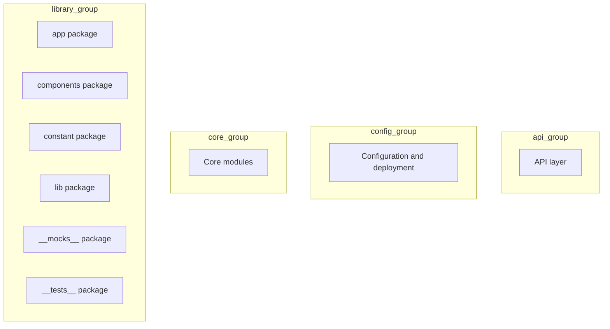

# Architecture report: theodorusclarence/ts-nextjs-tailwind-starter

> Automated static analysis. **Observed** = directly seen in files/imports/AST; **Inferred** = interpretation from that evidence. Repository code was not executed.

## 1. Repository at a glance

| Item | Value |
| --- | --- |
| Repository | theodorusclarence/ts-nextjs-tailwind-starter |
| Description | 🔋 Next.js + Tailwind CSS + TypeScript starter and boilerplate packed with useful development features |
| Language | TypeScript |
| Stars | 3405 |
| Licence | Not detected |
| Analysed commit / branch | 749ead17ba98170f713da39de0e5b2306f7e86bf / main |
| Framework(s) | Next.js, React |
| Files analysed | 65 |
| Components | 9 |

## 2. Architecture in one minute

theodorusclarence/ts-nextjs-tailwind-starter - 🔋 Next.js + Tailwind CSS + TypeScript starter and boilerplate packed with useful development features. This repository was analysed statically from 65 file(s) (0 Python). Detected technologies (observed from imports/manifests): GitHub Actions, Next.js, React, Tailwind CSS, Jest, TypeScript. Files are grouped into 9 component(s): API layer, app package, components package, Configuration and deployment, constant package, Core modules, lib package, __mocks__ package. Findings below distinguish observed facts from inferred interpretation.

## 3. High-level block diagram

## 4. Main components

### API layer (`api_layer`)

- **Kind:** api
- **Status:** Observed
- **Confidence:** 0.85
- **Responsibility:** Groups 1 file(s) under api layer (observed from repository paths and static analysis).
- **Paths:** `src/app/api/hello/route.ts`
- **Evidence:** [src/app/api/hello/route.ts](https://github.com/theodorusclarence/ts-nextjs-tailwind-starter/blob/749ead17ba98170f713da39de0e5b2306f7e86bf/src/app/api/hello/route.ts)

### app package (`app`)

- **Kind:** library
- **Status:** Observed
- **Confidence:** 0.85
- **Responsibility:** Groups 6 file(s) under app package (observed from repository paths and static analysis).
- **Paths:** `src/app/components/layout.tsx`, `src/app/components/page.tsx`, `src/app/error.tsx`, `src/app/layout.tsx`, `src/app/not-found.tsx`, `src/app/page.tsx`
- **Evidence:** [src/app/components/layout.tsx](https://github.com/theodorusclarence/ts-nextjs-tailwind-starter/blob/749ead17ba98170f713da39de0e5b2306f7e86bf/src/app/components/layout.tsx); [src/app/components/page.tsx](https://github.com/theodorusclarence/ts-nextjs-tailwind-starter/blob/749ead17ba98170f713da39de0e5b2306f7e86bf/src/app/components/page.tsx); [src/app/error.tsx](https://github.com/theodorusclarence/ts-nextjs-tailwind-starter/blob/749ead17ba98170f713da39de0e5b2306f7e86bf/src/app/error.tsx); [src/app/layout.tsx](https://github.com/theodorusclarence/ts-nextjs-tailwind-starter/blob/749ead17ba98170f713da39de0e5b2306f7e86bf/src/app/layout.tsx); [src/app/not-found.tsx](https://github.com/theodorusclarence/ts-nextjs-tailwind-starter/blob/749ead17ba98170f713da39de0e5b2306f7e86bf/src/app/not-found.tsx); [src/app/page.tsx](https://github.com/theodorusclarence/ts-nextjs-tailwind-starter/blob/749ead17ba98170f713da39de0e5b2306f7e86bf/src/app/page.tsx)

### components package (`components`)

- **Kind:** library
- **Status:** Observed
- **Confidence:** 0.85
- **Responsibility:** Groups 11 file(s) under components package (observed from repository paths and static analysis).
- **Paths:** `src/components/NextImage.tsx`, `src/components/Skeleton.tsx`, `src/components/buttons/Button.tsx`, `src/components/buttons/IconButton.tsx`, `src/components/buttons/TextButton.tsx`, `src/components/links/ArrowLink.tsx`, `src/components/links/ButtonLink.tsx`, `src/components/links/IconLink.tsx`, `src/components/links/PrimaryLink.tsx`, `src/components/links/UnderlineLink.tsx`, `src/components/links/UnstyledLink.tsx`
- **Evidence:** [src/components/NextImage.tsx](https://github.com/theodorusclarence/ts-nextjs-tailwind-starter/blob/749ead17ba98170f713da39de0e5b2306f7e86bf/src/components/NextImage.tsx); [src/components/Skeleton.tsx](https://github.com/theodorusclarence/ts-nextjs-tailwind-starter/blob/749ead17ba98170f713da39de0e5b2306f7e86bf/src/components/Skeleton.tsx); [src/components/buttons/Button.tsx](https://github.com/theodorusclarence/ts-nextjs-tailwind-starter/blob/749ead17ba98170f713da39de0e5b2306f7e86bf/src/components/buttons/Button.tsx); [src/components/buttons/IconButton.tsx](https://github.com/theodorusclarence/ts-nextjs-tailwind-starter/blob/749ead17ba98170f713da39de0e5b2306f7e86bf/src/components/buttons/IconButton.tsx); [src/components/buttons/TextButton.tsx](https://github.com/theodorusclarence/ts-nextjs-tailwind-starter/blob/749ead17ba98170f713da39de0e5b2306f7e86bf/src/components/buttons/TextButton.tsx); [src/components/links/ArrowLink.tsx](https://github.com/theodorusclarence/ts-nextjs-tailwind-starter/blob/749ead17ba98170f713da39de0e5b2306f7e86bf/src/components/links/ArrowLink.tsx); [src/components/links/ButtonLink.tsx](https://github.com/theodorusclarence/ts-nextjs-tailwind-starter/blob/749ead17ba98170f713da39de0e5b2306f7e86bf/src/components/links/ButtonLink.tsx); [src/components/links/IconLink.tsx](https://github.com/theodorusclarence/ts-nextjs-tailwind-starter/blob/749ead17ba98170f713da39de0e5b2306f7e86bf/src/components/links/IconLink.tsx)

### Configuration and deployment (`config`)

- **Kind:** config
- **Status:** Observed
- **Confidence:** 0.85
- **Responsibility:** Groups 4 file(s) under configuration and deployment (observed from repository paths and static analysis).
- **Paths:** `package.json`, `pnpm-workspace.yaml`, `tsconfig.json`, `vercel.json`
- **Evidence:** [package.json](https://github.com/theodorusclarence/ts-nextjs-tailwind-starter/blob/749ead17ba98170f713da39de0e5b2306f7e86bf/package.json); [pnpm-workspace.yaml](https://github.com/theodorusclarence/ts-nextjs-tailwind-starter/blob/749ead17ba98170f713da39de0e5b2306f7e86bf/pnpm-workspace.yaml); [tsconfig.json](https://github.com/theodorusclarence/ts-nextjs-tailwind-starter/blob/749ead17ba98170f713da39de0e5b2306f7e86bf/tsconfig.json); [vercel.json](https://github.com/theodorusclarence/ts-nextjs-tailwind-starter/blob/749ead17ba98170f713da39de0e5b2306f7e86bf/vercel.json)

### constant package (`constant`)

- **Kind:** library
- **Status:** Observed
- **Confidence:** 0.85
- **Responsibility:** Groups 2 file(s) under constant package (observed from repository paths and static analysis).
- **Paths:** `src/constant/config.ts`, `src/constant/env.ts`
- **Evidence:** [src/constant/config.ts](https://github.com/theodorusclarence/ts-nextjs-tailwind-starter/blob/749ead17ba98170f713da39de0e5b2306f7e86bf/src/constant/config.ts); [src/constant/env.ts](https://github.com/theodorusclarence/ts-nextjs-tailwind-starter/blob/749ead17ba98170f713da39de0e5b2306f7e86bf/src/constant/env.ts)

### Core modules (`core`)

- **Kind:** core
- **Status:** Observed
- **Confidence:** 0.85
- **Responsibility:** Groups 7 file(s) under core modules (observed from repository paths and static analysis).
- **Paths:** `commitlint.config.js`, `eslint.config.mjs`, `jest.config.js`, `jest.setup.js`, `next-sitemap.config.js`, `next.config.js`, `postcss.config.js`
- **Evidence:** [commitlint.config.js](https://github.com/theodorusclarence/ts-nextjs-tailwind-starter/blob/749ead17ba98170f713da39de0e5b2306f7e86bf/commitlint.config.js); [eslint.config.mjs](https://github.com/theodorusclarence/ts-nextjs-tailwind-starter/blob/749ead17ba98170f713da39de0e5b2306f7e86bf/eslint.config.mjs); [jest.config.js](https://github.com/theodorusclarence/ts-nextjs-tailwind-starter/blob/749ead17ba98170f713da39de0e5b2306f7e86bf/jest.config.js); [jest.setup.js](https://github.com/theodorusclarence/ts-nextjs-tailwind-starter/blob/749ead17ba98170f713da39de0e5b2306f7e86bf/jest.setup.js); [next-sitemap.config.js](https://github.com/theodorusclarence/ts-nextjs-tailwind-starter/blob/749ead17ba98170f713da39de0e5b2306f7e86bf/next-sitemap.config.js); [next.config.js](https://github.com/theodorusclarence/ts-nextjs-tailwind-starter/blob/749ead17ba98170f713da39de0e5b2306f7e86bf/next.config.js); [postcss.config.js](https://github.com/theodorusclarence/ts-nextjs-tailwind-starter/blob/749ead17ba98170f713da39de0e5b2306f7e86bf/postcss.config.js)

### lib package (`lib`)

- **Kind:** library
- **Status:** Observed
- **Confidence:** 0.85
- **Responsibility:** Groups 6 file(s) under lib package (observed from repository paths and static analysis).
- **Paths:** `src/lib/__tests__/og.test.ts`, `src/lib/env.ts`, `src/lib/helper.ts`, `src/lib/logger.ts`, `src/lib/og.ts`, `src/lib/utils.ts`
- **Evidence:** [src/lib/__tests__/og.test.ts](https://github.com/theodorusclarence/ts-nextjs-tailwind-starter/blob/749ead17ba98170f713da39de0e5b2306f7e86bf/src/lib/__tests__/og.test.ts); [src/lib/env.ts](https://github.com/theodorusclarence/ts-nextjs-tailwind-starter/blob/749ead17ba98170f713da39de0e5b2306f7e86bf/src/lib/env.ts); [src/lib/helper.ts](https://github.com/theodorusclarence/ts-nextjs-tailwind-starter/blob/749ead17ba98170f713da39de0e5b2306f7e86bf/src/lib/helper.ts); [src/lib/logger.ts](https://github.com/theodorusclarence/ts-nextjs-tailwind-starter/blob/749ead17ba98170f713da39de0e5b2306f7e86bf/src/lib/logger.ts); [src/lib/og.ts](https://github.com/theodorusclarence/ts-nextjs-tailwind-starter/blob/749ead17ba98170f713da39de0e5b2306f7e86bf/src/lib/og.ts); [src/lib/utils.ts](https://github.com/theodorusclarence/ts-nextjs-tailwind-starter/blob/749ead17ba98170f713da39de0e5b2306f7e86bf/src/lib/utils.ts)

### __mocks__ package (`mocks`)

- **Kind:** library
- **Status:** Observed
- **Confidence:** 0.85
- **Responsibility:** Groups 1 file(s) under __mocks__ package (observed from repository paths and static analysis).
- **Paths:** `src/__mocks__/svg.tsx`
- **Evidence:** [src/__mocks__/svg.tsx](https://github.com/theodorusclarence/ts-nextjs-tailwind-starter/blob/749ead17ba98170f713da39de0e5b2306f7e86bf/src/__mocks__/svg.tsx)

### __tests__ package (`tests`)

- **Kind:** library
- **Status:** Observed
- **Confidence:** 0.85
- **Responsibility:** Groups 1 file(s) under __tests__ package (observed from repository paths and static analysis).
- **Paths:** `src/__tests__/pages/HomePage.test.tsx`
- **Evidence:** [src/__tests__/pages/HomePage.test.tsx](https://github.com/theodorusclarence/ts-nextjs-tailwind-starter/blob/749ead17ba98170f713da39de0e5b2306f7e86bf/src/__tests__/pages/HomePage.test.tsx)

## 5. Execution flow

**Observed** entry point(s):

- [src/app/components/page.tsx](https://github.com/theodorusclarence/ts-nextjs-tailwind-starter/blob/749ead17ba98170f713da39de0e5b2306f7e86bf/src/app/components/page.tsx)
- [src/app/page.tsx](https://github.com/theodorusclarence/ts-nextjs-tailwind-starter/blob/749ead17ba98170f713da39de0e5b2306f7e86bf/src/app/page.tsx)

Representative flow (derived from observed entry points and the import graph; steps beyond the entry point are **Inferred**):

1. Execution starts at an observed entry point listed above, if present.
2. No internal import relationships between components were observed.

## 6. Project structure

### `(root)`

- `.env.example` - config (206 bytes)
- `.gitignore` - other (483 bytes)
- `.nvmrc` - other (3 bytes)
- `.prettierignore` - other (451 bytes)
- `.prettierrc.js` - source, JavaScript (215 bytes)
- `CHANGELOG.md` - docs (12168 bytes)
- `README.md` - docs (5877 bytes)
- `commitlint.config.js` - source, JavaScript (435 bytes)
- `eslint.config.mjs` - source, JavaScript (2526 bytes)
- `jest.config.js` - source, JavaScript (1032 bytes)
- `jest.setup.js` - source, JavaScript (132 bytes)
- `next-sitemap.config.js` - source, JavaScript (394 bytes)
- `next.config.js` - source, JavaScript (719 bytes)
- `package.json` - manifest (2174 bytes)
- `pnpm-workspace.yaml` - config (104 bytes)
- `postcss.config.js` - source, JavaScript (72 bytes)
- `tsconfig.json` - config (789 bytes)
- `vercel.json` - config (221 bytes)

### `.github`

- `.github/FUNDING.yml` - config (789 bytes)
- `.github/issue-branch.yml` - config (235 bytes)
- `.github/pull_request_template.md` - docs (462 bytes)
- `.github/workflows/create-branch.yml` - ci, YAML (292 bytes)
- `.github/workflows/issue-autolink.yml` - ci, YAML (337 bytes)
- `.github/workflows/lint.yml` - ci, YAML (881 bytes)
- `.github/workflows/release-please.yml` - ci, YAML (435 bytes)

### `.husky`

- `.husky/commit-msg` - other (40 bytes)
- `.husky/post-merge` - other (13 bytes)
- `.husky/pre-commit` - other (15 bytes)

### `.vscode`

- `.vscode/css.code-snippets` - other (194 bytes)
- `.vscode/extensions.json` - config (190 bytes)
- `.vscode/settings.json` - config (459 bytes)
- `.vscode/typescriptreact.code-snippets` - other (5315 bytes)

### `public`

- `public/favicon/site.webmanifest` - other (376 bytes)
- `public/svg/Logo.svg` - other (451 bytes)
- `public/svg/Vercel.svg` - other (141 bytes)

### `src`

- `src/__mocks__/svg.tsx` - source, TypeScript (234 bytes)
- `src/__tests__/pages/HomePage.test.tsx` - source, TypeScript (350 bytes)
- `src/app/api/hello/route.ts` - source, TypeScript (127 bytes)
- `src/app/components/layout.tsx` - source, TypeScript (342 bytes)
- `src/app/components/page.tsx` - source, TypeScript (17017 bytes)
- `src/app/error.tsx` - source, TypeScript (1019 bytes)
- `src/app/layout.tsx` - source, TypeScript (1663 bytes)
- `src/app/not-found.tsx` - source, TypeScript (721 bytes)
- `src/app/page.tsx` - source, TypeScript (2435 bytes)
- `src/components/NextImage.tsx` - source, TypeScript (1301 bytes)
- `src/components/Skeleton.tsx` - source, TypeScript (534 bytes)
- `src/components/buttons/Button.tsx` - source, TypeScript (4945 bytes)
- `src/components/buttons/IconButton.tsx` - source, TypeScript (3609 bytes)
- `src/components/buttons/TextButton.tsx` - source, TypeScript (1446 bytes)
- `src/components/links/ArrowLink.tsx` - source, TypeScript (2077 bytes)
- `src/components/links/ButtonLink.tsx` - source, TypeScript (4227 bytes)
- `src/components/links/IconLink.tsx` - source, TypeScript (2887 bytes)
- `src/components/links/PrimaryLink.tsx` - source, TypeScript (1316 bytes)
- `src/components/links/UnderlineLink.tsx` - source, TypeScript (788 bytes)
- `src/components/links/UnstyledLink.tsx` - source, TypeScript (1123 bytes)
- `src/constant/config.ts` - source, TypeScript (346 bytes)
- `src/constant/env.ts` - source, TypeScript (220 bytes)
- `src/lib/__tests__/og.test.ts` - source, TypeScript (637 bytes)
- `src/lib/env.ts` - source, TypeScript (557 bytes)
- `src/lib/helper.ts` - source, TypeScript (348 bytes)
- `src/lib/logger.ts` - source, TypeScript (527 bytes)
- `src/lib/og.ts` - source, TypeScript (986 bytes)
- `src/lib/utils.ts` - source, TypeScript (228 bytes)
- `src/styles/colors.css` - other (15824 bytes)
- `src/styles/globals.css` - other (3437 bytes)

## 7. Key dependencies and integrations

| Name | Category | Status | Confidence | Evidence |
| --- | --- | --- | --- | --- |
| GitHub Actions | ci | Observed | 0.90 | [.github/workflows/create-branch.yml](https://github.com/theodorusclarence/ts-nextjs-tailwind-starter/blob/749ead17ba98170f713da39de0e5b2306f7e86bf/.github/workflows/create-branch.yml); [.github/workflows/issue-autolink.yml](https://github.com/theodorusclarence/ts-nextjs-tailwind-starter/blob/749ead17ba98170f713da39de0e5b2306f7e86bf/.github/workflows/issue-autolink.yml); [.github/workflows/lint.yml](https://github.com/theodorusclarence/ts-nextjs-tailwind-starter/blob/749ead17ba98170f713da39de0e5b2306f7e86bf/.github/workflows/lint.yml); [.github/workflows/release-please.yml](https://github.com/theodorusclarence/ts-nextjs-tailwind-starter/blob/749ead17ba98170f713da39de0e5b2306f7e86bf/.github/workflows/release-please.yml) |
| Next.js | framework | Observed | 0.85 | [package.json:2](https://github.com/theodorusclarence/ts-nextjs-tailwind-starter/blob/749ead17ba98170f713da39de0e5b2306f7e86bf/package.json#L2) |
| React | framework | Observed | 0.90 | [package.json:22](https://github.com/theodorusclarence/ts-nextjs-tailwind-starter/blob/749ead17ba98170f713da39de0e5b2306f7e86bf/package.json#L22); [package.json:25](https://github.com/theodorusclarence/ts-nextjs-tailwind-starter/blob/749ead17ba98170f713da39de0e5b2306f7e86bf/package.json#L25) |
| Tailwind CSS | library | Observed | 0.85 | [package.json:34](https://github.com/theodorusclarence/ts-nextjs-tailwind-starter/blob/749ead17ba98170f713da39de0e5b2306f7e86bf/package.json#L34) |
| Jest | tooling | Observed | 0.85 | [package.json:13](https://github.com/theodorusclarence/ts-nextjs-tailwind-starter/blob/749ead17ba98170f713da39de0e5b2306f7e86bf/package.json#L13) |
| TypeScript | tooling | Observed | 0.85 | [package.json:43](https://github.com/theodorusclarence/ts-nextjs-tailwind-starter/blob/749ead17ba98170f713da39de0e5b2306f7e86bf/package.json#L43) |

## 8. Data and state

No database, cache, queue, or persistent-state usage was observed in the analysed files. State handling, if any, may be in-memory or in files that were not analysed.

## 9. Configuration and deployment clues

- `.env.example` (config)
- `.github/FUNDING.yml` (config)
- `.github/issue-branch.yml` (config)
- `.github/workflows/create-branch.yml` (ci)
- `.github/workflows/issue-autolink.yml` (ci)
- `.github/workflows/lint.yml` (ci)
- `.github/workflows/release-please.yml` (ci)
- `.vscode/extensions.json` (config)
- `.vscode/settings.json` (config)
- `package.json` (manifest)
- `pnpm-workspace.yaml` (config)
- `tsconfig.json` (config)
- `vercel.json` (config)

Environment variable *names* seen in example env files (values never recorded):

- `.env.example`: `NEXT_PUBLIC_SHOW_LOGGER`

## 10. Design observations

- An entry/API layer is separated from other code (Inferred from paths and decorators).

These observations are interpretations (**Inferred**) of the observed structure, not guarantees about runtime design.

## 11. Limitations and unknowns

- Static analysis only: repository code was not executed, installed, or imported at runtime.
- Components and relationships are inferred from file paths, imports, and AST structure; runtime behaviour, dynamic imports, and reflection may not be visible.
- 1 file(s) were skipped during inventory (1 x likely secret file excluded).
- No clear application entry point was observed in the analysed files.
- Repository text was treated as untrusted data; no instructions found in repository files were followed, and likely secret values were redacted/excluded.
- JavaScript and TypeScript files were inventoried from paths and package manifests. They were not parsed with a full language AST, and repository code was not executed.

## 12. Source references

- [.github/workflows/create-branch.yml](https://github.com/theodorusclarence/ts-nextjs-tailwind-starter/blob/749ead17ba98170f713da39de0e5b2306f7e86bf/.github/workflows/create-branch.yml)
- [.github/workflows/issue-autolink.yml](https://github.com/theodorusclarence/ts-nextjs-tailwind-starter/blob/749ead17ba98170f713da39de0e5b2306f7e86bf/.github/workflows/issue-autolink.yml)
- [.github/workflows/lint.yml](https://github.com/theodorusclarence/ts-nextjs-tailwind-starter/blob/749ead17ba98170f713da39de0e5b2306f7e86bf/.github/workflows/lint.yml)
- [.github/workflows/release-please.yml](https://github.com/theodorusclarence/ts-nextjs-tailwind-starter/blob/749ead17ba98170f713da39de0e5b2306f7e86bf/.github/workflows/release-please.yml)
- [commitlint.config.js](https://github.com/theodorusclarence/ts-nextjs-tailwind-starter/blob/749ead17ba98170f713da39de0e5b2306f7e86bf/commitlint.config.js)
- [eslint.config.mjs](https://github.com/theodorusclarence/ts-nextjs-tailwind-starter/blob/749ead17ba98170f713da39de0e5b2306f7e86bf/eslint.config.mjs)
- [jest.config.js](https://github.com/theodorusclarence/ts-nextjs-tailwind-starter/blob/749ead17ba98170f713da39de0e5b2306f7e86bf/jest.config.js)
- [jest.setup.js](https://github.com/theodorusclarence/ts-nextjs-tailwind-starter/blob/749ead17ba98170f713da39de0e5b2306f7e86bf/jest.setup.js)
- [next-sitemap.config.js](https://github.com/theodorusclarence/ts-nextjs-tailwind-starter/blob/749ead17ba98170f713da39de0e5b2306f7e86bf/next-sitemap.config.js)
- [next.config.js](https://github.com/theodorusclarence/ts-nextjs-tailwind-starter/blob/749ead17ba98170f713da39de0e5b2306f7e86bf/next.config.js)
- [package.json](https://github.com/theodorusclarence/ts-nextjs-tailwind-starter/blob/749ead17ba98170f713da39de0e5b2306f7e86bf/package.json)
- [package.json:2](https://github.com/theodorusclarence/ts-nextjs-tailwind-starter/blob/749ead17ba98170f713da39de0e5b2306f7e86bf/package.json#L2)
- [package.json:13](https://github.com/theodorusclarence/ts-nextjs-tailwind-starter/blob/749ead17ba98170f713da39de0e5b2306f7e86bf/package.json#L13)
- [package.json:22](https://github.com/theodorusclarence/ts-nextjs-tailwind-starter/blob/749ead17ba98170f713da39de0e5b2306f7e86bf/package.json#L22)
- [package.json:25](https://github.com/theodorusclarence/ts-nextjs-tailwind-starter/blob/749ead17ba98170f713da39de0e5b2306f7e86bf/package.json#L25)
- [package.json:34](https://github.com/theodorusclarence/ts-nextjs-tailwind-starter/blob/749ead17ba98170f713da39de0e5b2306f7e86bf/package.json#L34)
- [package.json:43](https://github.com/theodorusclarence/ts-nextjs-tailwind-starter/blob/749ead17ba98170f713da39de0e5b2306f7e86bf/package.json#L43)
- [pnpm-workspace.yaml](https://github.com/theodorusclarence/ts-nextjs-tailwind-starter/blob/749ead17ba98170f713da39de0e5b2306f7e86bf/pnpm-workspace.yaml)
- [postcss.config.js](https://github.com/theodorusclarence/ts-nextjs-tailwind-starter/blob/749ead17ba98170f713da39de0e5b2306f7e86bf/postcss.config.js)
- [src/__mocks__/svg.tsx](https://github.com/theodorusclarence/ts-nextjs-tailwind-starter/blob/749ead17ba98170f713da39de0e5b2306f7e86bf/src/__mocks__/svg.tsx)
- [src/__tests__/pages/HomePage.test.tsx](https://github.com/theodorusclarence/ts-nextjs-tailwind-starter/blob/749ead17ba98170f713da39de0e5b2306f7e86bf/src/__tests__/pages/HomePage.test.tsx)
- [src/app/api/hello/route.ts](https://github.com/theodorusclarence/ts-nextjs-tailwind-starter/blob/749ead17ba98170f713da39de0e5b2306f7e86bf/src/app/api/hello/route.ts)
- [src/app/components/layout.tsx](https://github.com/theodorusclarence/ts-nextjs-tailwind-starter/blob/749ead17ba98170f713da39de0e5b2306f7e86bf/src/app/components/layout.tsx)
- [src/app/components/page.tsx](https://github.com/theodorusclarence/ts-nextjs-tailwind-starter/blob/749ead17ba98170f713da39de0e5b2306f7e86bf/src/app/components/page.tsx)
- [src/app/error.tsx](https://github.com/theodorusclarence/ts-nextjs-tailwind-starter/blob/749ead17ba98170f713da39de0e5b2306f7e86bf/src/app/error.tsx)
- [src/app/layout.tsx](https://github.com/theodorusclarence/ts-nextjs-tailwind-starter/blob/749ead17ba98170f713da39de0e5b2306f7e86bf/src/app/layout.tsx)
- [src/app/not-found.tsx](https://github.com/theodorusclarence/ts-nextjs-tailwind-starter/blob/749ead17ba98170f713da39de0e5b2306f7e86bf/src/app/not-found.tsx)
- [src/app/page.tsx](https://github.com/theodorusclarence/ts-nextjs-tailwind-starter/blob/749ead17ba98170f713da39de0e5b2306f7e86bf/src/app/page.tsx)
- [src/components/NextImage.tsx](https://github.com/theodorusclarence/ts-nextjs-tailwind-starter/blob/749ead17ba98170f713da39de0e5b2306f7e86bf/src/components/NextImage.tsx)
- [src/components/Skeleton.tsx](https://github.com/theodorusclarence/ts-nextjs-tailwind-starter/blob/749ead17ba98170f713da39de0e5b2306f7e86bf/src/components/Skeleton.tsx)
- [src/components/buttons/Button.tsx](https://github.com/theodorusclarence/ts-nextjs-tailwind-starter/blob/749ead17ba98170f713da39de0e5b2306f7e86bf/src/components/buttons/Button.tsx)
- [src/components/buttons/IconButton.tsx](https://github.com/theodorusclarence/ts-nextjs-tailwind-starter/blob/749ead17ba98170f713da39de0e5b2306f7e86bf/src/components/buttons/IconButton.tsx)
- [src/components/buttons/TextButton.tsx](https://github.com/theodorusclarence/ts-nextjs-tailwind-starter/blob/749ead17ba98170f713da39de0e5b2306f7e86bf/src/components/buttons/TextButton.tsx)
- [src/components/links/ArrowLink.tsx](https://github.com/theodorusclarence/ts-nextjs-tailwind-starter/blob/749ead17ba98170f713da39de0e5b2306f7e86bf/src/components/links/ArrowLink.tsx)
- [src/components/links/ButtonLink.tsx](https://github.com/theodorusclarence/ts-nextjs-tailwind-starter/blob/749ead17ba98170f713da39de0e5b2306f7e86bf/src/components/links/ButtonLink.tsx)
- [src/components/links/IconLink.tsx](https://github.com/theodorusclarence/ts-nextjs-tailwind-starter/blob/749ead17ba98170f713da39de0e5b2306f7e86bf/src/components/links/IconLink.tsx)
- [src/constant/config.ts](https://github.com/theodorusclarence/ts-nextjs-tailwind-starter/blob/749ead17ba98170f713da39de0e5b2306f7e86bf/src/constant/config.ts)
- [src/constant/env.ts](https://github.com/theodorusclarence/ts-nextjs-tailwind-starter/blob/749ead17ba98170f713da39de0e5b2306f7e86bf/src/constant/env.ts)
- [src/lib/__tests__/og.test.ts](https://github.com/theodorusclarence/ts-nextjs-tailwind-starter/blob/749ead17ba98170f713da39de0e5b2306f7e86bf/src/lib/__tests__/og.test.ts)
- [src/lib/env.ts](https://github.com/theodorusclarence/ts-nextjs-tailwind-starter/blob/749ead17ba98170f713da39de0e5b2306f7e86bf/src/lib/env.ts)
- [src/lib/helper.ts](https://github.com/theodorusclarence/ts-nextjs-tailwind-starter/blob/749ead17ba98170f713da39de0e5b2306f7e86bf/src/lib/helper.ts)
- [src/lib/logger.ts](https://github.com/theodorusclarence/ts-nextjs-tailwind-starter/blob/749ead17ba98170f713da39de0e5b2306f7e86bf/src/lib/logger.ts)
- [src/lib/og.ts](https://github.com/theodorusclarence/ts-nextjs-tailwind-starter/blob/749ead17ba98170f713da39de0e5b2306f7e86bf/src/lib/og.ts)
- [src/lib/utils.ts](https://github.com/theodorusclarence/ts-nextjs-tailwind-starter/blob/749ead17ba98170f713da39de0e5b2306f7e86bf/src/lib/utils.ts)
- [tsconfig.json](https://github.com/theodorusclarence/ts-nextjs-tailwind-starter/blob/749ead17ba98170f713da39de0e5b2306f7e86bf/tsconfig.json)
- [vercel.json](https://github.com/theodorusclarence/ts-nextjs-tailwind-starter/blob/749ead17ba98170f713da39de0e5b2306f7e86bf/vercel.json)
