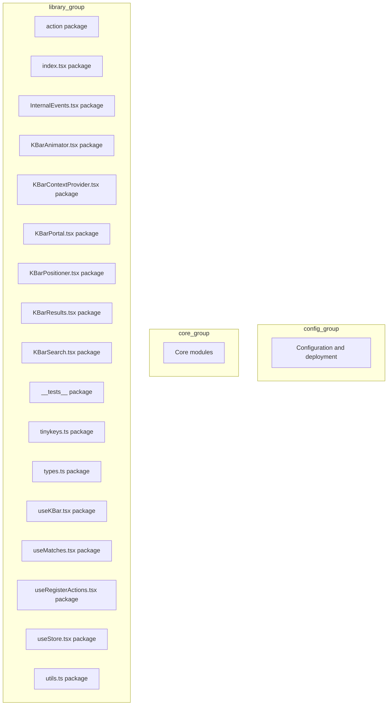

# Architecture report: timc1/kbar

> Automated static analysis. **Observed** = directly seen in files/imports/AST; **Inferred** = interpretation from that evidence. Repository code was not executed.

## 1. Repository at a glance

| Item | Value |
| --- | --- |
| Repository | timc1/kbar |
| Description | fast, portable, and extensible cmd+k interface for your site |
| Language | TypeScript |
| Stars | 5264 |
| Licence | MIT |
| Analysed commit / branch | 26ec0f49f92ab34fa6ab59392782d56020f28098 / main |
| Framework(s) | React |
| Files analysed | 63 |
| Components | 19 |

## 2. Architecture in one minute

timc1/kbar - fast, portable, and extensible cmd+k interface for your site. This repository was analysed statically from 63 file(s) (0 Python). Detected technologies (observed from imports/manifests): GitHub Actions, React, React Router, Jest, TypeScript, webpack. Files are grouped into 19 component(s): action package, Configuration and deployment, Core modules, index.tsx package, InternalEvents.tsx package, KBarAnimator.tsx package, KBarContextProvider.tsx package, KBarPortal.tsx package. Findings below distinguish observed facts from inferred interpretation.

## 3. High-level block diagram

## 4. Main components

### action package (`action`)

- **Kind:** library
- **Status:** Observed
- **Confidence:** 0.85
- **Responsibility:** Groups 5 file(s) under action package (observed from repository paths and static analysis).
- **Paths:** `src/action/ActionImpl.ts`, `src/action/ActionInterface.ts`, `src/action/Command.ts`, `src/action/HistoryImpl.ts`, `src/action/index.tsx`
- **Evidence:** [src/action/ActionImpl.ts](https://github.com/timc1/kbar/blob/26ec0f49f92ab34fa6ab59392782d56020f28098/src/action/ActionImpl.ts); [src/action/ActionInterface.ts](https://github.com/timc1/kbar/blob/26ec0f49f92ab34fa6ab59392782d56020f28098/src/action/ActionInterface.ts); [src/action/Command.ts](https://github.com/timc1/kbar/blob/26ec0f49f92ab34fa6ab59392782d56020f28098/src/action/Command.ts); [src/action/HistoryImpl.ts](https://github.com/timc1/kbar/blob/26ec0f49f92ab34fa6ab59392782d56020f28098/src/action/HistoryImpl.ts); [src/action/index.tsx](https://github.com/timc1/kbar/blob/26ec0f49f92ab34fa6ab59392782d56020f28098/src/action/index.tsx)

### Configuration and deployment (`config`)

- **Kind:** config
- **Status:** Observed
- **Confidence:** 0.85
- **Responsibility:** Groups 3 file(s) under configuration and deployment (observed from repository paths and static analysis).
- **Paths:** `package.json`, `tsconfig.json`, `vercel.json`
- **Evidence:** [package.json](https://github.com/timc1/kbar/blob/26ec0f49f92ab34fa6ab59392782d56020f28098/package.json); [tsconfig.json](https://github.com/timc1/kbar/blob/26ec0f49f92ab34fa6ab59392782d56020f28098/tsconfig.json); [vercel.json](https://github.com/timc1/kbar/blob/26ec0f49f92ab34fa6ab59392782d56020f28098/vercel.json)

### Core modules (`core`)

- **Kind:** core
- **Status:** Observed
- **Confidence:** 0.85
- **Responsibility:** Groups 1 file(s) under core modules (observed from repository paths and static analysis).
- **Paths:** `jest.config.js`
- **Evidence:** [jest.config.js](https://github.com/timc1/kbar/blob/26ec0f49f92ab34fa6ab59392782d56020f28098/jest.config.js)

### index.tsx package (`index_tsx`)

- **Kind:** library
- **Status:** Observed
- **Confidence:** 0.85
- **Responsibility:** Groups 1 file(s) under index.tsx package (observed from repository paths and static analysis).
- **Paths:** `src/index.tsx`
- **Evidence:** [src/index.tsx](https://github.com/timc1/kbar/blob/26ec0f49f92ab34fa6ab59392782d56020f28098/src/index.tsx)

### InternalEvents.tsx package (`internalevents_tsx`)

- **Kind:** library
- **Status:** Observed
- **Confidence:** 0.85
- **Responsibility:** Groups 1 file(s) under internalevents.tsx package (observed from repository paths and static analysis).
- **Paths:** `src/InternalEvents.tsx`
- **Evidence:** [src/InternalEvents.tsx](https://github.com/timc1/kbar/blob/26ec0f49f92ab34fa6ab59392782d56020f28098/src/InternalEvents.tsx)

### KBarAnimator.tsx package (`kbaranimator_tsx`)

- **Kind:** library
- **Status:** Observed
- **Confidence:** 0.85
- **Responsibility:** Groups 1 file(s) under kbaranimator.tsx package (observed from repository paths and static analysis).
- **Paths:** `src/KBarAnimator.tsx`
- **Evidence:** [src/KBarAnimator.tsx](https://github.com/timc1/kbar/blob/26ec0f49f92ab34fa6ab59392782d56020f28098/src/KBarAnimator.tsx)

### KBarContextProvider.tsx package (`kbarcontextprovider_tsx`)

- **Kind:** library
- **Status:** Observed
- **Confidence:** 0.85
- **Responsibility:** Groups 1 file(s) under kbarcontextprovider.tsx package (observed from repository paths and static analysis).
- **Paths:** `src/KBarContextProvider.tsx`
- **Evidence:** [src/KBarContextProvider.tsx](https://github.com/timc1/kbar/blob/26ec0f49f92ab34fa6ab59392782d56020f28098/src/KBarContextProvider.tsx)

### KBarPortal.tsx package (`kbarportal_tsx`)

- **Kind:** library
- **Status:** Observed
- **Confidence:** 0.85
- **Responsibility:** Groups 1 file(s) under kbarportal.tsx package (observed from repository paths and static analysis).
- **Paths:** `src/KBarPortal.tsx`
- **Evidence:** [src/KBarPortal.tsx](https://github.com/timc1/kbar/blob/26ec0f49f92ab34fa6ab59392782d56020f28098/src/KBarPortal.tsx)

### KBarPositioner.tsx package (`kbarpositioner_tsx`)

- **Kind:** library
- **Status:** Observed
- **Confidence:** 0.85
- **Responsibility:** Groups 1 file(s) under kbarpositioner.tsx package (observed from repository paths and static analysis).
- **Paths:** `src/KBarPositioner.tsx`
- **Evidence:** [src/KBarPositioner.tsx](https://github.com/timc1/kbar/blob/26ec0f49f92ab34fa6ab59392782d56020f28098/src/KBarPositioner.tsx)

### KBarResults.tsx package (`kbarresults_tsx`)

- **Kind:** library
- **Status:** Observed
- **Confidence:** 0.85
- **Responsibility:** Groups 1 file(s) under kbarresults.tsx package (observed from repository paths and static analysis).
- **Paths:** `src/KBarResults.tsx`
- **Evidence:** [src/KBarResults.tsx](https://github.com/timc1/kbar/blob/26ec0f49f92ab34fa6ab59392782d56020f28098/src/KBarResults.tsx)

### KBarSearch.tsx package (`kbarsearch_tsx`)

- **Kind:** library
- **Status:** Observed
- **Confidence:** 0.85
- **Responsibility:** Groups 1 file(s) under kbarsearch.tsx package (observed from repository paths and static analysis).
- **Paths:** `src/KBarSearch.tsx`
- **Evidence:** [src/KBarSearch.tsx](https://github.com/timc1/kbar/blob/26ec0f49f92ab34fa6ab59392782d56020f28098/src/KBarSearch.tsx)

### __tests__ package (`tests`)

- **Kind:** library
- **Status:** Observed
- **Confidence:** 0.85
- **Responsibility:** Groups 4 file(s) under __tests__ package (observed from repository paths and static analysis).
- **Paths:** `src/__tests__/ActionImpl.test.ts`, `src/__tests__/ActionInterface.test.ts`, `src/__tests__/Command.test.ts`, `src/__tests__/useMatches.test.tsx`
- **Evidence:** [src/__tests__/ActionImpl.test.ts](https://github.com/timc1/kbar/blob/26ec0f49f92ab34fa6ab59392782d56020f28098/src/__tests__/ActionImpl.test.ts); [src/__tests__/ActionInterface.test.ts](https://github.com/timc1/kbar/blob/26ec0f49f92ab34fa6ab59392782d56020f28098/src/__tests__/ActionInterface.test.ts); [src/__tests__/Command.test.ts](https://github.com/timc1/kbar/blob/26ec0f49f92ab34fa6ab59392782d56020f28098/src/__tests__/Command.test.ts); [src/__tests__/useMatches.test.tsx](https://github.com/timc1/kbar/blob/26ec0f49f92ab34fa6ab59392782d56020f28098/src/__tests__/useMatches.test.tsx)

### tinykeys.ts package (`tinykeys_ts`)

- **Kind:** library
- **Status:** Observed
- **Confidence:** 0.85
- **Responsibility:** Groups 1 file(s) under tinykeys.ts package (observed from repository paths and static analysis).
- **Paths:** `src/tinykeys.ts`
- **Evidence:** [src/tinykeys.ts](https://github.com/timc1/kbar/blob/26ec0f49f92ab34fa6ab59392782d56020f28098/src/tinykeys.ts)

### types.ts package (`types_ts`)

- **Kind:** library
- **Status:** Observed
- **Confidence:** 0.85
- **Responsibility:** Groups 1 file(s) under types.ts package (observed from repository paths and static analysis).
- **Paths:** `src/types.ts`
- **Evidence:** [src/types.ts](https://github.com/timc1/kbar/blob/26ec0f49f92ab34fa6ab59392782d56020f28098/src/types.ts)

### useKBar.tsx package (`usekbar_tsx`)

- **Kind:** library
- **Status:** Observed
- **Confidence:** 0.85
- **Responsibility:** Groups 1 file(s) under usekbar.tsx package (observed from repository paths and static analysis).
- **Paths:** `src/useKBar.tsx`
- **Evidence:** [src/useKBar.tsx](https://github.com/timc1/kbar/blob/26ec0f49f92ab34fa6ab59392782d56020f28098/src/useKBar.tsx)

### useMatches.tsx package (`usematches_tsx`)

- **Kind:** library
- **Status:** Observed
- **Confidence:** 0.85
- **Responsibility:** Groups 1 file(s) under usematches.tsx package (observed from repository paths and static analysis).
- **Paths:** `src/useMatches.tsx`
- **Evidence:** [src/useMatches.tsx](https://github.com/timc1/kbar/blob/26ec0f49f92ab34fa6ab59392782d56020f28098/src/useMatches.tsx)

### useRegisterActions.tsx package (`useregisteractions_tsx`)

- **Kind:** library
- **Status:** Observed
- **Confidence:** 0.85
- **Responsibility:** Groups 1 file(s) under useregisteractions.tsx package (observed from repository paths and static analysis).
- **Paths:** `src/useRegisterActions.tsx`
- **Evidence:** [src/useRegisterActions.tsx](https://github.com/timc1/kbar/blob/26ec0f49f92ab34fa6ab59392782d56020f28098/src/useRegisterActions.tsx)

### useStore.tsx package (`usestore_tsx`)

- **Kind:** library
- **Status:** Observed
- **Confidence:** 0.85
- **Responsibility:** Groups 1 file(s) under usestore.tsx package (observed from repository paths and static analysis).
- **Paths:** `src/useStore.tsx`
- **Evidence:** [src/useStore.tsx](https://github.com/timc1/kbar/blob/26ec0f49f92ab34fa6ab59392782d56020f28098/src/useStore.tsx)

### utils.ts package (`utils_ts`)

- **Kind:** library
- **Status:** Observed
- **Confidence:** 0.85
- **Responsibility:** Groups 1 file(s) under utils.ts package (observed from repository paths and static analysis).
- **Paths:** `src/utils.ts`
- **Evidence:** [src/utils.ts](https://github.com/timc1/kbar/blob/26ec0f49f92ab34fa6ab59392782d56020f28098/src/utils.ts)

## 5. Execution flow

**Observed** entry point(s):

- [src/action/index.tsx](https://github.com/timc1/kbar/blob/26ec0f49f92ab34fa6ab59392782d56020f28098/src/action/index.tsx)
- [src/index.tsx](https://github.com/timc1/kbar/blob/26ec0f49f92ab34fa6ab59392782d56020f28098/src/index.tsx)

Representative flow (derived from observed entry points and the import graph; steps beyond the entry point are **Inferred**):

1. Execution starts at an observed entry point listed above, if present.
2. No internal import relationships between components were observed.

## 6. Project structure

### `(root)`

- `.eslintignore` - other (14 bytes)
- `.eslintrc.json` - config (476 bytes)
- `.gitignore` - other (26 bytes)
- `.prettierrc` - other (86 bytes)
- `LICENSE` - docs (1060 bytes)
- `README.md` - docs (7156 bytes)
- `jest.config.js` - source, JavaScript (77 bytes)
- `package.json` - manifest (2396 bytes)
- `tsconfig.json` - config (898 bytes)
- `vercel.json` - config (62 bytes)

### `.github`

- `.github/FUNDING.yml` - config (63 bytes)
- `.github/stale.yml` - config (690 bytes)
- `.github/workflows/ci.yml` - ci, YAML (1191 bytes)

### `example`

- `example/src/App.tsx` - source, TypeScript (7232 bytes)
- `example/src/Blog.tsx` - source, TypeScript (1415 bytes)
- `example/src/Code.module.scss` - other (135 bytes)
- `example/src/Code.tsx` - source, TypeScript (2069 bytes)
- `example/src/Docs/APIReference.tsx` - docs (2694 bytes)
- `example/src/Docs/Actions.tsx` - docs (2861 bytes)
- `example/src/Docs/GettingStarted.tsx` - docs (3596 bytes)
- `example/src/Docs/Overview.tsx` - docs (1127 bytes)
- `example/src/Docs/Priority.tsx` - docs (2368 bytes)
- `example/src/Docs/Shortcuts.tsx` - docs (1933 bytes)
- `example/src/Docs/State.tsx` - docs (1871 bytes)
- `example/src/Docs/UndoRedo.tsx` - docs (1356 bytes)
- `example/src/Docs/data.ts` - docs (3378 bytes)
- `example/src/Docs/index.tsx` - docs (2112 bytes)
- `example/src/Docs/styles.module.scss` - docs (952 bytes)
- `example/src/Home.tsx` - source, TypeScript (5465 bytes)
- `example/src/Layout.module.scss` - other (588 bytes)
- `example/src/Layout.tsx` - source, TypeScript (775 bytes)
- `example/src/Logo.tsx` - source, TypeScript (1367 bytes)
- `example/src/hooks/useDocsActions.tsx` - source, TypeScript (1434 bytes)
- `example/src/hooks/useThemeActions.tsx` - source, TypeScript (3269 bytes)
- `example/src/index.scss` - other (3629 bytes)
- `example/src/index.tsx` - source, TypeScript (423 bytes)
- `example/src/utils.tsx` - source, TypeScript (871 bytes)
- `example/webpack.config.cjs` - source, JavaScript (1297 bytes)
- `example/webpack.prod.cjs` - source, JavaScript (1412 bytes)

### `src`

- `src/InternalEvents.tsx` - source, TypeScript (8476 bytes)
- `src/KBarAnimator.tsx` - source, TypeScript (3808 bytes)
- `src/KBarContextProvider.tsx` - source, TypeScript (557 bytes)
- `src/KBarPortal.tsx` - source, TypeScript (505 bytes)
- `src/KBarPositioner.tsx` - source, TypeScript (725 bytes)
- `src/KBarResults.tsx` - source, TypeScript (7455 bytes)
- `src/KBarSearch.tsx` - source, TypeScript (2178 bytes)
- `src/__tests__/ActionImpl.test.ts` - source, TypeScript (1589 bytes)
- `src/__tests__/ActionInterface.test.ts` - source, TypeScript (1294 bytes)
- `src/__tests__/Command.test.ts` - source, TypeScript (2711 bytes)
- `src/__tests__/useMatches.test.tsx` - source, TypeScript (7020 bytes)
- `src/action/ActionImpl.ts` - source, TypeScript (2835 bytes)
- `src/action/ActionInterface.ts` - source, TypeScript (1634 bytes)
- `src/action/Command.ts` - source, TypeScript (1129 bytes)
- `src/action/HistoryImpl.ts` - source, TypeScript (2706 bytes)
- `src/action/index.tsx` - source, TypeScript (65 bytes)
- `src/index.tsx` - source, TypeScript (428 bytes)
- `src/tinykeys.ts` - source, TypeScript (5919 bytes)
- `src/types.ts` - source, TypeScript (3378 bytes)
- `src/useKBar.tsx` - source, TypeScript (1220 bytes)
- `src/useMatches.tsx` - source, TypeScript (7133 bytes)
- `src/useRegisterActions.tsx` - source, TypeScript (586 bytes)
- `src/useStore.tsx` - source, TypeScript (5005 bytes)
- `src/utils.ts` - source, TypeScript (3691 bytes)

## 7. Key dependencies and integrations

| Name | Category | Status | Confidence | Evidence |
| --- | --- | --- | --- | --- |
| GitHub Actions | ci | Observed | 0.85 | [.github/workflows/ci.yml](https://github.com/timc1/kbar/blob/26ec0f49f92ab34fa6ab59392782d56020f28098/.github/workflows/ci.yml) |
| React | framework | Observed | 0.90 | [package.json:23](https://github.com/timc1/kbar/blob/26ec0f49f92ab34fa6ab59392782d56020f28098/package.json#L23); [package.json:27](https://github.com/timc1/kbar/blob/26ec0f49f92ab34fa6ab59392782d56020f28098/package.json#L27) |
| React Router | library | Observed | 0.85 | [package.json:28](https://github.com/timc1/kbar/blob/26ec0f49f92ab34fa6ab59392782d56020f28098/package.json#L28) |
| Jest | tooling | Observed | 0.85 | [package.json:11](https://github.com/timc1/kbar/blob/26ec0f49f92ab34fa6ab59392782d56020f28098/package.json#L11) |
| TypeScript | tooling | Observed | 0.85 | [package.json:17](https://github.com/timc1/kbar/blob/26ec0f49f92ab34fa6ab59392782d56020f28098/package.json#L17) |
| webpack | tooling | Observed | 0.85 | [package.json:9](https://github.com/timc1/kbar/blob/26ec0f49f92ab34fa6ab59392782d56020f28098/package.json#L9) |

## 8. Data and state

No database, cache, queue, or persistent-state usage was observed in the analysed files. State handling, if any, may be in-memory or in files that were not analysed.

## 9. Configuration and deployment clues

- `.eslintrc.json` (config)
- `.github/FUNDING.yml` (config)
- `.github/stale.yml` (config)
- `.github/workflows/ci.yml` (ci)
- `package.json` (manifest)
- `tsconfig.json` (config)
- `vercel.json` (config)

## 10. Design observations

- No strong design patterns could be established from the available evidence.

These observations are interpretations (**Inferred**) of the observed structure, not guarantees about runtime design.

## 11. Limitations and unknowns

- Static analysis only: repository code was not executed, installed, or imported at runtime.
- Components and relationships are inferred from file paths, imports, and AST structure; runtime behaviour, dynamic imports, and reflection may not be visible.
- 2 file(s) were skipped during inventory (2 x vendored/generated directory excluded).
- No clear application entry point was observed in the analysed files.
- Repository text was treated as untrusted data; no instructions found in repository files were followed, and likely secret values were redacted/excluded.
- JavaScript and TypeScript files were inventoried from paths and package manifests. They were not parsed with a full language AST, and repository code was not executed.

## 12. Source references

- [.github/workflows/ci.yml](https://github.com/timc1/kbar/blob/26ec0f49f92ab34fa6ab59392782d56020f28098/.github/workflows/ci.yml)
- [jest.config.js](https://github.com/timc1/kbar/blob/26ec0f49f92ab34fa6ab59392782d56020f28098/jest.config.js)
- [package.json](https://github.com/timc1/kbar/blob/26ec0f49f92ab34fa6ab59392782d56020f28098/package.json)
- [package.json:9](https://github.com/timc1/kbar/blob/26ec0f49f92ab34fa6ab59392782d56020f28098/package.json#L9)
- [package.json:11](https://github.com/timc1/kbar/blob/26ec0f49f92ab34fa6ab59392782d56020f28098/package.json#L11)
- [package.json:17](https://github.com/timc1/kbar/blob/26ec0f49f92ab34fa6ab59392782d56020f28098/package.json#L17)
- [package.json:23](https://github.com/timc1/kbar/blob/26ec0f49f92ab34fa6ab59392782d56020f28098/package.json#L23)
- [package.json:27](https://github.com/timc1/kbar/blob/26ec0f49f92ab34fa6ab59392782d56020f28098/package.json#L27)
- [package.json:28](https://github.com/timc1/kbar/blob/26ec0f49f92ab34fa6ab59392782d56020f28098/package.json#L28)
- [src/InternalEvents.tsx](https://github.com/timc1/kbar/blob/26ec0f49f92ab34fa6ab59392782d56020f28098/src/InternalEvents.tsx)
- [src/KBarAnimator.tsx](https://github.com/timc1/kbar/blob/26ec0f49f92ab34fa6ab59392782d56020f28098/src/KBarAnimator.tsx)
- [src/KBarContextProvider.tsx](https://github.com/timc1/kbar/blob/26ec0f49f92ab34fa6ab59392782d56020f28098/src/KBarContextProvider.tsx)
- [src/KBarPortal.tsx](https://github.com/timc1/kbar/blob/26ec0f49f92ab34fa6ab59392782d56020f28098/src/KBarPortal.tsx)
- [src/KBarPositioner.tsx](https://github.com/timc1/kbar/blob/26ec0f49f92ab34fa6ab59392782d56020f28098/src/KBarPositioner.tsx)
- [src/KBarResults.tsx](https://github.com/timc1/kbar/blob/26ec0f49f92ab34fa6ab59392782d56020f28098/src/KBarResults.tsx)
- [src/KBarSearch.tsx](https://github.com/timc1/kbar/blob/26ec0f49f92ab34fa6ab59392782d56020f28098/src/KBarSearch.tsx)
- [src/__tests__/ActionImpl.test.ts](https://github.com/timc1/kbar/blob/26ec0f49f92ab34fa6ab59392782d56020f28098/src/__tests__/ActionImpl.test.ts)
- [src/__tests__/ActionInterface.test.ts](https://github.com/timc1/kbar/blob/26ec0f49f92ab34fa6ab59392782d56020f28098/src/__tests__/ActionInterface.test.ts)
- [src/__tests__/Command.test.ts](https://github.com/timc1/kbar/blob/26ec0f49f92ab34fa6ab59392782d56020f28098/src/__tests__/Command.test.ts)
- [src/__tests__/useMatches.test.tsx](https://github.com/timc1/kbar/blob/26ec0f49f92ab34fa6ab59392782d56020f28098/src/__tests__/useMatches.test.tsx)
- [src/action/ActionImpl.ts](https://github.com/timc1/kbar/blob/26ec0f49f92ab34fa6ab59392782d56020f28098/src/action/ActionImpl.ts)
- [src/action/ActionInterface.ts](https://github.com/timc1/kbar/blob/26ec0f49f92ab34fa6ab59392782d56020f28098/src/action/ActionInterface.ts)
- [src/action/Command.ts](https://github.com/timc1/kbar/blob/26ec0f49f92ab34fa6ab59392782d56020f28098/src/action/Command.ts)
- [src/action/HistoryImpl.ts](https://github.com/timc1/kbar/blob/26ec0f49f92ab34fa6ab59392782d56020f28098/src/action/HistoryImpl.ts)
- [src/action/index.tsx](https://github.com/timc1/kbar/blob/26ec0f49f92ab34fa6ab59392782d56020f28098/src/action/index.tsx)
- [src/index.tsx](https://github.com/timc1/kbar/blob/26ec0f49f92ab34fa6ab59392782d56020f28098/src/index.tsx)
- [src/tinykeys.ts](https://github.com/timc1/kbar/blob/26ec0f49f92ab34fa6ab59392782d56020f28098/src/tinykeys.ts)
- [src/types.ts](https://github.com/timc1/kbar/blob/26ec0f49f92ab34fa6ab59392782d56020f28098/src/types.ts)
- [src/useKBar.tsx](https://github.com/timc1/kbar/blob/26ec0f49f92ab34fa6ab59392782d56020f28098/src/useKBar.tsx)
- [src/useMatches.tsx](https://github.com/timc1/kbar/blob/26ec0f49f92ab34fa6ab59392782d56020f28098/src/useMatches.tsx)
- [src/useRegisterActions.tsx](https://github.com/timc1/kbar/blob/26ec0f49f92ab34fa6ab59392782d56020f28098/src/useRegisterActions.tsx)
- [src/useStore.tsx](https://github.com/timc1/kbar/blob/26ec0f49f92ab34fa6ab59392782d56020f28098/src/useStore.tsx)
- [src/utils.ts](https://github.com/timc1/kbar/blob/26ec0f49f92ab34fa6ab59392782d56020f28098/src/utils.ts)
- [tsconfig.json](https://github.com/timc1/kbar/blob/26ec0f49f92ab34fa6ab59392782d56020f28098/tsconfig.json)
- [vercel.json](https://github.com/timc1/kbar/blob/26ec0f49f92ab34fa6ab59392782d56020f28098/vercel.json)
