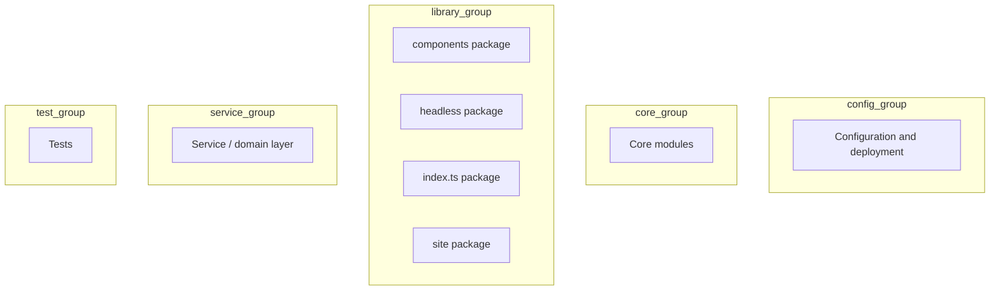

# Architecture report: timolins/react-hot-toast

> Automated static analysis. **Observed** = directly seen in files/imports/AST; **Inferred** = interpretation from that evidence. Repository code was not executed.

## 1. Repository at a glance

| Item | Value |
| --- | --- |
| Repository | timolins/react-hot-toast |
| Description | Smoking Hot React Notifications 🔥  |
| Language | TypeScript |
| Stars | 10993 |
| Licence | MIT |
| Analysed commit / branch | e725d38e0faec05f7b8fb10644b616ef978d2f4d / main |
| Framework(s) | Next.js, React |
| Files analysed | 65 |
| Components | 8 |

## 2. Architecture in one minute

timolins/react-hot-toast - Smoking Hot React Notifications 🔥 . This repository was analysed statically from 65 file(s) (0 Python). Detected technologies (observed from imports/manifests): GitHub Actions, Next.js, React, Tailwind CSS, Jest, TypeScript. Files are grouped into 8 component(s): components package, Configuration and deployment, Core modules, headless package, index.ts package, Service / domain layer, site package, Tests. Findings below distinguish observed facts from inferred interpretation.

## 3. High-level block diagram

## 4. Main components

### components package (`components`)

- **Kind:** library
- **Status:** Observed
- **Confidence:** 0.85
- **Responsibility:** Groups 6 file(s) under components package (observed from repository paths and static analysis).
- **Paths:** `src/components/checkmark.tsx`, `src/components/error.tsx`, `src/components/loader.tsx`, `src/components/toast-bar.tsx`, `src/components/toast-icon.tsx`, `src/components/toaster.tsx`
- **Evidence:** [src/components/checkmark.tsx](https://github.com/timolins/react-hot-toast/blob/e725d38e0faec05f7b8fb10644b616ef978d2f4d/src/components/checkmark.tsx); [src/components/error.tsx](https://github.com/timolins/react-hot-toast/blob/e725d38e0faec05f7b8fb10644b616ef978d2f4d/src/components/error.tsx); [src/components/loader.tsx](https://github.com/timolins/react-hot-toast/blob/e725d38e0faec05f7b8fb10644b616ef978d2f4d/src/components/loader.tsx); [src/components/toast-bar.tsx](https://github.com/timolins/react-hot-toast/blob/e725d38e0faec05f7b8fb10644b616ef978d2f4d/src/components/toast-bar.tsx); [src/components/toast-icon.tsx](https://github.com/timolins/react-hot-toast/blob/e725d38e0faec05f7b8fb10644b616ef978d2f4d/src/components/toast-icon.tsx); [src/components/toaster.tsx](https://github.com/timolins/react-hot-toast/blob/e725d38e0faec05f7b8fb10644b616ef978d2f4d/src/components/toaster.tsx)

### Configuration and deployment (`config`)

- **Kind:** config
- **Status:** Observed
- **Confidence:** 0.85
- **Responsibility:** Groups 4 file(s) under configuration and deployment (observed from repository paths and static analysis).
- **Paths:** `package.json`, `site/package.json`, `site/tsconfig.json`, `tsconfig.json`
- **Evidence:** [package.json](https://github.com/timolins/react-hot-toast/blob/e725d38e0faec05f7b8fb10644b616ef978d2f4d/package.json); [site/package.json](https://github.com/timolins/react-hot-toast/blob/e725d38e0faec05f7b8fb10644b616ef978d2f4d/site/package.json); [site/tsconfig.json](https://github.com/timolins/react-hot-toast/blob/e725d38e0faec05f7b8fb10644b616ef978d2f4d/site/tsconfig.json); [tsconfig.json](https://github.com/timolins/react-hot-toast/blob/e725d38e0faec05f7b8fb10644b616ef978d2f4d/tsconfig.json)

### Core modules (`core`)

- **Kind:** core
- **Status:** Observed
- **Confidence:** 0.85
- **Responsibility:** Groups 2 file(s) under core modules (observed from repository paths and static analysis).
- **Paths:** `jest.config.js`, `tsup.config.ts`
- **Evidence:** [jest.config.js](https://github.com/timolins/react-hot-toast/blob/e725d38e0faec05f7b8fb10644b616ef978d2f4d/jest.config.js); [tsup.config.ts](https://github.com/timolins/react-hot-toast/blob/e725d38e0faec05f7b8fb10644b616ef978d2f4d/tsup.config.ts)

### headless package (`headless`)

- **Kind:** library
- **Status:** Observed
- **Confidence:** 0.85
- **Responsibility:** Groups 1 file(s) under headless package (observed from repository paths and static analysis).
- **Paths:** `src/headless/index.ts`
- **Evidence:** [src/headless/index.ts](https://github.com/timolins/react-hot-toast/blob/e725d38e0faec05f7b8fb10644b616ef978d2f4d/src/headless/index.ts)

### index.ts package (`index_ts`)

- **Kind:** library
- **Status:** Observed
- **Confidence:** 0.85
- **Responsibility:** Groups 1 file(s) under index.ts package (observed from repository paths and static analysis).
- **Paths:** `src/index.ts`
- **Evidence:** [src/index.ts](https://github.com/timolins/react-hot-toast/blob/e725d38e0faec05f7b8fb10644b616ef978d2f4d/src/index.ts)

### Service / domain layer (`service_layer`)

- **Kind:** service
- **Status:** Observed
- **Confidence:** 0.85
- **Responsibility:** Groups 5 file(s) under service / domain layer (observed from repository paths and static analysis).
- **Paths:** `src/core/store.ts`, `src/core/toast.ts`, `src/core/types.ts`, `src/core/use-toaster.ts`, `src/core/utils.ts`
- **Evidence:** [src/core/store.ts](https://github.com/timolins/react-hot-toast/blob/e725d38e0faec05f7b8fb10644b616ef978d2f4d/src/core/store.ts); [src/core/toast.ts](https://github.com/timolins/react-hot-toast/blob/e725d38e0faec05f7b8fb10644b616ef978d2f4d/src/core/toast.ts); [src/core/types.ts](https://github.com/timolins/react-hot-toast/blob/e725d38e0faec05f7b8fb10644b616ef978d2f4d/src/core/types.ts); [src/core/use-toaster.ts](https://github.com/timolins/react-hot-toast/blob/e725d38e0faec05f7b8fb10644b616ef978d2f4d/src/core/use-toaster.ts); [src/core/utils.ts](https://github.com/timolins/react-hot-toast/blob/e725d38e0faec05f7b8fb10644b616ef978d2f4d/src/core/utils.ts)

### site package (`site`)

- **Kind:** library
- **Status:** Observed
- **Confidence:** 0.85
- **Responsibility:** Groups 15 file(s) under site package (observed from repository paths and static analysis).
- **Paths:** `site/components/code.tsx`, `site/components/docs-layout.tsx`, `site/components/emoji-button.tsx`, `site/components/sections/footer.tsx`, `site/components/sections/splitbee-counter.tsx`, `site/components/sections/toast-example.tsx`, `site/components/sections/toaster-example.tsx`, `site/next-env.d.ts`, `site/next.config.mjs`, `site/pages/_app.tsx`, `site/pages/index.tsx`, `site/postcss.config.js`, `site/tailwind.config.js`, `site/types/mdx.d.ts`, `site/types/svg.d.ts`
- **Evidence:** [site/components/code.tsx](https://github.com/timolins/react-hot-toast/blob/e725d38e0faec05f7b8fb10644b616ef978d2f4d/site/components/code.tsx); [site/components/docs-layout.tsx](https://github.com/timolins/react-hot-toast/blob/e725d38e0faec05f7b8fb10644b616ef978d2f4d/site/components/docs-layout.tsx); [site/components/emoji-button.tsx](https://github.com/timolins/react-hot-toast/blob/e725d38e0faec05f7b8fb10644b616ef978d2f4d/site/components/emoji-button.tsx); [site/components/sections/footer.tsx](https://github.com/timolins/react-hot-toast/blob/e725d38e0faec05f7b8fb10644b616ef978d2f4d/site/components/sections/footer.tsx); [site/components/sections/splitbee-counter.tsx](https://github.com/timolins/react-hot-toast/blob/e725d38e0faec05f7b8fb10644b616ef978d2f4d/site/components/sections/splitbee-counter.tsx); [site/components/sections/toast-example.tsx](https://github.com/timolins/react-hot-toast/blob/e725d38e0faec05f7b8fb10644b616ef978d2f4d/site/components/sections/toast-example.tsx); [site/components/sections/toaster-example.tsx](https://github.com/timolins/react-hot-toast/blob/e725d38e0faec05f7b8fb10644b616ef978d2f4d/site/components/sections/toaster-example.tsx); [site/next-env.d.ts](https://github.com/timolins/react-hot-toast/blob/e725d38e0faec05f7b8fb10644b616ef978d2f4d/site/next-env.d.ts)

### Tests (`tests`)

- **Kind:** test
- **Status:** Observed
- **Confidence:** 0.85
- **Responsibility:** Groups 3 file(s) under tests (observed from repository paths and static analysis).
- **Paths:** `test/setup.ts`, `test/store.test.tsx`, `test/toast.test.tsx`
- **Evidence:** [test/setup.ts](https://github.com/timolins/react-hot-toast/blob/e725d38e0faec05f7b8fb10644b616ef978d2f4d/test/setup.ts); [test/store.test.tsx](https://github.com/timolins/react-hot-toast/blob/e725d38e0faec05f7b8fb10644b616ef978d2f4d/test/store.test.tsx); [test/toast.test.tsx](https://github.com/timolins/react-hot-toast/blob/e725d38e0faec05f7b8fb10644b616ef978d2f4d/test/toast.test.tsx)

## 5. Execution flow

**Observed** entry point(s):

- [site/pages/index.tsx](https://github.com/timolins/react-hot-toast/blob/e725d38e0faec05f7b8fb10644b616ef978d2f4d/site/pages/index.tsx)
- [src/headless/index.ts](https://github.com/timolins/react-hot-toast/blob/e725d38e0faec05f7b8fb10644b616ef978d2f4d/src/headless/index.ts)
- [src/index.ts](https://github.com/timolins/react-hot-toast/blob/e725d38e0faec05f7b8fb10644b616ef978d2f4d/src/index.ts)

Representative flow (derived from observed entry points and the import graph; steps beyond the entry point are **Inferred**):

1. Execution starts at an observed entry point listed above, if present.
2. No internal import relationships between components were observed.

## 6. Project structure

### `(root)`

- `.gitignore` - other (76 bytes)
- `LICENSE` - docs (1065 bytes)
- `README.md` - docs (1966 bytes)
- `jest.config.js` - source, JavaScript (187 bytes)
- `package.json` - manifest (2759 bytes)
- `tsconfig.json` - config (1401 bytes)
- `tsup.config.ts` - source, TypeScript (705 bytes)

### `.github`

- `.github/workflows/main.yml` - ci, YAML (518 bytes)
- `.github/workflows/size.yml` - ci, YAML (422 bytes)

### `.vscode`

- `.vscode/settings.json` - config (56 bytes)

### `assets`

- `assets/header.svg` - other (71695 bytes)

### `site`

- `site/.gitignore` - other (386 bytes)
- `site/README.md` - docs (1206 bytes)
- `site/assets/arrow.svg` - other (245 bytes)
- `site/assets/butter-1.svg` - other (14416 bytes)
- `site/assets/butter-2.svg` - other (10348 bytes)
- `site/assets/checkmark.svg` - other (164 bytes)
- `site/assets/github.svg` - other (834 bytes)
- `site/assets/logo-small.svg` - other (3763 bytes)
- `site/assets/logo.svg` - other (12246 bytes)
- `site/components/code.tsx` - source, TypeScript (2781 bytes)
- `site/components/docs-layout.tsx` - source, TypeScript (2991 bytes)
- `site/components/emoji-button.tsx` - source, TypeScript (548 bytes)
- `site/components/sections/footer.tsx` - source, TypeScript (1371 bytes)
- `site/components/sections/splitbee-counter.tsx` - source, TypeScript (1936 bytes)
- `site/components/sections/toast-example.tsx` - source, TypeScript (7940 bytes)
- `site/components/sections/toaster-example.tsx` - source, TypeScript (3080 bytes)
- `site/next-env.d.ts` - source, TypeScript (201 bytes)
- `site/next.config.mjs` - source, JavaScript (820 bytes)
- `site/package.json` - manifest (870 bytes)
- `site/pages/_app.tsx` - source, TypeScript (2041 bytes)
- `site/pages/docs/index.mdx` - docs (735 bytes)
- `site/pages/docs/multi-toaster.mdx` - docs (3062 bytes)
- `site/pages/docs/styling.mdx` - docs (2284 bytes)
- `site/pages/docs/toast-bar.mdx` - docs (1253 bytes)
- `site/pages/docs/toast.mdx` - docs (5717 bytes)
- `site/pages/docs/toaster.mdx` - docs (3298 bytes)
- `site/pages/docs/use-toaster-store.mdx` - docs (663 bytes)
- `site/pages/docs/use-toaster.mdx` - docs (4946 bytes)
- `site/pages/docs/version-2.mdx` - docs (7231 bytes)
- `site/pages/index.tsx` - source, TypeScript (8452 bytes)
- `site/postcss.config.js` - source, JavaScript (50 bytes)
- `site/styles/main.css` - other (293 bytes)
- `site/styles/prism-theme.css` - other (2726 bytes)
- `site/styles/tailwind-utils.css` - other (21 bytes)
- `site/tailwind.config.js` - source, JavaScript (4009 bytes)
- `site/tsconfig.json` - config (652 bytes)
- `site/types/mdx.d.ts` - source, TypeScript (114 bytes)
- `site/types/svg.d.ts` - source, TypeScript (177 bytes)

### `src`

- `src/components/checkmark.tsx` - source, TypeScript (1161 bytes)
- `src/components/error.tsx` - source, TypeScript (1356 bytes)
- `src/components/loader.tsx` - source, TypeScript (544 bytes)
- `src/components/toast-bar.tsx` - source, TypeScript (2957 bytes)
- `src/components/toast-icon.tsx` - source, TypeScript (1644 bytes)
- `src/components/toaster.tsx` - source, TypeScript (3391 bytes)
- `src/core/store.ts` - source, TypeScript (5300 bytes)
- `src/core/toast.ts` - source, TypeScript (3505 bytes)
- `src/core/types.ts` - source, TypeScript (2204 bytes)
- `src/core/use-toaster.ts` - source, TypeScript (3724 bytes)
- `src/core/utils.ts` - source, TypeScript (509 bytes)
- `src/headless/index.ts` - source, TypeScript (434 bytes)
- `src/index.ts` - source, TypeScript (415 bytes)

### `test`

- `test/setup.ts` - test, TypeScript (667 bytes)
- `test/store.test.tsx` - test, TypeScript (932 bytes)
- `test/toast.test.tsx` - test, TypeScript (12839 bytes)

## 7. Key dependencies and integrations

| Name | Category | Status | Confidence | Evidence |
| --- | --- | --- | --- | --- |
| GitHub Actions | ci | Observed | 0.90 | [.github/workflows/main.yml](https://github.com/timolins/react-hot-toast/blob/e725d38e0faec05f7b8fb10644b616ef978d2f4d/.github/workflows/main.yml); [.github/workflows/size.yml](https://github.com/timolins/react-hot-toast/blob/e725d38e0faec05f7b8fb10644b616ef978d2f4d/.github/workflows/size.yml) |
| Next.js | framework | Observed | 0.85 | [site/package.json:4](https://github.com/timolins/react-hot-toast/blob/e725d38e0faec05f7b8fb10644b616ef978d2f4d/site/package.json#L4) |
| React | framework | Observed | 0.90 | [package.json:2](https://github.com/timolins/react-hot-toast/blob/e725d38e0faec05f7b8fb10644b616ef978d2f4d/package.json#L2); [package.json:42](https://github.com/timolins/react-hot-toast/blob/e725d38e0faec05f7b8fb10644b616ef978d2f4d/package.json#L42); [site/package.json:10](https://github.com/timolins/react-hot-toast/blob/e725d38e0faec05f7b8fb10644b616ef978d2f4d/site/package.json#L10); [site/package.json:21](https://github.com/timolins/react-hot-toast/blob/e725d38e0faec05f7b8fb10644b616ef978d2f4d/site/package.json#L21) |
| Tailwind CSS | library | Observed | 0.85 | [site/package.json:26](https://github.com/timolins/react-hot-toast/blob/e725d38e0faec05f7b8fb10644b616ef978d2f4d/site/package.json#L26) |
| Jest | tooling | Observed | 0.85 | [package.json:40](https://github.com/timolins/react-hot-toast/blob/e725d38e0faec05f7b8fb10644b616ef978d2f4d/package.json#L40) |
| TypeScript | tooling | Observed | 0.90 | [package.json:93](https://github.com/timolins/react-hot-toast/blob/e725d38e0faec05f7b8fb10644b616ef978d2f4d/package.json#L93); [site/package.json:33](https://github.com/timolins/react-hot-toast/blob/e725d38e0faec05f7b8fb10644b616ef978d2f4d/site/package.json#L33) |

## 8. Data and state

No database, cache, queue, or persistent-state usage was observed in the analysed files. State handling, if any, may be in-memory or in files that were not analysed.

## 9. Configuration and deployment clues

- `.github/workflows/main.yml` (ci)
- `.github/workflows/size.yml` (ci)
- `.vscode/settings.json` (config)
- `package.json` (manifest)
- `site/package.json` (manifest)
- `site/tsconfig.json` (config)
- `tsconfig.json` (config)

## 10. Design observations

- Service/domain code is distinct from entry and data code, suggesting layered separation (Inferred).
- Tests are present alongside source code (Observed from test file paths).

These observations are interpretations (**Inferred**) of the observed structure, not guarantees about runtime design.

## 11. Limitations and unknowns

- Static analysis only: repository code was not executed, installed, or imported at runtime.
- Components and relationships are inferred from file paths, imports, and AST structure; runtime behaviour, dynamic imports, and reflection may not be visible.
- 2 file(s) were skipped during inventory (2 x lockfile excluded).
- No clear application entry point was observed in the analysed files.
- Repository text was treated as untrusted data; no instructions found in repository files were followed, and likely secret values were redacted/excluded.
- JavaScript and TypeScript files were inventoried from paths and package manifests. They were not parsed with a full language AST, and repository code was not executed.

## 12. Source references

- [.github/workflows/main.yml](https://github.com/timolins/react-hot-toast/blob/e725d38e0faec05f7b8fb10644b616ef978d2f4d/.github/workflows/main.yml)
- [.github/workflows/size.yml](https://github.com/timolins/react-hot-toast/blob/e725d38e0faec05f7b8fb10644b616ef978d2f4d/.github/workflows/size.yml)
- [jest.config.js](https://github.com/timolins/react-hot-toast/blob/e725d38e0faec05f7b8fb10644b616ef978d2f4d/jest.config.js)
- [package.json](https://github.com/timolins/react-hot-toast/blob/e725d38e0faec05f7b8fb10644b616ef978d2f4d/package.json)
- [package.json:2](https://github.com/timolins/react-hot-toast/blob/e725d38e0faec05f7b8fb10644b616ef978d2f4d/package.json#L2)
- [package.json:40](https://github.com/timolins/react-hot-toast/blob/e725d38e0faec05f7b8fb10644b616ef978d2f4d/package.json#L40)
- [package.json:42](https://github.com/timolins/react-hot-toast/blob/e725d38e0faec05f7b8fb10644b616ef978d2f4d/package.json#L42)
- [package.json:93](https://github.com/timolins/react-hot-toast/blob/e725d38e0faec05f7b8fb10644b616ef978d2f4d/package.json#L93)
- [site/components/code.tsx](https://github.com/timolins/react-hot-toast/blob/e725d38e0faec05f7b8fb10644b616ef978d2f4d/site/components/code.tsx)
- [site/components/docs-layout.tsx](https://github.com/timolins/react-hot-toast/blob/e725d38e0faec05f7b8fb10644b616ef978d2f4d/site/components/docs-layout.tsx)
- [site/components/emoji-button.tsx](https://github.com/timolins/react-hot-toast/blob/e725d38e0faec05f7b8fb10644b616ef978d2f4d/site/components/emoji-button.tsx)
- [site/components/sections/footer.tsx](https://github.com/timolins/react-hot-toast/blob/e725d38e0faec05f7b8fb10644b616ef978d2f4d/site/components/sections/footer.tsx)
- [site/components/sections/splitbee-counter.tsx](https://github.com/timolins/react-hot-toast/blob/e725d38e0faec05f7b8fb10644b616ef978d2f4d/site/components/sections/splitbee-counter.tsx)
- [site/components/sections/toast-example.tsx](https://github.com/timolins/react-hot-toast/blob/e725d38e0faec05f7b8fb10644b616ef978d2f4d/site/components/sections/toast-example.tsx)
- [site/components/sections/toaster-example.tsx](https://github.com/timolins/react-hot-toast/blob/e725d38e0faec05f7b8fb10644b616ef978d2f4d/site/components/sections/toaster-example.tsx)
- [site/next-env.d.ts](https://github.com/timolins/react-hot-toast/blob/e725d38e0faec05f7b8fb10644b616ef978d2f4d/site/next-env.d.ts)
- [site/package.json](https://github.com/timolins/react-hot-toast/blob/e725d38e0faec05f7b8fb10644b616ef978d2f4d/site/package.json)
- [site/package.json:4](https://github.com/timolins/react-hot-toast/blob/e725d38e0faec05f7b8fb10644b616ef978d2f4d/site/package.json#L4)
- [site/package.json:10](https://github.com/timolins/react-hot-toast/blob/e725d38e0faec05f7b8fb10644b616ef978d2f4d/site/package.json#L10)
- [site/package.json:21](https://github.com/timolins/react-hot-toast/blob/e725d38e0faec05f7b8fb10644b616ef978d2f4d/site/package.json#L21)
- [site/package.json:26](https://github.com/timolins/react-hot-toast/blob/e725d38e0faec05f7b8fb10644b616ef978d2f4d/site/package.json#L26)
- [site/package.json:33](https://github.com/timolins/react-hot-toast/blob/e725d38e0faec05f7b8fb10644b616ef978d2f4d/site/package.json#L33)
- [site/pages/index.tsx](https://github.com/timolins/react-hot-toast/blob/e725d38e0faec05f7b8fb10644b616ef978d2f4d/site/pages/index.tsx)
- [site/tsconfig.json](https://github.com/timolins/react-hot-toast/blob/e725d38e0faec05f7b8fb10644b616ef978d2f4d/site/tsconfig.json)
- [src/components/checkmark.tsx](https://github.com/timolins/react-hot-toast/blob/e725d38e0faec05f7b8fb10644b616ef978d2f4d/src/components/checkmark.tsx)
- [src/components/error.tsx](https://github.com/timolins/react-hot-toast/blob/e725d38e0faec05f7b8fb10644b616ef978d2f4d/src/components/error.tsx)
- [src/components/loader.tsx](https://github.com/timolins/react-hot-toast/blob/e725d38e0faec05f7b8fb10644b616ef978d2f4d/src/components/loader.tsx)
- [src/components/toast-bar.tsx](https://github.com/timolins/react-hot-toast/blob/e725d38e0faec05f7b8fb10644b616ef978d2f4d/src/components/toast-bar.tsx)
- [src/components/toast-icon.tsx](https://github.com/timolins/react-hot-toast/blob/e725d38e0faec05f7b8fb10644b616ef978d2f4d/src/components/toast-icon.tsx)
- [src/components/toaster.tsx](https://github.com/timolins/react-hot-toast/blob/e725d38e0faec05f7b8fb10644b616ef978d2f4d/src/components/toaster.tsx)
- [src/core/store.ts](https://github.com/timolins/react-hot-toast/blob/e725d38e0faec05f7b8fb10644b616ef978d2f4d/src/core/store.ts)
- [src/core/toast.ts](https://github.com/timolins/react-hot-toast/blob/e725d38e0faec05f7b8fb10644b616ef978d2f4d/src/core/toast.ts)
- [src/core/types.ts](https://github.com/timolins/react-hot-toast/blob/e725d38e0faec05f7b8fb10644b616ef978d2f4d/src/core/types.ts)
- [src/core/use-toaster.ts](https://github.com/timolins/react-hot-toast/blob/e725d38e0faec05f7b8fb10644b616ef978d2f4d/src/core/use-toaster.ts)
- [src/core/utils.ts](https://github.com/timolins/react-hot-toast/blob/e725d38e0faec05f7b8fb10644b616ef978d2f4d/src/core/utils.ts)
- [src/headless/index.ts](https://github.com/timolins/react-hot-toast/blob/e725d38e0faec05f7b8fb10644b616ef978d2f4d/src/headless/index.ts)
- [src/index.ts](https://github.com/timolins/react-hot-toast/blob/e725d38e0faec05f7b8fb10644b616ef978d2f4d/src/index.ts)
- [test/setup.ts](https://github.com/timolins/react-hot-toast/blob/e725d38e0faec05f7b8fb10644b616ef978d2f4d/test/setup.ts)
- [test/store.test.tsx](https://github.com/timolins/react-hot-toast/blob/e725d38e0faec05f7b8fb10644b616ef978d2f4d/test/store.test.tsx)
- [test/toast.test.tsx](https://github.com/timolins/react-hot-toast/blob/e725d38e0faec05f7b8fb10644b616ef978d2f4d/test/toast.test.tsx)
- [tsconfig.json](https://github.com/timolins/react-hot-toast/blob/e725d38e0faec05f7b8fb10644b616ef978d2f4d/tsconfig.json)
- [tsup.config.ts](https://github.com/timolins/react-hot-toast/blob/e725d38e0faec05f7b8fb10644b616ef978d2f4d/tsup.config.ts)
