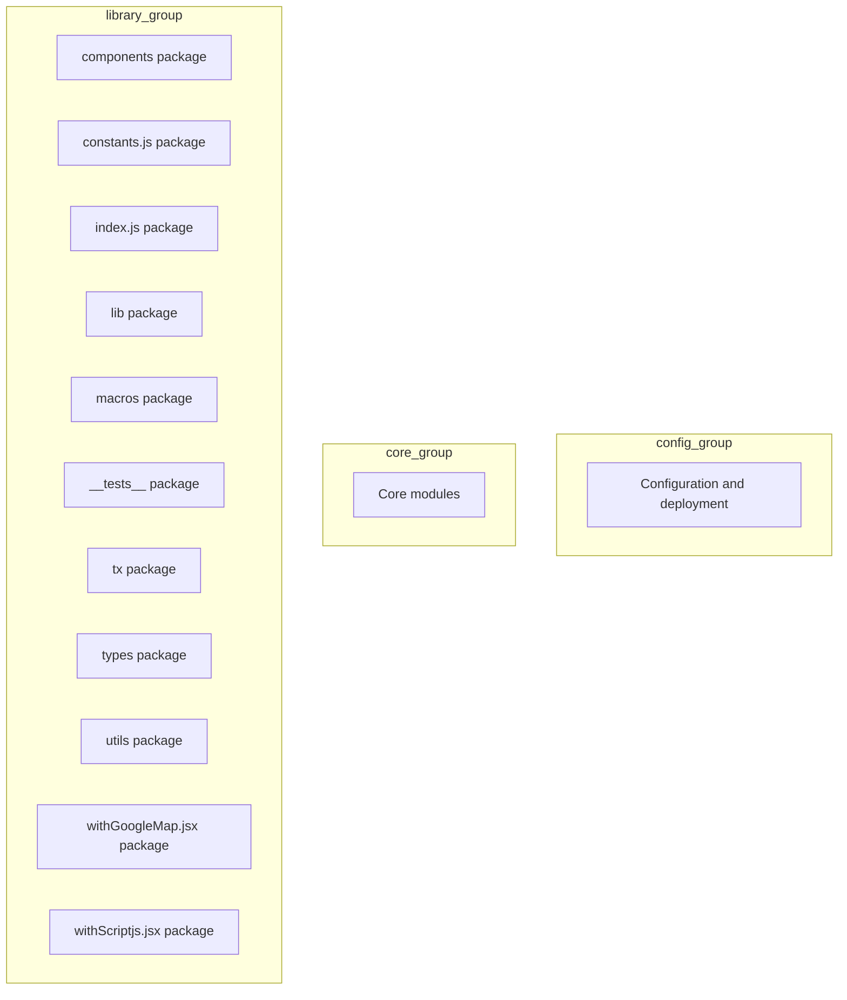

# Architecture report: tomchentw/react-google-maps

> Automated static analysis. **Observed** = directly seen in files/imports/AST; **Inferred** = interpretation from that evidence. Repository code was not executed.

## 1. Repository at a glance

| Item | Value |
| --- | --- |
| Repository | tomchentw/react-google-maps |
| Description | React.js Google Maps integration component |
| Language | JavaScript |
| Stars | 4625 |
| Licence | MIT |
| Analysed commit / branch | ca5c5c6f5346fb3ee0037893fbca488a408c9938 / master |
| Framework(s) | React |
| Files analysed | 124 |
| Components | 13 |

## 2. Architecture in one minute

tomchentw/react-google-maps - React.js Google Maps integration component. This repository was analysed statically from 124 file(s) (0 Python). Detected technologies (observed from imports/manifests): React. Files are grouped into 13 component(s): components package, Configuration and deployment, constants.js package, Core modules, index.js package, lib package, macros package, __tests__ package. Findings below distinguish observed facts from inferred interpretation.

## 3. High-level block diagram

## 4. Main components

### components package (`components`)

- **Kind:** library
- **Status:** Observed
- **Confidence:** 0.85
- **Responsibility:** Groups 27 file(s) under components package (observed from repository paths and static analysis).
- **Paths:** `src/components/BicyclingLayer.jsx`, `src/components/Circle.jsx`, `src/components/DirectionsRenderer.jsx`, `src/components/FusionTablesLayer.jsx`, `src/components/GoogleMap.jsx`, `src/components/GroundOverlay.jsx`, `src/components/InfoWindow.jsx`, `src/components/KmlLayer.jsx`, `src/components/Marker.jsx`, `src/components/OverlayView.jsx`, `src/components/Polygon.jsx`, `src/components/Polyline.jsx`, `src/components/Rectangle.jsx`, `src/components/StreetViewPanorama.jsx`, `src/components/TrafficLayer.jsx`, `src/components/addons/InfoBox.jsx`, `src/components/addons/MarkerClusterer.jsx`, `src/components/addons/MarkerWithLabel.jsx`, `src/components/addons/__tests__/InfoBox.spec.jsx`, `src/components/addons/__tests__/MarkerClusterer.spec.jsx`, `src/components/drawing/DrawingManager.jsx`, `src/components/drawing/__tests__/DrawingManager.spec.jsx`, `src/components/places/SearchBox.jsx`, `src/components/places/StandaloneSearchBox.jsx`, `src/components/places/__tests__/SearchBox.spec.jsx`, `src/components/visualization/HeatmapLayer.jsx`, `src/components/visualization/__tests__/HeatmapLayer.spec.jsx`
- **Evidence:** [src/components/BicyclingLayer.jsx](https://github.com/tomchentw/react-google-maps/blob/ca5c5c6f5346fb3ee0037893fbca488a408c9938/src/components/BicyclingLayer.jsx); [src/components/Circle.jsx](https://github.com/tomchentw/react-google-maps/blob/ca5c5c6f5346fb3ee0037893fbca488a408c9938/src/components/Circle.jsx); [src/components/DirectionsRenderer.jsx](https://github.com/tomchentw/react-google-maps/blob/ca5c5c6f5346fb3ee0037893fbca488a408c9938/src/components/DirectionsRenderer.jsx); [src/components/FusionTablesLayer.jsx](https://github.com/tomchentw/react-google-maps/blob/ca5c5c6f5346fb3ee0037893fbca488a408c9938/src/components/FusionTablesLayer.jsx); [src/components/GoogleMap.jsx](https://github.com/tomchentw/react-google-maps/blob/ca5c5c6f5346fb3ee0037893fbca488a408c9938/src/components/GoogleMap.jsx); [src/components/GroundOverlay.jsx](https://github.com/tomchentw/react-google-maps/blob/ca5c5c6f5346fb3ee0037893fbca488a408c9938/src/components/GroundOverlay.jsx); [src/components/InfoWindow.jsx](https://github.com/tomchentw/react-google-maps/blob/ca5c5c6f5346fb3ee0037893fbca488a408c9938/src/components/InfoWindow.jsx); [src/components/KmlLayer.jsx](https://github.com/tomchentw/react-google-maps/blob/ca5c5c6f5346fb3ee0037893fbca488a408c9938/src/components/KmlLayer.jsx)

### Configuration and deployment (`config`)

- **Kind:** config
- **Status:** Observed
- **Confidence:** 0.85
- **Responsibility:** Groups 4 file(s) under configuration and deployment (observed from repository paths and static analysis).
- **Paths:** `package.json`, `src/components/addons/demoFancyMapStyles.json`, `types/tsconfig.json`, `types/tslint.json`
- **Evidence:** [package.json](https://github.com/tomchentw/react-google-maps/blob/ca5c5c6f5346fb3ee0037893fbca488a408c9938/package.json); [src/components/addons/demoFancyMapStyles.json](https://github.com/tomchentw/react-google-maps/blob/ca5c5c6f5346fb3ee0037893fbca488a408c9938/src/components/addons/demoFancyMapStyles.json); [types/tsconfig.json](https://github.com/tomchentw/react-google-maps/blob/ca5c5c6f5346fb3ee0037893fbca488a408c9938/types/tsconfig.json); [types/tslint.json](https://github.com/tomchentw/react-google-maps/blob/ca5c5c6f5346fb3ee0037893fbca488a408c9938/types/tslint.json)

### constants.js package (`constants_js`)

- **Kind:** library
- **Status:** Observed
- **Confidence:** 0.85
- **Responsibility:** Groups 1 file(s) under constants.js package (observed from repository paths and static analysis).
- **Paths:** `src/constants.js`
- **Evidence:** [src/constants.js](https://github.com/tomchentw/react-google-maps/blob/ca5c5c6f5346fb3ee0037893fbca488a408c9938/src/constants.js)

### Core modules (`core`)

- **Kind:** core
- **Status:** Observed
- **Confidence:** 0.85
- **Responsibility:** Groups 1 file(s) under core modules (observed from repository paths and static analysis).
- **Paths:** `styleguide.config.js`
- **Evidence:** [styleguide.config.js](https://github.com/tomchentw/react-google-maps/blob/ca5c5c6f5346fb3ee0037893fbca488a408c9938/styleguide.config.js)

### index.js package (`index_js`)

- **Kind:** library
- **Status:** Observed
- **Confidence:** 0.85
- **Responsibility:** Groups 1 file(s) under index.js package (observed from repository paths and static analysis).
- **Paths:** `src/index.js`
- **Evidence:** [src/index.js](https://github.com/tomchentw/react-google-maps/blob/ca5c5c6f5346fb3ee0037893fbca488a408c9938/src/index.js)

### lib package (`lib`)

- **Kind:** library
- **Status:** Observed
- **Confidence:** 0.85
- **Responsibility:** Groups 28 file(s) under lib package (observed from repository paths and static analysis).
- **Paths:** `lib/components/BicyclingLayer.js`, `lib/components/Circle.js`, `lib/components/DirectionsRenderer.js`, `lib/components/FusionTablesLayer.js`, `lib/components/GoogleMap.js`, `lib/components/GroundOverlay.js`, `lib/components/InfoWindow.js`, `lib/components/KmlLayer.js`, `lib/components/Marker.js`, `lib/components/OverlayView.js`, `lib/components/Polygon.js`, `lib/components/Polyline.js`, `lib/components/Rectangle.js`, `lib/components/StreetViewPanorama.js`, `lib/components/TrafficLayer.js`, `lib/components/addons/InfoBox.js`, `lib/components/addons/MarkerClusterer.js`, `lib/components/addons/MarkerWithLabel.js`, `lib/components/drawing/DrawingManager.js`, `lib/components/places/SearchBox.js`, `lib/components/places/StandaloneSearchBox.js`, `lib/components/visualization/HeatmapLayer.js`, `lib/constants.js`, `lib/index.js`, `lib/utils/MapChildHelper.js`, `lib/utils/OverlayViewHelper.js`, `lib/withGoogleMap.js`, `lib/withScriptjs.js`
- **Evidence:** [lib/components/BicyclingLayer.js](https://github.com/tomchentw/react-google-maps/blob/ca5c5c6f5346fb3ee0037893fbca488a408c9938/lib/components/BicyclingLayer.js); [lib/components/Circle.js](https://github.com/tomchentw/react-google-maps/blob/ca5c5c6f5346fb3ee0037893fbca488a408c9938/lib/components/Circle.js); [lib/components/DirectionsRenderer.js](https://github.com/tomchentw/react-google-maps/blob/ca5c5c6f5346fb3ee0037893fbca488a408c9938/lib/components/DirectionsRenderer.js); [lib/components/FusionTablesLayer.js](https://github.com/tomchentw/react-google-maps/blob/ca5c5c6f5346fb3ee0037893fbca488a408c9938/lib/components/FusionTablesLayer.js); [lib/components/GoogleMap.js](https://github.com/tomchentw/react-google-maps/blob/ca5c5c6f5346fb3ee0037893fbca488a408c9938/lib/components/GoogleMap.js); [lib/components/GroundOverlay.js](https://github.com/tomchentw/react-google-maps/blob/ca5c5c6f5346fb3ee0037893fbca488a408c9938/lib/components/GroundOverlay.js); [lib/components/InfoWindow.js](https://github.com/tomchentw/react-google-maps/blob/ca5c5c6f5346fb3ee0037893fbca488a408c9938/lib/components/InfoWindow.js); [lib/components/KmlLayer.js](https://github.com/tomchentw/react-google-maps/blob/ca5c5c6f5346fb3ee0037893fbca488a408c9938/lib/components/KmlLayer.js)

### macros package (`macros`)

- **Kind:** library
- **Status:** Observed
- **Confidence:** 0.85
- **Responsibility:** Groups 20 file(s) under macros package (observed from repository paths and static analysis).
- **Paths:** `src/macros/BicyclingLayer.jsx`, `src/macros/Circle.jsx`, `src/macros/DirectionsRenderer.jsx`, `src/macros/FusionTablesLayer.jsx`, `src/macros/GoogleMap.jsx`, `src/macros/GroundOverlay.jsx`, `src/macros/InfoWindow.jsx`, `src/macros/KmlLayer.jsx`, `src/macros/Marker.jsx`, `src/macros/OverlayView.jsx`, `src/macros/Polygon.jsx`, `src/macros/Polyline.jsx`, `src/macros/Rectangle.jsx`, `src/macros/StreetViewPanorama.jsx`, `src/macros/TrafficLayer.jsx`, `src/macros/addons/MarkerWithLabel.jsx`, `src/macros/drawing/DrawingManager.jsx`, `src/macros/places/SearchBox.jsx`, `src/macros/places/StandaloneSearchBox.jsx`, `src/macros/visualization/HeatmapLayer.jsx`
- **Evidence:** [src/macros/BicyclingLayer.jsx](https://github.com/tomchentw/react-google-maps/blob/ca5c5c6f5346fb3ee0037893fbca488a408c9938/src/macros/BicyclingLayer.jsx); [src/macros/Circle.jsx](https://github.com/tomchentw/react-google-maps/blob/ca5c5c6f5346fb3ee0037893fbca488a408c9938/src/macros/Circle.jsx); [src/macros/DirectionsRenderer.jsx](https://github.com/tomchentw/react-google-maps/blob/ca5c5c6f5346fb3ee0037893fbca488a408c9938/src/macros/DirectionsRenderer.jsx); [src/macros/FusionTablesLayer.jsx](https://github.com/tomchentw/react-google-maps/blob/ca5c5c6f5346fb3ee0037893fbca488a408c9938/src/macros/FusionTablesLayer.jsx); [src/macros/GoogleMap.jsx](https://github.com/tomchentw/react-google-maps/blob/ca5c5c6f5346fb3ee0037893fbca488a408c9938/src/macros/GoogleMap.jsx); [src/macros/GroundOverlay.jsx](https://github.com/tomchentw/react-google-maps/blob/ca5c5c6f5346fb3ee0037893fbca488a408c9938/src/macros/GroundOverlay.jsx); [src/macros/InfoWindow.jsx](https://github.com/tomchentw/react-google-maps/blob/ca5c5c6f5346fb3ee0037893fbca488a408c9938/src/macros/InfoWindow.jsx); [src/macros/KmlLayer.jsx](https://github.com/tomchentw/react-google-maps/blob/ca5c5c6f5346fb3ee0037893fbca488a408c9938/src/macros/KmlLayer.jsx)

### __tests__ package (`tests`)

- **Kind:** library
- **Status:** Observed
- **Confidence:** 0.85
- **Responsibility:** Groups 1 file(s) under __tests__ package (observed from repository paths and static analysis).
- **Paths:** `src/__tests__/index.spec.js`
- **Evidence:** [src/__tests__/index.spec.js](https://github.com/tomchentw/react-google-maps/blob/ca5c5c6f5346fb3ee0037893fbca488a408c9938/src/__tests__/index.spec.js)

### tx package (`tx`)

- **Kind:** library
- **Status:** Observed
- **Confidence:** 0.85
- **Responsibility:** Groups 3 file(s) under tx package (observed from repository paths and static analysis).
- **Paths:** `src/tx/ClassDefinition.js`, `src/tx/MapChild.js`, `src/tx/jscodeshift.js`
- **Evidence:** [src/tx/ClassDefinition.js](https://github.com/tomchentw/react-google-maps/blob/ca5c5c6f5346fb3ee0037893fbca488a408c9938/src/tx/ClassDefinition.js); [src/tx/MapChild.js](https://github.com/tomchentw/react-google-maps/blob/ca5c5c6f5346fb3ee0037893fbca488a408c9938/src/tx/MapChild.js); [src/tx/jscodeshift.js](https://github.com/tomchentw/react-google-maps/blob/ca5c5c6f5346fb3ee0037893fbca488a408c9938/src/tx/jscodeshift.js)

### types package (`types`)

- **Kind:** library
- **Status:** Observed
- **Confidence:** 0.85
- **Responsibility:** Groups 1 file(s) under types package (observed from repository paths and static analysis).
- **Paths:** `types/index.d.ts`
- **Evidence:** [types/index.d.ts](https://github.com/tomchentw/react-google-maps/blob/ca5c5c6f5346fb3ee0037893fbca488a408c9938/types/index.d.ts)

### utils package (`utils`)

- **Kind:** library
- **Status:** Observed
- **Confidence:** 0.85
- **Responsibility:** Groups 2 file(s) under utils package (observed from repository paths and static analysis).
- **Paths:** `src/utils/MapChildHelper.js`, `src/utils/OverlayViewHelper.js`
- **Evidence:** [src/utils/MapChildHelper.js](https://github.com/tomchentw/react-google-maps/blob/ca5c5c6f5346fb3ee0037893fbca488a408c9938/src/utils/MapChildHelper.js); [src/utils/OverlayViewHelper.js](https://github.com/tomchentw/react-google-maps/blob/ca5c5c6f5346fb3ee0037893fbca488a408c9938/src/utils/OverlayViewHelper.js)

### withGoogleMap.jsx package (`withgooglemap_jsx`)

- **Kind:** library
- **Status:** Observed
- **Confidence:** 0.85
- **Responsibility:** Groups 1 file(s) under withgooglemap.jsx package (observed from repository paths and static analysis).
- **Paths:** `src/withGoogleMap.jsx`
- **Evidence:** [src/withGoogleMap.jsx](https://github.com/tomchentw/react-google-maps/blob/ca5c5c6f5346fb3ee0037893fbca488a408c9938/src/withGoogleMap.jsx)

### withScriptjs.jsx package (`withscriptjs_jsx`)

- **Kind:** library
- **Status:** Observed
- **Confidence:** 0.85
- **Responsibility:** Groups 1 file(s) under withscriptjs.jsx package (observed from repository paths and static analysis).
- **Paths:** `src/withScriptjs.jsx`
- **Evidence:** [src/withScriptjs.jsx](https://github.com/tomchentw/react-google-maps/blob/ca5c5c6f5346fb3ee0037893fbca488a408c9938/src/withScriptjs.jsx)

## 5. Execution flow

**Observed** entry point(s):

- [lib/index.js](https://github.com/tomchentw/react-google-maps/blob/ca5c5c6f5346fb3ee0037893fbca488a408c9938/lib/index.js)
- [src/index.js](https://github.com/tomchentw/react-google-maps/blob/ca5c5c6f5346fb3ee0037893fbca488a408c9938/src/index.js)

Representative flow (derived from observed entry points and the import graph; steps beyond the entry point are **Inferred**):

1. Execution starts at an observed entry point listed above, if present.
2. No internal import relationships between components were observed.

## 6. Project structure

### `(root)`

- `.codeclimate.yml` - config (1377 bytes)
- `.editorconfig` - config (677 bytes)
- `.gitignore` - other (715 bytes)
- `.travis.yml` - ci, YAML (675 bytes)
- `CHANGELOG.md` - docs (65770 bytes)
- `CONTRIBUTING.md` - docs (3685 bytes)
- `ISSUE_TEMPLATE.md` - docs (1032 bytes)
- `LICENSE` - docs (1101 bytes)
- `PULL_REQUEST_TEMPLATE.md` - docs (248 bytes)
- `README.md` - docs (3783 bytes)
- `package.json` - manifest (4421 bytes)
- `styleguide.config.js` - source, JavaScript (1673 bytes)

### `docs`

- `docs/index.html` - docs (304 bytes)

### `lib`

- `lib/components/BicyclingLayer.js` - source, JavaScript (4050 bytes)
- `lib/components/Circle.js` - source, JavaScript (8050 bytes)
- `lib/components/DirectionsRenderer.js` - source, JavaScript (6242 bytes)
- `lib/components/FusionTablesLayer.js` - source, JavaScript (4497 bytes)
- `lib/components/GoogleMap.js` - source, JavaScript (14074 bytes)
- `lib/components/GroundOverlay.js` - source, JavaScript (6923 bytes)
- `lib/components/InfoWindow.js` - source, JavaScript (8442 bytes)
- `lib/components/KmlLayer.js` - source, JavaScript (6292 bytes)
- `lib/components/Marker.js` - source, JavaScript (13384 bytes)
- `lib/components/OverlayView.js` - source, JavaScript (9327 bytes)
- `lib/components/Polygon.js` - source, JavaScript (7822 bytes)
- `lib/components/Polyline.js` - source, JavaScript (7195 bytes)
- `lib/components/Rectangle.js` - source, JavaScript (7362 bytes)
- `lib/components/StreetViewPanorama.js` - source, JavaScript (10855 bytes)
- `lib/components/TrafficLayer.js` - source, JavaScript (4241 bytes)
- `lib/components/addons/InfoBox.js` - source, JavaScript (8434 bytes)
- `lib/components/addons/MarkerClusterer.js` - source, JavaScript (9566 bytes)
- `lib/components/addons/MarkerWithLabel.js` - source, JavaScript (16635 bytes)
- `lib/components/drawing/DrawingManager.js` - source, JavaScript (5972 bytes)
- `lib/components/places/SearchBox.js` - source, JavaScript (9226 bytes)
- `lib/components/places/StandaloneSearchBox.js` - source, JavaScript (5718 bytes)
- `lib/components/visualization/HeatmapLayer.js` - source, JavaScript (5296 bytes)
- `lib/constants.js` - source, JavaScript (2393 bytes)
- `lib/index.js` - source, JavaScript (3792 bytes)
- `lib/utils/MapChildHelper.js` - source, JavaScript (3204 bytes)
- `lib/utils/OverlayViewHelper.js` - source, JavaScript (2529 bytes)
- `lib/withGoogleMap.js` - source, JavaScript (6112 bytes)
- `lib/withScriptjs.js` - source, JavaScript (5311 bytes)

### `src`

- `src/__tests__/index.spec.js` - source, JavaScript (1261 bytes)
- `src/components/BicyclingLayer.jsx` - source, JavaScript (1853 bytes)
- `src/components/BicyclingLayer.md` - docs (792 bytes)
- `src/components/Circle.jsx` - source, JavaScript (5196 bytes)
- `src/components/DirectionsRenderer.jsx` - source, JavaScript (3636 bytes)
- `src/components/DirectionsRenderer.md` - docs (1479 bytes)
- `src/components/FusionTablesLayer.jsx` - source, JavaScript (2273 bytes)
- `src/components/FusionTablesLayer.md` - docs (1023 bytes)
- `src/components/GoogleMap.jsx` - source, JavaScript (9338 bytes)
- `src/components/GoogleMap.md` - docs (1505 bytes)
- `src/components/GroundOverlay.jsx` - source, JavaScript (4175 bytes)
- `src/components/GroundOverlay.md` - docs (1002 bytes)
- `src/components/InfoWindow.jsx` - source, JavaScript (4970 bytes)
- `src/components/InfoWindow.md` - docs (1179 bytes)
- `src/components/KmlLayer.jsx` - source, JavaScript (3585 bytes)
- `src/components/KmlLayer.md` - docs (860 bytes)
- `src/components/Marker.jsx` - source, JavaScript (9095 bytes)
- `src/components/Marker.md` - docs (747 bytes)
- `src/components/OverlayView.jsx` - source, JavaScript (5511 bytes)
- `src/components/OverlayView.md` - docs (2278 bytes)
- `src/components/Polygon.jsx` - source, JavaScript (5065 bytes)
- `src/components/Polyline.jsx` - source, JavaScript (4521 bytes)
- `src/components/Rectangle.jsx` - source, JavaScript (4672 bytes)
- `src/components/StreetViewPanorama.jsx` - source, JavaScript (6985 bytes)
- `src/components/StreetViewPanorama.md` - docs (1429 bytes)
- `src/components/TrafficLayer.jsx` - source, JavaScript (2050 bytes)
- `src/components/TrafficLayer.md` - docs (774 bytes)
- `src/components/addons/InfoBox.jsx` - source, JavaScript (4653 bytes)
- `src/components/addons/InfoBox.md` - docs (1989 bytes)
- `src/components/addons/MarkerClusterer.jsx` - source, JavaScript (6226 bytes)
- `src/components/addons/MarkerClusterer.md` - docs (2048 bytes)
- `src/components/addons/MarkerWithLabel.jsx` - source, JavaScript (12106 bytes)
- `src/components/addons/MarkerWithLabel.md` - docs (1051 bytes)
- `src/components/addons/__tests__/InfoBox.spec.jsx` - source, JavaScript (406 bytes)
- `src/components/addons/__tests__/MarkerClusterer.spec.jsx` - source, JavaScript (430 bytes)
- `src/components/addons/demoFancyMapStyles.json` - config (2080 bytes)
- `src/components/drawing/DrawingManager.jsx` - source, JavaScript (3363 bytes)
- `src/components/drawing/DrawingManager.md` - docs (1549 bytes)
- `src/components/drawing/__tests__/DrawingManager.spec.jsx` - source, JavaScript (428 bytes)
- `src/components/places/SearchBox.jsx` - source, JavaScript (5112 bytes)
- `src/components/places/SearchBox.md` - docs (2963 bytes)
- `src/components/places/StandaloneSearchBox.jsx` - source, JavaScript (2772 bytes)
- `src/components/places/StandaloneSearchBox.md` - docs (1945 bytes)
- `src/components/places/__tests__/SearchBox.spec.jsx` - source, JavaScript (412 bytes)
- `src/components/visualization/HeatmapLayer.jsx` - source, JavaScript (2741 bytes)
- `src/components/visualization/__tests__/HeatmapLayer.spec.jsx` - source, JavaScript (421 bytes)
- `src/constants.js` - source, JavaScript (1930 bytes)
- `src/docs/configuration.md` - docs (5345 bytes)
- `src/docs/installation.md` - docs (79 bytes)
- `src/docs/introduction.md` - docs (945 bytes)
- `src/index.js` - source, JavaScript (1124 bytes)
- `src/macros/BicyclingLayer.jsx` - source, JavaScript (1723 bytes)
- `src/macros/Circle.jsx` - source, JavaScript (1834 bytes)
- `src/macros/DirectionsRenderer.jsx` - source, JavaScript (1833 bytes)
- `src/macros/FusionTablesLayer.jsx` - source, JavaScript (1819 bytes)
- `src/macros/GoogleMap.jsx` - source, JavaScript (2942 bytes)
- `src/macros/GroundOverlay.jsx` - source, JavaScript (3194 bytes)
- `src/macros/InfoWindow.jsx` - source, JavaScript (3511 bytes)
- `src/macros/KmlLayer.jsx` - source, JavaScript (1661 bytes)
- `src/macros/Marker.jsx` - source, JavaScript (2600 bytes)
- `src/macros/OverlayView.jsx` - source, JavaScript (4803 bytes)
- `src/macros/Polygon.jsx` - source, JavaScript (1854 bytes)
- `src/macros/Polyline.jsx` - source, JavaScript (1874 bytes)
- `src/macros/Rectangle.jsx` - source, JavaScript (1894 bytes)
- `src/macros/StreetViewPanorama.jsx` - source, JavaScript (1919 bytes)
- `src/macros/TrafficLayer.jsx` - source, JavaScript (1683 bytes)
- `src/macros/addons/MarkerWithLabel.jsx` - source, JavaScript (5505 bytes)
- `src/macros/drawing/DrawingManager.jsx` - source, JavaScript (2148 bytes)
- `src/macros/places/SearchBox.jsx` - source, JavaScript (4163 bytes)
- `src/macros/places/StandaloneSearchBox.jsx` - source, JavaScript (1826 bytes)
- `src/macros/visualization/HeatmapLayer.jsx` - source, JavaScript (1867 bytes)
- `src/tx/ClassDefinition.js` - source, JavaScript (2181 bytes)
- `src/tx/MapChild.js` - source, JavaScript (6955 bytes)
- `src/tx/jscodeshift.js` - source, JavaScript (817 bytes)
- `src/utils/MapChildHelper.js` - source, JavaScript (2153 bytes)
- `src/utils/OverlayViewHelper.js` - source, JavaScript (2160 bytes)
- `src/withGoogleMap.jsx` - source, JavaScript (2596 bytes)
- `src/withGoogleMap.md` - docs (525 bytes)
- `src/withScriptjs.jsx` - source, JavaScript (2200 bytes)
- `src/withScriptjs.md` - docs (746 bytes)

### `types`

- `types/index.d.ts` - source, TypeScript (25568 bytes)
- `types/tsconfig.json` - config (221 bytes)
- `types/tslint.json` - config (266 bytes)

## 7. Key dependencies and integrations

| Name | Category | Status | Confidence | Evidence |
| --- | --- | --- | --- | --- |
| React | framework | Observed | 0.90 | [package.json:2](https://github.com/tomchentw/react-google-maps/blob/ca5c5c6f5346fb3ee0037893fbca488a408c9938/package.json#L2); [package.json:120](https://github.com/tomchentw/react-google-maps/blob/ca5c5c6f5346fb3ee0037893fbca488a408c9938/package.json#L120) |

## 8. Data and state

No database, cache, queue, or persistent-state usage was observed in the analysed files. State handling, if any, may be in-memory or in files that were not analysed.

## 9. Configuration and deployment clues

- `.codeclimate.yml` (config)
- `.editorconfig` (config)
- `.travis.yml` (ci)
- `package.json` (manifest)
- `src/components/addons/demoFancyMapStyles.json` (config)
- `types/tsconfig.json` (config)
- `types/tslint.json` (config)

## 10. Design observations

- No strong design patterns could be established from the available evidence.

These observations are interpretations (**Inferred**) of the observed structure, not guarantees about runtime design.

## 11. Limitations and unknowns

- Static analysis only: repository code was not executed, installed, or imported at runtime.
- Components and relationships are inferred from file paths, imports, and AST structure; runtime behaviour, dynamic imports, and reflection may not be visible.
- No clear application entry point was observed in the analysed files.
- Repository text was treated as untrusted data; no instructions found in repository files were followed, and likely secret values were redacted/excluded.
- JavaScript and TypeScript files were inventoried from paths and package manifests. They were not parsed with a full language AST, and repository code was not executed.

## 12. Source references

- [lib/components/BicyclingLayer.js](https://github.com/tomchentw/react-google-maps/blob/ca5c5c6f5346fb3ee0037893fbca488a408c9938/lib/components/BicyclingLayer.js)
- [lib/components/Circle.js](https://github.com/tomchentw/react-google-maps/blob/ca5c5c6f5346fb3ee0037893fbca488a408c9938/lib/components/Circle.js)
- [lib/components/DirectionsRenderer.js](https://github.com/tomchentw/react-google-maps/blob/ca5c5c6f5346fb3ee0037893fbca488a408c9938/lib/components/DirectionsRenderer.js)
- [lib/components/FusionTablesLayer.js](https://github.com/tomchentw/react-google-maps/blob/ca5c5c6f5346fb3ee0037893fbca488a408c9938/lib/components/FusionTablesLayer.js)
- [lib/components/GoogleMap.js](https://github.com/tomchentw/react-google-maps/blob/ca5c5c6f5346fb3ee0037893fbca488a408c9938/lib/components/GoogleMap.js)
- [lib/components/GroundOverlay.js](https://github.com/tomchentw/react-google-maps/blob/ca5c5c6f5346fb3ee0037893fbca488a408c9938/lib/components/GroundOverlay.js)
- [lib/components/InfoWindow.js](https://github.com/tomchentw/react-google-maps/blob/ca5c5c6f5346fb3ee0037893fbca488a408c9938/lib/components/InfoWindow.js)
- [lib/components/KmlLayer.js](https://github.com/tomchentw/react-google-maps/blob/ca5c5c6f5346fb3ee0037893fbca488a408c9938/lib/components/KmlLayer.js)
- [lib/index.js](https://github.com/tomchentw/react-google-maps/blob/ca5c5c6f5346fb3ee0037893fbca488a408c9938/lib/index.js)
- [package.json](https://github.com/tomchentw/react-google-maps/blob/ca5c5c6f5346fb3ee0037893fbca488a408c9938/package.json)
- [package.json:2](https://github.com/tomchentw/react-google-maps/blob/ca5c5c6f5346fb3ee0037893fbca488a408c9938/package.json#L2)
- [package.json:120](https://github.com/tomchentw/react-google-maps/blob/ca5c5c6f5346fb3ee0037893fbca488a408c9938/package.json#L120)
- [src/__tests__/index.spec.js](https://github.com/tomchentw/react-google-maps/blob/ca5c5c6f5346fb3ee0037893fbca488a408c9938/src/__tests__/index.spec.js)
- [src/components/BicyclingLayer.jsx](https://github.com/tomchentw/react-google-maps/blob/ca5c5c6f5346fb3ee0037893fbca488a408c9938/src/components/BicyclingLayer.jsx)
- [src/components/Circle.jsx](https://github.com/tomchentw/react-google-maps/blob/ca5c5c6f5346fb3ee0037893fbca488a408c9938/src/components/Circle.jsx)
- [src/components/DirectionsRenderer.jsx](https://github.com/tomchentw/react-google-maps/blob/ca5c5c6f5346fb3ee0037893fbca488a408c9938/src/components/DirectionsRenderer.jsx)
- [src/components/FusionTablesLayer.jsx](https://github.com/tomchentw/react-google-maps/blob/ca5c5c6f5346fb3ee0037893fbca488a408c9938/src/components/FusionTablesLayer.jsx)
- [src/components/GoogleMap.jsx](https://github.com/tomchentw/react-google-maps/blob/ca5c5c6f5346fb3ee0037893fbca488a408c9938/src/components/GoogleMap.jsx)
- [src/components/GroundOverlay.jsx](https://github.com/tomchentw/react-google-maps/blob/ca5c5c6f5346fb3ee0037893fbca488a408c9938/src/components/GroundOverlay.jsx)
- [src/components/InfoWindow.jsx](https://github.com/tomchentw/react-google-maps/blob/ca5c5c6f5346fb3ee0037893fbca488a408c9938/src/components/InfoWindow.jsx)
- [src/components/KmlLayer.jsx](https://github.com/tomchentw/react-google-maps/blob/ca5c5c6f5346fb3ee0037893fbca488a408c9938/src/components/KmlLayer.jsx)
- [src/components/addons/demoFancyMapStyles.json](https://github.com/tomchentw/react-google-maps/blob/ca5c5c6f5346fb3ee0037893fbca488a408c9938/src/components/addons/demoFancyMapStyles.json)
- [src/constants.js](https://github.com/tomchentw/react-google-maps/blob/ca5c5c6f5346fb3ee0037893fbca488a408c9938/src/constants.js)
- [src/index.js](https://github.com/tomchentw/react-google-maps/blob/ca5c5c6f5346fb3ee0037893fbca488a408c9938/src/index.js)
- [src/macros/BicyclingLayer.jsx](https://github.com/tomchentw/react-google-maps/blob/ca5c5c6f5346fb3ee0037893fbca488a408c9938/src/macros/BicyclingLayer.jsx)
- [src/macros/Circle.jsx](https://github.com/tomchentw/react-google-maps/blob/ca5c5c6f5346fb3ee0037893fbca488a408c9938/src/macros/Circle.jsx)
- [src/macros/DirectionsRenderer.jsx](https://github.com/tomchentw/react-google-maps/blob/ca5c5c6f5346fb3ee0037893fbca488a408c9938/src/macros/DirectionsRenderer.jsx)
- [src/macros/FusionTablesLayer.jsx](https://github.com/tomchentw/react-google-maps/blob/ca5c5c6f5346fb3ee0037893fbca488a408c9938/src/macros/FusionTablesLayer.jsx)
- [src/macros/GoogleMap.jsx](https://github.com/tomchentw/react-google-maps/blob/ca5c5c6f5346fb3ee0037893fbca488a408c9938/src/macros/GoogleMap.jsx)
- [src/macros/GroundOverlay.jsx](https://github.com/tomchentw/react-google-maps/blob/ca5c5c6f5346fb3ee0037893fbca488a408c9938/src/macros/GroundOverlay.jsx)
- [src/macros/InfoWindow.jsx](https://github.com/tomchentw/react-google-maps/blob/ca5c5c6f5346fb3ee0037893fbca488a408c9938/src/macros/InfoWindow.jsx)
- [src/macros/KmlLayer.jsx](https://github.com/tomchentw/react-google-maps/blob/ca5c5c6f5346fb3ee0037893fbca488a408c9938/src/macros/KmlLayer.jsx)
- [src/tx/ClassDefinition.js](https://github.com/tomchentw/react-google-maps/blob/ca5c5c6f5346fb3ee0037893fbca488a408c9938/src/tx/ClassDefinition.js)
- [src/tx/MapChild.js](https://github.com/tomchentw/react-google-maps/blob/ca5c5c6f5346fb3ee0037893fbca488a408c9938/src/tx/MapChild.js)
- [src/tx/jscodeshift.js](https://github.com/tomchentw/react-google-maps/blob/ca5c5c6f5346fb3ee0037893fbca488a408c9938/src/tx/jscodeshift.js)
- [src/utils/MapChildHelper.js](https://github.com/tomchentw/react-google-maps/blob/ca5c5c6f5346fb3ee0037893fbca488a408c9938/src/utils/MapChildHelper.js)
- [src/utils/OverlayViewHelper.js](https://github.com/tomchentw/react-google-maps/blob/ca5c5c6f5346fb3ee0037893fbca488a408c9938/src/utils/OverlayViewHelper.js)
- [src/withGoogleMap.jsx](https://github.com/tomchentw/react-google-maps/blob/ca5c5c6f5346fb3ee0037893fbca488a408c9938/src/withGoogleMap.jsx)
- [src/withScriptjs.jsx](https://github.com/tomchentw/react-google-maps/blob/ca5c5c6f5346fb3ee0037893fbca488a408c9938/src/withScriptjs.jsx)
- [styleguide.config.js](https://github.com/tomchentw/react-google-maps/blob/ca5c5c6f5346fb3ee0037893fbca488a408c9938/styleguide.config.js)
- [types/index.d.ts](https://github.com/tomchentw/react-google-maps/blob/ca5c5c6f5346fb3ee0037893fbca488a408c9938/types/index.d.ts)
- [types/tsconfig.json](https://github.com/tomchentw/react-google-maps/blob/ca5c5c6f5346fb3ee0037893fbca488a408c9938/types/tsconfig.json)
- [types/tslint.json](https://github.com/tomchentw/react-google-maps/blob/ca5c5c6f5346fb3ee0037893fbca488a408c9938/types/tslint.json)
