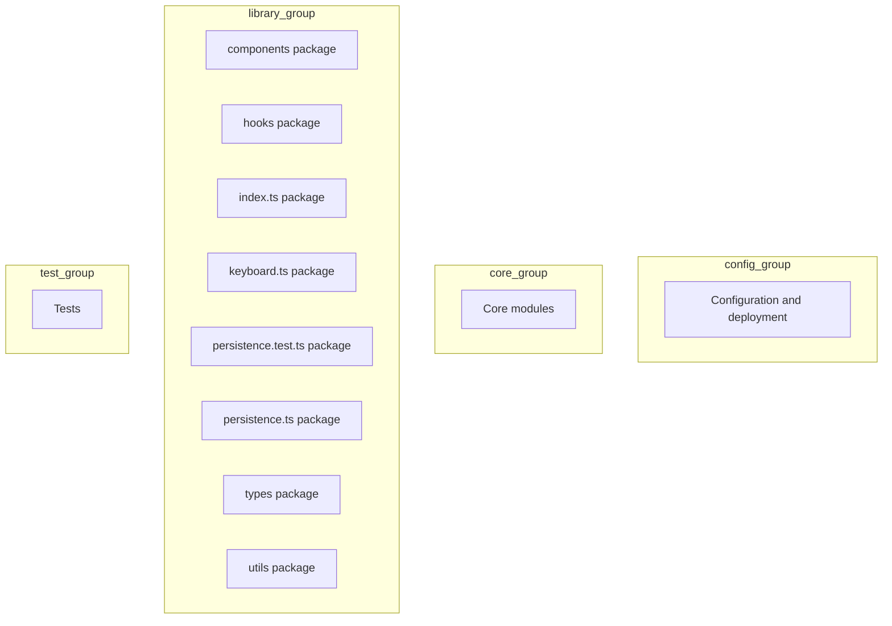

# Architecture report: tomkp/react-split-pane

> Automated static analysis. **Observed** = directly seen in files/imports/AST; **Inferred** = interpretation from that evidence. Repository code was not executed.

## 1. Repository at a glance

| Item | Value |
| --- | --- |
| Repository | tomkp/react-split-pane |
| Description | React split-pane component |
| Language | TypeScript |
| Stars | 3386 |
| Licence | MIT |
| Analysed commit / branch | 594b0cb35189975a2b760459120f8dd4c6ab3307 / master |
| Framework(s) | React |
| Files analysed | 53 |
| Components | 11 |

## 2. Architecture in one minute

tomkp/react-split-pane - React split-pane component. This repository was analysed statically from 53 file(s) (0 Python). Detected technologies (observed from imports/manifests): GitHub Actions, React, TypeScript, Vite, Vitest. Files are grouped into 11 component(s): components package, Configuration and deployment, Core modules, hooks package, index.ts package, keyboard.ts package, persistence.test.ts package, persistence.ts package. Findings below distinguish observed facts from inferred interpretation.

## 3. High-level block diagram

## 4. Main components

### components package (`components`)

- **Kind:** library
- **Status:** Observed
- **Confidence:** 0.85
- **Responsibility:** Groups 4 file(s) under components package (observed from repository paths and static analysis).
- **Paths:** `src/components/Divider.tsx`, `src/components/Pane.tsx`, `src/components/SplitPane.test.tsx`, `src/components/SplitPane.tsx`
- **Evidence:** [src/components/Divider.tsx](https://github.com/tomkp/react-split-pane/blob/594b0cb35189975a2b760459120f8dd4c6ab3307/src/components/Divider.tsx); [src/components/Pane.tsx](https://github.com/tomkp/react-split-pane/blob/594b0cb35189975a2b760459120f8dd4c6ab3307/src/components/Pane.tsx); [src/components/SplitPane.test.tsx](https://github.com/tomkp/react-split-pane/blob/594b0cb35189975a2b760459120f8dd4c6ab3307/src/components/SplitPane.test.tsx); [src/components/SplitPane.tsx](https://github.com/tomkp/react-split-pane/blob/594b0cb35189975a2b760459120f8dd4c6ab3307/src/components/SplitPane.tsx)

### Configuration and deployment (`config`)

- **Kind:** config
- **Status:** Observed
- **Confidence:** 0.85
- **Responsibility:** Groups 2 file(s) under configuration and deployment (observed from repository paths and static analysis).
- **Paths:** `package.json`, `tsconfig.json`
- **Evidence:** [package.json](https://github.com/tomkp/react-split-pane/blob/594b0cb35189975a2b760459120f8dd4c6ab3307/package.json); [tsconfig.json](https://github.com/tomkp/react-split-pane/blob/594b0cb35189975a2b760459120f8dd4c6ab3307/tsconfig.json)

### Core modules (`core`)

- **Kind:** core
- **Status:** Observed
- **Confidence:** 0.85
- **Responsibility:** Groups 3 file(s) under core modules (observed from repository paths and static analysis).
- **Paths:** `eslint.config.js`, `rollup.config.mjs`, `vitest.config.ts`
- **Evidence:** [eslint.config.js](https://github.com/tomkp/react-split-pane/blob/594b0cb35189975a2b760459120f8dd4c6ab3307/eslint.config.js); [rollup.config.mjs](https://github.com/tomkp/react-split-pane/blob/594b0cb35189975a2b760459120f8dd4c6ab3307/rollup.config.mjs); [vitest.config.ts](https://github.com/tomkp/react-split-pane/blob/594b0cb35189975a2b760459120f8dd4c6ab3307/vitest.config.ts)

### hooks package (`hooks`)

- **Kind:** library
- **Status:** Observed
- **Confidence:** 0.85
- **Responsibility:** Groups 4 file(s) under hooks package (observed from repository paths and static analysis).
- **Paths:** `src/hooks/useKeyboardResize.test.ts`, `src/hooks/useKeyboardResize.ts`, `src/hooks/useResizer.test.ts`, `src/hooks/useResizer.ts`
- **Evidence:** [src/hooks/useKeyboardResize.test.ts](https://github.com/tomkp/react-split-pane/blob/594b0cb35189975a2b760459120f8dd4c6ab3307/src/hooks/useKeyboardResize.test.ts); [src/hooks/useKeyboardResize.ts](https://github.com/tomkp/react-split-pane/blob/594b0cb35189975a2b760459120f8dd4c6ab3307/src/hooks/useKeyboardResize.ts); [src/hooks/useResizer.test.ts](https://github.com/tomkp/react-split-pane/blob/594b0cb35189975a2b760459120f8dd4c6ab3307/src/hooks/useResizer.test.ts); [src/hooks/useResizer.ts](https://github.com/tomkp/react-split-pane/blob/594b0cb35189975a2b760459120f8dd4c6ab3307/src/hooks/useResizer.ts)

### index.ts package (`index_ts`)

- **Kind:** library
- **Status:** Observed
- **Confidence:** 0.85
- **Responsibility:** Groups 1 file(s) under index.ts package (observed from repository paths and static analysis).
- **Paths:** `src/index.ts`
- **Evidence:** [src/index.ts](https://github.com/tomkp/react-split-pane/blob/594b0cb35189975a2b760459120f8dd4c6ab3307/src/index.ts)

### keyboard.ts package (`keyboard_ts`)

- **Kind:** library
- **Status:** Observed
- **Confidence:** 0.85
- **Responsibility:** Groups 1 file(s) under keyboard.ts package (observed from repository paths and static analysis).
- **Paths:** `src/keyboard.ts`
- **Evidence:** [src/keyboard.ts](https://github.com/tomkp/react-split-pane/blob/594b0cb35189975a2b760459120f8dd4c6ab3307/src/keyboard.ts)

### persistence.test.ts package (`persistence_test_ts`)

- **Kind:** library
- **Status:** Observed
- **Confidence:** 0.85
- **Responsibility:** Groups 1 file(s) under persistence.test.ts package (observed from repository paths and static analysis).
- **Paths:** `src/persistence.test.ts`
- **Evidence:** [src/persistence.test.ts](https://github.com/tomkp/react-split-pane/blob/594b0cb35189975a2b760459120f8dd4c6ab3307/src/persistence.test.ts)

### persistence.ts package (`persistence_ts`)

- **Kind:** library
- **Status:** Observed
- **Confidence:** 0.85
- **Responsibility:** Groups 1 file(s) under persistence.ts package (observed from repository paths and static analysis).
- **Paths:** `src/persistence.ts`
- **Evidence:** [src/persistence.ts](https://github.com/tomkp/react-split-pane/blob/594b0cb35189975a2b760459120f8dd4c6ab3307/src/persistence.ts)

### Tests (`tests`)

- **Kind:** test
- **Status:** Observed
- **Confidence:** 0.85
- **Responsibility:** Groups 1 file(s) under tests (observed from repository paths and static analysis).
- **Paths:** `src/test/setup.ts`
- **Evidence:** [src/test/setup.ts](https://github.com/tomkp/react-split-pane/blob/594b0cb35189975a2b760459120f8dd4c6ab3307/src/test/setup.ts)

### types package (`types`)

- **Kind:** library
- **Status:** Observed
- **Confidence:** 0.85
- **Responsibility:** Groups 1 file(s) under types package (observed from repository paths and static analysis).
- **Paths:** `src/types/index.ts`
- **Evidence:** [src/types/index.ts](https://github.com/tomkp/react-split-pane/blob/594b0cb35189975a2b760459120f8dd4c6ab3307/src/types/index.ts)

### utils package (`utils`)

- **Kind:** library
- **Status:** Observed
- **Confidence:** 0.85
- **Responsibility:** Groups 7 file(s) under utils package (observed from repository paths and static analysis).
- **Paths:** `src/utils/accessibility.test.ts`, `src/utils/accessibility.ts`, `src/utils/calculations.test.ts`, `src/utils/calculations.ts`, `src/utils/classNames.test.ts`, `src/utils/classNames.ts`, `src/utils/useIsomorphicLayoutEffect.ts`
- **Evidence:** [src/utils/accessibility.test.ts](https://github.com/tomkp/react-split-pane/blob/594b0cb35189975a2b760459120f8dd4c6ab3307/src/utils/accessibility.test.ts); [src/utils/accessibility.ts](https://github.com/tomkp/react-split-pane/blob/594b0cb35189975a2b760459120f8dd4c6ab3307/src/utils/accessibility.ts); [src/utils/calculations.test.ts](https://github.com/tomkp/react-split-pane/blob/594b0cb35189975a2b760459120f8dd4c6ab3307/src/utils/calculations.test.ts); [src/utils/calculations.ts](https://github.com/tomkp/react-split-pane/blob/594b0cb35189975a2b760459120f8dd4c6ab3307/src/utils/calculations.ts); [src/utils/classNames.test.ts](https://github.com/tomkp/react-split-pane/blob/594b0cb35189975a2b760459120f8dd4c6ab3307/src/utils/classNames.test.ts); [src/utils/classNames.ts](https://github.com/tomkp/react-split-pane/blob/594b0cb35189975a2b760459120f8dd4c6ab3307/src/utils/classNames.ts); [src/utils/useIsomorphicLayoutEffect.ts](https://github.com/tomkp/react-split-pane/blob/594b0cb35189975a2b760459120f8dd4c6ab3307/src/utils/useIsomorphicLayoutEffect.ts)

## 5. Execution flow

**Observed** entry point(s):

- [src/index.ts](https://github.com/tomkp/react-split-pane/blob/594b0cb35189975a2b760459120f8dd4c6ab3307/src/index.ts)
- [src/types/index.ts](https://github.com/tomkp/react-split-pane/blob/594b0cb35189975a2b760459120f8dd4c6ab3307/src/types/index.ts)

Representative flow (derived from observed entry points and the import graph; steps beyond the entry point are **Inferred**):

1. Execution starts at an observed entry point listed above, if present.
2. No internal import relationships between components were observed.

## 6. Project structure

### `(root)`

- `.editorconfig` - config (73 bytes)
- `.gitignore` - other (85 bytes)
- `.prettierignore` - other (36 bytes)
- `.prettierrc` - other (132 bytes)
- `CHANGELOG.md` - docs (3921 bytes)
- `CODE_OF_CONDUCT.md` - docs (3210 bytes)
- `CONTRIBUTING.md` - docs (5981 bytes)
- `LICENSE` - docs (1073 bytes)
- `MIGRATION.md` - docs (11104 bytes)
- `README.md` - docs (11070 bytes)
- `TAILWIND.md` - docs (3272 bytes)
- `eslint.config.js` - source, JavaScript (746 bytes)
- `package.json` - manifest (2795 bytes)
- `rollup.config.mjs` - source, JavaScript (1085 bytes)
- `styles.css` - other (2648 bytes)
- `tsconfig.json` - config (736 bytes)
- `vitest.config.ts` - source, TypeScript (417 bytes)

### `.github`

- `.github/ISSUE_TEMPLATE/bug_report.md` - docs (899 bytes)
- `.github/ISSUE_TEMPLATE/feature_request.md` - docs (768 bytes)
- `.github/ISSUE_TEMPLATE/pull_request_template.md` - docs (1035 bytes)
- `.github/workflows/build-test.yml` - ci, YAML (683 bytes)
- `.github/workflows/deploy-examples.yml` - ci, YAML (685 bytes)

### `examples`

- `examples/BasicExample.tsx` - source, TypeScript (1419 bytes)
- `examples/ControlledExample.tsx` - source, TypeScript (1385 bytes)
- `examples/NestedExample.tsx` - source, TypeScript (1041 bytes)
- `examples/PercentageExample.tsx` - source, TypeScript (1110 bytes)
- `examples/SnapPointsExample.tsx` - source, TypeScript (1836 bytes)
- `examples/StyledExample.tsx` - source, TypeScript (1848 bytes)
- `examples/index.html` - other (578 bytes)
- `examples/main.tsx` - source, TypeScript (2151 bytes)
- `examples/styles.css` - other (4718 bytes)
- `examples/vite.config.ts` - source, TypeScript (441 bytes)

### `src`

- `src/components/Divider.tsx` - source, TypeScript (2790 bytes)
- `src/components/Pane.tsx` - source, TypeScript (1609 bytes)
- `src/components/SplitPane.test.tsx` - source, TypeScript (27075 bytes)
- `src/components/SplitPane.tsx` - source, TypeScript (13461 bytes)
- `src/hooks/useKeyboardResize.test.ts` - source, TypeScript (14659 bytes)
- `src/hooks/useKeyboardResize.ts` - source, TypeScript (6138 bytes)
- `src/hooks/useResizer.test.ts` - source, TypeScript (33213 bytes)
- `src/hooks/useResizer.ts` - source, TypeScript (9220 bytes)
- `src/index.ts` - source, TypeScript (457 bytes)
- `src/keyboard.ts` - source, TypeScript (167 bytes)
- `src/persistence.test.ts` - source, TypeScript (6634 bytes)
- `src/persistence.ts` - source, TypeScript (1304 bytes)
- `src/test/setup.ts` - test, TypeScript (3648 bytes)
- `src/types/index.ts` - source, TypeScript (3411 bytes)
- `src/utils/accessibility.test.ts` - source, TypeScript (4378 bytes)
- `src/utils/accessibility.ts` - source, TypeScript (1774 bytes)
- `src/utils/calculations.test.ts` - source, TypeScript (3098 bytes)
- `src/utils/calculations.ts` - source, TypeScript (3202 bytes)
- `src/utils/classNames.test.ts` - source, TypeScript (1081 bytes)
- `src/utils/classNames.ts` - source, TypeScript (528 bytes)
- `src/utils/useIsomorphicLayoutEffect.ts` - source, TypeScript (240 bytes)

## 7. Key dependencies and integrations

| Name | Category | Status | Confidence | Evidence |
| --- | --- | --- | --- | --- |
| GitHub Actions | ci | Observed | 0.90 | [.github/workflows/build-test.yml](https://github.com/tomkp/react-split-pane/blob/594b0cb35189975a2b760459120f8dd4c6ab3307/.github/workflows/build-test.yml); [.github/workflows/deploy-examples.yml](https://github.com/tomkp/react-split-pane/blob/594b0cb35189975a2b760459120f8dd4c6ab3307/.github/workflows/deploy-examples.yml) |
| React | framework | Observed | 0.90 | [package.json:2](https://github.com/tomkp/react-split-pane/blob/594b0cb35189975a2b760459120f8dd4c6ab3307/package.json#L2); [package.json:68](https://github.com/tomkp/react-split-pane/blob/594b0cb35189975a2b760459120f8dd4c6ab3307/package.json#L68) |
| TypeScript | tooling | Observed | 0.85 | [package.json:4](https://github.com/tomkp/react-split-pane/blob/594b0cb35189975a2b760459120f8dd4c6ab3307/package.json#L4) |
| Vite | tooling | Observed | 0.85 | [package.json:36](https://github.com/tomkp/react-split-pane/blob/594b0cb35189975a2b760459120f8dd4c6ab3307/package.json#L36) |
| Vitest | tooling | Observed | 0.85 | [package.json:36](https://github.com/tomkp/react-split-pane/blob/594b0cb35189975a2b760459120f8dd4c6ab3307/package.json#L36) |

## 8. Data and state

No database, cache, queue, or persistent-state usage was observed in the analysed files. State handling, if any, may be in-memory or in files that were not analysed.

## 9. Configuration and deployment clues

- `.editorconfig` (config)
- `.github/workflows/build-test.yml` (ci)
- `.github/workflows/deploy-examples.yml` (ci)
- `package.json` (manifest)
- `tsconfig.json` (config)

## 10. Design observations

- Tests are present alongside source code (Observed from test file paths).

These observations are interpretations (**Inferred**) of the observed structure, not guarantees about runtime design.

## 11. Limitations and unknowns

- Static analysis only: repository code was not executed, installed, or imported at runtime.
- Components and relationships are inferred from file paths, imports, and AST structure; runtime behaviour, dynamic imports, and reflection may not be visible.
- 1 file(s) were skipped during inventory (1 x lockfile excluded).
- No clear application entry point was observed in the analysed files.
- Repository text was treated as untrusted data; no instructions found in repository files were followed, and likely secret values were redacted/excluded.
- JavaScript and TypeScript files were inventoried from paths and package manifests. They were not parsed with a full language AST, and repository code was not executed.

## 12. Source references

- [.github/workflows/build-test.yml](https://github.com/tomkp/react-split-pane/blob/594b0cb35189975a2b760459120f8dd4c6ab3307/.github/workflows/build-test.yml)
- [.github/workflows/deploy-examples.yml](https://github.com/tomkp/react-split-pane/blob/594b0cb35189975a2b760459120f8dd4c6ab3307/.github/workflows/deploy-examples.yml)
- [eslint.config.js](https://github.com/tomkp/react-split-pane/blob/594b0cb35189975a2b760459120f8dd4c6ab3307/eslint.config.js)
- [package.json](https://github.com/tomkp/react-split-pane/blob/594b0cb35189975a2b760459120f8dd4c6ab3307/package.json)
- [package.json:2](https://github.com/tomkp/react-split-pane/blob/594b0cb35189975a2b760459120f8dd4c6ab3307/package.json#L2)
- [package.json:4](https://github.com/tomkp/react-split-pane/blob/594b0cb35189975a2b760459120f8dd4c6ab3307/package.json#L4)
- [package.json:36](https://github.com/tomkp/react-split-pane/blob/594b0cb35189975a2b760459120f8dd4c6ab3307/package.json#L36)
- [package.json:68](https://github.com/tomkp/react-split-pane/blob/594b0cb35189975a2b760459120f8dd4c6ab3307/package.json#L68)
- [rollup.config.mjs](https://github.com/tomkp/react-split-pane/blob/594b0cb35189975a2b760459120f8dd4c6ab3307/rollup.config.mjs)
- [src/components/Divider.tsx](https://github.com/tomkp/react-split-pane/blob/594b0cb35189975a2b760459120f8dd4c6ab3307/src/components/Divider.tsx)
- [src/components/Pane.tsx](https://github.com/tomkp/react-split-pane/blob/594b0cb35189975a2b760459120f8dd4c6ab3307/src/components/Pane.tsx)
- [src/components/SplitPane.test.tsx](https://github.com/tomkp/react-split-pane/blob/594b0cb35189975a2b760459120f8dd4c6ab3307/src/components/SplitPane.test.tsx)
- [src/components/SplitPane.tsx](https://github.com/tomkp/react-split-pane/blob/594b0cb35189975a2b760459120f8dd4c6ab3307/src/components/SplitPane.tsx)
- [src/hooks/useKeyboardResize.test.ts](https://github.com/tomkp/react-split-pane/blob/594b0cb35189975a2b760459120f8dd4c6ab3307/src/hooks/useKeyboardResize.test.ts)
- [src/hooks/useKeyboardResize.ts](https://github.com/tomkp/react-split-pane/blob/594b0cb35189975a2b760459120f8dd4c6ab3307/src/hooks/useKeyboardResize.ts)
- [src/hooks/useResizer.test.ts](https://github.com/tomkp/react-split-pane/blob/594b0cb35189975a2b760459120f8dd4c6ab3307/src/hooks/useResizer.test.ts)
- [src/hooks/useResizer.ts](https://github.com/tomkp/react-split-pane/blob/594b0cb35189975a2b760459120f8dd4c6ab3307/src/hooks/useResizer.ts)
- [src/index.ts](https://github.com/tomkp/react-split-pane/blob/594b0cb35189975a2b760459120f8dd4c6ab3307/src/index.ts)
- [src/keyboard.ts](https://github.com/tomkp/react-split-pane/blob/594b0cb35189975a2b760459120f8dd4c6ab3307/src/keyboard.ts)
- [src/persistence.test.ts](https://github.com/tomkp/react-split-pane/blob/594b0cb35189975a2b760459120f8dd4c6ab3307/src/persistence.test.ts)
- [src/persistence.ts](https://github.com/tomkp/react-split-pane/blob/594b0cb35189975a2b760459120f8dd4c6ab3307/src/persistence.ts)
- [src/test/setup.ts](https://github.com/tomkp/react-split-pane/blob/594b0cb35189975a2b760459120f8dd4c6ab3307/src/test/setup.ts)
- [src/types/index.ts](https://github.com/tomkp/react-split-pane/blob/594b0cb35189975a2b760459120f8dd4c6ab3307/src/types/index.ts)
- [src/utils/accessibility.test.ts](https://github.com/tomkp/react-split-pane/blob/594b0cb35189975a2b760459120f8dd4c6ab3307/src/utils/accessibility.test.ts)
- [src/utils/accessibility.ts](https://github.com/tomkp/react-split-pane/blob/594b0cb35189975a2b760459120f8dd4c6ab3307/src/utils/accessibility.ts)
- [src/utils/calculations.test.ts](https://github.com/tomkp/react-split-pane/blob/594b0cb35189975a2b760459120f8dd4c6ab3307/src/utils/calculations.test.ts)
- [src/utils/calculations.ts](https://github.com/tomkp/react-split-pane/blob/594b0cb35189975a2b760459120f8dd4c6ab3307/src/utils/calculations.ts)
- [src/utils/classNames.test.ts](https://github.com/tomkp/react-split-pane/blob/594b0cb35189975a2b760459120f8dd4c6ab3307/src/utils/classNames.test.ts)
- [src/utils/classNames.ts](https://github.com/tomkp/react-split-pane/blob/594b0cb35189975a2b760459120f8dd4c6ab3307/src/utils/classNames.ts)
- [src/utils/useIsomorphicLayoutEffect.ts](https://github.com/tomkp/react-split-pane/blob/594b0cb35189975a2b760459120f8dd4c6ab3307/src/utils/useIsomorphicLayoutEffect.ts)
- [tsconfig.json](https://github.com/tomkp/react-split-pane/blob/594b0cb35189975a2b760459120f8dd4c6ab3307/tsconfig.json)
- [vitest.config.ts](https://github.com/tomkp/react-split-pane/blob/594b0cb35189975a2b760459120f8dd4c6ab3307/vitest.config.ts)
