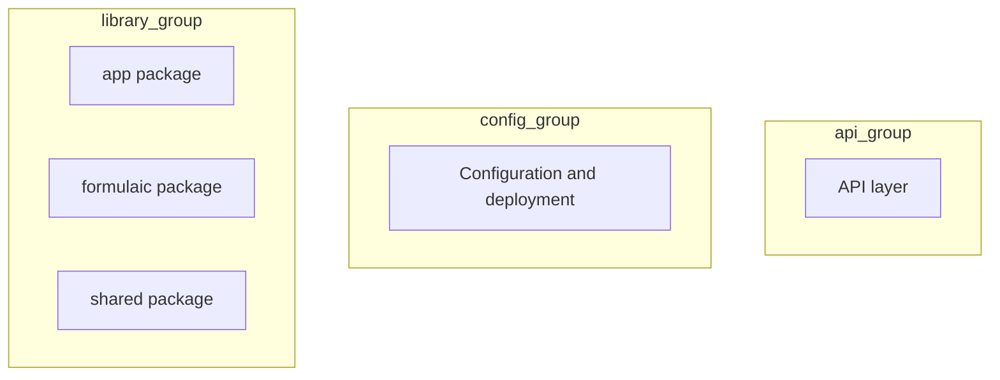

# Architecture report: tone-row/flowchart-fun

> Automated static analysis. **Observed** = directly seen in files/imports/AST; **Inferred** = interpretation from that evidence. Repository code was not executed.

## 1. Repository at a glance

| Item | Value |
| --- | --- |
| Repository | tone-row/flowchart-fun |
| Description | Easily generate flowcharts and diagrams from text ⿻ |
| Language | TypeScript |
| Stars | 3410 |
| Licence | MIT |
| Analysed commit / branch | 5854f69b97dc247cac3b689c5c2c482fd78df81d / main |
| Framework(s) | React |
| Files analysed | 523 |
| Components | 5 |

## 2. Architecture in one minute

tone-row/flowchart-fun - Easily generate flowcharts and diagrams from text ⿻. This repository was analysed statically from 523 file(s) (0 Python). Detected technologies (observed from imports/manifests): GitHub Actions, React, axios, React Router, Tailwind CSS, Jest. Files are grouped into 5 component(s): API layer, app package, Configuration and deployment, formulaic package, shared package. Findings below distinguish observed facts from inferred interpretation.

## 3. High-level block diagram

## 4. Main components

### API layer (`api_layer`)

- **Kind:** api
- **Status:** Observed
- **Confidence:** 0.85
- **Responsibility:** Groups 42 file(s) under api layer (observed from repository paths and static analysis).
- **Paths:** `api/_lib/_dates.ts`, `api/_lib/_helpers.ts`, `api/_lib/_mail.ts`, `api/_lib/_notion.ts`, `api/_lib/_openai.ts`, `api/_lib/_pass.test.ts`, `api/_lib/_pass.ts`, `api/_lib/_releases.ts`, `api/_lib/_stripe.ts`, `api/_lib/_supabase.ts`, `api/_lib/_validStripePrices.ts`, `api/blog/post.ts`, `api/blog/posts.ts`, `api/cancel-subscription.ts`, `api/changelog.ts`, `api/create-checkout-session.ts`, `api/create-customer-portal-session.ts`, `api/cron/deleteDevUsers.ts`, `api/customer-info.ts`, `api/data/_mapDataToGraph.test.ts`, `api/data/_mapDataToGraph.ts`, `api/data/import.ts`, `api/data/process.ts`, `api/generate-public-id.ts`, `api/jest.config.js`, `api/loops-event.ts`, `api/mail.ts`, `api/order-history.ts`, `api/prompt/_parseFlowchart.test.ts`, `api/prompt/_parseFlowchart.ts`, `api/prompt/_shared.ts`, `api/prompt/choose-template.ts`, `api/prompt/convert.ts`, `api/prompt/edit.ts`, `api/prompt/prompt.ts`, `api/prompt/speech-to-text.ts`, `api/public.ts`, `api/resume-subscription.ts`, `api/roadmap.ts`, `api/types.d.ts`, `api/update-email.ts`, `api/version.ts`
- **Evidence:** [api/_lib/_dates.ts](https://github.com/tone-row/flowchart-fun/blob/5854f69b97dc247cac3b689c5c2c482fd78df81d/api/_lib/_dates.ts); [api/_lib/_helpers.ts](https://github.com/tone-row/flowchart-fun/blob/5854f69b97dc247cac3b689c5c2c482fd78df81d/api/_lib/_helpers.ts); [api/_lib/_mail.ts](https://github.com/tone-row/flowchart-fun/blob/5854f69b97dc247cac3b689c5c2c482fd78df81d/api/_lib/_mail.ts); [api/_lib/_notion.ts](https://github.com/tone-row/flowchart-fun/blob/5854f69b97dc247cac3b689c5c2c482fd78df81d/api/_lib/_notion.ts); [api/_lib/_openai.ts](https://github.com/tone-row/flowchart-fun/blob/5854f69b97dc247cac3b689c5c2c482fd78df81d/api/_lib/_openai.ts); [api/_lib/_pass.test.ts](https://github.com/tone-row/flowchart-fun/blob/5854f69b97dc247cac3b689c5c2c482fd78df81d/api/_lib/_pass.test.ts); [api/_lib/_pass.ts](https://github.com/tone-row/flowchart-fun/blob/5854f69b97dc247cac3b689c5c2c482fd78df81d/api/_lib/_pass.ts); [api/_lib/_releases.ts](https://github.com/tone-row/flowchart-fun/blob/5854f69b97dc247cac3b689c5c2c482fd78df81d/api/_lib/_releases.ts)

### app package (`app`)

- **Kind:** library
- **Status:** Observed
- **Confidence:** 0.85
- **Responsibility:** Groups 256 file(s) under app package (observed from repository paths and static analysis).
- **Paths:** `app/.eslintrc.cjs`, `app/e2e/logged-in.spec.ts`, `app/e2e/not-logged-in.spec.ts`, `app/e2e/pass.spec.ts`, `app/e2e/pro.spec.ts`, `app/e2e/sign-up.spec.ts`, `app/e2e/utils.ts`, `app/e2e/visual/frozen-templates.ts`, `app/e2e/visual/templates.visual.spec.ts`, `app/playwright.config.ts`, `app/playwright.visual.config.ts`, `app/scripts/autotranslations.mjs`, `app/scripts/generate-font-previews.mjs`, `app/scripts/generate-frozen-fixtures.mjs`, `app/scripts/screenshot-templates.mjs`, `app/src/components/Actions.test.tsx`, `app/src/components/Actions.tsx`, `app/src/components/AiToolbar.tsx`, `app/src/components/App.tsx`, `app/src/components/AppContextProvider.test.tsx`, `app/src/components/AppContextProvider.tsx`, `app/src/components/AuthWall.tsx`, `app/src/components/Checkout.test.tsx`, `app/src/components/Checkout.tsx`, `app/src/components/ClearTextButton.tsx`, `app/src/components/CloneButton.tsx`, `app/src/components/ColorMode.tsx`, `app/src/components/ConvertOnPasteOverlay.tsx`, `app/src/components/ConvertToFlowchart.tsx`, `app/src/components/DownloadDropdown.tsx`, `app/src/components/EditWithAI.tsx`, `app/src/components/EditorError.tsx`, `app/src/components/FAQ.tsx`, `app/src/components/FeatureBreakdown.tsx`, `app/src/components/Feedback.test.tsx`, `app/src/components/Feedback.tsx`, `app/src/components/FloatingTip.tsx`, `app/src/components/FlowchartChatBar.tsx`, `app/src/components/FlowchartHeader.tsx`, `app/src/components/FlowchartLayout.tsx`, `app/src/components/GoogleSVG.tsx`, `app/src/components/Graph.test.tsx`, `app/src/components/Graph.tsx`, `app/src/components/GraphContextMenu.tsx`, `app/src/components/GraphFloatingMenu.test.tsx`, `app/src/components/GraphFloatingMenu.tsx`, `app/src/components/GraphTip.tsx`, `app/src/components/GraphWrapper.tsx`, `app/src/components/Header.tsx`, `app/src/components/I18n.tsx`, `app/src/components/ImportDataDialog.tsx`, `app/src/components/ImportDataUnauthenticatedDialog.tsx`, `app/src/components/InfoHeader.tsx`, `app/src/components/Layout.tsx`, `app/src/components/LearnSyntaxDialog.tsx`, `app/src/components/LoadFileButton.tsx`, `app/src/components/LoadFromHashDialog.tsx`, `app/src/components/LoadTemplateDialog.tsx`, `app/src/components/Loading.tsx`, `app/src/components/Microphone.tsx`, `app/src/components/MobileTabToggle.tsx`, `app/src/components/MoreFromToneRow.tsx`, `app/src/components/OnlyInEnglish.tsx`, `app/src/components/PaywallModal.tsx`, `app/src/components/PosthogWrapper.tsx`, `app/src/components/ReadOnlyNotice.tsx`, `app/src/components/RenameButton.tsx`, `app/src/components/RequestTemplate.tsx`, `app/src/components/Router.tsx`, `app/src/components/SandboxWarning.tsx`, `app/src/components/Settings.tsx`, `app/src/components/ShareDialog.tsx`, `app/src/components/Spinner.tsx`, `app/src/components/SvgProOnlyPopover.tsx`, `app/src/components/TabPane.tsx`, `app/src/components/Tabs/EditorTabList.tsx`, `app/src/components/Tabs/ThemeTab.tsx`, `app/src/components/Tabs/ThemeTabComponents.tsx`, `app/src/components/Tabs/shared.tsx`, `app/src/components/Testimonials.tsx`, `app/src/components/TextEditor.tsx`, `app/src/components/TextResizer.tsx`, `app/src/components/VersionCheck.tsx`, `app/src/components/Warning.tsx`, `app/src/components/WithGraph.test.tsx`, `app/src/components/WithGraph.tsx`, `app/src/components/WithMobileTabToggle.tsx`, `app/src/components/charts/ChartListItem.tsx`, `app/src/components/charts/ChartModals.tsx`, `app/src/components/charts/ChartsToolbar.tsx`, `app/src/components/charts/EmptyState.tsx`, `app/src/components/charts/types.ts`, `app/src/components/downloads.test.ts`, `app/src/components/downloads.ts`, `app/src/components/getNodePositionsFromCy.tsx`, `app/src/components/pageHeight.ts`, `app/src/index.tsx`, `app/src/lib/FFTheme.ts`, `app/src/lib/alignNodes.characterization.test.ts`, `app/src/lib/alignNodes.test.ts`, `app/src/lib/alignNodes.ts`, `app/src/lib/analytics.ts`, `app/src/lib/constants.ts`, `app/src/lib/cyStyleToString/cyStyleToString.characterization.test.ts`, `app/src/lib/cyStyleToString/cyStyleToString.test.ts`, `app/src/lib/cyStyleToString/cyStyleToString.ts`, `app/src/lib/cytoscape.ts`, `app/src/lib/designTokens.d.ts`, `app/src/lib/designTokens.js`, `app/src/lib/findMisclosedContainers.test.ts`, `app/src/lib/findMisclosedContainers.ts`, `app/src/lib/flowchartChat.test.ts`, `app/src/lib/flowchartChat.ts`, `app/src/lib/folderQueries.ts`, `app/src/lib/fonts.test.ts`, `app/src/lib/fonts.ts`, `app/src/lib/formatDate.ts`, `app/src/lib/getDefaultChart.ts`, `app/src/lib/getDefaultText.ts`, `app/src/lib/getElements.characterization.test.ts`, `app/src/lib/getElements.ts`, `app/src/lib/getExpirationDate.test.ts`, `app/src/lib/getExpirationDate.ts`, `app/src/lib/getFunFlowchartName.tsx`, `app/src/lib/getSize.characterization.test.ts`, `app/src/lib/getSize.ts`, `app/src/lib/getTemporaryCharts.tsx`, `app/src/lib/globalZ.ts`, `app/src/lib/graphOptions.ts`, `app/src/lib/graphThemes.tsx`, `app/src/lib/graphUtilityClasses.characterization.test.ts`, `app/src/lib/graphUtilityClasses.ts`, `app/src/lib/helpers.ts`, `app/src/lib/hooks.test.tsx`, `app/src/lib/hooks.ts`, `app/src/lib/isTypingTarget.ts`, `app/src/lib/layoutsWithoutContainers.test.ts`, `app/src/lib/legacyDefaultTheme.ts`, `app/src/lib/loadTemplate.ts`, `app/src/lib/mockChartData.ts`, `app/src/lib/parseGraph.ts`, `app/src/lib/parserErrors.tsx`, `app/src/lib/paywallCopy.ts`, `app/src/lib/prepareChart/prepareChart.characterization.test.ts`, `app/src/lib/prepareChart/prepareChart.test.ts`, `app/src/lib/prepareChart/prepareChart.ts`, `app/src/lib/preprocessStyle.characterization.test.ts`, `app/src/lib/preprocessStyle.ts`, `app/src/lib/preprocessStyle.unclosedComment.test.ts`, `app/src/lib/queries.ts`, `app/src/lib/renameDialogStore.tsx`, `app/src/lib/repairText.characterization.test.ts`, `app/src/lib/repairText.test.ts`, `app/src/lib/repairText.ts`, `app/src/lib/resolveNodePositions.test.ts`, `app/src/lib/resolveNodePositions.ts`, `app/src/lib/runAi.ts`, `app/src/lib/runMappers.ts`, `app/src/lib/sample.ts`, `app/src/lib/sendLoopsEvent.ts`, `app/src/lib/sentry.ts`, `app/src/lib/snapToNeighbours.test.ts`, `app/src/lib/socialProof.ts`, `app/src/lib/supabaseClient.ts`, `app/src/lib/templates/blueprint-template.ts`, `app/src/lib/templates/constellation-template.ts`, `app/src/lib/templates/decision-tree-template.ts`, `app/src/lib/templates/default-template.ts`, `app/src/lib/templates/ink-mindmap-template.ts`, `app/src/lib/templates/org-chart-template.ts`, `app/src/lib/templates/process-lanes-template.ts`, `app/src/lib/templates/sitemap-template.ts`, `app/src/lib/templates/storyline-template.ts`, `app/src/lib/templates/themeEditorContract.test.ts`, `app/src/lib/templates/timeline-template.ts`, `app/src/lib/toExcalidraw.characterization.test.ts`, `app/src/lib/toExcalidraw.ts`, `app/src/lib/toJSONCanvas.characterization.test.ts`, `app/src/lib/toJSONCanvas.ts`, `app/src/lib/toTheme.characterization.test.ts`, `app/src/lib/toTheme.ts`, `app/src/lib/toVisio.characterization.test.ts`, `app/src/lib/toVisio.test.ts`, `app/src/lib/toVisio.ts`, `app/src/lib/toneRowProjects.ts`, `app/src/lib/track.ts`, `app/src/lib/undoStack.test.ts`, `app/src/lib/undoStack.ts`, `app/src/lib/useContextMenuState.tsx`, `app/src/lib/useDoc.ts`, `app/src/lib/useEditorStore.test.ts`, `app/src/lib/useEditorStore.ts`, `app/src/lib/useEnsureGetScreenshotLink.ts`, `app/src/lib/useFadeIn.ts`, `app/src/lib/useGraphStore.ts`, `app/src/lib/useIsFrozen.ts`, `app/src/lib/useLastChart.ts`, `app/src/lib/useMicrophoneStore.ts`, `app/src/lib/useMobileStore.ts`, `app/src/lib/usePaywallModalStore.ts`, `app/src/lib/usePricingPlanStore.ts`, `app/src/lib/usePromptStore.ts`, `app/src/lib/useSandboxWarning.tsx`, `app/src/lib/useSupportLegacyNRoute.ts`, `app/src/lib/useTabsStore.ts`, `app/src/lib/useUnmountStore.ts`, `app/src/lib/utils.ts`, `app/src/lib/versionCheck.ts`, `app/src/locales/de/messages.js`, `app/src/locales/en/messages.js`, `app/src/locales/es/messages.js`, `app/src/locales/fr/messages.js`, `app/src/locales/hi/messages.js`, `app/src/locales/i18n.tsx`, `app/src/locales/ko/messages.js`, `app/src/locales/pt-br/messages.js`, `app/src/locales/zh/messages.js`, `app/src/pages/404.tsx`, `app/src/pages/Account.test.tsx`, `app/src/pages/Account.tsx`, `app/src/pages/Blog.tsx`, `app/src/pages/Changelog.tsx`, `app/src/pages/Charts.tsx`, `app/src/pages/CookiePolicy.tsx`, `app/src/pages/DesignSystem.tsx`, `app/src/pages/EditHosted.test.tsx`, `app/src/pages/EditHosted.tsx`, `app/src/pages/ForgotPassword.tsx`, `app/src/pages/Fullscreen.tsx`, `app/src/pages/LogIn.tsx`, `app/src/pages/MyCharts.tsx`, `app/src/pages/New.tsx`, `app/src/pages/Pricing.tsx`, `app/src/pages/Pricing2.tsx`, `app/src/pages/PrivacyPolicy.tsx`, `app/src/pages/Public.tsx`, `app/src/pages/ReadOnly.tsx`, `app/src/pages/ResetPassword.tsx`, `app/src/pages/Roadmap.tsx`, `app/src/pages/Sandbox.tsx`, `app/src/pages/Success.tsx`, `app/src/pages/createExamples.tsx`, `app/src/pages/post/Post.tsx`, `app/src/react-app-env.d.ts`, `app/src/reportWebVitals.ts`, `app/src/setupTests.ts`, `app/src/slang/config.ts`, `app/src/slang/index.tsx`, `app/src/test-utils.tsx`, `app/src/types/database.types.ts`, `app/src/ui/Dialog.tsx`, `app/src/ui/EditorActionTextButton.tsx`, `app/src/ui/Select.tsx`, `app/src/ui/Shared.tsx`, `app/src/ui/Typography.tsx`, `app/tailwind.config.js`
- **Evidence:** [app/.eslintrc.cjs](https://github.com/tone-row/flowchart-fun/blob/5854f69b97dc247cac3b689c5c2c482fd78df81d/app/.eslintrc.cjs); [app/e2e/logged-in.spec.ts](https://github.com/tone-row/flowchart-fun/blob/5854f69b97dc247cac3b689c5c2c482fd78df81d/app/e2e/logged-in.spec.ts); [app/e2e/not-logged-in.spec.ts](https://github.com/tone-row/flowchart-fun/blob/5854f69b97dc247cac3b689c5c2c482fd78df81d/app/e2e/not-logged-in.spec.ts); [app/e2e/pass.spec.ts](https://github.com/tone-row/flowchart-fun/blob/5854f69b97dc247cac3b689c5c2c482fd78df81d/app/e2e/pass.spec.ts); [app/e2e/pro.spec.ts](https://github.com/tone-row/flowchart-fun/blob/5854f69b97dc247cac3b689c5c2c482fd78df81d/app/e2e/pro.spec.ts); [app/e2e/sign-up.spec.ts](https://github.com/tone-row/flowchart-fun/blob/5854f69b97dc247cac3b689c5c2c482fd78df81d/app/e2e/sign-up.spec.ts); [app/e2e/utils.ts](https://github.com/tone-row/flowchart-fun/blob/5854f69b97dc247cac3b689c5c2c482fd78df81d/app/e2e/utils.ts); [app/e2e/visual/frozen-templates.ts](https://github.com/tone-row/flowchart-fun/blob/5854f69b97dc247cac3b689c5c2c482fd78df81d/app/e2e/visual/frozen-templates.ts)

### Configuration and deployment (`config`)

- **Kind:** config
- **Status:** Observed
- **Confidence:** 0.85
- **Responsibility:** Groups 18 file(s) under configuration and deployment (observed from repository paths and static analysis).
- **Paths:** `api/_fixtures/issues.json`, `api/_fixtures/releases.json`, `api/data/fixtures/simpleLucidChart.json`, `api/package.json`, `api/tsconfig.json`, `app/.env.example`, `app/package.json`, `app/public/manifest.json`, `app/src/lib/FFTheme.schema.json`, `app/src/lib/cyStyleToString/fixture.json`, `app/tsconfig.json`, `formulaic/package.json`, `formulaic/tsconfig.json`, `package.json`, `pnpm-workspace.yaml`, `shared/package.json`, `shared/tsconfig.json`, `vercel.json`
- **Evidence:** [api/_fixtures/issues.json](https://github.com/tone-row/flowchart-fun/blob/5854f69b97dc247cac3b689c5c2c482fd78df81d/api/_fixtures/issues.json); [api/_fixtures/releases.json](https://github.com/tone-row/flowchart-fun/blob/5854f69b97dc247cac3b689c5c2c482fd78df81d/api/_fixtures/releases.json); [api/data/fixtures/simpleLucidChart.json](https://github.com/tone-row/flowchart-fun/blob/5854f69b97dc247cac3b689c5c2c482fd78df81d/api/data/fixtures/simpleLucidChart.json); [api/package.json](https://github.com/tone-row/flowchart-fun/blob/5854f69b97dc247cac3b689c5c2c482fd78df81d/api/package.json); [api/tsconfig.json](https://github.com/tone-row/flowchart-fun/blob/5854f69b97dc247cac3b689c5c2c482fd78df81d/api/tsconfig.json); [app/.env.example](https://github.com/tone-row/flowchart-fun/blob/5854f69b97dc247cac3b689c5c2c482fd78df81d/app/.env.example); [app/package.json](https://github.com/tone-row/flowchart-fun/blob/5854f69b97dc247cac3b689c5c2c482fd78df81d/app/package.json); [app/public/manifest.json](https://github.com/tone-row/flowchart-fun/blob/5854f69b97dc247cac3b689c5c2c482fd78df81d/app/public/manifest.json)

### formulaic package (`formulaic`)

- **Kind:** library
- **Status:** Observed
- **Confidence:** 0.85
- **Responsibility:** Groups 6 file(s) under formulaic package (observed from repository paths and static analysis).
- **Paths:** `formulaic/src/example/App.tsx`, `formulaic/src/example/Minimal.tsx`, `formulaic/src/example/index.tsx`, `formulaic/src/formulaic.test.tsx`, `formulaic/src/formulaic.tsx`, `formulaic/tailwind.config.js`
- **Evidence:** [formulaic/src/example/App.tsx](https://github.com/tone-row/flowchart-fun/blob/5854f69b97dc247cac3b689c5c2c482fd78df81d/formulaic/src/example/App.tsx); [formulaic/src/example/Minimal.tsx](https://github.com/tone-row/flowchart-fun/blob/5854f69b97dc247cac3b689c5c2c482fd78df81d/formulaic/src/example/Minimal.tsx); [formulaic/src/example/index.tsx](https://github.com/tone-row/flowchart-fun/blob/5854f69b97dc247cac3b689c5c2c482fd78df81d/formulaic/src/example/index.tsx); [formulaic/src/formulaic.test.tsx](https://github.com/tone-row/flowchart-fun/blob/5854f69b97dc247cac3b689c5c2c482fd78df81d/formulaic/src/formulaic.test.tsx); [formulaic/src/formulaic.tsx](https://github.com/tone-row/flowchart-fun/blob/5854f69b97dc247cac3b689c5c2c482fd78df81d/formulaic/src/formulaic.tsx); [formulaic/tailwind.config.js](https://github.com/tone-row/flowchart-fun/blob/5854f69b97dc247cac3b689c5c2c482fd78df81d/formulaic/tailwind.config.js)

### shared package (`shared`)

- **Kind:** library
- **Status:** Observed
- **Confidence:** 0.85
- **Responsibility:** Groups 4 file(s) under shared package (observed from repository paths and static analysis).
- **Paths:** `shared/src/ImportDataFormType.ts`, `shared/src/blog.ts`, `shared/src/index.ts`, `shared/src/templates.ts`
- **Evidence:** [shared/src/ImportDataFormType.ts](https://github.com/tone-row/flowchart-fun/blob/5854f69b97dc247cac3b689c5c2c482fd78df81d/shared/src/ImportDataFormType.ts); [shared/src/blog.ts](https://github.com/tone-row/flowchart-fun/blob/5854f69b97dc247cac3b689c5c2c482fd78df81d/shared/src/blog.ts); [shared/src/index.ts](https://github.com/tone-row/flowchart-fun/blob/5854f69b97dc247cac3b689c5c2c482fd78df81d/shared/src/index.ts); [shared/src/templates.ts](https://github.com/tone-row/flowchart-fun/blob/5854f69b97dc247cac3b689c5c2c482fd78df81d/shared/src/templates.ts)

## 5. Execution flow

**Observed** entry point(s):

- [app/src/components/App.tsx](https://github.com/tone-row/flowchart-fun/blob/5854f69b97dc247cac3b689c5c2c482fd78df81d/app/src/components/App.tsx)
- [app/src/index.tsx](https://github.com/tone-row/flowchart-fun/blob/5854f69b97dc247cac3b689c5c2c482fd78df81d/app/src/index.tsx)
- [app/src/slang/index.tsx](https://github.com/tone-row/flowchart-fun/blob/5854f69b97dc247cac3b689c5c2c482fd78df81d/app/src/slang/index.tsx)
- [shared/src/index.ts](https://github.com/tone-row/flowchart-fun/blob/5854f69b97dc247cac3b689c5c2c482fd78df81d/shared/src/index.ts)

Representative flow (derived from observed entry points and the import graph; steps beyond the entry point are **Inferred**):

1. Execution starts at an observed entry point listed above, if present.
2. No internal import relationships between components were observed.

## 6. Project structure

### `(root)`

- `.gitignore` - other (317 bytes)
- `.node-version` - other (9 bytes)
- `CLAUDE.md` - docs (41836 bytes)
- `LICENSE` - docs (1070 bytes)
- `README.md` - docs (3041 bytes)
- `ff-pricing-redesign-plan.md` - docs (19431 bytes)
- `package.json` - manifest (658 bytes)
- `pnpm-workspace.yaml` - config (131 bytes)
- `pull_request_template.md` - docs (168 bytes)
- `vercel.json` - config (235 bytes)

### `.claude`

- `.claude/skills/verify/SKILL.md` - docs (10258 bytes)
- `.claude/skills/verify/examples/align-hotkeys.mjs` - source, JavaScript (7926 bytes)
- `.claude/skills/verify/examples/click-to-line.mjs` - source, JavaScript (6660 bytes)
- `.claude/skills/verify/examples/css-unclosed-comment.mjs` - source, JavaScript (3136 bytes)
- `.claude/skills/verify/examples/export-watermark.mjs` - source, JavaScript (4379 bytes)
- `.claude/skills/verify/examples/export.mjs` - source, JavaScript (1635 bytes)
- `.claude/skills/verify/examples/font-picker-serif.mjs` - source, JavaScript (2031 bytes)
- `.claude/skills/verify/examples/frozen-container-placement.mjs` - source, JavaScript (3687 bytes)
- `.claude/skills/verify/examples/frozen-container-reload.mjs` - source, JavaScript (4671 bytes)
- `.claude/skills/verify/examples/frozen-edit-sequences.mjs` - source, JavaScript (6281 bytes)
- `.claude/skills/verify/examples/frozen-layout-reload.mjs` - source, JavaScript (9517 bytes)
- `.claude/skills/verify/examples/frozen-layout.mjs` - source, JavaScript (10355 bytes)
- `.claude/skills/verify/examples/frozen-legacy-no-write.mjs` - source, JavaScript (5179 bytes)
- `.claude/skills/verify/examples/frozen-open-after-error.mjs` - source, JavaScript (3685 bytes)
- `.claude/skills/verify/examples/frozen-random-edits.mjs` - source, JavaScript (13386 bytes)
- `.claude/skills/verify/examples/hosted-chart.mjs` - source, JavaScript (2089 bytes)
- `.claude/skills/verify/examples/hosted-cleanup-isolation.mjs` - source, JavaScript (4267 bytes)
- `.claude/skills/verify/examples/hosted-offline-edit.mjs` - source, JavaScript (8693 bytes)
- `.claude/skills/verify/examples/hosted-open-no-write.mjs` - source, JavaScript (2276 bytes)
- `.claude/skills/verify/examples/layout-container-note.mjs` - source, JavaScript (3187 bytes)
- `.claude/skills/verify/examples/parallel-references.mjs` - source, JavaScript (2085 bytes)
- `.claude/skills/verify/examples/paste-repair.mjs` - source, JavaScript (1367 bytes)
- `.claude/skills/verify/examples/paywalls.mjs` - source, JavaScript (1790 bytes)
- `.claude/skills/verify/examples/reference-edges.mjs` - source, JavaScript (3534 bytes)
- `.claude/skills/verify/examples/sandbox-edit.mjs` - source, JavaScript (2175 bytes)
- `.claude/skills/verify/examples/sandbox-expiry.mjs` - source, JavaScript (5478 bytes)
- `.claude/skills/verify/examples/snap-on-drop.mjs` - source, JavaScript (11122 bytes)
- `.claude/skills/verify/examples/theme-and-templates.mjs` - source, JavaScript (2233 bytes)
- `.claude/skills/verify/examples/theme-css-editor.mjs` - source, JavaScript (14056 bytes)
- `.claude/skills/verify/examples/unclosed-container.mjs` - source, JavaScript (4316 bytes)
- `.claude/skills/verify/examples/undo-history.mjs` - source, JavaScript (13818 bytes)
- `.claude/skills/verify/examples/undo-per-chart.mjs` - source, JavaScript (9556 bytes)
- `.claude/skills/verify/features/README.md` - docs (4057 bytes)
- `.claude/skills/verify/features/access-and-paywalls.md` - docs (2914 bytes)
- `.claude/skills/verify/features/export.md` - docs (3647 bytes)
- `.claude/skills/verify/features/graph-interaction.md` - docs (5166 bytes)
- `.claude/skills/verify/features/graph-layout.md` - docs (13549 bytes)
- `.claude/skills/verify/features/hosted-charts.md` - docs (5306 bytes)
- `.claude/skills/verify/features/references-and-containers.md` - docs (5013 bytes)
- `.claude/skills/verify/features/sandbox-editor.md` - docs (5554 bytes)
- `.claude/skills/verify/features/themes-and-templates.md` - docs (9413 bytes)
- `.claude/skills/verify/scripts/cleanup.sh` - source, Shell (1432 bytes)
- `.claude/skills/verify/scripts/doctor.sh` - source, Shell (3481 bytes)
- `.claude/skills/verify/scripts/drive.mjs` - source, JavaScript (15594 bytes)
- `.claude/skills/verify/scripts/gate.sh` - source, Shell (2794 bytes)
- `.claude/skills/verify/scripts/launch.sh` - source, Shell (3282 bytes)

### `.github`

- `.github/FUNDING.yml` - config (17 bytes)
- `.github/workflows/e2e.yml` - ci, YAML (3010 bytes)
- `.github/workflows/release.yml` - ci, YAML (407 bytes)
- `.github/workflows/test.yml` - ci, YAML (569 bytes)

### `.husky`

- `.husky/.gitignore` - other (2 bytes)
- `.husky/pre-commit` - other (130 bytes)

### `api`

- `api/.eslintrc` - other (421 bytes)
- `api/_fixtures/issues.json` - config (1243 bytes)
- `api/_fixtures/releases.json` - config (65105 bytes)
- `api/_lib/_dates.ts` - source, TypeScript (450 bytes)
- `api/_lib/_helpers.ts` - source, TypeScript (2403 bytes)
- `api/_lib/_mail.ts` - source, TypeScript (187 bytes)
- `api/_lib/_notion.ts` - source, TypeScript (2957 bytes)
- `api/_lib/_openai.ts` - source, TypeScript (187 bytes)
- `api/_lib/_pass.test.ts` - source, TypeScript (3226 bytes)
- `api/_lib/_pass.ts` - source, TypeScript (1752 bytes)
- `api/_lib/_releases.ts` - source, TypeScript (1023 bytes)
- `api/_lib/_stripe.ts` - source, TypeScript (205 bytes)
- `api/_lib/_supabase.ts` - source, TypeScript (310 bytes)
- `api/_lib/_validStripePrices.ts` - source, TypeScript (397 bytes)
- `api/blog/post.ts` - source, TypeScript (1125 bytes)
- `api/blog/posts.ts` - source, TypeScript (1821 bytes)
- `api/cancel-subscription.ts` - source, TypeScript (702 bytes)
- `api/changelog.ts` - source, TypeScript (328 bytes)
- `api/create-checkout-session.ts` - source, TypeScript (3383 bytes)
- `api/create-customer-portal-session.ts` - source, TypeScript (636 bytes)
- `api/cron/deleteDevUsers.ts` - source, TypeScript (3902 bytes)
- `api/customer-info.ts` - source, TypeScript (1728 bytes)
- `api/data/_mapDataToGraph.test.ts` - source, TypeScript (11037 bytes)
- `api/data/_mapDataToGraph.ts` - source, TypeScript (5475 bytes)
- `api/data/fixtures/example-visio-process.csv` - data (395 bytes)
- `api/data/fixtures/simple.txt` - docs (834 bytes)
- `api/data/fixtures/simpleLucidChart.json` - config (3119 bytes)
- `api/data/import.ts` - source, TypeScript (1663 bytes)
- `api/data/process.ts` - source, TypeScript (802 bytes)
- `api/generate-public-id.ts` - source, TypeScript (304 bytes)
- `api/jest.config.js` - source, JavaScript (112 bytes)
- `api/loops-event.ts` - source, TypeScript (539 bytes)
- `api/mail.ts` - source, TypeScript (547 bytes)
- `api/order-history.ts` - source, TypeScript (755 bytes)
- `api/package.json` - manifest (1268 bytes)
- `api/prompt/_parseFlowchart.test.ts` - source, TypeScript (1500 bytes)
- `api/prompt/_parseFlowchart.ts` - source, TypeScript (1827 bytes)
- `api/prompt/_shared.ts` - source, TypeScript (5587 bytes)
- `api/prompt/choose-template.ts` - source, TypeScript (1429 bytes)
- `api/prompt/convert.ts` - source, TypeScript (1060 bytes)
- `api/prompt/edit.ts` - source, TypeScript (1740 bytes)
- `api/prompt/prompt.ts` - source, TypeScript (881 bytes)
- `api/prompt/speech-to-text.ts` - source, TypeScript (794 bytes)
- `api/public.ts` - source, TypeScript (899 bytes)
- `api/resume-subscription.ts` - source, TypeScript (706 bytes)
- `api/roadmap.ts` - source, TypeScript (379 bytes)
- `api/tsconfig.json` - config (269 bytes)
- `api/types.d.ts` - source, TypeScript (293 bytes)
- `api/update-email.ts` - source, TypeScript (1103 bytes)
- `api/version.ts` - source, TypeScript (378 bytes)

### `app`

- `app/.env.example` - config (282 bytes)
- `app/.eslintignore` - other (76 bytes)
- `app/.eslintrc.cjs` - source, JavaScript (695 bytes)
- `app/.gitignore` - other (394 bytes)
- `app/.linguirc` - other (268 bytes)
- `app/.prettierignore` - other (49 bytes)
- `app/.prettierrc` - other (40 bytes)
- `app/e2e/logged-in.spec.ts` - source, TypeScript (1926 bytes)
- `app/e2e/not-logged-in.spec.ts` - source, TypeScript (4481 bytes)
- `app/e2e/pass.spec.ts` - source, TypeScript (5058 bytes)
- `app/e2e/pro.spec.ts` - source, TypeScript (6949 bytes)
- `app/e2e/sign-up.spec.ts` - source, TypeScript (3429 bytes)
- `app/e2e/utils.ts` - source, TypeScript (3230 bytes)
- `app/e2e/visual/README.md` - docs (2862 bytes)
- `app/e2e/visual/fixtures/constellation.doc.txt` - docs (4893 bytes)
- `app/e2e/visual/fixtures/ink-mindmap.doc.txt` - docs (3837 bytes)
- `app/e2e/visual/fixtures/references.doc.txt` - docs (2634 bytes)
- `app/e2e/visual/frozen-templates.ts` - source, TypeScript (1478 bytes)
- `app/e2e/visual/templates.visual.spec.ts` - source, TypeScript (3304 bytes)
- `app/package.json` - manifest (7795 bytes)
- `app/playwright.config.ts` - source, TypeScript (1707 bytes)
- `app/playwright.visual.config.ts` - source, TypeScript (1566 bytes)
- `app/public/_redirects` - other (23 bytes)
- `app/public/browserconfig.xml` - other (246 bytes)
- `app/public/favicon.svg` - other (4494 bytes)
- `app/public/font-previews/CabinetGrotesk.svg` - other (4747 bytes)
- `app/public/font-previews/GeneralSans.svg` - other (3850 bytes)
- `app/public/font-previews/HubotSans.svg` - other (3111 bytes)
- `app/public/font-previews/Literata.svg` - other (6110 bytes)
- `app/public/font-previews/OpenRunde.svg` - other (4287 bytes)
- `app/public/font-previews/PublicSans.svg` - other (3258 bytes)
- `app/public/font-previews/Satoshi.svg` - other (2355 bytes)
- `app/public/font-previews/ShantellSans.svg` - other (13776 bytes)
- `app/public/font-previews/Switzer.svg` - other (1705 bytes)
- `app/public/fonts/CabinetGrotesk.css` - other (470 bytes)
- `app/public/fonts/FiraMono.css` - other (145 bytes)
- `app/public/fonts/GaeguRegular.css` - other (135 bytes)
- `app/public/fonts/GeneralSans.css` - other (456 bytes)
- `app/public/fonts/HubotSans.css` - other (295 bytes)
- `app/public/fonts/JosefinSans.css` - other (151 bytes)
- `app/public/fonts/Karla.css` - other (138 bytes)
- `app/public/fonts/Literata-OFL.txt` - docs (4389 bytes)
- `app/public/fonts/Literata.css` - other (146 bytes)
- `app/public/fonts/OpenRunde.css` - other (444 bytes)
- `app/public/fonts/PermanentMarker.css` - other (159 bytes)
- `app/public/fonts/PoorStory.css` - other (147 bytes)
- `app/public/fonts/Porpora.css` - other (142 bytes)
- `app/public/fonts/PublicSans.css` - other (450 bytes)
- `app/public/fonts/Satoshi.css` - other (148 bytes)
- `app/public/fonts/ShantellSans.css` - other (155 bytes)
- `app/public/fonts/SpaceMonoRegular.css` - other (146 bytes)
- `app/public/fonts/SportingGrotesque.css` - other (168 bytes)
- `app/public/fonts/Switzer.css` - other (429 bytes)
- `app/public/fonts/Virgil3YOFF.css` - other (142 bytes)
- `app/public/images/arrows-purple.svg` - other (41608 bytes)
- `app/public/images/company_logos/bbva.svg` - other (3317 bytes)
- `app/public/images/company_logos/boston-dynamics.svg` - other (6196 bytes)
- `app/public/images/company_logos/bytedance.svg` - other (7238 bytes)
- `app/public/images/company_logos/netflix.svg` - other (1118 bytes)
- `app/public/images/company_logos/razer.svg` - other (8246 bytes)
- `app/public/images/company_logos/sas-upenn.svg` - other (21728 bytes)
- `app/public/images/company_logos/technologico-de-monterrey.svg` - other (11240 bytes)
- `app/public/images/company_logos/ualaska.svg` - other (31292 bytes)
- `app/public/images/company_logos/ucsd.svg` - other (4841 bytes)
- `app/public/images/company_logos/utexas.svg` - other (26352 bytes)
- `app/public/images/flowchart-person.svg` - other (91034 bytes)
- `app/public/images/frame.svg` - other (710 bytes)
- `app/public/images/pricing-bg.svg` - other (108194 bytes)
- `app/public/images/pricing/AI.svg` - other (2969 bytes)
- `app/public/images/pricing/ArtificialIntelligence.svg` - other (1414 bytes)
- `app/public/images/pricing/Code-Script.svg` - other (1575 bytes)
- `app/public/images/pricing/Congratulations.svg` - other (3170 bytes)
- `app/public/images/pricing/Date.svg` - other (1865 bytes)
- `app/public/images/pricing/Investment.svg` - other (1644 bytes)
- `app/public/images/pricing/Learning.svg` - other (3973 bytes)
- `app/public/images/pricing/Performance-Chart.svg` - other (1508 bytes)
- `app/public/images/pricing/Server.svg` - other (2132 bytes)
- `app/public/images/pricing/launch.svg` - other (2659 bytes)
- `app/public/images/shape-sprite-2.svg` - other (5911 bytes)
- `app/public/images/visio-flowchart.svg` - other (1568 bytes)
- `app/public/images/visio-orgchart.svg` - other (2471 bytes)
- `app/public/images/watermark.svg` - other (7914 bytes)
- `app/public/index.html` - other (4161 bytes)
- `app/public/manifest.json` - config (492 bytes)
- `app/public/robots.txt` - docs (67 bytes)
- `app/public/safari-pinned-tab.svg` - other (4743 bytes)
- `app/public/site.webmanifest` - other (452 bytes)
- `app/public/sitemap.xml` - other (600 bytes)
- `app/scripts/autotranslations.mjs` - source, JavaScript (5247 bytes)
- `app/scripts/generate-font-previews.mjs` - source, JavaScript (3221 bytes)
- `app/scripts/generate-frozen-fixtures.mjs` - source, JavaScript (3202 bytes)
- `app/scripts/screenshot-templates.mjs` - source, JavaScript (4043 bytes)
- `app/src/components/Actions.test.tsx` - source, TypeScript (1482 bytes)
- `app/src/components/Actions.tsx` - source, TypeScript (2840 bytes)
- `app/src/components/AiToolbar.tsx` - source, TypeScript (6911 bytes)
- `app/src/components/App.tsx` - source, TypeScript (3111 bytes)
- `app/src/components/AppContextProvider.test.tsx` - source, TypeScript (120 bytes)
- `app/src/components/AppContextProvider.tsx` - source, TypeScript (5091 bytes)
- `app/src/components/AuthWall.tsx` - source, TypeScript (1443 bytes)
- `app/src/components/Checkout.test.tsx` - source, TypeScript (3365 bytes)
- `app/src/components/Checkout.tsx` - source, TypeScript (11250 bytes)
- `app/src/components/ClearTextButton.module.css` - other (644 bytes)
- `app/src/components/ClearTextButton.tsx` - source, TypeScript (1297 bytes)
- `app/src/components/CloneButton.tsx` - source, TypeScript (1546 bytes)
- `app/src/components/ColorMode.tsx` - source, TypeScript (574 bytes)
- `app/src/components/ConvertOnPasteOverlay.tsx` - source, TypeScript (3248 bytes)
- `app/src/components/ConvertToFlowchart.tsx` - source, TypeScript (3620 bytes)
- `app/src/components/Docs.css` - other (2305 bytes)
- `app/src/components/DownloadDropdown.tsx` - source, TypeScript (6359 bytes)
- `app/src/components/EditWithAI.tsx` - source, TypeScript (9592 bytes)
- `app/src/components/EditorError.tsx` - source, TypeScript (1880 bytes)
- `app/src/components/FAQ.tsx` - source, TypeScript (5125 bytes)
- `app/src/components/FeatureBreakdown.tsx` - source, TypeScript (10236 bytes)
- `app/src/components/Feedback.test.tsx` - source, TypeScript (1840 bytes)
- `app/src/components/Feedback.tsx` - source, TypeScript (3889 bytes)
- `app/src/components/FloatingTip.tsx` - source, TypeScript (878 bytes)
- `app/src/components/FlowchartChatBar.tsx` - source, TypeScript (2835 bytes)
- `app/src/components/FlowchartHeader.module.css` - other (124 bytes)
- `app/src/components/FlowchartHeader.tsx` - source, TypeScript (9217 bytes)
- `app/src/components/FlowchartLayout.tsx` - source, TypeScript (264 bytes)
- `app/src/components/GoogleSVG.tsx` - source, TypeScript (1159 bytes)
- `app/src/components/Graph.module.css` - other (425 bytes)
- `app/src/components/Graph.test.tsx` - source, TypeScript (556 bytes)
- `app/src/components/Graph.tsx` - source, TypeScript (17785 bytes)
- `app/src/components/GraphContextMenu.module.css` - other (1897 bytes)
- `app/src/components/GraphContextMenu.tsx` - source, TypeScript (12459 bytes)
- `app/src/components/GraphFloatingMenu.test.tsx` - source, TypeScript (1996 bytes)
- `app/src/components/GraphFloatingMenu.tsx` - source, TypeScript (5314 bytes)
- `app/src/components/GraphTip.tsx` - source, TypeScript (1104 bytes)
- `app/src/components/GraphWrapper.module.css` - other (564 bytes)
- `app/src/components/GraphWrapper.tsx` - source, TypeScript (1285 bytes)
- `app/src/components/Header.css` - other (1340 bytes)
- `app/src/components/Header.tsx` - source, TypeScript (17170 bytes)
- `app/src/components/I18n.tsx` - source, TypeScript (1329 bytes)
- `app/src/components/ImportDataDialog.tsx` - source, TypeScript (22650 bytes)
- `app/src/components/ImportDataUnauthenticatedDialog.tsx` - source, TypeScript (3066 bytes)
- `app/src/components/InfoHeader.tsx` - source, TypeScript (566 bytes)
- `app/src/components/Layout.module.css` - other (1047 bytes)
- `app/src/components/Layout.tsx` - source, TypeScript (3611 bytes)
- `app/src/components/LearnSyntaxDialog.module.css` - other (2185 bytes)
- `app/src/components/LearnSyntaxDialog.tsx` - source, TypeScript (15458 bytes)
- `app/src/components/LoadFileButton.tsx` - source, TypeScript (4954 bytes)
- `app/src/components/LoadFromHashDialog.tsx` - source, TypeScript (3341 bytes)
- `app/src/components/LoadTemplateDialog.tsx` - source, TypeScript (10160 bytes)
- `app/src/components/Loading.tsx` - source, TypeScript (400 bytes)
- `app/src/components/Microphone.tsx` - source, TypeScript (2067 bytes)
- `app/src/components/MobileTabToggle.tsx` - source, TypeScript (509 bytes)
- `app/src/components/MoreFromToneRow.tsx` - source, TypeScript (1450 bytes)
- `app/src/components/OnlyInEnglish.tsx` - source, TypeScript (718 bytes)
- `app/src/components/PaywallModal.tsx` - source, TypeScript (4020 bytes)
- `app/src/components/PosthogWrapper.tsx` - source, TypeScript (676 bytes)
- `app/src/components/ReadOnlyNotice.tsx` - source, TypeScript (1234 bytes)
- `app/src/components/RenameButton.tsx` - source, TypeScript (6053 bytes)
- `app/src/components/RequestTemplate.tsx` - source, TypeScript (450 bytes)
- `app/src/components/Router.tsx` - source, TypeScript (4367 bytes)
- `app/src/components/SandboxWarning.tsx` - source, TypeScript (4545 bytes)
- `app/src/components/Settings.module.css` - other (512 bytes)
- `app/src/components/Settings.tsx` - source, TypeScript (9168 bytes)
- `app/src/components/ShareDialog.module.css` - other (630 bytes)
- `app/src/components/ShareDialog.tsx` - source, TypeScript (21388 bytes)
- `app/src/components/Spinner.module.css` - other (224 bytes)
- `app/src/components/Spinner.tsx` - source, TypeScript (669 bytes)
- `app/src/components/Success.svg` - other (3439 bytes)
- `app/src/components/SvgProOnlyPopover.tsx` - source, TypeScript (1273 bytes)
- `app/src/components/TabPane.module.css` - other (848 bytes)
- `app/src/components/TabPane.tsx` - source, TypeScript (2542 bytes)
- `app/src/components/Tabs/EditorTabList.tsx` - source, TypeScript (2029 bytes)
- `app/src/components/Tabs/ThemeTab.tsx` - source, TypeScript (21515 bytes)
- `app/src/components/Tabs/ThemeTabComponents.tsx` - source, TypeScript (14064 bytes)
- `app/src/components/Tabs/shared.module.css` - other (2049 bytes)
- `app/src/components/Tabs/shared.tsx` - source, TypeScript (1307 bytes)
- `app/src/components/Testimonials.tsx` - source, TypeScript (5762 bytes)
- `app/src/components/TextEditor.tsx` - source, TypeScript (7125 bytes)
- `app/src/components/TextResizer.module.css` - other (1079 bytes)
- `app/src/components/TextResizer.tsx` - source, TypeScript (292 bytes)
- `app/src/components/VersionCheck.tsx` - source, TypeScript (1790 bytes)
- `app/src/components/Warning.tsx` - source, TypeScript (316 bytes)
- `app/src/components/WithGraph.module.css` - other (73 bytes)
- `app/src/components/WithGraph.test.tsx` - source, TypeScript (252 bytes)
- `app/src/components/WithGraph.tsx` - source, TypeScript (2640 bytes)
- `app/src/components/WithMobileTabToggle.module.css` - other (182 bytes)
- `app/src/components/WithMobileTabToggle.tsx` - source, TypeScript (739 bytes)
- `app/src/components/brand.svg` - other (755 bytes)
- `app/src/components/charts/ChartListItem.tsx` - source, TypeScript (8756 bytes)
- `app/src/components/charts/ChartModals.tsx` - source, TypeScript (13419 bytes)
- `app/src/components/charts/ChartsToolbar.tsx` - source, TypeScript (5018 bytes)
- `app/src/components/charts/EmptyState.tsx` - source, TypeScript (1819 bytes)
- `app/src/components/charts/types.ts` - source, TypeScript (1665 bytes)
- `app/src/components/downloads.test.ts` - source, TypeScript (2133 bytes)
- `app/src/components/downloads.ts` - source, TypeScript (9263 bytes)
- `app/src/components/getNodePositionsFromCy.tsx` - source, TypeScript (710 bytes)
- `app/src/components/pageHeight.ts` - source, TypeScript (360 bytes)
- `app/src/index.css` - other (13242 bytes)
- `app/src/index.tsx` - source, TypeScript (928 bytes)
- `app/src/lib/FFTheme.schema.json` - config (2440 bytes)
- `app/src/lib/FFTheme.ts` - source, TypeScript (1906 bytes)
- `app/src/lib/__snapshots__/graphUtilityClasses.characterization.test.ts.snap` - other (5894 bytes)
- `app/src/lib/__snapshots__/toExcalidraw.characterization.test.ts.snap` - other (4115 bytes)
- `app/src/lib/__snapshots__/toJSONCanvas.characterization.test.ts.snap` - other (783 bytes)
- `app/src/lib/__snapshots__/toTheme.characterization.test.ts.snap` - other (4355 bytes)
- `app/src/lib/__snapshots__/toVisio.characterization.test.ts.snap` - other (865 bytes)
- `app/src/lib/alignNodes.characterization.test.ts` - source, TypeScript (14191 bytes)
- `app/src/lib/alignNodes.test.ts` - source, TypeScript (1013 bytes)
- `app/src/lib/alignNodes.ts` - source, TypeScript (8307 bytes)
- `app/src/lib/analytics.ts` - source, TypeScript (736 bytes)
- `app/src/lib/constants.ts` - source, TypeScript (7928 bytes)
- `app/src/lib/cyStyleToString/__snapshots__/cyStyleToString.characterization.test.ts.snap` - other (5752 bytes)
- `app/src/lib/cyStyleToString/cyStyleToString.characterization.test.ts` - source, TypeScript (6405 bytes)
- `app/src/lib/cyStyleToString/cyStyleToString.test.ts` - source, TypeScript (5968 bytes)
- `app/src/lib/cyStyleToString/cyStyleToString.ts` - source, TypeScript (3422 bytes)
- `app/src/lib/cyStyleToString/fixture.json` - config (59189 bytes)
- `app/src/lib/cytoscape.ts` - source, TypeScript (545 bytes)
- `app/src/lib/designTokens.d.ts` - source, TypeScript (774 bytes)
- `app/src/lib/designTokens.js` - source, JavaScript (5046 bytes)
- `app/src/lib/findMisclosedContainers.test.ts` - source, TypeScript (4385 bytes)
- `app/src/lib/findMisclosedContainers.ts` - source, TypeScript (1864 bytes)
- `app/src/lib/flowchartChat.test.ts` - source, TypeScript (1753 bytes)
- `app/src/lib/flowchartChat.ts` - source, TypeScript (1012 bytes)
- `app/src/lib/folderQueries.ts` - source, TypeScript (13186 bytes)
- `app/src/lib/fonts.test.ts` - source, TypeScript (3057 bytes)
- `app/src/lib/fonts.ts` - source, TypeScript (3770 bytes)
- `app/src/lib/formatDate.ts` - source, TypeScript (1281 bytes)
- `app/src/lib/getDefaultChart.ts` - source, TypeScript (982 bytes)
- `app/src/lib/getDefaultText.ts` - source, TypeScript (786 bytes)
- `app/src/lib/getElements.characterization.test.ts` - source, TypeScript (13218 bytes)
- `app/src/lib/getElements.ts` - source, TypeScript (2200 bytes)
- `app/src/lib/getExpirationDate.test.ts` - source, TypeScript (1378 bytes)
- `app/src/lib/getExpirationDate.ts` - source, TypeScript (288 bytes)
- `app/src/lib/getFunFlowchartName.tsx` - source, TypeScript (3260 bytes)
- `app/src/lib/getSize.characterization.test.ts` - source, TypeScript (18335 bytes)
- `app/src/lib/getSize.ts` - source, TypeScript (5183 bytes)
- `app/src/lib/getTemporaryCharts.tsx` - source, TypeScript (373 bytes)
- `app/src/lib/globalZ.ts` - source, TypeScript (120 bytes)
- `app/src/lib/graphOptions.ts` - source, TypeScript (1783 bytes)
- `app/src/lib/graphThemes.tsx` - source, TypeScript (1280 bytes)
- `app/src/lib/graphUtilityClasses.characterization.test.ts` - source, TypeScript (9851 bytes)
- `app/src/lib/graphUtilityClasses.ts` - source, TypeScript (3952 bytes)
- `app/src/lib/helpers.ts` - source, TypeScript (2320 bytes)
- `app/src/lib/hooks.test.tsx` - source, TypeScript (6179 bytes)
- `app/src/lib/hooks.ts` - source, TypeScript (6614 bytes)
- `app/src/lib/isTypingTarget.ts` - source, TypeScript (284 bytes)
- `app/src/lib/layoutsWithoutContainers.test.ts` - source, TypeScript (3682 bytes)
- `app/src/lib/legacyDefaultTheme.ts` - source, TypeScript (2822 bytes)
- `app/src/lib/loadTemplate.ts` - source, TypeScript (1932 bytes)
- `app/src/lib/mockChartData.ts` - source, TypeScript (4036 bytes)
- `app/src/lib/parseGraph.ts` - source, TypeScript (646 bytes)
- `app/src/lib/parserErrors.tsx` - source, TypeScript (2609 bytes)
- `app/src/lib/paywallCopy.ts` - source, TypeScript (276 bytes)
- `app/src/lib/prepareChart/examples/example1` - other (453 bytes)
- `app/src/lib/prepareChart/examples/example2` - other (246 bytes)
- `app/src/lib/prepareChart/examples/example3` - other (22 bytes)
- `app/src/lib/prepareChart/examples/example4` - other (945 bytes)
- `app/src/lib/prepareChart/examples/example5` - other (114 bytes)
- `app/src/lib/prepareChart/examples/example6` - other (469 bytes)
- `app/src/lib/prepareChart/examples/example7` - other (130 bytes)
- `app/src/lib/prepareChart/examples/example8` - other (49 bytes)
- `app/src/lib/prepareChart/examples/example9` - other (114 bytes)
- `app/src/lib/prepareChart/prepareChart.characterization.test.ts` - source, TypeScript (21225 bytes)
- `app/src/lib/prepareChart/prepareChart.test.ts` - source, TypeScript (6595 bytes)
- `app/src/lib/prepareChart/prepareChart.ts` - source, TypeScript (3896 bytes)
- `app/src/lib/preprocessStyle.characterization.test.ts` - source, TypeScript (10847 bytes)
- `app/src/lib/preprocessStyle.ts` - source, TypeScript (10657 bytes)
- `app/src/lib/preprocessStyle.unclosedComment.test.ts` - source, TypeScript (4107 bytes)
- `app/src/lib/queries.ts` - source, TypeScript (9397 bytes)
- `app/src/lib/renameDialogStore.tsx` - source, TypeScript (187 bytes)
- `app/src/lib/repairText.characterization.test.ts` - source, TypeScript (8849 bytes)
- `app/src/lib/repairText.test.ts` - source, TypeScript (1871 bytes)
- `app/src/lib/repairText.ts` - source, TypeScript (1587 bytes)
- `app/src/lib/resolveNodePositions.test.ts` - source, TypeScript (23097 bytes)
- `app/src/lib/resolveNodePositions.ts` - source, TypeScript (11599 bytes)
- `app/src/lib/runAi.ts` - source, TypeScript (4717 bytes)
- `app/src/lib/runMappers.ts` - source, TypeScript (488 bytes)
- `app/src/lib/sample.ts` - source, TypeScript (450 bytes)
- `app/src/lib/sendLoopsEvent.ts` - source, TypeScript (1293 bytes)
- `app/src/lib/sentry.ts` - source, TypeScript (1035 bytes)
- `app/src/lib/snapToNeighbours.test.ts` - source, TypeScript (2586 bytes)
- `app/src/lib/socialProof.ts` - source, TypeScript (2225 bytes)
- `app/src/lib/supabaseClient.ts` - source, TypeScript (420 bytes)
- `app/src/lib/templates/blueprint-template.ts` - source, TypeScript (6601 bytes)
- `app/src/lib/templates/constellation-template.ts` - source, TypeScript (4137 bytes)
- `app/src/lib/templates/decision-tree-template.ts` - source, TypeScript (3333 bytes)
- `app/src/lib/templates/default-template.ts` - source, TypeScript (2669 bytes)
- `app/src/lib/templates/ink-mindmap-template.ts` - source, TypeScript (2895 bytes)
- `app/src/lib/templates/org-chart-template.ts` - source, TypeScript (3548 bytes)
- `app/src/lib/templates/process-lanes-template.ts` - source, TypeScript (3571 bytes)
- `app/src/lib/templates/sitemap-template.ts` - source, TypeScript (3214 bytes)
- `app/src/lib/templates/storyline-template.ts` - source, TypeScript (4112 bytes)
- `app/src/lib/templates/themeEditorContract.test.ts` - source, TypeScript (8148 bytes)
- `app/src/lib/templates/timeline-template.ts` - source, TypeScript (3162 bytes)
- `app/src/lib/toExcalidraw.characterization.test.ts` - source, TypeScript (16054 bytes)
- `app/src/lib/toExcalidraw.ts` - source, TypeScript (6743 bytes)
- `app/src/lib/toJSONCanvas.characterization.test.ts` - source, TypeScript (14164 bytes)
- `app/src/lib/toJSONCanvas.ts` - source, TypeScript (4477 bytes)
- `app/src/lib/toTheme.characterization.test.ts` - source, TypeScript (16502 bytes)
- `app/src/lib/toTheme.ts` - source, TypeScript (8993 bytes)
- `app/src/lib/toVisio.characterization.test.ts` - source, TypeScript (11215 bytes)
- `app/src/lib/toVisio.test.ts` - source, TypeScript (3329 bytes)
- `app/src/lib/toVisio.ts` - source, TypeScript (2758 bytes)
- `app/src/lib/toneRowProjects.ts` - source, TypeScript (874 bytes)
- `app/src/lib/track.ts` - source, TypeScript (198 bytes)
- `app/src/lib/undoStack.test.ts` - source, TypeScript (3268 bytes)
- `app/src/lib/undoStack.ts` - source, TypeScript (1277 bytes)
- `app/src/lib/useContextMenuState.tsx` - source, TypeScript (245 bytes)
- `app/src/lib/useDoc.ts` - source, TypeScript (2280 bytes)
- `app/src/lib/useEditorStore.test.ts` - source, TypeScript (1324 bytes)
- `app/src/lib/useEditorStore.ts` - source, TypeScript (2727 bytes)
- `app/src/lib/useEnsureGetScreenshotLink.ts` - source, TypeScript (707 bytes)
- `app/src/lib/useFadeIn.ts` - source, TypeScript (647 bytes)
- `app/src/lib/useGraphStore.ts` - source, TypeScript (1427 bytes)
- `app/src/lib/useIsFrozen.ts` - source, TypeScript (438 bytes)
- `app/src/lib/useLastChart.ts` - source, TypeScript (551 bytes)
- `app/src/lib/useMicrophoneStore.ts` - source, TypeScript (1602 bytes)
- `app/src/lib/useMobileStore.ts` - source, TypeScript (835 bytes)
- `app/src/lib/usePaywallModalStore.ts` - source, TypeScript (1319 bytes)
- `app/src/lib/usePricingPlanStore.ts` - source, TypeScript (645 bytes)
- `app/src/lib/usePromptStore.ts` - source, TypeScript (6220 bytes)
- `app/src/lib/useSandboxWarning.tsx` - source, TypeScript (134 bytes)
- `app/src/lib/useSupportLegacyNRoute.ts` - source, TypeScript (711 bytes)
- `app/src/lib/useTabsStore.ts` - source, TypeScript (191 bytes)
- `app/src/lib/useUnmountStore.ts` - source, TypeScript (730 bytes)
- `app/src/lib/utils.ts` - source, TypeScript (613 bytes)
- `app/src/lib/versionCheck.ts` - source, TypeScript (1321 bytes)
- `app/src/locales/de/messages.js` - source, JavaScript (47795 bytes)
- `app/src/locales/de/messages.po` - other (81563 bytes)
- `app/src/locales/en/messages.js` - source, JavaScript (42610 bytes)
- `app/src/locales/en/messages.po` - other (76310 bytes)
- `app/src/locales/es/messages.js` - source, JavaScript (47139 bytes)
- `app/src/locales/es/messages.po` - other (80910 bytes)
- `app/src/locales/fr/messages.js` - source, JavaScript (49036 bytes)
- `app/src/locales/fr/messages.po` - other (82673 bytes)
- `app/src/locales/hi/messages.js` - source, JavaScript (77547 bytes)
- `app/src/locales/hi/messages.po` - other (111324 bytes)
- `app/src/locales/i18n.tsx` - source, TypeScript (189 bytes)
- `app/src/locales/ko/messages.js` - source, JavaScript (49220 bytes)
- `app/src/locales/ko/messages.po` - other (82999 bytes)
- `app/src/locales/pt-br/messages.js` - source, JavaScript (46240 bytes)
- `app/src/locales/pt-br/messages.po` - other (80009 bytes)
- `app/src/locales/zh/messages.js` - source, JavaScript (41763 bytes)
- `app/src/locales/zh/messages.po` - other (75532 bytes)
- `app/src/pages/404.tsx` - source, TypeScript (599 bytes)
- `app/src/pages/Account.module.css` - other (513 bytes)
- `app/src/pages/Account.test.tsx` - source, TypeScript (1633 bytes)
- `app/src/pages/Account.tsx` - source, TypeScript (20568 bytes)
- `app/src/pages/BlockChain.svg` - other (2003 bytes)
- `app/src/pages/Blog.tsx` - source, TypeScript (2137 bytes)
- `app/src/pages/Changelog.tsx` - source, TypeScript (1951 bytes)
- `app/src/pages/Charts.tsx` - source, TypeScript (9888 bytes)
- `app/src/pages/CookiePolicy.tsx` - source, TypeScript (39847 bytes)
- `app/src/pages/DesignSystem.tsx` - source, TypeScript (22681 bytes)
- `app/src/pages/EditHosted.module.css` - other (235 bytes)
- `app/src/pages/EditHosted.test.tsx` - source, TypeScript (4255 bytes)
- `app/src/pages/EditHosted.tsx` - source, TypeScript (7265 bytes)
- `app/src/pages/EmailPassword.svg` - other (3752 bytes)
- `app/src/pages/ForgotPassword.tsx` - source, TypeScript (2280 bytes)
- `app/src/pages/Fullscreen.tsx` - source, TypeScript (596 bytes)
- `app/src/pages/LogIn.module.css` - other (137 bytes)
- `app/src/pages/LogIn.tsx` - source, TypeScript (10658 bytes)
- `app/src/pages/MyCharts.tsx` - source, TypeScript (9607 bytes)
- `app/src/pages/New.tsx` - source, TypeScript (7382 bytes)
- `app/src/pages/Pricing.module.css` - other (3096 bytes)
- `app/src/pages/Pricing.tsx` - source, TypeScript (6816 bytes)
- `app/src/pages/Pricing2.tsx` - source, TypeScript (14554 bytes)
- `app/src/pages/PrivacyPolicy.tsx` - source, TypeScript (5234 bytes)
- `app/src/pages/Public.tsx` - source, TypeScript (1307 bytes)
- `app/src/pages/ReadOnly.module.css` - other (32 bytes)
- `app/src/pages/ReadOnly.tsx` - source, TypeScript (2615 bytes)
- `app/src/pages/ResetPassword.tsx` - source, TypeScript (813 bytes)
- `app/src/pages/Roadmap.tsx` - source, TypeScript (1287 bytes)
- `app/src/pages/Sandbox.module.css` - other (98 bytes)
- `app/src/pages/Sandbox.tsx` - source, TypeScript (7733 bytes)
- `app/src/pages/Success.tsx` - source, TypeScript (4299 bytes)
- `app/src/pages/createExamples.tsx` - source, TypeScript (379 bytes)
- `app/src/pages/post/Post.css` - other (1478 bytes)
- `app/src/pages/post/Post.tsx` - source, TypeScript (2454 bytes)
- `app/src/react-app-env.d.ts` - source, TypeScript (494 bytes)
- `app/src/reportWebVitals.ts` - source, TypeScript (425 bytes)
- `app/src/setupTests.ts` - source, TypeScript (466 bytes)
- `app/src/slang/config.ts` - source, TypeScript (2560 bytes)
- `app/src/slang/index.tsx` - source, TypeScript (1555 bytes)
- `app/src/slang/slang.css` - other (34766 bytes)
- `app/src/test-utils.tsx` - source, TypeScript (9375 bytes)
- `app/src/types/database.types.ts` - source, TypeScript (6875 bytes)
- `app/src/ui/Dialog.css` - other (590 bytes)
- `app/src/ui/Dialog.tsx` - source, TypeScript (1896 bytes)
- `app/src/ui/EditorActionTextButton.tsx` - source, TypeScript (1108 bytes)
- `app/src/ui/Select.tsx` - source, TypeScript (2998 bytes)
- `app/src/ui/Shared.module.css` - other (1706 bytes)
- `app/src/ui/Shared.tsx` - source, TypeScript (12538 bytes)
- `app/src/ui/Typography.tsx` - source, TypeScript (2276 bytes)
- `app/tailwind.config.js` - source, JavaScript (3839 bytes)
- `app/tsconfig.json` - config (646 bytes)

### `formulaic`

- `formulaic/.gitignore` - other (23 bytes)
- `formulaic/.postcssrc` - other (45 bytes)
- `formulaic/package.json` - manifest (1039 bytes)
- `formulaic/src/README.md` - docs (49 bytes)
- `formulaic/src/example/App.tsx` - source, TypeScript (732 bytes)
- `formulaic/src/example/Minimal.tsx` - source, TypeScript (3379 bytes)
- `formulaic/src/example/index.html` - other (275 bytes)
- `formulaic/src/example/index.tsx` - source, TypeScript (186 bytes)
- `formulaic/src/example/style.css` - other (166 bytes)
- `formulaic/src/formulaic.test.tsx` - source, TypeScript (240 bytes)
- `formulaic/src/formulaic.tsx` - source, TypeScript (5384 bytes)
- `formulaic/tailwind.config.js` - source, JavaScript (169 bytes)
- `formulaic/tsconfig.json` - config (634 bytes)

### `shared`

- `shared/.gitignore` - other (4 bytes)
- `shared/package.json` - manifest (354 bytes)
- `shared/src/ImportDataFormType.ts` - source, TypeScript (1950 bytes)
- `shared/src/blog.ts` - source, TypeScript (568 bytes)
- `shared/src/index.ts` - source, TypeScript (91 bytes)
- `shared/src/templates.ts` - source, TypeScript (198 bytes)
- `shared/tsconfig.json` - config (341 bytes)

## 7. Key dependencies and integrations

| Name | Category | Status | Confidence | Evidence |
| --- | --- | --- | --- | --- |
| GitHub Actions | ci | Observed | 0.90 | [.github/workflows/e2e.yml](https://github.com/tone-row/flowchart-fun/blob/5854f69b97dc247cac3b689c5c2c482fd78df81d/.github/workflows/e2e.yml); [.github/workflows/release.yml](https://github.com/tone-row/flowchart-fun/blob/5854f69b97dc247cac3b689c5c2c482fd78df81d/.github/workflows/release.yml); [.github/workflows/test.yml](https://github.com/tone-row/flowchart-fun/blob/5854f69b97dc247cac3b689c5c2c482fd78df81d/.github/workflows/test.yml) |
| React | framework | Observed | 0.90 | [app/package.json:7](https://github.com/tone-row/flowchart-fun/blob/5854f69b97dc247cac3b689c5c2c482fd78df81d/app/package.json#L7); [app/package.json:111](https://github.com/tone-row/flowchart-fun/blob/5854f69b97dc247cac3b689c5c2c482fd78df81d/app/package.json#L111); [formulaic/package.json:28](https://github.com/tone-row/flowchart-fun/blob/5854f69b97dc247cac3b689c5c2c482fd78df81d/formulaic/package.json#L28); [formulaic/package.json:29](https://github.com/tone-row/flowchart-fun/blob/5854f69b97dc247cac3b689c5c2c482fd78df81d/formulaic/package.json#L29) |
| axios | library | Observed | 0.90 | [api/package.json:22](https://github.com/tone-row/flowchart-fun/blob/5854f69b97dc247cac3b689c5c2c482fd78df81d/api/package.json#L22); [app/package.json:182](https://github.com/tone-row/flowchart-fun/blob/5854f69b97dc247cac3b689c5c2c482fd78df81d/app/package.json#L182) |
| React Router | library | Observed | 0.85 | [app/package.json:119](https://github.com/tone-row/flowchart-fun/blob/5854f69b97dc247cac3b689c5c2c482fd78df81d/app/package.json#L119) |
| Tailwind CSS | library | Observed | 0.90 | [app/package.json:204](https://github.com/tone-row/flowchart-fun/blob/5854f69b97dc247cac3b689c5c2c482fd78df81d/app/package.json#L204); [formulaic/package.json:39](https://github.com/tone-row/flowchart-fun/blob/5854f69b97dc247cac3b689c5c2c482fd78df81d/formulaic/package.json#L39) |
| Jest | tooling | Observed | 0.85 | [api/package.json:7](https://github.com/tone-row/flowchart-fun/blob/5854f69b97dc247cac3b689c5c2c482fd78df81d/api/package.json#L7) |
| TypeScript | tooling | Observed | 0.90 | [api/package.json:44](https://github.com/tone-row/flowchart-fun/blob/5854f69b97dc247cac3b689c5c2c482fd78df81d/api/package.json#L44); [app/package.json:28](https://github.com/tone-row/flowchart-fun/blob/5854f69b97dc247cac3b689c5c2c482fd78df81d/app/package.json#L28); [formulaic/package.json:40](https://github.com/tone-row/flowchart-fun/blob/5854f69b97dc247cac3b689c5c2c482fd78df81d/formulaic/package.json#L40); [shared/package.json:17](https://github.com/tone-row/flowchart-fun/blob/5854f69b97dc247cac3b689c5c2c482fd78df81d/shared/package.json#L17) |
| Vitest | tooling | Observed | 0.85 | [formulaic/package.json:19](https://github.com/tone-row/flowchart-fun/blob/5854f69b97dc247cac3b689c5c2c482fd78df81d/formulaic/package.json#L19) |

## 8. Data and state

No database, cache, queue, or persistent-state usage was observed in the analysed files. State handling, if any, may be in-memory or in files that were not analysed.

## 9. Configuration and deployment clues

- `.github/FUNDING.yml` (config)
- `.github/workflows/e2e.yml` (ci)
- `.github/workflows/release.yml` (ci)
- `.github/workflows/test.yml` (ci)
- `api/_fixtures/issues.json` (config)
- `api/_fixtures/releases.json` (config)
- `api/data/fixtures/simpleLucidChart.json` (config)
- `api/package.json` (manifest)
- `api/tsconfig.json` (config)
- `app/.env.example` (config)
- `app/package.json` (manifest)
- `app/public/manifest.json` (config)
- `app/src/lib/FFTheme.schema.json` (config)
- `app/src/lib/cyStyleToString/fixture.json` (config)
- `app/tsconfig.json` (config)
- `formulaic/package.json` (manifest)
- `formulaic/tsconfig.json` (config)
- `package.json` (manifest)
- `pnpm-workspace.yaml` (config)
- `shared/package.json` (manifest)
- `shared/tsconfig.json` (config)
- `vercel.json` (config)

Environment variable *names* seen in example env files (values never recorded):

- `app/.env.example`: `DB_SECRET`, `NOTION_ACCESS_TOKEN`, `REACT_APP_ANALYTICS_ENABLED`, `REACT_APP_FEEDBACK_TO`, `REACT_APP_SENTRY_ENVIRONMENT`, `REACT_APP_STRIPE_KEY`, `REACT_APP_SUPABASE_ANON_KEY`, `REACT_APP_SUPABASE_URL`, `SENDGRID_API_KEY`, `STRIPE_KEY`, `STRIPE_PRICE_ID`, `STRIPE_PRICE_ID_PASS`, `STRIPE_PRICE_ID_YEARLY`

## 10. Design observations

- An entry/API layer is separated from other code (Inferred from paths and decorators).

These observations are interpretations (**Inferred**) of the observed structure, not guarantees about runtime design.

## 11. Limitations and unknowns

- Static analysis only: repository code was not executed, installed, or imported at runtime.
- Components and relationships are inferred from file paths, imports, and AST structure; runtime behaviour, dynamic imports, and reflection may not be visible.
- 1 file(s) were skipped during inventory (1 x likely secret file excluded).
- No clear application entry point was observed in the analysed files.
- Repository text was treated as untrusted data; no instructions found in repository files were followed, and likely secret values were redacted/excluded.
- JavaScript and TypeScript files were inventoried from paths and package manifests. They were not parsed with a full language AST, and repository code was not executed.

## 12. Source references

- [.github/workflows/e2e.yml](https://github.com/tone-row/flowchart-fun/blob/5854f69b97dc247cac3b689c5c2c482fd78df81d/.github/workflows/e2e.yml)
- [.github/workflows/release.yml](https://github.com/tone-row/flowchart-fun/blob/5854f69b97dc247cac3b689c5c2c482fd78df81d/.github/workflows/release.yml)
- [.github/workflows/test.yml](https://github.com/tone-row/flowchart-fun/blob/5854f69b97dc247cac3b689c5c2c482fd78df81d/.github/workflows/test.yml)
- [api/_fixtures/issues.json](https://github.com/tone-row/flowchart-fun/blob/5854f69b97dc247cac3b689c5c2c482fd78df81d/api/_fixtures/issues.json)
- [api/_fixtures/releases.json](https://github.com/tone-row/flowchart-fun/blob/5854f69b97dc247cac3b689c5c2c482fd78df81d/api/_fixtures/releases.json)
- [api/_lib/_dates.ts](https://github.com/tone-row/flowchart-fun/blob/5854f69b97dc247cac3b689c5c2c482fd78df81d/api/_lib/_dates.ts)
- [api/_lib/_helpers.ts](https://github.com/tone-row/flowchart-fun/blob/5854f69b97dc247cac3b689c5c2c482fd78df81d/api/_lib/_helpers.ts)
- [api/_lib/_mail.ts](https://github.com/tone-row/flowchart-fun/blob/5854f69b97dc247cac3b689c5c2c482fd78df81d/api/_lib/_mail.ts)
- [api/_lib/_notion.ts](https://github.com/tone-row/flowchart-fun/blob/5854f69b97dc247cac3b689c5c2c482fd78df81d/api/_lib/_notion.ts)
- [api/_lib/_openai.ts](https://github.com/tone-row/flowchart-fun/blob/5854f69b97dc247cac3b689c5c2c482fd78df81d/api/_lib/_openai.ts)
- [api/_lib/_pass.test.ts](https://github.com/tone-row/flowchart-fun/blob/5854f69b97dc247cac3b689c5c2c482fd78df81d/api/_lib/_pass.test.ts)
- [api/_lib/_pass.ts](https://github.com/tone-row/flowchart-fun/blob/5854f69b97dc247cac3b689c5c2c482fd78df81d/api/_lib/_pass.ts)
- [api/_lib/_releases.ts](https://github.com/tone-row/flowchart-fun/blob/5854f69b97dc247cac3b689c5c2c482fd78df81d/api/_lib/_releases.ts)
- [api/data/fixtures/simpleLucidChart.json](https://github.com/tone-row/flowchart-fun/blob/5854f69b97dc247cac3b689c5c2c482fd78df81d/api/data/fixtures/simpleLucidChart.json)
- [api/package.json](https://github.com/tone-row/flowchart-fun/blob/5854f69b97dc247cac3b689c5c2c482fd78df81d/api/package.json)
- [api/package.json:7](https://github.com/tone-row/flowchart-fun/blob/5854f69b97dc247cac3b689c5c2c482fd78df81d/api/package.json#L7)
- [api/package.json:22](https://github.com/tone-row/flowchart-fun/blob/5854f69b97dc247cac3b689c5c2c482fd78df81d/api/package.json#L22)
- [api/package.json:44](https://github.com/tone-row/flowchart-fun/blob/5854f69b97dc247cac3b689c5c2c482fd78df81d/api/package.json#L44)
- [api/tsconfig.json](https://github.com/tone-row/flowchart-fun/blob/5854f69b97dc247cac3b689c5c2c482fd78df81d/api/tsconfig.json)
- [app/.env.example](https://github.com/tone-row/flowchart-fun/blob/5854f69b97dc247cac3b689c5c2c482fd78df81d/app/.env.example)
- [app/.eslintrc.cjs](https://github.com/tone-row/flowchart-fun/blob/5854f69b97dc247cac3b689c5c2c482fd78df81d/app/.eslintrc.cjs)
- [app/e2e/logged-in.spec.ts](https://github.com/tone-row/flowchart-fun/blob/5854f69b97dc247cac3b689c5c2c482fd78df81d/app/e2e/logged-in.spec.ts)
- [app/e2e/not-logged-in.spec.ts](https://github.com/tone-row/flowchart-fun/blob/5854f69b97dc247cac3b689c5c2c482fd78df81d/app/e2e/not-logged-in.spec.ts)
- [app/e2e/pass.spec.ts](https://github.com/tone-row/flowchart-fun/blob/5854f69b97dc247cac3b689c5c2c482fd78df81d/app/e2e/pass.spec.ts)
- [app/e2e/pro.spec.ts](https://github.com/tone-row/flowchart-fun/blob/5854f69b97dc247cac3b689c5c2c482fd78df81d/app/e2e/pro.spec.ts)
- [app/e2e/sign-up.spec.ts](https://github.com/tone-row/flowchart-fun/blob/5854f69b97dc247cac3b689c5c2c482fd78df81d/app/e2e/sign-up.spec.ts)
- [app/e2e/utils.ts](https://github.com/tone-row/flowchart-fun/blob/5854f69b97dc247cac3b689c5c2c482fd78df81d/app/e2e/utils.ts)
- [app/e2e/visual/frozen-templates.ts](https://github.com/tone-row/flowchart-fun/blob/5854f69b97dc247cac3b689c5c2c482fd78df81d/app/e2e/visual/frozen-templates.ts)
- [app/package.json](https://github.com/tone-row/flowchart-fun/blob/5854f69b97dc247cac3b689c5c2c482fd78df81d/app/package.json)
- [app/package.json:7](https://github.com/tone-row/flowchart-fun/blob/5854f69b97dc247cac3b689c5c2c482fd78df81d/app/package.json#L7)
- [app/package.json:28](https://github.com/tone-row/flowchart-fun/blob/5854f69b97dc247cac3b689c5c2c482fd78df81d/app/package.json#L28)
- [app/package.json:111](https://github.com/tone-row/flowchart-fun/blob/5854f69b97dc247cac3b689c5c2c482fd78df81d/app/package.json#L111)
- [app/package.json:119](https://github.com/tone-row/flowchart-fun/blob/5854f69b97dc247cac3b689c5c2c482fd78df81d/app/package.json#L119)
- [app/package.json:182](https://github.com/tone-row/flowchart-fun/blob/5854f69b97dc247cac3b689c5c2c482fd78df81d/app/package.json#L182)
- [app/package.json:204](https://github.com/tone-row/flowchart-fun/blob/5854f69b97dc247cac3b689c5c2c482fd78df81d/app/package.json#L204)
- [app/public/manifest.json](https://github.com/tone-row/flowchart-fun/blob/5854f69b97dc247cac3b689c5c2c482fd78df81d/app/public/manifest.json)
- [app/src/components/App.tsx](https://github.com/tone-row/flowchart-fun/blob/5854f69b97dc247cac3b689c5c2c482fd78df81d/app/src/components/App.tsx)
- [app/src/index.tsx](https://github.com/tone-row/flowchart-fun/blob/5854f69b97dc247cac3b689c5c2c482fd78df81d/app/src/index.tsx)
- [app/src/slang/index.tsx](https://github.com/tone-row/flowchart-fun/blob/5854f69b97dc247cac3b689c5c2c482fd78df81d/app/src/slang/index.tsx)
- [formulaic/package.json:19](https://github.com/tone-row/flowchart-fun/blob/5854f69b97dc247cac3b689c5c2c482fd78df81d/formulaic/package.json#L19)
- [formulaic/package.json:28](https://github.com/tone-row/flowchart-fun/blob/5854f69b97dc247cac3b689c5c2c482fd78df81d/formulaic/package.json#L28)
- [formulaic/package.json:29](https://github.com/tone-row/flowchart-fun/blob/5854f69b97dc247cac3b689c5c2c482fd78df81d/formulaic/package.json#L29)
- [formulaic/package.json:39](https://github.com/tone-row/flowchart-fun/blob/5854f69b97dc247cac3b689c5c2c482fd78df81d/formulaic/package.json#L39)
- [formulaic/package.json:40](https://github.com/tone-row/flowchart-fun/blob/5854f69b97dc247cac3b689c5c2c482fd78df81d/formulaic/package.json#L40)
- [formulaic/src/example/App.tsx](https://github.com/tone-row/flowchart-fun/blob/5854f69b97dc247cac3b689c5c2c482fd78df81d/formulaic/src/example/App.tsx)
- [formulaic/src/example/Minimal.tsx](https://github.com/tone-row/flowchart-fun/blob/5854f69b97dc247cac3b689c5c2c482fd78df81d/formulaic/src/example/Minimal.tsx)
- [formulaic/src/example/index.tsx](https://github.com/tone-row/flowchart-fun/blob/5854f69b97dc247cac3b689c5c2c482fd78df81d/formulaic/src/example/index.tsx)
- [formulaic/src/formulaic.test.tsx](https://github.com/tone-row/flowchart-fun/blob/5854f69b97dc247cac3b689c5c2c482fd78df81d/formulaic/src/formulaic.test.tsx)
- [formulaic/src/formulaic.tsx](https://github.com/tone-row/flowchart-fun/blob/5854f69b97dc247cac3b689c5c2c482fd78df81d/formulaic/src/formulaic.tsx)
- [formulaic/tailwind.config.js](https://github.com/tone-row/flowchart-fun/blob/5854f69b97dc247cac3b689c5c2c482fd78df81d/formulaic/tailwind.config.js)
- [shared/package.json:17](https://github.com/tone-row/flowchart-fun/blob/5854f69b97dc247cac3b689c5c2c482fd78df81d/shared/package.json#L17)
- [shared/src/ImportDataFormType.ts](https://github.com/tone-row/flowchart-fun/blob/5854f69b97dc247cac3b689c5c2c482fd78df81d/shared/src/ImportDataFormType.ts)
- [shared/src/blog.ts](https://github.com/tone-row/flowchart-fun/blob/5854f69b97dc247cac3b689c5c2c482fd78df81d/shared/src/blog.ts)
- [shared/src/index.ts](https://github.com/tone-row/flowchart-fun/blob/5854f69b97dc247cac3b689c5c2c482fd78df81d/shared/src/index.ts)
- [shared/src/templates.ts](https://github.com/tone-row/flowchart-fun/blob/5854f69b97dc247cac3b689c5c2c482fd78df81d/shared/src/templates.ts)
