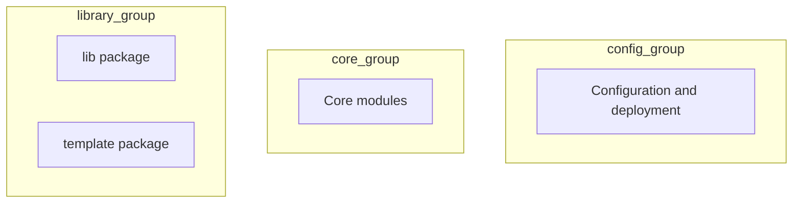

# Architecture report: transitive-bullshit/create-react-library

> Automated static analysis. **Observed** = directly seen in files/imports/AST; **Inferred** = interpretation from that evidence. Repository code was not executed.

## 1. Repository at a glance

| Item | Value |
| --- | --- |
| Repository | transitive-bullshit/create-react-library |
| Description | CLI for creating reusable react libraries. |
| Language | JavaScript |
| Stars | 4746 |
| Licence | Not detected |
| Analysed commit / branch | 43c4f5bcf97203b8e095558ab0d33b1e45f04182 / master |
| Framework(s) | React |
| Files analysed | 85 |
| Components | 4 |

## 2. Architecture in one minute

transitive-bullshit/create-react-library - CLI for creating reusable react libraries.. This repository was analysed statically from 85 file(s) (0 Python). Detected technologies (observed from imports/manifests): React, TypeScript. Files are grouped into 4 component(s): Configuration and deployment, Core modules, lib package, template package. Findings below distinguish observed facts from inferred interpretation.

## 3. High-level block diagram

## 4. Main components

### Configuration and deployment (`config`)

- **Kind:** config
- **Status:** Observed
- **Confidence:** 0.85
- **Responsibility:** Groups 19 file(s) under configuration and deployment (observed from repository paths and static analysis).
- **Paths:** `package.json`, `template/default/.editorconfig`, `template/default/.travis.yml`, `template/default/example/package.json`, `template/default/example/public/manifest.json`, `template/default/package.json`, `template/flow/.editorconfig`, `template/flow/.travis.yml`, `template/flow/example/package.json`, `template/flow/example/public/manifest.json`, `template/flow/package.json`, `template/typescript/.editorconfig`, `template/typescript/.travis.yml`, `template/typescript/example/package.json`, `template/typescript/example/public/manifest.json`, `template/typescript/example/tsconfig.json`, `template/typescript/package.json`, `template/typescript/tsconfig.json`, `template/typescript/tsconfig.test.json`
- **Evidence:** [package.json](https://github.com/transitive-bullshit/create-react-library/blob/43c4f5bcf97203b8e095558ab0d33b1e45f04182/package.json); [template/default/.editorconfig](https://github.com/transitive-bullshit/create-react-library/blob/43c4f5bcf97203b8e095558ab0d33b1e45f04182/template/default/.editorconfig); [template/default/.travis.yml](https://github.com/transitive-bullshit/create-react-library/blob/43c4f5bcf97203b8e095558ab0d33b1e45f04182/template/default/.travis.yml); [template/default/example/package.json](https://github.com/transitive-bullshit/create-react-library/blob/43c4f5bcf97203b8e095558ab0d33b1e45f04182/template/default/example/package.json); [template/default/example/public/manifest.json](https://github.com/transitive-bullshit/create-react-library/blob/43c4f5bcf97203b8e095558ab0d33b1e45f04182/template/default/example/public/manifest.json); [template/default/package.json](https://github.com/transitive-bullshit/create-react-library/blob/43c4f5bcf97203b8e095558ab0d33b1e45f04182/template/default/package.json); [template/flow/.editorconfig](https://github.com/transitive-bullshit/create-react-library/blob/43c4f5bcf97203b8e095558ab0d33b1e45f04182/template/flow/.editorconfig); [template/flow/.travis.yml](https://github.com/transitive-bullshit/create-react-library/blob/43c4f5bcf97203b8e095558ab0d33b1e45f04182/template/flow/.travis.yml)

### Core modules (`core`)

- **Kind:** core
- **Status:** Observed
- **Confidence:** 0.85
- **Responsibility:** Groups 2 file(s) under core modules (observed from repository paths and static analysis).
- **Paths:** `index.js`, `index.test.js`
- **Evidence:** [index.js](https://github.com/transitive-bullshit/create-react-library/blob/43c4f5bcf97203b8e095558ab0d33b1e45f04182/index.js); [index.test.js](https://github.com/transitive-bullshit/create-react-library/blob/43c4f5bcf97203b8e095558ab0d33b1e45f04182/index.test.js)

### lib package (`lib`)

- **Kind:** library
- **Status:** Observed
- **Confidence:** 0.85
- **Responsibility:** Groups 7 file(s) under lib package (observed from repository paths and static analysis).
- **Paths:** `lib/cli.js`, `lib/config.js`, `lib/create-library.js`, `lib/create-library.test.js`, `lib/get-default-library-params.js`, `lib/prompt-library-params.js`, `lib/prompt-library-params.test.js`
- **Evidence:** [lib/cli.js](https://github.com/transitive-bullshit/create-react-library/blob/43c4f5bcf97203b8e095558ab0d33b1e45f04182/lib/cli.js); [lib/config.js](https://github.com/transitive-bullshit/create-react-library/blob/43c4f5bcf97203b8e095558ab0d33b1e45f04182/lib/config.js); [lib/create-library.js](https://github.com/transitive-bullshit/create-react-library/blob/43c4f5bcf97203b8e095558ab0d33b1e45f04182/lib/create-library.js); [lib/create-library.test.js](https://github.com/transitive-bullshit/create-react-library/blob/43c4f5bcf97203b8e095558ab0d33b1e45f04182/lib/create-library.test.js); [lib/get-default-library-params.js](https://github.com/transitive-bullshit/create-react-library/blob/43c4f5bcf97203b8e095558ab0d33b1e45f04182/lib/get-default-library-params.js); [lib/prompt-library-params.js](https://github.com/transitive-bullshit/create-react-library/blob/43c4f5bcf97203b8e095558ab0d33b1e45f04182/lib/prompt-library-params.js); [lib/prompt-library-params.test.js](https://github.com/transitive-bullshit/create-react-library/blob/43c4f5bcf97203b8e095558ab0d33b1e45f04182/lib/prompt-library-params.test.js)

### template package (`template`)

- **Kind:** library
- **Status:** Observed
- **Confidence:** 0.85
- **Responsibility:** Groups 18 file(s) under template package (observed from repository paths and static analysis).
- **Paths:** `template/default/example/src/App.js`, `template/default/example/src/App.test.js`, `template/default/example/src/index.js`, `template/default/src/index.js`, `template/default/src/index.test.js`, `template/flow/example/src/App.js`, `template/flow/example/src/App.test.js`, `template/flow/example/src/index.js`, `template/flow/src/index.js`, `template/flow/src/index.test.js`, `template/typescript/example/src/App.test.tsx`, `template/typescript/example/src/App.tsx`, `template/typescript/example/src/index.tsx`, `template/typescript/example/src/react-app-env.d.ts`, `template/typescript/example/src/setupTests.ts`, `template/typescript/src/index.test.tsx`, `template/typescript/src/index.tsx`, `template/typescript/src/typings.d.ts`
- **Evidence:** [template/default/example/src/App.js](https://github.com/transitive-bullshit/create-react-library/blob/43c4f5bcf97203b8e095558ab0d33b1e45f04182/template/default/example/src/App.js); [template/default/example/src/App.test.js](https://github.com/transitive-bullshit/create-react-library/blob/43c4f5bcf97203b8e095558ab0d33b1e45f04182/template/default/example/src/App.test.js); [template/default/example/src/index.js](https://github.com/transitive-bullshit/create-react-library/blob/43c4f5bcf97203b8e095558ab0d33b1e45f04182/template/default/example/src/index.js); [template/default/src/index.js](https://github.com/transitive-bullshit/create-react-library/blob/43c4f5bcf97203b8e095558ab0d33b1e45f04182/template/default/src/index.js); [template/default/src/index.test.js](https://github.com/transitive-bullshit/create-react-library/blob/43c4f5bcf97203b8e095558ab0d33b1e45f04182/template/default/src/index.test.js); [template/flow/example/src/App.js](https://github.com/transitive-bullshit/create-react-library/blob/43c4f5bcf97203b8e095558ab0d33b1e45f04182/template/flow/example/src/App.js); [template/flow/example/src/App.test.js](https://github.com/transitive-bullshit/create-react-library/blob/43c4f5bcf97203b8e095558ab0d33b1e45f04182/template/flow/example/src/App.test.js); [template/flow/example/src/index.js](https://github.com/transitive-bullshit/create-react-library/blob/43c4f5bcf97203b8e095558ab0d33b1e45f04182/template/flow/example/src/index.js)

## 5. Execution flow

**Observed** entry point(s):

- [index.js](https://github.com/transitive-bullshit/create-react-library/blob/43c4f5bcf97203b8e095558ab0d33b1e45f04182/index.js)
- [template/default/src/index.js](https://github.com/transitive-bullshit/create-react-library/blob/43c4f5bcf97203b8e095558ab0d33b1e45f04182/template/default/src/index.js)
- [template/flow/src/index.js](https://github.com/transitive-bullshit/create-react-library/blob/43c4f5bcf97203b8e095558ab0d33b1e45f04182/template/flow/src/index.js)
- [template/typescript/src/index.tsx](https://github.com/transitive-bullshit/create-react-library/blob/43c4f5bcf97203b8e095558ab0d33b1e45f04182/template/typescript/src/index.tsx)

Representative flow (derived from observed entry points and the import graph; steps beyond the entry point are **Inferred**):

1. Execution starts at an observed entry point listed above, if present.
2. No internal import relationships between components were observed.

## 6. Project structure

### `(root)`

- `.editorconfig` - config (147 bytes)
- `.eslintrc` - other (30 bytes)
- `.gitignore` - other (356 bytes)
- `.npmignore` - other (22 bytes)
- `.travis.yml` - ci, YAML (53 bytes)
- `index.js` - source, JavaScript (55 bytes)
- `index.test.js` - source, JavaScript (240 bytes)
- `package.json` - manifest (1331 bytes)
- `readme.md` - docs (8013 bytes)
- `readme.zh-CN.md` - docs (8366 bytes)

### `lib`

- `lib/cli.js` - source, JavaScript (2500 bytes)
- `lib/config.js` - source, JavaScript (72 bytes)
- `lib/create-library.js` - source, JavaScript (4168 bytes)
- `lib/create-library.test.js` - source, JavaScript (3452 bytes)
- `lib/get-default-library-params.js` - source, JavaScript (1430 bytes)
- `lib/prompt-library-params.js` - source, JavaScript (2642 bytes)
- `lib/prompt-library-params.test.js` - source, JavaScript (646 bytes)

### `media`

- `media/demo.svg` - other (72870 bytes)
- `media/tree.svg` - other (4541 bytes)

### `template`

- `template/default/.editorconfig` - config (147 bytes)
- `template/default/.eslintignore` - other (47 bytes)
- `template/default/.eslintrc` - other (624 bytes)
- `template/default/.gitignore` - other (268 bytes)
- `template/default/.prettierrc` - other (197 bytes)
- `template/default/.travis.yml` - ci, YAML (41 bytes)
- `template/default/README.md` - docs (579 bytes)
- `template/default/example/README.md` - docs (275 bytes)
- `template/default/example/package.json` - manifest (994 bytes)
- `template/default/example/public/index.html` - other (1620 bytes)
- `template/default/example/public/manifest.json` - config (290 bytes)
- `template/default/example/src/App.js` - source, JavaScript (218 bytes)
- `template/default/example/src/App.test.js` - source, JavaScript (241 bytes)
- `template/default/example/src/index.css` - other (380 bytes)
- `template/default/example/src/index.js` - source, JavaScript (164 bytes)
- `template/default/package.json` - manifest (1587 bytes)
- `template/default/src/.eslintrc` - other (36 bytes)
- `template/default/src/index.js` - source, JavaScript (188 bytes)
- `template/default/src/index.test.js` - source, JavaScript (151 bytes)
- `template/default/src/styles.module.css` - other (154 bytes)
- `template/flow/.editorconfig` - config (147 bytes)
- `template/flow/.eslintignore` - other (47 bytes)
- `template/flow/.eslintrc` - other (1860 bytes)
- `template/flow/.gitignore` - other (268 bytes)
- `template/flow/.prettierrc` - other (197 bytes)
- `template/flow/.travis.yml` - ci, YAML (41 bytes)
- `template/flow/README.md` - docs (579 bytes)
- `template/flow/example/README.md` - docs (275 bytes)
- `template/flow/example/package.json` - manifest (994 bytes)
- `template/flow/example/public/index.html` - other (1620 bytes)
- `template/flow/example/public/manifest.json` - config (290 bytes)
- `template/flow/example/src/App.js` - source, JavaScript (218 bytes)
- `template/flow/example/src/App.test.js` - source, JavaScript (241 bytes)
- `template/flow/example/src/index.css` - other (380 bytes)
- `template/flow/example/src/index.js` - source, JavaScript (164 bytes)
- `template/flow/package.json` - manifest (1664 bytes)
- `template/flow/src/.eslintrc` - other (36 bytes)
- `template/flow/src/index.js` - source, JavaScript (244 bytes)
- `template/flow/src/index.test.js` - source, JavaScript (151 bytes)
- `template/flow/src/styles.module.css` - other (154 bytes)
- `template/typescript/.editorconfig` - config (147 bytes)
- `template/typescript/.eslintignore` - other (47 bytes)
- `template/typescript/.eslintrc` - other (689 bytes)
- `template/typescript/.gitignore` - other (330 bytes)
- `template/typescript/.prettierrc` - other (197 bytes)
- `template/typescript/.travis.yml` - ci, YAML (41 bytes)
- `template/typescript/README.md` - docs (579 bytes)
- `template/typescript/example/README.md` - docs (275 bytes)
- `template/typescript/example/package.json` - manifest (1931 bytes)
- `template/typescript/example/public/index.html` - other (1620 bytes)
- `template/typescript/example/public/manifest.json` - config (290 bytes)
- `template/typescript/example/src/App.test.tsx` - source, TypeScript (241 bytes)
- `template/typescript/example/src/App.tsx` - source, TypeScript (218 bytes)
- `template/typescript/example/src/index.css` - other (380 bytes)
- `template/typescript/example/src/index.tsx` - source, TypeScript (164 bytes)
- `template/typescript/example/src/react-app-env.d.ts` - source, TypeScript (40 bytes)
- `template/typescript/example/src/setupTests.ts` - source, TypeScript (255 bytes)
- `template/typescript/example/tsconfig.json` - config (559 bytes)
- `template/typescript/package.json` - manifest (1968 bytes)
- `template/typescript/src/.eslintrc` - other (36 bytes)
- `template/typescript/src/index.test.tsx` - source, TypeScript (151 bytes)
- `template/typescript/src/index.tsx` - source, TypeScript (236 bytes)
- `template/typescript/src/styles.module.css` - other (154 bytes)
- `template/typescript/src/typings.d.ts` - source, TypeScript (685 bytes)
- `template/typescript/tsconfig.json` - config (569 bytes)
- `template/typescript/tsconfig.test.json` - config (87 bytes)

## 7. Key dependencies and integrations

| Name | Category | Status | Confidence | Evidence |
| --- | --- | --- | --- | --- |
| React | framework | Observed | 0.90 | [template/default/example/package.json:7](https://github.com/transitive-bullshit/create-react-library/blob/43c4f5bcf97203b8e095558ab0d33b1e45f04182/template/default/example/package.json#L7); [template/default/example/package.json:14](https://github.com/transitive-bullshit/create-react-library/blob/43c4f5bcf97203b8e095558ab0d33b1e45f04182/template/default/example/package.json#L14); [template/default/package.json:21](https://github.com/transitive-bullshit/create-react-library/blob/43c4f5bcf97203b8e095558ab0d33b1e45f04182/template/default/package.json#L21); [template/default/package.json:47](https://github.com/transitive-bullshit/create-react-library/blob/43c4f5bcf97203b8e095558ab0d33b1e45f04182/template/default/package.json#L47) |
| TypeScript | tooling | Observed | 0.90 | [template/typescript/example/package.json:23](https://github.com/transitive-bullshit/create-react-library/blob/43c4f5bcf97203b8e095558ab0d33b1e45f04182/template/typescript/example/package.json#L23); [template/typescript/package.json:37](https://github.com/transitive-bullshit/create-react-library/blob/43c4f5bcf97203b8e095558ab0d33b1e45f04182/template/typescript/package.json#L37) |

## 8. Data and state

No database, cache, queue, or persistent-state usage was observed in the analysed files. State handling, if any, may be in-memory or in files that were not analysed.

## 9. Configuration and deployment clues

- `.editorconfig` (config)
- `.travis.yml` (ci)
- `package.json` (manifest)
- `template/default/.editorconfig` (config)
- `template/default/.travis.yml` (ci)
- `template/default/example/package.json` (manifest)
- `template/default/example/public/manifest.json` (config)
- `template/default/package.json` (manifest)
- `template/flow/.editorconfig` (config)
- `template/flow/.travis.yml` (ci)
- `template/flow/example/package.json` (manifest)
- `template/flow/example/public/manifest.json` (config)
- `template/flow/package.json` (manifest)
- `template/typescript/.editorconfig` (config)
- `template/typescript/.travis.yml` (ci)
- `template/typescript/example/package.json` (manifest)
- `template/typescript/example/public/manifest.json` (config)
- `template/typescript/example/tsconfig.json` (config)
- `template/typescript/package.json` (manifest)
- `template/typescript/tsconfig.json` (config)
- `template/typescript/tsconfig.test.json` (config)

## 10. Design observations

- No strong design patterns could be established from the available evidence.

These observations are interpretations (**Inferred**) of the observed structure, not guarantees about runtime design.

## 11. Limitations and unknowns

- Static analysis only: repository code was not executed, installed, or imported at runtime.
- Components and relationships are inferred from file paths, imports, and AST structure; runtime behaviour, dynamic imports, and reflection may not be visible.
- 2 file(s) were skipped during inventory (2 x lockfile excluded).
- No clear application entry point was observed in the analysed files.
- Repository text was treated as untrusted data; no instructions found in repository files were followed, and likely secret values were redacted/excluded.
- JavaScript and TypeScript files were inventoried from paths and package manifests. They were not parsed with a full language AST, and repository code was not executed.
- The GitHub repository was marked archived at selection time.

## 12. Source references

- [index.js](https://github.com/transitive-bullshit/create-react-library/blob/43c4f5bcf97203b8e095558ab0d33b1e45f04182/index.js)
- [index.test.js](https://github.com/transitive-bullshit/create-react-library/blob/43c4f5bcf97203b8e095558ab0d33b1e45f04182/index.test.js)
- [lib/cli.js](https://github.com/transitive-bullshit/create-react-library/blob/43c4f5bcf97203b8e095558ab0d33b1e45f04182/lib/cli.js)
- [lib/config.js](https://github.com/transitive-bullshit/create-react-library/blob/43c4f5bcf97203b8e095558ab0d33b1e45f04182/lib/config.js)
- [lib/create-library.js](https://github.com/transitive-bullshit/create-react-library/blob/43c4f5bcf97203b8e095558ab0d33b1e45f04182/lib/create-library.js)
- [lib/create-library.test.js](https://github.com/transitive-bullshit/create-react-library/blob/43c4f5bcf97203b8e095558ab0d33b1e45f04182/lib/create-library.test.js)
- [lib/get-default-library-params.js](https://github.com/transitive-bullshit/create-react-library/blob/43c4f5bcf97203b8e095558ab0d33b1e45f04182/lib/get-default-library-params.js)
- [lib/prompt-library-params.js](https://github.com/transitive-bullshit/create-react-library/blob/43c4f5bcf97203b8e095558ab0d33b1e45f04182/lib/prompt-library-params.js)
- [lib/prompt-library-params.test.js](https://github.com/transitive-bullshit/create-react-library/blob/43c4f5bcf97203b8e095558ab0d33b1e45f04182/lib/prompt-library-params.test.js)
- [package.json](https://github.com/transitive-bullshit/create-react-library/blob/43c4f5bcf97203b8e095558ab0d33b1e45f04182/package.json)
- [template/default/.editorconfig](https://github.com/transitive-bullshit/create-react-library/blob/43c4f5bcf97203b8e095558ab0d33b1e45f04182/template/default/.editorconfig)
- [template/default/.travis.yml](https://github.com/transitive-bullshit/create-react-library/blob/43c4f5bcf97203b8e095558ab0d33b1e45f04182/template/default/.travis.yml)
- [template/default/example/package.json](https://github.com/transitive-bullshit/create-react-library/blob/43c4f5bcf97203b8e095558ab0d33b1e45f04182/template/default/example/package.json)
- [template/default/example/package.json:7](https://github.com/transitive-bullshit/create-react-library/blob/43c4f5bcf97203b8e095558ab0d33b1e45f04182/template/default/example/package.json#L7)
- [template/default/example/package.json:14](https://github.com/transitive-bullshit/create-react-library/blob/43c4f5bcf97203b8e095558ab0d33b1e45f04182/template/default/example/package.json#L14)
- [template/default/example/public/manifest.json](https://github.com/transitive-bullshit/create-react-library/blob/43c4f5bcf97203b8e095558ab0d33b1e45f04182/template/default/example/public/manifest.json)
- [template/default/example/src/App.js](https://github.com/transitive-bullshit/create-react-library/blob/43c4f5bcf97203b8e095558ab0d33b1e45f04182/template/default/example/src/App.js)
- [template/default/example/src/App.test.js](https://github.com/transitive-bullshit/create-react-library/blob/43c4f5bcf97203b8e095558ab0d33b1e45f04182/template/default/example/src/App.test.js)
- [template/default/example/src/index.js](https://github.com/transitive-bullshit/create-react-library/blob/43c4f5bcf97203b8e095558ab0d33b1e45f04182/template/default/example/src/index.js)
- [template/default/package.json](https://github.com/transitive-bullshit/create-react-library/blob/43c4f5bcf97203b8e095558ab0d33b1e45f04182/template/default/package.json)
- [template/default/package.json:21](https://github.com/transitive-bullshit/create-react-library/blob/43c4f5bcf97203b8e095558ab0d33b1e45f04182/template/default/package.json#L21)
- [template/default/package.json:47](https://github.com/transitive-bullshit/create-react-library/blob/43c4f5bcf97203b8e095558ab0d33b1e45f04182/template/default/package.json#L47)
- [template/default/src/index.js](https://github.com/transitive-bullshit/create-react-library/blob/43c4f5bcf97203b8e095558ab0d33b1e45f04182/template/default/src/index.js)
- [template/default/src/index.test.js](https://github.com/transitive-bullshit/create-react-library/blob/43c4f5bcf97203b8e095558ab0d33b1e45f04182/template/default/src/index.test.js)
- [template/flow/.editorconfig](https://github.com/transitive-bullshit/create-react-library/blob/43c4f5bcf97203b8e095558ab0d33b1e45f04182/template/flow/.editorconfig)
- [template/flow/.travis.yml](https://github.com/transitive-bullshit/create-react-library/blob/43c4f5bcf97203b8e095558ab0d33b1e45f04182/template/flow/.travis.yml)
- [template/flow/example/package.json:7](https://github.com/transitive-bullshit/create-react-library/blob/43c4f5bcf97203b8e095558ab0d33b1e45f04182/template/flow/example/package.json#L7)
- [template/flow/example/package.json:14](https://github.com/transitive-bullshit/create-react-library/blob/43c4f5bcf97203b8e095558ab0d33b1e45f04182/template/flow/example/package.json#L14)
- [template/flow/example/src/App.js](https://github.com/transitive-bullshit/create-react-library/blob/43c4f5bcf97203b8e095558ab0d33b1e45f04182/template/flow/example/src/App.js)
- [template/flow/example/src/App.test.js](https://github.com/transitive-bullshit/create-react-library/blob/43c4f5bcf97203b8e095558ab0d33b1e45f04182/template/flow/example/src/App.test.js)
- [template/flow/example/src/index.js](https://github.com/transitive-bullshit/create-react-library/blob/43c4f5bcf97203b8e095558ab0d33b1e45f04182/template/flow/example/src/index.js)
- [template/flow/package.json:21](https://github.com/transitive-bullshit/create-react-library/blob/43c4f5bcf97203b8e095558ab0d33b1e45f04182/template/flow/package.json#L21)
- [template/flow/package.json:47](https://github.com/transitive-bullshit/create-react-library/blob/43c4f5bcf97203b8e095558ab0d33b1e45f04182/template/flow/package.json#L47)
- [template/flow/src/index.js](https://github.com/transitive-bullshit/create-react-library/blob/43c4f5bcf97203b8e095558ab0d33b1e45f04182/template/flow/src/index.js)
- [template/typescript/example/package.json:23](https://github.com/transitive-bullshit/create-react-library/blob/43c4f5bcf97203b8e095558ab0d33b1e45f04182/template/typescript/example/package.json#L23)
- [template/typescript/package.json:37](https://github.com/transitive-bullshit/create-react-library/blob/43c4f5bcf97203b8e095558ab0d33b1e45f04182/template/typescript/package.json#L37)
- [template/typescript/src/index.tsx](https://github.com/transitive-bullshit/create-react-library/blob/43c4f5bcf97203b8e095558ab0d33b1e45f04182/template/typescript/src/index.tsx)
