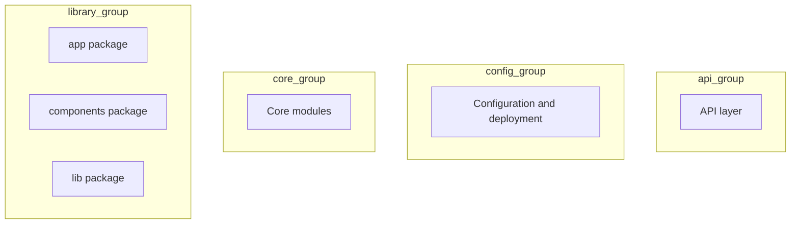

# Architecture report: transitive-bullshit/nextjs-notion-starter-kit

> Automated static analysis. **Observed** = directly seen in files/imports/AST; **Inferred** = interpretation from that evidence. Repository code was not executed.

## 1. Repository at a glance

| Item | Value |
| --- | --- |
| Repository | transitive-bullshit/nextjs-notion-starter-kit |
| Description | Deploy your own Notion-powered website in minutes with Next.js and Vercel. |
| Language | TypeScript |
| Stars | 7041 |
| Licence | MIT |
| Analysed commit / branch | e787e7b594f1ca6fe7445e1866d4d4668c533737 / main |
| Framework(s) | Next.js, React |
| Files analysed | 85 |
| Components | 6 |

## 2. Architecture in one minute

transitive-bullshit/nextjs-notion-starter-kit - Deploy your own Notion-powered website in minutes with Next.js and Vercel.. This repository was analysed statically from 85 file(s) (0 Python). Detected technologies (observed from imports/manifests): GitHub Actions, Next.js, React, TypeScript. Files are grouped into 6 component(s): API layer, app package, components package, Configuration and deployment, Core modules, lib package. Findings below distinguish observed facts from inferred interpretation.

## 3. High-level block diagram

## 4. Main components

### API layer (`api_layer`)

- **Kind:** api
- **Status:** Observed
- **Confidence:** 0.85
- **Responsibility:** Groups 2 file(s) under api layer (observed from repository paths and static analysis).
- **Paths:** `app/api/search-notion/route.ts`, `app/api/social-image/route.tsx`
- **Evidence:** [app/api/search-notion/route.ts](https://github.com/transitive-bullshit/nextjs-notion-starter-kit/blob/e787e7b594f1ca6fe7445e1866d4d4668c533737/app/api/search-notion/route.ts); [app/api/social-image/route.tsx](https://github.com/transitive-bullshit/nextjs-notion-starter-kit/blob/e787e7b594f1ca6fe7445e1866d4d4668c533737/app/api/social-image/route.tsx)

### app package (`app`)

- **Kind:** library
- **Status:** Observed
- **Confidence:** 0.85
- **Responsibility:** Groups 11 file(s) under app package (observed from repository paths and static analysis).
- **Paths:** `app/[pageId]/page.tsx`, `app/error.tsx`, `app/feed/route.ts`, `app/global-error.tsx`, `app/layout.tsx`, `app/loading.tsx`, `app/not-found.tsx`, `app/page.tsx`, `app/providers.tsx`, `app/robots.txt/route.ts`, `app/sitemap.xml/route.ts`
- **Evidence:** [app/[pageId]/page.tsx](https://github.com/transitive-bullshit/nextjs-notion-starter-kit/blob/e787e7b594f1ca6fe7445e1866d4d4668c533737/app/%5BpageId%5D/page.tsx); [app/error.tsx](https://github.com/transitive-bullshit/nextjs-notion-starter-kit/blob/e787e7b594f1ca6fe7445e1866d4d4668c533737/app/error.tsx); [app/feed/route.ts](https://github.com/transitive-bullshit/nextjs-notion-starter-kit/blob/e787e7b594f1ca6fe7445e1866d4d4668c533737/app/feed/route.ts); [app/global-error.tsx](https://github.com/transitive-bullshit/nextjs-notion-starter-kit/blob/e787e7b594f1ca6fe7445e1866d4d4668c533737/app/global-error.tsx); [app/layout.tsx](https://github.com/transitive-bullshit/nextjs-notion-starter-kit/blob/e787e7b594f1ca6fe7445e1866d4d4668c533737/app/layout.tsx); [app/loading.tsx](https://github.com/transitive-bullshit/nextjs-notion-starter-kit/blob/e787e7b594f1ca6fe7445e1866d4d4668c533737/app/loading.tsx); [app/not-found.tsx](https://github.com/transitive-bullshit/nextjs-notion-starter-kit/blob/e787e7b594f1ca6fe7445e1866d4d4668c533737/app/not-found.tsx); [app/page.tsx](https://github.com/transitive-bullshit/nextjs-notion-starter-kit/blob/e787e7b594f1ca6fe7445e1866d4d4668c533737/app/page.tsx)

### components package (`components`)

- **Kind:** library
- **Status:** Observed
- **Confidence:** 0.85
- **Responsibility:** Groups 12 file(s) under components package (observed from repository paths and static analysis).
- **Paths:** `components/ErrorPage.tsx`, `components/Footer.tsx`, `components/GitHubShareButton.tsx`, `components/Loading.tsx`, `components/LoadingIcon.tsx`, `components/NotionPage.tsx`, `components/NotionPageHeader.tsx`, `components/NotionPageRoute.tsx`, `components/Page404.tsx`, `components/PageActions.tsx`, `components/PageAside.tsx`, `components/PageSocial.tsx`
- **Evidence:** [components/ErrorPage.tsx](https://github.com/transitive-bullshit/nextjs-notion-starter-kit/blob/e787e7b594f1ca6fe7445e1866d4d4668c533737/components/ErrorPage.tsx); [components/Footer.tsx](https://github.com/transitive-bullshit/nextjs-notion-starter-kit/blob/e787e7b594f1ca6fe7445e1866d4d4668c533737/components/Footer.tsx); [components/GitHubShareButton.tsx](https://github.com/transitive-bullshit/nextjs-notion-starter-kit/blob/e787e7b594f1ca6fe7445e1866d4d4668c533737/components/GitHubShareButton.tsx); [components/Loading.tsx](https://github.com/transitive-bullshit/nextjs-notion-starter-kit/blob/e787e7b594f1ca6fe7445e1866d4d4668c533737/components/Loading.tsx); [components/LoadingIcon.tsx](https://github.com/transitive-bullshit/nextjs-notion-starter-kit/blob/e787e7b594f1ca6fe7445e1866d4d4668c533737/components/LoadingIcon.tsx); [components/NotionPage.tsx](https://github.com/transitive-bullshit/nextjs-notion-starter-kit/blob/e787e7b594f1ca6fe7445e1866d4d4668c533737/components/NotionPage.tsx); [components/NotionPageHeader.tsx](https://github.com/transitive-bullshit/nextjs-notion-starter-kit/blob/e787e7b594f1ca6fe7445e1866d4d4668c533737/components/NotionPageHeader.tsx); [components/NotionPageRoute.tsx](https://github.com/transitive-bullshit/nextjs-notion-starter-kit/blob/e787e7b594f1ca6fe7445e1866d4d4668c533737/components/NotionPageRoute.tsx)

### Configuration and deployment (`config`)

- **Kind:** config
- **Status:** Observed
- **Confidence:** 0.85
- **Responsibility:** Groups 4 file(s) under configuration and deployment (observed from repository paths and static analysis).
- **Paths:** `package.json`, `pnpm-workspace.yaml`, `public/manifest.json`, `tsconfig.json`
- **Evidence:** [package.json](https://github.com/transitive-bullshit/nextjs-notion-starter-kit/blob/e787e7b594f1ca6fe7445e1866d4d4668c533737/package.json); [pnpm-workspace.yaml](https://github.com/transitive-bullshit/nextjs-notion-starter-kit/blob/e787e7b594f1ca6fe7445e1866d4d4668c533737/pnpm-workspace.yaml); [public/manifest.json](https://github.com/transitive-bullshit/nextjs-notion-starter-kit/blob/e787e7b594f1ca6fe7445e1866d4d4668c533737/public/manifest.json); [tsconfig.json](https://github.com/transitive-bullshit/nextjs-notion-starter-kit/blob/e787e7b594f1ca6fe7445e1866d4d4668c533737/tsconfig.json)

### Core modules (`core`)

- **Kind:** core
- **Status:** Observed
- **Confidence:** 0.85
- **Responsibility:** Groups 4 file(s) under core modules (observed from repository paths and static analysis).
- **Paths:** `next.config.js`, `oxfmt.config.ts`, `oxlint.config.ts`, `site.config.ts`
- **Evidence:** [next.config.js](https://github.com/transitive-bullshit/nextjs-notion-starter-kit/blob/e787e7b594f1ca6fe7445e1866d4d4668c533737/next.config.js); [oxfmt.config.ts](https://github.com/transitive-bullshit/nextjs-notion-starter-kit/blob/e787e7b594f1ca6fe7445e1866d4d4668c533737/oxfmt.config.ts); [oxlint.config.ts](https://github.com/transitive-bullshit/nextjs-notion-starter-kit/blob/e787e7b594f1ca6fe7445e1866d4d4668c533737/oxlint.config.ts); [site.config.ts](https://github.com/transitive-bullshit/nextjs-notion-starter-kit/blob/e787e7b594f1ca6fe7445e1866d4d4668c533737/site.config.ts)

### lib package (`lib`)

- **Kind:** library
- **Status:** Observed
- **Confidence:** 0.85
- **Responsibility:** Groups 31 file(s) under lib package (observed from repository paths and static analysis).
- **Paths:** `lib/acl.ts`, `lib/bootstrap-client.ts`, `lib/config.ts`, `lib/db.ts`, `lib/get-canonical-page-id.ts`, `lib/get-config-value.ts`, `lib/get-page-data.ts`, `lib/get-page-tweet.ts`, `lib/get-site-map.ts`, `lib/get-social-image-url.ts`, `lib/get-tweets.ts`, `lib/icons/github.tsx`, `lib/icons/like.tsx`, `lib/icons/linkedin.tsx`, `lib/icons/moon.tsx`, `lib/icons/retweet.tsx`, `lib/icons/sun.tsx`, `lib/icons/twitter.tsx`, `lib/map-image-url.ts`, `lib/map-page-url.ts`, `lib/notion-api.ts`, `lib/notion.ts`, `lib/oembed.ts`, `lib/page-metadata.ts`, `lib/preview-images.ts`, `lib/reset.d.ts`, `lib/resolve-notion-page.ts`, `lib/search-notion.ts`, `lib/site-config.ts`, `lib/types.ts`, `lib/use-dark-mode.ts`
- **Evidence:** [lib/acl.ts](https://github.com/transitive-bullshit/nextjs-notion-starter-kit/blob/e787e7b594f1ca6fe7445e1866d4d4668c533737/lib/acl.ts); [lib/bootstrap-client.ts](https://github.com/transitive-bullshit/nextjs-notion-starter-kit/blob/e787e7b594f1ca6fe7445e1866d4d4668c533737/lib/bootstrap-client.ts); [lib/config.ts](https://github.com/transitive-bullshit/nextjs-notion-starter-kit/blob/e787e7b594f1ca6fe7445e1866d4d4668c533737/lib/config.ts); [lib/db.ts](https://github.com/transitive-bullshit/nextjs-notion-starter-kit/blob/e787e7b594f1ca6fe7445e1866d4d4668c533737/lib/db.ts); [lib/get-canonical-page-id.ts](https://github.com/transitive-bullshit/nextjs-notion-starter-kit/blob/e787e7b594f1ca6fe7445e1866d4d4668c533737/lib/get-canonical-page-id.ts); [lib/get-config-value.ts](https://github.com/transitive-bullshit/nextjs-notion-starter-kit/blob/e787e7b594f1ca6fe7445e1866d4d4668c533737/lib/get-config-value.ts); [lib/get-page-data.ts](https://github.com/transitive-bullshit/nextjs-notion-starter-kit/blob/e787e7b594f1ca6fe7445e1866d4d4668c533737/lib/get-page-data.ts); [lib/get-page-tweet.ts](https://github.com/transitive-bullshit/nextjs-notion-starter-kit/blob/e787e7b594f1ca6fe7445e1866d4d4668c533737/lib/get-page-tweet.ts)

## 5. Execution flow

**Observed** entry point(s):

- [app/[pageId]/page.tsx](https://github.com/transitive-bullshit/nextjs-notion-starter-kit/blob/e787e7b594f1ca6fe7445e1866d4d4668c533737/app/%5BpageId%5D/page.tsx)
- [app/page.tsx](https://github.com/transitive-bullshit/nextjs-notion-starter-kit/blob/e787e7b594f1ca6fe7445e1866d4d4668c533737/app/page.tsx)

Representative flow (derived from observed entry points and the import graph; steps beyond the entry point are **Inferred**):

1. Execution starts at an observed entry point listed above, if present.
2. No internal import relationships between components were observed.

## 6. Project structure

### `(root)`

- `.editorconfig` - config (134 bytes)
- `.env.example` - config (887 bytes)
- `.gitignore` - other (449 bytes)
- `.prettierignore` - other (69 bytes)
- `.worktreeinclude` - other (16 bytes)
- `AGENTS.md` - docs (170 bytes)
- `CODE_OF_CONDUCT.md` - docs (5481 bytes)
- `contributing.md` - docs (2188 bytes)
- `license` - docs (1071 bytes)
- `next.config.js` - source, JavaScript (784 bytes)
- `oxfmt.config.ts` - source, TypeScript (140 bytes)
- `oxlint.config.ts` - source, TypeScript (166 bytes)
- `package.json` - manifest (2789 bytes)
- `pnpm-workspace.yaml` - config (293 bytes)
- `readme.md` - docs (12478 bytes)
- `site.config.ts` - source, TypeScript (2293 bytes)
- `tsconfig.json` - config (311 bytes)

### `.github`

- `.github/funding.yml` - config (30 bytes)
- `.github/issue_template.md` - docs (318 bytes)
- `.github/pull_request_template.md` - docs (315 bytes)
- `.github/workflows/build.yml` - ci, YAML (929 bytes)

### `.vscode`

- `.vscode/launch.json` - config (597 bytes)
- `.vscode/settings.json` - config (923 bytes)

### `app`

- `app/[pageId]/page.tsx` - source, TypeScript (1149 bytes)
- `app/api/search-notion/route.ts` - source, TypeScript (3275 bytes)
- `app/api/social-image/route.tsx` - source, TypeScript (6696 bytes)
- `app/error.tsx` - source, TypeScript (346 bytes)
- `app/feed/route.ts` - source, TypeScript (2450 bytes)
- `app/global-error.tsx` - source, TypeScript (418 bytes)
- `app/layout.tsx` - source, TypeScript (2049 bytes)
- `app/loading.tsx` - source, TypeScript (71 bytes)
- `app/not-found.tsx` - source, TypeScript (108 bytes)
- `app/page.tsx` - source, TypeScript (490 bytes)
- `app/providers.tsx` - source, TypeScript (2807 bytes)
- `app/robots.txt/route.ts` - source, TypeScript (504 bytes)
- `app/sitemap.xml/route.ts` - source, TypeScript (891 bytes)

### `components`

- `components/ErrorPage.tsx` - source, TypeScript (562 bytes)
- `components/Footer.tsx` - source, TypeScript (2271 bytes)
- `components/GitHubShareButton.tsx` - source, TypeScript (1765 bytes)
- `components/Loading.tsx` - source, TypeScript (203 bytes)
- `components/LoadingIcon.tsx` - source, TypeScript (1545 bytes)
- `components/NotionPage.tsx` - source, TypeScript (8912 bytes)
- `components/NotionPageHeader.tsx` - source, TypeScript (2372 bytes)
- `components/NotionPageRoute.tsx` - source, TypeScript (1328 bytes)
- `components/Page404.tsx` - source, TypeScript (803 bytes)
- `components/PageActions.tsx` - source, TypeScript (864 bytes)
- `components/PageAside.tsx` - source, TypeScript (632 bytes)
- `components/PageSocial.module.css` - other (2110 bytes)
- `components/PageSocial.tsx` - source, TypeScript (3899 bytes)
- `components/styles.module.css` - other (3218 bytes)

### `lib`

- `lib/acl.ts` - source, TypeScript (1242 bytes)
- `lib/bootstrap-client.ts` - source, TypeScript (1633 bytes)
- `lib/config.ts` - source, TypeScript (6544 bytes)
- `lib/db.ts` - source, TypeScript (342 bytes)
- `lib/get-canonical-page-id.ts` - source, TypeScript (665 bytes)
- `lib/get-config-value.ts` - source, TypeScript (1641 bytes)
- `lib/get-page-data.ts` - source, TypeScript (238 bytes)
- `lib/get-page-tweet.ts` - source, TypeScript (249 bytes)
- `lib/get-site-map.ts` - source, TypeScript (2358 bytes)
- `lib/get-social-image-url.ts` - source, TypeScript (370 bytes)
- `lib/get-tweets.ts` - source, TypeScript (1552 bytes)
- `lib/icons/github.tsx` - source, TypeScript (515 bytes)
- `lib/icons/like.tsx` - source, TypeScript (1007 bytes)
- `lib/icons/linkedin.tsx` - source, TypeScript (702 bytes)
- `lib/icons/moon.tsx` - source, TypeScript (465 bytes)
- `lib/icons/retweet.tsx` - source, TypeScript (941 bytes)
- `lib/icons/sun.tsx` - source, TypeScript (696 bytes)
- `lib/icons/twitter.tsx` - source, TypeScript (526 bytes)
- `lib/map-image-url.ts` - source, TypeScript (350 bytes)
- `lib/map-page-url.ts` - source, TypeScript (1369 bytes)
- `lib/notion-api.ts` - source, TypeScript (130 bytes)
- `lib/notion.ts` - source, TypeScript (2059 bytes)
- `lib/oembed.ts` - source, TypeScript (1756 bytes)
- `lib/page-metadata.ts` - source, TypeScript (2884 bytes)
- `lib/preview-images.ts` - source, TypeScript (2079 bytes)
- `lib/reset.d.ts` - source, TypeScript (36 bytes)
- `lib/resolve-notion-page.ts` - source, TypeScript (2990 bytes)
- `lib/search-notion.ts` - source, TypeScript (906 bytes)
- `lib/site-config.ts` - source, TypeScript (1009 bytes)
- `lib/types.ts` - source, TypeScript (1519 bytes)
- `lib/use-dark-mode.ts` - source, TypeScript (526 bytes)

### `public`

- `public/manifest.json` - config (475 bytes)

### `styles`

- `styles/global.css` - other (1148 bytes)
- `styles/notion.css` - other (7800 bytes)
- `styles/prism-theme.css` - other (2402 bytes)

## 7. Key dependencies and integrations

| Name | Category | Status | Confidence | Evidence |
| --- | --- | --- | --- | --- |
| GitHub Actions | ci | Observed | 0.85 | [.github/workflows/build.yml](https://github.com/transitive-bullshit/nextjs-notion-starter-kit/blob/e787e7b594f1ca6fe7445e1866d4d4668c533737/.github/workflows/build.yml) |
| Next.js | framework | Observed | 0.85 | [package.json:2](https://github.com/transitive-bullshit/nextjs-notion-starter-kit/blob/e787e7b594f1ca6fe7445e1866d4d4668c533737/package.json#L2) |
| React | framework | Observed | 0.90 | [package.json:15](https://github.com/transitive-bullshit/nextjs-notion-starter-kit/blob/e787e7b594f1ca6fe7445e1866d4d4668c533737/package.json#L15); [package.json:50](https://github.com/transitive-bullshit/nextjs-notion-starter-kit/blob/e787e7b594f1ca6fe7445e1866d4d4668c533737/package.json#L50) |
| TypeScript | tooling | Observed | 0.85 | [package.json:69](https://github.com/transitive-bullshit/nextjs-notion-starter-kit/blob/e787e7b594f1ca6fe7445e1866d4d4668c533737/package.json#L69) |

## 8. Data and state

No database, cache, queue, or persistent-state usage was observed in the analysed files. State handling, if any, may be in-memory or in files that were not analysed.

## 9. Configuration and deployment clues

- `.editorconfig` (config)
- `.env.example` (config)
- `.github/funding.yml` (config)
- `.github/workflows/build.yml` (ci)
- `.vscode/launch.json` (config)
- `.vscode/settings.json` (config)
- `package.json` (manifest)
- `pnpm-workspace.yaml` (config)
- `public/manifest.json` (config)
- `tsconfig.json` (config)

Environment variable *names* seen in example env files (values never recorded):

- `.env.example`: 

## 10. Design observations

- An entry/API layer is separated from other code (Inferred from paths and decorators).

These observations are interpretations (**Inferred**) of the observed structure, not guarantees about runtime design.

## 11. Limitations and unknowns

- Static analysis only: repository code was not executed, installed, or imported at runtime.
- Components and relationships are inferred from file paths, imports, and AST structure; runtime behaviour, dynamic imports, and reflection may not be visible.
- 1 file(s) were skipped during inventory (1 x lockfile excluded).
- No clear application entry point was observed in the analysed files.
- Repository text was treated as untrusted data; no instructions found in repository files were followed, and likely secret values were redacted/excluded.
- JavaScript and TypeScript files were inventoried from paths and package manifests. They were not parsed with a full language AST, and repository code was not executed.

## 12. Source references

- [.github/workflows/build.yml](https://github.com/transitive-bullshit/nextjs-notion-starter-kit/blob/e787e7b594f1ca6fe7445e1866d4d4668c533737/.github/workflows/build.yml)
- [app/[pageId]/page.tsx](https://github.com/transitive-bullshit/nextjs-notion-starter-kit/blob/e787e7b594f1ca6fe7445e1866d4d4668c533737/app/%5BpageId%5D/page.tsx)
- [app/api/search-notion/route.ts](https://github.com/transitive-bullshit/nextjs-notion-starter-kit/blob/e787e7b594f1ca6fe7445e1866d4d4668c533737/app/api/search-notion/route.ts)
- [app/api/social-image/route.tsx](https://github.com/transitive-bullshit/nextjs-notion-starter-kit/blob/e787e7b594f1ca6fe7445e1866d4d4668c533737/app/api/social-image/route.tsx)
- [app/error.tsx](https://github.com/transitive-bullshit/nextjs-notion-starter-kit/blob/e787e7b594f1ca6fe7445e1866d4d4668c533737/app/error.tsx)
- [app/feed/route.ts](https://github.com/transitive-bullshit/nextjs-notion-starter-kit/blob/e787e7b594f1ca6fe7445e1866d4d4668c533737/app/feed/route.ts)
- [app/global-error.tsx](https://github.com/transitive-bullshit/nextjs-notion-starter-kit/blob/e787e7b594f1ca6fe7445e1866d4d4668c533737/app/global-error.tsx)
- [app/layout.tsx](https://github.com/transitive-bullshit/nextjs-notion-starter-kit/blob/e787e7b594f1ca6fe7445e1866d4d4668c533737/app/layout.tsx)
- [app/loading.tsx](https://github.com/transitive-bullshit/nextjs-notion-starter-kit/blob/e787e7b594f1ca6fe7445e1866d4d4668c533737/app/loading.tsx)
- [app/not-found.tsx](https://github.com/transitive-bullshit/nextjs-notion-starter-kit/blob/e787e7b594f1ca6fe7445e1866d4d4668c533737/app/not-found.tsx)
- [app/page.tsx](https://github.com/transitive-bullshit/nextjs-notion-starter-kit/blob/e787e7b594f1ca6fe7445e1866d4d4668c533737/app/page.tsx)
- [components/ErrorPage.tsx](https://github.com/transitive-bullshit/nextjs-notion-starter-kit/blob/e787e7b594f1ca6fe7445e1866d4d4668c533737/components/ErrorPage.tsx)
- [components/Footer.tsx](https://github.com/transitive-bullshit/nextjs-notion-starter-kit/blob/e787e7b594f1ca6fe7445e1866d4d4668c533737/components/Footer.tsx)
- [components/GitHubShareButton.tsx](https://github.com/transitive-bullshit/nextjs-notion-starter-kit/blob/e787e7b594f1ca6fe7445e1866d4d4668c533737/components/GitHubShareButton.tsx)
- [components/Loading.tsx](https://github.com/transitive-bullshit/nextjs-notion-starter-kit/blob/e787e7b594f1ca6fe7445e1866d4d4668c533737/components/Loading.tsx)
- [components/LoadingIcon.tsx](https://github.com/transitive-bullshit/nextjs-notion-starter-kit/blob/e787e7b594f1ca6fe7445e1866d4d4668c533737/components/LoadingIcon.tsx)
- [components/NotionPage.tsx](https://github.com/transitive-bullshit/nextjs-notion-starter-kit/blob/e787e7b594f1ca6fe7445e1866d4d4668c533737/components/NotionPage.tsx)
- [components/NotionPageHeader.tsx](https://github.com/transitive-bullshit/nextjs-notion-starter-kit/blob/e787e7b594f1ca6fe7445e1866d4d4668c533737/components/NotionPageHeader.tsx)
- [components/NotionPageRoute.tsx](https://github.com/transitive-bullshit/nextjs-notion-starter-kit/blob/e787e7b594f1ca6fe7445e1866d4d4668c533737/components/NotionPageRoute.tsx)
- [lib/acl.ts](https://github.com/transitive-bullshit/nextjs-notion-starter-kit/blob/e787e7b594f1ca6fe7445e1866d4d4668c533737/lib/acl.ts)
- [lib/bootstrap-client.ts](https://github.com/transitive-bullshit/nextjs-notion-starter-kit/blob/e787e7b594f1ca6fe7445e1866d4d4668c533737/lib/bootstrap-client.ts)
- [lib/config.ts](https://github.com/transitive-bullshit/nextjs-notion-starter-kit/blob/e787e7b594f1ca6fe7445e1866d4d4668c533737/lib/config.ts)
- [lib/db.ts](https://github.com/transitive-bullshit/nextjs-notion-starter-kit/blob/e787e7b594f1ca6fe7445e1866d4d4668c533737/lib/db.ts)
- [lib/get-canonical-page-id.ts](https://github.com/transitive-bullshit/nextjs-notion-starter-kit/blob/e787e7b594f1ca6fe7445e1866d4d4668c533737/lib/get-canonical-page-id.ts)
- [lib/get-config-value.ts](https://github.com/transitive-bullshit/nextjs-notion-starter-kit/blob/e787e7b594f1ca6fe7445e1866d4d4668c533737/lib/get-config-value.ts)
- [lib/get-page-data.ts](https://github.com/transitive-bullshit/nextjs-notion-starter-kit/blob/e787e7b594f1ca6fe7445e1866d4d4668c533737/lib/get-page-data.ts)
- [lib/get-page-tweet.ts](https://github.com/transitive-bullshit/nextjs-notion-starter-kit/blob/e787e7b594f1ca6fe7445e1866d4d4668c533737/lib/get-page-tweet.ts)
- [next.config.js](https://github.com/transitive-bullshit/nextjs-notion-starter-kit/blob/e787e7b594f1ca6fe7445e1866d4d4668c533737/next.config.js)
- [oxfmt.config.ts](https://github.com/transitive-bullshit/nextjs-notion-starter-kit/blob/e787e7b594f1ca6fe7445e1866d4d4668c533737/oxfmt.config.ts)
- [oxlint.config.ts](https://github.com/transitive-bullshit/nextjs-notion-starter-kit/blob/e787e7b594f1ca6fe7445e1866d4d4668c533737/oxlint.config.ts)
- [package.json](https://github.com/transitive-bullshit/nextjs-notion-starter-kit/blob/e787e7b594f1ca6fe7445e1866d4d4668c533737/package.json)
- [package.json:2](https://github.com/transitive-bullshit/nextjs-notion-starter-kit/blob/e787e7b594f1ca6fe7445e1866d4d4668c533737/package.json#L2)
- [package.json:15](https://github.com/transitive-bullshit/nextjs-notion-starter-kit/blob/e787e7b594f1ca6fe7445e1866d4d4668c533737/package.json#L15)
- [package.json:50](https://github.com/transitive-bullshit/nextjs-notion-starter-kit/blob/e787e7b594f1ca6fe7445e1866d4d4668c533737/package.json#L50)
- [package.json:69](https://github.com/transitive-bullshit/nextjs-notion-starter-kit/blob/e787e7b594f1ca6fe7445e1866d4d4668c533737/package.json#L69)
- [pnpm-workspace.yaml](https://github.com/transitive-bullshit/nextjs-notion-starter-kit/blob/e787e7b594f1ca6fe7445e1866d4d4668c533737/pnpm-workspace.yaml)
- [public/manifest.json](https://github.com/transitive-bullshit/nextjs-notion-starter-kit/blob/e787e7b594f1ca6fe7445e1866d4d4668c533737/public/manifest.json)
- [site.config.ts](https://github.com/transitive-bullshit/nextjs-notion-starter-kit/blob/e787e7b594f1ca6fe7445e1866d4d4668c533737/site.config.ts)
- [tsconfig.json](https://github.com/transitive-bullshit/nextjs-notion-starter-kit/blob/e787e7b594f1ca6fe7445e1866d4d4668c533737/tsconfig.json)
