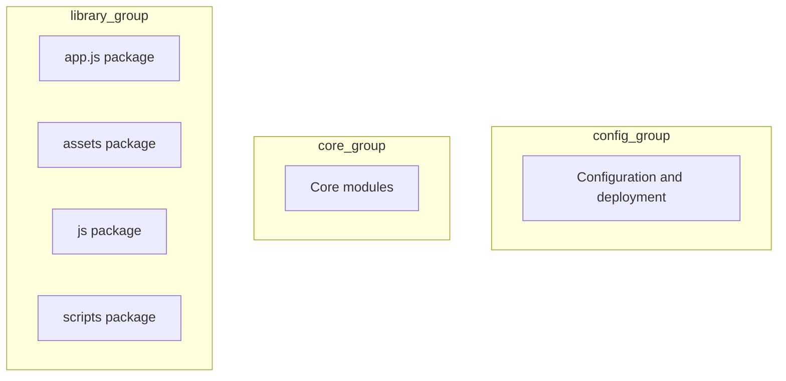

# Architecture report: trazyn/weweChat

> Automated static analysis. **Observed** = directly seen in files/imports/AST; **Inferred** = interpretation from that evidence. Repository code was not executed.

## 1. Repository at a glance

| Item | Value |
| --- | --- |
| Repository | trazyn/weweChat |
| Description | 💬 Unofficial WeChat client built with React, MobX and Electron. |
| Language | JavaScript |
| Stars | 5698 |
| Licence | MIT |
| Analysed commit / branch | 27ab1fd48816392a252f9fd3c20b389dd55431ee / master |
| Framework(s) | Electron, Express, React |
| Files analysed | 112 |
| Components | 6 |

## 2. Architecture in one minute

trazyn/weweChat - 💬 Unofficial WeChat client built with React, MobX and Electron.. This repository was analysed statically from 112 file(s) (0 Python). Detected technologies (observed from imports/manifests): Electron, Express, React, axios, React Router, webpack. Files are grouped into 6 component(s): app.js package, assets package, Configuration and deployment, Core modules, js package, scripts package. Findings below distinguish observed facts from inferred interpretation.

## 3. High-level block diagram

## 4. Main components

### app.js package (`app_js`)

- **Kind:** library
- **Status:** Observed
- **Confidence:** 0.85
- **Responsibility:** Groups 1 file(s) under app.js package (observed from repository paths and static analysis).
- **Paths:** `src/app.js`
- **Evidence:** [src/app.js](https://github.com/trazyn/weweChat/blob/27ab1fd48816392a252f9fd3c20b389dd55431ee/src/app.js)

### assets package (`assets`)

- **Kind:** library
- **Status:** Observed
- **Confidence:** 0.85
- **Responsibility:** Groups 1 file(s) under assets package (observed from repository paths and static analysis).
- **Paths:** `src/assets/fonts/icomoon/demo-files/demo.js`
- **Evidence:** [src/assets/fonts/icomoon/demo-files/demo.js](https://github.com/trazyn/weweChat/blob/27ab1fd48816392a252f9fd3c20b389dd55431ee/src/assets/fonts/icomoon/demo-files/demo.js)

### Configuration and deployment (`config`)

- **Kind:** config
- **Status:** Observed
- **Confidence:** 0.85
- **Responsibility:** Groups 7 file(s) under configuration and deployment (observed from repository paths and static analysis).
- **Paths:** `config/index.js`, `config/webpack.config.base.js`, `config/webpack.config.dev.js`, `config/webpack.config.electron.js`, `config/webpack.config.production.js`, `package.json`, `src/js/pages/Settings/index.js`
- **Evidence:** [config/index.js](https://github.com/trazyn/weweChat/blob/27ab1fd48816392a252f9fd3c20b389dd55431ee/config/index.js); [config/webpack.config.base.js](https://github.com/trazyn/weweChat/blob/27ab1fd48816392a252f9fd3c20b389dd55431ee/config/webpack.config.base.js); [config/webpack.config.dev.js](https://github.com/trazyn/weweChat/blob/27ab1fd48816392a252f9fd3c20b389dd55431ee/config/webpack.config.dev.js); [config/webpack.config.electron.js](https://github.com/trazyn/weweChat/blob/27ab1fd48816392a252f9fd3c20b389dd55431ee/config/webpack.config.electron.js); [config/webpack.config.production.js](https://github.com/trazyn/weweChat/blob/27ab1fd48816392a252f9fd3c20b389dd55431ee/config/webpack.config.production.js); [package.json](https://github.com/trazyn/weweChat/blob/27ab1fd48816392a252f9fd3c20b389dd55431ee/package.json); [src/js/pages/Settings/index.js](https://github.com/trazyn/weweChat/blob/27ab1fd48816392a252f9fd3c20b389dd55431ee/src/js/pages/Settings/index.js)

### Core modules (`core`)

- **Kind:** core
- **Status:** Observed
- **Confidence:** 0.85
- **Responsibility:** Groups 1 file(s) under core modules (observed from repository paths and static analysis).
- **Paths:** `main.js`
- **Evidence:** [main.js](https://github.com/trazyn/weweChat/blob/27ab1fd48816392a252f9fd3c20b389dd55431ee/main.js)

### js package (`js`)

- **Kind:** library
- **Status:** Observed
- **Confidence:** 0.85
- **Responsibility:** Groups 54 file(s) under js package (observed from repository paths and static analysis).
- **Paths:** `src/js/components/Avatar/index.js`, `src/js/components/Loader/index.js`, `src/js/components/MessageInput/Emoji/index.js`, `src/js/components/MessageInput/Suggestion/index.js`, `src/js/components/MessageInput/index.js`, `src/js/components/Modal/index.js`, `src/js/components/Offline/index.js`, `src/js/components/Snackbar/index.js`, `src/js/components/Switch/index.js`, `src/js/components/TransitionPortal/index.js`, `src/js/components/UserList/index.js`, `src/js/pages/AddFriend/index.js`, `src/js/pages/AddMember/index.js`, `src/js/pages/BatchSend/index.js`, `src/js/pages/ConfirmImagePaste/index.js`, `src/js/pages/Contacts/index.js`, `src/js/pages/Footer/Contacts.js`, `src/js/pages/Footer/Home.js`, `src/js/pages/Footer/Settings.js`, `src/js/pages/Footer/index.js`, `src/js/pages/Forward/index.js`, `src/js/pages/Header/index.js`, `src/js/pages/Home/ChatContent/index.js`, `src/js/pages/Home/Chats/index.js`, `src/js/pages/Home/SearchBar/index.js`, `src/js/pages/Home/index.js`, `src/js/pages/Layout.js`, `src/js/pages/Login/index.js`, `src/js/pages/Members/index.js`, `src/js/pages/NewChat/index.js`, `src/js/pages/UserInfo/index.js`, `src/js/pages/index.js`, `src/js/routes.js`, `src/js/stores/addfriend.js`, `src/js/stores/addmember.js`, `src/js/stores/batchsend.js`, `src/js/stores/chat.js`, `src/js/stores/confirmImagePaste.js`, `src/js/stores/contacts.js`, `src/js/stores/forward.js`, `src/js/stores/index.js`, `src/js/stores/members.js`, `src/js/stores/newchat.js`, `src/js/stores/search.js`, `src/js/stores/session.js`, `src/js/stores/settings.js`, `src/js/stores/snackbar.js`, `src/js/stores/userinfo.js`, `src/js/utils/albumcolors.js`, `src/js/utils/blacklist.js`, `src/js/utils/emoji.js`, `src/js/utils/event.js`, `src/js/utils/helper.js`, `src/js/utils/storage.js`
- **Evidence:** [src/js/components/Avatar/index.js](https://github.com/trazyn/weweChat/blob/27ab1fd48816392a252f9fd3c20b389dd55431ee/src/js/components/Avatar/index.js); [src/js/components/Loader/index.js](https://github.com/trazyn/weweChat/blob/27ab1fd48816392a252f9fd3c20b389dd55431ee/src/js/components/Loader/index.js); [src/js/components/MessageInput/Emoji/index.js](https://github.com/trazyn/weweChat/blob/27ab1fd48816392a252f9fd3c20b389dd55431ee/src/js/components/MessageInput/Emoji/index.js); [src/js/components/MessageInput/Suggestion/index.js](https://github.com/trazyn/weweChat/blob/27ab1fd48816392a252f9fd3c20b389dd55431ee/src/js/components/MessageInput/Suggestion/index.js); [src/js/components/MessageInput/index.js](https://github.com/trazyn/weweChat/blob/27ab1fd48816392a252f9fd3c20b389dd55431ee/src/js/components/MessageInput/index.js); [src/js/components/Modal/index.js](https://github.com/trazyn/weweChat/blob/27ab1fd48816392a252f9fd3c20b389dd55431ee/src/js/components/Modal/index.js); [src/js/components/Offline/index.js](https://github.com/trazyn/weweChat/blob/27ab1fd48816392a252f9fd3c20b389dd55431ee/src/js/components/Offline/index.js); [src/js/components/Snackbar/index.js](https://github.com/trazyn/weweChat/blob/27ab1fd48816392a252f9fd3c20b389dd55431ee/src/js/components/Snackbar/index.js)

### scripts package (`scripts`)

- **Kind:** library
- **Status:** Observed
- **Confidence:** 0.85
- **Responsibility:** Groups 2 file(s) under scripts package (observed from repository paths and static analysis).
- **Paths:** `scripts/dev.js`, `scripts/publish.sh`
- **Evidence:** [scripts/dev.js](https://github.com/trazyn/weweChat/blob/27ab1fd48816392a252f9fd3c20b389dd55431ee/scripts/dev.js); [scripts/publish.sh](https://github.com/trazyn/weweChat/blob/27ab1fd48816392a252f9fd3c20b389dd55431ee/scripts/publish.sh)

## 5. Execution flow

**Observed** entry point(s):

- [config/index.js](https://github.com/trazyn/weweChat/blob/27ab1fd48816392a252f9fd3c20b389dd55431ee/config/index.js)
- [main.js](https://github.com/trazyn/weweChat/blob/27ab1fd48816392a252f9fd3c20b389dd55431ee/main.js)
- [src/app.js](https://github.com/trazyn/weweChat/blob/27ab1fd48816392a252f9fd3c20b389dd55431ee/src/app.js)
- [src/js/pages/index.js](https://github.com/trazyn/weweChat/blob/27ab1fd48816392a252f9fd3c20b389dd55431ee/src/js/pages/index.js)
- [src/js/stores/index.js](https://github.com/trazyn/weweChat/blob/27ab1fd48816392a252f9fd3c20b389dd55431ee/src/js/stores/index.js)

Representative flow (derived from observed entry points and the import graph; steps beyond the entry point are **Inferred**):

1. Execution starts at an observed entry point listed above, if present.
2. No internal import relationships between components were observed.

## 6. Project structure

### `(root)`

- `.babelrc` - other (594 bytes)
- `.ctrlpignore` - other (61 bytes)
- `.editorconfig` - config (151 bytes)
- `.eslintignore` - other (44 bytes)
- `.eslintrc.json` - config (767 bytes)
- `.gitattributes` - other (65 bytes)
- `.gitignore` - other (459 bytes)
- `.stylelintignore` - other (33 bytes)
- `.stylelintrc` - other (681 bytes)
- `.travis.yml` - ci, YAML (75 bytes)
- `CHANGELOG.MD` - docs (1396 bytes)
- `LICENSE` - docs (1088 bytes)
- `README.MD` - docs (5219 bytes)
- `main.js` - source, JavaScript (20066 bytes)
- `package.json` - manifest (5390 bytes)

### `config`

- `config/index.js` - source, JavaScript (306 bytes)
- `config/webpack.config.base.js` - source, JavaScript (3966 bytes)
- `config/webpack.config.dev.js` - source, JavaScript (1056 bytes)
- `config/webpack.config.electron.js` - source, JavaScript (855 bytes)
- `config/webpack.config.production.js` - source, JavaScript (1717 bytes)

### `scripts`

- `scripts/dev.js` - source, JavaScript (910 bytes)
- `scripts/publish.sh` - source, Shell (304 bytes)

### `src`

- `src/app.js` - source, JavaScript (4166 bytes)
- `src/assets/fonts/icomoon/Read Me.txt` - docs (748 bytes)
- `src/assets/fonts/icomoon/demo-files/demo.css` - other (1961 bytes)
- `src/assets/fonts/icomoon/demo-files/demo.js` - source, JavaScript (996 bytes)
- `src/assets/fonts/icomoon/style.css` - other (41244 bytes)
- `src/global.css` - other (7426 bytes)
- `src/index.html` - other (467 bytes)
- `src/js/components/Avatar/index.js` - source, JavaScript (873 bytes)
- `src/js/components/Avatar/style.global.css` - other (73 bytes)
- `src/js/components/Loader/index.js` - source, JavaScript (1356 bytes)
- `src/js/components/Loader/style.global.css` - other (1352 bytes)
- `src/js/components/MessageInput/Emoji/index.js` - source, JavaScript (2319 bytes)
- `src/js/components/MessageInput/Emoji/style.css` - other (746 bytes)
- `src/js/components/MessageInput/Suggestion/index.js` - source, JavaScript (1677 bytes)
- `src/js/components/MessageInput/Suggestion/style.css` - other (2097 bytes)
- `src/js/components/MessageInput/index.js` - source, JavaScript (6608 bytes)
- `src/js/components/MessageInput/style.css` - other (1603 bytes)
- `src/js/components/Modal/index.js` - source, JavaScript (3457 bytes)
- `src/js/components/Modal/style.css` - other (1806 bytes)
- `src/js/components/Offline/index.js` - source, JavaScript (833 bytes)
- `src/js/components/Offline/style.css` - other (1013 bytes)
- `src/js/components/Snackbar/index.js` - source, JavaScript (1153 bytes)
- `src/js/components/Snackbar/style.global.css` - other (1302 bytes)
- `src/js/components/Switch/index.js` - source, JavaScript (456 bytes)
- `src/js/components/Switch/style.global.css` - other (1141 bytes)
- `src/js/components/TransitionPortal/index.js` - source, JavaScript (627 bytes)
- `src/js/components/UserList/index.js` - source, JavaScript (5326 bytes)
- `src/js/components/UserList/style.css` - other (1612 bytes)
- `src/js/pages/AddFriend/index.js` - source, JavaScript (1331 bytes)
- `src/js/pages/AddFriend/style.css` - other (1630 bytes)
- `src/js/pages/AddMember/index.js` - source, JavaScript (3326 bytes)
- `src/js/pages/AddMember/style.css` - other (2077 bytes)
- `src/js/pages/BatchSend/index.js` - source, JavaScript (5614 bytes)
- `src/js/pages/BatchSend/style.css` - other (3726 bytes)
- `src/js/pages/ConfirmImagePaste/index.js` - source, JavaScript (1220 bytes)
- `src/js/pages/ConfirmImagePaste/style.css` - other (1622 bytes)
- `src/js/pages/Contacts/index.js` - source, JavaScript (4218 bytes)
- `src/js/pages/Contacts/style.css` - other (2814 bytes)
- `src/js/pages/Footer/Contacts.js` - source, JavaScript (1557 bytes)
- `src/js/pages/Footer/Home.js` - source, JavaScript (1009 bytes)
- `src/js/pages/Footer/Settings.js` - source, JavaScript (840 bytes)
- `src/js/pages/Footer/index.js` - source, JavaScript (2093 bytes)
- `src/js/pages/Footer/style.css` - other (3676 bytes)
- `src/js/pages/Forward/index.js` - source, JavaScript (3046 bytes)
- `src/js/pages/Forward/style.css` - other (2077 bytes)
- `src/js/pages/Header/index.js` - source, JavaScript (587 bytes)
- `src/js/pages/Header/style.css` - other (427 bytes)
- `src/js/pages/Home/ChatContent/index.js` - source, JavaScript (23829 bytes)
- `src/js/pages/Home/ChatContent/style.css` - other (19506 bytes)
- `src/js/pages/Home/Chats/index.js` - source, JavaScript (5858 bytes)
- `src/js/pages/Home/Chats/style.css` - other (2487 bytes)
- `src/js/pages/Home/SearchBar/index.js` - source, JavaScript (6500 bytes)
- `src/js/pages/Home/SearchBar/style.css` - other (3120 bytes)
- `src/js/pages/Home/index.js` - source, JavaScript (1806 bytes)
- `src/js/pages/Home/style.css` - other (1014 bytes)
- `src/js/pages/Layout.css` - other (1178 bytes)
- `src/js/pages/Layout.js` - source, JavaScript (6058 bytes)
- `src/js/pages/Login/index.js` - source, JavaScript (1487 bytes)
- `src/js/pages/Login/style.css` - other (864 bytes)
- `src/js/pages/Members/index.js` - source, JavaScript (4340 bytes)
- `src/js/pages/Members/style.css` - other (3260 bytes)
- `src/js/pages/NewChat/index.js` - source, JavaScript (3504 bytes)
- `src/js/pages/NewChat/style.css` - other (2105 bytes)
- `src/js/pages/Settings/index.js` - source, JavaScript (7248 bytes)
- `src/js/pages/Settings/style.css` - other (2276 bytes)
- `src/js/pages/UserInfo/index.js` - source, JavaScript (8982 bytes)
- `src/js/pages/UserInfo/style.css` - other (4230 bytes)
- `src/js/pages/index.js` - source, JavaScript (175 bytes)
- `src/js/routes.js` - source, JavaScript (577 bytes)
- `src/js/stores/addfriend.js` - source, JavaScript (1050 bytes)
- `src/js/stores/addmember.js` - source, JavaScript (1741 bytes)
- `src/js/stores/batchsend.js` - source, JavaScript (1072 bytes)
- `src/js/stores/chat.js` - source, JavaScript (35087 bytes)
- `src/js/stores/confirmImagePaste.js` - source, JavaScript (513 bytes)
- `src/js/stores/contacts.js` - source, JavaScript (7496 bytes)
- `src/js/stores/forward.js` - source, JavaScript (1394 bytes)
- `src/js/stores/index.js` - source, JavaScript (738 bytes)
- `src/js/stores/members.js` - source, JavaScript (1400 bytes)
- `src/js/stores/newchat.js` - source, JavaScript (1689 bytes)
- `src/js/stores/search.js` - source, JavaScript (2424 bytes)
- `src/js/stores/session.js` - source, JavaScript (10168 bytes)
- `src/js/stores/settings.js` - source, JavaScript (3951 bytes)
- `src/js/stores/snackbar.js` - source, JavaScript (603 bytes)
- `src/js/stores/userinfo.js` - source, JavaScript (2030 bytes)
- `src/js/utils/albumcolors.js` - source, JavaScript (5666 bytes)
- `src/js/utils/blacklist.js` - source, JavaScript (245 bytes)
- `src/js/utils/emoji.js` - source, JavaScript (9847 bytes)
- `src/js/utils/event.js` - source, JavaScript (284 bytes)
- `src/js/utils/helper.js` - source, JavaScript (8120 bytes)
- `src/js/utils/storage.js` - source, JavaScript (933 bytes)

## 7. Key dependencies and integrations

| Name | Category | Status | Confidence | Evidence |
| --- | --- | --- | --- | --- |
| Electron | framework | Observed | 0.85 | [package.json:4](https://github.com/trazyn/weweChat/blob/27ab1fd48816392a252f9fd3c20b389dd55431ee/package.json#L4) |
| Express | framework | Observed | 0.85 | [package.json:139](https://github.com/trazyn/weweChat/blob/27ab1fd48816392a252f9fd3c20b389dd55431ee/package.json#L139) |
| React | framework | Observed | 0.90 | [package.json:4](https://github.com/trazyn/weweChat/blob/27ab1fd48816392a252f9fd3c20b389dd55431ee/package.json#L4); [package.json:102](https://github.com/trazyn/weweChat/blob/27ab1fd48816392a252f9fd3c20b389dd55431ee/package.json#L102) |
| axios | library | Observed | 0.85 | [package.json:86](https://github.com/trazyn/weweChat/blob/27ab1fd48816392a252f9fd3c20b389dd55431ee/package.json#L86) |
| React Router | library | Observed | 0.85 | [package.json:103](https://github.com/trazyn/weweChat/blob/27ab1fd48816392a252f9fd3c20b389dd55431ee/package.json#L103) |
| webpack | tooling | Observed | 0.85 | [package.json:11](https://github.com/trazyn/weweChat/blob/27ab1fd48816392a252f9fd3c20b389dd55431ee/package.json#L11) |

## 8. Data and state

No database, cache, queue, or persistent-state usage was observed in the analysed files. State handling, if any, may be in-memory or in files that were not analysed.

## 9. Configuration and deployment clues

- `.editorconfig` (config)
- `.eslintrc.json` (config)
- `.travis.yml` (ci)
- `package.json` (manifest)

## 10. Design observations

- No strong design patterns could be established from the available evidence.

These observations are interpretations (**Inferred**) of the observed structure, not guarantees about runtime design.

## 11. Limitations and unknowns

- Static analysis only: repository code was not executed, installed, or imported at runtime.
- Components and relationships are inferred from file paths, imports, and AST structure; runtime behaviour, dynamic imports, and reflection may not be visible.
- No clear application entry point was observed in the analysed files.
- Repository text was treated as untrusted data; no instructions found in repository files were followed, and likely secret values were redacted/excluded.
- JavaScript and TypeScript files were inventoried from paths and package manifests. They were not parsed with a full language AST, and repository code was not executed.
- The GitHub repository was marked archived at selection time.

## 12. Source references

- [config/index.js](https://github.com/trazyn/weweChat/blob/27ab1fd48816392a252f9fd3c20b389dd55431ee/config/index.js)
- [config/webpack.config.base.js](https://github.com/trazyn/weweChat/blob/27ab1fd48816392a252f9fd3c20b389dd55431ee/config/webpack.config.base.js)
- [config/webpack.config.dev.js](https://github.com/trazyn/weweChat/blob/27ab1fd48816392a252f9fd3c20b389dd55431ee/config/webpack.config.dev.js)
- [config/webpack.config.electron.js](https://github.com/trazyn/weweChat/blob/27ab1fd48816392a252f9fd3c20b389dd55431ee/config/webpack.config.electron.js)
- [config/webpack.config.production.js](https://github.com/trazyn/weweChat/blob/27ab1fd48816392a252f9fd3c20b389dd55431ee/config/webpack.config.production.js)
- [main.js](https://github.com/trazyn/weweChat/blob/27ab1fd48816392a252f9fd3c20b389dd55431ee/main.js)
- [package.json](https://github.com/trazyn/weweChat/blob/27ab1fd48816392a252f9fd3c20b389dd55431ee/package.json)
- [package.json:4](https://github.com/trazyn/weweChat/blob/27ab1fd48816392a252f9fd3c20b389dd55431ee/package.json#L4)
- [package.json:11](https://github.com/trazyn/weweChat/blob/27ab1fd48816392a252f9fd3c20b389dd55431ee/package.json#L11)
- [package.json:86](https://github.com/trazyn/weweChat/blob/27ab1fd48816392a252f9fd3c20b389dd55431ee/package.json#L86)
- [package.json:102](https://github.com/trazyn/weweChat/blob/27ab1fd48816392a252f9fd3c20b389dd55431ee/package.json#L102)
- [package.json:103](https://github.com/trazyn/weweChat/blob/27ab1fd48816392a252f9fd3c20b389dd55431ee/package.json#L103)
- [package.json:139](https://github.com/trazyn/weweChat/blob/27ab1fd48816392a252f9fd3c20b389dd55431ee/package.json#L139)
- [scripts/dev.js](https://github.com/trazyn/weweChat/blob/27ab1fd48816392a252f9fd3c20b389dd55431ee/scripts/dev.js)
- [scripts/publish.sh](https://github.com/trazyn/weweChat/blob/27ab1fd48816392a252f9fd3c20b389dd55431ee/scripts/publish.sh)
- [src/app.js](https://github.com/trazyn/weweChat/blob/27ab1fd48816392a252f9fd3c20b389dd55431ee/src/app.js)
- [src/assets/fonts/icomoon/demo-files/demo.js](https://github.com/trazyn/weweChat/blob/27ab1fd48816392a252f9fd3c20b389dd55431ee/src/assets/fonts/icomoon/demo-files/demo.js)
- [src/js/components/Avatar/index.js](https://github.com/trazyn/weweChat/blob/27ab1fd48816392a252f9fd3c20b389dd55431ee/src/js/components/Avatar/index.js)
- [src/js/components/Loader/index.js](https://github.com/trazyn/weweChat/blob/27ab1fd48816392a252f9fd3c20b389dd55431ee/src/js/components/Loader/index.js)
- [src/js/components/MessageInput/Emoji/index.js](https://github.com/trazyn/weweChat/blob/27ab1fd48816392a252f9fd3c20b389dd55431ee/src/js/components/MessageInput/Emoji/index.js)
- [src/js/components/MessageInput/Suggestion/index.js](https://github.com/trazyn/weweChat/blob/27ab1fd48816392a252f9fd3c20b389dd55431ee/src/js/components/MessageInput/Suggestion/index.js)
- [src/js/components/MessageInput/index.js](https://github.com/trazyn/weweChat/blob/27ab1fd48816392a252f9fd3c20b389dd55431ee/src/js/components/MessageInput/index.js)
- [src/js/components/Modal/index.js](https://github.com/trazyn/weweChat/blob/27ab1fd48816392a252f9fd3c20b389dd55431ee/src/js/components/Modal/index.js)
- [src/js/components/Offline/index.js](https://github.com/trazyn/weweChat/blob/27ab1fd48816392a252f9fd3c20b389dd55431ee/src/js/components/Offline/index.js)
- [src/js/components/Snackbar/index.js](https://github.com/trazyn/weweChat/blob/27ab1fd48816392a252f9fd3c20b389dd55431ee/src/js/components/Snackbar/index.js)
- [src/js/pages/Settings/index.js](https://github.com/trazyn/weweChat/blob/27ab1fd48816392a252f9fd3c20b389dd55431ee/src/js/pages/Settings/index.js)
- [src/js/pages/index.js](https://github.com/trazyn/weweChat/blob/27ab1fd48816392a252f9fd3c20b389dd55431ee/src/js/pages/index.js)
- [src/js/stores/index.js](https://github.com/trazyn/weweChat/blob/27ab1fd48816392a252f9fd3c20b389dd55431ee/src/js/stores/index.js)
