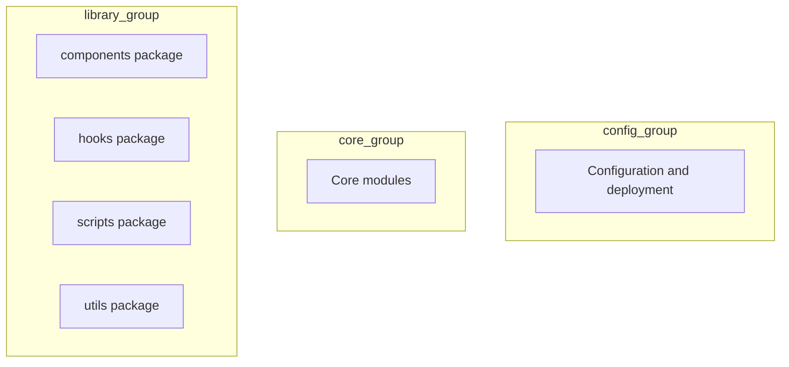

# Architecture report: tremorlabs/tremor

> Automated static analysis. **Observed** = directly seen in files/imports/AST; **Inferred** = interpretation from that evidence. Repository code was not executed.

## 1. Repository at a glance

| Item | Value |
| --- | --- |
| Repository | tremorlabs/tremor |
| Description | Copy & Paste React components to build modern web applications.  |
| Language | TypeScript |
| Stars | 3701 |
| Licence | Apache-2.0 |
| Analysed commit / branch | ca4d588f47820ff3d514d37fa4ee08a4222dec11 / main |
| Framework(s) | React |
| Files analysed | 196 |
| Components | 6 |

## 2. Architecture in one minute

tremorlabs/tremor - Copy & Paste React components to build modern web applications. . This repository was analysed statically from 196 file(s) (0 Python). Detected technologies (observed from imports/manifests): GitHub Actions, React, Tailwind CSS, TypeScript, Vite, Vitest. Files are grouped into 6 component(s): components package, Configuration and deployment, Core modules, hooks package, scripts package, utils package. Findings below distinguish observed facts from inferred interpretation.

## 3. High-level block diagram

## 4. Main components

### components package (`components`)

- **Kind:** library
- **Status:** Observed
- **Confidence:** 0.85
- **Responsibility:** Groups 120 file(s) under components package (observed from repository paths and static analysis).
- **Paths:** `src/components/Accordion/Accordion.tsx`, `src/components/Accordion/accordion.spec.ts`, `src/components/Accordion/accordion.stories.tsx`, `src/components/AreaChart/AreaChart.tsx`, `src/components/AreaChart/areachart.spec.ts`, `src/components/AreaChart/areachart.stories.tsx`, `src/components/Badge/Badge.tsx`, `src/components/Badge/badge.spec.ts`, `src/components/Badge/badge.stories.tsx`, `src/components/BarChart/BarChart.tsx`, `src/components/BarChart/barchart.spec.ts`, `src/components/BarChart/barchart.stories.tsx`, `src/components/BarList/BarList.tsx`, `src/components/BarList/barlist.spec.ts`, `src/components/BarList/barlist.stories.tsx`, `src/components/Button/Button.tsx`, `src/components/Button/button.spec.ts`, `src/components/Button/button.stories.tsx`, `src/components/Calendar/Calendar.tsx`, `src/components/Calendar/calendar.spec.ts`, `src/components/Calendar/calendar.stories.tsx`, `src/components/Callout/Callout.tsx`, `src/components/Callout/callout.spec.ts`, `src/components/Callout/callout.stories.tsx`, `src/components/Card/Card.tsx`, `src/components/Card/card.spec.ts`, `src/components/Card/card.stories.tsx`, `src/components/CategoryBar/CategoryBar.tsx`, `src/components/CategoryBar/categorybar.spec.ts`, `src/components/CategoryBar/categorybar.stories.tsx`, `src/components/Checkbox/Checkbox.tsx`, `src/components/Checkbox/checkbox.spec.ts`, `src/components/Checkbox/checkbox.stories.tsx`, `src/components/ComboChart/ComboChart.tsx`, `src/components/ComboChart/combochart.spec.ts`, `src/components/ComboChart/combochart.stories.tsx`, `src/components/DatePicker/DatePicker.tsx`, `src/components/DatePicker/datepicker.spec.ts`, `src/components/DatePicker/datepicker.stories.tsx`, `src/components/DatePicker/daterangepicker.stories.tsx`, `src/components/Dialog/Dialog.tsx`, `src/components/Dialog/dialog.spec.ts`, `src/components/Dialog/dialog.stories.tsx`, `src/components/Divider/Divider.tsx`, `src/components/Divider/divider.spec.ts`, `src/components/Divider/divider.stories.tsx`, `src/components/DonutChart/DonutChart.tsx`, `src/components/DonutChart/donutchart.spec.ts`, `src/components/DonutChart/donutchart.stories.tsx`, `src/components/Drawer/Drawer.tsx`, `src/components/Drawer/drawer.spec.ts`, `src/components/Drawer/drawer.stories.tsx`, `src/components/DropdownMenu/DropdownMenu.tsx`, `src/components/DropdownMenu/dropdownmenu.spec.ts`, `src/components/DropdownMenu/dropdownmenu.stories.tsx`, `src/components/Input/Input.tsx`, `src/components/Input/input.spec.ts`, `src/components/Input/input.stories.tsx`, `src/components/Label/Label.tsx`, `src/components/Label/label.spec.ts`, `src/components/Label/label.stories.tsx`, `src/components/LineChart/LineChart.tsx`, `src/components/LineChart/linechart.spec.ts`, `src/components/LineChart/linechart.stories.tsx`, `src/components/Popover/Popover.tsx`, `src/components/Popover/popover.spec.ts`, `src/components/Popover/popover.stories.tsx`, `src/components/ProgressBar/ProgressBar.tsx`, `src/components/ProgressBar/progressbar.spec.ts`, `src/components/ProgressBar/progressbar.stories.tsx`, `src/components/ProgressCircle/ProgressCircle.tsx`, `src/components/ProgressCircle/progresscircle.spec.ts`, `src/components/ProgressCircle/progresscircle.stories.tsx`, `src/components/RadioCardGroup/RadioCardGroup.tsx`, `src/components/RadioCardGroup/radiocardgroup.spec.ts`, `src/components/RadioCardGroup/radiocardgroup.stories.tsx`, `src/components/RadioGroup/RadioGroup.tsx`, `src/components/RadioGroup/radiogroup.spec.ts`, `src/components/RadioGroup/radiogroup.stories.tsx`, `src/components/Select/Select.tsx`, `src/components/Select/select.spec.ts`, `src/components/Select/select.stories.tsx`, `src/components/SelectNative/SelectNative.tsx`, `src/components/SelectNative/selectnative.spec.ts`, `src/components/SelectNative/selectnative.stories.tsx`, `src/components/Slider/Slider.tsx`, `src/components/Slider/slider.spec.ts`, `src/components/Slider/slider.stories.tsx`, `src/components/SparkChart/SparkChart.tsx`, `src/components/SparkChart/sparkareachart.stories.tsx`, `src/components/SparkChart/sparkbarchart.stories.tsx`, `src/components/SparkChart/sparkchart.spec.ts`, `src/components/SparkChart/sparklinechart.stories.tsx`, `src/components/Switch/Switch.tsx`, `src/components/Switch/switch.spec.ts`, `src/components/Switch/switch.stories.tsx`, `src/components/TabNavigation/TabNavigation.tsx`, `src/components/TabNavigation/tabnavigation.spec.tsx`, `src/components/TabNavigation/tabnavigation.stories.tsx`, `src/components/Table/Table.tsx`, `src/components/Table/table.spec.ts`, `src/components/Table/table.stories.tsx`, `src/components/Tabs/Tabs.tsx`, `src/components/Tabs/tabs.spec.tsx`, `src/components/Tabs/tabs.stories.tsx`, `src/components/Textarea/Textarea.tsx`, `src/components/Textarea/textarea.spec.ts`, `src/components/Textarea/textarea.stories.tsx`, `src/components/Toast/Toast.tsx`, `src/components/Toast/Toaster.tsx`, `src/components/Toast/toast.stories.tsx`, `src/components/Toggle/Toggle.tsx`, `src/components/Toggle/toggle.spec.ts`, `src/components/Toggle/toggle.stories.tsx`, `src/components/Tooltip/Tooltip.tsx`, `src/components/Tooltip/tooltip.spec.ts`, `src/components/Tooltip/tooltip.stories.tsx`, `src/components/Tracker/Tracker.tsx`, `src/components/Tracker/tracker.spec.ts`, `src/components/Tracker/tracker.stories.tsx`
- **Evidence:** [src/components/Accordion/Accordion.tsx](https://github.com/tremorlabs/tremor/blob/ca4d588f47820ff3d514d37fa4ee08a4222dec11/src/components/Accordion/Accordion.tsx); [src/components/Accordion/accordion.spec.ts](https://github.com/tremorlabs/tremor/blob/ca4d588f47820ff3d514d37fa4ee08a4222dec11/src/components/Accordion/accordion.spec.ts); [src/components/Accordion/accordion.stories.tsx](https://github.com/tremorlabs/tremor/blob/ca4d588f47820ff3d514d37fa4ee08a4222dec11/src/components/Accordion/accordion.stories.tsx); [src/components/AreaChart/AreaChart.tsx](https://github.com/tremorlabs/tremor/blob/ca4d588f47820ff3d514d37fa4ee08a4222dec11/src/components/AreaChart/AreaChart.tsx); [src/components/AreaChart/areachart.spec.ts](https://github.com/tremorlabs/tremor/blob/ca4d588f47820ff3d514d37fa4ee08a4222dec11/src/components/AreaChart/areachart.spec.ts); [src/components/AreaChart/areachart.stories.tsx](https://github.com/tremorlabs/tremor/blob/ca4d588f47820ff3d514d37fa4ee08a4222dec11/src/components/AreaChart/areachart.stories.tsx); [src/components/Badge/Badge.tsx](https://github.com/tremorlabs/tremor/blob/ca4d588f47820ff3d514d37fa4ee08a4222dec11/src/components/Badge/Badge.tsx); [src/components/Badge/badge.spec.ts](https://github.com/tremorlabs/tremor/blob/ca4d588f47820ff3d514d37fa4ee08a4222dec11/src/components/Badge/badge.spec.ts)

### Configuration and deployment (`config`)

- **Kind:** config
- **Status:** Observed
- **Confidence:** 0.85
- **Responsibility:** Groups 3 file(s) under configuration and deployment (observed from repository paths and static analysis).
- **Paths:** `package.json`, `tsconfig.json`, `tsconfig.node.json`
- **Evidence:** [package.json](https://github.com/tremorlabs/tremor/blob/ca4d588f47820ff3d514d37fa4ee08a4222dec11/package.json); [tsconfig.json](https://github.com/tremorlabs/tremor/blob/ca4d588f47820ff3d514d37fa4ee08a4222dec11/tsconfig.json); [tsconfig.node.json](https://github.com/tremorlabs/tremor/blob/ca4d588f47820ff3d514d37fa4ee08a4222dec11/tsconfig.node.json)

### Core modules (`core`)

- **Kind:** core
- **Status:** Observed
- **Confidence:** 0.85
- **Responsibility:** Groups 4 file(s) under core modules (observed from repository paths and static analysis).
- **Paths:** `playwright.config.ts`, `postcss.config.js`, `vite.config.ts`, `vitest.config.ts`
- **Evidence:** [playwright.config.ts](https://github.com/tremorlabs/tremor/blob/ca4d588f47820ff3d514d37fa4ee08a4222dec11/playwright.config.ts); [postcss.config.js](https://github.com/tremorlabs/tremor/blob/ca4d588f47820ff3d514d37fa4ee08a4222dec11/postcss.config.js); [vite.config.ts](https://github.com/tremorlabs/tremor/blob/ca4d588f47820ff3d514d37fa4ee08a4222dec11/vite.config.ts); [vitest.config.ts](https://github.com/tremorlabs/tremor/blob/ca4d588f47820ff3d514d37fa4ee08a4222dec11/vitest.config.ts)

### hooks package (`hooks`)

- **Kind:** library
- **Status:** Observed
- **Confidence:** 0.85
- **Responsibility:** Groups 2 file(s) under hooks package (observed from repository paths and static analysis).
- **Paths:** `src/hooks/useOnWindowResize.ts`, `src/hooks/useToast.ts`
- **Evidence:** [src/hooks/useOnWindowResize.ts](https://github.com/tremorlabs/tremor/blob/ca4d588f47820ff3d514d37fa4ee08a4222dec11/src/hooks/useOnWindowResize.ts); [src/hooks/useToast.ts](https://github.com/tremorlabs/tremor/blob/ca4d588f47820ff3d514d37fa4ee08a4222dec11/src/hooks/useToast.ts)

### scripts package (`scripts`)

- **Kind:** library
- **Status:** Observed
- **Confidence:** 0.85
- **Responsibility:** Groups 1 file(s) under scripts package (observed from repository paths and static analysis).
- **Paths:** `scripts/component-folder.js`
- **Evidence:** [scripts/component-folder.js](https://github.com/tremorlabs/tremor/blob/ca4d588f47820ff3d514d37fa4ee08a4222dec11/scripts/component-folder.js)

### utils package (`utils`)

- **Kind:** library
- **Status:** Observed
- **Confidence:** 0.85
- **Responsibility:** Groups 8 file(s) under utils package (observed from repository paths and static analysis).
- **Paths:** `src/utils/chartColors.ts`, `src/utils/cx.ts`, `src/utils/focusInput.ts`, `src/utils/focusRing.ts`, `src/utils/getYAxisDomain.ts`, `src/utils/hasErrorInput.ts`, `src/utils/hasOnlyOneValueForKey.ts`, `src/utils/utils.spec.ts`
- **Evidence:** [src/utils/chartColors.ts](https://github.com/tremorlabs/tremor/blob/ca4d588f47820ff3d514d37fa4ee08a4222dec11/src/utils/chartColors.ts); [src/utils/cx.ts](https://github.com/tremorlabs/tremor/blob/ca4d588f47820ff3d514d37fa4ee08a4222dec11/src/utils/cx.ts); [src/utils/focusInput.ts](https://github.com/tremorlabs/tremor/blob/ca4d588f47820ff3d514d37fa4ee08a4222dec11/src/utils/focusInput.ts); [src/utils/focusRing.ts](https://github.com/tremorlabs/tremor/blob/ca4d588f47820ff3d514d37fa4ee08a4222dec11/src/utils/focusRing.ts); [src/utils/getYAxisDomain.ts](https://github.com/tremorlabs/tremor/blob/ca4d588f47820ff3d514d37fa4ee08a4222dec11/src/utils/getYAxisDomain.ts); [src/utils/hasErrorInput.ts](https://github.com/tremorlabs/tremor/blob/ca4d588f47820ff3d514d37fa4ee08a4222dec11/src/utils/hasErrorInput.ts); [src/utils/hasOnlyOneValueForKey.ts](https://github.com/tremorlabs/tremor/blob/ca4d588f47820ff3d514d37fa4ee08a4222dec11/src/utils/hasOnlyOneValueForKey.ts); [src/utils/utils.spec.ts](https://github.com/tremorlabs/tremor/blob/ca4d588f47820ff3d514d37fa4ee08a4222dec11/src/utils/utils.spec.ts)

## 5. Execution flow

**Observed** entry point(s):

- [.storybook/main.ts](https://github.com/tremorlabs/tremor/blob/ca4d588f47820ff3d514d37fa4ee08a4222dec11/.storybook/main.ts)

Representative flow (derived from observed entry points and the import graph; steps beyond the entry point are **Inferred**):

1. Execution starts at an observed entry point listed above, if present.
2. No internal import relationships between components were observed.

## 6. Project structure

### `(root)`

- `.eslintrc.cjs` - source, JavaScript (368 bytes)
- `.gitignore` - other (834 bytes)
- `.prettierignore` - other (24 bytes)
- `.prettierrc` - other (944 bytes)
- `LICENSE` - docs (12378 bytes)
- `README.md` - docs (2224 bytes)
- `package.json` - manifest (2823 bytes)
- `playwright.config.ts` - source, TypeScript (2146 bytes)
- `postcss.config.js` - source, JavaScript (69 bytes)
- `tsconfig.json` - config (715 bytes)
- `tsconfig.node.json` - config (233 bytes)
- `vite.config.ts` - source, TypeScript (163 bytes)
- `vitest.config.ts` - source, TypeScript (214 bytes)

### `.github`

- `.github/ISSUE_TEMPLATE/bug-report.yml` - config (2596 bytes)
- `.github/ISSUE_TEMPLATE/config.yml` - config (224 bytes)
- `.github/ISSUE_TEMPLATE/feature-request.yml` - config (1549 bytes)
- `.github/pull_request_template.md` - docs (2076 bytes)
- `.github/workflows/playwright.yml` - ci, YAML (699 bytes)

### `.storybook`

- `.storybook/main.ts` - source, TypeScript (478 bytes)
- `.storybook/manager.ts` - source, TypeScript (125 bytes)
- `.storybook/preview.ts` - source, TypeScript (651 bytes)

### `public`

- `public/images/tremor-logo-dark.svg` - other (2294 bytes)
- `public/images/tremor-logo-light.svg` - other (2297 bytes)

### `scripts`

- `scripts/component-folder.js` - source, JavaScript (2637 bytes)

### `src`

- `src/components/Accordion/Accordion.tsx` - source, TypeScript (3077 bytes)
- `src/components/Accordion/accordion.spec.ts` - source, TypeScript (2704 bytes)
- `src/components/Accordion/accordion.stories.tsx` - source, TypeScript (17838 bytes)
- `src/components/Accordion/changelog.md` - docs (137 bytes)
- `src/components/AreaChart/AreaChart.tsx` - source, TypeScript (30323 bytes)
- `src/components/AreaChart/areachart.spec.ts` - source, TypeScript (1765 bytes)
- `src/components/AreaChart/areachart.stories.tsx` - source, TypeScript (7820 bytes)
- `src/components/AreaChart/changelog.md` - docs (525 bytes)
- `src/components/Badge/Badge.tsx` - source, TypeScript (1688 bytes)
- `src/components/Badge/badge.spec.ts` - source, TypeScript (1965 bytes)
- `src/components/Badge/badge.stories.tsx` - source, TypeScript (1817 bytes)
- `src/components/Badge/changelog.md` - docs (133 bytes)
- `src/components/BarChart/BarChart.tsx` - source, TypeScript (25933 bytes)
- `src/components/BarChart/barchart.spec.ts` - source, TypeScript (1741 bytes)
- `src/components/BarChart/barchart.stories.tsx` - source, TypeScript (7314 bytes)
- `src/components/BarChart/changelog.md` - docs (475 bytes)
- `src/components/BarList/BarList.tsx` - source, TypeScript (4973 bytes)
- `src/components/BarList/barlist.spec.ts` - source, TypeScript (8434 bytes)
- `src/components/BarList/barlist.stories.tsx` - source, TypeScript (2953 bytes)
- `src/components/BarList/changelog.md` - docs (291 bytes)
- `src/components/Button/Button.tsx` - source, TypeScript (4061 bytes)
- `src/components/Button/button.spec.ts` - source, TypeScript (2327 bytes)
- `src/components/Button/button.stories.tsx` - source, TypeScript (1716 bytes)
- `src/components/Button/changelog.md` - docs (296 bytes)
- `src/components/Calendar/Calendar.tsx` - source, TypeScript (10119 bytes)
- `src/components/Calendar/calendar.spec.ts` - source, TypeScript (3757 bytes)
- `src/components/Calendar/calendar.stories.tsx` - source, TypeScript (3450 bytes)
- `src/components/Calendar/changelog.md` - docs (443 bytes)
- `src/components/Callout/Callout.tsx` - source, TypeScript (2262 bytes)
- `src/components/Callout/callout.spec.ts` - source, TypeScript (3658 bytes)
- `src/components/Callout/callout.stories.tsx` - source, TypeScript (1549 bytes)
- `src/components/Callout/changelog.md` - docs (76 bytes)
- `src/components/Card/Card.tsx` - source, TypeScript (862 bytes)
- `src/components/Card/card.spec.ts` - source, TypeScript (1308 bytes)
- `src/components/Card/card.stories.tsx` - source, TypeScript (7291 bytes)
- `src/components/Card/changelog.md` - docs (173 bytes)
- `src/components/CategoryBar/CategoryBar.tsx` - source, TypeScript (6474 bytes)
- `src/components/CategoryBar/categorybar.spec.ts` - source, TypeScript (2474 bytes)
- `src/components/CategoryBar/categorybar.stories.tsx` - source, TypeScript (2009 bytes)
- `src/components/CategoryBar/changelog.md` - docs (203 bytes)
- `src/components/Checkbox/Checkbox.tsx` - source, TypeScript (2844 bytes)
- `src/components/Checkbox/changelog.md` - docs (234 bytes)
- `src/components/Checkbox/checkbox.spec.ts` - source, TypeScript (2322 bytes)
- `src/components/Checkbox/checkbox.stories.tsx` - source, TypeScript (1871 bytes)
- `src/components/ComboChart/ComboChart.tsx` - source, TypeScript (36000 bytes)
- `src/components/ComboChart/changelog.md` - docs (112 bytes)
- `src/components/ComboChart/combochart.spec.ts` - source, TypeScript (6707 bytes)
- `src/components/ComboChart/combochart.stories.tsx` - source, TypeScript (12858 bytes)
- `src/components/DatePicker/DatePicker.tsx` - source, TypeScript (33843 bytes)
- `src/components/DatePicker/changelog.md` - docs (561 bytes)
- `src/components/DatePicker/datepicker.spec.ts` - source, TypeScript (10058 bytes)
- `src/components/DatePicker/datepicker.stories.tsx` - source, TypeScript (5445 bytes)
- `src/components/DatePicker/daterangepicker.stories.tsx` - source, TypeScript (5565 bytes)
- `src/components/Dialog/Dialog.tsx` - source, TypeScript (3772 bytes)
- `src/components/Dialog/changelog.md` - docs (134 bytes)
- `src/components/Dialog/dialog.spec.ts` - source, TypeScript (3080 bytes)
- `src/components/Dialog/dialog.stories.tsx` - source, TypeScript (2889 bytes)
- `src/components/Divider/Divider.tsx` - source, TypeScript (1374 bytes)
- `src/components/Divider/changelog.md` - docs (196 bytes)
- `src/components/Divider/divider.spec.ts` - source, TypeScript (1405 bytes)
- `src/components/Divider/divider.stories.tsx` - source, TypeScript (1644 bytes)
- `src/components/DonutChart/DonutChart.tsx` - source, TypeScript (9476 bytes)
- `src/components/DonutChart/changelog.md` - docs (138 bytes)
- `src/components/DonutChart/donutchart.spec.ts` - source, TypeScript (2227 bytes)
- `src/components/DonutChart/donutchart.stories.tsx` - source, TypeScript (3710 bytes)
- `src/components/Drawer/Drawer.tsx` - source, TypeScript (5473 bytes)
- `src/components/Drawer/changelog.md` - docs (183 bytes)
- `src/components/Drawer/drawer.spec.ts` - source, TypeScript (2760 bytes)
- `src/components/Drawer/drawer.stories.tsx` - source, TypeScript (3133 bytes)
- `src/components/DropdownMenu/DropdownMenu.tsx` - source, TypeScript (12315 bytes)
- `src/components/DropdownMenu/changelog.md` - docs (196 bytes)
- `src/components/DropdownMenu/dropdownmenu.spec.ts` - source, TypeScript (4820 bytes)
- `src/components/DropdownMenu/dropdownmenu.stories.tsx` - source, TypeScript (13462 bytes)
- `src/components/Input/Input.tsx` - source, TypeScript (4952 bytes)
- `src/components/Input/changelog.md` - docs (640 bytes)
- `src/components/Input/input.spec.ts` - source, TypeScript (2716 bytes)
- `src/components/Input/input.stories.tsx` - source, TypeScript (3378 bytes)
- `src/components/Label/Label.tsx` - source, TypeScript (825 bytes)
- `src/components/Label/changelog.md` - docs (122 bytes)
- `src/components/Label/label.spec.ts` - source, TypeScript (697 bytes)
- `src/components/Label/label.stories.tsx` - source, TypeScript (1036 bytes)
- `src/components/LineChart/LineChart.tsx` - source, TypeScript (27329 bytes)
- `src/components/LineChart/changelog.md` - docs (470 bytes)
- `src/components/LineChart/linechart.spec.ts` - source, TypeScript (1765 bytes)
- `src/components/LineChart/linechart.stories.tsx` - source, TypeScript (7806 bytes)
- `src/components/Popover/Popover.tsx` - source, TypeScript (3540 bytes)
- `src/components/Popover/changelog.md` - docs (173 bytes)
- `src/components/Popover/popover.spec.ts` - source, TypeScript (1237 bytes)
- `src/components/Popover/popover.stories.tsx` - source, TypeScript (5803 bytes)
- `src/components/ProgressBar/ProgressBar.tsx` - source, TypeScript (2811 bytes)
- `src/components/ProgressBar/changelog.md` - docs (186 bytes)
- `src/components/ProgressBar/progressbar.spec.ts` - source, TypeScript (3016 bytes)
- `src/components/ProgressBar/progressbar.stories.tsx` - source, TypeScript (2578 bytes)
- `src/components/ProgressCircle/ProgressCircle.tsx` - source, TypeScript (3743 bytes)
- `src/components/ProgressCircle/changelog.md` - docs (189 bytes)
- `src/components/ProgressCircle/progresscircle.spec.ts` - source, TypeScript (1274 bytes)
- `src/components/ProgressCircle/progresscircle.stories.tsx` - source, TypeScript (3445 bytes)
- `src/components/RadioCardGroup/RadioCardGroup.tsx` - source, TypeScript (3331 bytes)
- `src/components/RadioCardGroup/changelog.md` - docs (240 bytes)
- `src/components/RadioCardGroup/radiocardgroup.spec.ts` - source, TypeScript (2422 bytes)
- `src/components/RadioCardGroup/radiocardgroup.stories.tsx` - source, TypeScript (6022 bytes)
- `src/components/RadioGroup/RadioGroup.tsx` - source, TypeScript (2773 bytes)
- `src/components/RadioGroup/changelog.md` - docs (191 bytes)
- `src/components/RadioGroup/radiogroup.spec.ts` - source, TypeScript (4321 bytes)
- `src/components/RadioGroup/radiogroup.stories.tsx` - source, TypeScript (7824 bytes)
- `src/components/Select/Select.tsx` - source, TypeScript (8194 bytes)
- `src/components/Select/changelog.md` - docs (259 bytes)
- `src/components/Select/select.spec.ts` - source, TypeScript (3312 bytes)
- `src/components/Select/select.stories.tsx` - source, TypeScript (12522 bytes)
- `src/components/SelectNative/SelectNative.tsx` - source, TypeScript (1876 bytes)
- `src/components/SelectNative/changelog.md` - docs (140 bytes)
- `src/components/SelectNative/selectnative.spec.ts` - source, TypeScript (682 bytes)
- `src/components/SelectNative/selectnative.stories.tsx` - source, TypeScript (2162 bytes)
- `src/components/Slider/Slider.tsx` - source, TypeScript (2660 bytes)
- `src/components/Slider/changelog.md` - docs (184 bytes)
- `src/components/Slider/slider.spec.ts` - source, TypeScript (2932 bytes)
- `src/components/Slider/slider.stories.tsx` - source, TypeScript (2154 bytes)
- `src/components/SparkChart/SparkChart.tsx` - source, TypeScript (9201 bytes)
- `src/components/SparkChart/changelog.md` - docs (246 bytes)
- `src/components/SparkChart/sparkareachart.stories.tsx` - source, TypeScript (4370 bytes)
- `src/components/SparkChart/sparkbarchart.stories.tsx` - source, TypeScript (4188 bytes)
- `src/components/SparkChart/sparkchart.spec.ts` - source, TypeScript (2802 bytes)
- `src/components/SparkChart/sparklinechart.stories.tsx` - source, TypeScript (3824 bytes)
- `src/components/Switch/Switch.tsx` - source, TypeScript (2919 bytes)
- `src/components/Switch/changelog.md` - docs (134 bytes)
- `src/components/Switch/switch.spec.ts` - source, TypeScript (1951 bytes)
- `src/components/Switch/switch.stories.tsx` - source, TypeScript (2644 bytes)
- `src/components/TabNavigation/TabNavigation.tsx` - source, TypeScript (3467 bytes)
- `src/components/TabNavigation/changelog.md` - docs (253 bytes)
- `src/components/TabNavigation/tabnavigation.spec.tsx` - source, TypeScript (1308 bytes)
- `src/components/TabNavigation/tabnavigation.stories.tsx` - source, TypeScript (1649 bytes)
- `src/components/Table/Table.tsx` - source, TypeScript (4023 bytes)
- `src/components/Table/changelog.md` - docs (263 bytes)
- `src/components/Table/table.spec.ts` - source, TypeScript (2661 bytes)
- `src/components/Table/table.stories.tsx` - source, TypeScript (5988 bytes)
- `src/components/Tabs/Tabs.tsx` - source, TypeScript (4009 bytes)
- `src/components/Tabs/changelog.md` - docs (182 bytes)
- `src/components/Tabs/tabs.spec.tsx` - source, TypeScript (4880 bytes)
- `src/components/Tabs/tabs.stories.tsx` - source, TypeScript (9451 bytes)
- `src/components/Textarea/Textarea.tsx` - source, TypeScript (1676 bytes)
- `src/components/Textarea/changelog.md` - docs (185 bytes)
- `src/components/Textarea/textarea.spec.ts` - source, TypeScript (1240 bytes)
- `src/components/Textarea/textarea.stories.tsx` - source, TypeScript (1030 bytes)
- `src/components/Toast/Toast.tsx` - source, TypeScript (6176 bytes)
- `src/components/Toast/Toaster.tsx` - source, TypeScript (436 bytes)
- `src/components/Toast/changelog.md` - docs (300 bytes)
- `src/components/Toast/toast.stories.tsx` - source, TypeScript (2952 bytes)
- `src/components/Toggle/Toggle.tsx` - source, TypeScript (2240 bytes)
- `src/components/Toggle/changelog.md` - docs (127 bytes)
- `src/components/Toggle/toggle.spec.ts` - source, TypeScript (367 bytes)
- `src/components/Toggle/toggle.stories.tsx` - source, TypeScript (1400 bytes)
- `src/components/Tooltip/Tooltip.tsx` - source, TypeScript (2770 bytes)
- `src/components/Tooltip/changelog.md` - docs (340 bytes)
- `src/components/Tooltip/tooltip.spec.ts` - source, TypeScript (931 bytes)
- `src/components/Tooltip/tooltip.stories.tsx` - source, TypeScript (3004 bytes)
- `src/components/Tracker/Tracker.tsx` - source, TypeScript (2607 bytes)
- `src/components/Tracker/changelog.md` - docs (481 bytes)
- `src/components/Tracker/tracker.spec.ts` - source, TypeScript (1658 bytes)
- `src/components/Tracker/tracker.stories.tsx` - source, TypeScript (7385 bytes)
- `src/globals.css` - other (2798 bytes)
- `src/hooks/changelog.md` - docs (258 bytes)
- `src/hooks/useOnWindowResize.ts` - source, TypeScript (369 bytes)
- `src/hooks/useToast.ts` - source, TypeScript (4113 bytes)
- `src/utils/changelog.md` - docs (448 bytes)
- `src/utils/chartColors.ts` - source, TypeScript (2219 bytes)
- `src/utils/cx.ts` - source, TypeScript (188 bytes)
- `src/utils/focusInput.ts` - source, TypeScript (230 bytes)
- `src/utils/focusRing.ts` - source, TypeScript (196 bytes)
- `src/utils/getYAxisDomain.ts` - source, TypeScript (296 bytes)
- `src/utils/hasErrorInput.ts` - source, TypeScript (202 bytes)
- `src/utils/hasOnlyOneValueForKey.ts` - source, TypeScript (423 bytes)
- `src/utils/utils.spec.ts` - source, TypeScript (4718 bytes)

## 7. Key dependencies and integrations

| Name | Category | Status | Confidence | Evidence |
| --- | --- | --- | --- | --- |
| GitHub Actions | ci | Observed | 0.85 | [.github/workflows/playwright.yml](https://github.com/tremorlabs/tremor/blob/ca4d588f47820ff3d514d37fa4ee08a4222dec11/.github/workflows/playwright.yml) |
| React | framework | Observed | 0.90 | [package.json:19](https://github.com/tremorlabs/tremor/blob/ca4d588f47820ff3d514d37fa4ee08a4222dec11/package.json#L19); [package.json:48](https://github.com/tremorlabs/tremor/blob/ca4d588f47820ff3d514d37fa4ee08a4222dec11/package.json#L48) |
| Tailwind CSS | library | Observed | 0.85 | [package.json:45](https://github.com/tremorlabs/tremor/blob/ca4d588f47820ff3d514d37fa4ee08a4222dec11/package.json#L45) |
| TypeScript | tooling | Observed | 0.85 | [package.json:65](https://github.com/tremorlabs/tremor/blob/ca4d588f47820ff3d514d37fa4ee08a4222dec11/package.json#L65) |
| Vite | tooling | Observed | 0.85 | [package.json:7](https://github.com/tremorlabs/tremor/blob/ca4d588f47820ff3d514d37fa4ee08a4222dec11/package.json#L7) |
| Vitest | tooling | Observed | 0.85 | [package.json:14](https://github.com/tremorlabs/tremor/blob/ca4d588f47820ff3d514d37fa4ee08a4222dec11/package.json#L14) |

## 8. Data and state

No database, cache, queue, or persistent-state usage was observed in the analysed files. State handling, if any, may be in-memory or in files that were not analysed.

## 9. Configuration and deployment clues

- `.github/ISSUE_TEMPLATE/bug-report.yml` (config)
- `.github/ISSUE_TEMPLATE/config.yml` (config)
- `.github/ISSUE_TEMPLATE/feature-request.yml` (config)
- `.github/workflows/playwright.yml` (ci)
- `package.json` (manifest)
- `tsconfig.json` (config)
- `tsconfig.node.json` (config)

## 10. Design observations

- No strong design patterns could be established from the available evidence.

These observations are interpretations (**Inferred**) of the observed structure, not guarantees about runtime design.

## 11. Limitations and unknowns

- Static analysis only: repository code was not executed, installed, or imported at runtime.
- Components and relationships are inferred from file paths, imports, and AST structure; runtime behaviour, dynamic imports, and reflection may not be visible.
- No clear application entry point was observed in the analysed files.
- Repository text was treated as untrusted data; no instructions found in repository files were followed, and likely secret values were redacted/excluded.
- JavaScript and TypeScript files were inventoried from paths and package manifests. They were not parsed with a full language AST, and repository code was not executed.

## 12. Source references

- [.github/workflows/playwright.yml](https://github.com/tremorlabs/tremor/blob/ca4d588f47820ff3d514d37fa4ee08a4222dec11/.github/workflows/playwright.yml)
- [.storybook/main.ts](https://github.com/tremorlabs/tremor/blob/ca4d588f47820ff3d514d37fa4ee08a4222dec11/.storybook/main.ts)
- [package.json](https://github.com/tremorlabs/tremor/blob/ca4d588f47820ff3d514d37fa4ee08a4222dec11/package.json)
- [package.json:7](https://github.com/tremorlabs/tremor/blob/ca4d588f47820ff3d514d37fa4ee08a4222dec11/package.json#L7)
- [package.json:14](https://github.com/tremorlabs/tremor/blob/ca4d588f47820ff3d514d37fa4ee08a4222dec11/package.json#L14)
- [package.json:19](https://github.com/tremorlabs/tremor/blob/ca4d588f47820ff3d514d37fa4ee08a4222dec11/package.json#L19)
- [package.json:45](https://github.com/tremorlabs/tremor/blob/ca4d588f47820ff3d514d37fa4ee08a4222dec11/package.json#L45)
- [package.json:48](https://github.com/tremorlabs/tremor/blob/ca4d588f47820ff3d514d37fa4ee08a4222dec11/package.json#L48)
- [package.json:65](https://github.com/tremorlabs/tremor/blob/ca4d588f47820ff3d514d37fa4ee08a4222dec11/package.json#L65)
- [playwright.config.ts](https://github.com/tremorlabs/tremor/blob/ca4d588f47820ff3d514d37fa4ee08a4222dec11/playwright.config.ts)
- [postcss.config.js](https://github.com/tremorlabs/tremor/blob/ca4d588f47820ff3d514d37fa4ee08a4222dec11/postcss.config.js)
- [scripts/component-folder.js](https://github.com/tremorlabs/tremor/blob/ca4d588f47820ff3d514d37fa4ee08a4222dec11/scripts/component-folder.js)
- [src/components/Accordion/Accordion.tsx](https://github.com/tremorlabs/tremor/blob/ca4d588f47820ff3d514d37fa4ee08a4222dec11/src/components/Accordion/Accordion.tsx)
- [src/components/Accordion/accordion.spec.ts](https://github.com/tremorlabs/tremor/blob/ca4d588f47820ff3d514d37fa4ee08a4222dec11/src/components/Accordion/accordion.spec.ts)
- [src/components/Accordion/accordion.stories.tsx](https://github.com/tremorlabs/tremor/blob/ca4d588f47820ff3d514d37fa4ee08a4222dec11/src/components/Accordion/accordion.stories.tsx)
- [src/components/AreaChart/AreaChart.tsx](https://github.com/tremorlabs/tremor/blob/ca4d588f47820ff3d514d37fa4ee08a4222dec11/src/components/AreaChart/AreaChart.tsx)
- [src/components/AreaChart/areachart.spec.ts](https://github.com/tremorlabs/tremor/blob/ca4d588f47820ff3d514d37fa4ee08a4222dec11/src/components/AreaChart/areachart.spec.ts)
- [src/components/AreaChart/areachart.stories.tsx](https://github.com/tremorlabs/tremor/blob/ca4d588f47820ff3d514d37fa4ee08a4222dec11/src/components/AreaChart/areachart.stories.tsx)
- [src/components/Badge/Badge.tsx](https://github.com/tremorlabs/tremor/blob/ca4d588f47820ff3d514d37fa4ee08a4222dec11/src/components/Badge/Badge.tsx)
- [src/components/Badge/badge.spec.ts](https://github.com/tremorlabs/tremor/blob/ca4d588f47820ff3d514d37fa4ee08a4222dec11/src/components/Badge/badge.spec.ts)
- [src/hooks/useOnWindowResize.ts](https://github.com/tremorlabs/tremor/blob/ca4d588f47820ff3d514d37fa4ee08a4222dec11/src/hooks/useOnWindowResize.ts)
- [src/hooks/useToast.ts](https://github.com/tremorlabs/tremor/blob/ca4d588f47820ff3d514d37fa4ee08a4222dec11/src/hooks/useToast.ts)
- [src/utils/chartColors.ts](https://github.com/tremorlabs/tremor/blob/ca4d588f47820ff3d514d37fa4ee08a4222dec11/src/utils/chartColors.ts)
- [src/utils/cx.ts](https://github.com/tremorlabs/tremor/blob/ca4d588f47820ff3d514d37fa4ee08a4222dec11/src/utils/cx.ts)
- [src/utils/focusInput.ts](https://github.com/tremorlabs/tremor/blob/ca4d588f47820ff3d514d37fa4ee08a4222dec11/src/utils/focusInput.ts)
- [src/utils/focusRing.ts](https://github.com/tremorlabs/tremor/blob/ca4d588f47820ff3d514d37fa4ee08a4222dec11/src/utils/focusRing.ts)
- [src/utils/getYAxisDomain.ts](https://github.com/tremorlabs/tremor/blob/ca4d588f47820ff3d514d37fa4ee08a4222dec11/src/utils/getYAxisDomain.ts)
- [src/utils/hasErrorInput.ts](https://github.com/tremorlabs/tremor/blob/ca4d588f47820ff3d514d37fa4ee08a4222dec11/src/utils/hasErrorInput.ts)
- [src/utils/hasOnlyOneValueForKey.ts](https://github.com/tremorlabs/tremor/blob/ca4d588f47820ff3d514d37fa4ee08a4222dec11/src/utils/hasOnlyOneValueForKey.ts)
- [src/utils/utils.spec.ts](https://github.com/tremorlabs/tremor/blob/ca4d588f47820ff3d514d37fa4ee08a4222dec11/src/utils/utils.spec.ts)
- [tsconfig.json](https://github.com/tremorlabs/tremor/blob/ca4d588f47820ff3d514d37fa4ee08a4222dec11/tsconfig.json)
- [tsconfig.node.json](https://github.com/tremorlabs/tremor/blob/ca4d588f47820ff3d514d37fa4ee08a4222dec11/tsconfig.node.json)
- [vite.config.ts](https://github.com/tremorlabs/tremor/blob/ca4d588f47820ff3d514d37fa4ee08a4222dec11/vite.config.ts)
- [vitest.config.ts](https://github.com/tremorlabs/tremor/blob/ca4d588f47820ff3d514d37fa4ee08a4222dec11/vitest.config.ts)
