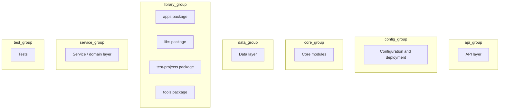

# Architecture report: ts-rest/ts-rest

> Automated static analysis. **Observed** = directly seen in files/imports/AST; **Inferred** = interpretation from that evidence. Repository code was not executed.

## 1. Repository at a glance

| Item | Value |
| --- | --- |
| Repository | ts-rest/ts-rest |
| Description | 🌄 - RPC-like client, contract, and server implementation for a pure REST API |
| Language | TypeScript |
| Stars | 3340 |
| Licence | MIT |
| Analysed commit / branch | 3d572e3336bd998b0c33a9d65b12292b158d0aec / main |
| Framework(s) | Express, Fastify, NestJS, Next.js, React, Vue |
| Files analysed | 683 |
| Components | 10 |

## 2. Architecture in one minute

ts-rest/ts-rest - 🌄 - RPC-like client, contract, and server implementation for a pure REST API. This repository was analysed statically from 683 file(s) (0 Python). Detected technologies (observed from imports/manifests): PostgreSQL, Express, Fastify, NestJS, Next.js, React. Files are grouped into 10 component(s): API layer, apps package, Configuration and deployment, Core modules, Data layer, libs package, Service / domain layer, test-projects package. Findings below distinguish observed facts from inferred interpretation.

## 3. High-level block diagram

## 4. Main components

### API layer (`api_layer`)

- **Kind:** api
- **Status:** Observed
- **Confidence:** 0.85
- **Responsibility:** Groups 11 file(s) under api layer (observed from repository paths and static analysis).
- **Paths:** `apps/example-microservice/web-app-vue/src/api/client.ts`, `apps/example-next/app/api/app-router/[...ts-rest]/route.ts`, `apps/example-next/pages/api/[...ts-rest].tsx`, `apps/example-next/pages/api/edge/[...ts-rest].ts`, `libs/ts-rest/serverless/src/lib/handlers/ts-rest-azure-function.spec.ts`, `libs/ts-rest/serverless/src/lib/handlers/ts-rest-azure-function.ts`, `libs/ts-rest/serverless/src/lib/handlers/ts-rest-fetch.spec.ts`, `libs/ts-rest/serverless/src/lib/handlers/ts-rest-fetch.ts`, `libs/ts-rest/serverless/src/lib/handlers/ts-rest-lambda.spec.ts`, `libs/ts-rest/serverless/src/lib/handlers/ts-rest-lambda.ts`, `libs/ts-rest/serverless/src/lib/handlers/ts-rest-next.ts`
- **Evidence:** [apps/example-microservice/web-app-vue/src/api/client.ts](https://github.com/ts-rest/ts-rest/blob/3d572e3336bd998b0c33a9d65b12292b158d0aec/apps/example-microservice/web-app-vue/src/api/client.ts); [apps/example-next/app/api/app-router/[...ts-rest]/route.ts](https://github.com/ts-rest/ts-rest/blob/3d572e3336bd998b0c33a9d65b12292b158d0aec/apps/example-next/app/api/app-router/%5B...ts-rest%5D/route.ts); [apps/example-next/pages/api/[...ts-rest].tsx](https://github.com/ts-rest/ts-rest/blob/3d572e3336bd998b0c33a9d65b12292b158d0aec/apps/example-next/pages/api/%5B...ts-rest%5D.tsx); [apps/example-next/pages/api/edge/[...ts-rest].ts](https://github.com/ts-rest/ts-rest/blob/3d572e3336bd998b0c33a9d65b12292b158d0aec/apps/example-next/pages/api/edge/%5B...ts-rest%5D.ts); [libs/ts-rest/serverless/src/lib/handlers/ts-rest-azure-function.spec.ts](https://github.com/ts-rest/ts-rest/blob/3d572e3336bd998b0c33a9d65b12292b158d0aec/libs/ts-rest/serverless/src/lib/handlers/ts-rest-azure-function.spec.ts); [libs/ts-rest/serverless/src/lib/handlers/ts-rest-azure-function.ts](https://github.com/ts-rest/ts-rest/blob/3d572e3336bd998b0c33a9d65b12292b158d0aec/libs/ts-rest/serverless/src/lib/handlers/ts-rest-azure-function.ts); [libs/ts-rest/serverless/src/lib/handlers/ts-rest-fetch.spec.ts](https://github.com/ts-rest/ts-rest/blob/3d572e3336bd998b0c33a9d65b12292b158d0aec/libs/ts-rest/serverless/src/lib/handlers/ts-rest-fetch.spec.ts); [libs/ts-rest/serverless/src/lib/handlers/ts-rest-fetch.ts](https://github.com/ts-rest/ts-rest/blob/3d572e3336bd998b0c33a9d65b12292b158d0aec/libs/ts-rest/serverless/src/lib/handlers/ts-rest-fetch.ts)

### apps package (`apps`)

- **Kind:** library
- **Status:** Observed
- **Confidence:** 0.85
- **Responsibility:** Groups 85 file(s) under apps package (observed from repository paths and static analysis).
- **Paths:** `apps/example-azure-function/jest.config.ts`, `apps/example-azure-function/src/functions/index.spec.ts`, `apps/example-azure-function/src/functions/index.ts`, `apps/example-cloudflare-worker/jest.config.ts`, `apps/example-cloudflare-worker/src/index.spec.ts`, `apps/example-cloudflare-worker/src/index.ts`, `apps/example-express/jest.config.ts`, `apps/example-express/src/authenticated-app.ts`, `apps/example-express/src/fixtures.ts`, `apps/example-express/src/get-post.ts`, `apps/example-express/src/main.ts`, `apps/example-express/src/ts-router.ts`, `apps/example-fastify/jest.config.ts`, `apps/example-fastify/src/get-post.ts`, `apps/example-fastify/src/main.ts`, `apps/example-microservice/posts-service/jest.config.ts`, `apps/example-microservice/posts-service/src/app/userAdapter.ts`, `apps/example-microservice/posts-service/src/environments/environment.prod.ts`, `apps/example-microservice/posts-service/src/environments/environment.ts`, `apps/example-microservice/posts-service/src/main.ts`, `apps/example-microservice/users-service/jest.config.ts`, `apps/example-microservice/users-service/src/app/app.controller.ts`, `apps/example-microservice/users-service/src/app/app.module.ts`, `apps/example-microservice/users-service/src/app/app.service.ts`, `apps/example-microservice/users-service/src/environments/environment.prod.ts`, `apps/example-microservice/users-service/src/environments/environment.ts`, `apps/example-microservice/users-service/src/main.ts`, `apps/example-microservice/web-app-solid/src/App.tsx`, `apps/example-microservice/web-app-solid/src/index.tsx`, `apps/example-microservice/web-app-solid/vite.config.ts`, `apps/example-microservice/web-app-vue/src/App.vue`, `apps/example-microservice/web-app-vue/src/Post.vue`, `apps/example-microservice/web-app-vue/src/hooks/use-create-post.ts`, `apps/example-microservice/web-app-vue/src/hooks/use-infinite-posts.ts`, `apps/example-microservice/web-app-vue/src/index.ts`, `apps/example-microservice/web-app-vue/vite.config.ts`, `apps/example-microservice/web-app/src/App.spec.tsx`, `apps/example-microservice/web-app/src/App.tsx`, `apps/example-microservice/web-app/src/main.tsx`, `apps/example-microservice/web-app/vite.config.ts`, `apps/example-nest/jest.config.ts`, `apps/example-nest/src/app/app.module.ts`, `apps/example-nest/src/app/post-json-query.controller.ts`, `apps/example-nest/src/app/post-json-query.spec.ts`, `apps/example-nest/src/app/post-validate-responses.controller.ts`, `apps/example-nest/src/app/post-validate-responses.spec.ts`, `apps/example-nest/src/app/post.controller.spec.ts`, `apps/example-nest/src/app/post.controller.ts`, `apps/example-nest/src/app/post.controller.withResponseShapes.ts`, `apps/example-nest/src/app/post.service.ts`, `apps/example-nest/src/app/prisma.service.ts`, `apps/example-nest/src/environments/environment.prod.ts`, `apps/example-nest/src/environments/environment.ts`, `apps/example-nest/src/main.ts`, `apps/example-next/app/(react-query)/layout.tsx`, `apps/example-next/app/(react-query-streaming)/layout.tsx`, `apps/example-next/app/(react-query-streaming)/test-streaming/client-component-suspense.tsx`, `apps/example-next/app/(react-query-streaming)/test-streaming/page.tsx`, `apps/example-next/app/layout.tsx`, `apps/example-next/app/react-query-utils/get-query-client.ts`, `apps/example-next/app/react-query-utils/react-query-provider.tsx`, `apps/example-next/app/react-query-utils/react-query-streaming-provider.tsx`, `apps/example-next/app/react-query-utils/tsr.ts`, `apps/example-next/app/test-fetch/data-component.tsx`, `apps/example-next/app/test-fetch/page.tsx`, `apps/example-next/components/Layout.tsx`, `apps/example-next/components/Navbar.tsx`, `apps/example-next/components/Post.tsx`, `apps/example-next/contracts/test-contract.ts`, `apps/example-next/hooks/useDebounce.tsx`, `apps/example-next/index.d.ts`, `apps/example-next/jest.config.ts`, `apps/example-next/next-env.d.ts`, `apps/example-next/next.config.js`, `apps/example-next/pages-tsr.ts`, `apps/example-next/pages/_app.tsx`, `apps/example-next/pages/_document.tsx`, `apps/example-next/pages/index.tsx`, `apps/example-next/pages/post/[id]/edit.tsx`, `apps/example-next/pages/post/[id]/index.tsx`, `apps/example-next/pages/post/new.tsx`, `apps/example-next/postcss.config.js`, `apps/example-next/server/posts.ts`, `apps/example-next/state.ts`, `apps/example-next/tailwind.config.js`
- **Evidence:** [apps/example-azure-function/jest.config.ts](https://github.com/ts-rest/ts-rest/blob/3d572e3336bd998b0c33a9d65b12292b158d0aec/apps/example-azure-function/jest.config.ts); [apps/example-azure-function/src/functions/index.spec.ts](https://github.com/ts-rest/ts-rest/blob/3d572e3336bd998b0c33a9d65b12292b158d0aec/apps/example-azure-function/src/functions/index.spec.ts); [apps/example-azure-function/src/functions/index.ts](https://github.com/ts-rest/ts-rest/blob/3d572e3336bd998b0c33a9d65b12292b158d0aec/apps/example-azure-function/src/functions/index.ts); [apps/example-cloudflare-worker/jest.config.ts](https://github.com/ts-rest/ts-rest/blob/3d572e3336bd998b0c33a9d65b12292b158d0aec/apps/example-cloudflare-worker/jest.config.ts); [apps/example-cloudflare-worker/src/index.spec.ts](https://github.com/ts-rest/ts-rest/blob/3d572e3336bd998b0c33a9d65b12292b158d0aec/apps/example-cloudflare-worker/src/index.spec.ts); [apps/example-cloudflare-worker/src/index.ts](https://github.com/ts-rest/ts-rest/blob/3d572e3336bd998b0c33a9d65b12292b158d0aec/apps/example-cloudflare-worker/src/index.ts); [apps/example-express/jest.config.ts](https://github.com/ts-rest/ts-rest/blob/3d572e3336bd998b0c33a9d65b12292b158d0aec/apps/example-express/jest.config.ts); [apps/example-express/src/authenticated-app.ts](https://github.com/ts-rest/ts-rest/blob/3d572e3336bd998b0c33a9d65b12292b158d0aec/apps/example-express/src/authenticated-app.ts)

### Configuration and deployment (`config`)

- **Kind:** config
- **Status:** Observed
- **Confidence:** 0.85
- **Responsibility:** Groups 200 file(s) under configuration and deployment (observed from repository paths and static analysis).
- **Paths:** `apps/example-azure-function/.eslintrc.json`, `apps/example-azure-function/host.json`, `apps/example-azure-function/package.json`, `apps/example-azure-function/project.json`, `apps/example-azure-function/tsconfig.app.json`, `apps/example-azure-function/tsconfig.json`, `apps/example-azure-function/tsconfig.spec.json`, `apps/example-cloudflare-worker/.eslintrc.json`, `apps/example-cloudflare-worker/project.json`, `apps/example-cloudflare-worker/tsconfig.app.json`, `apps/example-cloudflare-worker/tsconfig.json`, `apps/example-cloudflare-worker/tsconfig.spec.json`, `apps/example-cloudflare-worker/wrangler.toml`, `apps/example-express/.eslintrc.json`, `apps/example-express/package.json`, `apps/example-express/project.json`, `apps/example-express/src/http-client.env.json`, `apps/example-express/tsconfig.app.json`, `apps/example-express/tsconfig.json`, `apps/example-express/tsconfig.spec.json`, `apps/example-fastify/.eslintrc.json`, `apps/example-fastify/project.json`, `apps/example-fastify/tsconfig.app.json`, `apps/example-fastify/tsconfig.json`, `apps/example-fastify/tsconfig.spec.json`, `apps/example-microservice/posts-service/.eslintrc.json`, `apps/example-microservice/posts-service/project.json`, `apps/example-microservice/posts-service/tsconfig.app.json`, `apps/example-microservice/posts-service/tsconfig.json`, `apps/example-microservice/posts-service/tsconfig.spec.json`, `apps/example-microservice/users-service/.eslintrc.json`, `apps/example-microservice/users-service/project.json`, `apps/example-microservice/users-service/tsconfig.app.json`, `apps/example-microservice/users-service/tsconfig.json`, `apps/example-microservice/users-service/tsconfig.spec.json`, `apps/example-microservice/web-app-solid/package.json`, `apps/example-microservice/web-app-solid/project.json`, `apps/example-microservice/web-app-solid/tsconfig.json`, `apps/example-microservice/web-app-vue/package.json`, `apps/example-microservice/web-app-vue/project.json`, `apps/example-microservice/web-app-vue/tsconfig.json`, `apps/example-microservice/web-app/.eslintrc.json`, `apps/example-microservice/web-app/package.json`, `apps/example-microservice/web-app/project.json`, `apps/example-microservice/web-app/tsconfig.json`, `apps/example-microservice/web-app/tsconfig.spec.json`, `apps/example-nest/.eslintrc.json`, `apps/example-nest/package.json`, `apps/example-nest/project.json`, `apps/example-nest/tsconfig.app.json`, `apps/example-nest/tsconfig.json`, `apps/example-nest/tsconfig.spec.json`, `apps/example-next/.eslintrc.json`, `apps/example-next/package.json`, `apps/example-next/project.json`, `apps/example-next/tsconfig.json`, `apps/example-next/tsconfig.spec.json`, `babel.config.json`, `docker-compose.yml`, `libs/example-contracts/.eslintrc.json`, `libs/example-contracts/package.json`, `libs/example-contracts/project.json`, `libs/example-contracts/tsconfig.json`, `libs/example-contracts/tsconfig.lib.json`, `libs/example-contracts/tsconfig.spec.json`, `libs/example-microservice/util-posts-api/.eslintrc.json`, `libs/example-microservice/util-posts-api/package.json`, `libs/example-microservice/util-posts-api/project.json`, `libs/example-microservice/util-posts-api/tsconfig.json`, `libs/example-microservice/util-posts-api/tsconfig.lib.json`, `libs/example-microservice/util-posts-api/tsconfig.spec.json`, `libs/example-microservice/util-users-api/.eslintrc.json`, `libs/example-microservice/util-users-api/package.json`, `libs/example-microservice/util-users-api/project.json`, `libs/example-microservice/util-users-api/tsconfig.json`, `libs/example-microservice/util-users-api/tsconfig.lib.json`, `libs/example-microservice/util-users-api/tsconfig.spec.json`, `libs/non-strict-mode-test/.eslintrc.json`, `libs/non-strict-mode-test/package.json`, `libs/non-strict-mode-test/project.json`, `libs/non-strict-mode-test/tsconfig.json`, `libs/non-strict-mode-test/tsconfig.lib.json`, `libs/non-strict-mode-test/tsconfig.spec.json`, `libs/ts-rest/core/.eslintrc.json`, `libs/ts-rest/core/package.json`, `libs/ts-rest/core/project.json`, `libs/ts-rest/core/tsconfig.json`, `libs/ts-rest/core/tsconfig.lib.json`, `libs/ts-rest/core/tsconfig.spec.json`, `libs/ts-rest/core/typedoc.json`, `libs/ts-rest/express/.eslintrc.json`, `libs/ts-rest/express/package.json`, `libs/ts-rest/express/project.json`, `libs/ts-rest/express/tsconfig.json`, `libs/ts-rest/express/tsconfig.lib.json`, `libs/ts-rest/express/tsconfig.spec.json`, `libs/ts-rest/express/typedoc.json`, `libs/ts-rest/fastify/.eslintrc.json`, `libs/ts-rest/fastify/package.json`, `libs/ts-rest/fastify/project.json`, `libs/ts-rest/fastify/tsconfig.json`, `libs/ts-rest/fastify/tsconfig.lib.json`, `libs/ts-rest/fastify/tsconfig.spec.json`, `libs/ts-rest/fastify/typedoc.json`, `libs/ts-rest/nest/.eslintrc.json`, `libs/ts-rest/nest/package.json`, `libs/ts-rest/nest/project.json`, `libs/ts-rest/nest/tsconfig.json`, `libs/ts-rest/nest/tsconfig.lib.json`, `libs/ts-rest/nest/tsconfig.spec.json`, `libs/ts-rest/nest/typedoc.json`, `libs/ts-rest/next/.eslintrc.json`, `libs/ts-rest/next/package.json`, `libs/ts-rest/next/project.json`, `libs/ts-rest/next/tsconfig.json`, `libs/ts-rest/next/tsconfig.lib.json`, `libs/ts-rest/next/tsconfig.spec.json`, `libs/ts-rest/next/typedoc.json`, `libs/ts-rest/open-api/.eslintrc.json`, `libs/ts-rest/open-api/package.json`, `libs/ts-rest/open-api/project.json`, `libs/ts-rest/open-api/tsconfig.json`, `libs/ts-rest/open-api/tsconfig.lib.json`, `libs/ts-rest/open-api/tsconfig.spec.json`, `libs/ts-rest/open-api/typedoc.json`, `libs/ts-rest/react-query-v5/.eslintrc.json`, `libs/ts-rest/react-query-v5/package.json`, `libs/ts-rest/react-query-v5/project.json`, `libs/ts-rest/react-query-v5/tsconfig.json`, `libs/ts-rest/react-query-v5/tsconfig.lib.json`, `libs/ts-rest/react-query-v5/tsconfig.spec.json`, `libs/ts-rest/react-query-v5/typedoc.json`, `libs/ts-rest/react-query/.eslintrc.json`, `libs/ts-rest/react-query/package.json`, `libs/ts-rest/react-query/project.json`, `libs/ts-rest/react-query/tsconfig.json`, `libs/ts-rest/react-query/tsconfig.lib.json`, `libs/ts-rest/react-query/tsconfig.spec.json`, `libs/ts-rest/react-query/typedoc.json`, `libs/ts-rest/serverless/.eslintrc.json`, `libs/ts-rest/serverless/package.json`, `libs/ts-rest/serverless/project.json`, `libs/ts-rest/serverless/src/lib/mappers/aws/test-data/api-gateway-event-v1.json`, `libs/ts-rest/serverless/src/lib/mappers/aws/test-data/api-gateway-event-v2.json`, `libs/ts-rest/serverless/src/lib/mappers/aws/test-data/api-gateway-post-event-v1.json`, `libs/ts-rest/serverless/src/lib/mappers/aws/test-data/api-gateway-post-event-v2.json`, `libs/ts-rest/serverless/tsconfig.json`, `libs/ts-rest/serverless/tsconfig.lib.json`, `libs/ts-rest/serverless/tsconfig.spec.json`, `libs/ts-rest/solid-query/.eslintrc.json`, `libs/ts-rest/solid-query/package.json`, `libs/ts-rest/solid-query/project.json`, `libs/ts-rest/solid-query/tsconfig.json`, `libs/ts-rest/solid-query/tsconfig.lib.json`, `libs/ts-rest/solid-query/tsconfig.spec.json`, `libs/ts-rest/solid-query/typedoc.json`, `libs/ts-rest/vue-query/.eslintrc.json`, `libs/ts-rest/vue-query/package.json`, `libs/ts-rest/vue-query/project.json`, `libs/ts-rest/vue-query/tsconfig.json`, `libs/ts-rest/vue-query/tsconfig.lib.json`, `libs/ts-rest/vue-query/tsconfig.spec.json`, `libs/ts-rest/vue-query/typedoc.json`, `migrations.json`, `nx.json`, `package.json`, `pnpm-workspace.yaml`, `test-projects/arktype/package.json`, `test-projects/arktype/tsconfig.json`, `test-projects/express-4/package.json`, `test-projects/express-4/tsconfig.json`, `test-projects/express-5/package.json`, `test-projects/express-5/tsconfig.json`, `test-projects/nest-10/nest-cli.json`, `test-projects/nest-10/package.json`, `test-projects/nest-10/pnpm-workspace.yaml`, `test-projects/nest-10/tsconfig.build.json`, `test-projects/nest-10/tsconfig.json`, `test-projects/nest-11/nest-cli.json`, `test-projects/nest-11/package.json`, `test-projects/nest-11/pnpm-workspace.yaml`, `test-projects/nest-11/tsconfig.build.json`, `test-projects/nest-11/tsconfig.json`, `test-projects/nest-9/nest-cli.json`, `test-projects/nest-9/package.json`, `test-projects/nest-9/pnpm-workspace.yaml`, `test-projects/nest-9/tsconfig.build.json`, `test-projects/nest-9/tsconfig.json`, `test-projects/no-validator/package.json`, `test-projects/no-validator/tsconfig.json`, `test-projects/valibot/package.json`, `test-projects/valibot/tsconfig.json`, `test-projects/zod-3/package.json`, `test-projects/zod-3/tsconfig.json`, `test-projects/zod-4/package.json`, `test-projects/zod-4/tsconfig.json`, `tools/tsconfig.tools.json`, `tsconfig.base.json`, `tsconfig.settings.json`, `typedoc.base.json`
- **Evidence:** [apps/example-azure-function/.eslintrc.json](https://github.com/ts-rest/ts-rest/blob/3d572e3336bd998b0c33a9d65b12292b158d0aec/apps/example-azure-function/.eslintrc.json); [apps/example-azure-function/host.json](https://github.com/ts-rest/ts-rest/blob/3d572e3336bd998b0c33a9d65b12292b158d0aec/apps/example-azure-function/host.json); [apps/example-azure-function/package.json](https://github.com/ts-rest/ts-rest/blob/3d572e3336bd998b0c33a9d65b12292b158d0aec/apps/example-azure-function/package.json); [apps/example-azure-function/project.json](https://github.com/ts-rest/ts-rest/blob/3d572e3336bd998b0c33a9d65b12292b158d0aec/apps/example-azure-function/project.json); [apps/example-azure-function/tsconfig.app.json](https://github.com/ts-rest/ts-rest/blob/3d572e3336bd998b0c33a9d65b12292b158d0aec/apps/example-azure-function/tsconfig.app.json); [apps/example-azure-function/tsconfig.json](https://github.com/ts-rest/ts-rest/blob/3d572e3336bd998b0c33a9d65b12292b158d0aec/apps/example-azure-function/tsconfig.json); [apps/example-azure-function/tsconfig.spec.json](https://github.com/ts-rest/ts-rest/blob/3d572e3336bd998b0c33a9d65b12292b158d0aec/apps/example-azure-function/tsconfig.spec.json); [apps/example-cloudflare-worker/.eslintrc.json](https://github.com/ts-rest/ts-rest/blob/3d572e3336bd998b0c33a9d65b12292b158d0aec/apps/example-cloudflare-worker/.eslintrc.json)

### Core modules (`core`)

- **Kind:** core
- **Status:** Observed
- **Confidence:** 0.85
- **Responsibility:** Groups 2 file(s) under core modules (observed from repository paths and static analysis).
- **Paths:** `jest.config.ts`, `jest.preset.js`
- **Evidence:** [jest.config.ts](https://github.com/ts-rest/ts-rest/blob/3d572e3336bd998b0c33a9d65b12292b158d0aec/jest.config.ts); [jest.preset.js](https://github.com/ts-rest/ts-rest/blob/3d572e3336bd998b0c33a9d65b12292b158d0aec/jest.preset.js)

### Data layer (`data_layer`)

- **Kind:** data
- **Status:** Inferred
- **Confidence:** 0.70
- **Responsibility:** Groups 0 file(s) under data layer (observed from repository paths and static analysis).
- **Evidence:** [docker-compose.yml:4](https://github.com/ts-rest/ts-rest/blob/3d572e3336bd998b0c33a9d65b12292b158d0aec/docker-compose.yml#L4)

### libs package (`libs`)

- **Kind:** library
- **Status:** Observed
- **Confidence:** 0.85
- **Responsibility:** Groups 124 file(s) under libs package (observed from repository paths and static analysis).
- **Paths:** `libs/example-contracts/jest.config.ts`, `libs/example-contracts/src/index.ts`, `libs/example-contracts/src/lib/contract-blog.ts`, `libs/example-contracts/src/lib/contract-nested.ts`, `libs/example-contracts/src/lib/contract-ts.ts`, `libs/example-microservice/util-posts-api/jest.config.ts`, `libs/example-microservice/util-posts-api/src/index.ts`, `libs/example-microservice/util-posts-api/src/lib/example-microservice-util-posts-api.ts`, `libs/example-microservice/util-users-api/jest.config.ts`, `libs/example-microservice/util-users-api/src/index.ts`, `libs/example-microservice/util-users-api/src/lib/example-microservice-util-users-api.ts`, `libs/non-strict-mode-test/src/index.ts`, `libs/non-strict-mode-test/src/lib/non-strict-mode-test.spec.ts`, `libs/non-strict-mode-test/vite.config.ts`, `libs/ts-rest/express/jest.config.ts`, `libs/ts-rest/express/src/index.ts`, `libs/ts-rest/express/src/lib/request-validation-error.ts`, `libs/ts-rest/express/src/lib/ts-rest-express.spec.ts`, `libs/ts-rest/express/src/lib/ts-rest-express.ts`, `libs/ts-rest/express/src/lib/types.spec.ts`, `libs/ts-rest/express/src/lib/types.ts`, `libs/ts-rest/fastify/jest.config.ts`, `libs/ts-rest/fastify/src/index.ts`, `libs/ts-rest/fastify/src/lib/ts-rest-fastify.spec.ts`, `libs/ts-rest/fastify/src/lib/ts-rest-fastify.ts`, `libs/ts-rest/nest/jest.config.ts`, `libs/ts-rest/nest/src/index.ts`, `libs/ts-rest/nest/src/lib/constants.ts`, `libs/ts-rest/nest/src/lib/ts-rest-nest-handler.spec.ts`, `libs/ts-rest/nest/src/lib/ts-rest-nest-handler.ts`, `libs/ts-rest/nest/src/lib/ts-rest-nest.spec.ts`, `libs/ts-rest/nest/src/lib/ts-rest-nest.ts`, `libs/ts-rest/nest/src/lib/ts-rest-options.ts`, `libs/ts-rest/nest/src/lib/ts-rest-request.decorator.ts`, `libs/ts-rest/nest/src/lib/ts-rest.decorator.ts`, `libs/ts-rest/nest/src/lib/ts-rest.interceptor.ts`, `libs/ts-rest/nest/src/lib/ts-rest.module.ts`, `libs/ts-rest/next/jest.config.ts`, `libs/ts-rest/next/src/index.ts`, `libs/ts-rest/next/src/lib/next-client.spec.ts`, `libs/ts-rest/next/src/lib/next-client.ts`, `libs/ts-rest/next/src/lib/path-utils.spec.ts`, `libs/ts-rest/next/src/lib/path-utils.ts`, `libs/ts-rest/next/src/lib/test-helpers.ts`, `libs/ts-rest/next/src/lib/ts-rest-next.spec.ts`, `libs/ts-rest/next/src/lib/ts-rest-next.ts`, `libs/ts-rest/open-api/jest.config.ts`, `libs/ts-rest/open-api/src/index.ts`, `libs/ts-rest/open-api/src/lib/contract-traversal.ts`, `libs/ts-rest/open-api/src/lib/parsers/body.ts`, `libs/ts-rest/open-api/src/lib/parsers/headers.ts`, `libs/ts-rest/open-api/src/lib/parsers/index.ts`, `libs/ts-rest/open-api/src/lib/parsers/path-params.spec.ts`, `libs/ts-rest/open-api/src/lib/parsers/path-params.ts`, `libs/ts-rest/open-api/src/lib/parsers/query-params.spec.ts`, `libs/ts-rest/open-api/src/lib/parsers/query-params.ts`, `libs/ts-rest/open-api/src/lib/parsers/test-helpers.ts`, `libs/ts-rest/open-api/src/lib/parsers/utils.spec.ts`, `libs/ts-rest/open-api/src/lib/parsers/utils.ts`, `libs/ts-rest/open-api/src/lib/standard-schema.spec.ts`, `libs/ts-rest/open-api/src/lib/transformers.ts`, `libs/ts-rest/open-api/src/lib/ts-rest-open-api.spec.ts`, `libs/ts-rest/open-api/src/lib/ts-rest-open-api.ts`, `libs/ts-rest/open-api/src/lib/types.ts`, `libs/ts-rest/open-api/src/lib/utils.ts`, `libs/ts-rest/react-query-v5/jest.config.ts`, `libs/ts-rest/react-query-v5/rollup.config.js`, `libs/ts-rest/react-query-v5/src/v5.ts`, `libs/ts-rest/react-query-v5/src/v5/index.ts`, `libs/ts-rest/react-query-v5/src/v5/init-tsr-react-query.tsx`, `libs/ts-rest/react-query-v5/src/v5/internal/create-hooks.ts`, `libs/ts-rest/react-query-v5/src/v5/internal/provider-inner.tsx`, `libs/ts-rest/react-query-v5/src/v5/internal/queries-options.ts`, `libs/ts-rest/react-query-v5/src/v5/internal/suspense-queries-options.ts`, `libs/ts-rest/react-query-v5/src/v5/internal/use-tsr-query-client.tsx`, `libs/ts-rest/react-query-v5/src/v5/react-query.spec.tsx`, `libs/ts-rest/react-query-v5/src/v5/type-guards.ts`, `libs/ts-rest/react-query-v5/src/v5/types/common.ts`, `libs/ts-rest/react-query-v5/src/v5/types/hooks-options.ts`, `libs/ts-rest/react-query-v5/src/v5/types/hooks-results.ts`, `libs/ts-rest/react-query-v5/src/v5/types/hooks.ts`, `libs/ts-rest/react-query-v5/src/v5/types/index.ts`, `libs/ts-rest/react-query-v5/src/v5/types/query-client-functions.ts`, `libs/ts-rest/react-query/jest.config.ts`, `libs/ts-rest/react-query/src/index.ts`, `libs/ts-rest/react-query/src/tanstack.ts`, `libs/ts-rest/react-query/src/v4/index.ts`, `libs/ts-rest/react-query/src/v4/inner-types.ts`, `libs/ts-rest/react-query/src/v4/react-query.spec.tsx`, `libs/ts-rest/react-query/src/v4/react-query.ts`, `libs/ts-rest/react-query/src/v4/types.ts`, `libs/ts-rest/react-query/src/v5.ts`, `libs/ts-rest/serverless/src/aws.ts`, `libs/ts-rest/serverless/src/azure.ts`, `libs/ts-rest/serverless/src/fetch.ts`, `libs/ts-rest/serverless/src/index.ts`, `libs/ts-rest/serverless/src/lib/http-error.ts`, `libs/ts-rest/serverless/src/lib/mappers/aws/api-gateway.spec.ts`, `libs/ts-rest/serverless/src/lib/mappers/aws/api-gateway.ts`, `libs/ts-rest/serverless/src/lib/mappers/azure/azure-function.spec.ts`, `libs/ts-rest/serverless/src/lib/mappers/azure/azure-function.ts`, `libs/ts-rest/serverless/src/lib/mappers/azure/test-data/azure-function-http-request.ts`, `libs/ts-rest/serverless/src/lib/request.ts`, `libs/ts-rest/serverless/src/lib/response.ts`, `libs/ts-rest/serverless/src/lib/router-builder/index.ts`, `libs/ts-rest/serverless/src/lib/router-builder/router-builder.spec.ts`, `libs/ts-rest/serverless/src/lib/router-builder/types.ts`, `libs/ts-rest/serverless/src/lib/router.ts`, `libs/ts-rest/serverless/src/lib/types.ts`, `libs/ts-rest/serverless/src/lib/utils.spec.ts`, `libs/ts-rest/serverless/src/lib/utils.ts`, `libs/ts-rest/serverless/src/next.ts`, `libs/ts-rest/serverless/vite.config.ts`, `libs/ts-rest/solid-query/jest.config.ts`, `libs/ts-rest/solid-query/src/index.ts`, `libs/ts-rest/solid-query/src/lib/solid-query.ts`, `libs/ts-rest/vue-query/jest.config.ts`, `libs/ts-rest/vue-query/src/index.ts`, `libs/ts-rest/vue-query/src/lib/common.ts`, `libs/ts-rest/vue-query/src/lib/use-infinite-query.ts`, `libs/ts-rest/vue-query/src/lib/use-mutation.ts`, `libs/ts-rest/vue-query/src/lib/use-query.ts`, `libs/ts-rest/vue-query/src/lib/vue-query.spec.ts`, `libs/ts-rest/vue-query/src/lib/vue-query.ts`
- **Evidence:** [libs/example-contracts/jest.config.ts](https://github.com/ts-rest/ts-rest/blob/3d572e3336bd998b0c33a9d65b12292b158d0aec/libs/example-contracts/jest.config.ts); [libs/example-contracts/src/index.ts](https://github.com/ts-rest/ts-rest/blob/3d572e3336bd998b0c33a9d65b12292b158d0aec/libs/example-contracts/src/index.ts); [libs/example-contracts/src/lib/contract-blog.ts](https://github.com/ts-rest/ts-rest/blob/3d572e3336bd998b0c33a9d65b12292b158d0aec/libs/example-contracts/src/lib/contract-blog.ts); [libs/example-contracts/src/lib/contract-nested.ts](https://github.com/ts-rest/ts-rest/blob/3d572e3336bd998b0c33a9d65b12292b158d0aec/libs/example-contracts/src/lib/contract-nested.ts); [libs/example-contracts/src/lib/contract-ts.ts](https://github.com/ts-rest/ts-rest/blob/3d572e3336bd998b0c33a9d65b12292b158d0aec/libs/example-contracts/src/lib/contract-ts.ts); [libs/example-microservice/util-posts-api/jest.config.ts](https://github.com/ts-rest/ts-rest/blob/3d572e3336bd998b0c33a9d65b12292b158d0aec/libs/example-microservice/util-posts-api/jest.config.ts); [libs/example-microservice/util-posts-api/src/index.ts](https://github.com/ts-rest/ts-rest/blob/3d572e3336bd998b0c33a9d65b12292b158d0aec/libs/example-microservice/util-posts-api/src/index.ts); [libs/example-microservice/util-posts-api/src/lib/example-microservice-util-posts-api.ts](https://github.com/ts-rest/ts-rest/blob/3d572e3336bd998b0c33a9d65b12292b158d0aec/libs/example-microservice/util-posts-api/src/lib/example-microservice-util-posts-api.ts)

### Service / domain layer (`service_layer`)

- **Kind:** service
- **Status:** Observed
- **Confidence:** 0.85
- **Responsibility:** Groups 31 file(s) under service / domain layer (observed from repository paths and static analysis).
- **Paths:** `libs/ts-rest/core/jest.config.ts`, `libs/ts-rest/core/src/index.ts`, `libs/ts-rest/core/src/lib/client.spec.ts`, `libs/ts-rest/core/src/lib/client.ts`, `libs/ts-rest/core/src/lib/dsl.spec.ts`, `libs/ts-rest/core/src/lib/dsl.ts`, `libs/ts-rest/core/src/lib/fetch.spec.ts`, `libs/ts-rest/core/src/lib/infer-types.spec.ts`, `libs/ts-rest/core/src/lib/infer-types.ts`, `libs/ts-rest/core/src/lib/paths.spec.ts`, `libs/ts-rest/core/src/lib/paths.ts`, `libs/ts-rest/core/src/lib/query.spec.ts`, `libs/ts-rest/core/src/lib/query.ts`, `libs/ts-rest/core/src/lib/response-error.spec.ts`, `libs/ts-rest/core/src/lib/response-error.ts`, `libs/ts-rest/core/src/lib/response-validation-error.ts`, `libs/ts-rest/core/src/lib/server.spec.ts`, `libs/ts-rest/core/src/lib/server.ts`, `libs/ts-rest/core/src/lib/standard-schema-utils.spec.ts`, `libs/ts-rest/core/src/lib/standard-schema-utils.ts`, `libs/ts-rest/core/src/lib/standard-schema.ts`, `libs/ts-rest/core/src/lib/status-codes.ts`, `libs/ts-rest/core/src/lib/test-helpers.ts`, `libs/ts-rest/core/src/lib/type-guards.spec.ts`, `libs/ts-rest/core/src/lib/type-guards.ts`, `libs/ts-rest/core/src/lib/type-utils.spec.ts`, `libs/ts-rest/core/src/lib/type-utils.ts`, `libs/ts-rest/core/src/lib/unknown-status-error.ts`, `libs/ts-rest/core/src/lib/validation-error.ts`, `libs/ts-rest/core/src/lib/zod-utils.spec.ts`, `libs/ts-rest/core/src/lib/zod-utils.ts`
- **Evidence:** [libs/ts-rest/core/jest.config.ts](https://github.com/ts-rest/ts-rest/blob/3d572e3336bd998b0c33a9d65b12292b158d0aec/libs/ts-rest/core/jest.config.ts); [libs/ts-rest/core/src/index.ts](https://github.com/ts-rest/ts-rest/blob/3d572e3336bd998b0c33a9d65b12292b158d0aec/libs/ts-rest/core/src/index.ts); [libs/ts-rest/core/src/lib/client.spec.ts](https://github.com/ts-rest/ts-rest/blob/3d572e3336bd998b0c33a9d65b12292b158d0aec/libs/ts-rest/core/src/lib/client.spec.ts); [libs/ts-rest/core/src/lib/client.ts](https://github.com/ts-rest/ts-rest/blob/3d572e3336bd998b0c33a9d65b12292b158d0aec/libs/ts-rest/core/src/lib/client.ts); [libs/ts-rest/core/src/lib/dsl.spec.ts](https://github.com/ts-rest/ts-rest/blob/3d572e3336bd998b0c33a9d65b12292b158d0aec/libs/ts-rest/core/src/lib/dsl.spec.ts); [libs/ts-rest/core/src/lib/dsl.ts](https://github.com/ts-rest/ts-rest/blob/3d572e3336bd998b0c33a9d65b12292b158d0aec/libs/ts-rest/core/src/lib/dsl.ts); [libs/ts-rest/core/src/lib/fetch.spec.ts](https://github.com/ts-rest/ts-rest/blob/3d572e3336bd998b0c33a9d65b12292b158d0aec/libs/ts-rest/core/src/lib/fetch.spec.ts); [libs/ts-rest/core/src/lib/infer-types.spec.ts](https://github.com/ts-rest/ts-rest/blob/3d572e3336bd998b0c33a9d65b12292b158d0aec/libs/ts-rest/core/src/lib/infer-types.spec.ts)

### test-projects package (`test_projects`)

- **Kind:** library
- **Status:** Observed
- **Confidence:** 0.85
- **Responsibility:** Groups 35 file(s) under test-projects package (observed from repository paths and static analysis).
- **Paths:** `test-projects/arktype/index.spec.ts`, `test-projects/arktype/index.ts`, `test-projects/express-4/index.spec.ts`, `test-projects/express-4/index.ts`, `test-projects/express-5/index.spec.ts`, `test-projects/express-5/index.ts`, `test-projects/nest-10/.eslintrc.js`, `test-projects/nest-10/src/app.controller.spec.ts`, `test-projects/nest-10/src/app.controller.ts`, `test-projects/nest-10/src/app.module.ts`, `test-projects/nest-10/src/app.service.ts`, `test-projects/nest-10/src/contract.ts`, `test-projects/nest-10/src/main.ts`, `test-projects/nest-11/eslint.config.mjs`, `test-projects/nest-11/src/app.controller.spec.ts`, `test-projects/nest-11/src/app.controller.ts`, `test-projects/nest-11/src/app.module.ts`, `test-projects/nest-11/src/app.service.ts`, `test-projects/nest-11/src/contract.ts`, `test-projects/nest-11/src/main.ts`, `test-projects/nest-9/.eslintrc.js`, `test-projects/nest-9/src/app.controller.spec.ts`, `test-projects/nest-9/src/app.controller.ts`, `test-projects/nest-9/src/app.module.ts`, `test-projects/nest-9/src/app.service.ts`, `test-projects/nest-9/src/contract.ts`, `test-projects/nest-9/src/main.ts`, `test-projects/no-validator/index.spec.ts`, `test-projects/no-validator/index.ts`, `test-projects/valibot/index.spec.ts`, `test-projects/valibot/index.ts`, `test-projects/zod-3/index.spec.ts`, `test-projects/zod-3/index.ts`, `test-projects/zod-4/index.spec.ts`, `test-projects/zod-4/index.ts`
- **Evidence:** [test-projects/arktype/index.spec.ts](https://github.com/ts-rest/ts-rest/blob/3d572e3336bd998b0c33a9d65b12292b158d0aec/test-projects/arktype/index.spec.ts); [test-projects/arktype/index.ts](https://github.com/ts-rest/ts-rest/blob/3d572e3336bd998b0c33a9d65b12292b158d0aec/test-projects/arktype/index.ts); [test-projects/express-4/index.spec.ts](https://github.com/ts-rest/ts-rest/blob/3d572e3336bd998b0c33a9d65b12292b158d0aec/test-projects/express-4/index.spec.ts); [test-projects/express-4/index.ts](https://github.com/ts-rest/ts-rest/blob/3d572e3336bd998b0c33a9d65b12292b158d0aec/test-projects/express-4/index.ts); [test-projects/express-5/index.spec.ts](https://github.com/ts-rest/ts-rest/blob/3d572e3336bd998b0c33a9d65b12292b158d0aec/test-projects/express-5/index.spec.ts); [test-projects/express-5/index.ts](https://github.com/ts-rest/ts-rest/blob/3d572e3336bd998b0c33a9d65b12292b158d0aec/test-projects/express-5/index.ts); [test-projects/nest-10/.eslintrc.js](https://github.com/ts-rest/ts-rest/blob/3d572e3336bd998b0c33a9d65b12292b158d0aec/test-projects/nest-10/.eslintrc.js); [test-projects/nest-10/src/app.controller.spec.ts](https://github.com/ts-rest/ts-rest/blob/3d572e3336bd998b0c33a9d65b12292b158d0aec/test-projects/nest-10/src/app.controller.spec.ts)

### Tests (`tests`)

- **Kind:** test
- **Status:** Observed
- **Confidence:** 0.85
- **Responsibility:** Groups 13 file(s) under tests (observed from repository paths and static analysis).
- **Paths:** `apps/example-express/src/tests/authenticated-app.spec.ts`, `apps/example-express/src/tests/posts-response-validation.spec.ts`, `apps/example-express/src/tests/posts.spec.ts`, `apps/example-express/src/tests/ts-posts.spec.ts`, `apps/example-next/app/(react-query)/test/client-component.tsx`, `apps/example-next/app/(react-query)/test/page.tsx`, `apps/example-next/tests/ts-rest.spec.ts`, `test-projects/nest-10/test/app.e2e-spec.ts`, `test-projects/nest-10/test/jest-e2e.json`, `test-projects/nest-11/test/app.e2e-spec.ts`, `test-projects/nest-11/test/jest-e2e.json`, `test-projects/nest-9/test/app.e2e-spec.ts`, `test-projects/nest-9/test/jest-e2e.json`
- **Evidence:** [apps/example-express/src/tests/authenticated-app.spec.ts](https://github.com/ts-rest/ts-rest/blob/3d572e3336bd998b0c33a9d65b12292b158d0aec/apps/example-express/src/tests/authenticated-app.spec.ts); [apps/example-express/src/tests/posts-response-validation.spec.ts](https://github.com/ts-rest/ts-rest/blob/3d572e3336bd998b0c33a9d65b12292b158d0aec/apps/example-express/src/tests/posts-response-validation.spec.ts); [apps/example-express/src/tests/posts.spec.ts](https://github.com/ts-rest/ts-rest/blob/3d572e3336bd998b0c33a9d65b12292b158d0aec/apps/example-express/src/tests/posts.spec.ts); [apps/example-express/src/tests/ts-posts.spec.ts](https://github.com/ts-rest/ts-rest/blob/3d572e3336bd998b0c33a9d65b12292b158d0aec/apps/example-express/src/tests/ts-posts.spec.ts); [apps/example-next/app/(react-query)/test/client-component.tsx](https://github.com/ts-rest/ts-rest/blob/3d572e3336bd998b0c33a9d65b12292b158d0aec/apps/example-next/app/%28react-query%29/test/client-component.tsx); [apps/example-next/app/(react-query)/test/page.tsx](https://github.com/ts-rest/ts-rest/blob/3d572e3336bd998b0c33a9d65b12292b158d0aec/apps/example-next/app/%28react-query%29/test/page.tsx); [apps/example-next/tests/ts-rest.spec.ts](https://github.com/ts-rest/ts-rest/blob/3d572e3336bd998b0c33a9d65b12292b158d0aec/apps/example-next/tests/ts-rest.spec.ts); [test-projects/nest-10/test/app.e2e-spec.ts](https://github.com/ts-rest/ts-rest/blob/3d572e3336bd998b0c33a9d65b12292b158d0aec/test-projects/nest-10/test/app.e2e-spec.ts)

### tools package (`tools`)

- **Kind:** library
- **Status:** Observed
- **Confidence:** 0.85
- **Responsibility:** Groups 3 file(s) under tools package (observed from repository paths and static analysis).
- **Paths:** `tools/scripts/docs-redirects.ts`, `tools/scripts/rollup.config.js`, `tools/workflows/nx-affected.ts`
- **Evidence:** [tools/scripts/docs-redirects.ts](https://github.com/ts-rest/ts-rest/blob/3d572e3336bd998b0c33a9d65b12292b158d0aec/tools/scripts/docs-redirects.ts); [tools/scripts/rollup.config.js](https://github.com/ts-rest/ts-rest/blob/3d572e3336bd998b0c33a9d65b12292b158d0aec/tools/scripts/rollup.config.js); [tools/workflows/nx-affected.ts](https://github.com/ts-rest/ts-rest/blob/3d572e3336bd998b0c33a9d65b12292b158d0aec/tools/workflows/nx-affected.ts)

## 5. Execution flow

**Observed** entry point(s):

- [apps/example-cloudflare-worker/src/index.ts](https://github.com/ts-rest/ts-rest/blob/3d572e3336bd998b0c33a9d65b12292b158d0aec/apps/example-cloudflare-worker/src/index.ts)
- [apps/example-express/src/main.ts](https://github.com/ts-rest/ts-rest/blob/3d572e3336bd998b0c33a9d65b12292b158d0aec/apps/example-express/src/main.ts)
- [apps/example-fastify/src/main.ts](https://github.com/ts-rest/ts-rest/blob/3d572e3336bd998b0c33a9d65b12292b158d0aec/apps/example-fastify/src/main.ts)
- [apps/example-nest/src/main.ts](https://github.com/ts-rest/ts-rest/blob/3d572e3336bd998b0c33a9d65b12292b158d0aec/apps/example-nest/src/main.ts)
- [apps/example-next/pages/index.tsx](https://github.com/ts-rest/ts-rest/blob/3d572e3336bd998b0c33a9d65b12292b158d0aec/apps/example-next/pages/index.tsx)
- [libs/example-contracts/src/index.ts](https://github.com/ts-rest/ts-rest/blob/3d572e3336bd998b0c33a9d65b12292b158d0aec/libs/example-contracts/src/index.ts)
- [libs/non-strict-mode-test/src/index.ts](https://github.com/ts-rest/ts-rest/blob/3d572e3336bd998b0c33a9d65b12292b158d0aec/libs/non-strict-mode-test/src/index.ts)
- [test-projects/arktype/index.ts](https://github.com/ts-rest/ts-rest/blob/3d572e3336bd998b0c33a9d65b12292b158d0aec/test-projects/arktype/index.ts)
- [test-projects/express-4/index.ts](https://github.com/ts-rest/ts-rest/blob/3d572e3336bd998b0c33a9d65b12292b158d0aec/test-projects/express-4/index.ts)
- [test-projects/express-5/index.ts](https://github.com/ts-rest/ts-rest/blob/3d572e3336bd998b0c33a9d65b12292b158d0aec/test-projects/express-5/index.ts)
- [test-projects/nest-10/src/main.ts](https://github.com/ts-rest/ts-rest/blob/3d572e3336bd998b0c33a9d65b12292b158d0aec/test-projects/nest-10/src/main.ts)
- [test-projects/nest-11/src/main.ts](https://github.com/ts-rest/ts-rest/blob/3d572e3336bd998b0c33a9d65b12292b158d0aec/test-projects/nest-11/src/main.ts)

Representative flow (derived from observed entry points and the import graph; steps beyond the entry point are **Inferred**):

1. Execution starts at an observed entry point listed above, if present.
2. No internal import relationships between components were observed.

## 6. Project structure

### `(root)`

- `.all-contributorsrc` - other (4173 bytes)
- `.editorconfig` - config (245 bytes)
- `.eslintignore` - other (13 bytes)
- `.eslintrc.json` - config (1008 bytes)
- `.gitignore` - other (727 bytes)
- `.nvmrc` - other (3 bytes)
- `.prettierignore` - other (39 bytes)
- `.prettierrc` - other (26 bytes)
- `CONTRIBUTING.md` - docs (1171 bytes)
- `LICENCE` - other (1070 bytes)
- `Makefile` - other (365 bytes)
- `README.md` - docs (11441 bytes)
- `SECURITY.md` - docs (444 bytes)
- `babel.config.json` - config (28 bytes)
- `docker-compose.yml` - container (279 bytes)
- `jest.config.ts` - source, TypeScript (96 bytes)
- `jest.preset.js` - source, JavaScript (644 bytes)
- `migrations.json` - config (3987 bytes)
- `nx.json` - config (2059 bytes)
- `package.json` - manifest (6927 bytes)
- `pnpm-workspace.yaml` - config (42 bytes)
- `tsconfig.base.json` - config (2202 bytes)
- `tsconfig.settings.json` - config (199 bytes)
- `typedoc.base.json` - config (76 bytes)

### `.changeset`

- `.changeset/README.md` - docs (510 bytes)
- `.changeset/big-camels-complain.md` - docs (100 bytes)
- `.changeset/config.json` - config (285 bytes)
- `.changeset/cuddly-lions-buy.md` - docs (78 bytes)
- `.changeset/giant-dragons-burn.md` - docs (95 bytes)
- `.changeset/khaki-scissors-doubt.md` - docs (133 bytes)
- `.changeset/new-berries-camp.md` - docs (125 bytes)
- `.changeset/odd-papayas-happen.md` - docs (408 bytes)
- `.changeset/plenty-seahorses-wait.md` - docs (108 bytes)
- `.changeset/rare-elephants-itch.md` - docs (84 bytes)
- `.changeset/rich-coins-move.md` - docs (124 bytes)
- `.changeset/shy-vans-float.md` - docs (142 bytes)
- `.changeset/soft-dolls-leave.md` - docs (87 bytes)

### `.github`

- `.github/ISSUE_TEMPLATE/bug_report.yml` - config (1509 bytes)
- `.github/ISSUE_TEMPLATE/config.yml` - config (210 bytes)
- `.github/ISSUE_TEMPLATE/feature_request.md` - docs (604 bytes)

### `.vscode`

- `.vscode/extensions.json` - config (154 bytes)
- `.vscode/settings.json` - config (329 bytes)

### `apps`

- `apps/docs/content/docs/changelog.mdx` - docs (64917 bytes)
- `apps/example-azure-function/.eslintrc.json` - config (423 bytes)
- `apps/example-azure-function/.funcignore` - other (158 bytes)
- `apps/example-azure-function/.gitignore` - other (473 bytes)
- `apps/example-azure-function/host.json` - config (356 bytes)
- `apps/example-azure-function/jest.config.ts` - source, TypeScript (404 bytes)
- `apps/example-azure-function/package.json` - manifest (118 bytes)
- `apps/example-azure-function/project.json` - config (1454 bytes)
- `apps/example-azure-function/src/functions/index.spec.ts` - source, TypeScript (5640 bytes)
- `apps/example-azure-function/src/functions/index.ts` - source, TypeScript (1883 bytes)
- `apps/example-azure-function/tsconfig.app.json` - config (330 bytes)
- `apps/example-azure-function/tsconfig.json` - config (197 bytes)
- `apps/example-azure-function/tsconfig.spec.json` - config (331 bytes)
- `apps/example-cloudflare-worker/.eslintrc.json` - config (438 bytes)
- `apps/example-cloudflare-worker/.gitignore` - other (10 bytes)
- `apps/example-cloudflare-worker/jest.config.ts` - source, TypeScript (410 bytes)
- `apps/example-cloudflare-worker/project.json` - config (974 bytes)
- `apps/example-cloudflare-worker/src/index.spec.ts` - source, TypeScript (5629 bytes)
- `apps/example-cloudflare-worker/src/index.ts` - source, TypeScript (2524 bytes)
- `apps/example-cloudflare-worker/tsconfig.app.json` - config (244 bytes)
- `apps/example-cloudflare-worker/tsconfig.json` - config (197 bytes)
- `apps/example-cloudflare-worker/tsconfig.spec.json` - config (265 bytes)
- `apps/example-cloudflare-worker/wrangler.toml` - config (108 bytes)
- `apps/example-express/.babelrc` - other (106 bytes)
- `apps/example-express/.eslintrc.json` - config (423 bytes)
- `apps/example-express/jest.config.ts` - source, TypeScript (390 bytes)
- `apps/example-express/package.json` - manifest (54 bytes)
- `apps/example-express/project.json` - config (1669 bytes)
- `apps/example-express/src/authenticated-app.ts` - source, TypeScript (3965 bytes)
- `apps/example-express/src/fixtures.ts` - source, TypeScript (605 bytes)
- `apps/example-express/src/get-post.ts` - source, TypeScript (437 bytes)
- `apps/example-express/src/http-client.env.json` - config (55 bytes)
- `apps/example-express/src/main.ts` - source, TypeScript (2926 bytes)
- `apps/example-express/src/test.http` - other (569 bytes)
- `apps/example-express/src/tests/authenticated-app.spec.ts` - test, TypeScript (3306 bytes)
- `apps/example-express/src/tests/posts-response-validation.spec.ts` - test, TypeScript (776 bytes)
- `apps/example-express/src/tests/posts.spec.ts` - test, TypeScript (3329 bytes)
- `apps/example-express/src/tests/ts-posts.spec.ts` - test, TypeScript (698 bytes)
- `apps/example-express/src/ts-router.ts` - source, TypeScript (942 bytes)
- `apps/example-express/tsconfig.app.json` - config (347 bytes)
- `apps/example-express/tsconfig.json` - config (197 bytes)
- `apps/example-express/tsconfig.spec.json` - config (331 bytes)
- `apps/example-fastify/.eslintrc.json` - config (423 bytes)
- `apps/example-fastify/jest.config.ts` - source, TypeScript (383 bytes)
- `apps/example-fastify/project.json` - config (1459 bytes)
- `apps/example-fastify/src/app/.gitkeep` - other (0 bytes)
- `apps/example-fastify/src/assets/.gitkeep` - other (0 bytes)
- `apps/example-fastify/src/get-post.ts` - source, TypeScript (433 bytes)
- `apps/example-fastify/src/main.ts` - source, TypeScript (1638 bytes)
- `apps/example-fastify/tsconfig.app.json` - config (250 bytes)
- `apps/example-fastify/tsconfig.json` - config (197 bytes)
- `apps/example-fastify/tsconfig.spec.json` - config (265 bytes)
- `apps/example-microservice/posts-service/.babelrc` - other (106 bytes)
- `apps/example-microservice/posts-service/.eslintrc.json` - config (309 bytes)
- `apps/example-microservice/posts-service/jest.config.ts` - source, TypeScript (440 bytes)
- `apps/example-microservice/posts-service/project.json` - config (1935 bytes)
- `apps/example-microservice/posts-service/src/app/userAdapter.ts` - source, TypeScript (499 bytes)
- `apps/example-microservice/posts-service/src/assets/.gitkeep` - other (0 bytes)
- `apps/example-microservice/posts-service/src/environments/environment.prod.ts` - source, TypeScript (52 bytes)
- `apps/example-microservice/posts-service/src/environments/environment.ts` - source, TypeScript (53 bytes)
- `apps/example-microservice/posts-service/src/main.ts` - source, TypeScript (2096 bytes)
- `apps/example-microservice/posts-service/tsconfig.app.json` - config (350 bytes)
- `apps/example-microservice/posts-service/tsconfig.json` - config (200 bytes)
- `apps/example-microservice/posts-service/tsconfig.spec.json` - config (334 bytes)
- `apps/example-microservice/users-service/.eslintrc.json` - config (309 bytes)
- `apps/example-microservice/users-service/jest.config.ts` - source, TypeScript (438 bytes)
- `apps/example-microservice/users-service/project.json` - config (1935 bytes)
- `apps/example-microservice/users-service/src/app/app.controller.ts` - source, TypeScript (1289 bytes)
- `apps/example-microservice/users-service/src/app/app.module.ts` - source, TypeScript (250 bytes)
- `apps/example-microservice/users-service/src/app/app.service.ts` - source, TypeScript (180 bytes)
- `apps/example-microservice/users-service/src/assets/.gitkeep` - other (0 bytes)
- `apps/example-microservice/users-service/src/environments/environment.prod.ts` - source, TypeScript (52 bytes)
- `apps/example-microservice/users-service/src/environments/environment.ts` - source, TypeScript (53 bytes)
- `apps/example-microservice/users-service/src/main.ts` - source, TypeScript (469 bytes)
- `apps/example-microservice/users-service/tsconfig.app.json` - config (392 bytes)
- `apps/example-microservice/users-service/tsconfig.json` - config (200 bytes)
- `apps/example-microservice/users-service/tsconfig.spec.json` - config (334 bytes)
- `apps/example-microservice/web-app-solid/README.md` - docs (1093 bytes)
- `apps/example-microservice/web-app-solid/index.html` - other (499 bytes)
- `apps/example-microservice/web-app-solid/package.json` - manifest (73 bytes)
- `apps/example-microservice/web-app-solid/project.json` - config (746 bytes)
- `apps/example-microservice/web-app-solid/src/App.module.css` - other (472 bytes)
- `apps/example-microservice/web-app-solid/src/App.tsx` - source, TypeScript (1220 bytes)
- `apps/example-microservice/web-app-solid/src/index.css` - other (366 bytes)
- `apps/example-microservice/web-app-solid/src/index.tsx` - source, TypeScript (426 bytes)
- `apps/example-microservice/web-app-solid/src/logo.svg` - other (1598 bytes)
- `apps/example-microservice/web-app-solid/tsconfig.json` - config (495 bytes)
- `apps/example-microservice/web-app-solid/vite.config.ts` - source, TypeScript (761 bytes)
- `apps/example-microservice/web-app-vue/README.md` - docs (102 bytes)
- `apps/example-microservice/web-app-vue/index.html` - other (495 bytes)
- `apps/example-microservice/web-app-vue/package.json` - manifest (71 bytes)
- `apps/example-microservice/web-app-vue/project.json` - config (738 bytes)
- `apps/example-microservice/web-app-vue/src/App.vue` - source, Vue (1923 bytes)
- `apps/example-microservice/web-app-vue/src/Post.vue` - source, Vue (1380 bytes)
- `apps/example-microservice/web-app-vue/src/api/client.ts` - source, TypeScript (244 bytes)
- `apps/example-microservice/web-app-vue/src/assets/favicon.svg` - other (350 bytes)
- `apps/example-microservice/web-app-vue/src/hooks/use-create-post.ts` - source, TypeScript (661 bytes)
- `apps/example-microservice/web-app-vue/src/hooks/use-infinite-posts.ts` - source, TypeScript (938 bytes)
- `apps/example-microservice/web-app-vue/src/index.ts` - source, TypeScript (167 bytes)
- `apps/example-microservice/web-app-vue/tsconfig.json` - config (471 bytes)
- `apps/example-microservice/web-app-vue/vite.config.ts` - source, TypeScript (873 bytes)
- `apps/example-microservice/web-app/.eslintrc.json` - config (162 bytes)
- `apps/example-microservice/web-app/README.md` - docs (94 bytes)
- `apps/example-microservice/web-app/index.html` - other (388 bytes)
- `apps/example-microservice/web-app/package.json` - manifest (115 bytes)
- `apps/example-microservice/web-app/project.json` - config (987 bytes)
- `apps/example-microservice/web-app/src/App.spec.tsx` - source, TypeScript (102 bytes)
- `apps/example-microservice/web-app/src/App.tsx` - source, TypeScript (1059 bytes)
- `apps/example-microservice/web-app/src/main.tsx` - source, TypeScript (950 bytes)
- `apps/example-microservice/web-app/tsconfig.json` - config (298 bytes)
- `apps/example-microservice/web-app/tsconfig.spec.json` - config (433 bytes)
- `apps/example-microservice/web-app/vite.config.ts` - source, TypeScript (1282 bytes)
- `apps/example-nest/.babelrc` - other (106 bytes)
- `apps/example-nest/.eslintrc.json` - config (423 bytes)
- `apps/example-nest/jest.config.ts` - source, TypeScript (384 bytes)
- `apps/example-nest/package.json` - manifest (51 bytes)
- `apps/example-nest/project.json` - config (1685 bytes)
- `apps/example-nest/src/app/app.module.ts` - source, TypeScript (418 bytes)
- `apps/example-nest/src/app/post-json-query.controller.ts` - source, TypeScript (1154 bytes)
- `apps/example-nest/src/app/post-json-query.spec.ts` - source, TypeScript (1527 bytes)
- `apps/example-nest/src/app/post-validate-responses.controller.ts` - source, TypeScript (1351 bytes)
- `apps/example-nest/src/app/post-validate-responses.spec.ts` - source, TypeScript (2380 bytes)
- `apps/example-nest/src/app/post.controller.spec.ts` - source, TypeScript (3752 bytes)
- `apps/example-nest/src/app/post.controller.ts` - source, TypeScript (2545 bytes)
- `apps/example-nest/src/app/post.controller.withResponseShapes.ts` - source, TypeScript (2664 bytes)
- `apps/example-nest/src/app/post.service.ts` - source, TypeScript (2156 bytes)
- `apps/example-nest/src/app/prisma.service.ts` - source, TypeScript (253 bytes)
- `apps/example-nest/src/assets/.gitkeep` - other (0 bytes)
- `apps/example-nest/src/environments/environment.prod.ts` - source, TypeScript (52 bytes)
- `apps/example-nest/src/environments/environment.ts` - source, TypeScript (53 bytes)
- `apps/example-nest/src/main.ts` - source, TypeScript (716 bytes)
- `apps/example-nest/test.http` - other (334 bytes)
- `apps/example-nest/tsconfig.app.json` - config (456 bytes)
- `apps/example-nest/tsconfig.json` - config (197 bytes)
- `apps/example-nest/tsconfig.spec.json` - config (331 bytes)
- `apps/example-next/.eslintrc.json` - config (606 bytes)
- `apps/example-next/app/(react-query)/layout.tsx` - source, TypeScript (248 bytes)
- `apps/example-next/app/(react-query)/test/client-component.tsx` - test, TypeScript (1905 bytes)
- `apps/example-next/app/(react-query)/test/page.tsx` - test, TypeScript (720 bytes)
- `apps/example-next/app/(react-query-streaming)/layout.tsx` - source, TypeScript (281 bytes)
- `apps/example-next/app/(react-query-streaming)/test-streaming/client-component-suspense.tsx` - source, TypeScript (1880 bytes)
- `apps/example-next/app/(react-query-streaming)/test-streaming/page.tsx` - source, TypeScript (928 bytes)
- `apps/example-next/app/api/app-router/[...ts-rest]/route.ts` - source, TypeScript (671 bytes)
- `apps/example-next/app/layout.tsx` - source, TypeScript (290 bytes)
- `apps/example-next/app/react-query-utils/get-query-client.ts` - source, TypeScript (1417 bytes)
- `apps/example-next/app/react-query-utils/react-query-provider.tsx` - source, TypeScript (532 bytes)
- `apps/example-next/app/react-query-utils/react-query-streaming-provider.tsx` - source, TypeScript (575 bytes)
- `apps/example-next/app/react-query-utils/tsr.ts` - source, TypeScript (245 bytes)
- `apps/example-next/app/test-fetch/data-component.tsx` - source, TypeScript (1780 bytes)
- `apps/example-next/app/test-fetch/page.tsx` - source, TypeScript (603 bytes)
- `apps/example-next/components/Layout.tsx` - source, TypeScript (300 bytes)
- `apps/example-next/components/Navbar.tsx` - source, TypeScript (2117 bytes)
- `apps/example-next/components/Post.tsx` - source, TypeScript (1943 bytes)
- `apps/example-next/contracts/test-contract.ts` - source, TypeScript (550 bytes)
- `apps/example-next/hooks/useDebounce.tsx` - source, TypeScript (857 bytes)
- `apps/example-next/index.d.ts` - source, TypeScript (167 bytes)
- `apps/example-next/jest.config.ts` - source, TypeScript (375 bytes)
- `apps/example-next/next-env.d.ts` - source, TypeScript (267 bytes)
- `apps/example-next/next.config.js` - source, JavaScript (380 bytes)
- `apps/example-next/package.json` - manifest (51 bytes)
- `apps/example-next/pages-tsr.ts` - source, TypeScript (254 bytes)
- `apps/example-next/pages/_app.tsx` - source, TypeScript (958 bytes)
- `apps/example-next/pages/_document.tsx` - source, TypeScript (244 bytes)
- `apps/example-next/pages/api/[...ts-rest].tsx` - source, TypeScript (1730 bytes)
- `apps/example-next/pages/api/edge/[...ts-rest].ts` - source, TypeScript (584 bytes)
- `apps/example-next/pages/index.tsx` - source, TypeScript (2701 bytes)
- `apps/example-next/pages/post/[id]/edit.tsx` - source, TypeScript (2904 bytes)
- `apps/example-next/pages/post/[id]/index.tsx` - source, TypeScript (292 bytes)
- `apps/example-next/pages/post/new.tsx` - source, TypeScript (1889 bytes)
- `apps/example-next/pages/styles.css` - other (59 bytes)
- `apps/example-next/postcss.config.js` - source, JavaScript (176 bytes)
- `apps/example-next/project.json` - config (1624 bytes)
- `apps/example-next/public/.gitkeep` - other (0 bytes)
- `apps/example-next/server/posts.ts` - source, TypeScript (595 bytes)
- `apps/example-next/state.ts` - source, TypeScript (270 bytes)
- `apps/example-next/tailwind.config.js` - source, JavaScript (414 bytes)
- `apps/example-next/test.http` - other (637 bytes)
- `apps/example-next/tests/ts-rest.spec.ts` - test, TypeScript (2953 bytes)
- `apps/example-next/tsconfig.json` - config (774 bytes)
- `apps/example-next/tsconfig.spec.json` - config (397 bytes)

### `docs`

- `docs/.gitignore` - docs (274 bytes)
- `docs/README.md` - docs (1524 bytes)
- `docs/app/(home)/[[...slug]]/page.tsx` - docs (3558 bytes)
- `docs/app/(home)/layout.tsx` - docs (335 bytes)
- `docs/app/api/search/route.ts` - docs (153 bytes)
- `docs/app/global.css` - docs (284 bytes)
- `docs/app/layout.config.tsx` - docs (1606 bytes)
- `docs/app/layout.tsx` - docs (1249 bytes)
- `docs/bun.lock` - docs (136141 bytes)
- `docs/components/CookieBanner.tsx` - docs (3495 bytes)
- `docs/components/PostHogProvider.tsx` - docs (1641 bytes)
- `docs/content/docs/changelog.mdx` - docs (64917 bytes)
- `docs/content/docs/client/fetch.mdx` - docs (22308 bytes)
- `docs/content/docs/client/meta.json` - config (98 bytes)
- `docs/content/docs/client/react-query-v4.mdx` - docs (11795 bytes)
- `docs/content/docs/client/react-query-v5.mdx` - docs (17529 bytes)
- `docs/content/docs/client/vue-query-v4.mdx` - docs (6180 bytes)
- `docs/content/docs/contract/overview.mdx` - docs (27753 bytes)
- `docs/content/docs/contract/type-helpers.mdx` - docs (4116 bytes)
- `docs/content/docs/faq.mdx` - docs (6419 bytes)
- `docs/content/docs/index.mdx` - docs (5607 bytes)
- `docs/content/docs/meta.json` - config (216 bytes)
- `docs/content/docs/openapi.mdx` - docs (10041 bytes)
- `docs/content/docs/quickstart.mdx` - docs (9215 bytes)
- `docs/content/docs/recipies/frontend-only.mdx` - docs (3238 bytes)
- `docs/content/docs/server/express.mdx` - docs (2851 bytes)
- `docs/content/docs/server/fastify.mdx` - docs (2804 bytes)
- `docs/content/docs/server/nest.mdx` - docs (12818 bytes)
- `docs/content/docs/server/next.mdx` - docs (4026 bytes)
- `docs/content/docs/server/serverless/aws.md` - docs (1443 bytes)
- `docs/content/docs/server/serverless/azure-functions.md` - docs (2197 bytes)
- `docs/content/docs/server/serverless/fetch-runtimes.md` - docs (3775 bytes)
- `docs/content/docs/server/serverless/next-serverless.md` - docs (1719 bytes)
- `docs/content/docs/server/serverless/options.md` - docs (6723 bytes)
- `docs/content/docs/server/serverless/routers.md` - docs (1888 bytes)
- `docs/generate-changelog.js` - docs (6668 bytes)
- `docs/lib/InstallTabs.tsx` - docs (709 bytes)
- `docs/lib/posthog.ts` - docs (274 bytes)
- `docs/lib/source.ts` - docs (570 bytes)
- `docs/mdx-components.tsx` - docs (800 bytes)
- `docs/next.config.mjs` - docs (743 bytes)
- `docs/package.json` - manifest (1199 bytes)
- `docs/postcss.config.mjs` - docs (70 bytes)
- `docs/source.config.ts` - docs (995 bytes)
- `docs/tsconfig.json` - config (833 bytes)

### `libs`

- `libs/example-contracts/.babelrc` - other (106 bytes)
- `libs/example-contracts/.eslintrc.json` - config (306 bytes)
- `libs/example-contracts/README.md` - docs (257 bytes)
- `libs/example-contracts/jest.config.ts` - source, TypeScript (367 bytes)
- `libs/example-contracts/package.json` - manifest (87 bytes)
- `libs/example-contracts/project.json` - config (1267 bytes)
- `libs/example-contracts/src/index.ts` - source, TypeScript (111 bytes)
- `libs/example-contracts/src/lib/contract-blog.ts` - source, TypeScript (3293 bytes)
- `libs/example-contracts/src/lib/contract-nested.ts` - source, TypeScript (453 bytes)
- `libs/example-contracts/src/lib/contract-ts.ts` - source, TypeScript (1113 bytes)
- `libs/example-contracts/tsconfig.json` - config (467 bytes)
- `libs/example-contracts/tsconfig.lib.json` - config (231 bytes)
- `libs/example-contracts/tsconfig.spec.json` - config (233 bytes)
- `libs/example-microservice/util-posts-api/.babelrc` - other (106 bytes)
- `libs/example-microservice/util-posts-api/.eslintrc.json` - config (309 bytes)
- `libs/example-microservice/util-posts-api/README.md` - docs (311 bytes)
- `libs/example-microservice/util-posts-api/jest.config.ts` - source, TypeScript (413 bytes)
- `libs/example-microservice/util-posts-api/package.json` - manifest (105 bytes)
- `libs/example-microservice/util-posts-api/project.json` - config (1140 bytes)
- `libs/example-microservice/util-posts-api/src/index.ts` - source, TypeScript (59 bytes)
- `libs/example-microservice/util-posts-api/src/lib/example-microservice-util-posts-api.ts` - source, TypeScript (1123 bytes)
- `libs/example-microservice/util-posts-api/tsconfig.json` - config (470 bytes)
- `libs/example-microservice/util-posts-api/tsconfig.lib.json` - config (234 bytes)
- `libs/example-microservice/util-posts-api/tsconfig.spec.json` - config (236 bytes)
- `libs/example-microservice/util-users-api/.babelrc` - other (106 bytes)
- `libs/example-microservice/util-users-api/.eslintrc.json` - config (309 bytes)
- `libs/example-microservice/util-users-api/README.md` - docs (311 bytes)
- `libs/example-microservice/util-users-api/jest.config.ts` - source, TypeScript (413 bytes)
- `libs/example-microservice/util-users-api/package.json` - manifest (105 bytes)
- `libs/example-microservice/util-users-api/project.json` - config (1140 bytes)
- `libs/example-microservice/util-users-api/src/index.ts` - source, TypeScript (59 bytes)
- `libs/example-microservice/util-users-api/src/lib/example-microservice-util-users-api.ts` - source, TypeScript (690 bytes)
- `libs/example-microservice/util-users-api/tsconfig.json` - config (470 bytes)
- `libs/example-microservice/util-users-api/tsconfig.lib.json` - config (234 bytes)
- `libs/example-microservice/util-users-api/tsconfig.spec.json` - config (236 bytes)
- `libs/non-strict-mode-test/.eslintrc.json` - config (423 bytes)
- `libs/non-strict-mode-test/README.md` - docs (266 bytes)
- `libs/non-strict-mode-test/package.json` - manifest (90 bytes)
- `libs/non-strict-mode-test/project.json` - config (667 bytes)
- `libs/non-strict-mode-test/src/index.ts` - source, TypeScript (44 bytes)
- `libs/non-strict-mode-test/src/lib/non-strict-mode-test.spec.ts` - source, TypeScript (1799 bytes)
- `libs/non-strict-mode-test/tsconfig.json` - config (524 bytes)
- `libs/non-strict-mode-test/tsconfig.lib.json` - config (249 bytes)
- `libs/non-strict-mode-test/tsconfig.spec.json` - config (433 bytes)
- `libs/non-strict-mode-test/vite.config.ts` - source, TypeScript (1414 bytes)
- `libs/ts-rest/core/.babelrc` - other (106 bytes)
- `libs/ts-rest/core/.eslintrc.json` - config (426 bytes)
- `libs/ts-rest/core/CHANGELOG.md` - docs (12236 bytes)
- `libs/ts-rest/core/LICENCE` - other (1069 bytes)
- `libs/ts-rest/core/README.md` - docs (0 bytes)
- `libs/ts-rest/core/jest.config.ts` - source, TypeScript (363 bytes)
- `libs/ts-rest/core/package.json` - manifest (611 bytes)
- `libs/ts-rest/core/project.json` - config (1722 bytes)
- `libs/ts-rest/core/src/index.ts` - source, TypeScript (573 bytes)
- `libs/ts-rest/core/src/lib/client.spec.ts` - source, TypeScript (34649 bytes)
- `libs/ts-rest/core/src/lib/client.ts` - source, TypeScript (12382 bytes)
- `libs/ts-rest/core/src/lib/dsl.spec.ts` - source, TypeScript (33281 bytes)
- `libs/ts-rest/core/src/lib/dsl.ts` - source, TypeScript (14368 bytes)
- `libs/ts-rest/core/src/lib/fetch.spec.ts` - source, TypeScript (2747 bytes)
- `libs/ts-rest/core/src/lib/infer-types.spec.ts` - source, TypeScript (28195 bytes)
- `libs/ts-rest/core/src/lib/infer-types.ts` - source, TypeScript (8208 bytes)
- `libs/ts-rest/core/src/lib/paths.spec.ts` - source, TypeScript (3696 bytes)
- `libs/ts-rest/core/src/lib/paths.ts` - source, TypeScript (1712 bytes)
- `libs/ts-rest/core/src/lib/query.spec.ts` - source, TypeScript (8111 bytes)
- `libs/ts-rest/core/src/lib/query.ts` - source, TypeScript (3430 bytes)
- `libs/ts-rest/core/src/lib/response-error.spec.ts` - source, TypeScript (1586 bytes)
- `libs/ts-rest/core/src/lib/response-error.ts` - source, TypeScript (1703 bytes)
- `libs/ts-rest/core/src/lib/response-validation-error.ts` - source, TypeScript (763 bytes)
- `libs/ts-rest/core/src/lib/server.spec.ts` - source, TypeScript (3599 bytes)
- `libs/ts-rest/core/src/lib/server.ts` - source, TypeScript (2388 bytes)
- `libs/ts-rest/core/src/lib/standard-schema-utils.spec.ts` - source, TypeScript (8237 bytes)
- `libs/ts-rest/core/src/lib/standard-schema-utils.ts` - source, TypeScript (10034 bytes)
- `libs/ts-rest/core/src/lib/standard-schema.ts` - source, TypeScript (2416 bytes)
- `libs/ts-rest/core/src/lib/status-codes.ts` - source, TypeScript (718 bytes)
- `libs/ts-rest/core/src/lib/test-helpers.ts` - source, TypeScript (160 bytes)
- `libs/ts-rest/core/src/lib/type-guards.spec.ts` - source, TypeScript (9638 bytes)
- `libs/ts-rest/core/src/lib/type-guards.ts` - source, TypeScript (2526 bytes)
- `libs/ts-rest/core/src/lib/type-utils.spec.ts` - source, TypeScript (1230 bytes)
- `libs/ts-rest/core/src/lib/type-utils.ts` - source, TypeScript (6390 bytes)
- `libs/ts-rest/core/src/lib/unknown-status-error.ts` - source, TypeScript (427 bytes)
- `libs/ts-rest/core/src/lib/validation-error.ts` - source, TypeScript (2818 bytes)
- `libs/ts-rest/core/src/lib/zod-utils.spec.ts` - source, TypeScript (1580 bytes)
- `libs/ts-rest/core/src/lib/zod-utils.ts` - source, TypeScript (2582 bytes)
- `libs/ts-rest/core/tsconfig.json` - config (470 bytes)
- `libs/ts-rest/core/tsconfig.lib.json` - config (234 bytes)
- `libs/ts-rest/core/tsconfig.spec.json` - config (228 bytes)
- `libs/ts-rest/core/typedoc.json` - config (119 bytes)
- `libs/ts-rest/express/.babelrc` - other (106 bytes)
- `libs/ts-rest/express/.eslintrc.json` - config (426 bytes)
- `libs/ts-rest/express/.swcrc` - other (539 bytes)
- `libs/ts-rest/express/CHANGELOG.md` - docs (6486 bytes)
- `libs/ts-rest/express/README.md` - docs (251 bytes)
- `libs/ts-rest/express/jest.config.ts` - source, TypeScript (809 bytes)
- `libs/ts-rest/express/package.json` - manifest (274 bytes)
- `libs/ts-rest/express/project.json` - config (1755 bytes)
- `libs/ts-rest/express/src/index.ts` - source, TypeScript (323 bytes)
- `libs/ts-rest/express/src/lib/request-validation-error.ts` - source, TypeScript (1204 bytes)
- `libs/ts-rest/express/src/lib/ts-rest-express.spec.ts` - source, TypeScript (19517 bytes)
- `libs/ts-rest/express/src/lib/ts-rest-express.ts` - source, TypeScript (8878 bytes)
- `libs/ts-rest/express/src/lib/types.spec.ts` - source, TypeScript (1897 bytes)
- `libs/ts-rest/express/src/lib/types.ts` - source, TypeScript (3126 bytes)
- `libs/ts-rest/express/tsconfig.json` - config (470 bytes)
- `libs/ts-rest/express/tsconfig.lib.json` - config (234 bytes)
- `libs/ts-rest/express/tsconfig.spec.json` - config (236 bytes)
- `libs/ts-rest/express/typedoc.json` - config (119 bytes)
- `libs/ts-rest/fastify/.eslintrc.json` - config (309 bytes)
- `libs/ts-rest/fastify/.lib.swcrc` - other (539 bytes)
- `libs/ts-rest/fastify/CHANGELOG.md` - docs (3530 bytes)
- `libs/ts-rest/fastify/README.md` - docs (251 bytes)
- `libs/ts-rest/fastify/jest.config.ts` - source, TypeScript (568 bytes)
- `libs/ts-rest/fastify/package.json` - manifest (264 bytes)
- `libs/ts-rest/fastify/project.json` - config (1820 bytes)
- `libs/ts-rest/fastify/src/index.ts` - source, TypeScript (39 bytes)
- `libs/ts-rest/fastify/src/lib/ts-rest-fastify.spec.ts` - source, TypeScript (28367 bytes)
- `libs/ts-rest/fastify/src/lib/ts-rest-fastify.ts` - source, TypeScript (12533 bytes)
- `libs/ts-rest/fastify/tsconfig.json` - config (470 bytes)
- `libs/ts-rest/fastify/tsconfig.lib.json` - config (234 bytes)
- `libs/ts-rest/fastify/tsconfig.spec.json` - config (236 bytes)
- `libs/ts-rest/fastify/typedoc.json` - config (119 bytes)
- `libs/ts-rest/nest/.eslintrc.json` - config (442 bytes)
- `libs/ts-rest/nest/.swcrc` - other (573 bytes)
- `libs/ts-rest/nest/CHANGELOG.md` - docs (7917 bytes)
- `libs/ts-rest/nest/README.md` - docs (242 bytes)
- `libs/ts-rest/nest/jest.config.ts` - source, TypeScript (803 bytes)
- `libs/ts-rest/nest/package.json` - manifest (756 bytes)
- `libs/ts-rest/nest/project.json` - config (1722 bytes)
- `libs/ts-rest/nest/src/index.ts` - source, TypeScript (354 bytes)
- `libs/ts-rest/nest/src/lib/constants.ts` - source, TypeScript (137 bytes)
- `libs/ts-rest/nest/src/lib/ts-rest-nest-handler.spec.ts` - source, TypeScript (72208 bytes)
- `libs/ts-rest/nest/src/lib/ts-rest-nest-handler.ts` - source, TypeScript (15009 bytes)
- `libs/ts-rest/nest/src/lib/ts-rest-nest.spec.ts` - source, TypeScript (25833 bytes)
- `libs/ts-rest/nest/src/lib/ts-rest-nest.ts` - source, TypeScript (2329 bytes)
- `libs/ts-rest/nest/src/lib/ts-rest-options.ts` - source, TypeScript (1130 bytes)
- `libs/ts-rest/nest/src/lib/ts-rest-request.decorator.ts` - source, TypeScript (3334 bytes)
- `libs/ts-rest/nest/src/lib/ts-rest.decorator.ts` - source, TypeScript (2096 bytes)
- `libs/ts-rest/nest/src/lib/ts-rest.interceptor.ts` - source, TypeScript (2487 bytes)
- `libs/ts-rest/nest/src/lib/ts-rest.module.ts` - source, TypeScript (577 bytes)
- `libs/ts-rest/nest/tsconfig.json` - config (470 bytes)
- `libs/ts-rest/nest/tsconfig.lib.json` - config (234 bytes)
- `libs/ts-rest/nest/tsconfig.spec.json` - config (236 bytes)
- `libs/ts-rest/nest/typedoc.json` - config (119 bytes)
- `libs/ts-rest/next/.babelrc` - other (106 bytes)
- `libs/ts-rest/next/.eslintrc.json` - config (426 bytes)
- `libs/ts-rest/next/CHANGELOG.md` - docs (5545 bytes)
- `libs/ts-rest/next/README.md` - docs (242 bytes)
- `libs/ts-rest/next/jest.config.ts` - source, TypeScript (363 bytes)
- `libs/ts-rest/next/package.json` - manifest (278 bytes)
- `libs/ts-rest/next/project.json` - config (1722 bytes)
- `libs/ts-rest/next/src/index.ts` - source, TypeScript (71 bytes)
- `libs/ts-rest/next/src/lib/next-client.spec.ts` - source, TypeScript (2238 bytes)
- `libs/ts-rest/next/src/lib/next-client.ts` - source, TypeScript (1683 bytes)
- `libs/ts-rest/next/src/lib/path-utils.spec.ts` - source, TypeScript (1343 bytes)
- `libs/ts-rest/next/src/lib/path-utils.ts` - source, TypeScript (823 bytes)
- `libs/ts-rest/next/src/lib/test-helpers.ts` - source, TypeScript (160 bytes)
- `libs/ts-rest/next/src/lib/ts-rest-next.spec.ts` - source, TypeScript (18456 bytes)
- `libs/ts-rest/next/src/lib/ts-rest-next.ts` - source, TypeScript (11773 bytes)
- `libs/ts-rest/next/tsconfig.json` - config (470 bytes)
- `libs/ts-rest/next/tsconfig.lib.json` - config (234 bytes)
- `libs/ts-rest/next/tsconfig.spec.json` - config (244 bytes)
- `libs/ts-rest/next/typedoc.json` - config (119 bytes)
- `libs/ts-rest/open-api/.babelrc` - other (106 bytes)
- `libs/ts-rest/open-api/.eslintrc.json` - config (426 bytes)
- `libs/ts-rest/open-api/CHANGELOG.md` - docs (4771 bytes)
- `libs/ts-rest/open-api/README.md` - docs (254 bytes)
- `libs/ts-rest/open-api/jest.config.ts` - source, TypeScript (371 bytes)
- `libs/ts-rest/open-api/package.json` - manifest (355 bytes)
- `libs/ts-rest/open-api/project.json` - config (1747 bytes)
- `libs/ts-rest/open-api/src/index.ts` - source, TypeScript (143 bytes)
- `libs/ts-rest/open-api/src/lib/contract-traversal.ts` - source, TypeScript (5203 bytes)
- `libs/ts-rest/open-api/src/lib/parsers/body.ts` - source, TypeScript (1339 bytes)
- `libs/ts-rest/open-api/src/lib/parsers/headers.ts` - source, TypeScript (3306 bytes)
- `libs/ts-rest/open-api/src/lib/parsers/index.ts` - source, TypeScript (233 bytes)
- `libs/ts-rest/open-api/src/lib/parsers/path-params.spec.ts` - source, TypeScript (5722 bytes)
- `libs/ts-rest/open-api/src/lib/parsers/path-params.ts` - source, TypeScript (3181 bytes)
- `libs/ts-rest/open-api/src/lib/parsers/query-params.spec.ts` - source, TypeScript (3661 bytes)
- `libs/ts-rest/open-api/src/lib/parsers/query-params.ts` - source, TypeScript (1811 bytes)
- `libs/ts-rest/open-api/src/lib/parsers/test-helpers.ts` - source, TypeScript (943 bytes)
- `libs/ts-rest/open-api/src/lib/parsers/utils.spec.ts` - source, TypeScript (2578 bytes)
- `libs/ts-rest/open-api/src/lib/parsers/utils.ts` - source, TypeScript (2060 bytes)
- `libs/ts-rest/open-api/src/lib/standard-schema.spec.ts` - source, TypeScript (10734 bytes)
- `libs/ts-rest/open-api/src/lib/transformers.ts` - source, TypeScript (743 bytes)
- `libs/ts-rest/open-api/src/lib/ts-rest-open-api.spec.ts` - source, TypeScript (36721 bytes)
- `libs/ts-rest/open-api/src/lib/ts-rest-open-api.ts` - source, TypeScript (7775 bytes)
- `libs/ts-rest/open-api/src/lib/types.ts` - source, TypeScript (2516 bytes)
- `libs/ts-rest/open-api/src/lib/utils.ts` - source, TypeScript (2378 bytes)
- `libs/ts-rest/open-api/tsconfig.json` - config (470 bytes)
- `libs/ts-rest/open-api/tsconfig.lib.json` - config (234 bytes)
- `libs/ts-rest/open-api/tsconfig.spec.json` - config (236 bytes)
- `libs/ts-rest/open-api/typedoc.json` - config (119 bytes)
- `libs/ts-rest/react-query-v5/.babelrc` - other (106 bytes)
- `libs/ts-rest/react-query-v5/.eslintrc.json` - config (446 bytes)
- `libs/ts-rest/react-query-v5/CHANGELOG.md` - docs (210 bytes)
- `libs/ts-rest/react-query-v5/README.md` - docs (91 bytes)
- `libs/ts-rest/react-query-v5/jest.config.ts` - source, TypeScript (378 bytes)
- `libs/ts-rest/react-query-v5/package.json` - manifest (226 bytes)
- `libs/ts-rest/react-query-v5/project.json` - config (1247 bytes)
- `libs/ts-rest/react-query-v5/rollup.config.js` - source, JavaScript (2072 bytes)
- `libs/ts-rest/react-query-v5/src/v5.ts` - source, TypeScript (23 bytes)
- `libs/ts-rest/react-query-v5/src/v5/index.ts` - source, TypeScript (96 bytes)
- `libs/ts-rest/react-query-v5/src/v5/init-tsr-react-query.tsx` - source, TypeScript (1017 bytes)
- `libs/ts-rest/react-query-v5/src/v5/internal/create-hooks.ts` - source, TypeScript (8880 bytes)
- `libs/ts-rest/react-query-v5/src/v5/internal/provider-inner.tsx` - source, TypeScript (903 bytes)
- `libs/ts-rest/react-query-v5/src/v5/internal/queries-options.ts` - source, TypeScript (3673 bytes)
- `libs/ts-rest/react-query-v5/src/v5/internal/suspense-queries-options.ts` - source, TypeScript (2565 bytes)
- `libs/ts-rest/react-query-v5/src/v5/internal/use-tsr-query-client.tsx` - source, TypeScript (731 bytes)
- `libs/ts-rest/react-query-v5/src/v5/react-query.spec.tsx` - source, TypeScript (41252 bytes)
- `libs/ts-rest/react-query-v5/src/v5/type-guards.ts` - source, TypeScript (835 bytes)
- `libs/ts-rest/react-query-v5/src/v5/types/common.ts` - source, TypeScript (2218 bytes)
- `libs/ts-rest/react-query-v5/src/v5/types/hooks-options.ts` - source, TypeScript (5485 bytes)
- `libs/ts-rest/react-query-v5/src/v5/types/hooks-results.ts` - source, TypeScript (2809 bytes)
- `libs/ts-rest/react-query-v5/src/v5/types/hooks.ts` - source, TypeScript (4544 bytes)
- `libs/ts-rest/react-query-v5/src/v5/types/index.ts` - source, TypeScript (159 bytes)
- `libs/ts-rest/react-query-v5/src/v5/types/query-client-functions.ts` - source, TypeScript (2344 bytes)
- `libs/ts-rest/react-query-v5/tsconfig.json` - config (494 bytes)
- `libs/ts-rest/react-query-v5/tsconfig.lib.json` - config (327 bytes)
- `libs/ts-rest/react-query-v5/tsconfig.spec.json` - config (271 bytes)
- `libs/ts-rest/react-query-v5/typedoc.json` - config (119 bytes)
- `libs/ts-rest/react-query/.babelrc` - other (106 bytes)
- `libs/ts-rest/react-query/.eslintrc.json` - config (446 bytes)
- `libs/ts-rest/react-query/CHANGELOG.md` - docs (6690 bytes)
- `libs/ts-rest/react-query/README.md` - docs (192 bytes)
- `libs/ts-rest/react-query/jest.config.ts` - source, TypeScript (372 bytes)
- `libs/ts-rest/react-query/package.json` - manifest (573 bytes)
- `libs/ts-rest/react-query/project.json` - config (1587 bytes)
- `libs/ts-rest/react-query/src/index.ts` - source, TypeScript (66 bytes)
- `libs/ts-rest/react-query/src/tanstack.ts` - source, TypeScript (39 bytes)
- `libs/ts-rest/react-query/src/v4/index.ts` - source, TypeScript (56 bytes)
- `libs/ts-rest/react-query/src/v4/inner-types.ts` - source, TypeScript (10595 bytes)
- `libs/ts-rest/react-query/src/v4/react-query.spec.tsx` - source, TypeScript (31641 bytes)
- `libs/ts-rest/react-query/src/v4/react-query.ts` - source, TypeScript (14247 bytes)
- `libs/ts-rest/react-query/src/v4/types.ts` - source, TypeScript (3549 bytes)
- `libs/ts-rest/react-query/src/v5.ts` - source, TypeScript (41 bytes)
- `libs/ts-rest/react-query/tsconfig.json` - config (470 bytes)
- `libs/ts-rest/react-query/tsconfig.lib.json` - config (268 bytes)
- `libs/ts-rest/react-query/tsconfig.spec.json` - config (294 bytes)
- `libs/ts-rest/react-query/typedoc.json` - config (119 bytes)
- `libs/ts-rest/serverless/.eslintrc.json` - config (426 bytes)
- `libs/ts-rest/serverless/.lib.swcrc` - other (495 bytes)
- `libs/ts-rest/serverless/CHANGELOG.md` - docs (4231 bytes)
- `libs/ts-rest/serverless/README.md` - docs (260 bytes)
- `libs/ts-rest/serverless/package.json` - manifest (604 bytes)
- `libs/ts-rest/serverless/project.json` - config (1668 bytes)
- `libs/ts-rest/serverless/src/aws.ts` - source, TypeScript (72 bytes)
- `libs/ts-rest/serverless/src/azure.ts` - source, TypeScript (80 bytes)
- `libs/ts-rest/serverless/src/fetch.ts` - source, TypeScript (71 bytes)
- `libs/ts-rest/serverless/src/index.ts` - source, TypeScript (451 bytes)
- `libs/ts-rest/serverless/src/lib/handlers/ts-rest-azure-function.spec.ts` - source, TypeScript (11028 bytes)
- `libs/ts-rest/serverless/src/lib/handlers/ts-rest-azure-function.ts` - source, TypeScript (1542 bytes)
- `libs/ts-rest/serverless/src/lib/handlers/ts-rest-fetch.spec.ts` - source, TypeScript (12358 bytes)
- `libs/ts-rest/serverless/src/lib/handlers/ts-rest-fetch.ts` - source, TypeScript (1884 bytes)
- `libs/ts-rest/serverless/src/lib/handlers/ts-rest-lambda.spec.ts` - source, TypeScript (22873 bytes)
- `libs/ts-rest/serverless/src/lib/handlers/ts-rest-lambda.ts` - source, TypeScript (1408 bytes)
- `libs/ts-rest/serverless/src/lib/handlers/ts-rest-next.ts` - source, TypeScript (1540 bytes)
- `libs/ts-rest/serverless/src/lib/http-error.ts` - source, TypeScript (608 bytes)
- `libs/ts-rest/serverless/src/lib/mappers/aws/api-gateway.spec.ts` - source, TypeScript (9427 bytes)
- `libs/ts-rest/serverless/src/lib/mappers/aws/api-gateway.ts` - source, TypeScript (4624 bytes)
- `libs/ts-rest/serverless/src/lib/mappers/aws/test-data/api-gateway-event-v1.json` - config (3340 bytes)
- `libs/ts-rest/serverless/src/lib/mappers/aws/test-data/api-gateway-event-v2.json` - config (1836 bytes)
- `libs/ts-rest/serverless/src/lib/mappers/aws/test-data/api-gateway-post-event-v1.json` - config (2046 bytes)
- `libs/ts-rest/serverless/src/lib/mappers/aws/test-data/api-gateway-post-event-v2.json` - config (1664 bytes)
- `libs/ts-rest/serverless/src/lib/mappers/azure/azure-function.spec.ts` - source, TypeScript (1647 bytes)
- `libs/ts-rest/serverless/src/lib/mappers/azure/azure-function.ts` - source, TypeScript (1272 bytes)
- `libs/ts-rest/serverless/src/lib/mappers/azure/test-data/azure-function-http-request.ts` - source, TypeScript (826 bytes)
- `libs/ts-rest/serverless/src/lib/request.ts` - source, TypeScript (449 bytes)
- `libs/ts-rest/serverless/src/lib/response.ts` - source, TypeScript (941 bytes)
- `libs/ts-rest/serverless/src/lib/router-builder/index.ts` - source, TypeScript (12923 bytes)
- `libs/ts-rest/serverless/src/lib/router-builder/router-builder.spec.ts` - source, TypeScript (11054 bytes)
- `libs/ts-rest/serverless/src/lib/router-builder/types.ts` - source, TypeScript (2421 bytes)
- `libs/ts-rest/serverless/src/lib/router.ts` - source, TypeScript (12433 bytes)
- `libs/ts-rest/serverless/src/lib/types.ts` - source, TypeScript (6458 bytes)
- `libs/ts-rest/serverless/src/lib/utils.spec.ts` - source, TypeScript (3122 bytes)
- `libs/ts-rest/serverless/src/lib/utils.ts` - source, TypeScript (4150 bytes)
- `libs/ts-rest/serverless/src/next.ts` - source, TypeScript (70 bytes)
- `libs/ts-rest/serverless/tsconfig.json` - config (470 bytes)
- `libs/ts-rest/serverless/tsconfig.lib.json` - config (240 bytes)
- `libs/ts-rest/serverless/tsconfig.spec.json` - config (267 bytes)
- `libs/ts-rest/serverless/vite.config.ts` - source, TypeScript (1523 bytes)
- `libs/ts-rest/solid-query/.babelrc` - other (106 bytes)
- `libs/ts-rest/solid-query/.eslintrc.json` - config (329 bytes)
- `libs/ts-rest/solid-query/CHANGELOG.md` - docs (5199 bytes)
- `libs/ts-rest/solid-query/README.md` - docs (192 bytes)
- `libs/ts-rest/solid-query/jest.config.ts` - source, TypeScript (372 bytes)
- `libs/ts-rest/solid-query/package.json` - manifest (527 bytes)
- `libs/ts-rest/solid-query/project.json` - config (1490 bytes)
- `libs/ts-rest/solid-query/src/index.ts` - source, TypeScript (35 bytes)
- `libs/ts-rest/solid-query/src/lib/solid-query.ts` - source, TypeScript (7197 bytes)
- `libs/ts-rest/solid-query/tsconfig.json` - config (470 bytes)
- `libs/ts-rest/solid-query/tsconfig.lib.json` - config (234 bytes)
- `libs/ts-rest/solid-query/tsconfig.spec.json` - config (236 bytes)
- `libs/ts-rest/solid-query/typedoc.json` - config (119 bytes)
- `libs/ts-rest/vue-query/.eslintrc.json` - config (426 bytes)
- `libs/ts-rest/vue-query/CHANGELOG.md` - docs (2762 bytes)
- `libs/ts-rest/vue-query/README.md` - docs (257 bytes)
- `libs/ts-rest/vue-query/jest.config.ts` - source, TypeScript (281 bytes)
- `libs/ts-rest/vue-query/package.json` - manifest (517 bytes)
- `libs/ts-rest/vue-query/project.json` - config (1455 bytes)
- `libs/ts-rest/vue-query/src/index.ts` - source, TypeScript (69 bytes)
- `libs/ts-rest/vue-query/src/lib/common.ts` - source, TypeScript (1683 bytes)
- `libs/ts-rest/vue-query/src/lib/use-infinite-query.ts` - source, TypeScript (1618 bytes)
- `libs/ts-rest/vue-query/src/lib/use-mutation.ts` - source, TypeScript (1393 bytes)
- `libs/ts-rest/vue-query/src/lib/use-query.ts` - source, TypeScript (1706 bytes)
- `libs/ts-rest/vue-query/src/lib/vue-query.spec.ts` - source, TypeScript (22460 bytes)
- `libs/ts-rest/vue-query/src/lib/vue-query.ts` - source, TypeScript (2348 bytes)
- `libs/ts-rest/vue-query/tsconfig.json` - config (470 bytes)
- `libs/ts-rest/vue-query/tsconfig.lib.json` - config (252 bytes)
- `libs/ts-rest/vue-query/tsconfig.spec.json` - config (268 bytes)
- `libs/ts-rest/vue-query/typedoc.json` - config (119 bytes)

### `patches`

- `patches/@nx__rollup@17.1.1.patch` - other (18059 bytes)

### `prisma`

- `prisma/schema.prisma` - other (537 bytes)

### `test-projects`

- `test-projects/arktype/.gitignore` - other (2233 bytes)
- `test-projects/arktype/Makefile` - other (468 bytes)
- `test-projects/arktype/bun.lock` - other (26103 bytes)
- `test-projects/arktype/index.spec.ts` - source, TypeScript (1554 bytes)
- `test-projects/arktype/index.ts` - source, TypeScript (1810 bytes)
- `test-projects/arktype/package.json` - manifest (494 bytes)
- `test-projects/arktype/tsconfig.json` - config (665 bytes)
- `test-projects/express-4/.gitignore` - other (2233 bytes)
- `test-projects/express-4/Makefile` - other (468 bytes)
- `test-projects/express-4/bun.lock` - other (22529 bytes)
- `test-projects/express-4/index.spec.ts` - source, TypeScript (1391 bytes)
- `test-projects/express-4/index.ts` - source, TypeScript (1752 bytes)
- `test-projects/express-4/package.json` - manifest (493 bytes)
- `test-projects/express-4/tsconfig.json` - config (665 bytes)
- `test-projects/express-5/.gitignore` - other (2233 bytes)
- `test-projects/express-5/Makefile` - other (468 bytes)
- `test-projects/express-5/bun.lock` - other (25548 bytes)
- `test-projects/express-5/index.spec.ts` - source, TypeScript (1391 bytes)
- `test-projects/express-5/index.ts` - source, TypeScript (1752 bytes)
- `test-projects/express-5/package.json` - manifest (492 bytes)
- `test-projects/express-5/tsconfig.json` - config (665 bytes)
- `test-projects/nest-10/.eslintrc.js` - source, JavaScript (663 bytes)
- `test-projects/nest-10/.gitignore` - other (391 bytes)
- `test-projects/nest-10/.prettierrc` - other (51 bytes)
- `test-projects/nest-10/Makefile` - other (36 bytes)
- `test-projects/nest-10/README.md` - docs (3347 bytes)
- `test-projects/nest-10/nest-cli.json` - config (193 bytes)
- `test-projects/nest-10/package.json` - manifest (2199 bytes)
- `test-projects/nest-10/pnpm-workspace.yaml` - config (0 bytes)
- `test-projects/nest-10/src/app.controller.spec.ts` - source, TypeScript (736 bytes)
- `test-projects/nest-10/src/app.controller.ts` - source, TypeScript (519 bytes)
- `test-projects/nest-10/src/app.module.ts` - source, TypeScript (249 bytes)
- `test-projects/nest-10/src/app.service.ts` - source, TypeScript (142 bytes)
- `test-projects/nest-10/src/contract.ts` - source, TypeScript (219 bytes)
- `test-projects/nest-10/src/main.ts` - source, TypeScript (208 bytes)
- `test-projects/nest-10/test/app.e2e-spec.ts` - test, TypeScript (630 bytes)
- `test-projects/nest-10/test/jest-e2e.json` - test (183 bytes)
- `test-projects/nest-10/tsconfig.build.json` - config (97 bytes)
- `test-projects/nest-10/tsconfig.json` - config (546 bytes)
- `test-projects/nest-11/.gitignore` - other (686 bytes)
- `test-projects/nest-11/.prettierrc` - other (51 bytes)
- `test-projects/nest-11/Makefile` - other (36 bytes)
- `test-projects/nest-11/README.md` - docs (5213 bytes)
- `test-projects/nest-11/eslint.config.mjs` - source, JavaScript (856 bytes)
- `test-projects/nest-11/nest-cli.json` - config (171 bytes)
- `test-projects/nest-11/package.json` - manifest (2150 bytes)
- `test-projects/nest-11/pnpm-workspace.yaml` - config (0 bytes)
- `test-projects/nest-11/src/app.controller.spec.ts` - source, TypeScript (750 bytes)
- `test-projects/nest-11/src/app.controller.ts` - source, TypeScript (519 bytes)
- `test-projects/nest-11/src/app.module.ts` - source, TypeScript (249 bytes)
- `test-projects/nest-11/src/app.service.ts` - source, TypeScript (149 bytes)
- `test-projects/nest-11/src/contract.ts` - source, TypeScript (219 bytes)
- `test-projects/nest-11/src/main.ts` - source, TypeScript (208 bytes)
- `test-projects/nest-11/test/app.e2e-spec.ts` - test, TypeScript (674 bytes)
- `test-projects/nest-11/test/jest-e2e.json` - test (183 bytes)
- `test-projects/nest-11/tsconfig.build.json` - config (97 bytes)
- `test-projects/nest-11/tsconfig.json` - config (544 bytes)
- `test-projects/nest-9/.eslintrc.js` - source, JavaScript (663 bytes)
- `test-projects/nest-9/.gitignore` - other (391 bytes)
- `test-projects/nest-9/.prettierrc` - other (51 bytes)
- `test-projects/nest-9/Makefile` - other (36 bytes)
- `test-projects/nest-9/README.md` - docs (3347 bytes)
- `test-projects/nest-9/nest-cli.json` - config (171 bytes)
- `test-projects/nest-9/package.json` - manifest (2119 bytes)
- `test-projects/nest-9/pnpm-workspace.yaml` - config (0 bytes)
- `test-projects/nest-9/src/app.controller.spec.ts` - source, TypeScript (736 bytes)
- `test-projects/nest-9/src/app.controller.ts` - source, TypeScript (519 bytes)
- `test-projects/nest-9/src/app.module.ts` - source, TypeScript (249 bytes)
- `test-projects/nest-9/src/app.service.ts` - source, TypeScript (142 bytes)
- `test-projects/nest-9/src/contract.ts` - source, TypeScript (219 bytes)
- `test-projects/nest-9/src/main.ts` - source, TypeScript (208 bytes)
- `test-projects/nest-9/test/app.e2e-spec.ts` - test, TypeScript (630 bytes)
- `test-projects/nest-9/test/jest-e2e.json` - test (183 bytes)
- `test-projects/nest-9/tsconfig.build.json` - config (97 bytes)
- `test-projects/nest-9/tsconfig.json` - config (546 bytes)
- `test-projects/no-validator/.gitignore` - other (2233 bytes)
- `test-projects/no-validator/Makefile` - other (468 bytes)
- `test-projects/no-validator/bun.lock` - other (25526 bytes)
- `test-projects/no-validator/index.spec.ts` - source, TypeScript (1190 bytes)
- `test-projects/no-validator/index.ts` - source, TypeScript (2325 bytes)
- `test-projects/no-validator/package.json` - manifest (474 bytes)
- `test-projects/no-validator/tsconfig.json` - config (665 bytes)
- `test-projects/valibot/.gitignore` - other (2233 bytes)
- `test-projects/valibot/Makefile` - other (468 bytes)
- `test-projects/valibot/bun.lock` - other (25770 bytes)
- `test-projects/valibot/index.spec.ts` - source, TypeScript (1681 bytes)
- `test-projects/valibot/index.ts` - source, TypeScript (2142 bytes)
- `test-projects/valibot/package.json` - manifest (493 bytes)
- `test-projects/valibot/tsconfig.json` - config (665 bytes)
- `test-projects/zod-3/.gitignore` - other (2233 bytes)
- `test-projects/zod-3/Makefile` - other (468 bytes)
- `test-projects/zod-3/bun.lock` - other (25544 bytes)
- `test-projects/zod-3/index.spec.ts` - source, TypeScript (3686 bytes)
- `test-projects/zod-3/index.ts` - source, TypeScript (2164 bytes)
- `test-projects/zod-3/package.json` - manifest (488 bytes)
- `test-projects/zod-3/tsconfig.json` - config (665 bytes)
- `test-projects/zod-4/.gitignore` - other (2233 bytes)
- `test-projects/zod-4/Makefile` - other (468 bytes)
- `test-projects/zod-4/bun.lock` - other (25546 bytes)
- `test-projects/zod-4/index.spec.ts` - source, TypeScript (2729 bytes)
- `test-projects/zod-4/index.ts` - source, TypeScript (1999 bytes)
- `test-projects/zod-4/package.json` - manifest (489 bytes)
- `test-projects/zod-4/tsconfig.json` - config (665 bytes)

### `tools`

- `tools/scripts/docs-redirects.ts` - source, TypeScript (284 bytes)
- `tools/scripts/rollup.config.js` - source, JavaScript (2125 bytes)
- `tools/tsconfig.tools.json` - config (251 bytes)
- `tools/workflows/nx-affected.ts` - source, TypeScript (932 bytes)

## 7. Key dependencies and integrations

| Name | Category | Status | Confidence | Evidence |
| --- | --- | --- | --- | --- |
| PostgreSQL | database | Observed | 0.80 | [docker-compose.yml:4](https://github.com/ts-rest/ts-rest/blob/3d572e3336bd998b0c33a9d65b12292b158d0aec/docker-compose.yml#L4) |
| Express | framework | Observed | 0.90 | [libs/ts-rest/express/package.json:2](https://github.com/ts-rest/ts-rest/blob/3d572e3336bd998b0c33a9d65b12292b158d0aec/libs/ts-rest/express/package.json#L2); [package.json:14](https://github.com/ts-rest/ts-rest/blob/3d572e3336bd998b0c33a9d65b12292b158d0aec/package.json#L14); [test-projects/arktype/package.json:8](https://github.com/ts-rest/ts-rest/blob/3d572e3336bd998b0c33a9d65b12292b158d0aec/test-projects/arktype/package.json#L8); [test-projects/express-4/package.json:2](https://github.com/ts-rest/ts-rest/blob/3d572e3336bd998b0c33a9d65b12292b158d0aec/test-projects/express-4/package.json#L2) |
| Fastify | framework | Observed | 0.90 | [libs/ts-rest/fastify/package.json:2](https://github.com/ts-rest/ts-rest/blob/3d572e3336bd998b0c33a9d65b12292b158d0aec/libs/ts-rest/fastify/package.json#L2); [libs/ts-rest/nest/package.json:24](https://github.com/ts-rest/ts-rest/blob/3d572e3336bd998b0c33a9d65b12292b158d0aec/libs/ts-rest/nest/package.json#L24); [package.json:42](https://github.com/ts-rest/ts-rest/blob/3d572e3336bd998b0c33a9d65b12292b158d0aec/package.json#L42) |
| NestJS | framework | Observed | 0.90 | [libs/ts-rest/nest/package.json:29](https://github.com/ts-rest/ts-rest/blob/3d572e3336bd998b0c33a9d65b12292b158d0aec/libs/ts-rest/nest/package.json#L29); [package.json:40](https://github.com/ts-rest/ts-rest/blob/3d572e3336bd998b0c33a9d65b12292b158d0aec/package.json#L40); [test-projects/nest-10/package.json:28](https://github.com/ts-rest/ts-rest/blob/3d572e3336bd998b0c33a9d65b12292b158d0aec/test-projects/nest-10/package.json#L28); [test-projects/nest-11/package.json:24](https://github.com/ts-rest/ts-rest/blob/3d572e3336bd998b0c33a9d65b12292b158d0aec/test-projects/nest-11/package.json#L24) |
| Next.js | framework | Observed | 0.90 | [docs/package.json:9](https://github.com/ts-rest/ts-rest/blob/3d572e3336bd998b0c33a9d65b12292b158d0aec/docs/package.json#L9); [libs/ts-rest/next/package.json:2](https://github.com/ts-rest/ts-rest/blob/3d572e3336bd998b0c33a9d65b12292b158d0aec/libs/ts-rest/next/package.json#L2); [libs/ts-rest/serverless/package.json:16](https://github.com/ts-rest/ts-rest/blob/3d572e3336bd998b0c33a9d65b12292b158d0aec/libs/ts-rest/serverless/package.json#L16); [package.json:14](https://github.com/ts-rest/ts-rest/blob/3d572e3336bd998b0c33a9d65b12292b158d0aec/package.json#L14) |
| React | framework | Observed | 0.90 | [docs/package.json:20](https://github.com/ts-rest/ts-rest/blob/3d572e3336bd998b0c33a9d65b12292b158d0aec/docs/package.json#L20); [docs/package.json:31](https://github.com/ts-rest/ts-rest/blob/3d572e3336bd998b0c33a9d65b12292b158d0aec/docs/package.json#L31); [libs/ts-rest/react-query-v5/package.json:2](https://github.com/ts-rest/ts-rest/blob/3d572e3336bd998b0c33a9d65b12292b158d0aec/libs/ts-rest/react-query-v5/package.json#L2); [libs/ts-rest/react-query/package.json:2](https://github.com/ts-rest/ts-rest/blob/3d572e3336bd998b0c33a9d65b12292b158d0aec/libs/ts-rest/react-query/package.json#L2) |
| Vue | framework | Observed | 0.85 | [package.json:53](https://github.com/ts-rest/ts-rest/blob/3d572e3336bd998b0c33a9d65b12292b158d0aec/package.json#L53) |
| Prisma | library | Observed | 0.85 | [package.json:16](https://github.com/ts-rest/ts-rest/blob/3d572e3336bd998b0c33a9d65b12292b158d0aec/package.json#L16) |
| Tailwind CSS | library | Observed | 0.90 | [docs/package.json:37](https://github.com/ts-rest/ts-rest/blob/3d572e3336bd998b0c33a9d65b12292b158d0aec/docs/package.json#L37); [package.json:48](https://github.com/ts-rest/ts-rest/blob/3d572e3336bd998b0c33a9d65b12292b158d0aec/package.json#L48) |
| Docker Compose | tooling | Observed | 0.85 | [docker-compose.yml](https://github.com/ts-rest/ts-rest/blob/3d572e3336bd998b0c33a9d65b12292b158d0aec/docker-compose.yml) |
| Jest | tooling | Observed | 0.90 | [package.json:116](https://github.com/ts-rest/ts-rest/blob/3d572e3336bd998b0c33a9d65b12292b158d0aec/package.json#L116); [test-projects/nest-10/package.json:20](https://github.com/ts-rest/ts-rest/blob/3d572e3336bd998b0c33a9d65b12292b158d0aec/test-projects/nest-10/package.json#L20); [test-projects/nest-11/package.json:16](https://github.com/ts-rest/ts-rest/blob/3d572e3336bd998b0c33a9d65b12292b158d0aec/test-projects/nest-11/package.json#L16); [test-projects/nest-9/package.json:20](https://github.com/ts-rest/ts-rest/blob/3d572e3336bd998b0c33a9d65b12292b158d0aec/test-projects/nest-9/package.json#L20) |
| TypeScript | tooling | Observed | 0.90 | [docs/package.json:24](https://github.com/ts-rest/ts-rest/blob/3d572e3336bd998b0c33a9d65b12292b158d0aec/docs/package.json#L24); [package.json:150](https://github.com/ts-rest/ts-rest/blob/3d572e3336bd998b0c33a9d65b12292b158d0aec/package.json#L150); [test-projects/arktype/package.json:13](https://github.com/ts-rest/ts-rest/blob/3d572e3336bd998b0c33a9d65b12292b158d0aec/test-projects/arktype/package.json#L13); [test-projects/express-4/package.json:13](https://github.com/ts-rest/ts-rest/blob/3d572e3336bd998b0c33a9d65b12292b158d0aec/test-projects/express-4/package.json#L13) |
| Vite | tooling | Observed | 0.85 | [package.json:59](https://github.com/ts-rest/ts-rest/blob/3d572e3336bd998b0c33a9d65b12292b158d0aec/package.json#L59) |
| Vitest | tooling | Observed | 0.85 | [package.json:61](https://github.com/ts-rest/ts-rest/blob/3d572e3336bd998b0c33a9d65b12292b158d0aec/package.json#L61) |
| webpack | tooling | Observed | 0.85 | [package.json:125](https://github.com/ts-rest/ts-rest/blob/3d572e3336bd998b0c33a9d65b12292b158d0aec/package.json#L125) |

## 8. Data and state

- **PostgreSQL** (Observed, confidence 0.80) - evidence: [docker-compose.yml:4](https://github.com/ts-rest/ts-rest/blob/3d572e3336bd998b0c33a9d65b12292b158d0aec/docker-compose.yml#L4)
- Data component `data_layer` (Inferred): Groups 0 file(s) under data layer (observed from repository paths and static analysis).

## 9. Configuration and deployment clues

- `.changeset/config.json` (config)
- `.editorconfig` (config)
- `.eslintrc.json` (config)
- `.github/ISSUE_TEMPLATE/bug_report.yml` (config)
- `.github/ISSUE_TEMPLATE/config.yml` (config)
- `.vscode/extensions.json` (config)
- `.vscode/settings.json` (config)
- `apps/example-azure-function/.eslintrc.json` (config)
- `apps/example-azure-function/host.json` (config)
- `apps/example-azure-function/package.json` (manifest)
- `apps/example-azure-function/project.json` (config)
- `apps/example-azure-function/tsconfig.app.json` (config)
- `apps/example-azure-function/tsconfig.json` (config)
- `apps/example-azure-function/tsconfig.spec.json` (config)
- `apps/example-cloudflare-worker/.eslintrc.json` (config)
- `apps/example-cloudflare-worker/project.json` (config)
- `apps/example-cloudflare-worker/tsconfig.app.json` (config)
- `apps/example-cloudflare-worker/tsconfig.json` (config)
- `apps/example-cloudflare-worker/tsconfig.spec.json` (config)
- `apps/example-cloudflare-worker/wrangler.toml` (config)
- `apps/example-express/.eslintrc.json` (config)
- `apps/example-express/package.json` (manifest)
- `apps/example-express/project.json` (config)
- `apps/example-express/src/http-client.env.json` (config)
- `apps/example-express/tsconfig.app.json` (config)
- `apps/example-express/tsconfig.json` (config)
- `apps/example-express/tsconfig.spec.json` (config)
- `apps/example-fastify/.eslintrc.json` (config)
- `apps/example-fastify/project.json` (config)
- `apps/example-fastify/tsconfig.app.json` (config)
- `apps/example-fastify/tsconfig.json` (config)
- `apps/example-fastify/tsconfig.spec.json` (config)
- `apps/example-microservice/posts-service/.eslintrc.json` (config)
- `apps/example-microservice/posts-service/project.json` (config)
- `apps/example-microservice/posts-service/tsconfig.app.json` (config)
- `apps/example-microservice/posts-service/tsconfig.json` (config)
- `apps/example-microservice/posts-service/tsconfig.spec.json` (config)
- `apps/example-microservice/users-service/.eslintrc.json` (config)
- `apps/example-microservice/users-service/project.json` (config)
- `apps/example-microservice/users-service/tsconfig.app.json` (config)
- `apps/example-microservice/users-service/tsconfig.json` (config)
- `apps/example-microservice/users-service/tsconfig.spec.json` (config)
- `apps/example-microservice/web-app-solid/package.json` (manifest)
- `apps/example-microservice/web-app-solid/project.json` (config)
- `apps/example-microservice/web-app-solid/tsconfig.json` (config)
- `apps/example-microservice/web-app-vue/package.json` (manifest)
- `apps/example-microservice/web-app-vue/project.json` (config)
- `apps/example-microservice/web-app-vue/tsconfig.json` (config)
- `apps/example-microservice/web-app/.eslintrc.json` (config)
- `apps/example-microservice/web-app/package.json` (manifest)
- `apps/example-microservice/web-app/project.json` (config)
- `apps/example-microservice/web-app/tsconfig.json` (config)
- `apps/example-microservice/web-app/tsconfig.spec.json` (config)
- `apps/example-nest/.eslintrc.json` (config)
- `apps/example-nest/package.json` (manifest)
- `apps/example-nest/project.json` (config)
- `apps/example-nest/tsconfig.app.json` (config)
- `apps/example-nest/tsconfig.json` (config)
- `apps/example-nest/tsconfig.spec.json` (config)
- `apps/example-next/.eslintrc.json` (config)
- `apps/example-next/package.json` (manifest)
- `apps/example-next/project.json` (config)
- `apps/example-next/tsconfig.json` (config)
- `apps/example-next/tsconfig.spec.json` (config)
- `babel.config.json` (config)
- `docker-compose.yml` (container)
- `docs/content/docs/client/meta.json` (config)
- `docs/content/docs/meta.json` (config)
- `docs/package.json` (manifest)
- `docs/tsconfig.json` (config)
- `libs/example-contracts/.eslintrc.json` (config)
- `libs/example-contracts/package.json` (manifest)
- `libs/example-contracts/project.json` (config)
- `libs/example-contracts/tsconfig.json` (config)
- `libs/example-contracts/tsconfig.lib.json` (config)
- `libs/example-contracts/tsconfig.spec.json` (config)
- `libs/example-microservice/util-posts-api/.eslintrc.json` (config)
- `libs/example-microservice/util-posts-api/package.json` (manifest)
- `libs/example-microservice/util-posts-api/project.json` (config)
- `libs/example-microservice/util-posts-api/tsconfig.json` (config)
- `libs/example-microservice/util-posts-api/tsconfig.lib.json` (config)
- `libs/example-microservice/util-posts-api/tsconfig.spec.json` (config)
- `libs/example-microservice/util-users-api/.eslintrc.json` (config)
- `libs/example-microservice/util-users-api/package.json` (manifest)
- `libs/example-microservice/util-users-api/project.json` (config)
- `libs/example-microservice/util-users-api/tsconfig.json` (config)
- `libs/example-microservice/util-users-api/tsconfig.lib.json` (config)
- `libs/example-microservice/util-users-api/tsconfig.spec.json` (config)
- `libs/non-strict-mode-test/.eslintrc.json` (config)
- `libs/non-strict-mode-test/package.json` (manifest)
- `libs/non-strict-mode-test/project.json` (config)
- `libs/non-strict-mode-test/tsconfig.json` (config)
- `libs/non-strict-mode-test/tsconfig.lib.json` (config)
- `libs/non-strict-mode-test/tsconfig.spec.json` (config)
- `libs/ts-rest/core/.eslintrc.json` (config)
- `libs/ts-rest/core/package.json` (manifest)
- `libs/ts-rest/core/project.json` (config)
- `libs/ts-rest/core/tsconfig.json` (config)
- `libs/ts-rest/core/tsconfig.lib.json` (config)
- `libs/ts-rest/core/tsconfig.spec.json` (config)
- `libs/ts-rest/core/typedoc.json` (config)
- `libs/ts-rest/express/.eslintrc.json` (config)
- `libs/ts-rest/express/package.json` (manifest)
- `libs/ts-rest/express/project.json` (config)
- `libs/ts-rest/express/tsconfig.json` (config)
- `libs/ts-rest/express/tsconfig.lib.json` (config)
- `libs/ts-rest/express/tsconfig.spec.json` (config)
- `libs/ts-rest/express/typedoc.json` (config)
- `libs/ts-rest/fastify/.eslintrc.json` (config)
- `libs/ts-rest/fastify/package.json` (manifest)
- `libs/ts-rest/fastify/project.json` (config)
- `libs/ts-rest/fastify/tsconfig.json` (config)
- `libs/ts-rest/fastify/tsconfig.lib.json` (config)
- `libs/ts-rest/fastify/tsconfig.spec.json` (config)
- `libs/ts-rest/fastify/typedoc.json` (config)
- `libs/ts-rest/nest/.eslintrc.json` (config)
- `libs/ts-rest/nest/package.json` (manifest)
- `libs/ts-rest/nest/project.json` (config)
- `libs/ts-rest/nest/tsconfig.json` (config)
- `libs/ts-rest/nest/tsconfig.lib.json` (config)
- `libs/ts-rest/nest/tsconfig.spec.json` (config)
- `libs/ts-rest/nest/typedoc.json` (config)
- `libs/ts-rest/next/.eslintrc.json` (config)
- `libs/ts-rest/next/package.json` (manifest)
- `libs/ts-rest/next/project.json` (config)
- `libs/ts-rest/next/tsconfig.json` (config)
- `libs/ts-rest/next/tsconfig.lib.json` (config)
- `libs/ts-rest/next/tsconfig.spec.json` (config)
- `libs/ts-rest/next/typedoc.json` (config)
- `libs/ts-rest/open-api/.eslintrc.json` (config)
- `libs/ts-rest/open-api/package.json` (manifest)
- `libs/ts-rest/open-api/project.json` (config)
- `libs/ts-rest/open-api/tsconfig.json` (config)
- `libs/ts-rest/open-api/tsconfig.lib.json` (config)
- `libs/ts-rest/open-api/tsconfig.spec.json` (config)
- `libs/ts-rest/open-api/typedoc.json` (config)
- `libs/ts-rest/react-query-v5/.eslintrc.json` (config)
- `libs/ts-rest/react-query-v5/package.json` (manifest)
- `libs/ts-rest/react-query-v5/project.json` (config)
- `libs/ts-rest/react-query-v5/tsconfig.json` (config)
- `libs/ts-rest/react-query-v5/tsconfig.lib.json` (config)
- `libs/ts-rest/react-query-v5/tsconfig.spec.json` (config)
- `libs/ts-rest/react-query-v5/typedoc.json` (config)
- `libs/ts-rest/react-query/.eslintrc.json` (config)
- `libs/ts-rest/react-query/package.json` (manifest)
- `libs/ts-rest/react-query/project.json` (config)
- `libs/ts-rest/react-query/tsconfig.json` (config)
- `libs/ts-rest/react-query/tsconfig.lib.json` (config)
- `libs/ts-rest/react-query/tsconfig.spec.json` (config)
- `libs/ts-rest/react-query/typedoc.json` (config)
- `libs/ts-rest/serverless/.eslintrc.json` (config)
- `libs/ts-rest/serverless/package.json` (manifest)
- `libs/ts-rest/serverless/project.json` (config)
- `libs/ts-rest/serverless/src/lib/mappers/aws/test-data/api-gateway-event-v1.json` (config)
- `libs/ts-rest/serverless/src/lib/mappers/aws/test-data/api-gateway-event-v2.json` (config)
- `libs/ts-rest/serverless/src/lib/mappers/aws/test-data/api-gateway-post-event-v1.json` (config)
- `libs/ts-rest/serverless/src/lib/mappers/aws/test-data/api-gateway-post-event-v2.json` (config)
- `libs/ts-rest/serverless/tsconfig.json` (config)
- `libs/ts-rest/serverless/tsconfig.lib.json` (config)
- `libs/ts-rest/serverless/tsconfig.spec.json` (config)
- `libs/ts-rest/solid-query/.eslintrc.json` (config)
- `libs/ts-rest/solid-query/package.json` (manifest)
- `libs/ts-rest/solid-query/project.json` (config)
- `libs/ts-rest/solid-query/tsconfig.json` (config)
- `libs/ts-rest/solid-query/tsconfig.lib.json` (config)
- `libs/ts-rest/solid-query/tsconfig.spec.json` (config)
- `libs/ts-rest/solid-query/typedoc.json` (config)
- `libs/ts-rest/vue-query/.eslintrc.json` (config)
- `libs/ts-rest/vue-query/package.json` (manifest)
- `libs/ts-rest/vue-query/project.json` (config)
- `libs/ts-rest/vue-query/tsconfig.json` (config)
- `libs/ts-rest/vue-query/tsconfig.lib.json` (config)
- `libs/ts-rest/vue-query/tsconfig.spec.json` (config)
- `libs/ts-rest/vue-query/typedoc.json` (config)
- `migrations.json` (config)
- `nx.json` (config)
- `package.json` (manifest)
- `pnpm-workspace.yaml` (config)
- `test-projects/arktype/package.json` (manifest)
- `test-projects/arktype/tsconfig.json` (config)
- `test-projects/express-4/package.json` (manifest)
- `test-projects/express-4/tsconfig.json` (config)
- `test-projects/express-5/package.json` (manifest)
- `test-projects/express-5/tsconfig.json` (config)
- `test-projects/nest-10/nest-cli.json` (config)
- `test-projects/nest-10/package.json` (manifest)
- `test-projects/nest-10/pnpm-workspace.yaml` (config)
- `test-projects/nest-10/tsconfig.build.json` (config)
- `test-projects/nest-10/tsconfig.json` (config)
- `test-projects/nest-11/nest-cli.json` (config)
- `test-projects/nest-11/package.json` (manifest)
- `test-projects/nest-11/pnpm-workspace.yaml` (config)
- `test-projects/nest-11/tsconfig.build.json` (config)
- `test-projects/nest-11/tsconfig.json` (config)
- `test-projects/nest-9/nest-cli.json` (config)
- `test-projects/nest-9/package.json` (manifest)
- `test-projects/nest-9/pnpm-workspace.yaml` (config)
- `test-projects/nest-9/tsconfig.build.json` (config)
- `test-projects/nest-9/tsconfig.json` (config)
- `test-projects/no-validator/package.json` (manifest)
- `test-projects/no-validator/tsconfig.json` (config)
- `test-projects/valibot/package.json` (manifest)
- `test-projects/valibot/tsconfig.json` (config)
- `test-projects/zod-3/package.json` (manifest)
- `test-projects/zod-3/tsconfig.json` (config)
- `test-projects/zod-4/package.json` (manifest)
- `test-projects/zod-4/tsconfig.json` (config)
- `tools/tsconfig.tools.json` (config)
- `tsconfig.base.json` (config)
- `tsconfig.settings.json` (config)
- `typedoc.base.json` (config)

## 10. Design observations

- An entry/API layer is separated from other code (Inferred from paths and decorators).
- Data-related code is grouped separately, suggesting a data-layer boundary (Inferred).
- Service/domain code is distinct from entry and data code, suggesting layered separation (Inferred).
- Tests are present alongside source code (Observed from test file paths).

These observations are interpretations (**Inferred**) of the observed structure, not guarantees about runtime design.

## 11. Limitations and unknowns

- Static analysis only: repository code was not executed, installed, or imported at runtime.
- Components and relationships are inferred from file paths, imports, and AST structure; runtime behaviour, dynamic imports, and reflection may not be visible.
- 2 file(s) were skipped during inventory (1 x likely secret file excluded; 1 x lockfile excluded).
- No clear application entry point was observed in the analysed files.
- Repository text was treated as untrusted data; no instructions found in repository files were followed, and likely secret values were redacted/excluded.
- JavaScript and TypeScript files were inventoried from paths and package manifests. They were not parsed with a full language AST, and repository code was not executed.
- The GitHub repository was marked archived at selection time.

## 12. Source references

- [apps/example-azure-function/.eslintrc.json](https://github.com/ts-rest/ts-rest/blob/3d572e3336bd998b0c33a9d65b12292b158d0aec/apps/example-azure-function/.eslintrc.json)
- [apps/example-azure-function/host.json](https://github.com/ts-rest/ts-rest/blob/3d572e3336bd998b0c33a9d65b12292b158d0aec/apps/example-azure-function/host.json)
- [apps/example-azure-function/jest.config.ts](https://github.com/ts-rest/ts-rest/blob/3d572e3336bd998b0c33a9d65b12292b158d0aec/apps/example-azure-function/jest.config.ts)
- [apps/example-azure-function/package.json](https://github.com/ts-rest/ts-rest/blob/3d572e3336bd998b0c33a9d65b12292b158d0aec/apps/example-azure-function/package.json)
- [apps/example-azure-function/project.json](https://github.com/ts-rest/ts-rest/blob/3d572e3336bd998b0c33a9d65b12292b158d0aec/apps/example-azure-function/project.json)
- [apps/example-azure-function/src/functions/index.spec.ts](https://github.com/ts-rest/ts-rest/blob/3d572e3336bd998b0c33a9d65b12292b158d0aec/apps/example-azure-function/src/functions/index.spec.ts)
- [apps/example-azure-function/src/functions/index.ts](https://github.com/ts-rest/ts-rest/blob/3d572e3336bd998b0c33a9d65b12292b158d0aec/apps/example-azure-function/src/functions/index.ts)
- [apps/example-azure-function/tsconfig.app.json](https://github.com/ts-rest/ts-rest/blob/3d572e3336bd998b0c33a9d65b12292b158d0aec/apps/example-azure-function/tsconfig.app.json)
- [apps/example-azure-function/tsconfig.json](https://github.com/ts-rest/ts-rest/blob/3d572e3336bd998b0c33a9d65b12292b158d0aec/apps/example-azure-function/tsconfig.json)
- [apps/example-azure-function/tsconfig.spec.json](https://github.com/ts-rest/ts-rest/blob/3d572e3336bd998b0c33a9d65b12292b158d0aec/apps/example-azure-function/tsconfig.spec.json)
- [apps/example-cloudflare-worker/.eslintrc.json](https://github.com/ts-rest/ts-rest/blob/3d572e3336bd998b0c33a9d65b12292b158d0aec/apps/example-cloudflare-worker/.eslintrc.json)
- [apps/example-cloudflare-worker/jest.config.ts](https://github.com/ts-rest/ts-rest/blob/3d572e3336bd998b0c33a9d65b12292b158d0aec/apps/example-cloudflare-worker/jest.config.ts)
- [apps/example-cloudflare-worker/src/index.spec.ts](https://github.com/ts-rest/ts-rest/blob/3d572e3336bd998b0c33a9d65b12292b158d0aec/apps/example-cloudflare-worker/src/index.spec.ts)
- [apps/example-cloudflare-worker/src/index.ts](https://github.com/ts-rest/ts-rest/blob/3d572e3336bd998b0c33a9d65b12292b158d0aec/apps/example-cloudflare-worker/src/index.ts)
- [apps/example-express/jest.config.ts](https://github.com/ts-rest/ts-rest/blob/3d572e3336bd998b0c33a9d65b12292b158d0aec/apps/example-express/jest.config.ts)
- [apps/example-express/src/authenticated-app.ts](https://github.com/ts-rest/ts-rest/blob/3d572e3336bd998b0c33a9d65b12292b158d0aec/apps/example-express/src/authenticated-app.ts)
- [apps/example-express/src/main.ts](https://github.com/ts-rest/ts-rest/blob/3d572e3336bd998b0c33a9d65b12292b158d0aec/apps/example-express/src/main.ts)
- [apps/example-express/src/tests/authenticated-app.spec.ts](https://github.com/ts-rest/ts-rest/blob/3d572e3336bd998b0c33a9d65b12292b158d0aec/apps/example-express/src/tests/authenticated-app.spec.ts)
- [apps/example-express/src/tests/posts-response-validation.spec.ts](https://github.com/ts-rest/ts-rest/blob/3d572e3336bd998b0c33a9d65b12292b158d0aec/apps/example-express/src/tests/posts-response-validation.spec.ts)
- [apps/example-express/src/tests/posts.spec.ts](https://github.com/ts-rest/ts-rest/blob/3d572e3336bd998b0c33a9d65b12292b158d0aec/apps/example-express/src/tests/posts.spec.ts)
- [apps/example-express/src/tests/ts-posts.spec.ts](https://github.com/ts-rest/ts-rest/blob/3d572e3336bd998b0c33a9d65b12292b158d0aec/apps/example-express/src/tests/ts-posts.spec.ts)
- [apps/example-fastify/src/main.ts](https://github.com/ts-rest/ts-rest/blob/3d572e3336bd998b0c33a9d65b12292b158d0aec/apps/example-fastify/src/main.ts)
- [apps/example-microservice/web-app-vue/src/api/client.ts](https://github.com/ts-rest/ts-rest/blob/3d572e3336bd998b0c33a9d65b12292b158d0aec/apps/example-microservice/web-app-vue/src/api/client.ts)
- [apps/example-nest/src/main.ts](https://github.com/ts-rest/ts-rest/blob/3d572e3336bd998b0c33a9d65b12292b158d0aec/apps/example-nest/src/main.ts)
- [apps/example-next/app/(react-query)/test/client-component.tsx](https://github.com/ts-rest/ts-rest/blob/3d572e3336bd998b0c33a9d65b12292b158d0aec/apps/example-next/app/%28react-query%29/test/client-component.tsx)
- [apps/example-next/app/(react-query)/test/page.tsx](https://github.com/ts-rest/ts-rest/blob/3d572e3336bd998b0c33a9d65b12292b158d0aec/apps/example-next/app/%28react-query%29/test/page.tsx)
- [apps/example-next/app/api/app-router/[...ts-rest]/route.ts](https://github.com/ts-rest/ts-rest/blob/3d572e3336bd998b0c33a9d65b12292b158d0aec/apps/example-next/app/api/app-router/%5B...ts-rest%5D/route.ts)
- [apps/example-next/pages/api/[...ts-rest].tsx](https://github.com/ts-rest/ts-rest/blob/3d572e3336bd998b0c33a9d65b12292b158d0aec/apps/example-next/pages/api/%5B...ts-rest%5D.tsx)
- [apps/example-next/pages/api/edge/[...ts-rest].ts](https://github.com/ts-rest/ts-rest/blob/3d572e3336bd998b0c33a9d65b12292b158d0aec/apps/example-next/pages/api/edge/%5B...ts-rest%5D.ts)
- [apps/example-next/pages/index.tsx](https://github.com/ts-rest/ts-rest/blob/3d572e3336bd998b0c33a9d65b12292b158d0aec/apps/example-next/pages/index.tsx)
- [apps/example-next/tests/ts-rest.spec.ts](https://github.com/ts-rest/ts-rest/blob/3d572e3336bd998b0c33a9d65b12292b158d0aec/apps/example-next/tests/ts-rest.spec.ts)
- [docker-compose.yml](https://github.com/ts-rest/ts-rest/blob/3d572e3336bd998b0c33a9d65b12292b158d0aec/docker-compose.yml)
- [docker-compose.yml:4](https://github.com/ts-rest/ts-rest/blob/3d572e3336bd998b0c33a9d65b12292b158d0aec/docker-compose.yml#L4)
- [docs/package.json:9](https://github.com/ts-rest/ts-rest/blob/3d572e3336bd998b0c33a9d65b12292b158d0aec/docs/package.json#L9)
- [docs/package.json:20](https://github.com/ts-rest/ts-rest/blob/3d572e3336bd998b0c33a9d65b12292b158d0aec/docs/package.json#L20)
- [docs/package.json:24](https://github.com/ts-rest/ts-rest/blob/3d572e3336bd998b0c33a9d65b12292b158d0aec/docs/package.json#L24)
- [docs/package.json:31](https://github.com/ts-rest/ts-rest/blob/3d572e3336bd998b0c33a9d65b12292b158d0aec/docs/package.json#L31)
- [docs/package.json:37](https://github.com/ts-rest/ts-rest/blob/3d572e3336bd998b0c33a9d65b12292b158d0aec/docs/package.json#L37)
- [jest.config.ts](https://github.com/ts-rest/ts-rest/blob/3d572e3336bd998b0c33a9d65b12292b158d0aec/jest.config.ts)
- [jest.preset.js](https://github.com/ts-rest/ts-rest/blob/3d572e3336bd998b0c33a9d65b12292b158d0aec/jest.preset.js)
- [libs/example-contracts/jest.config.ts](https://github.com/ts-rest/ts-rest/blob/3d572e3336bd998b0c33a9d65b12292b158d0aec/libs/example-contracts/jest.config.ts)
- [libs/example-contracts/src/index.ts](https://github.com/ts-rest/ts-rest/blob/3d572e3336bd998b0c33a9d65b12292b158d0aec/libs/example-contracts/src/index.ts)
- [libs/example-contracts/src/lib/contract-blog.ts](https://github.com/ts-rest/ts-rest/blob/3d572e3336bd998b0c33a9d65b12292b158d0aec/libs/example-contracts/src/lib/contract-blog.ts)
- [libs/example-contracts/src/lib/contract-nested.ts](https://github.com/ts-rest/ts-rest/blob/3d572e3336bd998b0c33a9d65b12292b158d0aec/libs/example-contracts/src/lib/contract-nested.ts)
- [libs/example-contracts/src/lib/contract-ts.ts](https://github.com/ts-rest/ts-rest/blob/3d572e3336bd998b0c33a9d65b12292b158d0aec/libs/example-contracts/src/lib/contract-ts.ts)
- [libs/example-microservice/util-posts-api/jest.config.ts](https://github.com/ts-rest/ts-rest/blob/3d572e3336bd998b0c33a9d65b12292b158d0aec/libs/example-microservice/util-posts-api/jest.config.ts)
- [libs/example-microservice/util-posts-api/src/index.ts](https://github.com/ts-rest/ts-rest/blob/3d572e3336bd998b0c33a9d65b12292b158d0aec/libs/example-microservice/util-posts-api/src/index.ts)
- [libs/example-microservice/util-posts-api/src/lib/example-microservice-util-posts-api.ts](https://github.com/ts-rest/ts-rest/blob/3d572e3336bd998b0c33a9d65b12292b158d0aec/libs/example-microservice/util-posts-api/src/lib/example-microservice-util-posts-api.ts)
- [libs/non-strict-mode-test/src/index.ts](https://github.com/ts-rest/ts-rest/blob/3d572e3336bd998b0c33a9d65b12292b158d0aec/libs/non-strict-mode-test/src/index.ts)
- [libs/ts-rest/core/jest.config.ts](https://github.com/ts-rest/ts-rest/blob/3d572e3336bd998b0c33a9d65b12292b158d0aec/libs/ts-rest/core/jest.config.ts)
- [libs/ts-rest/core/src/index.ts](https://github.com/ts-rest/ts-rest/blob/3d572e3336bd998b0c33a9d65b12292b158d0aec/libs/ts-rest/core/src/index.ts)
- [libs/ts-rest/core/src/lib/client.spec.ts](https://github.com/ts-rest/ts-rest/blob/3d572e3336bd998b0c33a9d65b12292b158d0aec/libs/ts-rest/core/src/lib/client.spec.ts)
- [libs/ts-rest/core/src/lib/client.ts](https://github.com/ts-rest/ts-rest/blob/3d572e3336bd998b0c33a9d65b12292b158d0aec/libs/ts-rest/core/src/lib/client.ts)
- [libs/ts-rest/core/src/lib/dsl.spec.ts](https://github.com/ts-rest/ts-rest/blob/3d572e3336bd998b0c33a9d65b12292b158d0aec/libs/ts-rest/core/src/lib/dsl.spec.ts)
- [libs/ts-rest/core/src/lib/dsl.ts](https://github.com/ts-rest/ts-rest/blob/3d572e3336bd998b0c33a9d65b12292b158d0aec/libs/ts-rest/core/src/lib/dsl.ts)
- [libs/ts-rest/core/src/lib/fetch.spec.ts](https://github.com/ts-rest/ts-rest/blob/3d572e3336bd998b0c33a9d65b12292b158d0aec/libs/ts-rest/core/src/lib/fetch.spec.ts)
- [libs/ts-rest/core/src/lib/infer-types.spec.ts](https://github.com/ts-rest/ts-rest/blob/3d572e3336bd998b0c33a9d65b12292b158d0aec/libs/ts-rest/core/src/lib/infer-types.spec.ts)
- [libs/ts-rest/express/package.json:2](https://github.com/ts-rest/ts-rest/blob/3d572e3336bd998b0c33a9d65b12292b158d0aec/libs/ts-rest/express/package.json#L2)
- [libs/ts-rest/fastify/package.json:2](https://github.com/ts-rest/ts-rest/blob/3d572e3336bd998b0c33a9d65b12292b158d0aec/libs/ts-rest/fastify/package.json#L2)
- [libs/ts-rest/nest/package.json:24](https://github.com/ts-rest/ts-rest/blob/3d572e3336bd998b0c33a9d65b12292b158d0aec/libs/ts-rest/nest/package.json#L24)
- [libs/ts-rest/nest/package.json:29](https://github.com/ts-rest/ts-rest/blob/3d572e3336bd998b0c33a9d65b12292b158d0aec/libs/ts-rest/nest/package.json#L29)
- [libs/ts-rest/next/package.json:2](https://github.com/ts-rest/ts-rest/blob/3d572e3336bd998b0c33a9d65b12292b158d0aec/libs/ts-rest/next/package.json#L2)
- [libs/ts-rest/react-query-v5/package.json:2](https://github.com/ts-rest/ts-rest/blob/3d572e3336bd998b0c33a9d65b12292b158d0aec/libs/ts-rest/react-query-v5/package.json#L2)
- [libs/ts-rest/react-query/package.json:2](https://github.com/ts-rest/ts-rest/blob/3d572e3336bd998b0c33a9d65b12292b158d0aec/libs/ts-rest/react-query/package.json#L2)
- [libs/ts-rest/serverless/package.json:16](https://github.com/ts-rest/ts-rest/blob/3d572e3336bd998b0c33a9d65b12292b158d0aec/libs/ts-rest/serverless/package.json#L16)
- [libs/ts-rest/serverless/src/lib/handlers/ts-rest-azure-function.spec.ts](https://github.com/ts-rest/ts-rest/blob/3d572e3336bd998b0c33a9d65b12292b158d0aec/libs/ts-rest/serverless/src/lib/handlers/ts-rest-azure-function.spec.ts)
- [libs/ts-rest/serverless/src/lib/handlers/ts-rest-azure-function.ts](https://github.com/ts-rest/ts-rest/blob/3d572e3336bd998b0c33a9d65b12292b158d0aec/libs/ts-rest/serverless/src/lib/handlers/ts-rest-azure-function.ts)
- [libs/ts-rest/serverless/src/lib/handlers/ts-rest-fetch.spec.ts](https://github.com/ts-rest/ts-rest/blob/3d572e3336bd998b0c33a9d65b12292b158d0aec/libs/ts-rest/serverless/src/lib/handlers/ts-rest-fetch.spec.ts)
- [libs/ts-rest/serverless/src/lib/handlers/ts-rest-fetch.ts](https://github.com/ts-rest/ts-rest/blob/3d572e3336bd998b0c33a9d65b12292b158d0aec/libs/ts-rest/serverless/src/lib/handlers/ts-rest-fetch.ts)
- [package.json:14](https://github.com/ts-rest/ts-rest/blob/3d572e3336bd998b0c33a9d65b12292b158d0aec/package.json#L14)
- [package.json:16](https://github.com/ts-rest/ts-rest/blob/3d572e3336bd998b0c33a9d65b12292b158d0aec/package.json#L16)
- [package.json:40](https://github.com/ts-rest/ts-rest/blob/3d572e3336bd998b0c33a9d65b12292b158d0aec/package.json#L40)
- [package.json:42](https://github.com/ts-rest/ts-rest/blob/3d572e3336bd998b0c33a9d65b12292b158d0aec/package.json#L42)
- [package.json:48](https://github.com/ts-rest/ts-rest/blob/3d572e3336bd998b0c33a9d65b12292b158d0aec/package.json#L48)
- [package.json:53](https://github.com/ts-rest/ts-rest/blob/3d572e3336bd998b0c33a9d65b12292b158d0aec/package.json#L53)
- [package.json:59](https://github.com/ts-rest/ts-rest/blob/3d572e3336bd998b0c33a9d65b12292b158d0aec/package.json#L59)
- [package.json:61](https://github.com/ts-rest/ts-rest/blob/3d572e3336bd998b0c33a9d65b12292b158d0aec/package.json#L61)
- [package.json:84](https://github.com/ts-rest/ts-rest/blob/3d572e3336bd998b0c33a9d65b12292b158d0aec/package.json#L84)
- [package.json:116](https://github.com/ts-rest/ts-rest/blob/3d572e3336bd998b0c33a9d65b12292b158d0aec/package.json#L116)
- [package.json:125](https://github.com/ts-rest/ts-rest/blob/3d572e3336bd998b0c33a9d65b12292b158d0aec/package.json#L125)
- [package.json:150](https://github.com/ts-rest/ts-rest/blob/3d572e3336bd998b0c33a9d65b12292b158d0aec/package.json#L150)
- [test-projects/arktype/index.spec.ts](https://github.com/ts-rest/ts-rest/blob/3d572e3336bd998b0c33a9d65b12292b158d0aec/test-projects/arktype/index.spec.ts)
- [test-projects/arktype/index.ts](https://github.com/ts-rest/ts-rest/blob/3d572e3336bd998b0c33a9d65b12292b158d0aec/test-projects/arktype/index.ts)
- [test-projects/arktype/package.json:8](https://github.com/ts-rest/ts-rest/blob/3d572e3336bd998b0c33a9d65b12292b158d0aec/test-projects/arktype/package.json#L8)
- [test-projects/arktype/package.json:13](https://github.com/ts-rest/ts-rest/blob/3d572e3336bd998b0c33a9d65b12292b158d0aec/test-projects/arktype/package.json#L13)
- [test-projects/express-4/index.spec.ts](https://github.com/ts-rest/ts-rest/blob/3d572e3336bd998b0c33a9d65b12292b158d0aec/test-projects/express-4/index.spec.ts)
- [test-projects/express-4/index.ts](https://github.com/ts-rest/ts-rest/blob/3d572e3336bd998b0c33a9d65b12292b158d0aec/test-projects/express-4/index.ts)
- [test-projects/express-4/package.json:2](https://github.com/ts-rest/ts-rest/blob/3d572e3336bd998b0c33a9d65b12292b158d0aec/test-projects/express-4/package.json#L2)
- [test-projects/express-4/package.json:13](https://github.com/ts-rest/ts-rest/blob/3d572e3336bd998b0c33a9d65b12292b158d0aec/test-projects/express-4/package.json#L13)
- [test-projects/express-5/index.spec.ts](https://github.com/ts-rest/ts-rest/blob/3d572e3336bd998b0c33a9d65b12292b158d0aec/test-projects/express-5/index.spec.ts)
- [test-projects/express-5/index.ts](https://github.com/ts-rest/ts-rest/blob/3d572e3336bd998b0c33a9d65b12292b158d0aec/test-projects/express-5/index.ts)
- [test-projects/express-5/package.json:2](https://github.com/ts-rest/ts-rest/blob/3d572e3336bd998b0c33a9d65b12292b158d0aec/test-projects/express-5/package.json#L2)
- [test-projects/express-5/package.json:13](https://github.com/ts-rest/ts-rest/blob/3d572e3336bd998b0c33a9d65b12292b158d0aec/test-projects/express-5/package.json#L13)
- [test-projects/nest-10/.eslintrc.js](https://github.com/ts-rest/ts-rest/blob/3d572e3336bd998b0c33a9d65b12292b158d0aec/test-projects/nest-10/.eslintrc.js)
- [test-projects/nest-10/package.json:20](https://github.com/ts-rest/ts-rest/blob/3d572e3336bd998b0c33a9d65b12292b158d0aec/test-projects/nest-10/package.json#L20)
- [test-projects/nest-10/package.json:28](https://github.com/ts-rest/ts-rest/blob/3d572e3336bd998b0c33a9d65b12292b158d0aec/test-projects/nest-10/package.json#L28)
- [test-projects/nest-10/package.json:45](https://github.com/ts-rest/ts-rest/blob/3d572e3336bd998b0c33a9d65b12292b158d0aec/test-projects/nest-10/package.json#L45)
- [test-projects/nest-10/src/app.controller.spec.ts](https://github.com/ts-rest/ts-rest/blob/3d572e3336bd998b0c33a9d65b12292b158d0aec/test-projects/nest-10/src/app.controller.spec.ts)
- [test-projects/nest-10/src/main.ts](https://github.com/ts-rest/ts-rest/blob/3d572e3336bd998b0c33a9d65b12292b158d0aec/test-projects/nest-10/src/main.ts)
- [test-projects/nest-10/test/app.e2e-spec.ts](https://github.com/ts-rest/ts-rest/blob/3d572e3336bd998b0c33a9d65b12292b158d0aec/test-projects/nest-10/test/app.e2e-spec.ts)
- [test-projects/nest-11/package.json:16](https://github.com/ts-rest/ts-rest/blob/3d572e3336bd998b0c33a9d65b12292b158d0aec/test-projects/nest-11/package.json#L16)
- [test-projects/nest-11/package.json:24](https://github.com/ts-rest/ts-rest/blob/3d572e3336bd998b0c33a9d65b12292b158d0aec/test-projects/nest-11/package.json#L24)
- [test-projects/nest-11/package.json:55](https://github.com/ts-rest/ts-rest/blob/3d572e3336bd998b0c33a9d65b12292b158d0aec/test-projects/nest-11/package.json#L55)
- [test-projects/nest-11/src/main.ts](https://github.com/ts-rest/ts-rest/blob/3d572e3336bd998b0c33a9d65b12292b158d0aec/test-projects/nest-11/src/main.ts)
- [test-projects/nest-9/package.json:20](https://github.com/ts-rest/ts-rest/blob/3d572e3336bd998b0c33a9d65b12292b158d0aec/test-projects/nest-9/package.json#L20)
- [test-projects/nest-9/package.json:28](https://github.com/ts-rest/ts-rest/blob/3d572e3336bd998b0c33a9d65b12292b158d0aec/test-projects/nest-9/package.json#L28)
- [test-projects/nest-9/package.json:43](https://github.com/ts-rest/ts-rest/blob/3d572e3336bd998b0c33a9d65b12292b158d0aec/test-projects/nest-9/package.json#L43)
- [test-projects/no-validator/package.json:8](https://github.com/ts-rest/ts-rest/blob/3d572e3336bd998b0c33a9d65b12292b158d0aec/test-projects/no-validator/package.json#L8)
- [test-projects/valibot/package.json:8](https://github.com/ts-rest/ts-rest/blob/3d572e3336bd998b0c33a9d65b12292b158d0aec/test-projects/valibot/package.json#L8)
- [test-projects/zod-3/package.json:8](https://github.com/ts-rest/ts-rest/blob/3d572e3336bd998b0c33a9d65b12292b158d0aec/test-projects/zod-3/package.json#L8)
- [tools/scripts/docs-redirects.ts](https://github.com/ts-rest/ts-rest/blob/3d572e3336bd998b0c33a9d65b12292b158d0aec/tools/scripts/docs-redirects.ts)
- [tools/scripts/rollup.config.js](https://github.com/ts-rest/ts-rest/blob/3d572e3336bd998b0c33a9d65b12292b158d0aec/tools/scripts/rollup.config.js)
- [tools/workflows/nx-affected.ts](https://github.com/ts-rest/ts-rest/blob/3d572e3336bd998b0c33a9d65b12292b158d0aec/tools/workflows/nx-affected.ts)
