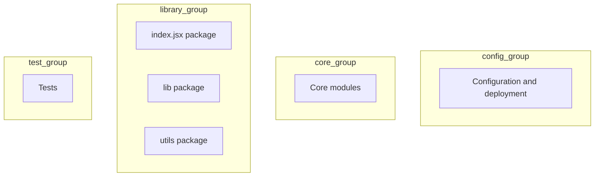

# Architecture report: twobin/react-lazyload

> Automated static analysis. **Observed** = directly seen in files/imports/AST; **Inferred** = interpretation from that evidence. Repository code was not executed.

## 1. Repository at a glance

| Item | Value |
| --- | --- |
| Repository | twobin/react-lazyload |
| Description | Lazy load your component, image or anything matters the performance. |
| Language | JavaScript |
| Stars | 5885 |
| Licence | MIT |
| Analysed commit / branch | 20abd7806416fe3fa4e92a8040526de96d1f2598 / master |
| Framework(s) | React |
| Files analysed | 43 |
| Components | 6 |

## 2. Architecture in one minute

twobin/react-lazyload - Lazy load your component, image or anything matters the performance.. This repository was analysed statically from 43 file(s) (0 Python). Detected technologies (observed from imports/manifests): React, React Router, webpack. Files are grouped into 6 component(s): Configuration and deployment, Core modules, index.jsx package, lib package, Tests, utils package. Findings below distinguish observed facts from inferred interpretation.

## 3. High-level block diagram

## 4. Main components

### Configuration and deployment (`config`)

- **Kind:** config
- **Status:** Observed
- **Confidence:** 0.85
- **Responsibility:** Groups 1 file(s) under configuration and deployment (observed from repository paths and static analysis).
- **Paths:** `package.json`
- **Evidence:** [package.json](https://github.com/twobin/react-lazyload/blob/20abd7806416fe3fa4e92a8040526de96d1f2598/package.json)

### Core modules (`core`)

- **Kind:** core
- **Status:** Observed
- **Confidence:** 0.85
- **Responsibility:** Groups 1 file(s) under core modules (observed from repository paths and static analysis).
- **Paths:** `webpack.config.js`
- **Evidence:** [webpack.config.js](https://github.com/twobin/react-lazyload/blob/20abd7806416fe3fa4e92a8040526de96d1f2598/webpack.config.js)

### index.jsx package (`index_jsx`)

- **Kind:** library
- **Status:** Observed
- **Confidence:** 0.85
- **Responsibility:** Groups 1 file(s) under index.jsx package (observed from repository paths and static analysis).
- **Paths:** `src/index.jsx`
- **Evidence:** [src/index.jsx](https://github.com/twobin/react-lazyload/blob/20abd7806416fe3fa4e92a8040526de96d1f2598/src/index.jsx)

### lib package (`lib`)

- **Kind:** library
- **Status:** Observed
- **Confidence:** 0.85
- **Responsibility:** Groups 6 file(s) under lib package (observed from repository paths and static analysis).
- **Paths:** `lib/decorator.js`, `lib/index.js`, `lib/utils/debounce.js`, `lib/utils/event.js`, `lib/utils/scrollParent.js`, `lib/utils/throttle.js`
- **Evidence:** [lib/decorator.js](https://github.com/twobin/react-lazyload/blob/20abd7806416fe3fa4e92a8040526de96d1f2598/lib/decorator.js); [lib/index.js](https://github.com/twobin/react-lazyload/blob/20abd7806416fe3fa4e92a8040526de96d1f2598/lib/index.js); [lib/utils/debounce.js](https://github.com/twobin/react-lazyload/blob/20abd7806416fe3fa4e92a8040526de96d1f2598/lib/utils/debounce.js); [lib/utils/event.js](https://github.com/twobin/react-lazyload/blob/20abd7806416fe3fa4e92a8040526de96d1f2598/lib/utils/event.js); [lib/utils/scrollParent.js](https://github.com/twobin/react-lazyload/blob/20abd7806416fe3fa4e92a8040526de96d1f2598/lib/utils/scrollParent.js); [lib/utils/throttle.js](https://github.com/twobin/react-lazyload/blob/20abd7806416fe3fa4e92a8040526de96d1f2598/lib/utils/throttle.js)

### Tests (`tests`)

- **Kind:** test
- **Status:** Observed
- **Confidence:** 0.85
- **Responsibility:** Groups 6 file(s) under tests (observed from repository paths and static analysis).
- **Paths:** `test/Test.component.js`, `test/karma.conf.js`, `test/specs/events.spec.js`, `test/specs/lazyload.debounce.spec.js`, `test/specs/lazyload.spec.js`, `test/specs/lazyload.throttle.spec.js`
- **Evidence:** [test/Test.component.js](https://github.com/twobin/react-lazyload/blob/20abd7806416fe3fa4e92a8040526de96d1f2598/test/Test.component.js); [test/karma.conf.js](https://github.com/twobin/react-lazyload/blob/20abd7806416fe3fa4e92a8040526de96d1f2598/test/karma.conf.js); [test/specs/events.spec.js](https://github.com/twobin/react-lazyload/blob/20abd7806416fe3fa4e92a8040526de96d1f2598/test/specs/events.spec.js); [test/specs/lazyload.debounce.spec.js](https://github.com/twobin/react-lazyload/blob/20abd7806416fe3fa4e92a8040526de96d1f2598/test/specs/lazyload.debounce.spec.js); [test/specs/lazyload.spec.js](https://github.com/twobin/react-lazyload/blob/20abd7806416fe3fa4e92a8040526de96d1f2598/test/specs/lazyload.spec.js); [test/specs/lazyload.throttle.spec.js](https://github.com/twobin/react-lazyload/blob/20abd7806416fe3fa4e92a8040526de96d1f2598/test/specs/lazyload.throttle.spec.js)

### utils package (`utils`)

- **Kind:** library
- **Status:** Observed
- **Confidence:** 0.85
- **Responsibility:** Groups 4 file(s) under utils package (observed from repository paths and static analysis).
- **Paths:** `src/utils/debounce.js`, `src/utils/event.js`, `src/utils/scrollParent.js`, `src/utils/throttle.js`
- **Evidence:** [src/utils/debounce.js](https://github.com/twobin/react-lazyload/blob/20abd7806416fe3fa4e92a8040526de96d1f2598/src/utils/debounce.js); [src/utils/event.js](https://github.com/twobin/react-lazyload/blob/20abd7806416fe3fa4e92a8040526de96d1f2598/src/utils/event.js); [src/utils/scrollParent.js](https://github.com/twobin/react-lazyload/blob/20abd7806416fe3fa4e92a8040526de96d1f2598/src/utils/scrollParent.js); [src/utils/throttle.js](https://github.com/twobin/react-lazyload/blob/20abd7806416fe3fa4e92a8040526de96d1f2598/src/utils/throttle.js)

## 5. Execution flow

**Observed** entry point(s):

- [lib/index.js](https://github.com/twobin/react-lazyload/blob/20abd7806416fe3fa4e92a8040526de96d1f2598/lib/index.js)
- [src/index.jsx](https://github.com/twobin/react-lazyload/blob/20abd7806416fe3fa4e92a8040526de96d1f2598/src/index.jsx)

Representative flow (derived from observed entry points and the import graph; steps beyond the entry point are **Inferred**):

1. Execution starts at an observed entry point listed above, if present.
2. No internal import relationships between components were observed.

## 6. Project structure

### `(root)`

- `.babelrc` - other (94 bytes)
- `.editorconfig` - config (62 bytes)
- `.eslintrc` - other (429 bytes)
- `.gitignore` - other (40 bytes)
- `.npmignore` - other (58 bytes)
- `.travis.yml` - ci, YAML (348 bytes)
- `LICENSE` - docs (1076 bytes)
- `README.md` - docs (9619 bytes)
- `package.json` - manifest (2087 bytes)
- `webpack.config.js` - source, JavaScript (919 bytes)

### `examples`

- `examples/app.js` - source, JavaScript (1788 bytes)
- `examples/components/Operation.js` - source, JavaScript (947 bytes)
- `examples/components/Placeholder.js` - source, JavaScript (366 bytes)
- `examples/components/Widget.js` - source, JavaScript (1422 bytes)
- `examples/index.html` - other (5808 bytes)
- `examples/js/vendors.js` - source, JavaScript (761 bytes)
- `examples/pages/debounce.js` - source, JavaScript (1198 bytes)
- `examples/pages/decorator.js` - source, JavaScript (1187 bytes)
- `examples/pages/fadein.js` - source, JavaScript (3843 bytes)
- `examples/pages/forcevisible.js` - source, JavaScript (276 bytes)
- `examples/pages/image.js` - source, JavaScript (1667 bytes)
- `examples/pages/normal.js` - source, JavaScript (1196 bytes)
- `examples/pages/overflow.js` - source, JavaScript (1277 bytes)
- `examples/pages/placeholder.js` - source, JavaScript (1346 bytes)
- `examples/pages/scroll.js` - source, JavaScript (1651 bytes)
- `examples/utils/index.js` - source, JavaScript (105 bytes)

### `lib`

- `lib/decorator.js` - source, JavaScript (2899 bytes)
- `lib/index.js` - source, JavaScript (16788 bytes)
- `lib/utils/debounce.js` - source, JavaScript (981 bytes)
- `lib/utils/event.js` - source, JavaScript (649 bytes)
- `lib/utils/scrollParent.js` - source, JavaScript (1055 bytes)
- `lib/utils/throttle.js` - source, JavaScript (632 bytes)

### `src`

- `src/index.jsx` - source, JavaScript (11516 bytes)
- `src/utils/debounce.js` - source, JavaScript (854 bytes)
- `src/utils/event.js` - source, JavaScript (542 bytes)
- `src/utils/scrollParent.js` - source, JavaScript (980 bytes)
- `src/utils/throttle.js` - source, JavaScript (544 bytes)

### `test`

- `test/Test.component.js` - test, JavaScript (522 bytes)
- `test/karma.conf.js` - test, JavaScript (3129 bytes)
- `test/specs/events.spec.js` - test, JavaScript (770 bytes)
- `test/specs/lazyload.debounce.spec.js` - test, JavaScript (1366 bytes)
- `test/specs/lazyload.spec.js` - test, JavaScript (11386 bytes)
- `test/specs/lazyload.throttle.spec.js` - test, JavaScript (1600 bytes)

## 7. Key dependencies and integrations

| Name | Category | Status | Confidence | Evidence |
| --- | --- | --- | --- | --- |
| React | framework | Observed | 0.90 | [package.json:2](https://github.com/twobin/react-lazyload/blob/20abd7806416fe3fa4e92a8040526de96d1f2598/package.json#L2); [package.json:54](https://github.com/twobin/react-lazyload/blob/20abd7806416fe3fa4e92a8040526de96d1f2598/package.json#L54) |
| React Router | library | Observed | 0.85 | [package.json:56](https://github.com/twobin/react-lazyload/blob/20abd7806416fe3fa4e92a8040526de96d1f2598/package.json#L56) |
| webpack | tooling | Observed | 0.85 | [package.json:8](https://github.com/twobin/react-lazyload/blob/20abd7806416fe3fa4e92a8040526de96d1f2598/package.json#L8) |

## 8. Data and state

No database, cache, queue, or persistent-state usage was observed in the analysed files. State handling, if any, may be in-memory or in files that were not analysed.

## 9. Configuration and deployment clues

- `.editorconfig` (config)
- `.travis.yml` (ci)
- `package.json` (manifest)

## 10. Design observations

- Tests are present alongside source code (Observed from test file paths).

These observations are interpretations (**Inferred**) of the observed structure, not guarantees about runtime design.

## 11. Limitations and unknowns

- Static analysis only: repository code was not executed, installed, or imported at runtime.
- Components and relationships are inferred from file paths, imports, and AST structure; runtime behaviour, dynamic imports, and reflection may not be visible.
- No clear application entry point was observed in the analysed files.
- Repository text was treated as untrusted data; no instructions found in repository files were followed, and likely secret values were redacted/excluded.
- JavaScript and TypeScript files were inventoried from paths and package manifests. They were not parsed with a full language AST, and repository code was not executed.

## 12. Source references

- [lib/decorator.js](https://github.com/twobin/react-lazyload/blob/20abd7806416fe3fa4e92a8040526de96d1f2598/lib/decorator.js)
- [lib/index.js](https://github.com/twobin/react-lazyload/blob/20abd7806416fe3fa4e92a8040526de96d1f2598/lib/index.js)
- [lib/utils/debounce.js](https://github.com/twobin/react-lazyload/blob/20abd7806416fe3fa4e92a8040526de96d1f2598/lib/utils/debounce.js)
- [lib/utils/event.js](https://github.com/twobin/react-lazyload/blob/20abd7806416fe3fa4e92a8040526de96d1f2598/lib/utils/event.js)
- [lib/utils/scrollParent.js](https://github.com/twobin/react-lazyload/blob/20abd7806416fe3fa4e92a8040526de96d1f2598/lib/utils/scrollParent.js)
- [lib/utils/throttle.js](https://github.com/twobin/react-lazyload/blob/20abd7806416fe3fa4e92a8040526de96d1f2598/lib/utils/throttle.js)
- [package.json](https://github.com/twobin/react-lazyload/blob/20abd7806416fe3fa4e92a8040526de96d1f2598/package.json)
- [package.json:2](https://github.com/twobin/react-lazyload/blob/20abd7806416fe3fa4e92a8040526de96d1f2598/package.json#L2)
- [package.json:8](https://github.com/twobin/react-lazyload/blob/20abd7806416fe3fa4e92a8040526de96d1f2598/package.json#L8)
- [package.json:54](https://github.com/twobin/react-lazyload/blob/20abd7806416fe3fa4e92a8040526de96d1f2598/package.json#L54)
- [package.json:56](https://github.com/twobin/react-lazyload/blob/20abd7806416fe3fa4e92a8040526de96d1f2598/package.json#L56)
- [src/index.jsx](https://github.com/twobin/react-lazyload/blob/20abd7806416fe3fa4e92a8040526de96d1f2598/src/index.jsx)
- [src/utils/debounce.js](https://github.com/twobin/react-lazyload/blob/20abd7806416fe3fa4e92a8040526de96d1f2598/src/utils/debounce.js)
- [src/utils/event.js](https://github.com/twobin/react-lazyload/blob/20abd7806416fe3fa4e92a8040526de96d1f2598/src/utils/event.js)
- [src/utils/scrollParent.js](https://github.com/twobin/react-lazyload/blob/20abd7806416fe3fa4e92a8040526de96d1f2598/src/utils/scrollParent.js)
- [src/utils/throttle.js](https://github.com/twobin/react-lazyload/blob/20abd7806416fe3fa4e92a8040526de96d1f2598/src/utils/throttle.js)
- [test/Test.component.js](https://github.com/twobin/react-lazyload/blob/20abd7806416fe3fa4e92a8040526de96d1f2598/test/Test.component.js)
- [test/karma.conf.js](https://github.com/twobin/react-lazyload/blob/20abd7806416fe3fa4e92a8040526de96d1f2598/test/karma.conf.js)
- [test/specs/events.spec.js](https://github.com/twobin/react-lazyload/blob/20abd7806416fe3fa4e92a8040526de96d1f2598/test/specs/events.spec.js)
- [test/specs/lazyload.debounce.spec.js](https://github.com/twobin/react-lazyload/blob/20abd7806416fe3fa4e92a8040526de96d1f2598/test/specs/lazyload.debounce.spec.js)
- [test/specs/lazyload.spec.js](https://github.com/twobin/react-lazyload/blob/20abd7806416fe3fa4e92a8040526de96d1f2598/test/specs/lazyload.spec.js)
- [test/specs/lazyload.throttle.spec.js](https://github.com/twobin/react-lazyload/blob/20abd7806416fe3fa4e92a8040526de96d1f2598/test/specs/lazyload.throttle.spec.js)
- [webpack.config.js](https://github.com/twobin/react-lazyload/blob/20abd7806416fe3fa4e92a8040526de96d1f2598/webpack.config.js)
