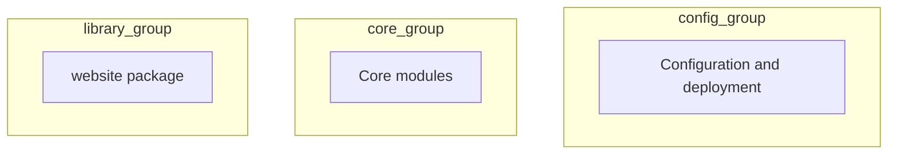

# Architecture report: typescript-cheatsheets/react

> Automated static analysis. **Observed** = directly seen in files/imports/AST; **Inferred** = interpretation from that evidence. Repository code was not executed.

## 1. Repository at a glance

| Item | Value |
| --- | --- |
| Repository | typescript-cheatsheets/react |
| Description | Cheatsheets for experienced React developers getting started with TypeScript |
| Language | TypeScript |
| Stars | 47090 |
| Licence | MIT |
| Analysed commit / branch | c550e41b98f7ec20d993eb3c2acc4cbf6eac2e29 / main |
| Framework(s) | React |
| Files analysed | 46 |
| Components | 3 |

## 2. Architecture in one minute

typescript-cheatsheets/react - Cheatsheets for experienced React developers getting started with TypeScript. This repository was analysed statically from 46 file(s) (0 Python). Detected technologies (observed from imports/manifests): GitHub Actions, React, TypeScript. Files are grouped into 3 component(s): Configuration and deployment, Core modules, website package. Findings below distinguish observed facts from inferred interpretation.

## 3. High-level block diagram

## 4. Main components

### Configuration and deployment (`config`)

- **Kind:** config
- **Status:** Observed
- **Confidence:** 0.85
- **Responsibility:** Groups 5 file(s) under configuration and deployment (observed from repository paths and static analysis).
- **Paths:** `netlify.toml`, `package.json`, `website/package.json`, `website/sidebars.json`, `website/tsconfig.json`
- **Evidence:** [netlify.toml](https://github.com/typescript-cheatsheets/react/blob/c550e41b98f7ec20d993eb3c2acc4cbf6eac2e29/netlify.toml); [package.json](https://github.com/typescript-cheatsheets/react/blob/c550e41b98f7ec20d993eb3c2acc4cbf6eac2e29/package.json); [website/package.json](https://github.com/typescript-cheatsheets/react/blob/c550e41b98f7ec20d993eb3c2acc4cbf6eac2e29/website/package.json); [website/sidebars.json](https://github.com/typescript-cheatsheets/react/blob/c550e41b98f7ec20d993eb3c2acc4cbf6eac2e29/website/sidebars.json); [website/tsconfig.json](https://github.com/typescript-cheatsheets/react/blob/c550e41b98f7ec20d993eb3c2acc4cbf6eac2e29/website/tsconfig.json)

### Core modules (`core`)

- **Kind:** core
- **Status:** Observed
- **Confidence:** 0.85
- **Responsibility:** Groups 2 file(s) under core modules (observed from repository paths and static analysis).
- **Paths:** `copyFile.js`, `genReadme.mjs`
- **Evidence:** [copyFile.js](https://github.com/typescript-cheatsheets/react/blob/c550e41b98f7ec20d993eb3c2acc4cbf6eac2e29/copyFile.js); [genReadme.mjs](https://github.com/typescript-cheatsheets/react/blob/c550e41b98f7ec20d993eb3c2acc4cbf6eac2e29/genReadme.mjs)

### website package (`website`)

- **Kind:** library
- **Status:** Observed
- **Confidence:** 0.85
- **Responsibility:** Groups 2 file(s) under website package (observed from repository paths and static analysis).
- **Paths:** `website/docusaurus.config.ts`, `website/src/pages/index.tsx`
- **Evidence:** [website/docusaurus.config.ts](https://github.com/typescript-cheatsheets/react/blob/c550e41b98f7ec20d993eb3c2acc4cbf6eac2e29/website/docusaurus.config.ts); [website/src/pages/index.tsx](https://github.com/typescript-cheatsheets/react/blob/c550e41b98f7ec20d993eb3c2acc4cbf6eac2e29/website/src/pages/index.tsx)

## 5. Execution flow

**Observed** entry point(s):

- [website/src/pages/index.tsx](https://github.com/typescript-cheatsheets/react/blob/c550e41b98f7ec20d993eb3c2acc4cbf6eac2e29/website/src/pages/index.tsx)

Representative flow (derived from observed entry points and the import graph; steps beyond the entry point are **Inferred**):

1. Execution starts at an observed entry point listed above, if present.
2. No internal import relationships between components were observed.

## 6. Project structure

### `(root)`

- `.all-contributorsrc` - other (6643 bytes)
- `.gitignore` - other (2115 bytes)
- `.nvmrc` - other (5 bytes)
- `CONTRIBUTING.md` - docs (2574 bytes)
- `CONTRIBUTORS.md` - docs (10776 bytes)
- `LICENSE` - docs (1067 bytes)
- `README.md` - docs (76594 bytes)
- `code-of-conduct.md` - docs (5934 bytes)
- `copyFile.js` - source, JavaScript (465 bytes)
- `genReadme.mjs` - source, JavaScript (7215 bytes)
- `netlify.toml` - config (655 bytes)
- `package.json` - manifest (1078 bytes)

### `.github`

- `.github/workflows/main.yml` - ci, YAML (631 bytes)

### `docs`

- `docs/basic/getting-started/basic-type-examples.md` - docs (7668 bytes)
- `docs/basic/getting-started/class-components.md` - docs (6736 bytes)
- `docs/basic/getting-started/concurrent.md` - docs (4594 bytes)
- `docs/basic/getting-started/context.md` - docs (3970 bytes)
- `docs/basic/getting-started/default-props.md` - docs (2311 bytes)
- `docs/basic/getting-started/error-boundaries.md` - docs (1243 bytes)
- `docs/basic/getting-started/forms-and-events.md` - docs (10015 bytes)
- `docs/basic/getting-started/forward-create-ref.md` - docs (6091 bytes)
- `docs/basic/getting-started/function-components.md` - docs (3187 bytes)
- `docs/basic/getting-started/hooks.md` - docs (15448 bytes)
- `docs/basic/getting-started/patterns_by_usecase.md` - docs (35382 bytes)
- `docs/basic/getting-started/portals.md` - docs (4444 bytes)
- `docs/basic/setup.md` - docs (2071 bytes)
- `docs/reference/CSSProperties.md` - docs (4168 bytes)
- `docs/reference/ComponentProps.md` - docs (3249 bytes)
- `docs/reference/ReactNode.md` - docs (3827 bytes)
- `docs/reference/Ref.md` - docs (4498 bytes)

### `website`

- `website/README.md` - docs (721 bytes)
- `website/docusaurus.config.ts` - source, TypeScript (5859 bytes)
- `website/package.json` - manifest (1059 bytes)
- `website/sidebars.json` - config (923 bytes)
- `website/src/css/custom.css` - other (2756 bytes)
- `website/src/pages/index.tsx` - source, TypeScript (3077 bytes)
- `website/static/img/undraw_code_review.svg` - other (17343 bytes)
- `website/static/img/undraw_monitor.svg` - other (32999 bytes)
- `website/static/img/undraw_note_list.svg` - other (15536 bytes)
- `website/static/img/undraw_online.svg` - other (26627 bytes)
- `website/static/img/undraw_open_source.svg` - other (16533 bytes)
- `website/static/img/undraw_operating_system.svg` - other (36675 bytes)
- `website/static/img/undraw_react.svg` - other (24273 bytes)
- `website/static/img/undraw_tweetstorm.svg` - other (9421 bytes)
- `website/static/img/undraw_youtube_tutorial.svg` - other (29040 bytes)
- `website/tsconfig.json` - config (139 bytes)

## 7. Key dependencies and integrations

| Name | Category | Status | Confidence | Evidence |
| --- | --- | --- | --- | --- |
| GitHub Actions | ci | Observed | 0.85 | [.github/workflows/main.yml](https://github.com/typescript-cheatsheets/react/blob/c550e41b98f7ec20d993eb3c2acc4cbf6eac2e29/.github/workflows/main.yml) |
| React | framework | Observed | 0.90 | [website/package.json:18](https://github.com/typescript-cheatsheets/react/blob/c550e41b98f7ec20d993eb3c2acc4cbf6eac2e29/website/package.json#L18); [website/package.json:20](https://github.com/typescript-cheatsheets/react/blob/c550e41b98f7ec20d993eb3c2acc4cbf6eac2e29/website/package.json#L20) |
| TypeScript | tooling | Observed | 0.85 | [website/package.json:27](https://github.com/typescript-cheatsheets/react/blob/c550e41b98f7ec20d993eb3c2acc4cbf6eac2e29/website/package.json#L27) |

## 8. Data and state

No database, cache, queue, or persistent-state usage was observed in the analysed files. State handling, if any, may be in-memory or in files that were not analysed.

## 9. Configuration and deployment clues

- `.github/workflows/main.yml` (ci)
- `netlify.toml` (config)
- `package.json` (manifest)
- `website/package.json` (manifest)
- `website/sidebars.json` (config)
- `website/tsconfig.json` (config)

## 10. Design observations

- No strong design patterns could be established from the available evidence.

These observations are interpretations (**Inferred**) of the observed structure, not guarantees about runtime design.

## 11. Limitations and unknowns

- Static analysis only: repository code was not executed, installed, or imported at runtime.
- Components and relationships are inferred from file paths, imports, and AST structure; runtime behaviour, dynamic imports, and reflection may not be visible.
- 1 file(s) were skipped during inventory (1 x lockfile excluded).
- No clear application entry point was observed in the analysed files.
- Repository text was treated as untrusted data; no instructions found in repository files were followed, and likely secret values were redacted/excluded.
- JavaScript and TypeScript files were inventoried from paths and package manifests. They were not parsed with a full language AST, and repository code was not executed.

## 12. Source references

- [.github/workflows/main.yml](https://github.com/typescript-cheatsheets/react/blob/c550e41b98f7ec20d993eb3c2acc4cbf6eac2e29/.github/workflows/main.yml)
- [copyFile.js](https://github.com/typescript-cheatsheets/react/blob/c550e41b98f7ec20d993eb3c2acc4cbf6eac2e29/copyFile.js)
- [genReadme.mjs](https://github.com/typescript-cheatsheets/react/blob/c550e41b98f7ec20d993eb3c2acc4cbf6eac2e29/genReadme.mjs)
- [netlify.toml](https://github.com/typescript-cheatsheets/react/blob/c550e41b98f7ec20d993eb3c2acc4cbf6eac2e29/netlify.toml)
- [package.json](https://github.com/typescript-cheatsheets/react/blob/c550e41b98f7ec20d993eb3c2acc4cbf6eac2e29/package.json)
- [website/docusaurus.config.ts](https://github.com/typescript-cheatsheets/react/blob/c550e41b98f7ec20d993eb3c2acc4cbf6eac2e29/website/docusaurus.config.ts)
- [website/package.json](https://github.com/typescript-cheatsheets/react/blob/c550e41b98f7ec20d993eb3c2acc4cbf6eac2e29/website/package.json)
- [website/package.json:18](https://github.com/typescript-cheatsheets/react/blob/c550e41b98f7ec20d993eb3c2acc4cbf6eac2e29/website/package.json#L18)
- [website/package.json:20](https://github.com/typescript-cheatsheets/react/blob/c550e41b98f7ec20d993eb3c2acc4cbf6eac2e29/website/package.json#L20)
- [website/package.json:27](https://github.com/typescript-cheatsheets/react/blob/c550e41b98f7ec20d993eb3c2acc4cbf6eac2e29/website/package.json#L27)
- [website/sidebars.json](https://github.com/typescript-cheatsheets/react/blob/c550e41b98f7ec20d993eb3c2acc4cbf6eac2e29/website/sidebars.json)
- [website/src/pages/index.tsx](https://github.com/typescript-cheatsheets/react/blob/c550e41b98f7ec20d993eb3c2acc4cbf6eac2e29/website/src/pages/index.tsx)
- [website/tsconfig.json](https://github.com/typescript-cheatsheets/react/blob/c550e41b98f7ec20d993eb3c2acc4cbf6eac2e29/website/tsconfig.json)
